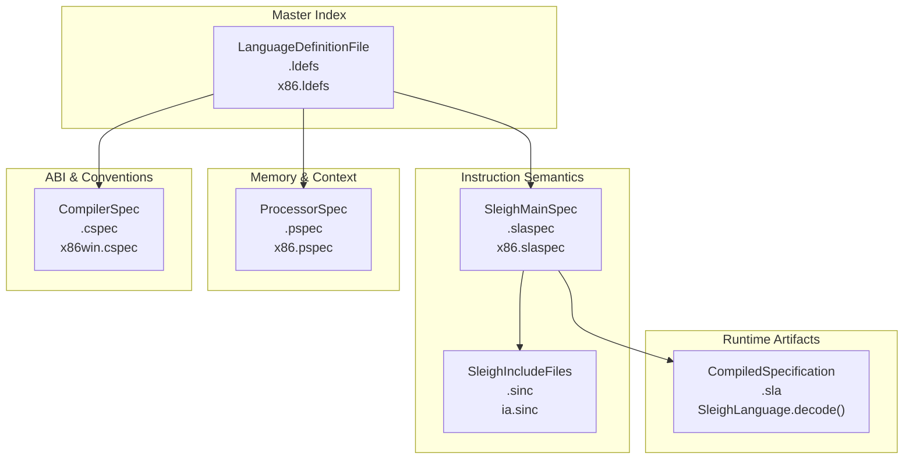
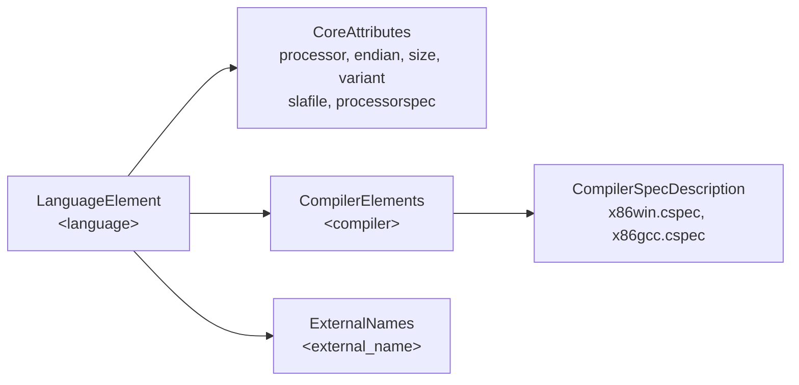
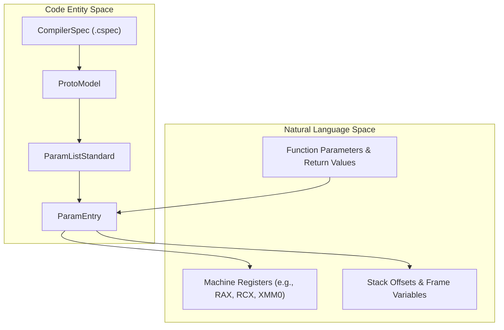
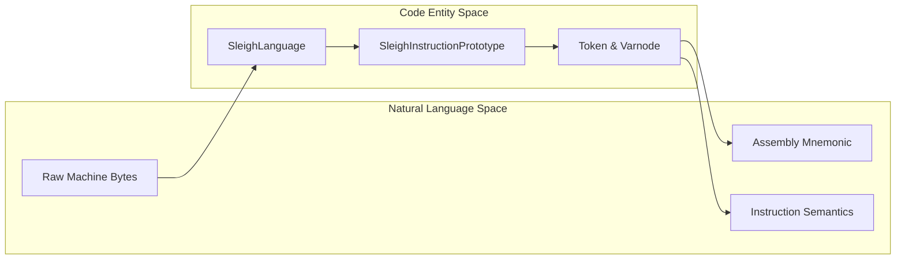
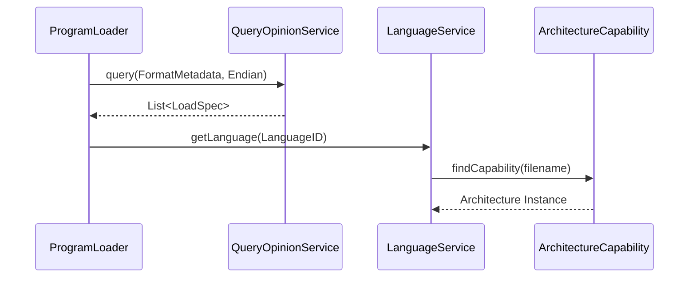

<!-- source: DeepWiki mcp.deepwiki.com · repo NationalSecurityAgency/ghidra · page 3.4 Language Definition and Compiler Specs · fetched 2026-11-09 -->

# Language Definition and Compiler Specs

Relevant source files

The following files were used as context for generating this wiki page:

- [Ghidra/Features/Base/data/x64_linux_syscall_numbers](Ghidra/Features/Base/data/x64_linux_syscall_numbers)
- [Ghidra/Features/Base/data/x86_linux_syscall_numbers](Ghidra/Features/Base/data/x86_linux_syscall_numbers)
- [Ghidra/Features/Base/src/main/help/help/topics/CodeBrowserPlugin/ListingBackground.html](Ghidra/Features/Base/src/main/help/help/topics/CodeBrowserPlugin/ListingBackground.html)
- [Ghidra/Features/Base/src/main/help/help/topics/ComputeChecksumsPlugin/Generate_Checksum_Help.html](Ghidra/Features/Base/src/main/help/help/topics/ComputeChecksumsPlugin/Generate_Checksum_Help.html)
- [Ghidra/Features/Base/src/main/help/help/topics/ShowInstructionInfoPlugin/ShowInstructionInfo.htm](Ghidra/Features/Base/src/main/help/help/topics/ShowInstructionInfoPlugin/ShowInstructionInfo.htm)
- [Ghidra/Features/Base/src/main/help/help/topics/ShowInstructionInfoPlugin/images/ShowInstructionInfo.png](Ghidra/Features/Base/src/main/help/help/topics/ShowInstructionInfoPlugin/images/ShowInstructionInfo.png)
- [Ghidra/Features/Base/src/main/java/ghidra/app/plugin/core/processors/InstructionInfoProvider.java](Ghidra/Features/Base/src/main/java/ghidra/app/plugin/core/processors/InstructionInfoProvider.java)
- [Ghidra/Features/Base/src/main/java/ghidra/app/plugin/core/processors/ShowInstructionInfoPlugin.java](Ghidra/Features/Base/src/main/java/ghidra/app/plugin/core/processors/ShowInstructionInfoPlugin.java)
- [Ghidra/Features/Base/src/main/java/ghidra/app/util/datatype/microsoft/ThreadEnvironmentBlock.java](Ghidra/Features/Base/src/main/java/ghidra/app/util/datatype/microsoft/ThreadEnvironmentBlock.java)
- [Ghidra/Features/Base/src/main/java/ghidra/util/BrowserLoader.java](Ghidra/Features/Base/src/main/java/ghidra/util/BrowserLoader.java)
- [Ghidra/Features/Base/src/main/java/ghidra/util/ManualViewerCommandEditor.java](Ghidra/Features/Base/src/main/java/ghidra/util/ManualViewerCommandEditor.java)
- [Ghidra/Features/Base/src/main/java/ghidra/util/ManualViewerCommandWrappedOption.java](Ghidra/Features/Base/src/main/java/ghidra/util/ManualViewerCommandWrappedOption.java)
- [Ghidra/Features/Base/src/test.slow/java/ghidra/app/plugin/core/processors/ShowInstructionInfoPluginTest.java](Ghidra/Features/Base/src/test.slow/java/ghidra/app/plugin/core/processors/ShowInstructionInfoPluginTest.java)
- [Ghidra/Features/Decompiler/ghidra_scripts/GraphASTAndFlowScript.java](Ghidra/Features/Decompiler/ghidra_scripts/GraphASTAndFlowScript.java)
- [Ghidra/Features/Decompiler/ghidra_scripts/GraphASTScript.java](Ghidra/Features/Decompiler/ghidra_scripts/GraphASTScript.java)
- [Ghidra/Features/Decompiler/ghidra_scripts/GraphSelectedASTScript.java](Ghidra/Features/Decompiler/ghidra_scripts/GraphSelectedASTScript.java)
- [Ghidra/Features/Decompiler/src/decompile/cpp/Doxyfile](Ghidra/Features/Decompiler/src/decompile/cpp/Doxyfile)
- [Ghidra/Features/Decompiler/src/decompile/cpp/marshal.cc](Ghidra/Features/Decompiler/src/decompile/cpp/marshal.cc)
- [Ghidra/Features/Decompiler/src/decompile/cpp/marshal.hh](Ghidra/Features/Decompiler/src/decompile/cpp/marshal.hh)
- [Ghidra/Features/Decompiler/src/decompile/cpp/modelrules.cc](Ghidra/Features/Decompiler/src/decompile/cpp/modelrules.cc)
- [Ghidra/Features/Decompiler/src/decompile/cpp/modelrules.hh](Ghidra/Features/Decompiler/src/decompile/cpp/modelrules.hh)
- [Ghidra/Features/Decompiler/src/decompile/cpp/prefersplit.cc](Ghidra/Features/Decompiler/src/decompile/cpp/prefersplit.cc)
- [Ghidra/Features/Decompiler/src/decompile/cpp/prefersplit.hh](Ghidra/Features/Decompiler/src/decompile/cpp/prefersplit.hh)
- [Ghidra/Features/Decompiler/src/decompile/cpp/xml.cc](Ghidra/Features/Decompiler/src/decompile/cpp/xml.cc)
- [Ghidra/Features/Decompiler/src/decompile/cpp/xml.hh](Ghidra/Features/Decompiler/src/decompile/cpp/xml.hh)
- [Ghidra/Features/Decompiler/src/decompile/cpp/xml.y](Ghidra/Features/Decompiler/src/decompile/cpp/xml.y)
- [Ghidra/Features/Decompiler/src/main/java/ghidra/app/plugin/core/decompile/actions/PCodeCfgAction.java](Ghidra/Features/Decompiler/src/main/java/ghidra/app/plugin/core/decompile/actions/PCodeCfgAction.java)
- [Ghidra/Features/Decompiler/src/main/java/ghidra/app/plugin/core/decompile/actions/PCodeCfgDisplayListener.java](Ghidra/Features/Decompiler/src/main/java/ghidra/app/plugin/core/decompile/actions/PCodeCfgDisplayListener.java)
- [Ghidra/Features/Decompiler/src/main/java/ghidra/app/plugin/core/decompile/actions/PCodeCfgGraphType.java](Ghidra/Features/Decompiler/src/main/java/ghidra/app/plugin/core/decompile/actions/PCodeCfgGraphType.java)
- [Ghidra/Features/MicrosoftCodeAnalyzer/src/main/java/ghidra/app/plugin/prototype/MicrosoftCodeAnalyzerPlugin/TEBAnalyzer.java](Ghidra/Features/MicrosoftCodeAnalyzer/src/main/java/ghidra/app/plugin/prototype/MicrosoftCodeAnalyzerPlugin/TEBAnalyzer.java)
- [Ghidra/Framework/Docking/src/main/help/help/topics/Trees/GhidraTreeFilter.html](Ghidra/Framework/Docking/src/main/help/help/topics/Trees/GhidraTreeFilter.html)
- [Ghidra/Framework/Docking/src/main/java/docking/menu/DockingToolBarUtils.java](Ghidra/Framework/Docking/src/main/java/docking/menu/DockingToolBarUtils.java)
- [Ghidra/Framework/SoftwareModeling/data/languages/compiler_spec.rxg](Ghidra/Framework/SoftwareModeling/data/languages/compiler_spec.rxg)
- [Ghidra/Framework/SoftwareModeling/data/languages/processor_spec.rxg](Ghidra/Framework/SoftwareModeling/data/languages/processor_spec.rxg)
- [Ghidra/Framework/SoftwareModeling/src/main/java/ghidra/app/plugin/processors/sleigh/SleighLanguage.java](Ghidra/Framework/SoftwareModeling/src/main/java/ghidra/app/plugin/processors/sleigh/SleighLanguage.java)
- [Ghidra/Framework/SoftwareModeling/src/main/java/ghidra/program/model/lang/AddressLabelInfo.java](Ghidra/Framework/SoftwareModeling/src/main/java/ghidra/program/model/lang/AddressLabelInfo.java)
- [Ghidra/Framework/SoftwareModeling/src/main/java/ghidra/program/model/lang/Language.java](Ghidra/Framework/SoftwareModeling/src/main/java/ghidra/program/model/lang/Language.java)
- [Ghidra/Framework/SoftwareModeling/src/main/java/ghidra/program/model/lang/ParamEntry.java](Ghidra/Framework/SoftwareModeling/src/main/java/ghidra/program/model/lang/ParamEntry.java)
- [Ghidra/Framework/SoftwareModeling/src/main/java/ghidra/program/model/lang/ParamListStandard.java](Ghidra/Framework/SoftwareModeling/src/main/java/ghidra/program/model/lang/ParamListStandard.java)
- [Ghidra/Framework/SoftwareModeling/src/main/java/ghidra/program/model/lang/ParamListStandardOut.java](Ghidra/Framework/SoftwareModeling/src/main/java/ghidra/program/model/lang/ParamListStandardOut.java)
- [Ghidra/Framework/SoftwareModeling/src/main/java/ghidra/program/model/lang/protorules/AssignAction.java](Ghidra/Framework/SoftwareModeling/src/main/java/ghidra/program/model/lang/protorules/AssignAction.java)
- [Ghidra/Framework/SoftwareModeling/src/main/java/ghidra/program/model/lang/protorules/DatatypeFilter.java](Ghidra/Framework/SoftwareModeling/src/main/java/ghidra/program/model/lang/protorules/DatatypeFilter.java)
- [Ghidra/Framework/SoftwareModeling/src/main/java/ghidra/program/model/lang/protorules/HomogeneousAggregate.java](Ghidra/Framework/SoftwareModeling/src/main/java/ghidra/program/model/lang/protorules/HomogeneousAggregate.java)
- [Ghidra/Framework/SoftwareModeling/src/main/java/ghidra/program/model/lang/protorules/MultiMemberAssign.java](Ghidra/Framework/SoftwareModeling/src/main/java/ghidra/program/model/lang/protorules/MultiMemberAssign.java)
- [Ghidra/Framework/SoftwareModeling/src/main/java/ghidra/program/model/lang/protorules/MultiSlotAssign.java](Ghidra/Framework/SoftwareModeling/src/main/java/ghidra/program/model/lang/protorules/MultiSlotAssign.java)
- [Ghidra/Framework/SoftwareModeling/src/main/java/ghidra/program/model/lang/protorules/MultiSlotDualAssign.java](Ghidra/Framework/SoftwareModeling/src/main/java/ghidra/program/model/lang/protorules/MultiSlotDualAssign.java)
- [Ghidra/Framework/SoftwareModeling/src/main/java/ghidra/program/model/pcode/AttributeId.java](Ghidra/Framework/SoftwareModeling/src/main/java/ghidra/program/model/pcode/AttributeId.java)
- [Ghidra/Framework/SoftwareModeling/src/main/java/ghidra/program/model/pcode/ElementId.java](Ghidra/Framework/SoftwareModeling/src/main/java/ghidra/program/model/pcode/ElementId.java)
- [Ghidra/Framework/SoftwareModeling/src/main/java/ghidra/program/util/OldLanguage.java](Ghidra/Framework/SoftwareModeling/src/main/java/ghidra/program/util/OldLanguage.java)
- [Ghidra/Processors/JVM/data/languages/JVM.ldefs](Ghidra/Processors/JVM/data/languages/JVM.ldefs)
- [Ghidra/Processors/JVM/data/languages/JVM.slaspec](Ghidra/Processors/JVM/data/languages/JVM.slaspec)
- [Ghidra/Processors/JVM/src/main/java/ghidra/javaclass/analyzers/JvmSwitchAnalyzer.java](Ghidra/Processors/JVM/src/main/java/ghidra/javaclass/analyzers/JvmSwitchAnalyzer.java)
- [Ghidra/Processors/x86/data/languages/x86-64-gcc.cspec](Ghidra/Processors/x86/data/languages/x86-64-gcc.cspec)
- [Ghidra/Processors/x86/data/languages/x86-64-win.cspec](Ghidra/Processors/x86/data/languages/x86-64-win.cspec)
- [Ghidra/Processors/x86/data/languages/x86gcc.cspec](Ghidra/Processors/x86/data/languages/x86gcc.cspec)
- [Ghidra/Processors/x86/data/languages/x86win.cspec](Ghidra/Processors/x86/data/languages/x86win.cspec)
- [Ghidra/Processors/x86/data/patterns/x86-64gcc_patterns.xml](Ghidra/Processors/x86/data/patterns/x86-64gcc_patterns.xml)
- [Ghidra/Processors/x86/data/patterns/x86-64win_patterns.xml](Ghidra/Processors/x86/data/patterns/x86-64win_patterns.xml)
- [Ghidra/Processors/x86/data/patterns/x86gcc_patterns.xml](Ghidra/Processors/x86/data/patterns/x86gcc_patterns.xml)
- [Ghidra/Processors/x86/data/patterns/x86win_patterns.xml](Ghidra/Processors/x86/data/patterns/x86win_patterns.xml)
- [Ghidra/Test/IntegrationTest/src/screen/java/help/screenshot/ShowInstructionInfoPluginScreenShots.java](Ghidra/Test/IntegrationTest/src/screen/java/help/screenshot/ShowInstructionInfoPluginScreenShots.java)
- [GhidraDocs/GhidraClass/Advanced/improvingDisassemblyAndDecompilation.pdf](GhidraDocs/GhidraClass/Advanced/improvingDisassemblyAndDecompilation.pdf)
- [GhidraDocs/GhidraClass/ExerciseFiles/Advanced/write](GhidraDocs/GhidraClass/ExerciseFiles/Advanced/write)

## Purpose and Scope

The Language Definition System is Ghidra's modular framework for defining processor architectures, instruction set semantics, and compiler-specific conventions. This system allows Ghidra to support dozens of processor families through declarative specification files rather than hardcoded analysis logic.

This page covers the `.ldefs` (language definition), `.slaspec`/`.sinc` (Sleigh specifications), `.pspec` (processor specifications), and `.cspec` (compiler specifications) files, as well as the opinion service for automatic selection.

Sources:
- [Ghidra/Processors/x86/data/languages/x86.ldefs:1-120]()
- [Ghidra/Framework/SoftwareModeling/src/main/java/ghidra/app/plugin/processors/sleigh/SleighLanguage.java:1-100]()

## System Architecture

The Language Definition System consists of four specification layers that collectively define a processor architecture. The decompiler's C++ core and Java modeling layers interact with these through classes such as `SleighLanguage`, `Architecture`, and `BasicCompilerSpec`.

Title: Language Specification Hierarchy

Sources:
- [Ghidra/Processors/x86/data/languages/x86.ldefs:1-120]()
- [Ghidra/Processors/x86/data/languages/x86.slaspec:1-10]()
- [Ghidra/Processors/x86/data/languages/ia.sinc:1-50]()
- [Ghidra/Framework/SoftwareModeling/src/main/java/ghidra/app/plugin/processors/sleigh/SleighLanguage.java:100-140]()

## Language Definition Files (.ldefs)

The `.ldefs` file serves as the master registry for all processor variants supported by a language module. Each `<language>` element maps a unique language ID to its specification files.

### Language ID Format
Language IDs follow the pattern: `processor:endian:size:variant`

Examples from `x86.ldefs`:
- `x86:LE:32:default` - Intel/AMD 32-bit x86 [Ghidra/Processors/x86/data/languages/x86.ldefs:4-12]()
- `x86:LE:16:Real Mode` - Intel/AMD 16-bit x86 Real Mode [Ghidra/Processors/x86/data/languages/x86.ldefs:49-57]()
- `x86:LE:64:default` - Intel/AMD 64-bit x86 [Ghidra/Processors/x86/data/languages/x86.ldefs:84-92]()

### Structure of a Language Entry
A language entry defines core properties and associates compiler specifications. It also includes external names for interoperability with other tools like GNU, IDA-PRO, or QEMU [Ghidra/Processors/x86/data/languages/x86.ldefs:20-34]().

Title: Language Entry Components

Sources:
- [Ghidra/Processors/x86/data/languages/x86.ldefs:1-120]()
- [Ghidra/Processors/ARM/data/languages/ARM.ldefs:1-166]()

## Processor Specifications (.pspec)

The `.pspec` file defines processor-specific configurations that are not strictly part of the instruction semantics but are required for correct analysis. In the C++ decompiler core, these are marshaled into the `Architecture` class via `ElementId` and `AttributeId` constants [Ghidra/Features/Decompiler/src/decompile/cpp/architecture.cc:38-80]().

Key configurations include:
*   **Default Context**: Register values like `longMode` or `TMode`.
*   **Memory Properties**: Volatile ranges and address shift amounts [Ghidra/Features/Decompiler/src/decompile/cpp/architecture.hh:79-82]().
*   **Symbols**: Entry points and predefined register aliases.

Sources:
- [Ghidra/Features/Decompiler/src/decompile/cpp/architecture.cc:38-80]()
- [Ghidra/Features/Decompiler/src/decompile/cpp/architecture.hh:66-108]()

## Compiler Specifications (.cspec)

Compiler specifications define the Application Binary Interface (ABI). This is critical for the Decompiler to recover function signatures and parameters. The `DecompileOptions` class manages how these specs are interpreted during analysis.

### Calling Convention Modeling
The `.cspec` file defines `prototype` models [Ghidra/Processors/x86/data/languages/x86-64-win.cspec:44-134](). These models specify:
*   **Input/Output**: Parameter storage in registers or stack via `ParamListStandard` and `ParamEntry` [Ghidra/Framework/SoftwareModeling/src/main/java/ghidra/program/model/lang/ParamListStandard.java:40-118]() [Ghidra/Framework/SoftwareModeling/src/main/java/ghidra/program/model/lang/ParamEntry.java:47-90]().
*   **KilledByCall**: Registers volatile across calls [Ghidra/Processors/x86/data/languages/x86-64-win.cspec:125-128]().
*   **StackPointer**: The register used as the stack base [Ghidra/Processors/x86/data/languages/x86-64-win.cspec:40-40]().

Title: Calling Convention Parameter Mapping (Natural Language to Code Entity Space)

Sources:
- [Ghidra/Processors/x86/data/languages/x86-64-win.cspec:35-134]()
- [Ghidra/Framework/SoftwareModeling/src/main/java/ghidra/program/model/lang/ParamListStandard.java:40-157]()
- [Ghidra/Framework/SoftwareModeling/src/main/java/ghidra/program/model/lang/ParamEntry.java:47-122]()

## Instruction Semantics (Sleigh)

Sleigh files (`.slaspec` and `.sinc`) define the machine code patterns and their corresponding P-code operations. 

*   **Tokens**: Define bit-fields.
*   **Variables**: Attach register names to fields.
*   **Macros**: Encapsulate P-code semantics.
*   **Constructors**: Map bit patterns to P-code [Ghidra/Framework/SoftwareModeling/src/main/java/ghidra/app/plugin/processors/sleigh/SleighLanguage.java:60-110]().

Title: Instruction Decoding Pipeline (Natural Language to Code Entity Space)

Sources:
- [Ghidra/Framework/SoftwareModeling/src/main/java/ghidra/app/plugin/processors/sleigh/SleighLanguage.java:58-105]()
- [Ghidra/Processors/ARM/data/languages/ARMTHUMBinstructions.sinc:11-206]()
- [Ghidra/Processors/x86/data/languages/avx.sinc:6-58]()

## Opinion Service and Automatic Selection

The Opinion Service maps file format metadata (like ELF machine types or PE machine IDs) to Language IDs. This allows Ghidra to automatically select the correct processor and compiler spec during the loading process.

The `ArchitectureCapability` class in the C++ core provides the mechanism to find a matching architecture based on a file or XML document [Ghidra/Features/Decompiler/src/decompile/cpp/architecture.cc:89-115]().

Title: Opinion Service Data Flow

Sources:
- [Ghidra/Features/Decompiler/src/decompile/cpp/architecture.cc:89-130]()
- [Ghidra/Processors/x86/data/languages/x86.ldefs:14-19]()
- [Ghidra/Processors/ARM/data/languages/ARM.ldefs:14-16]()

---

