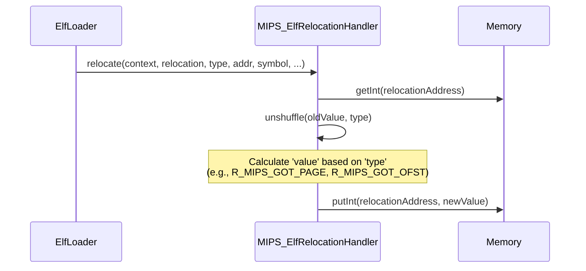

<!-- source: DeepWiki mcp.deepwiki.com · repo NationalSecurityAgency/ghidra · page 3.5 Additional Processor Families · fetched 2026-11-09 -->

# Additional Processor Families

Relevant source files

The following files were used as context for generating this wiki page:

- [GPL/DMG/src/dmg/java/mobiledevices/dmg/ghidra/GBinaryReader.java](GPL/DMG/src/dmg/java/mobiledevices/dmg/ghidra/GBinaryReader.java)
- [Ghidra/Features/Base/src/main/help/help/topics/DisassemblerPlugin/Disassembly.htm](Ghidra/Features/Base/src/main/help/help/topics/DisassemblerPlugin/Disassembly.htm)
- [Ghidra/Features/Base/src/main/java/ghidra/app/plugin/core/disassembler/ContextAction.java](Ghidra/Features/Base/src/main/java/ghidra/app/plugin/core/disassembler/ContextAction.java)
- [Ghidra/Features/Base/src/main/java/ghidra/app/plugin/core/disassembler/DisassembleAction.java](Ghidra/Features/Base/src/main/java/ghidra/app/plugin/core/disassembler/DisassembleAction.java)
- [Ghidra/Features/Base/src/main/java/ghidra/app/plugin/core/disassembler/RestrictedDisassembleAction.java](Ghidra/Features/Base/src/main/java/ghidra/app/plugin/core/disassembler/RestrictedDisassembleAction.java)
- [Ghidra/Features/Base/src/main/java/ghidra/app/plugin/core/disassembler/StaticDisassembleAction.java](Ghidra/Features/Base/src/main/java/ghidra/app/plugin/core/disassembler/StaticDisassembleAction.java)
- [Ghidra/Features/Base/src/main/java/ghidra/app/util/bin/format/elf/ElfConstants.java](Ghidra/Features/Base/src/main/java/ghidra/app/util/bin/format/elf/ElfConstants.java)
- [Ghidra/Features/Base/src/main/java/ghidra/app/util/bin/format/elf/relocation/ElfRelocationHandler.java](Ghidra/Features/Base/src/main/java/ghidra/app/util/bin/format/elf/relocation/ElfRelocationHandler.java)
- [Ghidra/Framework/Emulation/src/main/java/ghidra/pcode/emulate/EmulateInstructionStateModifier.java](Ghidra/Framework/Emulation/src/main/java/ghidra/pcode/emulate/EmulateInstructionStateModifier.java)
- [Ghidra/Framework/Emulation/src/main/java/ghidra/pcode/emulate/callother/OpBehaviorOther.java](Ghidra/Framework/Emulation/src/main/java/ghidra/pcode/emulate/callother/OpBehaviorOther.java)
- [Ghidra/Framework/SoftwareModeling/src/test/java/ghidra/app/plugin/assembler/sleigh/PowerPCVLEAssemblyTest.java](Ghidra/Framework/SoftwareModeling/src/test/java/ghidra/app/plugin/assembler/sleigh/PowerPCVLEAssemblyTest.java)
- [Ghidra/Framework/SoftwareModeling/src/test/java/ghidra/app/plugin/assembler/sleigh/SparcAssemblyTest.java](Ghidra/Framework/SoftwareModeling/src/test/java/ghidra/app/plugin/assembler/sleigh/SparcAssemblyTest.java)
- [Ghidra/Processors/68000/certification.manifest](Ghidra/Processors/68000/certification.manifest)
- [Ghidra/Processors/68000/data/languages/68000.cspec](Ghidra/Processors/68000/data/languages/68000.cspec)
- [Ghidra/Processors/68000/data/languages/68000.ldefs](Ghidra/Processors/68000/data/languages/68000.ldefs)
- [Ghidra/Processors/68000/data/languages/68000.pspec](Ghidra/Processors/68000/data/languages/68000.pspec)
- [Ghidra/Processors/68000/data/languages/68000.sinc](Ghidra/Processors/68000/data/languages/68000.sinc)
- [Ghidra/Processors/68000/data/languages/68000_register.cspec](Ghidra/Processors/68000/data/languages/68000_register.cspec)
- [Ghidra/Processors/68000/data/languages/68030.slaspec](Ghidra/Processors/68000/data/languages/68030.slaspec)
- [Ghidra/Processors/68000/data/languages/68040.slaspec](Ghidra/Processors/68000/data/languages/68040.slaspec)
- [Ghidra/Processors/68000/data/languages/CPU32.slaspec](Ghidra/Processors/68000/data/languages/CPU32.slaspec)
- [Ghidra/Processors/68000/data/languages/coldfire.slaspec](Ghidra/Processors/68000/data/languages/coldfire.slaspec)
- [Ghidra/Processors/68000/data/patterns/68000_patterns.xml](Ghidra/Processors/68000/data/patterns/68000_patterns.xml)
- [Ghidra/Processors/68000/data/patterns/patternconstraints.xml](Ghidra/Processors/68000/data/patterns/patternconstraints.xml)
- [Ghidra/Processors/68000/src/main/java/ghidra/program/emulation/m68kEmulateInstructionStateModifier.java](Ghidra/Processors/68000/src/main/java/ghidra/program/emulation/m68kEmulateInstructionStateModifier.java)
- [Ghidra/Processors/68000/src/test.processors/java/ghidra/test/processors/CPU32_O0_EmulatorTest.java](Ghidra/Processors/68000/src/test.processors/java/ghidra/test/processors/CPU32_O0_EmulatorTest.java)
- [Ghidra/Processors/68000/src/test.processors/java/ghidra/test/processors/CPU32_O3_EmulatorTest.java](Ghidra/Processors/68000/src/test.processors/java/ghidra/test/processors/CPU32_O3_EmulatorTest.java)
- [Ghidra/Processors/8048/data/languages/8048.slaspec](Ghidra/Processors/8048/data/languages/8048.slaspec)
- [Ghidra/Processors/8051/certification.manifest](Ghidra/Processors/8051/certification.manifest)
- [Ghidra/Processors/8051/data/languages/80251.pspec](Ghidra/Processors/8051/data/languages/80251.pspec)
- [Ghidra/Processors/8051/data/languages/80251.sinc](Ghidra/Processors/8051/data/languages/80251.sinc)
- [Ghidra/Processors/8051/data/languages/8051.ldefs](Ghidra/Processors/8051/data/languages/8051.ldefs)
- [Ghidra/Processors/8051/data/languages/8051.pspec](Ghidra/Processors/8051/data/languages/8051.pspec)
- [Ghidra/Processors/8051/data/languages/8051_main.sinc](Ghidra/Processors/8051/data/languages/8051_main.sinc)
- [Ghidra/Processors/8051/data/languages/cip-51.pspec](Ghidra/Processors/8051/data/languages/cip-51.pspec)
- [Ghidra/Processors/8051/data/languages/cip-51.slaspec](Ghidra/Processors/8051/data/languages/cip-51.slaspec)
- [Ghidra/Processors/8051/data/languages/keil-cx51.cspec](Ghidra/Processors/8051/data/languages/keil-cx51.cspec)
- [Ghidra/Processors/8051/data/languages/mx51.pspec](Ghidra/Processors/8051/data/languages/mx51.pspec)
- [Ghidra/Processors/8051/data/languages/mx51.sinc](Ghidra/Processors/8051/data/languages/mx51.sinc)
- [Ghidra/Processors/8085/data/languages/8085.slaspec](Ghidra/Processors/8085/data/languages/8085.slaspec)
- [Ghidra/Processors/AARCH64/src/main/java/ghidra/app/util/bin/format/elf/relocation/AARCH64_ElfRelocationHandler.java](Ghidra/Processors/AARCH64/src/main/java/ghidra/app/util/bin/format/elf/relocation/AARCH64_ElfRelocationHandler.java)
- [Ghidra/Processors/AARCH64/src/main/java/ghidra/program/emulation/AARCH64EmulateInstructionStateModifier.java](Ghidra/Processors/AARCH64/src/main/java/ghidra/program/emulation/AARCH64EmulateInstructionStateModifier.java)
- [Ghidra/Processors/ARM/src/main/java/ghidra/app/util/bin/format/elf/relocation/ARM_ElfRelocationHandler.java](Ghidra/Processors/ARM/src/main/java/ghidra/app/util/bin/format/elf/relocation/ARM_ElfRelocationHandler.java)
- [Ghidra/Processors/ARM/src/main/java/ghidra/app/util/bin/format/elf/relocation/ElfArmRelocationFixupHandler.java](Ghidra/Processors/ARM/src/main/java/ghidra/app/util/bin/format/elf/relocation/ElfArmRelocationFixupHandler.java)
- [Ghidra/Processors/Atmel/data/languages/avr32a_bit_operations.sinc](Ghidra/Processors/Atmel/data/languages/avr32a_bit_operations.sinc)
- [Ghidra/Processors/Hexagon/Module.manifest](Ghidra/Processors/Hexagon/Module.manifest)
- [Ghidra/Processors/Hexagon/build.gradle](Ghidra/Processors/Hexagon/build.gradle)
- [Ghidra/Processors/Hexagon/certification.manifest](Ghidra/Processors/Hexagon/certification.manifest)
- [Ghidra/Processors/Hexagon/data/languages/Hexagon.opinion](Ghidra/Processors/Hexagon/data/languages/Hexagon.opinion)
- [Ghidra/Processors/Hexagon/data/languages/hexagon.cspec](Ghidra/Processors/Hexagon/data/languages/hexagon.cspec)
- [Ghidra/Processors/Hexagon/data/languages/hexagon.dwarf](Ghidra/Processors/Hexagon/data/languages/hexagon.dwarf)
- [Ghidra/Processors/Hexagon/data/languages/hexagon.ldefs](Ghidra/Processors/Hexagon/data/languages/hexagon.ldefs)
- [Ghidra/Processors/Hexagon/data/languages/hexagon.pspec](Ghidra/Processors/Hexagon/data/languages/hexagon.pspec)
- [Ghidra/Processors/Hexagon/data/languages/hexagon.sinc](Ghidra/Processors/Hexagon/data/languages/hexagon.sinc)
- [Ghidra/Processors/Hexagon/data/languages/hexagon.slaspec](Ghidra/Processors/Hexagon/data/languages/hexagon.slaspec)
- [Ghidra/Processors/Hexagon/data/languages/hexagon_float.sinc](Ghidra/Processors/Hexagon/data/languages/hexagon_float.sinc)
- [Ghidra/Processors/Hexagon/data/languages/hexagon_hvx.sinc](Ghidra/Processors/Hexagon/data/languages/hexagon_hvx.sinc)
- [Ghidra/Processors/Hexagon/data/languages/hexagon_hvx2.sinc](Ghidra/Processors/Hexagon/data/languages/hexagon_hvx2.sinc)
- [Ghidra/Processors/Hexagon/data/languages/hexagon_left.sinc](Ghidra/Processors/Hexagon/data/languages/hexagon_left.sinc)
- [Ghidra/Processors/Hexagon/data/languages/hexagon_right.sinc](Ghidra/Processors/Hexagon/data/languages/hexagon_right.sinc)
- [Ghidra/Processors/Hexagon/src/main/java/ghidra/app/util/bin/format/elf/relocation/Hexagon_ElfRelocationHandler.java](Ghidra/Processors/Hexagon/src/main/java/ghidra/app/util/bin/format/elf/relocation/Hexagon_ElfRelocationHandler.java)
- [Ghidra/Processors/Hexagon/src/test.processors/java/ghidra/test/processors/cspec/Hexagon_CSpecTest.java](Ghidra/Processors/Hexagon/src/test.processors/java/ghidra/test/processors/cspec/Hexagon_CSpecTest.java)
- [Ghidra/Processors/MC6800/data/languages/6805.slaspec](Ghidra/Processors/MC6800/data/languages/6805.slaspec)
- [Ghidra/Processors/MCS96/Module.manifest](Ghidra/Processors/MCS96/Module.manifest)
- [Ghidra/Processors/MCS96/data/languages/MCS96.cspec](Ghidra/Processors/MCS96/data/languages/MCS96.cspec)
- [Ghidra/Processors/MCS96/data/languages/MCS96.pspec](Ghidra/Processors/MCS96/data/languages/MCS96.pspec)
- [Ghidra/Processors/MCS96/data/languages/MCS96.sinc](Ghidra/Processors/MCS96/data/languages/MCS96.sinc)
- [Ghidra/Processors/MCS96/data/languages/MCS96.slaspec](Ghidra/Processors/MCS96/data/languages/MCS96.slaspec)
- [Ghidra/Processors/MCS96/data/manuals/MCS96.idx](Ghidra/Processors/MCS96/data/manuals/MCS96.idx)
- [Ghidra/Processors/MIPS/certification.manifest](Ghidra/Processors/MIPS/certification.manifest)
- [Ghidra/Processors/MIPS/data/languages/mips.ldefs](Ghidra/Processors/MIPS/data/languages/mips.ldefs)
- [Ghidra/Processors/MIPS/data/languages/mips.sinc](Ghidra/Processors/MIPS/data/languages/mips.sinc)
- [Ghidra/Processors/MIPS/data/languages/mips16.sinc](Ghidra/Processors/MIPS/data/languages/mips16.sinc)
- [Ghidra/Processors/MIPS/data/languages/mips32Instructions.sinc](Ghidra/Processors/MIPS/data/languages/mips32Instructions.sinc)
- [Ghidra/Processors/MIPS/data/languages/mips32R6be.slaspec](Ghidra/Processors/MIPS/data/languages/mips32R6be.slaspec)
- [Ghidra/Processors/MIPS/data/languages/mips32R6le.slaspec](Ghidra/Processors/MIPS/data/languages/mips32R6le.slaspec)
- [Ghidra/Processors/MIPS/data/languages/mips32_16e.pspec](Ghidra/Processors/MIPS/data/languages/mips32_16e.pspec)
- [Ghidra/Processors/MIPS/data/languages/mips32be.slaspec](Ghidra/Processors/MIPS/data/languages/mips32be.slaspec)
- [Ghidra/Processors/MIPS/data/languages/mips32le.slaspec](Ghidra/Processors/MIPS/data/languages/mips32le.slaspec)
- [Ghidra/Processors/MIPS/data/languages/mips64_16e.pspec](Ghidra/Processors/MIPS/data/languages/mips64_16e.pspec)
- [Ghidra/Processors/MIPS/data/languages/mips64be.slaspec](Ghidra/Processors/MIPS/data/languages/mips64be.slaspec)
- [Ghidra/Processors/MIPS/data/languages/mips64le.slaspec](Ghidra/Processors/MIPS/data/languages/mips64le.slaspec)
- [Ghidra/Processors/MIPS/data/languages/mips_dsp.sinc](Ghidra/Processors/MIPS/data/languages/mips_dsp.sinc)
- [Ghidra/Processors/MIPS/data/languages/mipsmicro.sinc](Ghidra/Processors/MIPS/data/languages/mipsmicro.sinc)
- [Ghidra/Processors/MIPS/src/main/java/ghidra/app/util/bin/format/elf/relocation/MIPS_ElfRelocationHandler.java](Ghidra/Processors/MIPS/src/main/java/ghidra/app/util/bin/format/elf/relocation/MIPS_ElfRelocationHandler.java)
- [Ghidra/Processors/MIPS/src/main/java/ghidra/program/emulation/MIPSEmulateInstructionStateModifier.java](Ghidra/Processors/MIPS/src/main/java/ghidra/program/emulation/MIPSEmulateInstructionStateModifier.java)
- [Ghidra/Processors/PIC/certification.manifest](Ghidra/Processors/PIC/certification.manifest)
- [Ghidra/Processors/PIC/data/languages/PIC24.ldefs](Ghidra/Processors/PIC/data/languages/PIC24.ldefs)
- [Ghidra/Processors/PIC/data/languages/PIC24.sinc](Ghidra/Processors/PIC/data/languages/PIC24.sinc)
- [Ghidra/Processors/PIC/data/languages/dsPIC33C.slaspec](Ghidra/Processors/PIC/data/languages/dsPIC33C.slaspec)
- [Ghidra/Processors/PIC/data/languages/pic18.slaspec](Ghidra/Processors/PIC/data/languages/pic18.slaspec)
- [Ghidra/Processors/PIC/data/manuals/PIC24.idx](Ghidra/Processors/PIC/data/manuals/PIC24.idx)
- [Ghidra/Processors/PowerPC/build.gradle](Ghidra/Processors/PowerPC/build.gradle)
- [Ghidra/Processors/PowerPC/data/languages/4xx.sinc](Ghidra/Processors/PowerPC/data/languages/4xx.sinc)
- [Ghidra/Processors/PowerPC/data/languages/SPE_APU.sinc](Ghidra/Processors/PowerPC/data/languages/SPE_APU.sinc)
- [Ghidra/Processors/PowerPC/data/languages/SPE_EFV.sinc](Ghidra/Processors/PowerPC/data/languages/SPE_EFV.sinc)
- [Ghidra/Processors/PowerPC/data/languages/altivec.sinc](Ghidra/Processors/PowerPC/data/languages/altivec.sinc)
- [Ghidra/Processors/PowerPC/data/languages/evx.sinc](Ghidra/Processors/PowerPC/data/languages/evx.sinc)
- [Ghidra/Processors/PowerPC/data/languages/mulhwInstructions.sinc](Ghidra/Processors/PowerPC/data/languages/mulhwInstructions.sinc)
- [Ghidra/Processors/PowerPC/data/languages/ppc_32.pspec](Ghidra/Processors/PowerPC/data/languages/ppc_32.pspec)
- [Ghidra/Processors/PowerPC/data/languages/ppc_32_e500_be.slaspec](Ghidra/Processors/PowerPC/data/languages/ppc_32_e500_be.slaspec)
- [Ghidra/Processors/PowerPC/data/languages/ppc_32_e500_le.slaspec](Ghidra/Processors/PowerPC/data/languages/ppc_32_e500_le.slaspec)
- [Ghidra/Processors/PowerPC/data/languages/ppc_32_e500mc_be.slaspec](Ghidra/Processors/PowerPC/data/languages/ppc_32_e500mc_be.slaspec)
- [Ghidra/Processors/PowerPC/data/languages/ppc_32_e500mc_le.slaspec](Ghidra/Processors/PowerPC/data/languages/ppc_32_e500mc_le.slaspec)
- [Ghidra/Processors/PowerPC/data/languages/ppc_32_mpc8270.pspec](Ghidra/Processors/PowerPC/data/languages/ppc_32_mpc8270.pspec)
- [Ghidra/Processors/PowerPC/data/languages/ppc_64.pspec](Ghidra/Processors/PowerPC/data/languages/ppc_64.pspec)
- [Ghidra/Processors/PowerPC/data/languages/ppc_a2.sinc](Ghidra/Processors/PowerPC/data/languages/ppc_a2.sinc)
- [Ghidra/Processors/PowerPC/data/languages/ppc_common.sinc](Ghidra/Processors/PowerPC/data/languages/ppc_common.sinc)
- [Ghidra/Processors/PowerPC/data/languages/ppc_embedded.sinc](Ghidra/Processors/PowerPC/data/languages/ppc_embedded.sinc)
- [Ghidra/Processors/PowerPC/data/languages/ppc_instructions.sinc](Ghidra/Processors/PowerPC/data/languages/ppc_instructions.sinc)
- [Ghidra/Processors/PowerPC/data/languages/ppc_isa.sinc](Ghidra/Processors/PowerPC/data/languages/ppc_isa.sinc)
- [Ghidra/Processors/PowerPC/data/languages/ppc_vle.sinc](Ghidra/Processors/PowerPC/data/languages/ppc_vle.sinc)
- [Ghidra/Processors/PowerPC/data/languages/quicciii.sinc](Ghidra/Processors/PowerPC/data/languages/quicciii.sinc)
- [Ghidra/Processors/PowerPC/src/main/java/ghidra/app/util/bin/format/elf/extend/PowerPC_ElfExtension.java](Ghidra/Processors/PowerPC/src/main/java/ghidra/app/util/bin/format/elf/extend/PowerPC_ElfExtension.java)
- [Ghidra/Processors/PowerPC/src/main/java/ghidra/app/util/bin/format/elf/relocation/PowerPC64_ElfRelocationHandler.java](Ghidra/Processors/PowerPC/src/main/java/ghidra/app/util/bin/format/elf/relocation/PowerPC64_ElfRelocationHandler.java)
- [Ghidra/Processors/PowerPC/src/main/java/ghidra/app/util/bin/format/elf/relocation/PowerPC_ElfRelocationHandler.java](Ghidra/Processors/PowerPC/src/main/java/ghidra/app/util/bin/format/elf/relocation/PowerPC_ElfRelocationHandler.java)
- [Ghidra/Processors/PowerPC/src/main/java/ghidra/program/emulation/PPCEmulateInstructionStateModifier.java](Ghidra/Processors/PowerPC/src/main/java/ghidra/program/emulation/PPCEmulateInstructionStateModifier.java)
- [Ghidra/Processors/PowerPC/src/test/java/ghidra/program/emulation/PpcPcodeUseropLibraryTest.java](Ghidra/Processors/PowerPC/src/test/java/ghidra/program/emulation/PpcPcodeUseropLibraryTest.java)
- [Ghidra/Processors/RISCV/src/main/java/ghidra/app/util/bin/format/elf/relocation/RISCV_ElfRelocationHandler.java](Ghidra/Processors/RISCV/src/main/java/ghidra/app/util/bin/format/elf/relocation/RISCV_ElfRelocationHandler.java)
- [Ghidra/Processors/Sparc/certification.manifest](Ghidra/Processors/Sparc/certification.manifest)
- [Ghidra/Processors/Sparc/data/languages/SparcV9.ldefs](Ghidra/Processors/Sparc/data/languages/SparcV9.ldefs)
- [Ghidra/Processors/Sparc/data/languages/SparcV9.sinc](Ghidra/Processors/Sparc/data/languages/SparcV9.sinc)
- [Ghidra/Processors/Sparc/data/languages/SparcV9_32.cspec](Ghidra/Processors/Sparc/data/languages/SparcV9_32.cspec)
- [Ghidra/Processors/Sparc/data/languages/SparcV9_64.cspec](Ghidra/Processors/Sparc/data/languages/SparcV9_64.cspec)
- [Ghidra/Processors/Sparc/data/patterns/SPARC_patterns.xml](Ghidra/Processors/Sparc/data/patterns/SPARC_patterns.xml)
- [Ghidra/Processors/Sparc/src/main/java/ghidra/app/plugin/core/analysis/SparcEarlyAddressAnalyzer.java](Ghidra/Processors/Sparc/src/main/java/ghidra/app/plugin/core/analysis/SparcEarlyAddressAnalyzer.java)
- [Ghidra/Processors/Sparc/src/main/java/ghidra/app/util/bin/format/elf/relocation/SPARC64_ElfRelocationHandler.java](Ghidra/Processors/Sparc/src/main/java/ghidra/app/util/bin/format/elf/relocation/SPARC64_ElfRelocationHandler.java)
- [Ghidra/Processors/Sparc/src/main/java/ghidra/app/util/bin/format/elf/relocation/SPARC_ElfRelocationHandler.java](Ghidra/Processors/Sparc/src/main/java/ghidra/app/util/bin/format/elf/relocation/SPARC_ElfRelocationHandler.java)
- [Ghidra/Processors/SuperH/Module.manifest](Ghidra/Processors/SuperH/Module.manifest)
- [Ghidra/Processors/SuperH/build.gradle](Ghidra/Processors/SuperH/build.gradle)
- [Ghidra/Processors/SuperH/certification.manifest](Ghidra/Processors/SuperH/certification.manifest)
- [Ghidra/Processors/SuperH/data/languages/sh-1.slaspec](Ghidra/Processors/SuperH/data/languages/sh-1.slaspec)
- [Ghidra/Processors/SuperH/data/languages/sh-2.slaspec](Ghidra/Processors/SuperH/data/languages/sh-2.slaspec)
- [Ghidra/Processors/SuperH/data/languages/sh-2a.slaspec](Ghidra/Processors/SuperH/data/languages/sh-2a.slaspec)
- [Ghidra/Processors/SuperH/data/languages/superh.cspec](Ghidra/Processors/SuperH/data/languages/superh.cspec)
- [Ghidra/Processors/SuperH/data/languages/superh.ldefs](Ghidra/Processors/SuperH/data/languages/superh.ldefs)
- [Ghidra/Processors/SuperH/data/languages/superh.pspec](Ghidra/Processors/SuperH/data/languages/superh.pspec)
- [Ghidra/Processors/SuperH/data/languages/superh.sinc](Ghidra/Processors/SuperH/data/languages/superh.sinc)
- [Ghidra/Processors/SuperH/data/languages/superh2a.cspec](Ghidra/Processors/SuperH/data/languages/superh2a.cspec)
- [Ghidra/Processors/SuperH/data/manuals/superh.idx](Ghidra/Processors/SuperH/data/manuals/superh.idx)
- [Ghidra/Processors/SuperH4/src/main/java/ghidra/app/util/bin/format/elf/relocation/ElfSH4RelocationFixupHandler.java](Ghidra/Processors/SuperH4/src/main/java/ghidra/app/util/bin/format/elf/relocation/ElfSH4RelocationFixupHandler.java)
- [Ghidra/Processors/SuperH4/src/main/java/ghidra/app/util/bin/format/elf/relocation/SH_ElfRelocationHandler.java](Ghidra/Processors/SuperH4/src/main/java/ghidra/app/util/bin/format/elf/relocation/SH_ElfRelocationHandler.java)
- [Ghidra/Processors/TI_MSP430/build.gradle](Ghidra/Processors/TI_MSP430/build.gradle)
- [Ghidra/Processors/TI_MSP430/data/languages/TI430Common.sinc](Ghidra/Processors/TI_MSP430/data/languages/TI430Common.sinc)
- [Ghidra/Processors/TI_MSP430/data/languages/TI430X.sinc](Ghidra/Processors/TI_MSP430/data/languages/TI430X.sinc)
- [Ghidra/Processors/TI_MSP430/data/languages/TI_MSP430.ldefs](Ghidra/Processors/TI_MSP430/data/languages/TI_MSP430.ldefs)
- [Ghidra/Processors/TI_MSP430/data/languages/ti_msp430.opinion](Ghidra/Processors/TI_MSP430/data/languages/ti_msp430.opinion)
- [Ghidra/Processors/TI_MSP430/src/main/java/ghidra/app/util/bin/format/elf/relocation/MSP430X_ElfRelocationHandler.java](Ghidra/Processors/TI_MSP430/src/main/java/ghidra/app/util/bin/format/elf/relocation/MSP430X_ElfRelocationHandler.java)
- [Ghidra/Processors/TI_MSP430/src/main/java/ghidra/app/util/bin/format/elf/relocation/MSP430_ElfRelocationHandler.java](Ghidra/Processors/TI_MSP430/src/main/java/ghidra/app/util/bin/format/elf/relocation/MSP430_ElfRelocationHandler.java)
- [Ghidra/Processors/TI_MSP430/src/test.processors/java/ghidra/test/processors/MSP430X_O0_EmulatorTest.java](Ghidra/Processors/TI_MSP430/src/test.processors/java/ghidra/test/processors/MSP430X_O0_EmulatorTest.java)
- [Ghidra/Processors/Xtensa/src/main/java/ghidra/program/emulation/XtensaEmulateInstructionStateModifier.java](Ghidra/Processors/Xtensa/src/main/java/ghidra/program/emulation/XtensaEmulateInstructionStateModifier.java)
- [Ghidra/Processors/Z80/data/languages/z80.slaspec](Ghidra/Processors/Z80/data/languages/z80.slaspec)
- [Ghidra/Processors/tricore/Module.manifest](Ghidra/Processors/tricore/Module.manifest)
- [Ghidra/Processors/tricore/build.gradle](Ghidra/Processors/tricore/build.gradle)
- [Ghidra/Processors/tricore/certification.manifest](Ghidra/Processors/tricore/certification.manifest)
- [Ghidra/Processors/tricore/data/languages/tc172x.pspec](Ghidra/Processors/tricore/data/languages/tc172x.pspec)
- [Ghidra/Processors/tricore/data/languages/tc176x.pspec](Ghidra/Processors/tricore/data/languages/tc176x.pspec)
- [Ghidra/Processors/tricore/data/languages/tc29x.pspec](Ghidra/Processors/tricore/data/languages/tc29x.pspec)
- [Ghidra/Processors/tricore/data/languages/tricore.cspec](Ghidra/Processors/tricore/data/languages/tricore.cspec)
- [Ghidra/Processors/tricore/data/languages/tricore.dwarf](Ghidra/Processors/tricore/data/languages/tricore.dwarf)
- [Ghidra/Processors/tricore/data/languages/tricore.ldefs](Ghidra/Processors/tricore/data/languages/tricore.ldefs)
- [Ghidra/Processors/tricore/data/languages/tricore.opinion](Ghidra/Processors/tricore/data/languages/tricore.opinion)
- [Ghidra/Processors/tricore/data/languages/tricore.pcp.sinc](Ghidra/Processors/tricore/data/languages/tricore.pcp.sinc)
- [Ghidra/Processors/tricore/data/languages/tricore.pspec](Ghidra/Processors/tricore/data/languages/tricore.pspec)
- [Ghidra/Processors/tricore/data/languages/tricore.sinc](Ghidra/Processors/tricore/data/languages/tricore.sinc)
- [Ghidra/Processors/tricore/data/patterns/patternconstraints.xml](Ghidra/Processors/tricore/data/patterns/patternconstraints.xml)
- [Ghidra/Processors/tricore/data/patterns/tricore_patterns.xml](Ghidra/Processors/tricore/data/patterns/tricore_patterns.xml)
- [Ghidra/Processors/tricore/src/main/java/ghidra/app/util/bin/format/elf/relocation/Tricore_ElfRelocationHandler.java](Ghidra/Processors/tricore/src/main/java/ghidra/app/util/bin/format/elf/relocation/Tricore_ElfRelocationHandler.java)
- [Ghidra/Processors/tricore/src/main/java/ghidra/app/util/bin/format/elf/relocation/Tricore_ElfRelocationType.java](Ghidra/Processors/tricore/src/main/java/ghidra/app/util/bin/format/elf/relocation/Tricore_ElfRelocationType.java)
- [Ghidra/Processors/tricore/src/main/java/ghidra/program/emulation/TRICOREEmulateInstructionStateModifier.java](Ghidra/Processors/tricore/src/main/java/ghidra/program/emulation/TRICOREEmulateInstructionStateModifier.java)
- [Ghidra/Processors/tricore/src/test/java/ghidra/program/emulation/TricorePcodeUseropLibraryTest.java](Ghidra/Processors/tricore/src/test/java/ghidra/program/emulation/TricorePcodeUseropLibraryTest.java)
- [Ghidra/Processors/x86/src/main/java/ghidra/app/util/bin/format/elf/relocation/Elfx86_32bitRelocationFixupHandler.java](Ghidra/Processors/x86/src/main/java/ghidra/app/util/bin/format/elf/relocation/Elfx86_32bitRelocationFixupHandler.java)
- [Ghidra/Processors/x86/src/main/java/ghidra/app/util/bin/format/elf/relocation/Elfx86_64bitRelocationFixupHandler.java](Ghidra/Processors/x86/src/main/java/ghidra/app/util/bin/format/elf/relocation/Elfx86_64bitRelocationFixupHandler.java)
- [Ghidra/Processors/x86/src/main/java/ghidra/app/util/bin/format/elf/relocation/X86_32_ElfRelocationHandler.java](Ghidra/Processors/x86/src/main/java/ghidra/app/util/bin/format/elf/relocation/X86_32_ElfRelocationHandler.java)
- [Ghidra/Processors/x86/src/main/java/ghidra/app/util/bin/format/elf/relocation/X86_64_ElfRelocationHandler.java](Ghidra/Processors/x86/src/main/java/ghidra/app/util/bin/format/elf/relocation/X86_64_ElfRelocationHandler.java)

Ghidra provides extensive support for a diverse array of processor architectures beyond x86 and ARM. This support is implemented through the **Sleigh** specification language for instruction semantics and specialized **ELF Relocation Handlers** for binary loading. Each processor family is defined by a combination of `.slaspec` (or `.sinc` includes), `.ldefs` (language definitions), `.pspec` (processor specifications), and `.cspec` (compiler specifications).

## Processor Architecture Implementation Map

The following diagram bridges the natural language names of supported processor families to their primary Sleigh implementation files and relocation handlers.

### Architecture to Code Entity Mapping

```mermaid
graph TD
    subgraph "Processor Families"
        MIPS["MIPS (mips16/microMIPS)"]
        PPC["PowerPC (VLE)"]
        M68K["Motorola 68000"]
        SH["SuperH"]
        SPARC["SPARC V9"]
        TRICORE["TriCore"]
        HEX["Hexagon"]
        EMBEDDED["Embedded (8051/Z80/PIC)"]
    end

    subgraph "Sleigh Definitions (.sinc/.slaspec)"
        MIPS_S["mips16.sinc"]
        PPC_S["ppc_vle.sinc"]
        M68K_S["68000.sinc"]
        SH_S["superh.sinc"]
        SPARC_S["SparcV9.sinc"]
        TRICORE_S["tricore.sinc"]
        HEX_S["hexagon.sinc"]
        PIC_S["PIC24.sinc"]
    end

    subgraph "Relocation Handlers (Java)"
        MIPS_R["MIPS_ElfRelocationHandler"]
        PPC_R["PowerPC_ElfRelocationHandler"]
        SH_R["SH_ElfRelocationHandler"]
        TRI_R["Tricore_ElfRelocationHandler"]
    end

    MIPS --> MIPS_S
    MIPS --> MIPS_R
    PPC --> PPC_S
    PPC --> PPC_R
    M68K --> M68K_S
    SH --> SH_S
    SH --> SH_R
    SPARC --> SPARC_S
    TRICORE --> TRICORE_S
    TRICORE --> TRI_R
    HEX --> HEX_S
    EMBEDDED --> PIC_S
```

Sources: [Ghidra/Processors/MIPS/data/languages/mips16.sinc:13-73](), [Ghidra/Processors/PowerPC/data/languages/ppc_vle.sinc:1-158](), [Ghidra/Processors/68000/data/languages/68000.sinc:1-130](), [Ghidra/Processors/Sparc/data/languages/SparcV9.sinc:1-206](), [Ghidra/Processors/tricore/data/languages/tricore.sinc:1-222](), [Ghidra/Processors/Hexagon/data/languages/hexagon.sinc:1-250](), [Ghidra/Processors/MIPS/src/main/java/ghidra/app/util/bin/format/elf/relocation/MIPS_ElfRelocationHandler.java:31-63]().

---

## MIPS Architecture Variants

Ghidra supports standard MIPS32/64 along with compressed instruction sets like **mips16** and **microMIPS**.

### mips16 and microMIPS
The `mips16.sinc` file defines 16-bit tokens such as `m16_op`, `m16_rx`, and `m16_ry` [Ghidra/Processors/MIPS/data/languages/mips16.sinc:13-29](). It uses `attach variables` to map these bitfields to registers like `s0`, `v0`, and `a0` [Ghidra/Processors/MIPS/data/languages/mips16.sinc:75-76](). Instruction semantics for standard MIPS32, such as `add` and `beq`, are defined in `mips32Instructions.sinc`, utilizing `delayslot` markers for branching [Ghidra/Processors/MIPS/data/languages/mips32Instructions.sinc:17-61](). The architecture supports complex instruction decoding based on `ISA_MODE` [Ghidra/Processors/MIPS/data/languages/mips32Instructions.sinc:10-14]().

### MIPS ELF Relocation Handling
The `MIPS_ElfRelocationHandler` manages complex relocation types including `R_MIPS_GOT_PAGE` and `R_MIPS_GOT_OFST` [Ghidra/Processors/MIPS/src/main/java/ghidra/app/util/bin/format/elf/relocation/MIPS_ElfRelocationHandler.java:146-160](). It specifically handles the Global Pointer (`GP`) relative addressing by calculating offsets via `getGpOffset` [Ghidra/Processors/MIPS/src/main/java/ghidra/app/util/bin/format/elf/relocation/MIPS_ElfRelocationHandler.java:177-185](). It also handles MicroMIPS specific relocations like `R_MICROMIPS_GOT_PAGE` [Ghidra/Processors/MIPS/src/main/java/ghidra/app/util/bin/format/elf/relocation/MIPS_ElfRelocationHandler.java:107-110]().

Sources: [Ghidra/Processors/MIPS/data/languages/mips16.sinc:13-83](), [Ghidra/Processors/MIPS/data/languages/mips32Instructions.sinc:1-204](), [Ghidra/Processors/MIPS/src/main/java/ghidra/app/util/bin/format/elf/relocation/MIPS_ElfRelocationHandler.java:31-193]().

---

## PowerPC and VLE Extensions

PowerPC support includes the **Variable Length Encoding (VLE)**, commonly found in automotive microcontrollers, alongside standard ISA definitions.

### VLE Instruction Semantics
VLE instructions are defined in `ppc_vle.sinc`. It handles both 16-bit and 32-bit instructions within the same stream. Conditional branches like `e_b` and `se_b` are mapped to P-code `goto` or `call` operations based on condition register bits recovered via `getCrBit` [Ghidra/Processors/PowerPC/data/languages/ppc_vle.sinc:2-9](). VLE also introduces specific memory addressing modes like `d8PlusRaAddress` and `sd4PlusRxAddr` [Ghidra/Processors/PowerPC/data/languages/ppc_vle.sinc:27-32]().

### ISA and Embedded Support
Standard PowerPC ISA instructions (e.g., `dcbz`, `dcbf`) are defined in `ppc_isa.sinc` using `define pcodeop` for cache management and power-saving modes [Ghidra/Processors/PowerPC/data/languages/ppc_isa.sinc:21-102](). Common register sets (`r0-r31`) and Special Purpose Registers (`XER`, `LR`, `CTR`) are shared via `ppc_common.sinc` [Ghidra/Processors/PowerPC/data/languages/ppc_common.sinc:1-77](). E500 variants define specific 4-byte general purpose sub-registers [Ghidra/Processors/PowerPC/data/languages/ppc_common.sinc:1-38]().

Sources: [Ghidra/Processors/PowerPC/data/languages/ppc_vle.sinc:2-158](), [Ghidra/Processors/PowerPC/data/languages/ppc_isa.sinc:1-109](), [Ghidra/Processors/PowerPC/data/languages/ppc_common.sinc:1-77]().

---

## Motorola 68000 and Variants

The Motorola family definition covers the base 68000 through Coldfire and CPU32 variants.

*   **Registers:** Defines Data registers (`D0-D7`), Address registers (`A0-SP`), and floating point registers (`FP0-FP7`) which are 80 bits internally but 96 bits in memory [Ghidra/Processors/68000/data/languages/68000.sinc:9-46]().
*   **Condition Flags:** Maps specific bits to `TF`, `SVF`, `IPL`, `XF`, `NF`, `ZF`, `VF`, and `CF` [Ghidra/Processors/68000/data/languages/68000.sinc:15]().
*   **Instruction Tokens:** Uses a 16-bit `instr` token to define fields like `mode`, `regdn`, and `op`, as well as `extword` for 32-bit extensions [Ghidra/Processors/68000/data/languages/68000.sinc:72-187]().
*   **Coldfire Support:** Adds specific MAC and EMAC registers such as `MACSR`, `MASK`, and `ACC0-ACC3` [Ghidra/Processors/68000/data/languages/68000.sinc:30-34]().

Sources: [Ghidra/Processors/68000/data/languages/68000.sinc:1-187]().

---

## SuperH Architecture

The SuperH specification covers SH1 through SH4 variants, including FPU support.

*   **Registers:** Defines standard registers `r0-r15` and system registers like `sr`, `gbr`, `mach`, `macl`, `pr`, and `pc` [Ghidra/Processors/SuperH/data/languages/superh.sinc:10-13]().
*   **SH-2A Extensions:** Adds `tbr` and register bank support via `resbank_base` [Ghidra/Processors/SuperH/data/languages/superh.sinc:16-18, 53-56]().
*   **FPU Support:** Defines floating-point registers `fr0-fr15` and double-precision pairs `dr0-dr14`, along with `fpscr` and `fpul` [Ghidra/Processors/SuperH/data/languages/superh.sinc:32-51]().
*   **Instruction Semantics:** Implements data transfer instructions like `mov.l` and branch targets using relative displacement calculations [Ghidra/Processors/SuperH/data/languages/superh.sinc:165-210]().

Sources: [Ghidra/Processors/SuperH/data/languages/superh.sinc:1-2400]().

---

## TriCore Architecture

The Infineon TriCore is a multi-core architecture combining RISC, MCU, and DSP features.

*   **Context Management:** Uses `contextreg` to track processor modes like `PCPMode` [Ghidra/Processors/tricore/data/languages/tricore.sinc:7-10]().
*   **Register Banks:** Features distinct Data (`d0-d15`) and Address (`a0-a15`) register files, with support for 64-bit extended register pairs (`e0`, `p0`) [Ghidra/Processors/tricore/data/languages/tricore.sinc:13-18]().
*   **System Control:** Defines numerous Special Function Registers (SFRs) like `PSW` (Program Status Word), `PCXI`, and `SYSCON` [Ghidra/Processors/tricore/data/languages/tricore.sinc:24-75]().
*   **Protection Ranges:** Defines Code and Data protection bounds (`DPR0_L` through `CPR15_U`) and execute enable sets (`CPXE_0-3`) [Ghidra/Processors/tricore/data/languages/tricore.sinc:175-188]().

Sources: [Ghidra/Processors/tricore/data/languages/tricore.sinc:1-222]().

---

## Qualcomm Hexagon Architecture

The Qualcomm Hexagon architecture (V60-V81) is a VLIW (Very Long Instruction Word) DSP processor family supported via `hexagon.sinc`.

*   **Custom P-code Operations:** Defines specialized pcodeops such as `lock`, `unlock`, `bitReverse`, `circularAdd`, saturation functions (`saturate8`, `saturate16`, `saturate32`), and rounding operations (`roundArithmetic`, `roundConvergent`) [Ghidra/Processors/Hexagon/data/languages/hexagon.sinc:6-35]().
*   **Macros and Sub-constructors:** Implements arithmetic macros with saturation (`addSat16`, `subSat16`, `addSat32`, etc.) and complex register sub-constructors handling packet-based execution and shadow registers (`Rd5`, `Rx5`, `P0dest`) [Ghidra/Processors/Hexagon/data/languages/hexagon.sinc:41-148]().

Sources: [Ghidra/Processors/Hexagon/data/languages/hexagon.sinc:1-250]().

---

## Embedded and Smaller Processors

Ghidra provides specialized support for 8-bit and 16-bit embedded architectures.

### PIC (Programmable Intelligent Computer)
The PIC24 implementation handles a 24-bit instruction word size and a 16-bit data space [Ghidra/Processors/PIC/data/languages/PIC24.sinc:23-25](). It defines a large register set including `W0-W15`, accumulator registers `ACCA/ACCB`, and core control registers like `CORCON` and `MODCON` [Ghidra/Processors/PIC/data/languages/PIC24.sinc:41-98]().

### Intel 8048
The 8048 Sleigh specification manages a 12-bit address space and implements bank switching via the `DBF` (Data Bank Flag) in the context register [Ghidra/Processors/8048/data/languages/8048.slaspec:3-52](). It defines specialized memory spaces for `INTMEM`, `EXTMEM`, and `PORT` [Ghidra/Processors/8048/data/languages/8048.slaspec:36-38](). Macros are used to simulate hardware behavior like `push`, `pop`, and `da` (decimal adjust) [Ghidra/Processors/8048/data/languages/8048.slaspec:164-209]().

### SPARC V9
The SPARC implementation defines a complex register window system using global (`g0-g7`), output (`o0-o7`), local (`l0-l7`), and input (`i0-i7`) registers [Ghidra/Processors/Sparc/data/languages/SparcV9.sinc:10-15](). It supports both 32-bit and 64-bit variants via the `$(SIZE)` macro [Ghidra/Processors/Sparc/data/languages/SparcV9.sinc:7-24](). It includes support for floating-point registers `fs0-fs31`, `fd0-fd62`, and `fq0-fq60` [Ghidra/Processors/Sparc/data/languages/SparcV9.sinc:123-140]().

Sources: [Ghidra/Processors/PIC/data/languages/PIC24.sinc:1-188](), [Ghidra/Processors/8048/data/languages/8048.slaspec:1-279](), [Ghidra/Processors/Sparc/data/languages/SparcV9.sinc:1-206]().

---

## ELF Relocation Handler Implementation

The `ElfRelocationHandler` interface is the core extension point for architecture-specific loading logic.

### Relocation Logic Flow

| Class | Machine Type | Key Relocations Handled |
| :--- | :--- | :--- |
| `MIPS_ElfRelocationHandler` | `EM_MIPS` | `R_MIPS_GOT_PAGE`, `R_MIPS_GOT_OFST`, `R_MIPS_GOT_DISP` |
| `Tricore_ElfRelocationHandler` | `EM_TRICORE` | TriCore-specific fixups |
| `SH_ElfRelocationHandler` | `EM_SH` | SuperH-specific fixups |

Relocation handlers must implement the `relocate` method, which calculates the `newValue` to be written to the program's memory based on the `symbolValue` and `addend` [Ghidra/Processors/MIPS/src/main/java/ghidra/app/util/bin/format/elf/relocation/MIPS_ElfRelocationHandler.java:60-63](). For MIPS, this includes "unshuffling" instruction bits to extract immediate values and handling GOT (Global Offset Table) entries [Ghidra/Processors/MIPS/src/main/java/ghidra/app/util/bin/format/elf/relocation/MIPS_ElfRelocationHandler.java:131-160](). The handler also manages the `GP_DISP` symbol for global pointer relative addressing [Ghidra/Processors/MIPS/src/main/java/ghidra/app/util/bin/format/elf/relocation/MIPS_ElfRelocationHandler.java:116-120]().

Sources: [Ghidra/Processors/MIPS/src/main/java/ghidra/app/util/bin/format/elf/relocation/MIPS_ElfRelocationHandler.java:31-193](), [Ghidra/Features/Base/src/main/java/ghidra/app/util/bin/format/elf/relocation/ElfRelocationHandler.java:1-30]().

---

