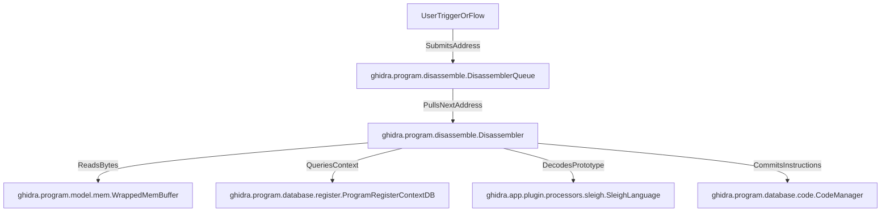
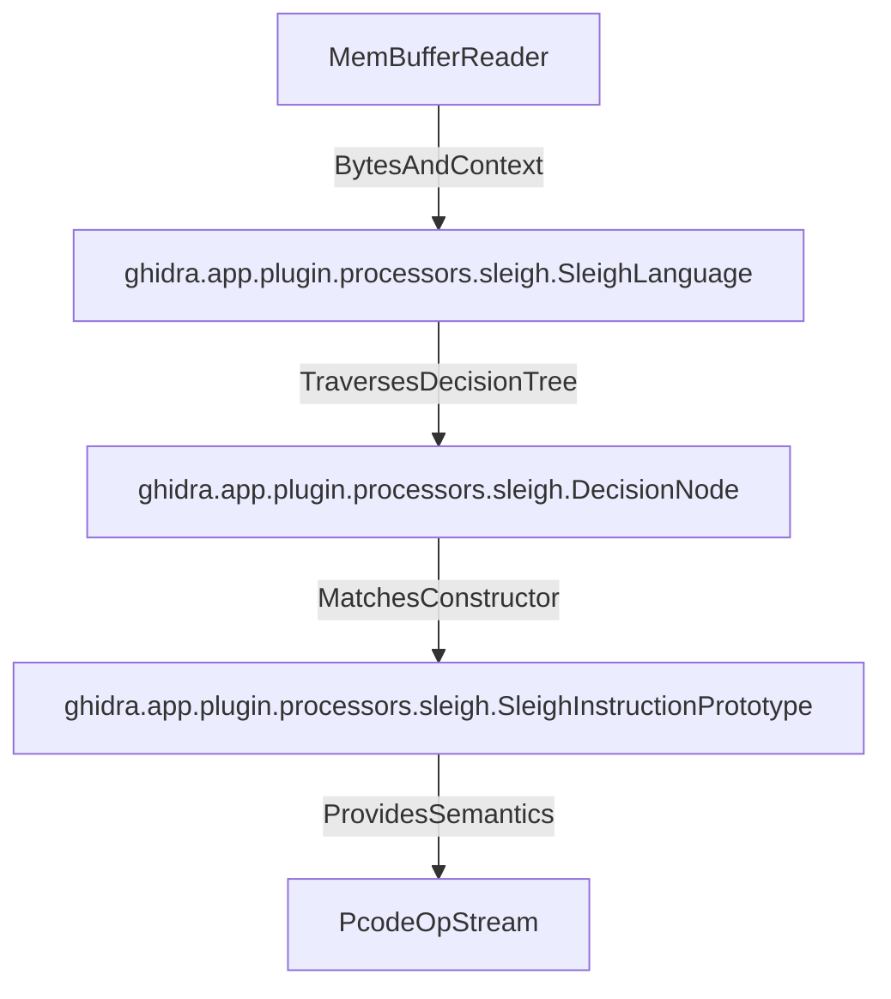
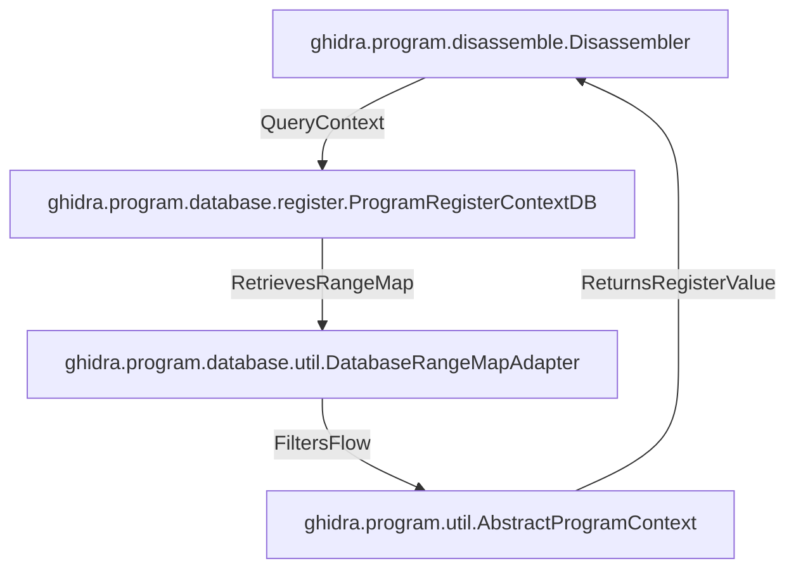

<!-- source: DeepWiki mcp.deepwiki.com · repo NationalSecurityAgency/ghidra · page 3.6 Disassembly and Instruction Decoding · fetched 2026-11-09 -->

# Disassembly and Instruction Decoding

Relevant source files

The following files were used as context for generating this wiki page:

- [Ghidra/Features/Base/src/main/help/help/topics/CodeBrowserPlugin/ListingBackground.html](Ghidra/Features/Base/src/main/help/help/topics/CodeBrowserPlugin/ListingBackground.html)
- [Ghidra/Features/Base/src/main/help/help/topics/ComputeChecksumsPlugin/Generate_Checksum_Help.html](Ghidra/Features/Base/src/main/help/help/topics/ComputeChecksumsPlugin/Generate_Checksum_Help.html)
- [Ghidra/Features/Base/src/main/help/help/topics/ShowInstructionInfoPlugin/ShowInstructionInfo.htm](Ghidra/Features/Base/src/main/help/help/topics/ShowInstructionInfoPlugin/ShowInstructionInfo.htm)
- [Ghidra/Features/Base/src/main/help/help/topics/ShowInstructionInfoPlugin/images/ShowInstructionInfo.png](Ghidra/Features/Base/src/main/help/help/topics/ShowInstructionInfoPlugin/images/ShowInstructionInfo.png)
- [Ghidra/Features/Base/src/main/java/ghidra/app/cmd/disassemble/Hcs12DisassembleCommand.java](Ghidra/Features/Base/src/main/java/ghidra/app/cmd/disassemble/Hcs12DisassembleCommand.java)
- [Ghidra/Features/Base/src/main/java/ghidra/app/cmd/register/SetRegisterCmd.java](Ghidra/Features/Base/src/main/java/ghidra/app/cmd/register/SetRegisterCmd.java)
- [Ghidra/Features/Base/src/main/java/ghidra/app/merge/listing/RegisterMergeManager.java](Ghidra/Features/Base/src/main/java/ghidra/app/merge/listing/RegisterMergeManager.java)
- [Ghidra/Features/Base/src/main/java/ghidra/app/plugin/core/disassembler/DisassemblerPlugin.java](Ghidra/Features/Base/src/main/java/ghidra/app/plugin/core/disassembler/DisassemblerPlugin.java)
- [Ghidra/Features/Base/src/main/java/ghidra/app/plugin/core/disassembler/Hcs12DisassembleAction.java](Ghidra/Features/Base/src/main/java/ghidra/app/plugin/core/disassembler/Hcs12DisassembleAction.java)
- [Ghidra/Features/Base/src/main/java/ghidra/app/plugin/core/function/AbstractEditFunctionSignatureDialog.java](Ghidra/Features/Base/src/main/java/ghidra/app/plugin/core/function/AbstractEditFunctionSignatureDialog.java)
- [Ghidra/Features/Base/src/main/java/ghidra/app/plugin/core/processors/InstructionInfoProvider.java](Ghidra/Features/Base/src/main/java/ghidra/app/plugin/core/processors/InstructionInfoProvider.java)
- [Ghidra/Features/Base/src/main/java/ghidra/app/plugin/core/processors/ShowInstructionInfoPlugin.java](Ghidra/Features/Base/src/main/java/ghidra/app/plugin/core/processors/ShowInstructionInfoPlugin.java)
- [Ghidra/Features/Base/src/main/java/ghidra/util/BrowserLoader.java](Ghidra/Features/Base/src/main/java/ghidra/util/BrowserLoader.java)
- [Ghidra/Features/Base/src/main/java/ghidra/util/ManualViewerCommandEditor.java](Ghidra/Features/Base/src/main/java/ghidra/util/ManualViewerCommandEditor.java)
- [Ghidra/Features/Base/src/main/java/ghidra/util/ManualViewerCommandWrappedOption.java](Ghidra/Features/Base/src/main/java/ghidra/util/ManualViewerCommandWrappedOption.java)
- [Ghidra/Features/Base/src/main/java/ghidra/util/UndefinedFunction.java](Ghidra/Features/Base/src/main/java/ghidra/util/UndefinedFunction.java)
- [Ghidra/Features/Base/src/test.slow/java/ghidra/app/merge/listing/ProgramContextMergeManagerTest.java](Ghidra/Features/Base/src/test.slow/java/ghidra/app/merge/listing/ProgramContextMergeManagerTest.java)
- [Ghidra/Features/Base/src/test.slow/java/ghidra/app/plugin/core/processors/ShowInstructionInfoPluginTest.java](Ghidra/Features/Base/src/test.slow/java/ghidra/app/plugin/core/processors/ShowInstructionInfoPluginTest.java)
- [Ghidra/Features/Base/src/test.slow/java/ghidra/program/database/symbol/NamespaceManagerTest.java](Ghidra/Features/Base/src/test.slow/java/ghidra/program/database/symbol/NamespaceManagerTest.java)
- [Ghidra/Features/Base/src/test.slow/java/ghidra/program/model/mem/WrappedMemoryBufferTest.java](Ghidra/Features/Base/src/test.slow/java/ghidra/program/model/mem/WrappedMemoryBufferTest.java)
- [Ghidra/Features/Base/src/test/java/ghidra/app/cmd/function/DeleteFunctionCmdTest.java](Ghidra/Features/Base/src/test/java/ghidra/app/cmd/function/DeleteFunctionCmdTest.java)
- [Ghidra/Features/Base/src/test/java/ghidra/program/database/MergeProgramGenerator_DiffTestPrograms.java](Ghidra/Features/Base/src/test/java/ghidra/program/database/MergeProgramGenerator_DiffTestPrograms.java)
- [Ghidra/Framework/Docking/src/main/help/help/topics/Trees/GhidraTreeFilter.html](Ghidra/Framework/Docking/src/main/help/help/topics/Trees/GhidraTreeFilter.html)
- [Ghidra/Framework/Docking/src/main/java/docking/menu/DockingToolBarUtils.java](Ghidra/Framework/Docking/src/main/java/docking/menu/DockingToolBarUtils.java)
- [Ghidra/Framework/Docking/src/main/java/docking/widgets/conditiontestpanel/ConditionTestPanel.java](Ghidra/Framework/Docking/src/main/java/docking/widgets/conditiontestpanel/ConditionTestPanel.java)
- [Ghidra/Framework/Docking/src/main/java/docking/widgets/table/constrainteditor/EnumConstraintEditor.java](Ghidra/Framework/Docking/src/main/java/docking/widgets/table/constrainteditor/EnumConstraintEditor.java)
- [Ghidra/Framework/SoftwareModeling/data/languages/processor_spec.rxg](Ghidra/Framework/SoftwareModeling/data/languages/processor_spec.rxg)
- [Ghidra/Framework/SoftwareModeling/src/main/java/ghidra/app/plugin/processors/sleigh/SleighLanguage.java](Ghidra/Framework/SoftwareModeling/src/main/java/ghidra/app/plugin/processors/sleigh/SleighLanguage.java)
- [Ghidra/Framework/SoftwareModeling/src/main/java/ghidra/program/database/function/FunctionDB.java](Ghidra/Framework/SoftwareModeling/src/main/java/ghidra/program/database/function/FunctionDB.java)
- [Ghidra/Framework/SoftwareModeling/src/main/java/ghidra/program/database/function/FunctionManagerDB.java](Ghidra/Framework/SoftwareModeling/src/main/java/ghidra/program/database/function/FunctionManagerDB.java)
- [Ghidra/Framework/SoftwareModeling/src/main/java/ghidra/program/database/function/OverlappingFunctionException.java](Ghidra/Framework/SoftwareModeling/src/main/java/ghidra/program/database/function/OverlappingFunctionException.java)
- [Ghidra/Framework/SoftwareModeling/src/main/java/ghidra/program/database/register/ProgramRegisterContextDB.java](Ghidra/Framework/SoftwareModeling/src/main/java/ghidra/program/database/register/ProgramRegisterContextDB.java)
- [Ghidra/Framework/SoftwareModeling/src/main/java/ghidra/program/database/symbol/NamespaceManager.java](Ghidra/Framework/SoftwareModeling/src/main/java/ghidra/program/database/symbol/NamespaceManager.java)
- [Ghidra/Framework/SoftwareModeling/src/main/java/ghidra/program/disassemble/Disassembler.java](Ghidra/Framework/SoftwareModeling/src/main/java/ghidra/program/disassemble/Disassembler.java)
- [Ghidra/Framework/SoftwareModeling/src/main/java/ghidra/program/disassemble/DisassemblerQueue.java](Ghidra/Framework/SoftwareModeling/src/main/java/ghidra/program/disassemble/DisassemblerQueue.java)
- [Ghidra/Framework/SoftwareModeling/src/main/java/ghidra/program/model/lang/AddressLabelInfo.java](Ghidra/Framework/SoftwareModeling/src/main/java/ghidra/program/model/lang/AddressLabelInfo.java)
- [Ghidra/Framework/SoftwareModeling/src/main/java/ghidra/program/model/lang/Language.java](Ghidra/Framework/SoftwareModeling/src/main/java/ghidra/program/model/lang/Language.java)
- [Ghidra/Framework/SoftwareModeling/src/main/java/ghidra/program/model/lang/RegisterBuilder.java](Ghidra/Framework/SoftwareModeling/src/main/java/ghidra/program/model/lang/RegisterBuilder.java)
- [Ghidra/Framework/SoftwareModeling/src/main/java/ghidra/program/model/lang/RegisterManager.java](Ghidra/Framework/SoftwareModeling/src/main/java/ghidra/program/model/lang/RegisterManager.java)
- [Ghidra/Framework/SoftwareModeling/src/main/java/ghidra/program/model/listing/Function.java](Ghidra/Framework/SoftwareModeling/src/main/java/ghidra/program/model/listing/Function.java)
- [Ghidra/Framework/SoftwareModeling/src/main/java/ghidra/program/model/listing/FunctionManager.java](Ghidra/Framework/SoftwareModeling/src/main/java/ghidra/program/model/listing/FunctionManager.java)
- [Ghidra/Framework/SoftwareModeling/src/main/java/ghidra/program/model/mem/MemoryBufferImpl.java](Ghidra/Framework/SoftwareModeling/src/main/java/ghidra/program/model/mem/MemoryBufferImpl.java)
- [Ghidra/Framework/SoftwareModeling/src/main/java/ghidra/program/model/mem/WrappedMemBuffer.java](Ghidra/Framework/SoftwareModeling/src/main/java/ghidra/program/model/mem/WrappedMemBuffer.java)
- [Ghidra/Framework/SoftwareModeling/src/main/java/ghidra/program/util/AbstractProgramContext.java](Ghidra/Framework/SoftwareModeling/src/main/java/ghidra/program/util/AbstractProgramContext.java)
- [Ghidra/Framework/SoftwareModeling/src/main/java/ghidra/program/util/AbstractStoredProgramContext.java](Ghidra/Framework/SoftwareModeling/src/main/java/ghidra/program/util/AbstractStoredProgramContext.java)
- [Ghidra/Framework/SoftwareModeling/src/main/java/ghidra/program/util/OldLanguage.java](Ghidra/Framework/SoftwareModeling/src/main/java/ghidra/program/util/OldLanguage.java)
- [Ghidra/Framework/SoftwareModeling/src/test/java/ghidra/program/model/FunctionTestDouble.java](Ghidra/Framework/SoftwareModeling/src/test/java/ghidra/program/model/FunctionTestDouble.java)
- [Ghidra/Processors/JVM/data/languages/JVM.ldefs](Ghidra/Processors/JVM/data/languages/JVM.ldefs)
- [Ghidra/Processors/JVM/data/languages/JVM.slaspec](Ghidra/Processors/JVM/data/languages/JVM.slaspec)
- [Ghidra/Processors/JVM/src/main/java/ghidra/javaclass/analyzers/JvmSwitchAnalyzer.java](Ghidra/Processors/JVM/src/main/java/ghidra/javaclass/analyzers/JvmSwitchAnalyzer.java)
- [Ghidra/Test/IntegrationTest/src/screen/java/help/screenshot/ShowInstructionInfoPluginScreenShots.java](Ghidra/Test/IntegrationTest/src/screen/java/help/screenshot/ShowInstructionInfoPluginScreenShots.java)
- [Ghidra/Test/IntegrationTest/src/test.slow/java/ghidra/program/disassemble/DisassemblerLargeSetTest.java](Ghidra/Test/IntegrationTest/src/test.slow/java/ghidra/program/disassemble/DisassemblerLargeSetTest.java)

## Purpose and Scope
This page details Ghidra's runtime disassembly pipeline, responsible for translating raw machine bytes into structured `Instruction` objects and associated P-code semantics. The scope covers the core orchestration engine (`Disassembler` and `DisassemblerQueue`), SLEIGH-based instruction pattern matching and prototype generation (`SleighInstructionPrototype`), contextual processor state management (`ProgramRegisterContextDB`), block-level pseudo-disassembly, and the assembler framework (`ghidra.app.plugin.assembler`) used for patching and wildcard assembly.

---

## 1. Disassembler Engine and Flow Management (`Disassembler` & `DisassemblerQueue`)

The `Disassembler` class serves as the primary engine for analyzing executable code within a `Program` [ghidra/program/disassemble/Disassembler.java:44-52](). It coordinates instruction extraction, parses control-flow transitions, and applies conflict resolution strategies when overlapping code or data units are encountered.

Execution flows are scheduled and processed iteratively using `DisassemblerQueue`, which tracks pending disassembly addresses alongside their associated context values. The engine evaluates program options such as `MARK_BAD_INSTRUCTION_PROPERTY`, `MARK_UNIMPL_PCODE_PROPERTY`, and `RESTRICT_DISASSEMBLY_TO_EXECUTE_MEMORY_PROPERTY` to govern error handling and memory boundaries during traversal [ghidra/program/disassemble/Disassembler.java:57-78]().

*Diagram: Architecture mapping of the disassembly pipeline components.*

Sources: 
- `ghidra/program/disassemble/Disassembler.java:44-125` [ghidra/program/disassemble/Disassembler.java:44-125]()
- `ghidra/Framework/SoftwareModeling/src/main/java/ghidra/program/disassemble/DisassemblerQueue.java` [ghidra/Framework/SoftwareModeling/src/main/java/ghidra/program/disassemble/DisassemblerQueue.java]()

---

## 2. Instruction Decoding and Prototype Construction (`SleighInstructionPrototype`)

When the `Disassembler` inspects an address, it wraps the target memory stream using a `MemBuffer` (such as `WrappedMemBuffer`) to minimize raw memory access overhead [ghidra/program/model/mem/WrappedMemBuffer.java:25-42](). 

The bytes and current register context are passed to `SleighLanguage` [ghidra/app/plugin/processors/sleigh/SleighLanguage.java:58](), which uses its compiled decision trees (`DecisionNode`) to match instruction bit patterns against defined constructors in `.sla` specifications. Upon a successful match, a `SleighInstructionPrototype` is produced. This prototype encapsulates:
- The instruction's mnemonic and formatted operands.
- The instruction length in bytes.
- P-code opcodes (`PcodeOp`) generated by evaluating the semantic actions defined in SLEIGH.

*Diagram: Decoding flow from raw memory bytes to instruction prototypes and P-code.*

Sources:
- `ghidra/app/plugin/processors/sleigh/SleighLanguage.java:58-105` [ghidra/app/plugin/processors/sleigh/SleighLanguage.java:58-105]()
- `ghidra/program/model/mem/WrappedMemBuffer.java:25-55` [ghidra/program/model/mem/WrappedMemBuffer.java:25-55]()

---

## 3. Register Context Propagation (`ProgramRegisterContextDB`)

Instruction decoding in many architectures (e.g., ARM/Thumb mode switching, x86 `opsize`/`addrsize` prefixes) depends heavily on architectural context registers. Ghidra manages these via `ProgramRegisterContextDB` [ghidra/program/database/register/ProgramRegisterContextDB.java:41](), which extends `AbstractStoredProgramContext` [ghidra/program/util/AbstractStoredProgramContext.java:28]().

The context database tracks register values across address ranges using underlying range map adapters (`DatabaseRangeMapAdapter`). Context bits are categorized as either *flowing* (propagated along control-flow edges during disassembly) or *non-flowing* (scoped strictly to specific instructions or ranges) [ghidra/program/util/AbstractProgramContext.java:31-73](). During disassembly, `DisassemblerContext` queries the context manager to determine parser states dynamically.

*Diagram: Register context resolution and flow routing.*

Sources:
- `ghidra/program/database/register/ProgramRegisterContextDB.java:41-84` [ghidra/program/database/register/ProgramRegisterContextDB.java:41-84]()
- `ghidra/program/util/AbstractStoredProgramContext.java:28-74` [ghidra/program/util/AbstractStoredProgramContext.java:28-74]()
- `ghidra/program/util/AbstractProgramContext.java:28-73` [ghidra/program/util/AbstractProgramContext.java:28-73]()

---

## 4. Pseudo-Disassembly

For lightweight analysis tasks, speculative decoding, or decompiler type inference where modifying the persistent database program is undesirable, Ghidra supports block-level pseudo-disassembly via `Disassembler#pseudoDisassembleBlock(...)` [ghidra/program/disassemble/Disassembler.java:157-166](). 

Pseudo-disassembly uses an in-memory ephemeral buffer (`MemBuffer`) and a local context store to decode a linear sequence of instructions without committing code units, labels, or flow references to the `CodeManager` database.

Sources:
- `ghidra/program/disassemble/Disassembler.java:138-166` [ghidra/program/disassemble/Disassembler.java:138-166]()

---

## 5. The Assembler Subsystem (`ghidra.app.plugin.assembler`)

The assembler package (`ghidra.app.plugin.assembler`) provides the inverse capability of the disassembler: compiling assembly language text strings into raw machine code byte arrays. This subsystem is utilized for binary patching, interactive instruction assembly, and wildcard pattern matching.

Key components parse assembly syntax using ANTLR-based grammars derived directly from the language's SLEIGH specifications, resolving symbol references, register operands, and immediate values into encoded instructions.

Sources:
- `ghidra/app/plugin/assembler` [ghidra/app/plugin/assembler]()

---

