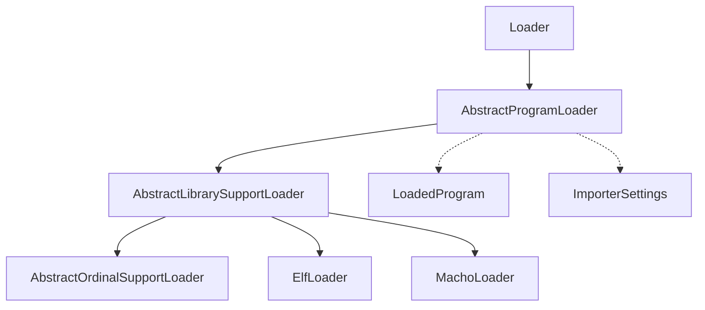
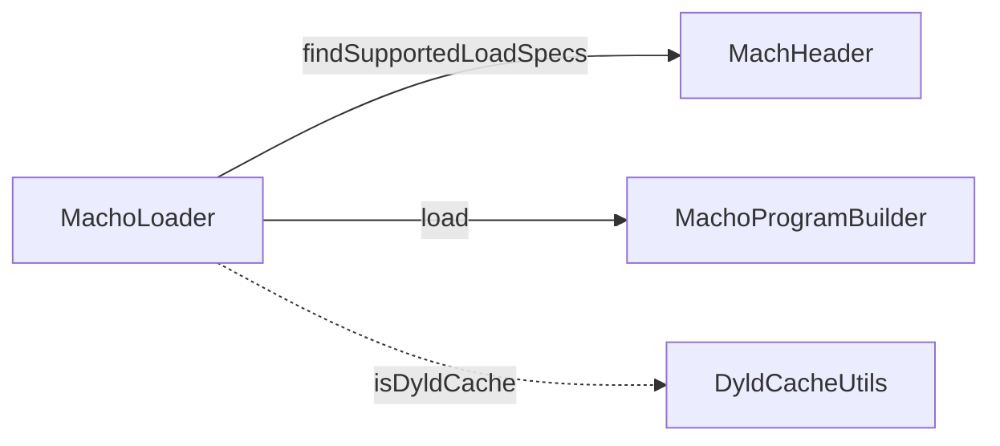
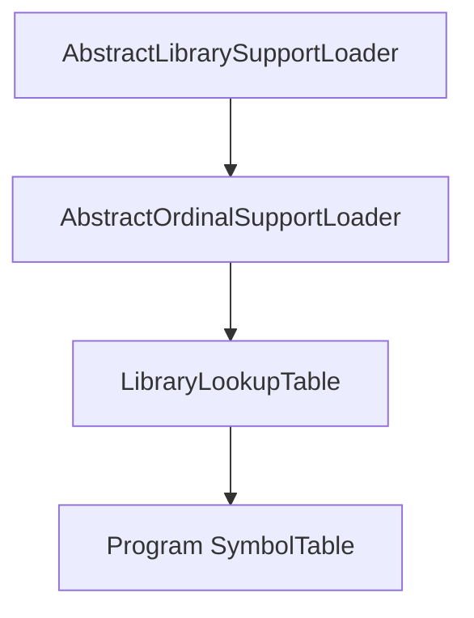

<!-- source: DeepWiki mcp.deepwiki.com · repo NationalSecurityAgency/ghidra · page 4 Binary Format Support · fetched 2026-11-09 -->

# Binary Format Support

Relevant source files

The following files were used as context for generating this wiki page:

- [Ghidra/Debug/TaintAnalysis/src/main/java/ghidra/taint/gui/field/TaintFieldFactory.java](Ghidra/Debug/TaintAnalysis/src/main/java/ghidra/taint/gui/field/TaintFieldFactory.java)
- [Ghidra/Extensions/sample/src/main/java/ghidra/examples/EntropyFieldFactory.java](Ghidra/Extensions/sample/src/main/java/ghidra/examples/EntropyFieldFactory.java)
- [Ghidra/Features/Base/data/symbols/README.txt](Ghidra/Features/Base/data/symbols/README.txt)
- [Ghidra/Features/Base/ghidra_scripts/CreateExportFileForDLL.java](Ghidra/Features/Base/ghidra_scripts/CreateExportFileForDLL.java)
- [Ghidra/Features/Base/src/main/java/ghidra/app/cmd/function/CallDepthChangeInfo.java](Ghidra/Features/Base/src/main/java/ghidra/app/cmd/function/CallDepthChangeInfo.java)
- [Ghidra/Features/Base/src/main/java/ghidra/app/cmd/function/FunctionPurgeAnalysisCmd.java](Ghidra/Features/Base/src/main/java/ghidra/app/cmd/function/FunctionPurgeAnalysisCmd.java)
- [Ghidra/Features/Base/src/main/java/ghidra/app/plugin/core/function/StackDepthFieldFactory.java](Ghidra/Features/Base/src/main/java/ghidra/app/plugin/core/function/StackDepthFieldFactory.java)
- [Ghidra/Features/Base/src/main/java/ghidra/app/util/bin/format/ne/Segment.java](Ghidra/Features/Base/src/main/java/ghidra/app/util/bin/format/ne/Segment.java)
- [Ghidra/Features/Base/src/main/java/ghidra/app/util/importer/LibrarySearchPathManager.java](Ghidra/Features/Base/src/main/java/ghidra/app/util/importer/LibrarySearchPathManager.java)
- [Ghidra/Features/Base/src/main/java/ghidra/app/util/importer/LoaderArgsOptionChooser.java](Ghidra/Features/Base/src/main/java/ghidra/app/util/importer/LoaderArgsOptionChooser.java)
- [Ghidra/Features/Base/src/main/java/ghidra/app/util/importer/OptionChooser.java](Ghidra/Features/Base/src/main/java/ghidra/app/util/importer/OptionChooser.java)
- [Ghidra/Features/Base/src/main/java/ghidra/app/util/importer/SingleLoaderFilter.java](Ghidra/Features/Base/src/main/java/ghidra/app/util/importer/SingleLoaderFilter.java)
- [Ghidra/Features/Base/src/main/java/ghidra/app/util/opinion/AbstractLibrarySupportLoader.java](Ghidra/Features/Base/src/main/java/ghidra/app/util/opinion/AbstractLibrarySupportLoader.java)
- [Ghidra/Features/Base/src/main/java/ghidra/app/util/opinion/AbstractOrdinalSupportLoader.java](Ghidra/Features/Base/src/main/java/ghidra/app/util/opinion/AbstractOrdinalSupportLoader.java)
- [Ghidra/Features/Base/src/main/java/ghidra/app/util/opinion/AbstractProgramLoader.java](Ghidra/Features/Base/src/main/java/ghidra/app/util/opinion/AbstractProgramLoader.java)
- [Ghidra/Features/Base/src/main/java/ghidra/app/util/opinion/LibraryLookupTable.java](Ghidra/Features/Base/src/main/java/ghidra/app/util/opinion/LibraryLookupTable.java)
- [Ghidra/Features/Base/src/main/java/ghidra/app/util/opinion/LibrarySymbolTable.java](Ghidra/Features/Base/src/main/java/ghidra/app/util/opinion/LibrarySymbolTable.java)
- [Ghidra/Features/Base/src/main/java/ghidra/app/util/opinion/LoadResults.java](Ghidra/Features/Base/src/main/java/ghidra/app/util/opinion/LoadResults.java)
- [Ghidra/Features/Base/src/main/java/ghidra/app/util/opinion/Loaded.java](Ghidra/Features/Base/src/main/java/ghidra/app/util/opinion/Loaded.java)
- [Ghidra/Features/Base/src/main/java/ghidra/app/util/opinion/MachoLoader.java](Ghidra/Features/Base/src/main/java/ghidra/app/util/opinion/MachoLoader.java)
- [Ghidra/Features/Base/src/main/java/ghidra/app/util/opinion/NeLoader.java](Ghidra/Features/Base/src/main/java/ghidra/app/util/opinion/NeLoader.java)
- [Ghidra/Features/Base/src/main/java/ghidra/base/project/GhidraProject.java](Ghidra/Features/Base/src/main/java/ghidra/base/project/GhidraProject.java)
- [Ghidra/Features/Base/src/test/java/ghidra/app/util/opinion/OrdinalFileSymbolLoadTest.java](Ghidra/Features/Base/src/test/java/ghidra/app/util/opinion/OrdinalFileSymbolLoadTest.java)
- [Ghidra/Features/Base/src/test/resources/ghidra/app/util/opinion/test.ord](Ghidra/Features/Base/src/test/resources/ghidra/app/util/opinion/test.ord)
- [Ghidra/Features/FileFormats/src/main/java/ghidra/app/util/opinion/ApkLoader.java](Ghidra/Features/FileFormats/src/main/java/ghidra/app/util/opinion/ApkLoader.java)
- [Ghidra/Features/FileFormats/src/main/java/ghidra/app/util/opinion/DyldCacheExtractLoader.java](Ghidra/Features/FileFormats/src/main/java/ghidra/app/util/opinion/DyldCacheExtractLoader.java)
- [Ghidra/Features/FileFormats/src/main/java/ghidra/app/util/opinion/MachoExtractProgramBuilder.java](Ghidra/Features/FileFormats/src/main/java/ghidra/app/util/opinion/MachoExtractProgramBuilder.java)
- [Ghidra/Features/FileFormats/src/main/java/ghidra/app/util/opinion/MachoFileSetExtractLoader.java](Ghidra/Features/FileFormats/src/main/java/ghidra/app/util/opinion/MachoFileSetExtractLoader.java)
- [Ghidra/Framework/SoftwareModeling/src/main/java/ghidra/program/model/listing/Program.java](Ghidra/Framework/SoftwareModeling/src/main/java/ghidra/program/model/listing/Program.java)
- [Ghidra/Framework/SoftwareModeling/src/main/java/ghidra/program/model/pcode/VarnodeTranslator.java](Ghidra/Framework/SoftwareModeling/src/main/java/ghidra/program/model/pcode/VarnodeTranslator.java)
- [Ghidra/Processors/x86/data/languages/x86-16.cspec](Ghidra/Processors/x86/data/languages/x86-16.cspec)
- [Ghidra/Processors/x86/data/patterns/patternconstraints.xml](Ghidra/Processors/x86/data/patterns/patternconstraints.xml)
- [Ghidra/Processors/x86/data/patterns/x86-16_default_patterns.xml](Ghidra/Processors/x86/data/patterns/x86-16_default_patterns.xml)

## Purpose and Scope

This document describes Ghidra's binary format loading infrastructure, which is responsible for parsing executable file formats (ELF, Mach-O, PE, NE, etc.) and transforming them into Ghidra `Program` objects. The system handles format-specific header parsing, memory block creation, symbol table processing, relocation application, and external library resolution through a modular loader framework.

For information about processor architecture support (Sleigh definitions), see [Processor Architecture Support](#3). For debug symbol processing (DWARF/PDB), see [Debug Symbol Import (DWARF and PDB)](#8.4).

---

## Loader Framework Architecture

Ghidra's loader framework provides an abstract hierarchy that enables format-specific implementations while sharing common functionality for program creation, library resolution, and external symbol management.

### Class Hierarchy

Diagram: Loader Framework Hierarchy

Sources: [Ghidra/Features/Base/src/main/java/ghidra/app/util/opinion/AbstractProgramLoader.java:53-77](), [Ghidra/Features/Base/src/main/java/ghidra/app/util/opinion/AbstractLibrarySupportLoader.java:52-125](), [Ghidra/Features/Base/src/main/java/ghidra/app/util/opinion/AbstractOrdinalSupportLoader.java:41-45]()

**Key Responsibilities:**

| Class | Primary Responsibility |
|-------|------------------------|
| `AbstractProgramLoader` | Program creation, processor label application, and transaction management [Ghidra/Features/Base/src/main/java/ghidra/app/util/opinion/AbstractProgramLoader.java:53-162]() |
| `AbstractLibrarySupportLoader` | Library search paths, external library loading, and symbol resolution across programs [Ghidra/Features/Base/src/main/java/ghidra/app/util/opinion/AbstractLibrarySupportLoader.java:52-152]() |
| `AbstractOrdinalSupportLoader` | Support for programs linking to external libraries with an ordinal mechanism [Ghidra/Features/Base/src/main/java/ghidra/app/util/opinion/AbstractOrdinalSupportLoader.java:41-45]() |
| `LoaderService` | Factory for discovering and querying available loaders via `ClassSearcher` [Ghidra/Features/Base/src/main/java/ghidra/app/util/opinion/LoaderService.java:33-59]() |

For details, see [Loader Framework Architecture](#4.1).

Sources: [Ghidra/Features/Base/src/main/java/ghidra/app/util/opinion/AbstractProgramLoader.java:53-77](), [Ghidra/Features/Base/src/main/java/ghidra/app/util/opinion/AbstractLibrarySupportLoader.java:52-125](), [Ghidra/Features/Base/src/main/java/ghidra/app/util/opinion/AbstractOrdinalSupportLoader.java:41-45]()

---

## Mach-O Loader and DYLD Cache Support

The Mach-O loader handles Apple's Mach Object file format used on macOS and iOS. It supports both standalone Mach-O files and Universal Binaries (Fat binaries).

### Mach-O Loading Process

Diagram: Mach-O Loader Architecture

Sources: [Ghidra/Features/Base/src/main/java/ghidra/app/util/opinion/MachoLoader.java:50-143]()

**Key Features:**
- **Universal Binaries**: Detects universal binaries and extracts architecture-specific slices [Ghidra/Features/Base/src/main/java/ghidra/app/util/opinion/MachoLoader.java:73-80]().
- **DYLD Cache**: Specialized utilities identify and process Apple's dynamic linker cache files [Ghidra/Features/Base/src/main/java/ghidra/app/util/opinion/MachoLoader.java:187-201]().
- **Prelink Support**: Handles prelinked kernel and file-set binaries via `MachoPrelinkProgramBuilder` [Ghidra/Features/Base/src/main/java/ghidra/app/util/opinion/MachoLoader.java:126-131]().

For details, see [Mach-O Loader and DYLD Cache Support](#4.2).

Sources: [Ghidra/Features/Base/src/main/java/ghidra/app/util/opinion/MachoLoader.java:50-143]()

---

## Dynamic Linking and Symbol Resolution

Ghidra manages external library dependencies and symbol resolution through `AbstractLibrarySupportLoader`, `AbstractOrdinalSupportLoader`, and related symbol resolution utilities.

### External Resolution Pipeline

Diagram: Dynamic Linking and Ordinal Resolution

Sources: [Ghidra/Features/Base/src/main/java/ghidra/app/util/opinion/AbstractLibrarySupportLoader.java:52-125](), [Ghidra/Features/Base/src/main/java/ghidra/app/util/opinion/AbstractOrdinalSupportLoader.java:41-45]()

**Key Mechanisms:**
- **Library Ordinals**: `AbstractOrdinalSupportLoader` manages symbol resolution when libraries use numeric ordinals instead of names, utilizing `LibraryLookupTable` for export caching [Ghidra/Features/Base/src/main/java/ghidra/app/util/opinion/AbstractOrdinalSupportLoader.java:133-158]().
- **Project Linking**: Options to link against libraries already imported into the Ghidra project workspace.

For details, see [Dynamic Linking and Symbol Resolution](#4.3).

Sources: [Ghidra/Features/Base/src/main/java/ghidra/app/util/opinion/AbstractLibrarySupportLoader.java:52-125](), [Ghidra/Features/Base/src/main/java/ghidra/app/util/opinion/AbstractOrdinalSupportLoader.java:41-45]()

---

## ELF Loader

The ELF loader processes Executable and Linking Format files, common on Linux and embedded systems. It parses ELF headers, program headers, and section headers to map memory blocks and apply relocations.

For details, see [ELF Loader](#4.4).

Sources: [Ghidra/Features/Base/src/main/java/ghidra/app/util/opinion/AbstractProgramLoader.java:53-77]()

---

## PE and Other Format Loaders

The framework supports Windows Portable Executable (PE) files (including COFF headers, NT headers, and unwind information), legacy MZ/DOS executables, OMF object files, and PDB symbol loading integration.

For details, see [PE and Other Format Loaders](#4.5).

Sources: [Ghidra/Features/Base/src/main/java/ghidra/app/util/opinion/AbstractProgramLoader.java:53-77]()

---

## Filesystem and Container Formats

Ghidra includes the `Features/FileFormats` module, providing the `GFileSystem` abstraction and `FileSystemService` for browsing nested container formats, archives (zip, tar, 7zip, etc.), filesystem images (ext4, squashfs, etc.), mobile binary packages (APK/dex), and iOS DYLD shared caches.

For details, see [Filesystem and Container Formats](#4.6).

Sources: [Ghidra/Features/Base/src/main/java/ghidra/app/util/opinion/AbstractProgramLoader.java:53-77]()

---

