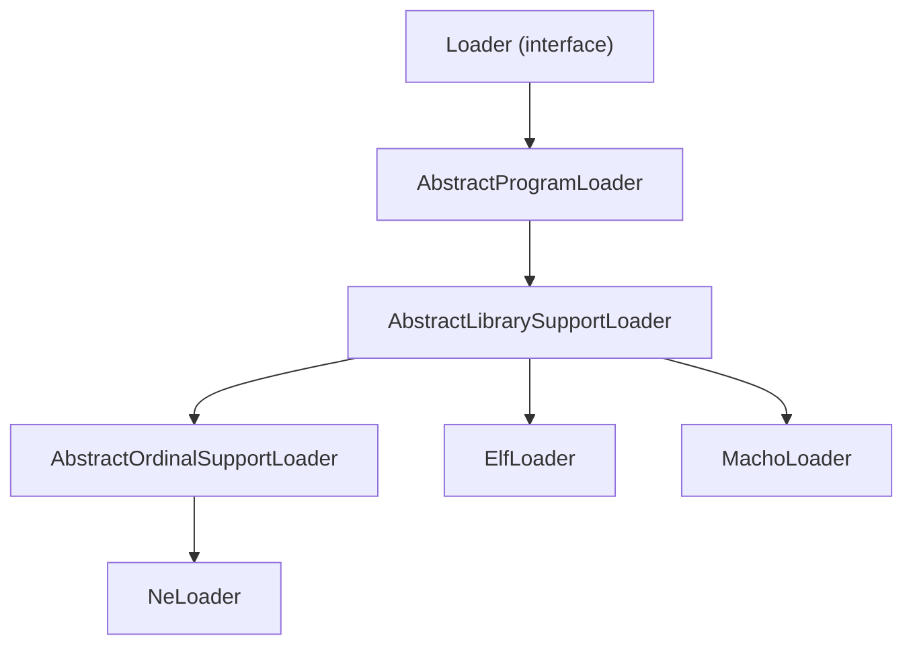
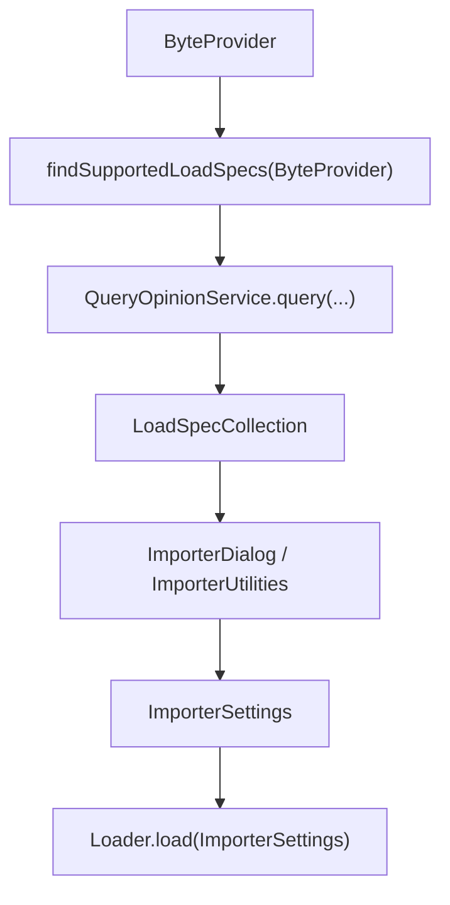
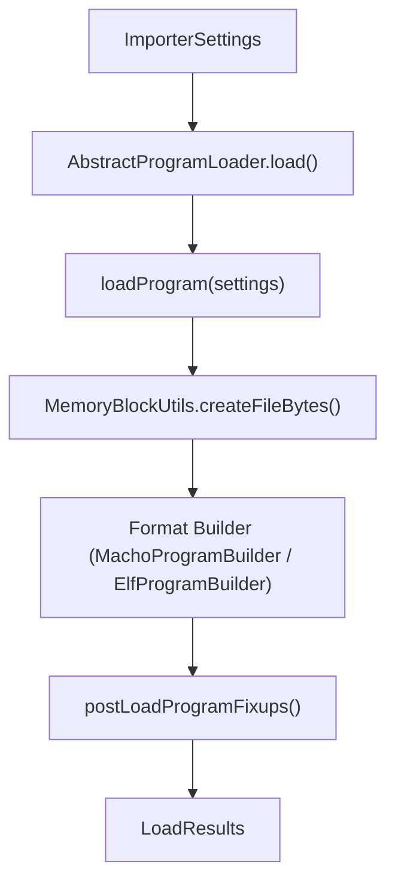

<!-- source: DeepWiki mcp.deepwiki.com · repo NationalSecurityAgency/ghidra · page 4.1 Loader Framework Architecture · fetched 2026-11-09 -->

# Loader Framework Architecture

Relevant source files

The following files were used as context for generating this wiki page:

- [Ghidra/Debug/TaintAnalysis/src/main/java/ghidra/taint/gui/field/TaintFieldFactory.java](Ghidra/Debug/TaintAnalysis/src/main/java/ghidra/taint/gui/field/TaintFieldFactory.java)
- [Ghidra/Extensions/sample/src/main/java/ghidra/examples/EntropyFieldFactory.java](Ghidra/Extensions/sample/src/main/java/ghidra/examples/EntropyFieldFactory.java)
- [Ghidra/Features/Base/data/symbols/README.txt](Ghidra/Features/Base/data/symbols/README.txt)
- [Ghidra/Features/Base/ghidra_scripts/CreateExportFileForDLL.java](Ghidra/Features/Base/ghidra_scripts/CreateExportFileForDLL.java)
- [Ghidra/Features/Base/src/main/help/help/topics/ImporterPlugin/images/BatchImportDialog.png](Ghidra/Features/Base/src/main/help/help/topics/ImporterPlugin/images/BatchImportDialog.png)
- [Ghidra/Features/Base/src/main/help/help/topics/ImporterPlugin/images/ImporterDialog.png](Ghidra/Features/Base/src/main/help/help/topics/ImporterPlugin/images/ImporterDialog.png)
- [Ghidra/Features/Base/src/main/help/help/topics/ImporterPlugin/images/LanguagePickerDialog.png](Ghidra/Features/Base/src/main/help/help/topics/ImporterPlugin/images/LanguagePickerDialog.png)
- [Ghidra/Features/Base/src/main/help/help/topics/ImporterPlugin/images/SearchPathsDialog.png](Ghidra/Features/Base/src/main/help/help/topics/ImporterPlugin/images/SearchPathsDialog.png)
- [Ghidra/Features/Base/src/main/help/help/topics/ImporterPlugin/importer.htm](Ghidra/Features/Base/src/main/help/help/topics/ImporterPlugin/importer.htm)
- [Ghidra/Features/Base/src/main/java/ghidra/app/cmd/function/CallDepthChangeInfo.java](Ghidra/Features/Base/src/main/java/ghidra/app/cmd/function/CallDepthChangeInfo.java)
- [Ghidra/Features/Base/src/main/java/ghidra/app/cmd/function/FunctionPurgeAnalysisCmd.java](Ghidra/Features/Base/src/main/java/ghidra/app/cmd/function/FunctionPurgeAnalysisCmd.java)
- [Ghidra/Features/Base/src/main/java/ghidra/app/plugin/core/disassembler/AutoTableDisassemblerPlugin.java](Ghidra/Features/Base/src/main/java/ghidra/app/plugin/core/disassembler/AutoTableDisassemblerPlugin.java)
- [Ghidra/Features/Base/src/main/java/ghidra/app/plugin/core/exporter/ExporterDialog.java](Ghidra/Features/Base/src/main/java/ghidra/app/plugin/core/exporter/ExporterDialog.java)
- [Ghidra/Features/Base/src/main/java/ghidra/app/plugin/core/exporter/ExporterPlugin.java](Ghidra/Features/Base/src/main/java/ghidra/app/plugin/core/exporter/ExporterPlugin.java)
- [Ghidra/Features/Base/src/main/java/ghidra/app/plugin/core/function/StackDepthFieldFactory.java](Ghidra/Features/Base/src/main/java/ghidra/app/plugin/core/function/StackDepthFieldFactory.java)
- [Ghidra/Features/Base/src/main/java/ghidra/app/plugin/core/processors/SetLanguageDialog.java](Ghidra/Features/Base/src/main/java/ghidra/app/plugin/core/processors/SetLanguageDialog.java)
- [Ghidra/Features/Base/src/main/java/ghidra/app/plugin/core/validator/ValidateProgramDialog.java](Ghidra/Features/Base/src/main/java/ghidra/app/plugin/core/validator/ValidateProgramDialog.java)
- [Ghidra/Features/Base/src/main/java/ghidra/app/services/FileImporterService.java](Ghidra/Features/Base/src/main/java/ghidra/app/services/FileImporterService.java)
- [Ghidra/Features/Base/src/main/java/ghidra/app/util/DomainObjectService.java](Ghidra/Features/Base/src/main/java/ghidra/app/util/DomainObjectService.java)
- [Ghidra/Features/Base/src/main/java/ghidra/app/util/Option.java](Ghidra/Features/Base/src/main/java/ghidra/app/util/Option.java)
- [Ghidra/Features/Base/src/main/java/ghidra/app/util/OptionsDialog.java](Ghidra/Features/Base/src/main/java/ghidra/app/util/OptionsDialog.java)
- [Ghidra/Features/Base/src/main/java/ghidra/app/util/OptionsEditorPanel.java](Ghidra/Features/Base/src/main/java/ghidra/app/util/OptionsEditorPanel.java)
- [Ghidra/Features/Base/src/main/java/ghidra/app/util/bin/format/ne/Segment.java](Ghidra/Features/Base/src/main/java/ghidra/app/util/bin/format/ne/Segment.java)
- [Ghidra/Features/Base/src/main/java/ghidra/app/util/exporter/BinaryExporter.java](Ghidra/Features/Base/src/main/java/ghidra/app/util/exporter/BinaryExporter.java)
- [Ghidra/Features/Base/src/main/java/ghidra/app/util/exporter/Exporter.java](Ghidra/Features/Base/src/main/java/ghidra/app/util/exporter/Exporter.java)
- [Ghidra/Features/Base/src/main/java/ghidra/app/util/exporter/GdtExporter.java](Ghidra/Features/Base/src/main/java/ghidra/app/util/exporter/GdtExporter.java)
- [Ghidra/Features/Base/src/main/java/ghidra/app/util/exporter/GzfExporter.java](Ghidra/Features/Base/src/main/java/ghidra/app/util/exporter/GzfExporter.java)
- [Ghidra/Features/Base/src/main/java/ghidra/app/util/exporter/OriginalFileExporter.java](Ghidra/Features/Base/src/main/java/ghidra/app/util/exporter/OriginalFileExporter.java)
- [Ghidra/Features/Base/src/main/java/ghidra/app/util/importer/LibrarySearchPathManager.java](Ghidra/Features/Base/src/main/java/ghidra/app/util/importer/LibrarySearchPathManager.java)
- [Ghidra/Features/Base/src/main/java/ghidra/app/util/importer/LoaderArgsOptionChooser.java](Ghidra/Features/Base/src/main/java/ghidra/app/util/importer/LoaderArgsOptionChooser.java)
- [Ghidra/Features/Base/src/main/java/ghidra/app/util/importer/OptionChooser.java](Ghidra/Features/Base/src/main/java/ghidra/app/util/importer/OptionChooser.java)
- [Ghidra/Features/Base/src/main/java/ghidra/app/util/importer/ProgramLoader.java](Ghidra/Features/Base/src/main/java/ghidra/app/util/importer/ProgramLoader.java)
- [Ghidra/Features/Base/src/main/java/ghidra/app/util/importer/SingleLoaderFilter.java](Ghidra/Features/Base/src/main/java/ghidra/app/util/importer/SingleLoaderFilter.java)
- [Ghidra/Features/Base/src/main/java/ghidra/app/util/opinion/AbstractLibrarySupportLoader.java](Ghidra/Features/Base/src/main/java/ghidra/app/util/opinion/AbstractLibrarySupportLoader.java)
- [Ghidra/Features/Base/src/main/java/ghidra/app/util/opinion/AbstractOrdinalSupportLoader.java](Ghidra/Features/Base/src/main/java/ghidra/app/util/opinion/AbstractOrdinalSupportLoader.java)
- [Ghidra/Features/Base/src/main/java/ghidra/app/util/opinion/AbstractProgramLoader.java](Ghidra/Features/Base/src/main/java/ghidra/app/util/opinion/AbstractProgramLoader.java)
- [Ghidra/Features/Base/src/main/java/ghidra/app/util/opinion/LibraryLookupTable.java](Ghidra/Features/Base/src/main/java/ghidra/app/util/opinion/LibraryLookupTable.java)
- [Ghidra/Features/Base/src/main/java/ghidra/app/util/opinion/LibrarySymbolTable.java](Ghidra/Features/Base/src/main/java/ghidra/app/util/opinion/LibrarySymbolTable.java)
- [Ghidra/Features/Base/src/main/java/ghidra/app/util/opinion/LoadResults.java](Ghidra/Features/Base/src/main/java/ghidra/app/util/opinion/LoadResults.java)
- [Ghidra/Features/Base/src/main/java/ghidra/app/util/opinion/Loaded.java](Ghidra/Features/Base/src/main/java/ghidra/app/util/opinion/Loaded.java)
- [Ghidra/Features/Base/src/main/java/ghidra/app/util/opinion/Loader.java](Ghidra/Features/Base/src/main/java/ghidra/app/util/opinion/Loader.java)
- [Ghidra/Features/Base/src/main/java/ghidra/app/util/opinion/LoaderService.java](Ghidra/Features/Base/src/main/java/ghidra/app/util/opinion/LoaderService.java)
- [Ghidra/Features/Base/src/main/java/ghidra/app/util/opinion/LoaderTier.java](Ghidra/Features/Base/src/main/java/ghidra/app/util/opinion/LoaderTier.java)
- [Ghidra/Features/Base/src/main/java/ghidra/app/util/opinion/MachoLoader.java](Ghidra/Features/Base/src/main/java/ghidra/app/util/opinion/MachoLoader.java)
- [Ghidra/Features/Base/src/main/java/ghidra/app/util/opinion/NeLoader.java](Ghidra/Features/Base/src/main/java/ghidra/app/util/opinion/NeLoader.java)
- [Ghidra/Features/Base/src/main/java/ghidra/base/project/GhidraProject.java](Ghidra/Features/Base/src/main/java/ghidra/base/project/GhidraProject.java)
- [Ghidra/Features/Base/src/main/java/ghidra/plugin/importer/AddToProgramDialog.java](Ghidra/Features/Base/src/main/java/ghidra/plugin/importer/AddToProgramDialog.java)
- [Ghidra/Features/Base/src/main/java/ghidra/plugin/importer/ImporterDialog.java](Ghidra/Features/Base/src/main/java/ghidra/plugin/importer/ImporterDialog.java)
- [Ghidra/Features/Base/src/main/java/ghidra/plugin/importer/ImporterLanguageDialog.java](Ghidra/Features/Base/src/main/java/ghidra/plugin/importer/ImporterLanguageDialog.java)
- [Ghidra/Features/Base/src/main/java/ghidra/plugin/importer/ImporterPlugin.java](Ghidra/Features/Base/src/main/java/ghidra/plugin/importer/ImporterPlugin.java)
- [Ghidra/Features/Base/src/main/java/ghidra/plugin/importer/ImporterUtilities.java](Ghidra/Features/Base/src/main/java/ghidra/plugin/importer/ImporterUtilities.java)
- [Ghidra/Features/Base/src/main/java/ghidra/plugin/importer/LcsSelectionEvent.java](Ghidra/Features/Base/src/main/java/ghidra/plugin/importer/LcsSelectionEvent.java)
- [Ghidra/Features/Base/src/main/java/ghidra/plugin/importer/NewLanguagePanel.java](Ghidra/Features/Base/src/main/java/ghidra/plugin/importer/NewLanguagePanel.java)
- [Ghidra/Features/Base/src/main/java/ghidra/plugins/importer/batch/BatchGroup.java](Ghidra/Features/Base/src/main/java/ghidra/plugins/importer/batch/BatchGroup.java)
- [Ghidra/Features/Base/src/main/java/ghidra/plugins/importer/batch/BatchGroupLoadSpec.java](Ghidra/Features/Base/src/main/java/ghidra/plugins/importer/batch/BatchGroupLoadSpec.java)
- [Ghidra/Features/Base/src/main/java/ghidra/plugins/importer/batch/BatchImportDialog.java](Ghidra/Features/Base/src/main/java/ghidra/plugins/importer/batch/BatchImportDialog.java)
- [Ghidra/Features/Base/src/main/java/ghidra/plugins/importer/batch/BatchImportTableModel.java](Ghidra/Features/Base/src/main/java/ghidra/plugins/importer/batch/BatchImportTableModel.java)
- [Ghidra/Features/Base/src/main/java/ghidra/plugins/importer/batch/BatchInfo.java](Ghidra/Features/Base/src/main/java/ghidra/plugins/importer/batch/BatchInfo.java)
- [Ghidra/Features/Base/src/main/java/ghidra/plugins/importer/batch/BatchSegregatingCriteria.java](Ghidra/Features/Base/src/main/java/ghidra/plugins/importer/batch/BatchSegregatingCriteria.java)
- [Ghidra/Features/Base/src/main/java/ghidra/plugins/importer/tasks/ImportBatchTask.java](Ghidra/Features/Base/src/main/java/ghidra/plugins/importer/tasks/ImportBatchTask.java)
- [Ghidra/Features/Base/src/test/java/ghidra/app/util/opinion/OrdinalFileSymbolLoadTest.java](Ghidra/Features/Base/src/test/java/ghidra/app/util/opinion/OrdinalFileSymbolLoadTest.java)
- [Ghidra/Features/Base/src/test/resources/ghidra/app/util/opinion/test.ord](Ghidra/Features/Base/src/test/resources/ghidra/app/util/opinion/test.ord)
- [Ghidra/Features/FileFormats/src/main/java/ghidra/app/util/opinion/ApkLoader.java](Ghidra/Features/FileFormats/src/main/java/ghidra/app/util/opinion/ApkLoader.java)
- [Ghidra/Features/FileFormats/src/main/java/ghidra/app/util/opinion/DyldCacheExtractLoader.java](Ghidra/Features/FileFormats/src/main/java/ghidra/app/util/opinion/DyldCacheExtractLoader.java)
- [Ghidra/Features/FileFormats/src/main/java/ghidra/app/util/opinion/MachoExtractProgramBuilder.java](Ghidra/Features/FileFormats/src/main/java/ghidra/app/util/opinion/MachoExtractProgramBuilder.java)
- [Ghidra/Features/FileFormats/src/main/java/ghidra/app/util/opinion/MachoFileSetExtractLoader.java](Ghidra/Features/FileFormats/src/main/java/ghidra/app/util/opinion/MachoFileSetExtractLoader.java)
- [Ghidra/Framework/Docking/src/main/java/docking/DialogComponentProviderPopupActionManager.java](Ghidra/Framework/Docking/src/main/java/docking/DialogComponentProviderPopupActionManager.java)
- [Ghidra/Framework/Docking/src/main/java/docking/options/editor/CustomOptionComponent.java](Ghidra/Framework/Docking/src/main/java/docking/options/editor/CustomOptionComponent.java)
- [Ghidra/Framework/Docking/src/main/java/docking/options/editor/DefaultOptionComponent.java](Ghidra/Framework/Docking/src/main/java/docking/options/editor/DefaultOptionComponent.java)
- [Ghidra/Framework/SoftwareModeling/src/main/java/ghidra/program/model/listing/Program.java](Ghidra/Framework/SoftwareModeling/src/main/java/ghidra/program/model/listing/Program.java)
- [Ghidra/Framework/SoftwareModeling/src/main/java/ghidra/program/model/pcode/VarnodeTranslator.java](Ghidra/Framework/SoftwareModeling/src/main/java/ghidra/program/model/pcode/VarnodeTranslator.java)
- [Ghidra/Processors/x86/data/languages/x86-16.cspec](Ghidra/Processors/x86/data/languages/x86-16.cspec)
- [Ghidra/Processors/x86/data/patterns/patternconstraints.xml](Ghidra/Processors/x86/data/patterns/patternconstraints.xml)
- [Ghidra/Processors/x86/data/patterns/x86-16_default_patterns.xml](Ghidra/Processors/x86/data/patterns/x86-16_default_patterns.xml)
- [GhidraBuild/Skeleton/src/main/java/skeleton/SkeletonExporter.java](GhidraBuild/Skeleton/src/main/java/skeleton/SkeletonExporter.java)

## Purpose and Scope

This document describes Ghidra's loader framework architecture, which provides the foundational classes and interfaces for importing binary files into Ghidra Programs. The framework defines how binary formats (ELF, Mach-O, PE, OMF, etc.) are parsed and transformed into Ghidra's internal Program model, including memory block creation, symbol table population, and relocation processing.

The architecture centers on the `Loader` interface and its abstract implementations, which manage the lifecycle of a program import from initial format detection to final symbol resolution and library linking, alongside batch importing and export capabilities.

Sources:
- [Ghidra/Features/Base/src/main/java/ghidra/app/util/opinion/Loader.java:37-44]()
- [Ghidra/Features/Base/src/main/java/ghidra/app/util/opinion/AbstractProgramLoader.java:46-53]()

---

## Loader Class Hierarchy

The loader framework is organized into a hierarchy of abstract base classes that provide progressively more specialized functionality:

### Core Interfaces and Classes

* **`Loader` Interface**: Defines the primary contract for format detection via `findSupportedLoadSpecs(ByteProvider)` [Ghidra/Features/Base/src/main/java/ghidra/app/util/opinion/Loader.java:123-123]() and object loading via `load(ImporterSettings)` [Ghidra/Features/Base/src/main/java/ghidra/app/util/opinion/Loader.java:148-149]() or `loadInto(Program, ImporterSettings)` [Ghidra/Features/Base/src/main/java/ghidra/app/util/opinion/Loader.java:160-161]().
* **`AbstractProgramLoader`**: Handles standard `Program` creation workflows, transaction management during `loadInto`, and post-load application of processor-defined labels [Ghidra/Features/Base/src/main/java/ghidra/app/util/opinion/AbstractProgramLoader.java:53-110]().
* **`AbstractLibrarySupportLoader`**: Extends base loading with recursive library discovery, search paths, and external program linking options [Ghidra/Features/Base/src/main/java/ghidra/app/util/opinion/AbstractLibrarySupportLoader.java:52-102]().
* **`AbstractOrdinalSupportLoader`**: Adds support for ordinal-based library linking (e.g., in PE/NE formats) and export/lookup table caching via `LibraryLookupTable` [Ghidra/Features/Base/src/main/java/ghidra/app/util/opinion/AbstractOrdinalSupportLoader.java:37-41]().

Sources:
- [Ghidra/Features/Base/src/main/java/ghidra/app/util/opinion/Loader.java:37-44]()
- [Ghidra/Features/Base/src/main/java/ghidra/app/util/opinion/AbstractProgramLoader.java:53-78]()
- [Ghidra/Features/Base/src/main/java/ghidra/app/util/opinion/AbstractLibrarySupportLoader.java:52-102]()
- [Ghidra/Features/Base/src/main/java/ghidra/app/util/opinion/AbstractOrdinalSupportLoader.java:37-41]()

---

## Opinion-Based Loader Selection & LoadSpec System

Loaders identify compatible binaries using format-specific checks and the opinion service.

1. **`findSupportedLoadSpecs(ByteProvider)`**: Each loader inspects the file header (e.g., magic numbers) to determine if it handles the format [Ghidra/Features/Base/src/main/java/ghidra/app/util/opinion/Loader.java:123-123](), [Ghidra/Features/Base/src/main/java/ghidra/app/util/opinion/MachoLoader.java:59-108]().
2. **`QueryOpinionService`**: Queries XML-defined opinion files matching architecture identifiers, machine types, and compilers to propose suitable language and compiler specifications [Ghidra/Features/Base/src/main/java/ghidra/app/util/opinion/MachoLoader.java:92-97]().
3. **`LoadSpec`**: Encapsulates the selected `Loader`, suggested image base, and `LanguageCompilerSpecPair` [Ghidra/Features/Base/src/main/java/ghidra/app/util/opinion/MachoLoader.java:95-95]().

Sources:
- [Ghidra/Features/Base/src/main/java/ghidra/app/util/opinion/Loader.java:123-123]()
- [Ghidra/Features/Base/src/main/java/ghidra/app/util/opinion/MachoLoader.java:59-108]()

---

## Import Workflow: Single and Batch Import

Files can be imported individually via interactive dialogs or programmatically using builders, or processed in bulk through container files and firmware images.

### Single Import Workflow
* **`ImporterPlugin`**: Manages menu actions and dispatches file selection events [Ghidra/plugin/importer/ImporterPlugin.java:81-125]().
* **`ImporterDialog`**: Prompts the user to select the `Loader`, `LoadSpec`, destination folder, and specific loader options [Ghidra/plugin/importer/ImporterDialog.java:67-144]().
* **`ProgramLoader`**: Provides a fluent `Builder` API (`ProgramLoader.builder()`) to configure inputs, target projects, and task monitors for headless or scripted imports [Ghidra/app/util/importer/ProgramLoader.java:42-60]().

### Batch Import Workflow
* **`ImportBatchTask`**: Coordinates bulk import jobs from container files (such as filesystems or firmware images via `GFileSystem`) [Ghidra/plugins/importer/tasks/ImportBatchTask.java:51-96]().
* Iterates through batch groups, validates options per binary [Ghidra/plugins/importer/tasks/ImportBatchTask.java:146-158](), invokes `.load(settings)` [Ghidra/plugins/importer/tasks/ImportBatchTask.java:163-163](), and persists results to the project workspace [Ghidra/plugins/importer/tasks/ImportBatchTask.java:167-167]().

Sources:
- [Ghidra/plugin/importer/ImporterPlugin.java:81-125]()
- [Ghidra/plugin/importer/ImporterDialog.java:67-144]()
- [Ghidra/app/util/importer/ProgramLoader.java:42-60]()
- [Ghidra/plugins/importer/tasks/ImportBatchTask.java:51-96]()

---

## Program Building Process & Library Support

### Program Building
* **`MemoryBlockUtils`**: Maps underlying file bytes into program address space via `FileBytes` [Ghidra/Features/Base/src/main/java/ghidra/app/util/opinion/MachoLoader.java:122-122]().
* Format-specific builders (e.g., `MachoProgramBuilder` [Ghidra/Features/Base/src/main/java/ghidra/app/util/opinion/MachoLoader.java:131-131](), `ElfProgramBuilder`) construct memory blocks, populate symbol tables, apply relocations, and process dynamic tags.

### Library Linking and Ordinal Resolution
* **`AbstractLibrarySupportLoader`**: Discovers dependent libraries recursively based on depth settings (`DEPTH_OPTION_NAME`) and search paths (`LINK_SEARCH_FOLDER_OPTION_NAME`) [Ghidra/Features/Base/src/main/java/ghidra/app/util/opinion/AbstractLibrarySupportLoader.java:52-92]().
* **`AbstractOrdinalSupportLoader`**: Resolves symbols linked by ordinal numbers by referencing pre-cached export mapping tables (`LibraryLookupTable`) [Ghidra/Features/Base/src/main/java/ghidra/app/util/opinion/AbstractOrdinalSupportLoader.java:37-78]().

Sources:
- [Ghidra/Features/Base/src/main/java/ghidra/app/util/opinion/AbstractProgramLoader.java:95-141]()
- [Ghidra/Features/Base/src/main/java/ghidra/app/util/opinion/MachoLoader.java:110-143]()
- [Ghidra/Features/Base/src/main/java/ghidra/app/util/opinion/AbstractLibrarySupportLoader.java:52-102]()
- [Ghidra/Features/Base/src/main/java/ghidra/app/util/opinion/AbstractOrdinalSupportLoader.java:37-78]()

---

## Exporters

Ghidra also supports exporting loaded programs back to external representations (such as GZF archives, XML, or original binary files).
* **`Exporter`**: Interface implemented by export modules.
* **`ExporterDialog`**: GUI component (`ExporterDialog.show()`) that retrieves applicable exporters for a given `DomainFile` or open `DomainObject`, configures format options, and initiates background export tasks [Ghidra/app/plugin/core/exporter/ExporterDialog.java:65-128]().

Sources:
- [Ghidra/app/plugin/core/exporter/ExporterDialog.java:65-128]()

---

## Code Entity Space Mapping

| Natural Language Concept | Code Entity (Class / Method) | Role / Description |
| :--- | :--- | :--- |
| **Loader Contract** | `ghidra.app.util.opinion.Loader` | Interface defining format detection and loading [Ghidra/Features/Base/src/main/java/ghidra/app/util/opinion/Loader.java:37-44]() |
| **Opinion Query Service** | `ghidra.app.util.opinion.QueryOpinionService` | Matches file attributes to supported language configurations [Ghidra/Features/Base/src/main/java/ghidra/app/util/opinion/MachoLoader.java:92-97]() |
| **Import Dialog** | `ghidra.plugin.importer.ImporterDialog` | UI for choosing loaders, languages, and settings [Ghidra/plugin/importer/ImporterDialog.java:67-144]() |
| **Program Loader Builder** | `ghidra.app.util.importer.ProgramLoader$Builder` | Fluent API for programmatic/headless loading [Ghidra/app/util/importer/ProgramLoader.java:42-60]() |
| **Batch Import Task** | `ghidra.plugins.importer.tasks.ImportBatchTask` | Background task for bulk container/archive imports [Ghidra/plugins/importer/tasks/ImportBatchTask.java:51-96]() |
| **Exporter Dialog** | `ghidra.app.plugin.core.exporter.ExporterDialog` | UI for exporting programs to various formats [Ghidra/app/plugin/core/exporter/ExporterDialog.java:65-128]() |

Sources:
- [Ghidra/Features/Base/src/main/java/ghidra/app/util/opinion/Loader.java:37-44]()
- [Ghidra/Features/Base/src/main/java/ghidra/app/util/opinion/MachoLoader.java:92-97]()
- [Ghidra/plugin/importer/ImporterDialog.java:67-144]()
- [Ghidra/app/util/importer/ProgramLoader.java:42-60]()
- [Ghidra/plugins/importer/tasks/ImportBatchTask.java:51-96]()
- [Ghidra/app/plugin/core/exporter/ExporterDialog.java:65-128]()

---

