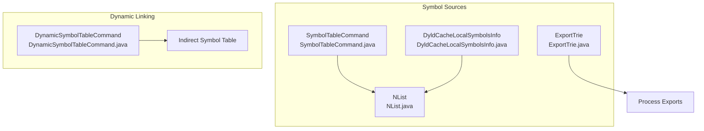
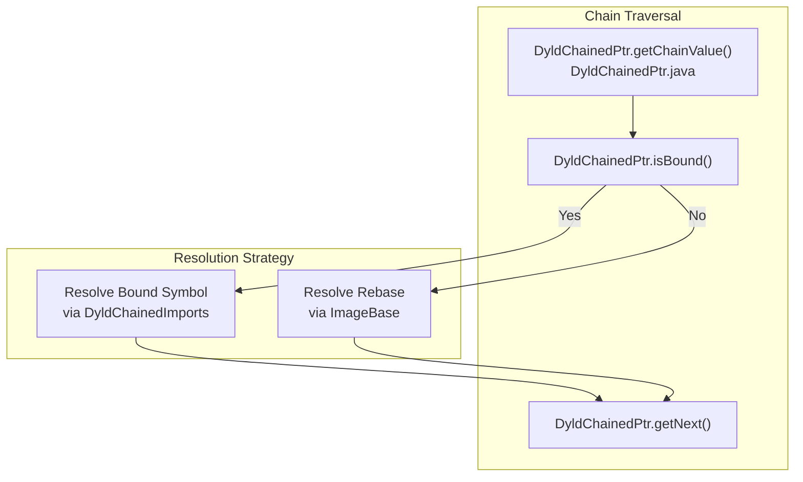
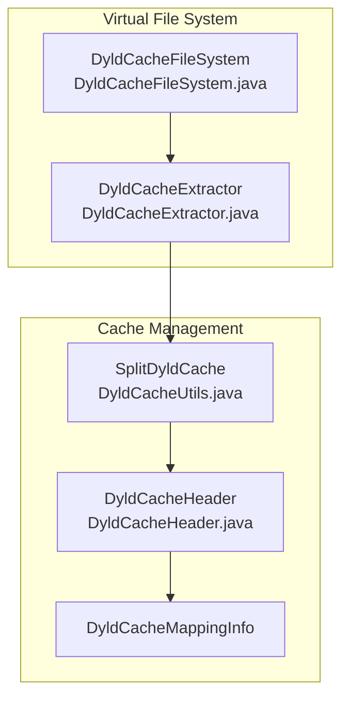
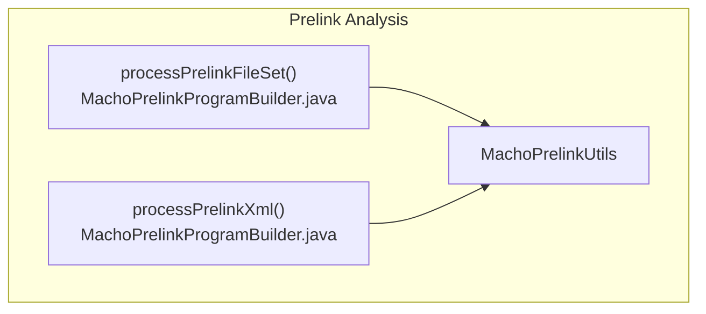

<!-- source: DeepWiki mcp.deepwiki.com · repo NationalSecurityAgency/ghidra · page 4.2 Mach-O Loader and DYLD Cache Support · fetched 2026-11-09 -->

# Mach-O Loader and DYLD Cache Support

<details>
<summary>Relevant source files</summary>

The following files were used as context for generating this wiki page:

- [Ghidra/Features/Base/src/main/java/ghidra/app/plugin/core/analysis/MachoFunctionStartsAnalyzer.java](Ghidra/Features/Base/src/main/java/ghidra/app/plugin/core/analysis/MachoFunctionStartsAnalyzer.java)
- [Ghidra/Features/Base/src/main/java/ghidra/app/util/bin/format/macho/CpuTypes.java](Ghidra/Features/Base/src/main/java/ghidra/app/util/bin/format/macho/CpuTypes.java)
- [Ghidra/Features/Base/src/main/java/ghidra/app/util/bin/format/macho/MachHeader.java](Ghidra/Features/Base/src/main/java/ghidra/app/util/bin/format/macho/MachHeader.java)
- [Ghidra/Features/Base/src/main/java/ghidra/app/util/bin/format/macho/Section.java](Ghidra/Features/Base/src/main/java/ghidra/app/util/bin/format/macho/Section.java)
- [Ghidra/Features/Base/src/main/java/ghidra/app/util/bin/format/macho/commands/BuildVersionCommand.java](Ghidra/Features/Base/src/main/java/ghidra/app/util/bin/format/macho/commands/BuildVersionCommand.java)
- [Ghidra/Features/Base/src/main/java/ghidra/app/util/bin/format/macho/commands/CorruptLoadCommand.java](Ghidra/Features/Base/src/main/java/ghidra/app/util/bin/format/macho/commands/CorruptLoadCommand.java)
- [Ghidra/Features/Base/src/main/java/ghidra/app/util/bin/format/macho/commands/DataInCodeCommand.java](Ghidra/Features/Base/src/main/java/ghidra/app/util/bin/format/macho/commands/DataInCodeCommand.java)
- [Ghidra/Features/Base/src/main/java/ghidra/app/util/bin/format/macho/commands/DyldChainedFixupsCommand.java](Ghidra/Features/Base/src/main/java/ghidra/app/util/bin/format/macho/commands/DyldChainedFixupsCommand.java)
- [Ghidra/Features/Base/src/main/java/ghidra/app/util/bin/format/macho/commands/DyldExportsTrieCommand.java](Ghidra/Features/Base/src/main/java/ghidra/app/util/bin/format/macho/commands/DyldExportsTrieCommand.java)
- [Ghidra/Features/Base/src/main/java/ghidra/app/util/bin/format/macho/commands/DyldInfoCommand.java](Ghidra/Features/Base/src/main/java/ghidra/app/util/bin/format/macho/commands/DyldInfoCommand.java)
- [Ghidra/Features/Base/src/main/java/ghidra/app/util/bin/format/macho/commands/DyldInfoCommandConstants.java](Ghidra/Features/Base/src/main/java/ghidra/app/util/bin/format/macho/commands/DyldInfoCommandConstants.java)
- [Ghidra/Features/Base/src/main/java/ghidra/app/util/bin/format/macho/commands/DynamicLibraryCommand.java](Ghidra/Features/Base/src/main/java/ghidra/app/util/bin/format/macho/commands/DynamicLibraryCommand.java)
- [Ghidra/Features/Base/src/main/java/ghidra/app/util/bin/format/macho/commands/DynamicSymbolTableCommand.java](Ghidra/Features/Base/src/main/java/ghidra/app/util/bin/format/macho/commands/DynamicSymbolTableCommand.java)
- [Ghidra/Features/Base/src/main/java/ghidra/app/util/bin/format/macho/commands/EncryptedInformationCommand.java](Ghidra/Features/Base/src/main/java/ghidra/app/util/bin/format/macho/commands/EncryptedInformationCommand.java)
- [Ghidra/Features/Base/src/main/java/ghidra/app/util/bin/format/macho/commands/ExportTrie.java](Ghidra/Features/Base/src/main/java/ghidra/app/util/bin/format/macho/commands/ExportTrie.java)
- [Ghidra/Features/Base/src/main/java/ghidra/app/util/bin/format/macho/commands/FixedVirtualMemoryFileCommand.java](Ghidra/Features/Base/src/main/java/ghidra/app/util/bin/format/macho/commands/FixedVirtualMemoryFileCommand.java)
- [Ghidra/Features/Base/src/main/java/ghidra/app/util/bin/format/macho/commands/FunctionStartsCommand.java](Ghidra/Features/Base/src/main/java/ghidra/app/util/bin/format/macho/commands/FunctionStartsCommand.java)
- [Ghidra/Features/Base/src/main/java/ghidra/app/util/bin/format/macho/commands/LinkEditDataCommand.java](Ghidra/Features/Base/src/main/java/ghidra/app/util/bin/format/macho/commands/LinkEditDataCommand.java)
- [Ghidra/Features/Base/src/main/java/ghidra/app/util/bin/format/macho/commands/LinkerOptionCommand.java](Ghidra/Features/Base/src/main/java/ghidra/app/util/bin/format/macho/commands/LinkerOptionCommand.java)
- [Ghidra/Features/Base/src/main/java/ghidra/app/util/bin/format/macho/commands/LoadCommand.java](Ghidra/Features/Base/src/main/java/ghidra/app/util/bin/format/macho/commands/LoadCommand.java)
- [Ghidra/Features/Base/src/main/java/ghidra/app/util/bin/format/macho/commands/LoadCommandFactory.java](Ghidra/Features/Base/src/main/java/ghidra/app/util/bin/format/macho/commands/LoadCommandFactory.java)
- [Ghidra/Features/Base/src/main/java/ghidra/app/util/bin/format/macho/commands/LoadCommandTypes.java](Ghidra/Features/Base/src/main/java/ghidra/app/util/bin/format/macho/commands/LoadCommandTypes.java)
- [Ghidra/Features/Base/src/main/java/ghidra/app/util/bin/format/macho/commands/NList.java](Ghidra/Features/Base/src/main/java/ghidra/app/util/bin/format/macho/commands/NList.java)
- [Ghidra/Features/Base/src/main/java/ghidra/app/util/bin/format/macho/commands/PreboundDynamicLibraryCommand.java](Ghidra/Features/Base/src/main/java/ghidra/app/util/bin/format/macho/commands/PreboundDynamicLibraryCommand.java)
- [Ghidra/Features/Base/src/main/java/ghidra/app/util/bin/format/macho/commands/SegmentCommand.java](Ghidra/Features/Base/src/main/java/ghidra/app/util/bin/format/macho/commands/SegmentCommand.java)
- [Ghidra/Features/Base/src/main/java/ghidra/app/util/bin/format/macho/commands/SegmentNames.java](Ghidra/Features/Base/src/main/java/ghidra/app/util/bin/format/macho/commands/SegmentNames.java)
- [Ghidra/Features/Base/src/main/java/ghidra/app/util/bin/format/macho/commands/SymbolTableCommand.java](Ghidra/Features/Base/src/main/java/ghidra/app/util/bin/format/macho/commands/SymbolTableCommand.java)
- [Ghidra/Features/Base/src/main/java/ghidra/app/util/bin/format/macho/commands/UnsupportedLoadCommand.java](Ghidra/Features/Base/src/main/java/ghidra/app/util/bin/format/macho/commands/UnsupportedLoadCommand.java)
- [Ghidra/Features/Base/src/main/java/ghidra/app/util/bin/format/macho/commands/chained/DyldChainedFixups.java](Ghidra/Features/Base/src/main/java/ghidra/app/util/bin/format/macho/commands/chained/DyldChainedFixups.java)
- [Ghidra/Features/Base/src/main/java/ghidra/app/util/bin/format/macho/commands/dyld/BindingTable.java](Ghidra/Features/Base/src/main/java/ghidra/app/util/bin/format/macho/commands/dyld/BindingTable.java)
- [Ghidra/Features/Base/src/main/java/ghidra/app/util/bin/format/macho/commands/dyld/OpcodeTable.java](Ghidra/Features/Base/src/main/java/ghidra/app/util/bin/format/macho/commands/dyld/OpcodeTable.java)
- [Ghidra/Features/Base/src/main/java/ghidra/app/util/bin/format/macho/commands/dyld/RebaseOpcode.java](Ghidra/Features/Base/src/main/java/ghidra/app/util/bin/format/macho/commands/dyld/RebaseOpcode.java)
- [Ghidra/Features/Base/src/main/java/ghidra/app/util/bin/format/macho/commands/dyld/RebaseTable.java](Ghidra/Features/Base/src/main/java/ghidra/app/util/bin/format/macho/commands/dyld/RebaseTable.java)
- [Ghidra/Features/Base/src/main/java/ghidra/app/util/bin/format/macho/dyld/DyldCacheAcceleratorDof.java](Ghidra/Features/Base/src/main/java/ghidra/app/util/bin/format/macho/dyld/DyldCacheAcceleratorDof.java)
- [Ghidra/Features/Base/src/main/java/ghidra/app/util/bin/format/macho/dyld/DyldCacheAcceleratorInitializer.java](Ghidra/Features/Base/src/main/java/ghidra/app/util/bin/format/macho/dyld/DyldCacheAcceleratorInitializer.java)
- [Ghidra/Features/Base/src/main/java/ghidra/app/util/bin/format/macho/dyld/DyldCacheHeader.java](Ghidra/Features/Base/src/main/java/ghidra/app/util/bin/format/macho/dyld/DyldCacheHeader.java)
- [Ghidra/Features/Base/src/main/java/ghidra/app/util/bin/format/macho/dyld/DyldCacheImage.java](Ghidra/Features/Base/src/main/java/ghidra/app/util/bin/format/macho/dyld/DyldCacheImage.java)
- [Ghidra/Features/Base/src/main/java/ghidra/app/util/bin/format/macho/dyld/DyldCacheImageInfo.java](Ghidra/Features/Base/src/main/java/ghidra/app/util/bin/format/macho/dyld/DyldCacheImageInfo.java)
- [Ghidra/Features/Base/src/main/java/ghidra/app/util/bin/format/macho/dyld/DyldCacheImageInfoExtra.java](Ghidra/Features/Base/src/main/java/ghidra/app/util/bin/format/macho/dyld/DyldCacheImageInfoExtra.java)
- [Ghidra/Features/Base/src/main/java/ghidra/app/util/bin/format/macho/dyld/DyldCacheImageTextInfo.java](Ghidra/Features/Base/src/main/java/ghidra/app/util/bin/format/macho/dyld/DyldCacheImageTextInfo.java)
- [Ghidra/Features/Base/src/main/java/ghidra/app/util/bin/format/macho/dyld/DyldCacheLocalSymbolsEntry.java](Ghidra/Features/Base/src/main/java/ghidra/app/util/bin/format/macho/dyld/DyldCacheLocalSymbolsEntry.java)
- [Ghidra/Features/Base/src/main/java/ghidra/app/util/bin/format/macho/dyld/DyldCacheLocalSymbolsInfo.java](Ghidra/Features/Base/src/main/java/ghidra/app/util/bin/format/macho/dyld/DyldCacheLocalSymbolsInfo.java)
- [Ghidra/Features/Base/src/main/java/ghidra/app/util/bin/format/macho/dyld/DyldCacheMappingAndSlideInfo.java](Ghidra/Features/Base/src/main/java/ghidra/app/util/bin/format/macho/dyld/DyldCacheMappingAndSlideInfo.java)
- [Ghidra/Features/Base/src/main/java/ghidra/app/util/bin/format/macho/dyld/DyldCacheMappingInfo.java](Ghidra/Features/Base/src/main/java/ghidra/app/util/bin/format/macho/dyld/DyldCacheMappingInfo.java)
- [Ghidra/Features/Base/src/main/java/ghidra/app/util/bin/format/macho/dyld/DyldCacheRangeEntry.java](Ghidra/Features/Base/src/main/java/ghidra/app/util/bin/format/macho/dyld/DyldCacheRangeEntry.java)
- [Ghidra/Features/Base/src/main/java/ghidra/app/util/bin/format/macho/dyld/DyldCacheSlideInfo1.java](Ghidra/Features/Base/src/main/java/ghidra/app/util/bin/format/macho/dyld/DyldCacheSlideInfo1.java)
- [Ghidra/Features/Base/src/main/java/ghidra/app/util/bin/format/macho/dyld/DyldCacheSlideInfo2.java](Ghidra/Features/Base/src/main/java/ghidra/app/util/bin/format/macho/dyld/DyldCacheSlideInfo2.java)
- [Ghidra/Features/Base/src/main/java/ghidra/app/util/bin/format/macho/dyld/DyldCacheSlideInfo3.java](Ghidra/Features/Base/src/main/java/ghidra/app/util/bin/format/macho/dyld/DyldCacheSlideInfo3.java)
- [Ghidra/Features/Base/src/main/java/ghidra/app/util/bin/format/macho/dyld/DyldCacheSlideInfo4.java](Ghidra/Features/Base/src/main/java/ghidra/app/util/bin/format/macho/dyld/DyldCacheSlideInfo4.java)
- [Ghidra/Features/Base/src/main/java/ghidra/app/util/bin/format/macho/dyld/DyldCacheSlideInfo5.java](Ghidra/Features/Base/src/main/java/ghidra/app/util/bin/format/macho/dyld/DyldCacheSlideInfo5.java)
- [Ghidra/Features/Base/src/main/java/ghidra/app/util/bin/format/macho/dyld/DyldCacheSlideInfoCommon.java](Ghidra/Features/Base/src/main/java/ghidra/app/util/bin/format/macho/dyld/DyldCacheSlideInfoCommon.java)
- [Ghidra/Features/Base/src/main/java/ghidra/app/util/bin/format/macho/dyld/DyldChainedPtr.java](Ghidra/Features/Base/src/main/java/ghidra/app/util/bin/format/macho/dyld/DyldChainedPtr.java)
- [Ghidra/Features/Base/src/main/java/ghidra/app/util/bin/format/macho/dyld/DyldFixup.java](Ghidra/Features/Base/src/main/java/ghidra/app/util/bin/format/macho/dyld/DyldFixup.java)
- [Ghidra/Features/Base/src/main/java/ghidra/app/util/bin/format/macho/dyld/DyldSubcacheEntry.java](Ghidra/Features/Base/src/main/java/ghidra/app/util/bin/format/macho/dyld/DyldSubcacheEntry.java)
- [Ghidra/Features/Base/src/main/java/ghidra/app/util/bin/format/macho/threadcommand/ThreadCommand.java](Ghidra/Features/Base/src/main/java/ghidra/app/util/bin/format/macho/threadcommand/ThreadCommand.java)
- [Ghidra/Features/Base/src/main/java/ghidra/app/util/opinion/DyldCacheLoader.java](Ghidra/Features/Base/src/main/java/ghidra/app/util/opinion/DyldCacheLoader.java)
- [Ghidra/Features/Base/src/main/java/ghidra/app/util/opinion/DyldCacheOptions.java](Ghidra/Features/Base/src/main/java/ghidra/app/util/opinion/DyldCacheOptions.java)
- [Ghidra/Features/Base/src/main/java/ghidra/app/util/opinion/DyldCacheProgramBuilder.java](Ghidra/Features/Base/src/main/java/ghidra/app/util/opinion/DyldCacheProgramBuilder.java)
- [Ghidra/Features/Base/src/main/java/ghidra/app/util/opinion/DyldCacheUtils.java](Ghidra/Features/Base/src/main/java/ghidra/app/util/opinion/DyldCacheUtils.java)
- [Ghidra/Features/Base/src/main/java/ghidra/app/util/opinion/MachoPrelinkProgramBuilder.java](Ghidra/Features/Base/src/main/java/ghidra/app/util/opinion/MachoPrelinkProgramBuilder.java)
- [Ghidra/Features/Base/src/main/java/ghidra/app/util/opinion/MachoProgramBuilder.java](Ghidra/Features/Base/src/main/java/ghidra/app/util/opinion/MachoProgramBuilder.java)
- [Ghidra/Features/FileFormats/src/main/java/ghidra/file/formats/android/bootldr/AndroidBootLoaderHeader.java](Ghidra/Features/FileFormats/src/main/java/ghidra/file/formats/android/bootldr/AndroidBootLoaderHeader.java)
- [Ghidra/Features/FileFormats/src/main/java/ghidra/file/formats/ios/ExtractedMacho.java](Ghidra/Features/FileFormats/src/main/java/ghidra/file/formats/ios/ExtractedMacho.java)
- [Ghidra/Features/FileFormats/src/main/java/ghidra/file/formats/ios/dyldcache/DyldCacheEntry.java](Ghidra/Features/FileFormats/src/main/java/ghidra/file/formats/ios/dyldcache/DyldCacheEntry.java)
- [Ghidra/Features/FileFormats/src/main/java/ghidra/file/formats/ios/dyldcache/DyldCacheExtractor.java](Ghidra/Features/FileFormats/src/main/java/ghidra/file/formats/ios/dyldcache/DyldCacheExtractor.java)
- [Ghidra/Features/FileFormats/src/main/java/ghidra/file/formats/ios/dyldcache/DyldCacheFileSystem.java](Ghidra/Features/FileFormats/src/main/java/ghidra/file/formats/ios/dyldcache/DyldCacheFileSystem.java)
- [Ghidra/Features/FileFormats/src/main/java/ghidra/file/formats/ios/dyldcache/DyldCacheFileSystemFactory.java](Ghidra/Features/FileFormats/src/main/java/ghidra/file/formats/ios/dyldcache/DyldCacheFileSystemFactory.java)
- [Ghidra/Features/FileFormats/src/main/java/ghidra/file/formats/ios/fileset/MachoFileSetEntry.java](Ghidra/Features/FileFormats/src/main/java/ghidra/file/formats/ios/fileset/MachoFileSetEntry.java)
- [Ghidra/Features/FileFormats/src/main/java/ghidra/file/formats/ios/fileset/MachoFileSetExtractor.java](Ghidra/Features/FileFormats/src/main/java/ghidra/file/formats/ios/fileset/MachoFileSetExtractor.java)
- [Ghidra/Features/FileFormats/src/main/java/ghidra/file/formats/ios/fileset/MachoFileSetFileSystem.java](Ghidra/Features/FileFormats/src/main/java/ghidra/file/formats/ios/fileset/MachoFileSetFileSystem.java)
- [Ghidra/Features/FileFormats/src/main/java/ghidra/macosx/plugins/DyldCacheBuilderPlugin.java](Ghidra/Features/FileFormats/src/main/java/ghidra/macosx/plugins/DyldCacheBuilderPlugin.java)
- [Ghidra/Features/FileFormats/src/main/java/ghidra/macosx/plugins/MachoFileSetBuilderPlugin.java](Ghidra/Features/FileFormats/src/main/java/ghidra/macosx/plugins/MachoFileSetBuilderPlugin.java)

</details>


## Purpose and Scope

This document details Ghidra's support for loading Mach-O (Mach Object) executables and DYLD (Dynamic Link Editor) shared caches. It covers the parsing of Mach-O headers (`MachHeader`), load commands (`SegmentCommand`, `SymbolTableCommand`), memory block creation from segments and sections, symbol table and local symbol processing, chained fixups (`DyldChainedFixups`), and the extraction and loading of libraries from DYLD caches (`SplitDyldCache`, `DyldCacheFileSystem`). For general loader framework concepts, see [Loader Framework Architecture](4.1). For details on library linking and external symbol resolution, see [Dynamic Linking and Symbol Resolution](4.3).

---

## Mach-O Loading Pipeline

The loading process follows a well-defined pipeline from binary detection through program construction, primarily managed by `MachoProgramBuilder`.

```mermaid
graph TB
    Provider["ByteProvider<br/>(ByteProvider.java)"]
    Opinion["MachoLoader<br/>findSupportedLoadSpecs()"]
    LoadSpec["LoadSpec<br/>(LoadSpec.java)"]
    
    subgraph "Program Creation"
        CreateProg["createProgram()<br/>ProgramDB"]
        SetProps["setProgramProperties()"]
    end
    
    subgraph "MachoProgramBuilder Execution"
        ParseHeader["MachHeader.parse()<br/>MachHeader.java"]
        SetImageBase["setProgramImageBase()<br/>MachoProgramBuilder.java"]
        
        subgraph "Memory Setup"
            ProcessMemBlocks["processMemoryBlocks()<br/>MachoProgramBuilder.java"]
            ProcessSections["processSections()<br/>SegmentCommand.java"]
            FixupTree["fixupProgramTree()<br/>MachoProgramBuilder.java"]
        end
        
        subgraph "Load Command Processing"
            ProcessEntry["processEntryPoint()<br/>MachoProgramBuilder.java"]
            ProcessExports["processExports()<br/>MachoProgramBuilder.java"]
            ProcessSymbols["processSymbolTables()<br/>SymbolTableCommand.java"]
            ProcessStubs["processStubs()<br/>MachoProgramBuilder.java"]
            ProcessFixups["processChainedFixups()<br/>DyldChainedFixups.java"]
            ProcessDyld["processDyldInfo()<br/>MachoProgramBuilder.java"]
        end
        
        subgraph "Markup"
            MarkupHeaders["markupHeaders()<br/>MachHeader.java"]
            MarkupSections["markupSections()<br/>MachoProgramBuilder.java"]
            MarkupLoadCmds["markupLoadCommandData()<br/>MachoProgramBuilder.java"]
        end
    end
    
    Provider --> Opinion
    Opinion --> LoadSpec
    LoadSpec --> CreateProg
    CreateProg --> SetProps
    SetProps --> ParseHeader
    ParseHeader --> SetImageBase
    
    SetImageBase --> ProcessMemBlocks
    ProcessMemBlocks --> ProcessSections
    ProcessSections --> FixupTree
    
    FixupTree --> ProcessEntry
    ProcessEntry --> ProcessExports
    ProcessExports --> ProcessSymbols
    ProcessSymbols --> ProcessStubs
    ProcessStubs --> ProcessFixups
    ProcessFixups --> ProcessDyld
    
    ProcessDyld --> MarkupHeaders
    MarkupHeaders --> MarkupSections
    MarkupSections --> MarkupLoadCmds
```



Sources: 
- [Ghidra/Features/Base/src/main/java/ghidra/app/util/opinion/MachoProgramBuilder.java:126-172]()
- [Ghidra/Features/Base/src/main/java/ghidra/app/util/bin/format/macho/MachHeader.java:151-196]()

---

## MachoProgramBuilder Class Hierarchy

The `MachoProgramBuilder` class [Ghidra/Features/Base/src/main/java/ghidra/app/util/opinion/MachoProgramBuilder.java:62-107]() orchestrates program building for Mach-O files. It is subclassed by `DyldCacheProgramBuilder` [Ghidra/Features/Base/src/main/java/ghidra/app/util/opinion/DyldCacheProgramBuilder.java:47-47]() for shared caches and `MachoPrelinkProgramBuilder` [Ghidra/Features/Base/src/main/java/ghidra/app/util/opinion/MachoPrelinkProgramBuilder.java:40-40]() for kernel caches.

```mermaid
graph TB
    MachoProgramBuilder["MachoProgramBuilder<br/>MachoProgramBuilder.java"]
    DyldCacheProgramBuilder["DyldCacheProgramBuilder<br/>DyldCacheProgramBuilder.java"]
    MachoPrelinkProgramBuilder["MachoPrelinkProgramBuilder<br/>MachoPrelinkProgramBuilder.java"]

    MachoProgramBuilder <|-- DyldCacheProgramBuilder
    MachoProgramBuilder <|-- MachoPrelinkProgramBuilder
    
    subgraph "Fields and State"
        machoHeader["MachHeader machoHeader"]
        program["Program program"]
        provider["ByteProvider provider"]
        fileBytes["FileBytes fileBytes"]
        memory["Memory memory"]
        space["AddressSpace space"]
    end
    
    subgraph "Core Methods"
        build["build()"]
        processMemoryBlocks["processMemoryBlocks()"]
        processSymbolTables["processSymbolTables()"]
        processChainedFixups["processChainedFixups()"]
        processDyldInfo["processDyldInfo()"]
    end

    MachoProgramBuilder --> machoHeader
    MachoProgramBuilder --> program
    DyldCacheProgramBuilder --> build
    MachoPrelinkProgramBuilder --> build
```

Sources:
- [Ghidra/Features/Base/src/main/java/ghidra/app/util/opinion/MachoProgramBuilder.java:62-107]()
- [Ghidra/Features/Base/src/main/java/ghidra/app/util/opinion/DyldCacheProgramBuilder.java:47-47]()
- [Ghidra/Features/Base/src/main/java/ghidra/app/util/opinion/MachoPrelinkProgramBuilder.java:40-40]()

---

## Memory Block Creation from Segments and Sections

Mach-O files organize memory layout into segments (`SegmentCommand`) which contain fine-grained sections (`Section`). Ghidra maps these directly into program memory blocks.

| Entity | Code Representation | Key Attributes |
| :--- | :--- | :--- |
| **Mach-O Header** | `MachHeader` [Ghidra/Features/Base/src/main/java/ghidra/app/util/bin/format/macho/MachHeader.java:36-44]() | `magic`, `cpuType`, `nCmds`, `flags` |
| **Segment** | `SegmentCommand` [Ghidra/Features/Base/src/main/java/ghidra/app/util/bin/format/macho/commands/SegmentCommand.java:38-78]() | `segname`, `vmaddr`, `vmsize`, `fileoff`, `filesize`, `initprot`, `maxprot` |
| **Section** | `Section` | `sectname`, `addr`, `size`, `offset`, `flags` |

The `SegmentCommand` class parses segment load commands (`LC_SEGMENT` and `LC_SEGMENT_64`), extracting virtual memory addresses and protections. `MachoProgramBuilder.processMemoryBlocks` converts these structures into Ghidra memory blocks.

Sources:
- [Ghidra/Features/Base/src/main/java/ghidra/app/util/bin/format/macho/commands/SegmentCommand.java:38-78]()
- [Ghidra/Features/Base/src/main/java/ghidra/app/util/opinion/MachoProgramBuilder.java:136-136]()
- [Ghidra/Features/Base/src/main/java/ghidra/app/util/bin/format/macho/MachHeader.java:179-181]()

---

## Symbol Table Processing

Symbol management in Mach-O relies on several command structures and tables.



### Symbol Processing Order
1. **Export Tries**: Modern binaries use `DyldInfoCommand` or `DyldExportsTrieCommand` processed via `ExportTrie`.
2. **Symbol Table Command**: `SymbolTableCommand` parses `NList` entries and populates string tables (`stroff`, `strsize`) [Ghidra/Features/Base/src/main/java/ghidra/app/util/bin/format/macho/commands/SymbolTableCommand.java:39-85](). Entries are sorted by string table indices to optimize loading performance.
3. **Local Symbols (DYLD Cache)**: `DyldCacheLocalSymbolsInfo` extracts local symbol tables (`nlistOffset`, `stringsOffset`) for system libraries inside shared caches [Ghidra/Features/Base/src/main/java/ghidra/app/util/bin/format/macho/dyld/DyldCacheLocalSymbolsInfo.java:44-90]().

Sources:
- [Ghidra/Features/Base/src/main/java/ghidra/app/util/bin/format/macho/commands/SymbolTableCommand.java:39-85]()
- [Ghidra/Features/Base/src/main/java/ghidra/app/util/bin/format/macho/dyld/DyldCacheLocalSymbolsInfo.java:44-90]()
- [Ghidra/Features/Base/src/main/java/ghidra/app/util/opinion/MachoProgramBuilder.java:140-144]()

---

## Chained Fixups Processing

Modern Mach-O binaries use chained fixups (`DyldChainedFixups`) for compact pointer relocation. 



`DyldChainedFixups.getChainedFixups` walks pointer chains, evaluating authentication (`DyldChainedPtr.isAuthenticated`), bound symbols (`DyldChainedImports`), and image-relative rebasing [Ghidra/Features/Base/src/main/java/ghidra/app/util/bin/format/macho/commands/chained/DyldChainedFixups.java:59-123]().

Sources:
- [Ghidra/Features/Base/src/main/java/ghidra/app/util/bin/format/macho/commands/chained/DyldChainedFixups.java:59-123]()
- [Ghidra/Features/Base/src/main/java/ghidra/app/util/bin/format/macho/dyld/DyldChainedPtr.java:24-110]()

---

## DYLD Cache Support

DYLD shared caches combine multiple system libraries into unified cache files. `DyldCacheLoader` [Ghidra/Features/Base/src/main/java/ghidra/app/util/opinion/DyldCacheLoader.java:33-143]() and `DyldCacheProgramBuilder` [Ghidra/Features/Base/src/main/java/ghidra/app/util/opinion/DyldCacheProgramBuilder.java:47-47]() manage loading and parsing these files.



| Code Entity | Role |
| :--- | :--- |
| `SplitDyldCache` | Manages multi-file subcache collections (`.1`, `.2`, `.symbols`) [Ghidra/Features/Base/src/main/java/ghidra/app/util/opinion/DyldCacheUtils.java:143-162](). |
| `DyldCacheHeader` | Parses `dyld_cache_header` structures and mapping offsets [Ghidra/Features/Base/src/main/java/ghidra/app/util/bin/format/macho/dyld/DyldCacheHeader.java:39-135](). |
| `DyldCacheFileSystem` | Exposes cache components as a navigable virtual file system [Ghidra/Features/FileFormats/src/main/java/ghidra/file/formats/ios/dyldcache/DyldCacheFileSystem.java:48-132](). |

Sources:
- [Ghidra/Features/Base/src/main/java/ghidra/app/util/bin/format/macho/dyld/DyldCacheHeader.java:39-135]()
- [Ghidra/Features/Base/src/main/java/ghidra/app/util/opinion/DyldCacheUtils.java:143-162]()
- [Ghidra/Features/FileFormats/src/main/java/ghidra/file/formats/ios/dyldcache/DyldCacheFileSystem.java:48-132]()
- [Ghidra/Features/Base/src/main/java/ghidra/app/util/opinion/DyldCacheProgramBuilder.java:47-127]()

---

## Prelink Support

`MachoPrelinkProgramBuilder` handles kernel cache files containing multiple prelinked extensions (`kext` bundles) [Ghidra/Features/Base/src/main/java/ghidra/app/util/opinion/MachoPrelinkProgramBuilder.java:40-40]().



It parses modern `LC_FILESET_ENTRY` commands or falls back to parsing XML prelink maps (`__PRELINK_INFO`) to locate and instantiate inner Mach-O headers [Ghidra/Features/Base/src/main/java/ghidra/app/util/opinion/MachoPrelinkProgramBuilder.java:77-110]().

Sources:
- [Ghidra/Features/Base/src/main/java/ghidra/app/util/opinion/MachoPrelinkProgramBuilder.java:40-110]()
- [Ghidra/Features/Base/src/main/java/ghidra/app/util/opinion/MachoPrelinkProgramBuilder.java:118-175]()

---

