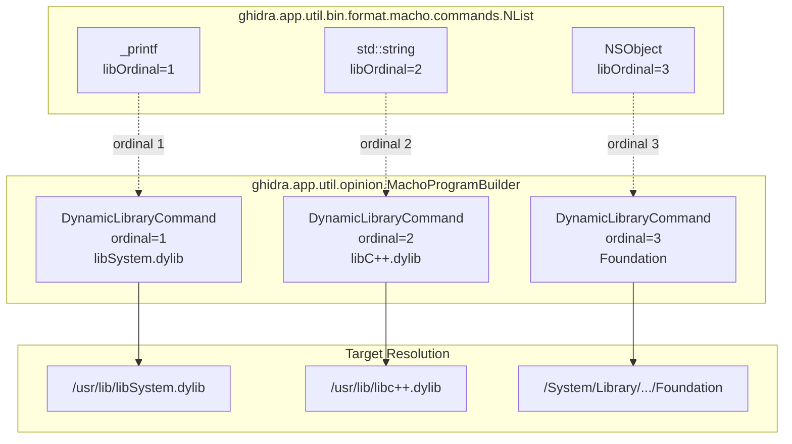
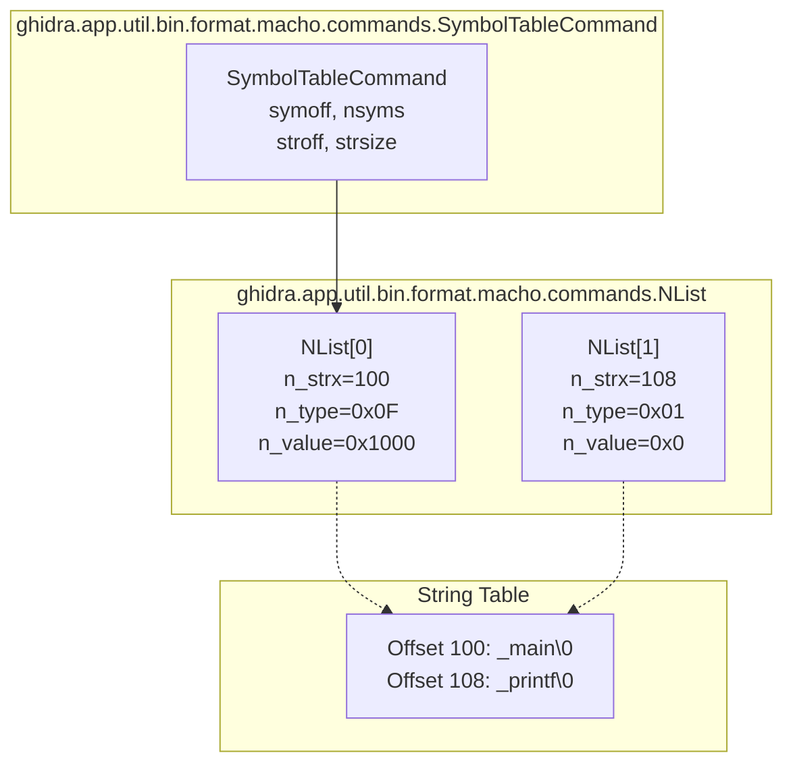
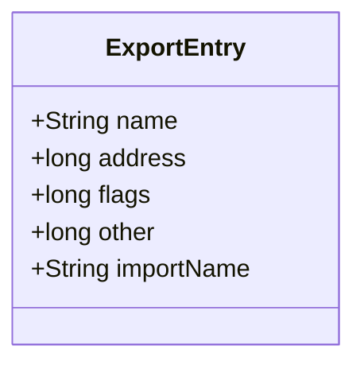
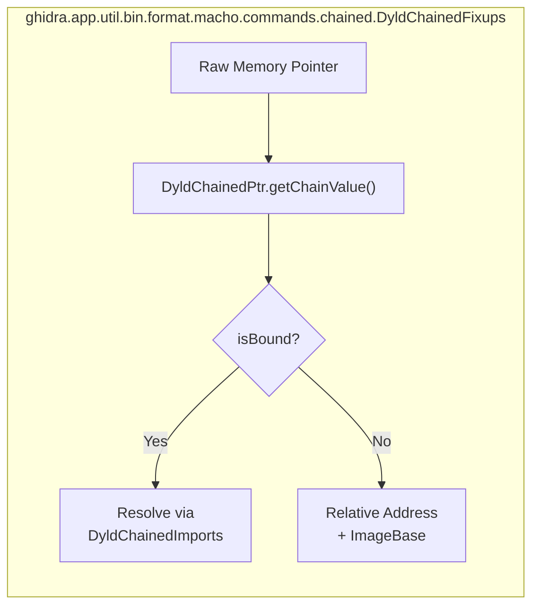
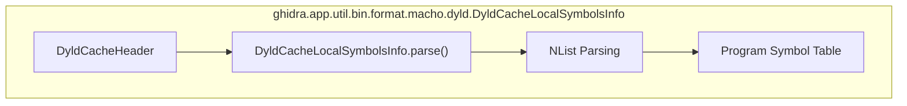

<!-- source: DeepWiki mcp.deepwiki.com · repo NationalSecurityAgency/ghidra · page 4.3 Dynamic Linking and Symbol Resolution · fetched 2026-11-09 -->

# Dynamic Linking and Symbol Resolution

Relevant source files

The following files were used as context for generating this wiki page:

- [Ghidra/Debug/TaintAnalysis/src/main/java/ghidra/taint/gui/field/TaintFieldFactory.java](Ghidra/Debug/TaintAnalysis/src/main/java/ghidra/taint/gui/field/TaintFieldFactory.java)
- [Ghidra/Extensions/sample/src/main/java/ghidra/examples/EntropyFieldFactory.java](Ghidra/Extensions/sample/src/main/java/ghidra/examples/EntropyFieldFactory.java)
- [Ghidra/Features/Base/data/symbols/README.txt](Ghidra/Features/Base/data/symbols/README.txt)
- [Ghidra/Features/Base/ghidra_scripts/CreateExportFileForDLL.java](Ghidra/Features/Base/ghidra_scripts/CreateExportFileForDLL.java)
- [Ghidra/Features/Base/src/main/java/ghidra/app/cmd/function/CallDepthChangeInfo.java](Ghidra/Features/Base/src/main/java/ghidra/app/cmd/function/CallDepthChangeInfo.java)
- [Ghidra/Features/Base/src/main/java/ghidra/app/cmd/function/FunctionPurgeAnalysisCmd.java](Ghidra/Features/Base/src/main/java/ghidra/app/cmd/function/FunctionPurgeAnalysisCmd.java)
- [Ghidra/Features/Base/src/main/java/ghidra/app/plugin/core/function/StackDepthFieldFactory.java](Ghidra/Features/Base/src/main/java/ghidra/app/plugin/core/function/StackDepthFieldFactory.java)
- [Ghidra/Features/Base/src/main/java/ghidra/app/util/bin/format/macho/commands/DataInCodeCommand.java](Ghidra/Features/Base/src/main/java/ghidra/app/util/bin/format/macho/commands/DataInCodeCommand.java)
- [Ghidra/Features/Base/src/main/java/ghidra/app/util/bin/format/macho/commands/DyldChainedFixupsCommand.java](Ghidra/Features/Base/src/main/java/ghidra/app/util/bin/format/macho/commands/DyldChainedFixupsCommand.java)
- [Ghidra/Features/Base/src/main/java/ghidra/app/util/bin/format/macho/commands/DyldExportsTrieCommand.java](Ghidra/Features/Base/src/main/java/ghidra/app/util/bin/format/macho/commands/DyldExportsTrieCommand.java)
- [Ghidra/Features/Base/src/main/java/ghidra/app/util/bin/format/macho/commands/DyldInfoCommand.java](Ghidra/Features/Base/src/main/java/ghidra/app/util/bin/format/macho/commands/DyldInfoCommand.java)
- [Ghidra/Features/Base/src/main/java/ghidra/app/util/bin/format/macho/commands/DyldInfoCommandConstants.java](Ghidra/Features/Base/src/main/java/ghidra/app/util/bin/format/macho/commands/DyldInfoCommandConstants.java)
- [Ghidra/Features/Base/src/main/java/ghidra/app/util/bin/format/macho/commands/DynamicLibraryCommand.java](Ghidra/Features/Base/src/main/java/ghidra/app/util/bin/format/macho/commands/DynamicLibraryCommand.java)
- [Ghidra/Features/Base/src/main/java/ghidra/app/util/bin/format/macho/commands/DynamicSymbolTableCommand.java](Ghidra/Features/Base/src/main/java/ghidra/app/util/bin/format/macho/commands/DynamicSymbolTableCommand.java)
- [Ghidra/Features/Base/src/main/java/ghidra/app/util/bin/format/macho/commands/ExportTrie.java](Ghidra/Features/Base/src/main/java/ghidra/app/util/bin/format/macho/commands/ExportTrie.java)
- [Ghidra/Features/Base/src/main/java/ghidra/app/util/bin/format/macho/commands/FunctionStartsCommand.java](Ghidra/Features/Base/src/main/java/ghidra/app/util/bin/format/macho/commands/FunctionStartsCommand.java)
- [Ghidra/Features/Base/src/main/java/ghidra/app/util/bin/format/macho/commands/LinkEditDataCommand.java](Ghidra/Features/Base/src/main/java/ghidra/app/util/bin/format/macho/commands/LinkEditDataCommand.java)
- [Ghidra/Features/Base/src/main/java/ghidra/app/util/bin/format/macho/commands/LoadCommand.java](Ghidra/Features/Base/src/main/java/ghidra/app/util/bin/format/macho/commands/LoadCommand.java)
- [Ghidra/Features/Base/src/main/java/ghidra/app/util/bin/format/macho/commands/NList.java](Ghidra/Features/Base/src/main/java/ghidra/app/util/bin/format/macho/commands/NList.java)
- [Ghidra/Features/Base/src/main/java/ghidra/app/util/bin/format/macho/commands/SymbolTableCommand.java](Ghidra/Features/Base/src/main/java/ghidra/app/util/bin/format/macho/commands/SymbolTableCommand.java)
- [Ghidra/Features/Base/src/main/java/ghidra/app/util/bin/format/macho/commands/chained/DyldChainedFixups.java](Ghidra/Features/Base/src/main/java/ghidra/app/util/bin/format/macho/commands/chained/DyldChainedFixups.java)
- [Ghidra/Features/Base/src/main/java/ghidra/app/util/bin/format/macho/commands/dyld/BindingTable.java](Ghidra/Features/Base/src/main/java/ghidra/app/util/bin/format/macho/commands/dyld/BindingTable.java)
- [Ghidra/Features/Base/src/main/java/ghidra/app/util/bin/format/macho/commands/dyld/OpcodeTable.java](Ghidra/Features/Base/src/main/java/ghidra/app/util/bin/format/macho/commands/dyld/OpcodeTable.java)
- [Ghidra/Features/Base/src/main/java/ghidra/app/util/bin/format/macho/commands/dyld/RebaseOpcode.java](Ghidra/Features/Base/src/main/java/ghidra/app/util/bin/format/macho/commands/dyld/RebaseOpcode.java)
- [Ghidra/Features/Base/src/main/java/ghidra/app/util/bin/format/macho/commands/dyld/RebaseTable.java](Ghidra/Features/Base/src/main/java/ghidra/app/util/bin/format/macho/commands/dyld/RebaseTable.java)
- [Ghidra/Features/Base/src/main/java/ghidra/app/util/bin/format/macho/dyld/DyldCacheAcceleratorDof.java](Ghidra/Features/Base/src/main/java/ghidra/app/util/bin/format/macho/dyld/DyldCacheAcceleratorDof.java)
- [Ghidra/Features/Base/src/main/java/ghidra/app/util/bin/format/macho/dyld/DyldCacheAcceleratorInitializer.java](Ghidra/Features/Base/src/main/java/ghidra/app/util/bin/format/macho/dyld/DyldCacheAcceleratorInitializer.java)
- [Ghidra/Features/Base/src/main/java/ghidra/app/util/bin/format/macho/dyld/DyldCacheImageInfoExtra.java](Ghidra/Features/Base/src/main/java/ghidra/app/util/bin/format/macho/dyld/DyldCacheImageInfoExtra.java)
- [Ghidra/Features/Base/src/main/java/ghidra/app/util/bin/format/macho/dyld/DyldCacheLocalSymbolsEntry.java](Ghidra/Features/Base/src/main/java/ghidra/app/util/bin/format/macho/dyld/DyldCacheLocalSymbolsEntry.java)
- [Ghidra/Features/Base/src/main/java/ghidra/app/util/bin/format/macho/dyld/DyldCacheLocalSymbolsInfo.java](Ghidra/Features/Base/src/main/java/ghidra/app/util/bin/format/macho/dyld/DyldCacheLocalSymbolsInfo.java)
- [Ghidra/Features/Base/src/main/java/ghidra/app/util/bin/format/macho/dyld/DyldCacheRangeEntry.java](Ghidra/Features/Base/src/main/java/ghidra/app/util/bin/format/macho/dyld/DyldCacheRangeEntry.java)
- [Ghidra/Features/Base/src/main/java/ghidra/app/util/bin/format/macho/dyld/DyldFixup.java](Ghidra/Features/Base/src/main/java/ghidra/app/util/bin/format/macho/dyld/DyldFixup.java)
- [Ghidra/Features/Base/src/main/java/ghidra/app/util/bin/format/ne/Segment.java](Ghidra/Features/Base/src/main/java/ghidra/app/util/bin/format/ne/Segment.java)
- [Ghidra/Features/Base/src/main/java/ghidra/app/util/importer/LibrarySearchPathManager.java](Ghidra/Features/Base/src/main/java/ghidra/app/util/importer/LibrarySearchPathManager.java)
- [Ghidra/Features/Base/src/main/java/ghidra/app/util/importer/LoaderArgsOptionChooser.java](Ghidra/Features/Base/src/main/java/ghidra/app/util/importer/LoaderArgsOptionChooser.java)
- [Ghidra/Features/Base/src/main/java/ghidra/app/util/importer/OptionChooser.java](Ghidra/Features/Base/src/main/java/ghidra/app/util/importer/OptionChooser.java)
- [Ghidra/Features/Base/src/main/java/ghidra/app/util/importer/SingleLoaderFilter.java](Ghidra/Features/Base/src/main/java/ghidra/app/util/importer/SingleLoaderFilter.java)
- [Ghidra/Features/Base/src/main/java/ghidra/app/util/opinion/AbstractLibrarySupportLoader.java](Ghidra/Features/Base/src/main/java/ghidra/app/util/opinion/AbstractLibrarySupportLoader.java)
- [Ghidra/Features/Base/src/main/java/ghidra/app/util/opinion/AbstractOrdinalSupportLoader.java](Ghidra/Features/Base/src/main/java/ghidra/app/util/opinion/AbstractOrdinalSupportLoader.java)
- [Ghidra/Features/Base/src/main/java/ghidra/app/util/opinion/AbstractProgramLoader.java](Ghidra/Features/Base/src/main/java/ghidra/app/util/opinion/AbstractProgramLoader.java)
- [Ghidra/Features/Base/src/main/java/ghidra/app/util/opinion/LibraryLookupTable.java](Ghidra/Features/Base/src/main/java/ghidra/app/util/opinion/LibraryLookupTable.java)
- [Ghidra/Features/Base/src/main/java/ghidra/app/util/opinion/LibrarySymbolTable.java](Ghidra/Features/Base/src/main/java/ghidra/app/util/opinion/LibrarySymbolTable.java)
- [Ghidra/Features/Base/src/main/java/ghidra/app/util/opinion/LoadResults.java](Ghidra/Features/Base/src/main/java/ghidra/app/util/opinion/LoadResults.java)
- [Ghidra/Features/Base/src/main/java/ghidra/app/util/opinion/Loaded.java](Ghidra/Features/Base/src/main/java/ghidra/app/util/opinion/Loaded.java)
- [Ghidra/Features/Base/src/main/java/ghidra/app/util/opinion/MachoLoader.java](Ghidra/Features/Base/src/main/java/ghidra/app/util/opinion/MachoLoader.java)
- [Ghidra/Features/Base/src/main/java/ghidra/app/util/opinion/MachoProgramBuilder.java](Ghidra/Features/Base/src/main/java/ghidra/app/util/opinion/MachoProgramBuilder.java)
- [Ghidra/Features/Base/src/main/java/ghidra/app/util/opinion/NeLoader.java](Ghidra/Features/Base/src/main/java/ghidra/app/util/opinion/NeLoader.java)
- [Ghidra/Features/Base/src/main/java/ghidra/base/project/GhidraProject.java](Ghidra/Features/Base/src/main/java/ghidra/base/project/GhidraProject.java)
- [Ghidra/Features/Base/src/test/java/ghidra/app/util/opinion/OrdinalFileSymbolLoadTest.java](Ghidra/Features/Base/src/test/java/ghidra/app/util/opinion/OrdinalFileSymbolLoadTest.java)
- [Ghidra/Features/Base/src/test/resources/ghidra/app/util/opinion/test.ord](Ghidra/Features/Base/src/test/resources/ghidra/app/util/opinion/test.ord)
- [Ghidra/Features/FileFormats/src/main/java/ghidra/app/util/opinion/ApkLoader.java](Ghidra/Features/FileFormats/src/main/java/ghidra/app/util/opinion/ApkLoader.java)
- [Ghidra/Features/FileFormats/src/main/java/ghidra/app/util/opinion/DyldCacheExtractLoader.java](Ghidra/Features/FileFormats/src/main/java/ghidra/app/util/opinion/DyldCacheExtractLoader.java)
- [Ghidra/Features/FileFormats/src/main/java/ghidra/app/util/opinion/MachoExtractProgramBuilder.java](Ghidra/Features/FileFormats/src/main/java/ghidra/app/util/opinion/MachoExtractProgramBuilder.java)
- [Ghidra/Features/FileFormats/src/main/java/ghidra/app/util/opinion/MachoFileSetExtractLoader.java](Ghidra/Features/FileFormats/src/main/java/ghidra/app/util/opinion/MachoFileSetExtractLoader.java)
- [Ghidra/Features/FileFormats/src/main/java/ghidra/file/formats/android/bootldr/AndroidBootLoaderHeader.java](Ghidra/Features/FileFormats/src/main/java/ghidra/file/formats/android/bootldr/AndroidBootLoaderHeader.java)
- [Ghidra/Features/FileFormats/src/main/java/ghidra/file/formats/ios/ExtractedMacho.java](Ghidra/Features/FileFormats/src/main/java/ghidra/file/formats/ios/ExtractedMacho.java)
- [Ghidra/Features/FileFormats/src/main/java/ghidra/macosx/plugins/DyldCacheBuilderPlugin.java](Ghidra/Features/FileFormats/src/main/java/ghidra/macosx/plugins/DyldCacheBuilderPlugin.java)
- [Ghidra/Framework/SoftwareModeling/src/main/java/ghidra/program/model/listing/Program.java](Ghidra/Framework/SoftwareModeling/src/main/java/ghidra/program/model/listing/Program.java)
- [Ghidra/Framework/SoftwareModeling/src/main/java/ghidra/program/model/pcode/VarnodeTranslator.java](Ghidra/Framework/SoftwareModeling/src/main/java/ghidra/program/model/pcode/VarnodeTranslator.java)
- [Ghidra/Processors/x86/data/languages/x86-16.cspec](Ghidra/Processors/x86/data/languages/x86-16.cspec)
- [Ghidra/Processors/x86/data/patterns/patternconstraints.xml](Ghidra/Processors/x86/data/patterns/patternconstraints.xml)
- [Ghidra/Processors/x86/data/patterns/x86-16_default_patterns.xml](Ghidra/Processors/x86/data/patterns/x86-16_default_patterns.xml)

This document describes how Ghidra handles dynamic linking and symbol resolution for Mach-O binaries. It covers the mechanisms used to resolve external library references, process symbol tables, handle binding information, and apply fixups during program loading.

For information about the overall Mach-O loading process and memory block creation, see [4.2 Mach-O Loader and DYLD Cache Support](). For the general loader framework, see [4.1 Loader Framework Architecture]().

---

## Overview

Mach-O binaries use several interconnected mechanisms to support dynamic linking:

- **Library Ordinals**: Numeric identifiers that reference dependent libraries (`ghidra.app.util.bin.format.macho.commands.DynamicLibraryCommand`) [Ghidra/Features/Base/src/main/java/ghidra/app/util/bin/format/macho/commands/DynamicLibraryCommand.java:1-1]()
- **Symbol Tables**: Collections of symbols (both local and external) stored in `LC_SYMTAB` and `LC_DYSYMTAB` commands via `SymbolTableCommand` and `DynamicSymbolTableCommand` [Ghidra/Features/Base/src/main/java/ghidra/app/util/bin/format/macho/commands/SymbolTableCommand.java:39-85](), [Ghidra/Features/Base/src/main/java/ghidra/app/util/bin/format/macho/commands/DynamicSymbolTableCommand.java:38-135]()
- **Export Tries**: Compressed tree structures containing exported symbols (`ExportTrie`) [Ghidra/Features/Base/src/main/java/ghidra/app/util/bin/format/macho/commands/ExportTrie.java:1-1]()
- **Binding Tables**: Instructions for binding imported symbols to addresses (`BindingTable`) [Ghidra/Features/Base/src/main/java/ghidra/app/util/bin/format/macho/commands/dyld/BindingTable.java:1-1]()
- **Chained Fixups**: Modern pointer fixup mechanism (`DyldChainedFixups`) that chains related fixups together [Ghidra/Features/Base/src/main/java/ghidra/app/util/bin/format/macho/commands/chained/DyldChainedFixups.java:37-123]()
- **Stub Functions**: Trampolines for external function calls created during `processStubs()` in `MachoProgramBuilder` [Ghidra/Features/Base/src/main/java/ghidra/app/util/opinion/MachoProgramBuilder.java:139-144]()

These components work together to enable code sharing between executables and dynamic libraries.

Sources: [Ghidra/Features/Base/src/main/java/ghidra/app/util/opinion/MachoProgramBuilder.java:126-172](), [Ghidra/Features/Base/src/main/java/ghidra/app/util/bin/format/macho/commands/SymbolTableCommand.java:39-85](), [Ghidra/Features/Base/src/main/java/ghidra/app/util/bin/format/macho/commands/chained/DyldChainedFixups.java:37-123]()

---

## Library Ordinal System

### Library Path Management

Libraries are referenced by ordinal numbers (indices) rather than by full paths. The ordinal system maps numeric identifiers to actual library paths.

**Library Ordinal Processing Flow**

The `MachoProgramBuilder.processLibraries()` method builds the library path list by iterating through load commands and extracting names from `DynamicLibraryCommand` objects.

Sources: [Ghidra/Features/Base/src/main/java/ghidra/app/util/opinion/MachoProgramBuilder.java:126-172](), [Ghidra/Features/Base/src/main/java/ghidra/app/util/bin/format/macho/commands/NList.java:195-197]()

### Library Ordinal Resolution

The `MachoProgramBuilder` handles special ordinals during the binding process to ensure symbols are resolved to the correct binary image or self-reference.

Sources: [Ghidra/Features/Base/src/main/java/ghidra/app/util/opinion/MachoProgramBuilder.java:126-172]()

---

## Symbol Table Architecture

### SymbolTableCommand Structure

The `LC_SYMTAB` command contains the symbol table and string table for all symbols in the Mach-O file. It is represented by the `SymbolTableCommand` class, which parses `NList` records and associates them with strings from the string table.

Sources: [Ghidra/Features/Base/src/main/java/ghidra/app/util/bin/format/macho/commands/SymbolTableCommand.java:39-85](), [Ghidra/Features/Base/src/main/java/ghidra/app/util/bin/format/macho/commands/NList.java:43-56]()

### DynamicSymbolTableCommand Structure

The `LC_DYSYMTAB` command (`DynamicSymbolTableCommand`) provides additional organization of symbols for dynamic linking, categorizing them into local, externally defined, and undefined symbols. It also manages indirect symbols used by stubs.

Sources: [Ghidra/Features/Base/src/main/java/ghidra/app/util/bin/format/macho/commands/DynamicSymbolTableCommand.java:38-135]()

---

## Export Tries

Export tries are compressed tree structures that efficiently represent exported symbols. They are processed via `ExportTrie` and `ExportEntry`.

### Export Entry Structure

The `ExportEntry` class represents a leaf in the trie, containing the symbol name, flags, and address.

Sources: [Ghidra/Features/Base/src/main/java/ghidra/app/util/bin/format/macho/commands/ExportTrie.java:32-32](), [Ghidra/Features/Base/src/main/java/ghidra/app/util/opinion/MachoProgramBuilder.java:140-141]()

---

## Binding Tables

Binding tables contain opcodes for the dynamic linker to bind imported symbols. `DyldInfoCommand` manages rebase, bind, lazy bind, and weak bind tables.

### Binding Process

The `MachoProgramBuilder` parses these tables and applies the results to the program's memory and relocation table.

Sources: [Ghidra/Features/Base/src/main/java/ghidra/app/util/opinion/MachoProgramBuilder.java:126-172](), [Ghidra/Features/Base/src/main/java/ghidra/app/util/bin/format/macho/commands/DyldInfoCommand.java:44-55]()

---

## Chained Fixups

`DyldChainedFixups` is a modern mechanism where fixup information is stored in a linked list embedded within the data pages.

### Chained Fixup Processing

The `DyldChainedFixups.getChainedFixups()` method traverses the chains and decodes `DyldChainedPtr` values based on the `DyldChainType` (e.g., `DYLD_CHAINED_PTR_64`, `DYLD_CHAINED_PTR_ARM64E`).

Sources: [Ghidra/Features/Base/src/main/java/ghidra/app/util/bin/format/macho/commands/chained/DyldChainedFixups.java:59-123](), [Ghidra/Features/Base/src/main/java/ghidra/app/util/bin/format/macho/dyld/DyldChainedPtr.java:25-77]()

---

## Stub Functions

Stub sections (`S_SYMBOL_STUBS`) contain trampolines for external calls. Ghidra creates one-byte thunk functions in the listing that point to the `EXTERNAL` block.

**Stub Creation Logic**:
1. `MachoProgramBuilder` identifies stub sections via segment and section attributes.
2. It looks up the symbol via the `indirectSymbols` table in `DynamicSymbolTableCommand`.
3. It marks up the stub in the program listing.

Sources: [Ghidra/Features/Base/src/main/java/ghidra/app/util/opinion/MachoProgramBuilder.java:139-144](), [Ghidra/Features/Base/src/main/java/ghidra/app/util/bin/format/macho/commands/DynamicSymbolTableCommand.java:117-122]()

---

## DYLD Cache Symbol Resolution

For DYLD Cache files, symbol resolution involves mapping local symbols from separate subcache files or the `.symbols` subcache using `DyldCacheLocalSymbolsInfo`.

### Local Symbol Processing

The cache headers and local symbol info structures manage the parsing of local symbol information across split cache files.

Sources: [Ghidra/Features/Base/src/main/java/ghidra/app/util/bin/format/macho/dyld/DyldCacheLocalSymbolsInfo.java:44-101](), [Ghidra/Features/Base/src/main/java/ghidra/app/util/bin/format/macho/dyld/DyldCacheLocalSymbolsInfo.java:163-183]()

---

## RTTI Structure Processing

Ghidra provides specialized support for C++ RTTI and Golang RTTI in Mach-O binaries.

### Golang RTTI
For Mach-O files identified as Golang programs, `MachoProgramBuilder` invokes markup procedures utilizing the `GoRttiMapper` to identify and mark up runtime type structures and function metadata.

Sources: [Ghidra/Features/Base/src/main/java/ghidra/app/util/opinion/MachoProgramBuilder.java:166-168](), [Ghidra/Features/Base/src/main/java/ghidra/app/util/bin/format/golang/rtti/GoRttiMapper.java:29-30]()

---

## Integration in Loading Pipeline

The `MachoProgramBuilder.build()` method orchestrates the sequence of resolution.

| Step | Method | Description |
|------|--------|-------------|
| 1 | `processExports()` | Extracts exported symbols from trie. [Ghidra/Features/Base/src/main/java/ghidra/app/util/opinion/MachoProgramBuilder.java:140-140]() |
| 2 | `processSymbolTables()` | Processes standard Mach-O symbols. [Ghidra/Features/Base/src/main/java/ghidra/app/util/opinion/MachoProgramBuilder.java:141-141]() |
| 3 | `processStubs()` | Creates thunks for external calls. [Ghidra/Features/Base/src/main/java/ghidra/app/util/opinion/MachoProgramBuilder.java:142-142]() |
| 4 | `processLibraries()` | Identifies dependent dylibs. [Ghidra/Features/Base/src/main/java/ghidra/app/util/opinion/MachoProgramBuilder.java:145-145]() |
| 5 | `processChainedFixups()` | Resolves modern chained pointers. [Ghidra/Features/Base/src/main/java/ghidra/app/util/opinion/MachoProgramBuilder.java:146-146]() |
| 6 | `processDyldInfo()` | Processes legacy binding opcodes. [Ghidra/Features/Base/src/main/java/ghidra/app/util/opinion/MachoProgramBuilder.java:147-147]() |

Sources: [Ghidra/Features/Base/src/main/java/ghidra/app/util/opinion/MachoProgramBuilder.java:126-172]()

---

