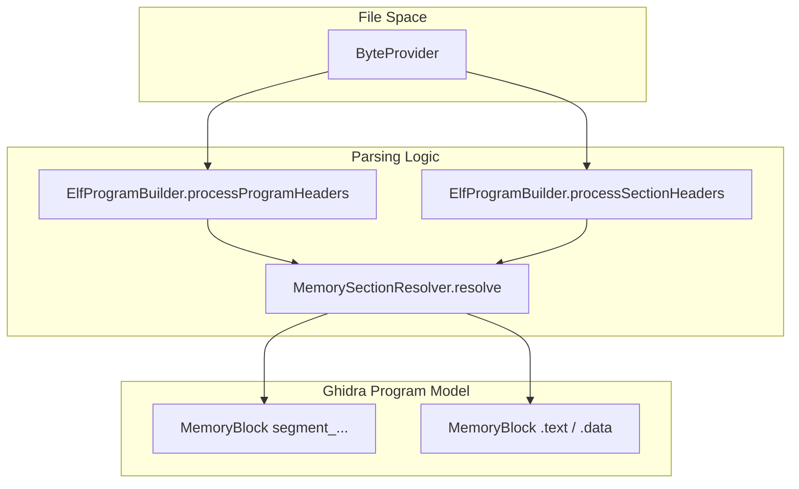
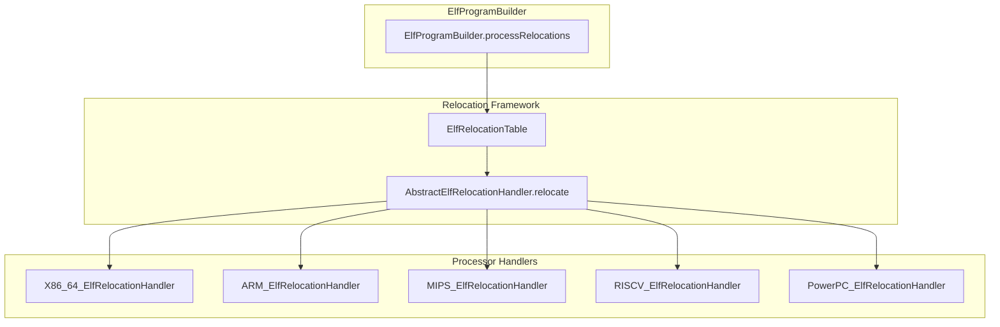
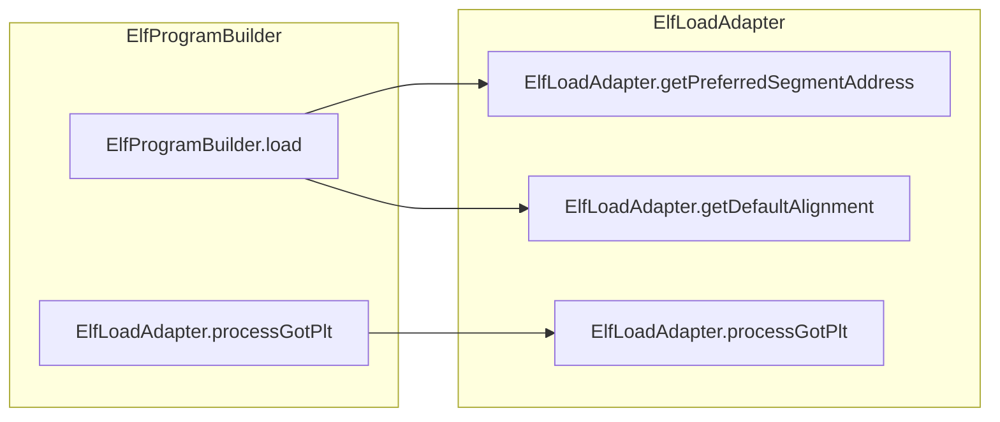

<!-- source: DeepWiki mcp.deepwiki.com · repo NationalSecurityAgency/ghidra · page 4.4 ELF Loader · fetched 2026-11-09 -->

# ELF Loader

Relevant source files

The following files were used as context for generating this wiki page:

- [Ghidra/Features/Base/src/main/java/ghidra/app/util/bin/MemBufferByteProvider.java](Ghidra/Features/Base/src/main/java/ghidra/app/util/bin/MemBufferByteProvider.java)
- [Ghidra/Features/Base/src/main/java/ghidra/app/util/bin/format/elf/AndroidElfRelocationData.java](Ghidra/Features/Base/src/main/java/ghidra/app/util/bin/format/elf/AndroidElfRelocationData.java)
- [Ghidra/Features/Base/src/main/java/ghidra/app/util/bin/format/elf/AndroidElfRelocationGroup.java](Ghidra/Features/Base/src/main/java/ghidra/app/util/bin/format/elf/AndroidElfRelocationGroup.java)
- [Ghidra/Features/Base/src/main/java/ghidra/app/util/bin/format/elf/AndroidElfRelocationOffset.java](Ghidra/Features/Base/src/main/java/ghidra/app/util/bin/format/elf/AndroidElfRelocationOffset.java)
- [Ghidra/Features/Base/src/main/java/ghidra/app/util/bin/format/elf/AndroidElfRelocationTableDataType.java](Ghidra/Features/Base/src/main/java/ghidra/app/util/bin/format/elf/AndroidElfRelocationTableDataType.java)
- [Ghidra/Features/Base/src/main/java/ghidra/app/util/bin/format/elf/ElfDefaultGotPltMarkup.java](Ghidra/Features/Base/src/main/java/ghidra/app/util/bin/format/elf/ElfDefaultGotPltMarkup.java)
- [Ghidra/Features/Base/src/main/java/ghidra/app/util/bin/format/elf/ElfDynamic.java](Ghidra/Features/Base/src/main/java/ghidra/app/util/bin/format/elf/ElfDynamic.java)
- [Ghidra/Features/Base/src/main/java/ghidra/app/util/bin/format/elf/ElfDynamicTable.java](Ghidra/Features/Base/src/main/java/ghidra/app/util/bin/format/elf/ElfDynamicTable.java)
- [Ghidra/Features/Base/src/main/java/ghidra/app/util/bin/format/elf/ElfDynamicType.java](Ghidra/Features/Base/src/main/java/ghidra/app/util/bin/format/elf/ElfDynamicType.java)
- [Ghidra/Features/Base/src/main/java/ghidra/app/util/bin/format/elf/ElfHeader.java](Ghidra/Features/Base/src/main/java/ghidra/app/util/bin/format/elf/ElfHeader.java)
- [Ghidra/Features/Base/src/main/java/ghidra/app/util/bin/format/elf/ElfLoadHelper.java](Ghidra/Features/Base/src/main/java/ghidra/app/util/bin/format/elf/ElfLoadHelper.java)
- [Ghidra/Features/Base/src/main/java/ghidra/app/util/bin/format/elf/ElfProgramHeader.java](Ghidra/Features/Base/src/main/java/ghidra/app/util/bin/format/elf/ElfProgramHeader.java)
- [Ghidra/Features/Base/src/main/java/ghidra/app/util/bin/format/elf/ElfRelocation.java](Ghidra/Features/Base/src/main/java/ghidra/app/util/bin/format/elf/ElfRelocation.java)
- [Ghidra/Features/Base/src/main/java/ghidra/app/util/bin/format/elf/ElfRelocationTable.java](Ghidra/Features/Base/src/main/java/ghidra/app/util/bin/format/elf/ElfRelocationTable.java)
- [Ghidra/Features/Base/src/main/java/ghidra/app/util/bin/format/elf/ElfSectionHeader.java](Ghidra/Features/Base/src/main/java/ghidra/app/util/bin/format/elf/ElfSectionHeader.java)
- [Ghidra/Features/Base/src/main/java/ghidra/app/util/bin/format/elf/ElfSectionHeaderConstants.java](Ghidra/Features/Base/src/main/java/ghidra/app/util/bin/format/elf/ElfSectionHeaderConstants.java)
- [Ghidra/Features/Base/src/main/java/ghidra/app/util/bin/format/elf/ElfSectionHeaderType.java](Ghidra/Features/Base/src/main/java/ghidra/app/util/bin/format/elf/ElfSectionHeaderType.java)
- [Ghidra/Features/Base/src/main/java/ghidra/app/util/bin/format/elf/ElfStringTable.java](Ghidra/Features/Base/src/main/java/ghidra/app/util/bin/format/elf/ElfStringTable.java)
- [Ghidra/Features/Base/src/main/java/ghidra/app/util/bin/format/elf/ElfSymbol.java](Ghidra/Features/Base/src/main/java/ghidra/app/util/bin/format/elf/ElfSymbol.java)
- [Ghidra/Features/Base/src/main/java/ghidra/app/util/bin/format/elf/ElfSymbolTable.java](Ghidra/Features/Base/src/main/java/ghidra/app/util/bin/format/elf/ElfSymbolTable.java)
- [Ghidra/Features/Base/src/main/java/ghidra/app/util/bin/format/elf/extend/ElfLoadAdapter.java](Ghidra/Features/Base/src/main/java/ghidra/app/util/bin/format/elf/extend/ElfLoadAdapter.java)
- [Ghidra/Features/Base/src/main/java/ghidra/app/util/bin/format/elf/relocation/ElfRelocationContext.java](Ghidra/Features/Base/src/main/java/ghidra/app/util/bin/format/elf/relocation/ElfRelocationContext.java)
- [Ghidra/Features/Base/src/main/java/ghidra/app/util/bin/format/elf/relocation/ElfRelocationHandler.java](Ghidra/Features/Base/src/main/java/ghidra/app/util/bin/format/elf/relocation/ElfRelocationHandler.java)
- [Ghidra/Features/Base/src/main/java/ghidra/app/util/opinion/ElfLoaderOptionsFactory.java](Ghidra/Features/Base/src/main/java/ghidra/app/util/opinion/ElfLoaderOptionsFactory.java)
- [Ghidra/Features/Base/src/main/java/ghidra/app/util/opinion/ElfProgramBuilder.java](Ghidra/Features/Base/src/main/java/ghidra/app/util/opinion/ElfProgramBuilder.java)
- [Ghidra/Features/Base/src/main/java/ghidra/app/util/opinion/MemorySection.java](Ghidra/Features/Base/src/main/java/ghidra/app/util/opinion/MemorySection.java)
- [Ghidra/Features/Base/src/main/java/ghidra/app/util/opinion/MemorySectionResolver.java](Ghidra/Features/Base/src/main/java/ghidra/app/util/opinion/MemorySectionResolver.java)
- [Ghidra/Framework/SoftwareModeling/src/main/java/ghidra/program/model/data/AbstractLeb128DataType.java](Ghidra/Framework/SoftwareModeling/src/main/java/ghidra/program/model/data/AbstractLeb128DataType.java)
- [Ghidra/Processors/AARCH64/src/main/java/ghidra/app/util/bin/format/elf/relocation/AARCH64_ElfRelocationHandler.java](Ghidra/Processors/AARCH64/src/main/java/ghidra/app/util/bin/format/elf/relocation/AARCH64_ElfRelocationHandler.java)
- [Ghidra/Processors/ARM/src/main/java/ghidra/app/util/bin/format/elf/extend/ARM_ElfExtension.java](Ghidra/Processors/ARM/src/main/java/ghidra/app/util/bin/format/elf/extend/ARM_ElfExtension.java)
- [Ghidra/Processors/ARM/src/main/java/ghidra/app/util/bin/format/elf/relocation/ARM_ElfRelocationHandler.java](Ghidra/Processors/ARM/src/main/java/ghidra/app/util/bin/format/elf/relocation/ARM_ElfRelocationHandler.java)
- [Ghidra/Processors/ARM/src/main/java/ghidra/app/util/bin/format/elf/relocation/ElfArmRelocationFixupHandler.java](Ghidra/Processors/ARM/src/main/java/ghidra/app/util/bin/format/elf/relocation/ElfArmRelocationFixupHandler.java)
- [Ghidra/Processors/MIPS/src/main/java/ghidra/app/util/bin/format/elf/extend/MIPS_ElfExtension.java](Ghidra/Processors/MIPS/src/main/java/ghidra/app/util/bin/format/elf/extend/MIPS_ElfExtension.java)
- [Ghidra/Processors/MIPS/src/main/java/ghidra/app/util/bin/format/elf/relocation/MIPS_ElfRelocationHandler.java](Ghidra/Processors/MIPS/src/main/java/ghidra/app/util/bin/format/elf/relocation/MIPS_ElfRelocationHandler.java)
- [Ghidra/Processors/PowerPC/src/main/java/ghidra/app/util/bin/format/elf/extend/PowerPC64_ElfExtension.java](Ghidra/Processors/PowerPC/src/main/java/ghidra/app/util/bin/format/elf/extend/PowerPC64_ElfExtension.java)
- [Ghidra/Processors/PowerPC/src/main/java/ghidra/app/util/bin/format/elf/relocation/PowerPC64_ElfRelocationHandler.java](Ghidra/Processors/PowerPC/src/main/java/ghidra/app/util/bin/format/elf/relocation/PowerPC64_ElfRelocationHandler.java)
- [Ghidra/Processors/PowerPC/src/main/java/ghidra/app/util/bin/format/elf/relocation/PowerPC_ElfRelocationHandler.java](Ghidra/Processors/PowerPC/src/main/java/ghidra/app/util/bin/format/elf/relocation/PowerPC_ElfRelocationHandler.java)
- [Ghidra/Processors/RISCV/src/main/java/ghidra/app/util/bin/format/elf/relocation/RISCV_ElfRelocationHandler.java](Ghidra/Processors/RISCV/src/main/java/ghidra/app/util/bin/format/elf/relocation/RISCV_ElfRelocationHandler.java)
- [Ghidra/Processors/SuperH4/src/main/java/ghidra/app/util/bin/format/elf/relocation/ElfSH4RelocationFixupHandler.java](Ghidra/Processors/SuperH4/src/main/java/ghidra/app/util/bin/format/elf/relocation/ElfSH4RelocationFixupHandler.java)
- [Ghidra/Processors/SuperH4/src/main/java/ghidra/app/util/bin/format/elf/relocation/SH_ElfRelocationHandler.java](Ghidra/Processors/SuperH4/src/main/java/ghidra/app/util/bin/format/elf/relocation/SH_ElfRelocationHandler.java)
- [Ghidra/Processors/x86/src/main/java/ghidra/app/util/bin/format/elf/relocation/Elfx86_32bitRelocationFixupHandler.java](Ghidra/Processors/x86/src/main/java/ghidra/app/util/bin/format/elf/relocation/Elfx86_32bitRelocationFixupHandler.java)
- [Ghidra/Processors/x86/src/main/java/ghidra/app/util/bin/format/elf/relocation/Elfx86_64bitRelocationFixupHandler.java](Ghidra/Processors/x86/src/main/java/ghidra/app/util/bin/format/elf/relocation/Elfx86_64bitRelocationFixupHandler.java)
- [Ghidra/Processors/x86/src/main/java/ghidra/app/util/bin/format/elf/relocation/X86_32_ElfRelocationHandler.java](Ghidra/Processors/x86/src/main/java/ghidra/app/util/bin/format/elf/relocation/X86_32_ElfRelocationHandler.java)
- [Ghidra/Processors/x86/src/main/java/ghidra/app/util/bin/format/elf/relocation/X86_64_ElfRelocationHandler.java](Ghidra/Processors/x86/src/main/java/ghidra/app/util/bin/format/elf/relocation/X86_64_ElfRelocationHandler.java)

The ELF Loader is a sophisticated subsystem responsible for parsing Executable and Linking Format (ELF) files and mapping them into the Ghidra program database (`Program`). It manages the transition from raw file bytes to a structured memory model, including segment and section resolution via `MemorySectionResolver`, symbol table processing, dynamic linking markup (`.got`/`.plt`), and architecture-specific extensions such as `MIPS_ElfExtension` and `ElfLoadAdapter`.

---

## 1. ELF Parsing and Header Structure

The loading process begins with `ElfHeader`, which serves as the primary entry point for parsing the ELF file structure. It encapsulates identification bytes (`e_ident`), target architecture (`e_machine`), object file type (`e_type`), and offsets to the Program Header (`e_phoff`) and Section Header (`e_shoff`) tables.

### Data Flow and Header Parsing
1. **Initial Parse**: `ElfHeader` reads the magic bytes and determines header endianness [Ghidra/Features/Base/src/main/java/ghidra/app/util/bin/format/elf/ElfHeader.java:106-125]().
2. **Table Offsets**: It extracts offsets for the Program Header table (`e_phoff`) and Section Header table (`e_shoff`) [Ghidra/Features/Base/src/main/java/ghidra/app/util/bin/format/elf/ElfHeader.java:137-146]().
3. **Lazy Loading**: While the main header is parsed immediately, program and section headers are parsed during initialization or on demand within `ElfProgramBuilder.load()` [Ghidra/Features/Base/src/main/java/ghidra/app/util/opinion/ElfProgramBuilder.java:114-118]().

### Key Classes
| Class | Responsibility |
| :--- | :--- |
| `ElfHeader` | Manages top-level ELF structure, endianness, and sub-parsers [Ghidra/Features/Base/src/main/java/ghidra/app/util/bin/format/elf/ElfHeader.java:35]() |
| `ElfProgramHeader` | Represents segments (`PT_LOAD`, `PT_DYNAMIC`, etc.) used for runtime execution mapping [Ghidra/Features/Base/src/main/java/ghidra/app/util/bin/format/elf/ElfProgramHeader.java:1]() |
| `ElfSectionHeader` | Represents sections (`SHT_PROGBITS`, `SHT_SYMTAB`, etc.) used for linking and organization [Ghidra/Features/Base/src/main/java/ghidra/app/util/bin/format/elf/ElfSectionHeader.java:1]() |

Sources: [Ghidra/Features/Base/src/main/java/ghidra/app/util/bin/format/elf/ElfHeader.java:35-185](), [Ghidra/Features/Base/src/main/java/ghidra/app/util/opinion/ElfProgramBuilder.java:114-118]()

---

## 2. Memory Section Resolution

`ElfProgramBuilder` extends `MemorySectionResolver` to reconcile differences between segments (Program Headers) and sections (Section Headers). In many ELF binaries, sections overlap segments, and Ghidra must create `MemoryBlock` instances without duplication.

### Mapping Logic
The `resolve(TaskMonitor)` method in `ElfProgramBuilder` performs the following steps:
- **Segment Priority**: Segments are processed first to define the primary runtime memory layout [Ghidra/Features/Base/src/main/java/ghidra/app/util/opinion/ElfProgramBuilder.java:136-141]().
- **Section Overlay**: Sections falling within segments are mapped as subdivisions of those segments.
- **Unallocated Sections**: Sections not contained within any segment (e.g., debug information, comments) are created as separate memory blocks [Ghidra/Features/Base/src/main/java/ghidra/app/util/opinion/ElfProgramBuilder.java:137]().

Title: "ELF Memory Mapping Process"

Sources: [Ghidra/Features/Base/src/main/java/ghidra/app/util/opinion/ElfProgramBuilder.java:135-141](), [Ghidra/Features/Base/src/main/java/ghidra/app/util/opinion/MemorySectionResolver.java:1-50]()

---

## 3. Symbol Table and Dynamic Linking

The loader processes symbol tables (`.symtab` and `.dynsym`) to populate the Ghidra `SymbolTable`.

### Symbol Processing
- **String Resolution**: Symbols reference names in an `ElfStringTable` [Ghidra/Features/Base/src/main/java/ghidra/app/util/opinion/ElfProgramBuilder.java:164-166](). `ElfSymbol` initialization is split to optimize performance; the name is read via `initSymbolName()` after the symbol entry is parsed [Ghidra/Features/Base/src/main/java/ghidra/app/util/bin/format/elf/ElfSymbol.java:137-195]().
- **Symbol Mapping**: `symbolMap` tracks the relationship between `ElfSymbol` objects and their resolved `Address` in the program [Ghidra/Features/Base/src/main/java/ghidra/app/util/opinion/ElfProgramBuilder.java:82]().
- **External Symbols**: Symbols with section index `SHN_UNDEF` are marked as external symbols [Ghidra/Features/Base/src/main/java/ghidra/app/util/opinion/ElfProgramBuilder.java:172]().

### GOT/PLT Markup
The Global Offset Table (GOT) and Procedure Linkage Table (PLT) are processed to facilitate cross-binary external calls.
- **Default Markup**: `ElfDefaultGotPltMarkup` scans for sections starting with `.got` or `.plt` [Ghidra/Features/Base/src/main/java/ghidra/app/util/bin/format/elf/ElfDefaultGotPltMarkup.java:78-94]().
- **Dynamic Entries**: When named section headers are missing, it utilizes dynamic table entries such as `DT_PLTGOT` and `DT_JMPREL` to locate GOT and relocation structures [Ghidra/Features/Base/src/main/java/ghidra/app/util/bin/format/elf/ElfDefaultGotPltMarkup.java:63-71]().

Sources: [Ghidra/Features/Base/src/main/java/ghidra/app/util/opinion/ElfProgramBuilder.java:164-181](), [Ghidra/Features/Base/src/main/java/ghidra/app/util/bin/format/elf/ElfDefaultGotPltMarkup.java:40-172](), [Ghidra/Features/Base/src/main/java/ghidra/app/util/bin/format/elf/ElfSymbol.java:137-195]()

---

## 4. Relocation Handling

Relocations are processed by architecture-specific implementations of `ElfRelocationHandler`.

### The Relocation Pipeline
1. **Context Creation**: An `ElfRelocationContext` instance is created to maintain state during relocation application (such as the Global Pointer `gp` in MIPS or instruction pointers) [Ghidra/Processors/MIPS/src/main/java/ghidra/app/util/bin/format/elf/relocation/MIPS_ElfRelocationHandler.java:54-57]().
2. **Relocation Table**: `ElfRelocationTable` parses standard, Android packed (`APS2`), or `RELR` relocation table formats [Ghidra/Features/Base/src/main/java/ghidra/app/util/bin/format/elf/ElfRelocationTable.java:87-96]().
3. **Execution**: The handler's `relocate()` method computes target values based on relocation type (e.g., `R_X86_64_64`, `R_ARM_ABS32`) and updates memory [Ghidra/Processors/x86/src/main/java/ghidra/app/util/bin/format/elf/relocation/X86_64_ElfRelocationHandler.java:117-127]().

### Architecture Handlers
| Architecture | Handler Class | Key Feature |
| :--- | :--- | :--- |
| **x86-64** | `X86_64_ElfRelocationHandler` | Handles PC-relative, GOT, and `R_X86_64_RELATIVE` relocations [Ghidra/Processors/x86/src/main/java/ghidra/app/util/bin/format/elf/relocation/X86_64_ElfRelocationHandler.java:29]() |
| **ARM** | `ARM_ElfRelocationHandler` | Manages Thumb-mode bit tagging and PC-relative fixups [Ghidra/Processors/ARM/src/main/java/ghidra/app/util/bin/format/elf/relocation/ARM_ElfRelocationHandler.java:28]() |
| **MIPS** | `MIPS_ElfRelocationHandler` | Complex handling of `_gp_disp`, GOT pages, and paired hi/lo relocations [Ghidra/Processors/MIPS/src/main/java/ghidra/app/util/bin/format/elf/relocation/MIPS_ElfRelocationHandler.java:31]() |
| **RISC-V** | `RISCV_ElfRelocationHandler` | Indirect symbol value resolution via `getSymbolValueIndirect` [Ghidra/Processors/RISCV/src/main/java/ghidra/app/util/bin/format/elf/relocation/RISCV_ElfRelocationHandler.java:53]() |
| **PowerPC** | `PowerPC_ElfRelocationHandler` | Handles `R_PPC_RELATIVE` and section-relative addends [Ghidra/Processors/PowerPC/src/main/java/ghidra/app/util/bin/format/elf/relocation/PowerPC_ElfRelocationHandler.java:28]() |

Title: "Relocation Handler Dispatch and Execution"

Sources: [Ghidra/Features/Base/src/main/java/ghidra/app/util/bin/format/elf/ElfRelocationTable.java:29-150](), [Ghidra/Processors/MIPS/src/main/java/ghidra/app/util/bin/format/elf/relocation/MIPS_ElfRelocationHandler.java:31-115](), [Ghidra/Processors/ARM/src/main/java/ghidra/app/util/bin/format/elf/relocation/ARM_ElfRelocationHandler.java:28-90](), [Ghidra/Processors/RISCV/src/main/java/ghidra/app/util/bin/format/elf/relocation/RISCV_ElfRelocationHandler.java:53-141](), [Ghidra/Processors/PowerPC/src/main/java/ghidra/app/util/bin/format/elf/relocation/PowerPC_ElfRelocationHandler.java:28-95]()

---

## 5. Architecture-Specific ELF Extensions

The `ElfLoadAdapter` and processor-specific extension classes allow the loader to handle target-specific ELF headers, program/section types, and custom layout rules.

### MIPS Elf Extension (`MIPS_ElfExtension`)
`MIPS_ElfExtension` defines specialized MIPS structures:
- **Program Header Types**: Such as `PT_MIPS_REGINFO`, `PT_MIPS_OPTIONS`, and `PT_MIPS_ABIFLAGS` [Ghidra/Processors/MIPS/src/main/java/ghidra/app/util/bin/format/elf/extend/MIPS_ElfExtension.java:53-60]().
- **GP Symbols**: Manages global pointer symbol names like `_gp_disp`, `__gnu_local_gp`, and `_mips_gp_value` [Ghidra/Processors/MIPS/src/main/java/ghidra/app/util/bin/format/elf/extend/MIPS_ElfExtension.java:44-47]().

### Load Adapter Lifecycle
Title: "ElfLoadAdapter Extension Points"

The base `ElfLoadAdapter` provides default implementations for segment address calculation and default alignments, which subclasses override to customize address space assignment and GOT/PLT analysis [Ghidra/Features/Base/src/main/java/ghidra/app/util/bin/format/elf/extend/ElfLoadAdapter.java:39-186]().

Sources: [Ghidra/Features/Base/src/main/java/ghidra/app/util/bin/format/elf/extend/ElfLoadAdapter.java:39-186](), [Ghidra/Processors/MIPS/src/main/java/ghidra/app/util/bin/format/elf/extend/MIPS_ElfExtension.java:39-104]()

---

