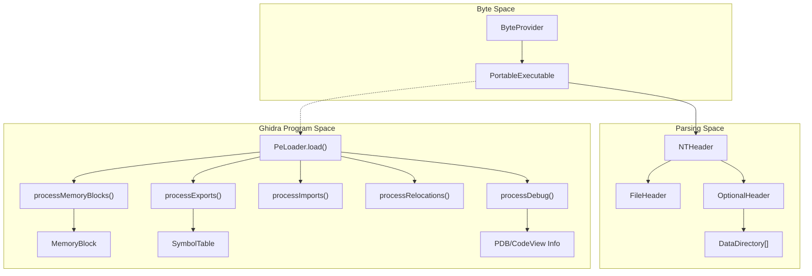
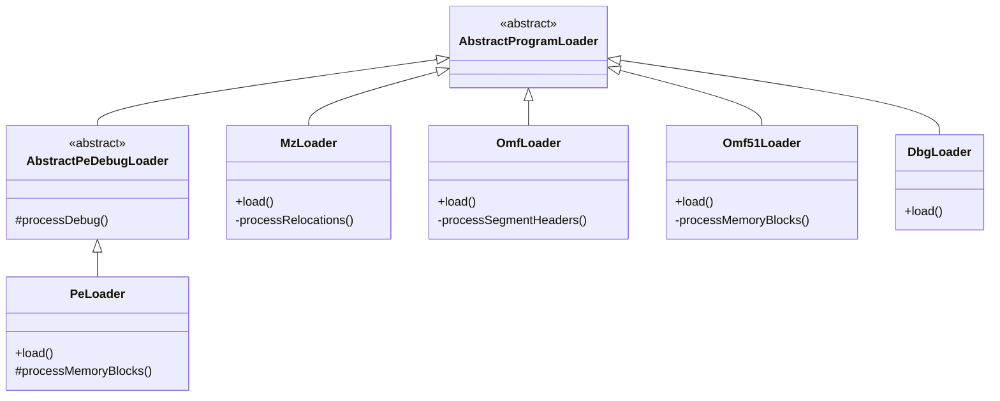

<!-- source: DeepWiki mcp.deepwiki.com · repo NationalSecurityAgency/ghidra · page 4.5 PE and Other Format Loaders · fetched 2026-11-09 -->

# PE and Other Format Loaders

Relevant source files

The following files were used as context for generating this wiki page:

- [Ghidra/Features/Base/src/main/java/ghidra/app/cmd/formats/PortableExecutableBinaryAnalysisCommand.java](Ghidra/Features/Base/src/main/java/ghidra/app/cmd/formats/PortableExecutableBinaryAnalysisCommand.java)
- [Ghidra/Features/Base/src/main/java/ghidra/app/util/bin/format/mz/DOSHeader.java](Ghidra/Features/Base/src/main/java/ghidra/app/util/bin/format/mz/DOSHeader.java)
- [Ghidra/Features/Base/src/main/java/ghidra/app/util/bin/format/mz/MzExecutable.java](Ghidra/Features/Base/src/main/java/ghidra/app/util/bin/format/mz/MzExecutable.java)
- [Ghidra/Features/Base/src/main/java/ghidra/app/util/bin/format/mz/MzRelocation.java](Ghidra/Features/Base/src/main/java/ghidra/app/util/bin/format/mz/MzRelocation.java)
- [Ghidra/Features/Base/src/main/java/ghidra/app/util/bin/format/mz/OldDOSHeader.java](Ghidra/Features/Base/src/main/java/ghidra/app/util/bin/format/mz/OldDOSHeader.java)
- [Ghidra/Features/Base/src/main/java/ghidra/app/util/bin/format/omf/OmfObsoleteRecord.java](Ghidra/Features/Base/src/main/java/ghidra/app/util/bin/format/omf/OmfObsoleteRecord.java)
- [Ghidra/Features/Base/src/main/java/ghidra/app/util/bin/format/omf/OmfRecord.java](Ghidra/Features/Base/src/main/java/ghidra/app/util/bin/format/omf/OmfRecord.java)
- [Ghidra/Features/Base/src/main/java/ghidra/app/util/bin/format/omf/OmfString.java](Ghidra/Features/Base/src/main/java/ghidra/app/util/bin/format/omf/OmfString.java)
- [Ghidra/Features/Base/src/main/java/ghidra/app/util/bin/format/omf/OmfUnknownRecord.java](Ghidra/Features/Base/src/main/java/ghidra/app/util/bin/format/omf/OmfUnknownRecord.java)
- [Ghidra/Features/Base/src/main/java/ghidra/app/util/bin/format/omf/OmfUnsupportedRecord.java](Ghidra/Features/Base/src/main/java/ghidra/app/util/bin/format/omf/OmfUnsupportedRecord.java)
- [Ghidra/Features/Base/src/main/java/ghidra/app/util/bin/format/omf/OmfUtils.java](Ghidra/Features/Base/src/main/java/ghidra/app/util/bin/format/omf/OmfUtils.java)
- [Ghidra/Features/Base/src/main/java/ghidra/app/util/bin/format/omf/omf/OmfComdatExternalSymbol.java](Ghidra/Features/Base/src/main/java/ghidra/app/util/bin/format/omf/omf/OmfComdatExternalSymbol.java)
- [Ghidra/Features/Base/src/main/java/ghidra/app/util/bin/format/omf/omf/OmfComdefRecord.java](Ghidra/Features/Base/src/main/java/ghidra/app/util/bin/format/omf/omf/OmfComdefRecord.java)
- [Ghidra/Features/Base/src/main/java/ghidra/app/util/bin/format/omf/omf/OmfExternalSymbol.java](Ghidra/Features/Base/src/main/java/ghidra/app/util/bin/format/omf/omf/OmfExternalSymbol.java)
- [Ghidra/Features/Base/src/main/java/ghidra/app/util/bin/format/omf/omf/OmfFileHeader.java](Ghidra/Features/Base/src/main/java/ghidra/app/util/bin/format/omf/omf/OmfFileHeader.java)
- [Ghidra/Features/Base/src/main/java/ghidra/app/util/bin/format/omf/omf/OmfNamesRecord.java](Ghidra/Features/Base/src/main/java/ghidra/app/util/bin/format/omf/omf/OmfNamesRecord.java)
- [Ghidra/Features/Base/src/main/java/ghidra/app/util/bin/format/omf/omf/OmfRecordFactory.java](Ghidra/Features/Base/src/main/java/ghidra/app/util/bin/format/omf/omf/OmfRecordFactory.java)
- [Ghidra/Features/Base/src/main/java/ghidra/app/util/bin/format/omf/omf/OmfSymbolRecord.java](Ghidra/Features/Base/src/main/java/ghidra/app/util/bin/format/omf/omf/OmfSymbolRecord.java)
- [Ghidra/Features/Base/src/main/java/ghidra/app/util/bin/format/omf/omf166/Omf166DepList.java](Ghidra/Features/Base/src/main/java/ghidra/app/util/bin/format/omf/omf166/Omf166DepList.java)
- [Ghidra/Features/Base/src/main/java/ghidra/app/util/bin/format/omf/omf51/Omf51Content.java](Ghidra/Features/Base/src/main/java/ghidra/app/util/bin/format/omf/omf51/Omf51Content.java)
- [Ghidra/Features/Base/src/main/java/ghidra/app/util/bin/format/omf/omf51/Omf51ExternalDef.java](Ghidra/Features/Base/src/main/java/ghidra/app/util/bin/format/omf/omf51/Omf51ExternalDef.java)
- [Ghidra/Features/Base/src/main/java/ghidra/app/util/bin/format/omf/omf51/Omf51ExternalDefsRecord.java](Ghidra/Features/Base/src/main/java/ghidra/app/util/bin/format/omf/omf51/Omf51ExternalDefsRecord.java)
- [Ghidra/Features/Base/src/main/java/ghidra/app/util/bin/format/omf/omf51/Omf51Fixup.java](Ghidra/Features/Base/src/main/java/ghidra/app/util/bin/format/omf/omf51/Omf51Fixup.java)
- [Ghidra/Features/Base/src/main/java/ghidra/app/util/bin/format/omf/omf51/Omf51FixupRecord.java](Ghidra/Features/Base/src/main/java/ghidra/app/util/bin/format/omf/omf51/Omf51FixupRecord.java)
- [Ghidra/Features/Base/src/main/java/ghidra/app/util/bin/format/omf/omf51/Omf51ModuleEnd.java](Ghidra/Features/Base/src/main/java/ghidra/app/util/bin/format/omf/omf51/Omf51ModuleEnd.java)
- [Ghidra/Features/Base/src/main/java/ghidra/app/util/bin/format/omf/omf51/Omf51ModuleHeader.java](Ghidra/Features/Base/src/main/java/ghidra/app/util/bin/format/omf/omf51/Omf51ModuleHeader.java)
- [Ghidra/Features/Base/src/main/java/ghidra/app/util/bin/format/omf/omf51/Omf51PublicDef.java](Ghidra/Features/Base/src/main/java/ghidra/app/util/bin/format/omf/omf51/Omf51PublicDef.java)
- [Ghidra/Features/Base/src/main/java/ghidra/app/util/bin/format/omf/omf51/Omf51PublicDefsRecord.java](Ghidra/Features/Base/src/main/java/ghidra/app/util/bin/format/omf/omf51/Omf51PublicDefsRecord.java)
- [Ghidra/Features/Base/src/main/java/ghidra/app/util/bin/format/omf/omf51/Omf51RecordFactory.java](Ghidra/Features/Base/src/main/java/ghidra/app/util/bin/format/omf/omf51/Omf51RecordFactory.java)
- [Ghidra/Features/Base/src/main/java/ghidra/app/util/bin/format/omf/omf51/Omf51RecordTypes.java](Ghidra/Features/Base/src/main/java/ghidra/app/util/bin/format/omf/omf51/Omf51RecordTypes.java)
- [Ghidra/Features/Base/src/main/java/ghidra/app/util/bin/format/omf/omf51/Omf51Segment.java](Ghidra/Features/Base/src/main/java/ghidra/app/util/bin/format/omf/omf51/Omf51Segment.java)
- [Ghidra/Features/Base/src/main/java/ghidra/app/util/bin/format/omf/omf51/Omf51SegmentDefs.java](Ghidra/Features/Base/src/main/java/ghidra/app/util/bin/format/omf/omf51/Omf51SegmentDefs.java)
- [Ghidra/Features/Base/src/main/java/ghidra/app/util/bin/format/pe/DebugDataDirectory.java](Ghidra/Features/Base/src/main/java/ghidra/app/util/bin/format/pe/DebugDataDirectory.java)
- [Ghidra/Features/Base/src/main/java/ghidra/app/util/bin/format/pe/ExceptionDataDirectory.java](Ghidra/Features/Base/src/main/java/ghidra/app/util/bin/format/pe/ExceptionDataDirectory.java)
- [Ghidra/Features/Base/src/main/java/ghidra/app/util/bin/format/pe/FileHeader.java](Ghidra/Features/Base/src/main/java/ghidra/app/util/bin/format/pe/FileHeader.java)
- [Ghidra/Features/Base/src/main/java/ghidra/app/util/bin/format/pe/ImageRuntimeFunctionEntries.java](Ghidra/Features/Base/src/main/java/ghidra/app/util/bin/format/pe/ImageRuntimeFunctionEntries.java)
- [Ghidra/Features/Base/src/main/java/ghidra/app/util/bin/format/pe/ImageRuntimeFunctionEntries_ARM.java](Ghidra/Features/Base/src/main/java/ghidra/app/util/bin/format/pe/ImageRuntimeFunctionEntries_ARM.java)
- [Ghidra/Features/Base/src/main/java/ghidra/app/util/bin/format/pe/ImageRuntimeFunctionEntries_X86.java](Ghidra/Features/Base/src/main/java/ghidra/app/util/bin/format/pe/ImageRuntimeFunctionEntries_X86.java)
- [Ghidra/Features/Base/src/main/java/ghidra/app/util/bin/format/pe/NTHeader.java](Ghidra/Features/Base/src/main/java/ghidra/app/util/bin/format/pe/NTHeader.java)
- [Ghidra/Features/Base/src/main/java/ghidra/app/util/bin/format/pe/OffsetValidator.java](Ghidra/Features/Base/src/main/java/ghidra/app/util/bin/format/pe/OffsetValidator.java)
- [Ghidra/Features/Base/src/main/java/ghidra/app/util/bin/format/pe/OptionalHeader.java](Ghidra/Features/Base/src/main/java/ghidra/app/util/bin/format/pe/OptionalHeader.java)
- [Ghidra/Features/Base/src/main/java/ghidra/app/util/bin/format/pe/PEx64UnwindInfo.java](Ghidra/Features/Base/src/main/java/ghidra/app/util/bin/format/pe/PEx64UnwindInfo.java)
- [Ghidra/Features/Base/src/main/java/ghidra/app/util/bin/format/pe/PEx64UnwindInfoDataType.java](Ghidra/Features/Base/src/main/java/ghidra/app/util/bin/format/pe/PEx64UnwindInfoDataType.java)
- [Ghidra/Features/Base/src/main/java/ghidra/app/util/bin/format/pe/PeUtils.java](Ghidra/Features/Base/src/main/java/ghidra/app/util/bin/format/pe/PeUtils.java)
- [Ghidra/Features/Base/src/main/java/ghidra/app/util/bin/format/pe/PortableExecutable.java](Ghidra/Features/Base/src/main/java/ghidra/app/util/bin/format/pe/PortableExecutable.java)
- [Ghidra/Features/Base/src/main/java/ghidra/app/util/bin/format/pe/SectionHeader.java](Ghidra/Features/Base/src/main/java/ghidra/app/util/bin/format/pe/SectionHeader.java)
- [Ghidra/Features/Base/src/main/java/ghidra/app/util/bin/format/pe/SeparateDebugHeader.java](Ghidra/Features/Base/src/main/java/ghidra/app/util/bin/format/pe/SeparateDebugHeader.java)
- [Ghidra/Features/Base/src/main/java/ghidra/app/util/bin/format/pe/debug/DebugCOFFSymbol.java](Ghidra/Features/Base/src/main/java/ghidra/app/util/bin/format/pe/debug/DebugCOFFSymbol.java)
- [Ghidra/Features/Base/src/main/java/ghidra/app/util/bin/format/pe/debug/DebugCOFFSymbolTable.java](Ghidra/Features/Base/src/main/java/ghidra/app/util/bin/format/pe/debug/DebugCOFFSymbolTable.java)
- [Ghidra/Features/Base/src/main/java/ghidra/app/util/bin/format/pe/debug/DebugDirectoryParser.java](Ghidra/Features/Base/src/main/java/ghidra/app/util/bin/format/pe/debug/DebugDirectoryParser.java)
- [Ghidra/Features/Base/src/main/java/ghidra/app/util/bin/format/pe/debug/DebugMisc.java](Ghidra/Features/Base/src/main/java/ghidra/app/util/bin/format/pe/debug/DebugMisc.java)
- [Ghidra/Features/Base/src/main/java/ghidra/app/util/bin/format/pe/debug/OMFSrcModule.java](Ghidra/Features/Base/src/main/java/ghidra/app/util/bin/format/pe/debug/OMFSrcModule.java)
- [Ghidra/Features/Base/src/main/java/ghidra/app/util/bin/format/pe/debug/OMFSrcModuleFile.java](Ghidra/Features/Base/src/main/java/ghidra/app/util/bin/format/pe/debug/OMFSrcModuleFile.java)
- [Ghidra/Features/Base/src/main/java/ghidra/app/util/bin/format/pe/debug/S_CONSTANT32.java](Ghidra/Features/Base/src/main/java/ghidra/app/util/bin/format/pe/debug/S_CONSTANT32.java)
- [Ghidra/Features/Base/src/main/java/ghidra/app/util/bin/format/pe/debug/S_LDATA32_NEW.java](Ghidra/Features/Base/src/main/java/ghidra/app/util/bin/format/pe/debug/S_LDATA32_NEW.java)
- [Ghidra/Features/Base/src/main/java/ghidra/app/util/bin/format/pe/debug/S_OBJNAME.java](Ghidra/Features/Base/src/main/java/ghidra/app/util/bin/format/pe/debug/S_OBJNAME.java)
- [Ghidra/Features/Base/src/main/java/ghidra/app/util/opinion/AbstractPeDebugLoader.java](Ghidra/Features/Base/src/main/java/ghidra/app/util/opinion/AbstractPeDebugLoader.java)
- [Ghidra/Features/Base/src/main/java/ghidra/app/util/opinion/DbgLoader.java](Ghidra/Features/Base/src/main/java/ghidra/app/util/opinion/DbgLoader.java)
- [Ghidra/Features/Base/src/main/java/ghidra/app/util/opinion/MSCoffLoader.java](Ghidra/Features/Base/src/main/java/ghidra/app/util/opinion/MSCoffLoader.java)
- [Ghidra/Features/Base/src/main/java/ghidra/app/util/opinion/MzLoader.java](Ghidra/Features/Base/src/main/java/ghidra/app/util/opinion/MzLoader.java)
- [Ghidra/Features/Base/src/main/java/ghidra/app/util/opinion/Omf51Loader.java](Ghidra/Features/Base/src/main/java/ghidra/app/util/opinion/Omf51Loader.java)
- [Ghidra/Features/Base/src/main/java/ghidra/app/util/opinion/OmfLoader.java](Ghidra/Features/Base/src/main/java/ghidra/app/util/opinion/OmfLoader.java)
- [Ghidra/Features/Base/src/main/java/ghidra/app/util/opinion/PeDataType.java](Ghidra/Features/Base/src/main/java/ghidra/app/util/opinion/PeDataType.java)
- [Ghidra/Features/Base/src/main/java/ghidra/app/util/opinion/PeLoader.java](Ghidra/Features/Base/src/main/java/ghidra/app/util/opinion/PeLoader.java)
- [Ghidra/Features/Base/src/test/java/ghidra/app/util/bin/format/cli/streams/CliStreamStringsTest.java](Ghidra/Features/Base/src/test/java/ghidra/app/util/bin/format/cli/streams/CliStreamStringsTest.java)
- [Ghidra/Features/FileFormats/ghidra_scripts/MergeTwoProgramsScript.java](Ghidra/Features/FileFormats/ghidra_scripts/MergeTwoProgramsScript.java)

This section describes Ghidra's support for Microsoft Portable Executable (PE), Common Object File Format (COFF), DOS MZ, New Executable (NE), and Relocatable Object Module Format (OMF) files. These loaders are responsible for parsing header structures, mapping sections into Ghidra's memory model, and processing debug information such as PDB and COFF symbols.

## Portable Executable (PE) Loader

The `PeLoader` is the primary entry point for loading Windows executables (EXE, DLL, SYS). It leverages the `PortableExecutable` class to parse the underlying binary structure [Ghidra/Features/Base/src/main/java/ghidra/app/util/opinion/PeLoader.java:113-114]().

### PE Header Architecture
The loader parses several nested structures defined in the PE specification:
*   **DOSHeader**: The initial legacy header containing the `e_lfanew` pointer to the NT headers [Ghidra/Features/Base/src/main/java/ghidra/app/util/bin/format/mz/DOSHeader.java:69-69]().
*   **NTHeader**: The root structure for PE metadata, containing the `FileHeader` and `OptionalHeader` [Ghidra/Features/Base/src/main/java/ghidra/app/util/bin/format/pe/NTHeader.java:36-46]().
*   **FileHeader**: Defines the target machine (e.g., x86, x64, ARM), number of sections, and characteristics [Ghidra/Features/Base/src/main/java/ghidra/app/util/bin/format/pe/FileHeader.java:139-152]().
*   **OptionalHeader**: Contains the entry point, image base, and the `DataDirectory` array [Ghidra/Features/Base/src/main/java/ghidra/app/util/bin/format/pe/NTHeader.java:85-85]().
*   **SectionHeader**: Describes individual segments (e.g., `.text`, `.data`) including their virtual addresses, sizes, and characteristics [Ghidra/Features/Base/src/main/java/ghidra/app/util/bin/format/pe/SectionHeader.java:30-48]().

### PE Loading Data Flow
The following diagram illustrates the transition from raw bytes to Ghidra Program entities during PE loading.

**PE Loading Sequence**

**Sources:** [Ghidra/Features/Base/src/main/java/ghidra/app/util/opinion/PeLoader.java:103-161](), [Ghidra/Features/Base/src/main/java/ghidra/app/util/bin/format/pe/NTHeader.java:60-101]()

### x64 Unwind Information (.pdata)
For x64 and ARM binaries, the loader processes the Exception Data directory, which contains function table entries used for exception handling [Ghidra/Features/Base/src/main/java/ghidra/app/util/bin/format/pe/ImageRuntimeFunctionEntries.java:27-30]().

*   **ImageRuntimeFunctionEntries_X86**: Parses the `.pdata` section for x64, creating `ImageRuntimeFunctionEntry_X86` records [Ghidra/Features/Base/src/main/java/ghidra/app/util/bin/format/pe/ImageRuntimeFunctionEntries_X86.java:73-77]().
*   **PEx64UnwindInfo**: Represents the `UNWIND_INFO` structures describing function prologues and stack frame layouts [Ghidra/Features/Base/src/main/java/ghidra/app/util/bin/format/pe/ImageRuntimeFunctionEntries_X86.java:93-97]().
*   **Markup**: The `markup` method in the entries class applies data types to the program and marks entry points as functions using `AbstractProgramLoader.markAsFunction` [Ghidra/Features/Base/src/main/java/ghidra/app/util/bin/format/pe/ImageRuntimeFunctionEntries_X86.java:139-151]().

**Sources:** [Ghidra/Features/Base/src/main/java/ghidra/app/util/bin/format/pe/ImageRuntimeFunctionEntries_X86.java:87-103](), [Ghidra/Features/Base/src/main/java/ghidra/app/util/bin/format/pe/ImageRuntimeFunctionEntries.java:30-44]()

## MZ/DOS Loader

The `MzLoader` handles "Old-style" DOS executables. It identifies files by the `MZ` signature and the absence of newer PE or NE headers [Ghidra/Features/Base/src/main/java/ghidra/app/util/opinion/MzLoader.java:63-83]().

### Implementation Details
*   **Segmented Addressing**: DOS binaries require a `SegmentedAddressSpace` to handle the `segment:offset` memory model [Ghidra/Features/Base/src/main/java/ghidra/app/util/opinion/MzLoader.java:95-99]().
*   **Relocation Fixups**: Relocations are processed by reading the `MzRelocation` table defined in the `OldDOSHeader` [Ghidra/Features/Base/src/main/java/ghidra/app/util/opinion/MzLoader.java:103-107]().
*   **Memory Mapping**: The loader creates memory blocks (e.g., `HEADER`) using `MemoryBlockUtils` and marks up the `OldDOSHeader` [Ghidra/Features/Base/src/main/java/ghidra/app/util/opinion/MzLoader.java:167-182]().

**Sources:** [Ghidra/Features/Base/src/main/java/ghidra/app/util/opinion/MzLoader.java:53-54](), [Ghidra/Features/Base/src/main/java/ghidra/app/util/bin/format/mz/OldDOSHeader.java:1-1]()

## Debug Symbol Integration

Ghidra integrates various debug formats during the PE loading process via `AbstractPeDebugLoader` [Ghidra/Features/Base/src/main/java/ghidra/app/util/opinion/AbstractPeDebugLoader.java:41-41]().

### PDB and CodeView
The loader extracts PDB (Program Database) information from the CodeView data directory.
*   **PdbInfoCodeView**: Contains the GUID and age used to match the binary with a `.pdb` file [Ghidra/Features/Base/src/main/java/ghidra/app/util/opinion/AbstractPeDebugLoader.java:164-167]().
*   **DebugDirectoryParser**: Iterates through the debug directory to find CodeView, COFF, and Misc debug entries [Ghidra/Features/Base/src/main/java/ghidra/app/util/bin/format/pe/debug/DebugDirectoryParser.java:39-39]().

### COFF Symbols
Legacy COFF symbols are processed via the `FileHeader`. This includes mapping section-relative symbols to absolute Ghidra addresses [Ghidra/Features/Base/src/main/java/ghidra/app/util/opinion/AbstractPeDebugLoader.java:149-152]().

**Sources:** [Ghidra/Features/Base/src/main/java/ghidra/app/util/opinion/AbstractPeDebugLoader.java:131-152](), [Ghidra/Features/Base/src/main/java/ghidra/app/util/bin/format/pe/FileHeader.java:148-148]()

## Additional Format Loaders

### OMF Loader
The `OmfLoader` supports the Relocatable Object Module Format, typically used by older 16-bit compilers (Borland, Watcom) [Ghidra/Features/Base/src/main/java/ghidra/app/util/opinion/OmfLoader.java:47-50]().
*   **Record Parsing**: OMF files are a sequence of records (e.g., `THEADR`, `SEGDEF`, `PUBDEF`) [Ghidra/Features/Base/src/main/java/ghidra/app/util/bin/format/omf/OmfRecord.java:1-1]().
*   **Linking**: The loader performs linking by resolving names and calculating segment offsets [Ghidra/Features/Base/src/main/java/ghidra/app/util/opinion/OmfLoader.java:123-127]().
*   **Markup**: The `markupRecords` method creates a `RECORDS` memory block in `OTHER` space to store and markup raw OMF record structures [Ghidra/Features/Base/src/main/java/ghidra/app/util/opinion/OmfLoader.java:154-178]().

### OMF-51 Loader
The `Omf51Loader` handles object modules for the 8051 architecture. It identifies segments and performs fixups based on segment IDs [Ghidra/Features/Base/src/main/java/ghidra/app/util/opinion/Omf51Loader.java:44-46]().
*   **Memory Mapping**: Groups content by `Omf51Content` and places it into the appropriate address space (CODE, DATA, etc.) [Ghidra/Features/Base/src/main/java/ghidra/app/util/opinion/Omf51Loader.java:111-168]().

### DbgLoader
The `DbgLoader` handles Microsoft separated debug files (`.dbg`), extracting symbol and header metadata associated with PE images.

**Loader Component Relationships**

**Sources:** [Ghidra/Features/Base/src/main/java/ghidra/app/util/opinion/PeLoader.java:60-63](), [Ghidra/Features/Base/src/main/java/ghidra/app/util/opinion/MzLoader.java:53-54](), [Ghidra/Features/Base/src/main/java/ghidra/app/util/opinion/OmfLoader.java:47-48](), [Ghidra/Features/Base/src/main/java/ghidra/app/util/opinion/Omf51Loader.java:44-46](), [Ghidra/Features/Base/src/main/java/ghidra/app/util/opinion/DbgLoader.java:1-1]()

---

