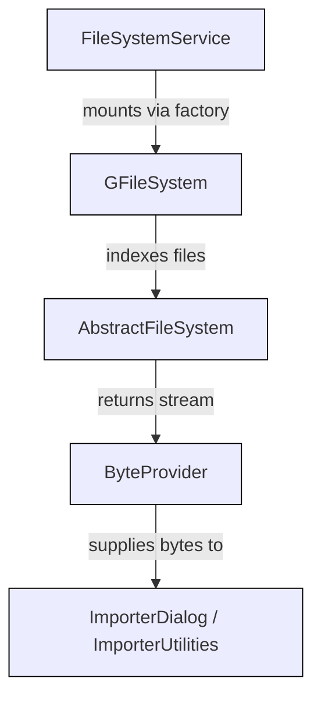
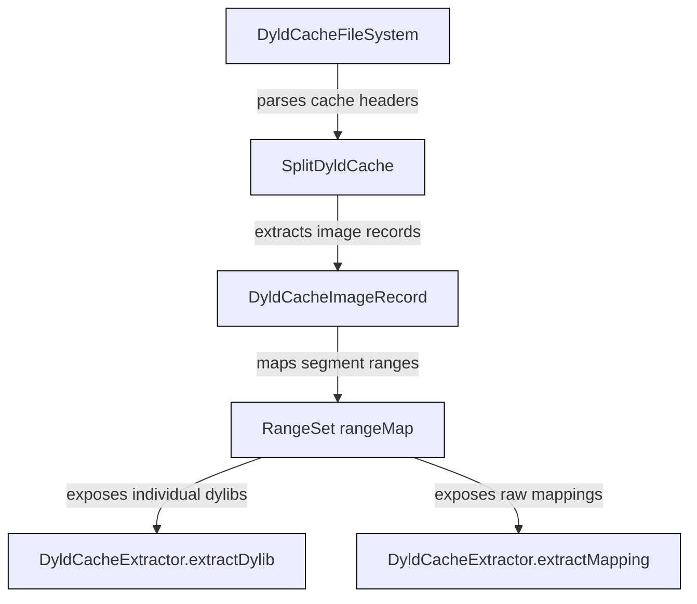

<!-- source: DeepWiki mcp.deepwiki.com · repo NationalSecurityAgency/ghidra · page 4.6 Filesystem and Container Formats · fetched 2026-11-09 -->

# Filesystem and Container Formats

Relevant source files

The following files were used as context for generating this wiki page:

- [Ghidra/Features/Base/src/main/help/help/topics/ImporterPlugin/images/BatchImportDialog.png](Ghidra/Features/Base/src/main/help/help/topics/ImporterPlugin/images/BatchImportDialog.png)
- [Ghidra/Features/Base/src/main/help/help/topics/ImporterPlugin/images/ImporterDialog.png](Ghidra/Features/Base/src/main/help/help/topics/ImporterPlugin/images/ImporterDialog.png)
- [Ghidra/Features/Base/src/main/help/help/topics/ImporterPlugin/images/LanguagePickerDialog.png](Ghidra/Features/Base/src/main/help/help/topics/ImporterPlugin/images/LanguagePickerDialog.png)
- [Ghidra/Features/Base/src/main/help/help/topics/ImporterPlugin/images/SearchPathsDialog.png](Ghidra/Features/Base/src/main/help/help/topics/ImporterPlugin/images/SearchPathsDialog.png)
- [Ghidra/Features/Base/src/main/help/help/topics/ImporterPlugin/importer.htm](Ghidra/Features/Base/src/main/help/help/topics/ImporterPlugin/importer.htm)
- [Ghidra/Features/Base/src/main/java/ghidra/app/plugin/core/analysis/MachoFunctionStartsAnalyzer.java](Ghidra/Features/Base/src/main/java/ghidra/app/plugin/core/analysis/MachoFunctionStartsAnalyzer.java)
- [Ghidra/Features/Base/src/main/java/ghidra/app/plugin/core/disassembler/AutoTableDisassemblerPlugin.java](Ghidra/Features/Base/src/main/java/ghidra/app/plugin/core/disassembler/AutoTableDisassemblerPlugin.java)
- [Ghidra/Features/Base/src/main/java/ghidra/app/plugin/core/exporter/ExporterDialog.java](Ghidra/Features/Base/src/main/java/ghidra/app/plugin/core/exporter/ExporterDialog.java)
- [Ghidra/Features/Base/src/main/java/ghidra/app/plugin/core/exporter/ExporterPlugin.java](Ghidra/Features/Base/src/main/java/ghidra/app/plugin/core/exporter/ExporterPlugin.java)
- [Ghidra/Features/Base/src/main/java/ghidra/app/plugin/core/processors/SetLanguageDialog.java](Ghidra/Features/Base/src/main/java/ghidra/app/plugin/core/processors/SetLanguageDialog.java)
- [Ghidra/Features/Base/src/main/java/ghidra/app/plugin/core/validator/ValidateProgramDialog.java](Ghidra/Features/Base/src/main/java/ghidra/app/plugin/core/validator/ValidateProgramDialog.java)
- [Ghidra/Features/Base/src/main/java/ghidra/app/services/FileImporterService.java](Ghidra/Features/Base/src/main/java/ghidra/app/services/FileImporterService.java)
- [Ghidra/Features/Base/src/main/java/ghidra/app/util/DomainObjectService.java](Ghidra/Features/Base/src/main/java/ghidra/app/util/DomainObjectService.java)
- [Ghidra/Features/Base/src/main/java/ghidra/app/util/Option.java](Ghidra/Features/Base/src/main/java/ghidra/app/util/Option.java)
- [Ghidra/Features/Base/src/main/java/ghidra/app/util/OptionsDialog.java](Ghidra/Features/Base/src/main/java/ghidra/app/util/OptionsDialog.java)
- [Ghidra/Features/Base/src/main/java/ghidra/app/util/OptionsEditorPanel.java](Ghidra/Features/Base/src/main/java/ghidra/app/util/OptionsEditorPanel.java)
- [Ghidra/Features/Base/src/main/java/ghidra/app/util/bin/format/macho/CpuTypes.java](Ghidra/Features/Base/src/main/java/ghidra/app/util/bin/format/macho/CpuTypes.java)
- [Ghidra/Features/Base/src/main/java/ghidra/app/util/bin/format/macho/MachHeader.java](Ghidra/Features/Base/src/main/java/ghidra/app/util/bin/format/macho/MachHeader.java)
- [Ghidra/Features/Base/src/main/java/ghidra/app/util/bin/format/macho/Section.java](Ghidra/Features/Base/src/main/java/ghidra/app/util/bin/format/macho/Section.java)
- [Ghidra/Features/Base/src/main/java/ghidra/app/util/bin/format/macho/commands/BuildVersionCommand.java](Ghidra/Features/Base/src/main/java/ghidra/app/util/bin/format/macho/commands/BuildVersionCommand.java)
- [Ghidra/Features/Base/src/main/java/ghidra/app/util/bin/format/macho/commands/CorruptLoadCommand.java](Ghidra/Features/Base/src/main/java/ghidra/app/util/bin/format/macho/commands/CorruptLoadCommand.java)
- [Ghidra/Features/Base/src/main/java/ghidra/app/util/bin/format/macho/commands/DataInCodeCommand.java](Ghidra/Features/Base/src/main/java/ghidra/app/util/bin/format/macho/commands/DataInCodeCommand.java)
- [Ghidra/Features/Base/src/main/java/ghidra/app/util/bin/format/macho/commands/DyldChainedFixupsCommand.java](Ghidra/Features/Base/src/main/java/ghidra/app/util/bin/format/macho/commands/DyldChainedFixupsCommand.java)
- [Ghidra/Features/Base/src/main/java/ghidra/app/util/bin/format/macho/commands/DyldExportsTrieCommand.java](Ghidra/Features/Base/src/main/java/ghidra/app/util/bin/format/macho/commands/DyldExportsTrieCommand.java)
- [Ghidra/Features/Base/src/main/java/ghidra/app/util/bin/format/macho/commands/DyldInfoCommand.java](Ghidra/Features/Base/src/main/java/ghidra/app/util/bin/format/macho/commands/DyldInfoCommand.java)
- [Ghidra/Features/Base/src/main/java/ghidra/app/util/bin/format/macho/commands/DyldInfoCommandConstants.java](Ghidra/Features/Base/src/main/java/ghidra/app/util/bin/format/macho/commands/DyldInfoCommandConstants.java)
- [Ghidra/Features/Base/src/main/java/ghidra/app/util/bin/format/macho/commands/DynamicLibraryCommand.java](Ghidra/Features/Base/src/main/java/ghidra/app/util/bin/format/macho/commands/DynamicLibraryCommand.java)
- [Ghidra/Features/Base/src/main/java/ghidra/app/util/bin/format/macho/commands/DynamicSymbolTableCommand.java](Ghidra/Features/Base/src/main/java/ghidra/app/util/bin/format/macho/commands/DynamicSymbolTableCommand.java)
- [Ghidra/Features/Base/src/main/java/ghidra/app/util/bin/format/macho/commands/EncryptedInformationCommand.java](Ghidra/Features/Base/src/main/java/ghidra/app/util/bin/format/macho/commands/EncryptedInformationCommand.java)
- [Ghidra/Features/Base/src/main/java/ghidra/app/util/bin/format/macho/commands/ExportTrie.java](Ghidra/Features/Base/src/main/java/ghidra/app/util/bin/format/macho/commands/ExportTrie.java)
- [Ghidra/Features/Base/src/main/java/ghidra/app/util/bin/format/macho/commands/FixedVirtualMemoryFileCommand.java](Ghidra/Features/Base/src/main/java/ghidra/app/util/bin/format/macho/commands/FixedVirtualMemoryFileCommand.java)
- [Ghidra/Features/Base/src/main/java/ghidra/app/util/bin/format/macho/commands/FunctionStartsCommand.java](Ghidra/Features/Base/src/main/java/ghidra/app/util/bin/format/macho/commands/FunctionStartsCommand.java)
- [Ghidra/Features/Base/src/main/java/ghidra/app/util/bin/format/macho/commands/LinkEditDataCommand.java](Ghidra/Features/Base/src/main/java/ghidra/app/util/bin/format/macho/commands/LinkEditDataCommand.java)
- [Ghidra/Features/Base/src/main/java/ghidra/app/util/bin/format/macho/commands/LinkerOptionCommand.java](Ghidra/Features/Base/src/main/java/ghidra/app/util/bin/format/macho/commands/LinkerOptionCommand.java)
- [Ghidra/Features/Base/src/main/java/ghidra/app/util/bin/format/macho/commands/LoadCommand.java](Ghidra/Features/Base/src/main/java/ghidra/app/util/bin/format/macho/commands/LoadCommand.java)
- [Ghidra/Features/Base/src/main/java/ghidra/app/util/bin/format/macho/commands/LoadCommandFactory.java](Ghidra/Features/Base/src/main/java/ghidra/app/util/bin/format/macho/commands/LoadCommandFactory.java)
- [Ghidra/Features/Base/src/main/java/ghidra/app/util/bin/format/macho/commands/LoadCommandTypes.java](Ghidra/Features/Base/src/main/java/ghidra/app/util/bin/format/macho/commands/LoadCommandTypes.java)
- [Ghidra/Features/Base/src/main/java/ghidra/app/util/bin/format/macho/commands/NList.java](Ghidra/Features/Base/src/main/java/ghidra/app/util/bin/format/macho/commands/NList.java)
- [Ghidra/Features/Base/src/main/java/ghidra/app/util/bin/format/macho/commands/PreboundDynamicLibraryCommand.java](Ghidra/Features/Base/src/main/java/ghidra/app/util/bin/format/macho/commands/PreboundDynamicLibraryCommand.java)
- [Ghidra/Features/Base/src/main/java/ghidra/app/util/bin/format/macho/commands/SegmentCommand.java](Ghidra/Features/Base/src/main/java/ghidra/app/util/bin/format/macho/commands/SegmentCommand.java)
- [Ghidra/Features/Base/src/main/java/ghidra/app/util/bin/format/macho/commands/SegmentNames.java](Ghidra/Features/Base/src/main/java/ghidra/app/util/bin/format/macho/commands/SegmentNames.java)
- [Ghidra/Features/Base/src/main/java/ghidra/app/util/bin/format/macho/commands/SymbolTableCommand.java](Ghidra/Features/Base/src/main/java/ghidra/app/util/bin/format/macho/commands/SymbolTableCommand.java)
- [Ghidra/Features/Base/src/main/java/ghidra/app/util/bin/format/macho/commands/UnsupportedLoadCommand.java](Ghidra/Features/Base/src/main/java/ghidra/app/util/bin/format/macho/commands/UnsupportedLoadCommand.java)
- [Ghidra/Features/Base/src/main/java/ghidra/app/util/bin/format/macho/commands/chained/DyldChainedFixups.java](Ghidra/Features/Base/src/main/java/ghidra/app/util/bin/format/macho/commands/chained/DyldChainedFixups.java)
- [Ghidra/Features/Base/src/main/java/ghidra/app/util/bin/format/macho/commands/dyld/BindingTable.java](Ghidra/Features/Base/src/main/java/ghidra/app/util/bin/format/macho/commands/dyld/BindingTable.java)
- [Ghidra/Features/Base/src/main/java/ghidra/app/util/bin/format/macho/commands/dyld/OpcodeTable.java](Ghidra/Features/Base/src/main/java/ghidra/app/util/bin/format/macho/commands/dyld/OpcodeTable.java)
- [Ghidra/Features/Base/src/main/java/ghidra/app/util/bin/format/macho/commands/dyld/RebaseOpcode.java](Ghidra/Features/Base/src/main/java/ghidra/app/util/bin/format/macho/commands/dyld/RebaseOpcode.java)
- [Ghidra/Features/Base/src/main/java/ghidra/app/util/bin/format/macho/commands/dyld/RebaseTable.java](Ghidra/Features/Base/src/main/java/ghidra/app/util/bin/format/macho/commands/dyld/RebaseTable.java)
- [Ghidra/Features/Base/src/main/java/ghidra/app/util/bin/format/macho/dyld/DyldCacheAcceleratorDof.java](Ghidra/Features/Base/src/main/java/ghidra/app/util/bin/format/macho/dyld/DyldCacheAcceleratorDof.java)
- [Ghidra/Features/Base/src/main/java/ghidra/app/util/bin/format/macho/dyld/DyldCacheAcceleratorInitializer.java](Ghidra/Features/Base/src/main/java/ghidra/app/util/bin/format/macho/dyld/DyldCacheAcceleratorInitializer.java)
- [Ghidra/Features/Base/src/main/java/ghidra/app/util/bin/format/macho/dyld/DyldCacheHeader.java](Ghidra/Features/Base/src/main/java/ghidra/app/util/bin/format/macho/dyld/DyldCacheHeader.java)
- [Ghidra/Features/Base/src/main/java/ghidra/app/util/bin/format/macho/dyld/DyldCacheImage.java](Ghidra/Features/Base/src/main/java/ghidra/app/util/bin/format/macho/dyld/DyldCacheImage.java)
- [Ghidra/Features/Base/src/main/java/ghidra/app/util/bin/format/macho/dyld/DyldCacheImageInfo.java](Ghidra/Features/Base/src/main/java/ghidra/app/util/bin/format/macho/dyld/DyldCacheImageInfo.java)
- [Ghidra/Features/Base/src/main/java/ghidra/app/util/bin/format/macho/dyld/DyldCacheImageInfoExtra.java](Ghidra/Features/Base/src/main/java/ghidra/app/util/bin/format/macho/dyld/DyldCacheImageInfoExtra.java)
- [Ghidra/Features/Base/src/main/java/ghidra/app/util/bin/format/macho/dyld/DyldCacheImageTextInfo.java](Ghidra/Features/Base/src/main/java/ghidra/app/util/bin/format/macho/dyld/DyldCacheImageTextInfo.java)
- [Ghidra/Features/Base/src/main/java/ghidra/app/util/bin/format/macho/dyld/DyldCacheLocalSymbolsEntry.java](Ghidra/Features/Base/src/main/java/ghidra/app/util/bin/format/macho/dyld/DyldCacheLocalSymbolsEntry.java)
- [Ghidra/Features/Base/src/main/java/ghidra/app/util/bin/format/macho/dyld/DyldCacheLocalSymbolsInfo.java](Ghidra/Features/Base/src/main/java/ghidra/app/util/bin/format/macho/dyld/DyldCacheLocalSymbolsInfo.java)
- [Ghidra/Features/Base/src/main/java/ghidra/app/util/bin/format/macho/dyld/DyldCacheMappingAndSlideInfo.java](Ghidra/Features/Base/src/main/java/ghidra/app/util/bin/format/macho/dyld/DyldCacheMappingAndSlideInfo.java)
- [Ghidra/Features/Base/src/main/java/ghidra/app/util/bin/format/macho/dyld/DyldCacheMappingInfo.java](Ghidra/Features/Base/src/main/java/ghidra/app/util/bin/format/macho/dyld/DyldCacheMappingInfo.java)
- [Ghidra/Features/Base/src/main/java/ghidra/app/util/bin/format/macho/dyld/DyldCacheRangeEntry.java](Ghidra/Features/Base/src/main/java/ghidra/app/util/bin/format/macho/dyld/DyldCacheRangeEntry.java)
- [Ghidra/Features/Base/src/main/java/ghidra/app/util/bin/format/macho/dyld/DyldCacheSlideInfo1.java](Ghidra/Features/Base/src/main/java/ghidra/app/util/bin/format/macho/dyld/DyldCacheSlideInfo1.java)
- [Ghidra/Features/Base/src/main/java/ghidra/app/util/bin/format/macho/dyld/DyldCacheSlideInfo2.java](Ghidra/Features/Base/src/main/java/ghidra/app/util/bin/format/macho/dyld/DyldCacheSlideInfo2.java)
- [Ghidra/Features/Base/src/main/java/ghidra/app/util/bin/format/macho/dyld/DyldCacheSlideInfo3.java](Ghidra/Features/Base/src/main/java/ghidra/app/util/bin/format/macho/dyld/DyldCacheSlideInfo3.java)
- [Ghidra/Features/Base/src/main/java/ghidra/app/util/bin/format/macho/dyld/DyldCacheSlideInfo4.java](Ghidra/Features/Base/src/main/java/ghidra/app/util/bin/format/macho/dyld/DyldCacheSlideInfo4.java)
- [Ghidra/Features/Base/src/main/java/ghidra/app/util/bin/format/macho/dyld/DyldCacheSlideInfo5.java](Ghidra/Features/Base/src/main/java/ghidra/app/util/bin/format/macho/dyld/DyldCacheSlideInfo5.java)
- [Ghidra/Features/Base/src/main/java/ghidra/app/util/bin/format/macho/dyld/DyldCacheSlideInfoCommon.java](Ghidra/Features/Base/src/main/java/ghidra/app/util/bin/format/macho/dyld/DyldCacheSlideInfoCommon.java)
- [Ghidra/Features/Base/src/main/java/ghidra/app/util/bin/format/macho/dyld/DyldChainedPtr.java](Ghidra/Features/Base/src/main/java/ghidra/app/util/bin/format/macho/dyld/DyldChainedPtr.java)
- [Ghidra/Features/Base/src/main/java/ghidra/app/util/bin/format/macho/dyld/DyldFixup.java](Ghidra/Features/Base/src/main/java/ghidra/app/util/bin/format/macho/dyld/DyldFixup.java)
- [Ghidra/Features/Base/src/main/java/ghidra/app/util/bin/format/macho/dyld/DyldSubcacheEntry.java](Ghidra/Features/Base/src/main/java/ghidra/app/util/bin/format/macho/dyld/DyldSubcacheEntry.java)
- [Ghidra/Features/Base/src/main/java/ghidra/app/util/bin/format/macho/threadcommand/ThreadCommand.java](Ghidra/Features/Base/src/main/java/ghidra/app/util/bin/format/macho/threadcommand/ThreadCommand.java)
- [Ghidra/Features/Base/src/main/java/ghidra/app/util/exporter/BinaryExporter.java](Ghidra/Features/Base/src/main/java/ghidra/app/util/exporter/BinaryExporter.java)
- [Ghidra/Features/Base/src/main/java/ghidra/app/util/exporter/Exporter.java](Ghidra/Features/Base/src/main/java/ghidra/app/util/exporter/Exporter.java)
- [Ghidra/Features/Base/src/main/java/ghidra/app/util/exporter/GdtExporter.java](Ghidra/Features/Base/src/main/java/ghidra/app/util/exporter/GdtExporter.java)
- [Ghidra/Features/Base/src/main/java/ghidra/app/util/exporter/GzfExporter.java](Ghidra/Features/Base/src/main/java/ghidra/app/util/exporter/GzfExporter.java)
- [Ghidra/Features/Base/src/main/java/ghidra/app/util/exporter/OriginalFileExporter.java](Ghidra/Features/Base/src/main/java/ghidra/app/util/exporter/OriginalFileExporter.java)
- [Ghidra/Features/Base/src/main/java/ghidra/app/util/importer/ProgramLoader.java](Ghidra/Features/Base/src/main/java/ghidra/app/util/importer/ProgramLoader.java)
- [Ghidra/Features/Base/src/main/java/ghidra/app/util/opinion/DyldCacheLoader.java](Ghidra/Features/Base/src/main/java/ghidra/app/util/opinion/DyldCacheLoader.java)
- [Ghidra/Features/Base/src/main/java/ghidra/app/util/opinion/DyldCacheOptions.java](Ghidra/Features/Base/src/main/java/ghidra/app/util/opinion/DyldCacheOptions.java)
- [Ghidra/Features/Base/src/main/java/ghidra/app/util/opinion/DyldCacheProgramBuilder.java](Ghidra/Features/Base/src/main/java/ghidra/app/util/opinion/DyldCacheProgramBuilder.java)
- [Ghidra/Features/Base/src/main/java/ghidra/app/util/opinion/DyldCacheUtils.java](Ghidra/Features/Base/src/main/java/ghidra/app/util/opinion/DyldCacheUtils.java)
- [Ghidra/Features/Base/src/main/java/ghidra/app/util/opinion/Loader.java](Ghidra/Features/Base/src/main/java/ghidra/app/util/opinion/Loader.java)
- [Ghidra/Features/Base/src/main/java/ghidra/app/util/opinion/LoaderService.java](Ghidra/Features/Base/src/main/java/ghidra/app/util/opinion/LoaderService.java)
- [Ghidra/Features/Base/src/main/java/ghidra/app/util/opinion/LoaderTier.java](Ghidra/Features/Base/src/main/java/ghidra/app/util/opinion/LoaderTier.java)
- [Ghidra/Features/Base/src/main/java/ghidra/app/util/opinion/MachoPrelinkProgramBuilder.java](Ghidra/Features/Base/src/main/java/ghidra/app/util/opinion/MachoPrelinkProgramBuilder.java)
- [Ghidra/Features/Base/src/main/java/ghidra/app/util/opinion/MachoProgramBuilder.java](Ghidra/Features/Base/src/main/java/ghidra/app/util/opinion/MachoProgramBuilder.java)
- [Ghidra/Features/Base/src/main/java/ghidra/plugin/importer/AddToProgramDialog.java](Ghidra/Features/Base/src/main/java/ghidra/plugin/importer/AddToProgramDialog.java)
- [Ghidra/Features/Base/src/main/java/ghidra/plugin/importer/ImporterDialog.java](Ghidra/Features/Base/src/main/java/ghidra/plugin/importer/ImporterDialog.java)
- [Ghidra/Features/Base/src/main/java/ghidra/plugin/importer/ImporterLanguageDialog.java](Ghidra/Features/Base/src/main/java/ghidra/plugin/importer/ImporterLanguageDialog.java)
- [Ghidra/Features/Base/src/main/java/ghidra/plugin/importer/ImporterPlugin.java](Ghidra/Features/Base/src/main/java/ghidra/plugin/importer/ImporterPlugin.java)
- [Ghidra/Features/Base/src/main/java/ghidra/plugin/importer/ImporterUtilities.java](Ghidra/Features/Base/src/main/java/ghidra/plugin/importer/ImporterUtilities.java)
- [Ghidra/Features/Base/src/main/java/ghidra/plugin/importer/LcsSelectionEvent.java](Ghidra/Features/Base/src/main/java/ghidra/plugin/importer/LcsSelectionEvent.java)
- [Ghidra/Features/Base/src/main/java/ghidra/plugin/importer/NewLanguagePanel.java](Ghidra/Features/Base/src/main/java/ghidra/plugin/importer/NewLanguagePanel.java)
- [Ghidra/Features/Base/src/main/java/ghidra/plugins/importer/batch/BatchGroup.java](Ghidra/Features/Base/src/main/java/ghidra/plugins/importer/batch/BatchGroup.java)
- [Ghidra/Features/Base/src/main/java/ghidra/plugins/importer/batch/BatchGroupLoadSpec.java](Ghidra/Features/Base/src/main/java/ghidra/plugins/importer/batch/BatchGroupLoadSpec.java)
- [Ghidra/Features/Base/src/main/java/ghidra/plugins/importer/batch/BatchImportDialog.java](Ghidra/Features/Base/src/main/java/ghidra/plugins/importer/batch/BatchImportDialog.java)
- [Ghidra/Features/Base/src/main/java/ghidra/plugins/importer/batch/BatchImportTableModel.java](Ghidra/Features/Base/src/main/java/ghidra/plugins/importer/batch/BatchImportTableModel.java)
- [Ghidra/Features/Base/src/main/java/ghidra/plugins/importer/batch/BatchInfo.java](Ghidra/Features/Base/src/main/java/ghidra/plugins/importer/batch/BatchInfo.java)
- [Ghidra/Features/Base/src/main/java/ghidra/plugins/importer/batch/BatchSegregatingCriteria.java](Ghidra/Features/Base/src/main/java/ghidra/plugins/importer/batch/BatchSegregatingCriteria.java)
- [Ghidra/Features/Base/src/main/java/ghidra/plugins/importer/tasks/ImportBatchTask.java](Ghidra/Features/Base/src/main/java/ghidra/plugins/importer/tasks/ImportBatchTask.java)
- [Ghidra/Features/FileFormats/src/main/java/ghidra/file/formats/android/bootldr/AndroidBootLoaderHeader.java](Ghidra/Features/FileFormats/src/main/java/ghidra/file/formats/android/bootldr/AndroidBootLoaderHeader.java)
- [Ghidra/Features/FileFormats/src/main/java/ghidra/file/formats/ios/ExtractedMacho.java](Ghidra/Features/FileFormats/src/main/java/ghidra/file/formats/ios/ExtractedMacho.java)
- [Ghidra/Features/FileFormats/src/main/java/ghidra/file/formats/ios/dyldcache/DyldCacheEntry.java](Ghidra/Features/FileFormats/src/main/java/ghidra/file/formats/ios/dyldcache/DyldCacheEntry.java)
- [Ghidra/Features/FileFormats/src/main/java/ghidra/file/formats/ios/dyldcache/DyldCacheExtractor.java](Ghidra/Features/FileFormats/src/main/java/ghidra/file/formats/ios/dyldcache/DyldCacheExtractor.java)
- [Ghidra/Features/FileFormats/src/main/java/ghidra/file/formats/ios/dyldcache/DyldCacheFileSystem.java](Ghidra/Features/FileFormats/src/main/java/ghidra/file/formats/ios/dyldcache/DyldCacheFileSystem.java)
- [Ghidra/Features/FileFormats/src/main/java/ghidra/file/formats/ios/dyldcache/DyldCacheFileSystemFactory.java](Ghidra/Features/FileFormats/src/main/java/ghidra/file/formats/ios/dyldcache/DyldCacheFileSystemFactory.java)
- [Ghidra/Features/FileFormats/src/main/java/ghidra/file/formats/ios/fileset/MachoFileSetEntry.java](Ghidra/Features/FileFormats/src/main/java/ghidra/file/formats/ios/fileset/MachoFileSetEntry.java)
- [Ghidra/Features/FileFormats/src/main/java/ghidra/file/formats/ios/fileset/MachoFileSetExtractor.java](Ghidra/Features/FileFormats/src/main/java/ghidra/file/formats/ios/fileset/MachoFileSetExtractor.java)
- [Ghidra/Features/FileFormats/src/main/java/ghidra/file/formats/ios/fileset/MachoFileSetFileSystem.java](Ghidra/Features/FileFormats/src/main/java/ghidra/file/formats/ios/fileset/MachoFileSetFileSystem.java)
- [Ghidra/Features/FileFormats/src/main/java/ghidra/macosx/plugins/DyldCacheBuilderPlugin.java](Ghidra/Features/FileFormats/src/main/java/ghidra/macosx/plugins/DyldCacheBuilderPlugin.java)
- [Ghidra/Features/FileFormats/src/main/java/ghidra/macosx/plugins/MachoFileSetBuilderPlugin.java](Ghidra/Features/FileFormats/src/main/java/ghidra/macosx/plugins/MachoFileSetBuilderPlugin.java)
- [Ghidra/Framework/Docking/src/main/java/docking/DialogComponentProviderPopupActionManager.java](Ghidra/Framework/Docking/src/main/java/docking/DialogComponentProviderPopupActionManager.java)
- [Ghidra/Framework/Docking/src/main/java/docking/options/editor/CustomOptionComponent.java](Ghidra/Framework/Docking/src/main/java/docking/options/editor/CustomOptionComponent.java)
- [Ghidra/Framework/Docking/src/main/java/docking/options/editor/DefaultOptionComponent.java](Ghidra/Framework/Docking/src/main/java/docking/options/editor/DefaultOptionComponent.java)
- [GhidraBuild/Skeleton/src/main/java/skeleton/SkeletonExporter.java](GhidraBuild/Skeleton/src/main/java/skeleton/SkeletonExporter.java)

## Purpose and Scope

The `Features/FileFormats` module and core `gfilesystem` subsystem provide Ghidra with the ability to transparently inspect, mount, and extract nested container files, firmware images, compressed archives, and filesystem snapshots without requiring external host tools. This module defines a unified virtual filesystem abstraction (`GFileSystem`) managed by `FileSystemService`, allowing reverse engineers to recursively browse complex firmware update images, mobile OS caches, application packages, and archive structures directly from the project tree or import dialogs.

---

## 1. GFileSystem Abstraction and FileSystemService

Ghidra models file container navigation through the `GFileSystem` interface and the central `FileSystemService` singleton. When a user interacts with a compressed or structured file (such as a zip file, firmware image, or custom archive), `FileSystemService` queries registered filesystem factories to mount the data via a `ByteProvider` wrapper [ghidra/plugin/importer/ImporterUtilities.java:161-170]().

Key components of this architecture include:
- **`FileSystemService`**: Manages active filesystem mounts, tracks cached files, resolves file system references (`FSRL`), and coordinates background task interactions.
- **`GFileSystem`**: The base interface implemented by all container and filesystem handlers. It provides methods to list files, retrieve metadata, and open individual stream items as `ByteProvider` instances.
- **`AbstractFileSystem`**: A base implementation handling common index tracking, locking, and file lookup structures (`fsIndex`).
- **`FSRL` (File System Reference Language)**: A specialized URI-like syntax (`fsrl://filesystem-type/path/inside/container!inner-file`) that uniquely addresses files nested arbitrarily deep inside container hierarchies.

*Sources: `ghidra/plugin/importer/ImporterUtilities.java:161-170`*, `ghidra/plugin/importer/ImporterDialog.java:49-125`

---

## 2. Archive and Compression Handlers

Ghidra includes native stream and archive handlers for standard packaging formats. These handlers implement `GFileSystem` or direct decompression wrappers to expose compressed payloads as virtual files:
- **ZIP, TAR, CPIO**: Handlers parse central directories or sequential header structures, mapping archive entry paths directly to virtual file nodes.
- **7-Zip (`7z`)**: Integrates robust LZMA/LZMA2 decompression services to unpack complex compressed structures.
- **Compression codecs (Gzip, Bzip2, Zstd, LZSS/CompLZS, XAR)**: Standalone single-file decompression filters or container wrappers that transparently stream decompressed bytes to downstream analyzers or loaders.

Sources: `ghidra/plugin/importer/ImporterUtilities.java:89-101`

---

## 3. Filesystem Images and Sparse Containers

For low-level firmware analysis, Ghidra supports mounting disk and filesystem images directly. The filesystem image parsers interpret raw sector layouts and metadata structures:
- **ext4 / SquashFS / CramFS / YAFFS2**: Specialized filesystem modules that parse inodes, block allocation tables, and directory structures, presenting Linux embedded filesystem hierarchies as standard directory trees.
- **UBI (Unsorted Block Images)**: Handles raw flash memory management layers, parsing erase blocks and volume tables.
- **Sparse Images (`sparseimage`)**: Interprets chunk-based sparse disk images, mapping non-contiguous data blocks into a continuous virtual address space.

Sources: `ghidra/plugin/importer/ImporterUtilities.java:89-101`

---

## 4. iOS DYLD Cache and Apple Container Formats

iOS and macOS firmware structures, particularly DYLD shared caches (`dyld_cache`) and prelinked kernel files, are supported via dedicated filesystem and builder pipelines. 

The `DyldCacheFileSystem` (`ghidra.file.formats.ios.dyldcache.DyldCacheFileSystem`) mounts a DYLD cache file, parsing memory mapping headers (`DyldCacheHeader`), shared library lists, and local symbol information (`DyldCacheLocalSymbolsInfo`) [ghidra/file/formats/ios/dyldcache/DyldCacheFileSystem.java:43-166]().

*Sources: `ghidra/file/formats/ios/dyldcache/DyldCacheFileSystem.java:43-166`*, `ghidra/app/util/opinion/DyldCacheProgramBuilder.java:80-127`

- **`SplitDyldCache`**: Coordinates split cache segments across multiple files (e.g., auxiliary caches on modern iOS versions) [ghidra/app/util/opinion/DyldCacheProgramBuilder.java:89-91]().
- **`DyldCacheExtractor`**: Reconstructs individual dylibs from the monolithic shared cache, applying pointer sliding fixups (`DyldFixup`) so that extracted dylibs can be analyzed as standalone Mach-O binaries [ghidra/file/formats/ios/dyldcache/DyldCacheFileSystem.java:135-166]().
- **MachoPrelinkProgramBuilder**: Parses Apple's `LC_FILESET_ENTRY` commands or prelink XML maps to ingest bundled kernel extensions in prelinked kernels [ghidra/app/util/opinion/MachoPrelinkProgramBuilder.java:77-110]().

Sources: `ghidra/file/formats/ios/dyldcache/DyldCacheFileSystem.java:43-166`, `ghidra/app/util/opinion/DyldCacheProgramBuilder.java:80-127`, `ghidra/app/util/opinion/MachoPrelinkProgramBuilder.java:77-110`

---

## 5. Android and Embedded Formats

Ghidra includes container handlers and loaders for mobile and embedded platforms:
- **DEX (Dalvik Executable)**: Parses Android application bytecode containers, managing class definitions, method pools, and field descriptors.
- **Android Bootloaders and Images (`AndroidBootLoaderHeader`)**: Extracts kernel and ramdisk components from packed boot image headers.
- **DTB (Device Tree Blob)**: Parses flattened device tree files to recover hardware configuration nodes and peripheral definitions.

Sources: `ghidra/app/util/opinion/Loader.java:1-50`

---

## 6. Java Class and Archive Handling

Java archives (`.jar`), compressed class collections (`.zip`), and raw `.class` files are integrated into the filesystem framework. When a jar or class container is opened:
- The filesystem plugin exposes the internal package path hierarchy as virtual directories and files.
- Bytecode containers can be imported into Ghidra using specialized Java loaders that translate JVM class files into program databases for analysis.

Sources: `ghidra/plugin/importer/ImporterUtilities.java:69-81`

---

