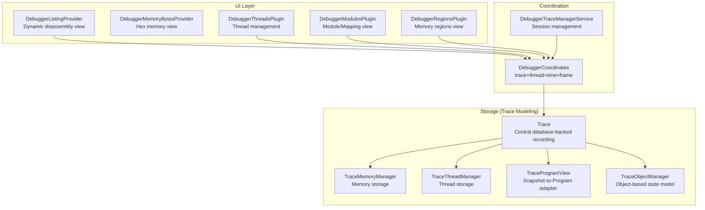
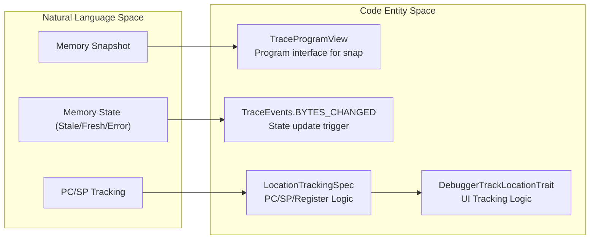

<!-- source: DeepWiki mcp.deepwiki.com · repo NationalSecurityAgency/ghidra · page 5 Debugger System · fetched 2026-11-09 -->

# Debugger System

Relevant source files

The following files were used as context for generating this wiki page:

- [Ghidra/Debug/Debugger/certification.manifest](Ghidra/Debug/Debugger/certification.manifest)
- [Ghidra/Debug/Debugger/data/debugger.theme.properties](Ghidra/Debug/Debugger/data/debugger.theme.properties)
- [Ghidra/Debug/Debugger/src/main/help/help/TOC_Source.xml](Ghidra/Debug/Debugger/src/main/help/help/TOC_Source.xml)
- [Ghidra/Debug/Debugger/src/main/help/help/topics/DebuggerListingPlugin/DebuggerListingPlugin.html](Ghidra/Debug/Debugger/src/main/help/help/topics/DebuggerListingPlugin/DebuggerListingPlugin.html)
- [Ghidra/Debug/Debugger/src/main/help/help/topics/DebuggerMemoryBytesPlugin/DebuggerMemoryBytesPlugin.html](Ghidra/Debug/Debugger/src/main/help/help/topics/DebuggerMemoryBytesPlugin/DebuggerMemoryBytesPlugin.html)
- [Ghidra/Debug/Debugger/src/main/help/help/topics/DebuggerMemoryBytesPlugin/images/DebuggerMemoryBytesPlugin.png](Ghidra/Debug/Debugger/src/main/help/help/topics/DebuggerMemoryBytesPlugin/images/DebuggerMemoryBytesPlugin.png)
- [Ghidra/Debug/Debugger/src/main/help/help/topics/DebuggerVariableViewerPlugin/DebuggerVariableViewerPlugin.html](Ghidra/Debug/Debugger/src/main/help/help/topics/DebuggerVariableViewerPlugin/DebuggerVariableViewerPlugin.html)
- [Ghidra/Debug/Debugger/src/main/help/help/topics/DebuggerVariableViewerPlugin/images/DebuggerVariableViewerPlugin.png](Ghidra/Debug/Debugger/src/main/help/help/topics/DebuggerVariableViewerPlugin/images/DebuggerVariableViewerPlugin.png)
- [Ghidra/Debug/Debugger/src/main/help/help/topics/DebuggerVariableViewerPlugin/images/DebuggerVariableViewerPluginRightClick.png](Ghidra/Debug/Debugger/src/main/help/help/topics/DebuggerVariableViewerPlugin/images/DebuggerVariableViewerPluginRightClick.png)
- [Ghidra/Debug/Debugger/src/main/java/ghidra/app/plugin/core/debug/gui/DebuggerLocationLabel.java](Ghidra/Debug/Debugger/src/main/java/ghidra/app/plugin/core/debug/gui/DebuggerLocationLabel.java)
- [Ghidra/Debug/Debugger/src/main/java/ghidra/app/plugin/core/debug/gui/DebuggerResources.java](Ghidra/Debug/Debugger/src/main/java/ghidra/app/plugin/core/debug/gui/DebuggerResources.java)
- [Ghidra/Debug/Debugger/src/main/java/ghidra/app/plugin/core/debug/gui/action/DebuggerReadsMemoryTrait.java](Ghidra/Debug/Debugger/src/main/java/ghidra/app/plugin/core/debug/gui/action/DebuggerReadsMemoryTrait.java)
- [Ghidra/Debug/Debugger/src/main/java/ghidra/app/plugin/core/debug/gui/action/DebuggerTrackLocationTrait.java](Ghidra/Debug/Debugger/src/main/java/ghidra/app/plugin/core/debug/gui/action/DebuggerTrackLocationTrait.java)
- [Ghidra/Debug/Debugger/src/main/java/ghidra/app/plugin/core/debug/gui/action/NoneLocationTrackingSpec.java](Ghidra/Debug/Debugger/src/main/java/ghidra/app/plugin/core/debug/gui/action/NoneLocationTrackingSpec.java)
- [Ghidra/Debug/Debugger/src/main/java/ghidra/app/plugin/core/debug/gui/action/PCByRegisterLocationTrackingSpec.java](Ghidra/Debug/Debugger/src/main/java/ghidra/app/plugin/core/debug/gui/action/PCByRegisterLocationTrackingSpec.java)
- [Ghidra/Debug/Debugger/src/main/java/ghidra/app/plugin/core/debug/gui/action/PCByStackLocationTrackingSpec.java](Ghidra/Debug/Debugger/src/main/java/ghidra/app/plugin/core/debug/gui/action/PCByStackLocationTrackingSpec.java)
- [Ghidra/Debug/Debugger/src/main/java/ghidra/app/plugin/core/debug/gui/action/PCLocationTrackingSpec.java](Ghidra/Debug/Debugger/src/main/java/ghidra/app/plugin/core/debug/gui/action/PCLocationTrackingSpec.java)
- [Ghidra/Debug/Debugger/src/main/java/ghidra/app/plugin/core/debug/gui/action/RegisterLocationTrackingSpec.java](Ghidra/Debug/Debugger/src/main/java/ghidra/app/plugin/core/debug/gui/action/RegisterLocationTrackingSpec.java)
- [Ghidra/Debug/Debugger/src/main/java/ghidra/app/plugin/core/debug/gui/action/SPLocationTrackingSpec.java](Ghidra/Debug/Debugger/src/main/java/ghidra/app/plugin/core/debug/gui/action/SPLocationTrackingSpec.java)
- [Ghidra/Debug/Debugger/src/main/java/ghidra/app/plugin/core/debug/gui/listing/DebuggerListingPlugin.java](Ghidra/Debug/Debugger/src/main/java/ghidra/app/plugin/core/debug/gui/listing/DebuggerListingPlugin.java)
- [Ghidra/Debug/Debugger/src/main/java/ghidra/app/plugin/core/debug/gui/listing/DebuggerListingProvider.java](Ghidra/Debug/Debugger/src/main/java/ghidra/app/plugin/core/debug/gui/listing/DebuggerListingProvider.java)
- [Ghidra/Debug/Debugger/src/main/java/ghidra/app/plugin/core/debug/gui/listing/MemoryStateListingBackgroundColorModel.java](Ghidra/Debug/Debugger/src/main/java/ghidra/app/plugin/core/debug/gui/listing/MemoryStateListingBackgroundColorModel.java)
- [Ghidra/Debug/Debugger/src/main/java/ghidra/app/plugin/core/debug/gui/memory/DebuggerMemoryBytesActionContext.java](Ghidra/Debug/Debugger/src/main/java/ghidra/app/plugin/core/debug/gui/memory/DebuggerMemoryBytesActionContext.java)
- [Ghidra/Debug/Debugger/src/main/java/ghidra/app/plugin/core/debug/gui/memory/DebuggerMemoryBytesPlugin.java](Ghidra/Debug/Debugger/src/main/java/ghidra/app/plugin/core/debug/gui/memory/DebuggerMemoryBytesPlugin.java)
- [Ghidra/Debug/Debugger/src/main/java/ghidra/app/plugin/core/debug/gui/memory/DebuggerMemoryBytesProvider.java](Ghidra/Debug/Debugger/src/main/java/ghidra/app/plugin/core/debug/gui/memory/DebuggerMemoryBytesProvider.java)
- [Ghidra/Debug/Debugger/src/main/java/ghidra/app/plugin/core/debug/gui/time/DebuggerTimePlugin.java](Ghidra/Debug/Debugger/src/main/java/ghidra/app/plugin/core/debug/gui/time/DebuggerTimePlugin.java)
- [Ghidra/Debug/Debugger/src/main/java/ghidra/app/plugin/core/debug/gui/variable/DebuggerVariableViewerProvider.java](Ghidra/Debug/Debugger/src/main/java/ghidra/app/plugin/core/debug/gui/variable/DebuggerVariableViewerProvider.java)
- [Ghidra/Debug/Debugger/src/screen/java/ghidra/app/plugin/core/debug/gui/variable/DebuggerVariableViewerPluginScreenShots.java](Ghidra/Debug/Debugger/src/screen/java/ghidra/app/plugin/core/debug/gui/variable/DebuggerVariableViewerPluginScreenShots.java)
- [Ghidra/Features/ByteViewer/src/main/java/ghidra/app/plugin/core/byteviewer/AbstractByteViewerPlugin.java](Ghidra/Features/ByteViewer/src/main/java/ghidra/app/plugin/core/byteviewer/AbstractByteViewerPlugin.java)
- [Ghidra/Features/ByteViewer/src/main/java/ghidra/app/plugin/core/byteviewer/ByteViewerPlugin.java](Ghidra/Features/ByteViewer/src/main/java/ghidra/app/plugin/core/byteviewer/ByteViewerPlugin.java)
- [Ghidra/Features/ByteViewer/src/main/java/ghidra/app/plugin/core/byteviewer/ProgramByteBlockSet.java](Ghidra/Features/ByteViewer/src/main/java/ghidra/app/plugin/core/byteviewer/ProgramByteBlockSet.java)
- [Ghidra/Features/ByteViewer/src/main/java/ghidra/app/plugin/core/format/ByteBlockSet.java](Ghidra/Features/ByteViewer/src/main/java/ghidra/app/plugin/core/format/ByteBlockSet.java)

The Debugger System provides Ghidra's dynamic analysis capabilities through a trace-based architecture that records and displays program execution state. Unlike traditional debuggers that only show the current state, Ghidra's debugger records execution history in a trace database, enabling time-travel debugging, post-mortem analysis, and seamless integration between static analysis and dynamic targets.

For detailed information about specific subsystems, see:
- [Debugger UI Components](#5.1) — Detail the `DebuggerListingProvider` and `DebuggerMemoryBytesProvider` with location tracking (PC/SP tracking specs), automatic memory reading, and memory state visualization.
- [Trace Database and Coordinates](#5.2) — Explain the trace storage model, `DebuggerCoordinates` system (trace, time, thread, frame), snapshot management, and memory state tracking.
- [Trace RMI Protocol and Debugger Agents](#5.3) — Detail the Trace RMI protocol, Python-based debugger agents (GDB, LLDB, DBG-ENG), command/hook/method architecture, and bidirectional state synchronization.
- [Breakpoints and Emulation](#5.4) — Explain the logical breakpoint service that maps breakpoints across static programs and live traces, and the P-code emulation service for time-travel debugging via `TraceSchedule`.
- [P-code Emulation Framework](#5.5) — Describe the underlying P-code emulation framework, executor state abstractions, and derived emulators.

## System Architecture

The debugger system comprises several interconnected subsystems organized around a central trace database (`Trace`). The architecture separates UI components from the underlying trace storage and agent communication layers, using a coordination layer to ensure all views remain synchronized.

Title: Debugger System Architecture

Sources: [Ghidra/Debug/Debugger/src/main/java/ghidra/app/plugin/core/debug/gui/listing/DebuggerListingPlugin.java:59-91](), [Ghidra/Debug/Debugger/src/main/java/ghidra/app/plugin/core/debug/gui/memory/DebuggerMemoryBytesPlugin.java:44-70]()

## DebuggerCoordinates: The Addressing System

The `DebuggerCoordinates` class serves as the unified addressing mechanism for the debugger system, identifying a specific point in execution state. Unlike static analysis where an address alone is sufficient, dynamic analysis requires specifying both spatial and temporal coordinates.

| Component | Purpose | Code Entity |
|-----------|---------|-------------|
| **Trace** | The recording session | `ghidra.trace.model.Trace` [Ghidra/Debug/Debugger/src/main/java/ghidra/app/plugin/core/debug/gui/listing/DebuggerListingProvider.java:86-86]() |
| **Thread** | Execution thread | `ghidra.trace.model.thread.TraceThread` [Ghidra/Debug/Debugger/src/main/java/ghidra/app/plugin/core/debug/gui/action/DebuggerTrackLocationTrait.java:49-49]() |
| **Time/Snap** | Point in execution history | `long snap` [Ghidra/Debug/Debugger/src/main/java/ghidra/app/plugin/core/debug/gui/action/DebuggerTrackLocationTrait.java:100-100]() |
| **Frame** | Stack frame level | `int frame` [Ghidra/Debug/Debugger/src/main/java/ghidra/app/plugin/core/debug/gui/action/DebuggerTrackLocationTrait.java:191-192]() |
| **View** | Snapshot perspective | `ghidra.trace.model.program.TraceProgramView` [Ghidra/Debug/Debugger/src/main/java/ghidra/app/plugin/core/debug/gui/listing/DebuggerListingProvider.java:87-87]() |

The coordinate system is propagated throughout the UI via events. All UI components synchronize based on coordinate changes. Comparison logic in `sameCoordinates` ensures UI updates only when relevant state changes [Ghidra/Debug/Debugger/src/main/java/ghidra/app/plugin/core/debug/gui/listing/DebuggerListingProvider.java:101-118]().

For details, see [Trace Database and Coordinates](#5.2).

Sources: [Ghidra/Debug/Debugger/src/main/java/ghidra/app/plugin/core/debug/gui/listing/DebuggerListingProvider.java:101-118](), [Ghidra/Debug/Debugger/src/main/java/ghidra/app/plugin/core/debug/gui/action/DebuggerTrackLocationTrait.java:49-192]()

## Debugger UI Components

Ghidra provides specialized UI components for interacting with dynamic execution state. These components extend existing static views but add dynamic traits for location tracking, automatic memory reading, and memory state visualization.

- **`DebuggerListingProvider`**: Displays disassembled instructions from a `TraceProgramView`, supporting PC and stack pointer tracking via `LocationTrackingSpec` [Ghidra/Debug/Debugger/src/main/java/ghidra/app/plugin/core/debug/gui/listing/DebuggerListingProvider.java:94-171]().
- **`DebuggerMemoryBytesProvider`**: Provides hex view representation of trace memory bytes with background coloring for memory states (stale, error, read-only) [Ghidra/Debug/Debugger/src/main/java/ghidra/app/plugin/core/debug/gui/memory/DebuggerMemoryBytesProvider.java:70-192]().
- **`DebuggerTrackLocationTrait`**: Manages location tracking specs (`PCLocationTrackingSpec`, `SPLocationTrackingSpec`, etc.) to automatically navigate views based on register changes or thread context [Ghidra/Debug/Debugger/src/main/java/ghidra/app/plugin/core/debug/gui/action/DebuggerTrackLocationTrait.java:53-152]().
- **`DebuggerReadsMemoryTrait`**: Handles automatic memory reading based on view visibility (`AutoReadMemorySpec`) and manual refresh actions [Ghidra/Debug/Debugger/src/main/java/ghidra/app/plugin/core/debug/gui/action/DebuggerReadsMemoryTrait.java:56-104]().

For details, see [Debugger UI Components](#5.1).

Sources: [Ghidra/Debug/Debugger/src/main/java/ghidra/app/plugin/core/debug/gui/listing/DebuggerListingProvider.java:94-171](), [Ghidra/Debug/Debugger/src/main/java/ghidra/app/plugin/core/debug/gui/memory/DebuggerMemoryBytesProvider.java:70-192](), [Ghidra/Debug/Debugger/src/main/java/ghidra/app/plugin/core/debug/gui/action/DebuggerTrackLocationTrait.java:53-152](), [Ghidra/Debug/Debugger/src/main/java/ghidra/app/plugin/core/debug/gui/action/DebuggerReadsMemoryTrait.java:56-104]()

## Memory and State Management

The debugger tracks memory state across time using snapshots and address-snap range property maps. The `TraceMemoryManager` handles the storage of bytes and states (`KNOWN`, `UNKNOWN`, `ERROR`), while `TraceProgramView` provides a standard `Program` interface to a specific snapshot.

Title: Memory State and Storage Mapping

Sources: [Ghidra/Debug/Debugger/src/main/java/ghidra/app/plugin/core/debug/gui/memory/DebuggerMemoryBytesProvider.java:96-106](), [Ghidra/Debug/Debugger/src/main/java/ghidra/app/plugin/core/debug/gui/action/DebuggerTrackLocationTrait.java:53-152]()

## Trace RMI and Debugger Agents

Ghidra integrates with native debuggers through the Trace RMI protocol and Python-based agents (GDB, LLDB, DBG-ENG). This architecture allows bidirectional state synchronization, where user actions in Ghidra translate into commands sent to target debuggers, and target events (such as breakpoints hit, memory modifications, or thread creation) are recorded back into the trace database.

For details, see [Trace RMI Protocol and Debugger Agents](#5.3).

Sources: [Ghidra/Debug/Debugger/src/main/java/ghidra/app/plugin/core/debug/gui/DebuggerResources.java:66-86]()

## Breakpoints and Emulation

Dynamic analysis is supported by advanced services for breakpoint management and time-travel emulation:
- **Logical Breakpoints**: The `DebuggerLogicalBreakpointServicePlugin` maps breakpoints across static programs and live traces, managing breakpoint markers in listing and decompiler views.
- **P-code Emulation**: The `DebuggerEmulationServicePlugin` and P-code emulation framework provide time-travel debugging capabilities via `TraceSchedule`, allowing instruction execution and state exploration without requiring a live target.

For details, see [Breakpoints and Emulation](#5.4) and [P-code Emulation Framework](#5.5).

Sources: [Ghidra/Debug/Debugger/certification.manifest:19-33]()

---

