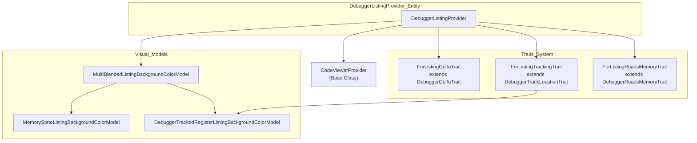
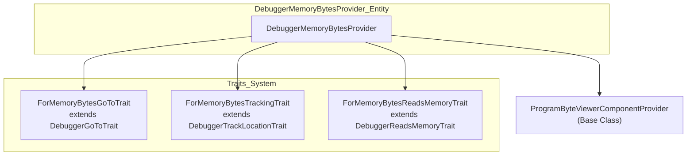
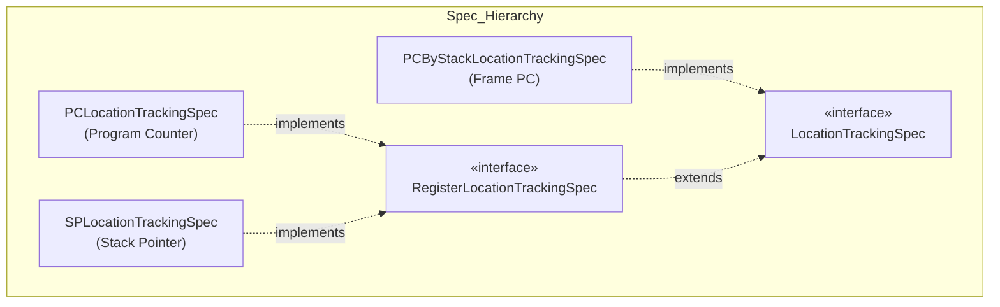
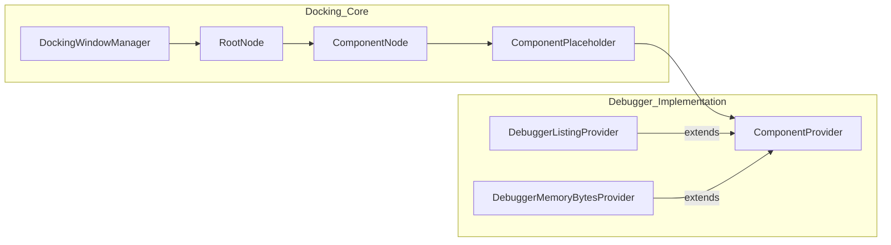

<!-- source: DeepWiki mcp.deepwiki.com · repo NationalSecurityAgency/ghidra · page 5.1 Debugger UI Components · fetched 2026-11-09 -->

# Debugger UI Components

Relevant source files

The following files were used as context for generating this wiki page:

- [Ghidra/Debug/Debugger-rmi-trace/src/main/java/ghidra/app/plugin/core/debug/gui/tracermi/connection/TraceRmiConnectionManagerPlugin.java](Ghidra/Debug/Debugger-rmi-trace/src/main/java/ghidra/app/plugin/core/debug/gui/tracermi/connection/TraceRmiConnectionManagerPlugin.java)
- [Ghidra/Debug/Debugger/certification.manifest](Ghidra/Debug/Debugger/certification.manifest)
- [Ghidra/Debug/Debugger/data/debugger.theme.properties](Ghidra/Debug/Debugger/data/debugger.theme.properties)
- [Ghidra/Debug/Debugger/src/main/help/help/TOC_Source.xml](Ghidra/Debug/Debugger/src/main/help/help/TOC_Source.xml)
- [Ghidra/Debug/Debugger/src/main/help/help/topics/DebuggerListingPlugin/DebuggerListingPlugin.html](Ghidra/Debug/Debugger/src/main/help/help/topics/DebuggerListingPlugin/DebuggerListingPlugin.html)
- [Ghidra/Debug/Debugger/src/main/help/help/topics/DebuggerListingPlugin/images/DebuggerGoToDialog.png](Ghidra/Debug/Debugger/src/main/help/help/topics/DebuggerListingPlugin/images/DebuggerGoToDialog.png)
- [Ghidra/Debug/Debugger/src/main/help/help/topics/DebuggerMemoryBytesPlugin/DebuggerMemoryBytesPlugin.html](Ghidra/Debug/Debugger/src/main/help/help/topics/DebuggerMemoryBytesPlugin/DebuggerMemoryBytesPlugin.html)
- [Ghidra/Debug/Debugger/src/main/help/help/topics/DebuggerMemoryBytesPlugin/images/DebuggerMemoryBytesPlugin.png](Ghidra/Debug/Debugger/src/main/help/help/topics/DebuggerMemoryBytesPlugin/images/DebuggerMemoryBytesPlugin.png)
- [Ghidra/Debug/Debugger/src/main/help/help/topics/DebuggerRegistersPlugin/DebuggerRegistersPlugin.html](Ghidra/Debug/Debugger/src/main/help/help/topics/DebuggerRegistersPlugin/DebuggerRegistersPlugin.html)
- [Ghidra/Debug/Debugger/src/main/help/help/topics/DebuggerRegistersPlugin/images/DebuggerRegistersPlugin.png](Ghidra/Debug/Debugger/src/main/help/help/topics/DebuggerRegistersPlugin/images/DebuggerRegistersPlugin.png)
- [Ghidra/Debug/Debugger/src/main/help/help/topics/DebuggerStackPlugin/images/DebuggerStackPlugin.png](Ghidra/Debug/Debugger/src/main/help/help/topics/DebuggerStackPlugin/images/DebuggerStackPlugin.png)
- [Ghidra/Debug/Debugger/src/main/help/help/topics/DebuggerVariableViewerPlugin/DebuggerVariableViewerPlugin.html](Ghidra/Debug/Debugger/src/main/help/help/topics/DebuggerVariableViewerPlugin/DebuggerVariableViewerPlugin.html)
- [Ghidra/Debug/Debugger/src/main/help/help/topics/DebuggerVariableViewerPlugin/images/DebuggerVariableViewerPlugin.png](Ghidra/Debug/Debugger/src/main/help/help/topics/DebuggerVariableViewerPlugin/images/DebuggerVariableViewerPlugin.png)
- [Ghidra/Debug/Debugger/src/main/help/help/topics/DebuggerVariableViewerPlugin/images/DebuggerVariableViewerPluginRightClick.png](Ghidra/Debug/Debugger/src/main/help/help/topics/DebuggerVariableViewerPlugin/images/DebuggerVariableViewerPluginRightClick.png)
- [Ghidra/Debug/Debugger/src/main/help/help/topics/DebuggerWatchesPlugin/DebuggerWatchesPlugin.html](Ghidra/Debug/Debugger/src/main/help/help/topics/DebuggerWatchesPlugin/DebuggerWatchesPlugin.html)
- [Ghidra/Debug/Debugger/src/main/help/help/topics/DebuggerWatchesPlugin/images/DebuggerWatchesPlugin.png](Ghidra/Debug/Debugger/src/main/help/help/topics/DebuggerWatchesPlugin/images/DebuggerWatchesPlugin.png)
- [Ghidra/Debug/Debugger/src/main/java/ghidra/app/plugin/core/debug/gui/DebuggerLocationLabel.java](Ghidra/Debug/Debugger/src/main/java/ghidra/app/plugin/core/debug/gui/DebuggerLocationLabel.java)
- [Ghidra/Debug/Debugger/src/main/java/ghidra/app/plugin/core/debug/gui/DebuggerResources.java](Ghidra/Debug/Debugger/src/main/java/ghidra/app/plugin/core/debug/gui/DebuggerResources.java)
- [Ghidra/Debug/Debugger/src/main/java/ghidra/app/plugin/core/debug/gui/action/DebuggerGoToDialog.java](Ghidra/Debug/Debugger/src/main/java/ghidra/app/plugin/core/debug/gui/action/DebuggerGoToDialog.java)
- [Ghidra/Debug/Debugger/src/main/java/ghidra/app/plugin/core/debug/gui/action/DebuggerGoToTrait.java](Ghidra/Debug/Debugger/src/main/java/ghidra/app/plugin/core/debug/gui/action/DebuggerGoToTrait.java)
- [Ghidra/Debug/Debugger/src/main/java/ghidra/app/plugin/core/debug/gui/action/DebuggerReadsMemoryTrait.java](Ghidra/Debug/Debugger/src/main/java/ghidra/app/plugin/core/debug/gui/action/DebuggerReadsMemoryTrait.java)
- [Ghidra/Debug/Debugger/src/main/java/ghidra/app/plugin/core/debug/gui/action/DebuggerTrackLocationTrait.java](Ghidra/Debug/Debugger/src/main/java/ghidra/app/plugin/core/debug/gui/action/DebuggerTrackLocationTrait.java)
- [Ghidra/Debug/Debugger/src/main/java/ghidra/app/plugin/core/debug/gui/action/NoneLocationTrackingSpec.java](Ghidra/Debug/Debugger/src/main/java/ghidra/app/plugin/core/debug/gui/action/NoneLocationTrackingSpec.java)
- [Ghidra/Debug/Debugger/src/main/java/ghidra/app/plugin/core/debug/gui/action/PCByRegisterLocationTrackingSpec.java](Ghidra/Debug/Debugger/src/main/java/ghidra/app/plugin/core/debug/gui/action/PCByRegisterLocationTrackingSpec.java)
- [Ghidra/Debug/Debugger/src/main/java/ghidra/app/plugin/core/debug/gui/action/PCByStackLocationTrackingSpec.java](Ghidra/Debug/Debugger/src/main/java/ghidra/app/plugin/core/debug/gui/action/PCByStackLocationTrackingSpec.java)
- [Ghidra/Debug/Debugger/src/main/java/ghidra/app/plugin/core/debug/gui/action/PCLocationTrackingSpec.java](Ghidra/Debug/Debugger/src/main/java/ghidra/app/plugin/core/debug/gui/action/PCLocationTrackingSpec.java)
- [Ghidra/Debug/Debugger/src/main/java/ghidra/app/plugin/core/debug/gui/action/RegisterLocationTrackingSpec.java](Ghidra/Debug/Debugger/src/main/java/ghidra/app/plugin/core/debug/gui/action/RegisterLocationTrackingSpec.java)
- [Ghidra/Debug/Debugger/src/main/java/ghidra/app/plugin/core/debug/gui/action/SPLocationTrackingSpec.java](Ghidra/Debug/Debugger/src/main/java/ghidra/app/plugin/core/debug/gui/action/SPLocationTrackingSpec.java)
- [Ghidra/Debug/Debugger/src/main/java/ghidra/app/plugin/core/debug/gui/listing/DebuggerListingPlugin.java](Ghidra/Debug/Debugger/src/main/java/ghidra/app/plugin/core/debug/gui/listing/DebuggerListingPlugin.java)
- [Ghidra/Debug/Debugger/src/main/java/ghidra/app/plugin/core/debug/gui/listing/DebuggerListingProvider.java](Ghidra/Debug/Debugger/src/main/java/ghidra/app/plugin/core/debug/gui/listing/DebuggerListingProvider.java)
- [Ghidra/Debug/Debugger/src/main/java/ghidra/app/plugin/core/debug/gui/listing/MemoryStateListingBackgroundColorModel.java](Ghidra/Debug/Debugger/src/main/java/ghidra/app/plugin/core/debug/gui/listing/MemoryStateListingBackgroundColorModel.java)
- [Ghidra/Debug/Debugger/src/main/java/ghidra/app/plugin/core/debug/gui/memory/DebuggerMemoryBytesActionContext.java](Ghidra/Debug/Debugger/src/main/java/ghidra/app/plugin/core/debug/gui/memory/DebuggerMemoryBytesActionContext.java)
- [Ghidra/Debug/Debugger/src/main/java/ghidra/app/plugin/core/debug/gui/memory/DebuggerMemoryBytesPlugin.java](Ghidra/Debug/Debugger/src/main/java/ghidra/app/plugin/core/debug/gui/memory/DebuggerMemoryBytesPlugin.java)
- [Ghidra/Debug/Debugger/src/main/java/ghidra/app/plugin/core/debug/gui/memory/DebuggerMemoryBytesProvider.java](Ghidra/Debug/Debugger/src/main/java/ghidra/app/plugin/core/debug/gui/memory/DebuggerMemoryBytesProvider.java)
- [Ghidra/Debug/Debugger/src/main/java/ghidra/app/plugin/core/debug/gui/model/AbstractQueryTableModel.java](Ghidra/Debug/Debugger/src/main/java/ghidra/app/plugin/core/debug/gui/model/AbstractQueryTableModel.java)
- [Ghidra/Debug/Debugger/src/main/java/ghidra/app/plugin/core/debug/gui/model/AbstractQueryTablePanel.java](Ghidra/Debug/Debugger/src/main/java/ghidra/app/plugin/core/debug/gui/model/AbstractQueryTablePanel.java)
- [Ghidra/Debug/Debugger/src/main/java/ghidra/app/plugin/core/debug/gui/model/DebuggerModelPlugin.java](Ghidra/Debug/Debugger/src/main/java/ghidra/app/plugin/core/debug/gui/model/DebuggerModelPlugin.java)
- [Ghidra/Debug/Debugger/src/main/java/ghidra/app/plugin/core/debug/gui/model/DebuggerModelProvider.java](Ghidra/Debug/Debugger/src/main/java/ghidra/app/plugin/core/debug/gui/model/DebuggerModelProvider.java)
- [Ghidra/Debug/Debugger/src/main/java/ghidra/app/plugin/core/debug/gui/model/DisplaysObjectValues.java](Ghidra/Debug/Debugger/src/main/java/ghidra/app/plugin/core/debug/gui/model/DisplaysObjectValues.java)
- [Ghidra/Debug/Debugger/src/main/java/ghidra/app/plugin/core/debug/gui/model/KeepTreeState.java](Ghidra/Debug/Debugger/src/main/java/ghidra/app/plugin/core/debug/gui/model/KeepTreeState.java)
- [Ghidra/Debug/Debugger/src/main/java/ghidra/app/plugin/core/debug/gui/model/ModelQuery.java](Ghidra/Debug/Debugger/src/main/java/ghidra/app/plugin/core/debug/gui/model/ModelQuery.java)
- [Ghidra/Debug/Debugger/src/main/java/ghidra/app/plugin/core/debug/gui/model/ObjectTableModel.java](Ghidra/Debug/Debugger/src/main/java/ghidra/app/plugin/core/debug/gui/model/ObjectTableModel.java)
- [Ghidra/Debug/Debugger/src/main/java/ghidra/app/plugin/core/debug/gui/model/ObjectTreeModel.java](Ghidra/Debug/Debugger/src/main/java/ghidra/app/plugin/core/debug/gui/model/ObjectTreeModel.java)
- [Ghidra/Debug/Debugger/src/main/java/ghidra/app/plugin/core/debug/gui/model/ObjectsTablePanel.java](Ghidra/Debug/Debugger/src/main/java/ghidra/app/plugin/core/debug/gui/model/ObjectsTablePanel.java)
- [Ghidra/Debug/Debugger/src/main/java/ghidra/app/plugin/core/debug/gui/model/ObjectsTreePanel.java](Ghidra/Debug/Debugger/src/main/java/ghidra/app/plugin/core/debug/gui/model/ObjectsTreePanel.java)
- [Ghidra/Debug/Debugger/src/main/java/ghidra/app/plugin/core/debug/gui/model/PathTableModel.java](Ghidra/Debug/Debugger/src/main/java/ghidra/app/plugin/core/debug/gui/model/PathTableModel.java)
- [Ghidra/Debug/Debugger/src/main/java/ghidra/app/plugin/core/debug/gui/model/columns/TracePathLastLifespanPlotColumn.java](Ghidra/Debug/Debugger/src/main/java/ghidra/app/plugin/core/debug/gui/model/columns/TracePathLastLifespanPlotColumn.java)
- [Ghidra/Debug/Debugger/src/main/java/ghidra/app/plugin/core/debug/gui/model/columns/TraceValueLifePlotColumn.java](Ghidra/Debug/Debugger/src/main/java/ghidra/app/plugin/core/debug/gui/model/columns/TraceValueLifePlotColumn.java)
- [Ghidra/Debug/Debugger/src/main/java/ghidra/app/plugin/core/debug/gui/platform/DebuggerPlatformPlugin.java](Ghidra/Debug/Debugger/src/main/java/ghidra/app/plugin/core/debug/gui/platform/DebuggerPlatformPlugin.java)
- [Ghidra/Debug/Debugger/src/main/java/ghidra/app/plugin/core/debug/gui/register/DebuggerRegistersProvider.java](Ghidra/Debug/Debugger/src/main/java/ghidra/app/plugin/core/debug/gui/register/DebuggerRegistersProvider.java)
- [Ghidra/Debug/Debugger/src/main/java/ghidra/app/plugin/core/debug/gui/register/RegisterRow.java](Ghidra/Debug/Debugger/src/main/java/ghidra/app/plugin/core/debug/gui/register/RegisterRow.java)
- [Ghidra/Debug/Debugger/src/main/java/ghidra/app/plugin/core/debug/gui/stack/DebuggerStackPanel.java](Ghidra/Debug/Debugger/src/main/java/ghidra/app/plugin/core/debug/gui/stack/DebuggerStackPanel.java)
- [Ghidra/Debug/Debugger/src/main/java/ghidra/app/plugin/core/debug/gui/stack/DebuggerStackProvider.java](Ghidra/Debug/Debugger/src/main/java/ghidra/app/plugin/core/debug/gui/stack/DebuggerStackProvider.java)
- [Ghidra/Debug/Debugger/src/main/java/ghidra/app/plugin/core/debug/gui/thread/DebuggerThreadsPanel.java](Ghidra/Debug/Debugger/src/main/java/ghidra/app/plugin/core/debug/gui/thread/DebuggerThreadsPanel.java)
- [Ghidra/Debug/Debugger/src/main/java/ghidra/app/plugin/core/debug/gui/time/DebuggerTimePlugin.java](Ghidra/Debug/Debugger/src/main/java/ghidra/app/plugin/core/debug/gui/time/DebuggerTimePlugin.java)
- [Ghidra/Debug/Debugger/src/main/java/ghidra/app/plugin/core/debug/gui/variable/DebuggerVariableViewerProvider.java](Ghidra/Debug/Debugger/src/main/java/ghidra/app/plugin/core/debug/gui/variable/DebuggerVariableViewerProvider.java)
- [Ghidra/Debug/Debugger/src/main/java/ghidra/app/plugin/core/debug/gui/watch/DebuggerWatchesProvider.java](Ghidra/Debug/Debugger/src/main/java/ghidra/app/plugin/core/debug/gui/watch/DebuggerWatchesProvider.java)
- [Ghidra/Debug/Debugger/src/main/java/ghidra/app/plugin/core/debug/mapping/AbstractDebuggerPlatformMapper.java](Ghidra/Debug/Debugger/src/main/java/ghidra/app/plugin/core/debug/mapping/AbstractDebuggerPlatformMapper.java)
- [Ghidra/Debug/Debugger/src/main/java/ghidra/app/plugin/core/debug/mapping/DefaultDebuggerPlatformMapper.java](Ghidra/Debug/Debugger/src/main/java/ghidra/app/plugin/core/debug/mapping/DefaultDebuggerPlatformMapper.java)
- [Ghidra/Debug/Debugger/src/main/java/ghidra/app/plugin/core/debug/platform/dbgeng/DbgengDebuggerPlatformOpinion.java](Ghidra/Debug/Debugger/src/main/java/ghidra/app/plugin/core/debug/platform/dbgeng/DbgengDebuggerPlatformOpinion.java)
- [Ghidra/Debug/Debugger/src/main/java/ghidra/app/plugin/core/debug/service/platform/DebuggerPlatformServicePlugin.java](Ghidra/Debug/Debugger/src/main/java/ghidra/app/plugin/core/debug/service/platform/DebuggerPlatformServicePlugin.java)
- [Ghidra/Debug/Debugger/src/main/java/ghidra/pcode/exec/DebuggerPcodeUtils.java](Ghidra/Debug/Debugger/src/main/java/ghidra/pcode/exec/DebuggerPcodeUtils.java)
- [Ghidra/Debug/Debugger/src/main/resources/defaultTools/Debugger.tool](Ghidra/Debug/Debugger/src/main/resources/defaultTools/Debugger.tool)
- [Ghidra/Debug/Debugger/src/screen/java/ghidra/app/plugin/core/debug/gui/listing/DebuggerListingPluginScreenShots.java](Ghidra/Debug/Debugger/src/screen/java/ghidra/app/plugin/core/debug/gui/listing/DebuggerListingPluginScreenShots.java)
- [Ghidra/Debug/Debugger/src/screen/java/ghidra/app/plugin/core/debug/gui/pcode/DebuggerPcodeStepperPluginScreenShots.java](Ghidra/Debug/Debugger/src/screen/java/ghidra/app/plugin/core/debug/gui/pcode/DebuggerPcodeStepperPluginScreenShots.java)
- [Ghidra/Debug/Debugger/src/screen/java/ghidra/app/plugin/core/debug/gui/variable/DebuggerVariableViewerPluginScreenShots.java](Ghidra/Debug/Debugger/src/screen/java/ghidra/app/plugin/core/debug/gui/variable/DebuggerVariableViewerPluginScreenShots.java)
- [Ghidra/Debug/Debugger/src/screen/java/ghidra/app/plugin/core/debug/gui/watch/DebuggerWatchesPluginScreenShots.java](Ghidra/Debug/Debugger/src/screen/java/ghidra/app/plugin/core/debug/gui/watch/DebuggerWatchesPluginScreenShots.java)
- [Ghidra/Debug/Debugger/src/test/java/ghidra/app/plugin/core/debug/gui/model/DebuggerModelProviderTest.java](Ghidra/Debug/Debugger/src/test/java/ghidra/app/plugin/core/debug/gui/model/DebuggerModelProviderTest.java)
- [Ghidra/Debug/Debugger/src/test/java/ghidra/app/plugin/core/debug/gui/model/QueryPanelTestHelper.java](Ghidra/Debug/Debugger/src/test/java/ghidra/app/plugin/core/debug/gui/model/QueryPanelTestHelper.java)
- [Ghidra/Debug/Debugger/src/test/java/ghidra/app/plugin/core/debug/gui/platform/DebuggerPlatformPluginTest.java](Ghidra/Debug/Debugger/src/test/java/ghidra/app/plugin/core/debug/gui/platform/DebuggerPlatformPluginTest.java)
- [Ghidra/Debug/Debugger/src/test/java/ghidra/app/plugin/core/debug/gui/stack/DebuggerStackProviderTest.java](Ghidra/Debug/Debugger/src/test/java/ghidra/app/plugin/core/debug/gui/stack/DebuggerStackProviderTest.java)
- [Ghidra/Debug/Framework-TraceModeling/src/main/java/ghidra/trace/database/guest/DBTraceGuestPlatform.java](Ghidra/Debug/Framework-TraceModeling/src/main/java/ghidra/trace/database/guest/DBTraceGuestPlatform.java)
- [Ghidra/Debug/Framework-TraceModeling/src/main/java/ghidra/trace/database/guest/DBTracePlatformManager.java](Ghidra/Debug/Framework-TraceModeling/src/main/java/ghidra/trace/database/guest/DBTracePlatformManager.java)
- [Ghidra/Debug/Framework-TraceModeling/src/main/java/ghidra/trace/database/listing/AbstractDBTraceDataComponent.java](Ghidra/Debug/Framework-TraceModeling/src/main/java/ghidra/trace/database/listing/AbstractDBTraceDataComponent.java)
- [Ghidra/Debug/Framework-TraceModeling/src/main/java/ghidra/trace/database/listing/UndefinedDBTraceData.java](Ghidra/Debug/Framework-TraceModeling/src/main/java/ghidra/trace/database/listing/UndefinedDBTraceData.java)
- [Ghidra/Debug/Framework-TraceModeling/src/main/java/ghidra/trace/database/map/DBTraceAddressSnapRangePropertyMapAddressSetView.java](Ghidra/Debug/Framework-TraceModeling/src/main/java/ghidra/trace/database/map/DBTraceAddressSnapRangePropertyMapAddressSetView.java)
- [Ghidra/Debug/Framework-TraceModeling/src/main/java/ghidra/trace/model/listing/TraceInstructionsView.java](Ghidra/Debug/Framework-TraceModeling/src/main/java/ghidra/trace/model/listing/TraceInstructionsView.java)
- [Ghidra/Debug/Framework-TraceModeling/src/test/java/ghidra/trace/database/ToyDBTraceBuilder.java](Ghidra/Debug/Framework-TraceModeling/src/test/java/ghidra/trace/database/ToyDBTraceBuilder.java)
- [Ghidra/Debug/Framework-TraceModeling/src/test/java/ghidra/trace/database/program/DBTraceProgramViewListingTest.java](Ghidra/Debug/Framework-TraceModeling/src/test/java/ghidra/trace/database/program/DBTraceProgramViewListingTest.java)
- [Ghidra/Debug/Framework-TraceModeling/src/test/java/ghidra/trace/database/program/DBTraceProgramViewMemoryTest.java](Ghidra/Debug/Framework-TraceModeling/src/test/java/ghidra/trace/database/program/DBTraceProgramViewMemoryTest.java)
- [Ghidra/Debug/ProposedUtils/src/main/java/docking/widgets/table/RangeCursorTableHeaderRenderer.java](Ghidra/Debug/ProposedUtils/src/main/java/docking/widgets/table/RangeCursorTableHeaderRenderer.java)
- [Ghidra/Debug/ProposedUtils/src/test/java/docking/widgets/table/DemoSpanCellRendererTest.java](Ghidra/Debug/ProposedUtils/src/test/java/docking/widgets/table/DemoSpanCellRendererTest.java)
- [Ghidra/Debug/TaintAnalysis/src/main/java/ghidra/taint/gui/field/TaintDebuggerRegisterColumnFactory.java](Ghidra/Debug/TaintAnalysis/src/main/java/ghidra/taint/gui/field/TaintDebuggerRegisterColumnFactory.java)
- [Ghidra/Features/ByteViewer/src/main/java/ghidra/app/plugin/core/byteviewer/AbstractByteViewerPlugin.java](Ghidra/Features/ByteViewer/src/main/java/ghidra/app/plugin/core/byteviewer/AbstractByteViewerPlugin.java)
- [Ghidra/Features/ByteViewer/src/main/java/ghidra/app/plugin/core/byteviewer/ByteViewerPlugin.java](Ghidra/Features/ByteViewer/src/main/java/ghidra/app/plugin/core/byteviewer/ByteViewerPlugin.java)
- [Ghidra/Features/ByteViewer/src/main/java/ghidra/app/plugin/core/byteviewer/ProgramByteBlockSet.java](Ghidra/Features/ByteViewer/src/main/java/ghidra/app/plugin/core/byteviewer/ProgramByteBlockSet.java)
- [Ghidra/Features/ByteViewer/src/main/java/ghidra/app/plugin/core/format/ByteBlockSet.java](Ghidra/Features/ByteViewer/src/main/java/ghidra/app/plugin/core/format/ByteBlockSet.java)
- [Ghidra/Features/FunctionGraph/src/main/java/ghidra/app/plugin/core/functiongraph/FGClipboardProvider.java](Ghidra/Features/FunctionGraph/src/main/java/ghidra/app/plugin/core/functiongraph/FGClipboardProvider.java)
- [Ghidra/Framework/Emulation/src/main/java/ghidra/pcode/exec/SleighProgramCompiler.java](Ghidra/Framework/Emulation/src/main/java/ghidra/pcode/exec/SleighProgramCompiler.java)
- [Ghidra/Framework/Emulation/src/main/java/ghidra/pcode/exec/SleighUtils.java](Ghidra/Framework/Emulation/src/main/java/ghidra/pcode/exec/SleighUtils.java)
- [Ghidra/Framework/Generic/src/main/java/generic/text/TextLayoutGraphics.java](Ghidra/Framework/Generic/src/main/java/generic/text/TextLayoutGraphics.java)
- [Ghidra/Framework/Gui/src/main/java/ghidra/util/HTMLUtilities.java](Ghidra/Framework/Gui/src/main/java/ghidra/util/HTMLUtilities.java)

This page documents the primary UI components of Ghidra's debugger, focusing on the dynamic listing and memory bytes viewers, their location tracking capabilities, the auto-read memory system, registers and watches providers, object model tree/table providers, modules and regions views, and memory state visualization. For information about the trace database and coordinate system, see [Trace Database and Coordinates](5.2). For information about debugger agents and target control, see [Trace RMI Protocol and Debugger Agents](5.3).

## Overview

The debugger UI consists of several specialized component providers that display dynamic trace data. The two most prominent are `DebuggerListingProvider` (the dynamic disassembly listing) and `DebuggerMemoryBytesProvider` (the hex memory view). These providers share common functionality through a trait-based architecture that handles location tracking, memory reading, and navigation.

**Sources:**
- [Ghidra/Debug/Debugger/src/main/java/ghidra/app/plugin/core/debug/gui/listing/DebuggerListingProvider.java:94-94]()
- [Ghidra/Debug/Debugger/src/main/java/ghidra/app/plugin/core/debug/gui/memory/DebuggerMemoryBytesProvider.java:69-70]()

## Primary UI Providers

### DebuggerListingProvider

The `DebuggerListingProvider` extends Ghidra's standard `CodeViewerProvider` to display trace memory as disassembled instructions. It integrates specialized traits to handle the unique requirements of dynamic analysis, such as tracking the program counter (PC) across different threads and snapshots.

Title: DebuggerListingProvider Structure

**Responsibilities**
- **Program View Management**: Maintains a `TraceProgramView` representing the current trace snapshot [Ghidra/Debug/Debugger/src/main/java/ghidra/app/plugin/core/debug/gui/listing/DebuggerListingProvider.java:87-87]().
- **Coordinate Tracking**: Responds to `DebuggerCoordinates` changes (trace, thread, time, frame) via coordinate activation logic, ensuring that disassembly stays synchronized with the selected execution context [Ghidra/Debug/Debugger/src/main/java/ghidra/app/plugin/core/debug/gui/listing/DebuggerListingProvider.java:101-118]().
- **Auto-Disassembly**: Automatically disassembles at tracked locations when memory is read if the tracking spec follows the PC, using `CurrentPlatformTraceDisassembleCommand` [Ghidra/Debug/Debugger/src/main/java/ghidra/app/plugin/core/debug/gui/listing/DebuggerListingProvider.java:49-51](), [Ghidra/Debug/Debugger/src/main/java/ghidra/app/plugin/core/debug/gui/listing/DebuggerListingProvider.java:120-132]().
- **Background Coloring**: Uses `MultiBlendedListingBackgroundColorModel` to show memory state (e.g., KNOWN vs UNKNOWN) and tracked registers [Ghidra/Debug/Debugger/src/main/java/ghidra/app/plugin/core/debug/gui/listing/DebuggerListingProvider.java:71-71]().

**Sources:**
- [Ghidra/Debug/Debugger/src/main/java/ghidra/app/plugin/core/debug/gui/listing/DebuggerListingProvider.java:94-182]()
- [Ghidra/Features/Base/src/main/java/ghidra/app/plugin/core/codebrowser/CodeViewerProvider.java:69-181]()

### DebuggerMemoryBytesProvider

The `DebuggerMemoryBytesProvider` extends Ghidra's `ProgramByteViewerComponentProvider` to display trace memory in various formats (hex, octal, ASCII, etc.). It is optimized for large memory views and dynamic updates from a live target.

Title: DebuggerMemoryBytesProvider Structure

**Responsibilities**
- **Coordinate Tracking**: Validates `DebuggerCoordinates` equality to avoid redundant updates to the byte viewer when coordinates change but the relevant memory view remains the same [Ghidra/Debug/Debugger/src/main/java/ghidra/app/plugin/core/debug/gui/memory/DebuggerMemoryBytesProvider.java:77-94]().
- **Change Tracking**: Uses `TraceDomainObjectListener` to listen for `TraceEvents.BYTES_CHANGED` and invalidate internal caches, ensuring the hex view reflects the latest trace data [Ghidra/Debug/Debugger/src/main/java/ghidra/app/plugin/core/debug/gui/memory/DebuggerMemoryBytesProvider.java:96-107]().
- **Direct Target Editing**: Overrides standard clipboard and paste behavior to allow editing live target memory via the `DebuggerControlService`. The `PasteIntoTargetCommand` facilitates writing bytes back to the live process [Ghidra/Debug/Debugger/src/main/java/ghidra/app/plugin/core/debug/gui/memory/DebuggerMemoryBytesProvider.java:179-207]().

**Sources:**
- [Ghidra/Debug/Debugger/src/main/java/ghidra/app/plugin/core/debug/gui/memory/DebuggerMemoryBytesProvider.java:70-207]()

## Location Tracking System

### LocationTrackingSpec Hierarchy

The `LocationTrackingSpec` interface defines the strategy for how a UI component should resolve and track program locations based on the current debugger state.

Title: LocationTrackingSpec Entity Mapping

**Built-in Specifications**

| Spec Class | Description |
|------------|-------------|
| `PCLocationTrackingSpec` | Tracks the program counter register defined by the processor language [Ghidra/Debug/Debugger/src/main/java/ghidra/app/plugin/core/debug/gui/action/DebuggerTrackLocationTrait.java:147-147](). |
| `PCByStackLocationTrackingSpec` | Tracks the PC from specific stack frame information rather than the raw register [Ghidra/Debug/Debugger/src/main/java/ghidra/app/plugin/core/debug/gui/action/PCByStackLocationTrackingSpec.java](). |
| `SPLocationTrackingSpec` | Tracks the stack pointer register [Ghidra/Debug/Debugger/src/main/java/ghidra/app/plugin/core/debug/gui/action/SPLocationTrackingSpec.java](). |
| `RegisterLocationTrackingSpec` | Generic base for any register-based tracking (e.g., tracking a specific general-purpose register) [Ghidra/Debug/Debugger/src/main/java/ghidra/app/plugin/core/debug/gui/action/RegisterLocationTrackingSpec.java](). |

### DebuggerTrackLocationTrait

The `DebuggerTrackLocationTrait` encapsulates the location tracking logic. It links a `LocationTrackingSpec` to a provider and manages the lifecycle of tracking updates.

**Tracking Trait Operation**
1. **Specification Management**: Holds the current `LocationTrackingSpec`, which can be changed by the user via the UI [Ghidra/Debug/Debugger/src/main/java/ghidra/app/plugin/core/debug/gui/action/DebuggerTrackLocationTrait.java:150-155]().
2. **Dynamic Updates**: The `ForTrackingListener` (a `TraceDomainObjectListener`) listens for `BYTES_CHANGED` or stack changes to re-calculate the tracked location [Ghidra/Debug/Debugger/src/main/java/ghidra/app/plugin/core/debug/gui/action/DebuggerTrackLocationTrait.java:61-116]().
3. **Visual Feedback**: Provides a `ListingBackgroundColorModel` and `SelectionGenerator` to highlight the tracked location in the listing or memory views [Ghidra/Debug/Debugger/src/main/java/ghidra/app/plugin/core/debug/gui/action/DebuggerTrackLocationTrait.java:118-143]().

**Sources:**
- [Ghidra/Debug/Debugger/src/main/java/ghidra/app/plugin/core/debug/gui/action/DebuggerTrackLocationTrait.java:53-207]()

## Auto-Read Memory System

### AutoReadMemorySpec

The `AutoReadMemorySpec` defines policies for when the debugger should automatically read target memory. This is critical for keeping the UI responsive without overwhelming the target with read requests. Policies include reading memory around the PC, reading visible ranges, or reading nothing [Ghidra/Debug/Debugger/src/main/java/ghidra/app/plugin/core/debug/gui/memory/DebuggerMemoryBytesProvider.java:50-51]().

### DebuggerReadsMemoryTrait

The `DebuggerReadsMemoryTrait` implements the logic to perform memory reads based on the active policy.

**Responsibilities**
- **Visibility Tracking**: Monitors which memory ranges are currently visible in the provider's viewport.
- **Read Coordination**: When coordinates change or the view is scrolled, it checks the `AutoReadMemorySpec`. If the policy dictates, it initiates a memory read via the `DebuggerControlService` [Ghidra/Debug/Debugger/src/main/java/ghidra/app/plugin/core/debug/gui/memory/DebuggerMemoryBytesProvider.java:159-177]().
- **State Visualization**: Works with the background color models to show the status of memory (e.g., graying out regions that haven't been read yet).

**Sources:**
- [Ghidra/Debug/Debugger/src/main/java/ghidra/app/plugin/core/debug/gui/action/DebuggerReadsMemoryTrait.java]()
- [Ghidra/Debug/Debugger/src/main/java/ghidra/app/plugin/core/debug/gui/memory/DebuggerMemoryBytesProvider.java:159-177]()

## Registers and Watches Providers

### DebuggerRegistersProvider

Displays and allows editing of processor registers.
- **Table Representation**: Uses `RegisterRow` to track register values, types, and representations (e.g., hex, decimal, or floating point) [Ghidra/Debug/Debugger/src/main/java/ghidra/app/plugin/core/debug/gui/register/DebuggerRegistersProvider.java:151-184]().
- **State Visualization**: Highlights changed values in `color.debugger.plugin.resources.register.changed` and stale values in `color.debugger.plugin.resources.register.stale` [Ghidra/Debug/Debugger/src/main/java/ghidra/app/plugin/core/debug/gui/register/DebuggerRegistersProvider.java:90-97]().
- **Editing**: Supports direct value editing which translates to `StateEditor.setRegister` calls [Ghidra/Debug/Debugger/src/main/java/ghidra/app/plugin/core/debug/gui/register/DebuggerRegistersProvider.java:48-48]().

**Sources:**
- [Ghidra/Debug/Debugger/src/main/java/ghidra/app/plugin/core/debug/gui/register/DebuggerRegistersProvider.java:86-184]()

### DebuggerWatchesProvider

Evaluates and displays P-code expressions as "watches", allowing users to monitor complex state like `[ESP + 8]` or specific bitfields.
- **Expression Evaluation**: Uses `DebuggerPcodeUtils` to execute Sleigh expressions against the current trace snapshot [Ghidra/Debug/Debugger/src/main/java/ghidra/app/plugin/core/debug/gui/watch/DebuggerWatchesProvider.java:63-66]().
- **Row Management**: Each `DefaultWatchRow` tracks the user-defined expression, the resulting address, symbol, and the evaluated value [Ghidra/Debug/Debugger/src/main/java/ghidra/app/plugin/core/debug/gui/watch/DebuggerWatchesProvider.java:153-180]().

**Sources:**
- [Ghidra/Debug/Debugger/src/main/java/ghidra/app/plugin/core/debug/gui/watch/DebuggerWatchesProvider.java:89-181]()

## Object Model Tree and Table Providers

The `DebuggerModelProvider` and its associated components (`ObjectTreeModel`, `ObjectsTreePanel`, `ObjectTableModel`) provide hierarchical and tabular inspection of the target's underlying object model (derived from debugger agents via Trace RMI).

- **Tree Model (`ObjectTreeModel`)**: Represents the live target structure (e.g., session, processes, threads, stack frames, handles) using `GTreeLazyNode` implementations like `CanonicalNode`, `LinkNode`, and `PrimitiveNode` [Ghidra/Debug/Debugger/src/main/java/ghidra/app/plugin/core/debug/gui/model/ObjectTreeModel.java:157-170](). Listens to domain object changes via `ListenerForChanges` to handle dynamic object creation and deletion [Ghidra/Debug/Debugger/src/main/java/ghidra/app/plugin/core/debug/gui/model/ObjectTreeModel.java:45-155]().
- **Table Panels (`ObjectTableModel`, `PathTableModel`)**: Display attributes and elements of selected target objects in synchronized table views.

**Sources:**
- [Ghidra/Debug/Debugger/src/main/java/ghidra/app/plugin/core/debug/gui/model/DebuggerModelProvider.java:71-171]()
- [Ghidra/Debug/Debugger/src/main/java/ghidra/app/plugin/core/debug/gui/model/ObjectTreeModel.java:42-237]()

## Modules and Regions Views

Debugger plugins provide specialized views for loaded binary modules (`DebuggerModulesPlugin`) and memory regions (`DebuggerRegionsPlugin`):
- **Modules View**: Manages loaded executable images, shared libraries, and mapping them statically to static Ghidra `Program` databases via `DebuggerStaticMappingService`.
- **Regions View**: Displays target memory regions, permissions (read/write/execute), and assists in mapping or populating regions into the trace database.

**Sources:**
- [Ghidra/Debug/Debugger/src/main/java/ghidra/app/plugin/core/debug/gui/modules/DebuggerModulesPlugin.java]()
- [Ghidra/Debug/Debugger/src/main/java/ghidra/app/plugin/core/debug/gui/memory/DebuggerRegionsPlugin.java]()

## Memory State Visualization

Memory state tracking is visually exposed through background color models such as `MemoryStateListingBackgroundColorModel` and specialized cell renderers. 
- **States**: Differentiates between known, unknown, error, and synthesized or emulated memory states stored across address-snap range property maps in the trace database.
- **Blending**: Combines memory states, cursor locations, and tracked registers using `MultiBlendedListingBackgroundColorModel` [Ghidra/Debug/Debugger/src/main/java/ghidra/app/plugin/core/debug/gui/listing/DebuggerListingPlugin.java:158-164]().

**Sources:**
- [Ghidra/Debug/Debugger/src/main/java/ghidra/app/plugin/core/debug/gui/listing/MemoryStateListingBackgroundColorModel.java]()
- [Ghidra/Debug/Debugger/src/main/java/ghidra/app/plugin/core/debug/gui/listing/DebuggerListingPlugin.java:158-164]()

## Docking Framework Integration

Debugger components leverage Ghidra's `DockingWindowManager` for layout and lifecycle management. The `ComponentPlaceholder` and `Node` hierarchy allow the debugger to restore complex window arrangements across sessions.

Title: Docking Framework Interaction

**Sources:**
- [Ghidra/Framework/Docking/src/main/java/docking/DockingWindowManager.java:63-157]()
- [Ghidra/Framework/Docking/src/main/java/docking/ComponentProvider.java:75-176]()
- [Ghidra/Framework/Docking/src/main/java/docking/ComponentNode.java:37-107]()
- [Ghidra/Framework/Docking/src/main/java/docking/RootNode.java:39-98]()

---

