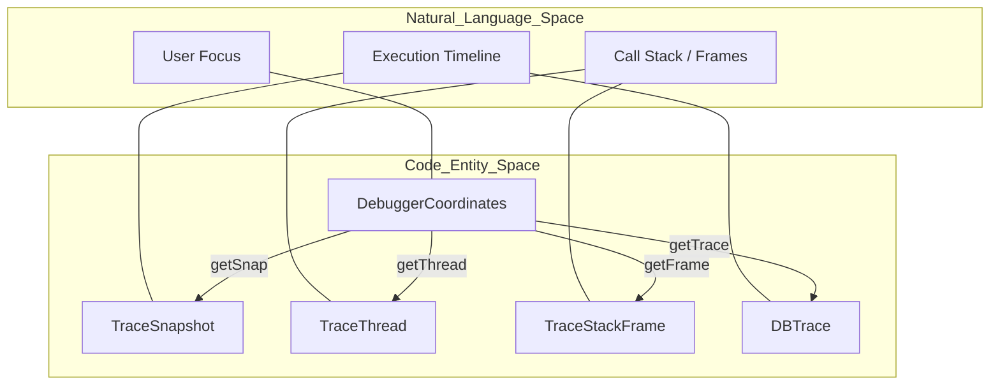
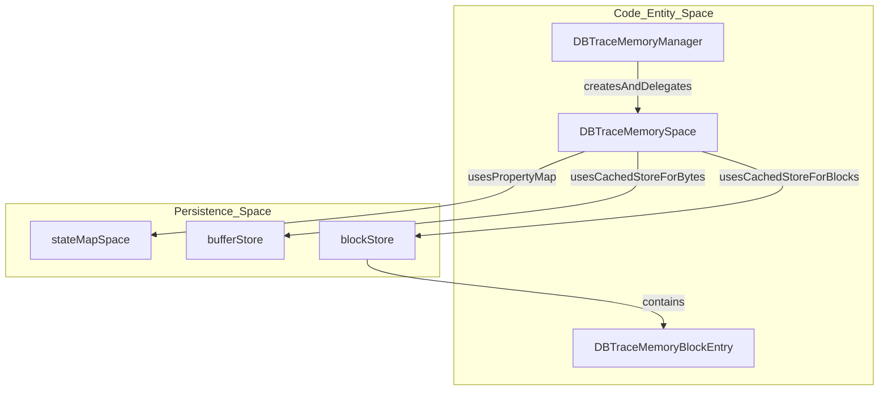

<!-- source: DeepWiki mcp.deepwiki.com · repo NationalSecurityAgency/ghidra · page 5.2 Trace Database and Coordinates · fetched 2026-11-09 -->

# Trace Database and Coordinates

Relevant source files

The following files were used as context for generating this wiki page:

- [Ghidra/Debug/Debugger-api/src/main/java/ghidra/app/services/DebuggerStaticMappingService.java](Ghidra/Debug/Debugger-api/src/main/java/ghidra/app/services/DebuggerStaticMappingService.java)
- [Ghidra/Debug/Debugger-api/src/main/java/ghidra/app/services/DebuggerTraceManagerService.java](Ghidra/Debug/Debugger-api/src/main/java/ghidra/app/services/DebuggerTraceManagerService.java)
- [Ghidra/Debug/Debugger-api/src/main/java/ghidra/debug/api/modules/DebuggerAddressTranslator.java](Ghidra/Debug/Debugger-api/src/main/java/ghidra/debug/api/modules/DebuggerAddressTranslator.java)
- [Ghidra/Debug/Debugger-api/src/main/java/ghidra/debug/api/modules/MappedAddressRange.java](Ghidra/Debug/Debugger-api/src/main/java/ghidra/debug/api/modules/MappedAddressRange.java)
- [Ghidra/Debug/Debugger/ghidra_scripts/SearchBytesAcrossTime.java](Ghidra/Debug/Debugger/ghidra_scripts/SearchBytesAcrossTime.java)
- [Ghidra/Debug/Debugger/src/main/help/help/topics/DebuggerBreakpointMarkerPlugin/images/DebuggerBreakpointMarkerPlugin.png](Ghidra/Debug/Debugger/src/main/help/help/topics/DebuggerBreakpointMarkerPlugin/images/DebuggerBreakpointMarkerPlugin.png)
- [Ghidra/Debug/Debugger/src/main/help/help/topics/DebuggerBreakpointMarkerPlugin/images/DebuggerDecompilerBreakpointMargin.png](Ghidra/Debug/Debugger/src/main/help/help/topics/DebuggerBreakpointMarkerPlugin/images/DebuggerDecompilerBreakpointMargin.png)
- [Ghidra/Debug/Debugger/src/main/help/help/topics/DebuggerBreakpointMarkerPlugin/images/DebuggerFunctionGraphBreakpointMargin.png](Ghidra/Debug/Debugger/src/main/help/help/topics/DebuggerBreakpointMarkerPlugin/images/DebuggerFunctionGraphBreakpointMargin.png)
- [Ghidra/Debug/Debugger/src/main/help/help/topics/DebuggerConsolePlugin/DebuggerConsolePlugin.html](Ghidra/Debug/Debugger/src/main/help/help/topics/DebuggerConsolePlugin/DebuggerConsolePlugin.html)
- [Ghidra/Debug/Debugger/src/main/help/help/topics/DebuggerListingPlugin/images/DebuggerListingPlugin.png](Ghidra/Debug/Debugger/src/main/help/help/topics/DebuggerListingPlugin/images/DebuggerListingPlugin.png)
- [Ghidra/Debug/Debugger/src/main/help/help/topics/DebuggerModulesPlugin/DebuggerModulesPlugin.html](Ghidra/Debug/Debugger/src/main/help/help/topics/DebuggerModulesPlugin/DebuggerModulesPlugin.html)
- [Ghidra/Debug/Debugger/src/main/help/help/topics/DebuggerModulesPlugin/images/DebuggerModulesPlugin.png](Ghidra/Debug/Debugger/src/main/help/help/topics/DebuggerModulesPlugin/images/DebuggerModulesPlugin.png)
- [Ghidra/Debug/Debugger/src/main/help/help/topics/DebuggerRegionsPlugin/images/DebuggerRegionsPlugin.png](Ghidra/Debug/Debugger/src/main/help/help/topics/DebuggerRegionsPlugin/images/DebuggerRegionsPlugin.png)
- [Ghidra/Debug/Debugger/src/main/help/help/topics/DebuggerStaticMappingPlugin/DebuggerStaticMappingPlugin.html](Ghidra/Debug/Debugger/src/main/help/help/topics/DebuggerStaticMappingPlugin/DebuggerStaticMappingPlugin.html)
- [Ghidra/Debug/Debugger/src/main/help/help/topics/DebuggerThreadsPlugin/DebuggerThreadsPlugin.html](Ghidra/Debug/Debugger/src/main/help/help/topics/DebuggerThreadsPlugin/DebuggerThreadsPlugin.html)
- [Ghidra/Debug/Debugger/src/main/help/help/topics/DebuggerThreadsPlugin/images/DebuggerThreadsPlugin.png](Ghidra/Debug/Debugger/src/main/help/help/topics/DebuggerThreadsPlugin/images/DebuggerThreadsPlugin.png)
- [Ghidra/Debug/Debugger/src/main/help/help/topics/DebuggerTraceViewDiffPlugin/images/DebuggerTraceViewDiffPlugin.png](Ghidra/Debug/Debugger/src/main/help/help/topics/DebuggerTraceViewDiffPlugin/images/DebuggerTraceViewDiffPlugin.png)
- [Ghidra/Debug/Debugger/src/main/java/ghidra/app/plugin/core/debug/gui/memory/DebuggerAddRegionDialog.java](Ghidra/Debug/Debugger/src/main/java/ghidra/app/plugin/core/debug/gui/memory/DebuggerAddRegionDialog.java)
- [Ghidra/Debug/Debugger/src/main/java/ghidra/app/plugin/core/debug/gui/memory/DebuggerRegionsPanel.java](Ghidra/Debug/Debugger/src/main/java/ghidra/app/plugin/core/debug/gui/memory/DebuggerRegionsPanel.java)
- [Ghidra/Debug/Debugger/src/main/java/ghidra/app/plugin/core/debug/gui/memory/DebuggerRegionsProvider.java](Ghidra/Debug/Debugger/src/main/java/ghidra/app/plugin/core/debug/gui/memory/DebuggerRegionsProvider.java)
- [Ghidra/Debug/Debugger/src/main/java/ghidra/app/plugin/core/debug/gui/model/AbstractObjectsTableBasedPanel.java](Ghidra/Debug/Debugger/src/main/java/ghidra/app/plugin/core/debug/gui/model/AbstractObjectsTableBasedPanel.java)
- [Ghidra/Debug/Debugger/src/main/java/ghidra/app/plugin/core/debug/gui/modules/DebuggerModulesPanel.java](Ghidra/Debug/Debugger/src/main/java/ghidra/app/plugin/core/debug/gui/modules/DebuggerModulesPanel.java)
- [Ghidra/Debug/Debugger/src/main/java/ghidra/app/plugin/core/debug/gui/modules/DebuggerModulesProvider.java](Ghidra/Debug/Debugger/src/main/java/ghidra/app/plugin/core/debug/gui/modules/DebuggerModulesProvider.java)
- [Ghidra/Debug/Debugger/src/main/java/ghidra/app/plugin/core/debug/gui/modules/DebuggerSectionsPanel.java](Ghidra/Debug/Debugger/src/main/java/ghidra/app/plugin/core/debug/gui/modules/DebuggerSectionsPanel.java)
- [Ghidra/Debug/Debugger/src/main/java/ghidra/app/plugin/core/debug/gui/thread/DebuggerThreadsProvider.java](Ghidra/Debug/Debugger/src/main/java/ghidra/app/plugin/core/debug/gui/thread/DebuggerThreadsProvider.java)
- [Ghidra/Debug/Debugger/src/main/java/ghidra/app/plugin/core/debug/gui/thread/DebuggerTraceFileActionContext.java](Ghidra/Debug/Debugger/src/main/java/ghidra/app/plugin/core/debug/gui/thread/DebuggerTraceFileActionContext.java)
- [Ghidra/Debug/Debugger/src/main/java/ghidra/app/plugin/core/debug/gui/time/DebuggerTimeSelectionDialog.java](Ghidra/Debug/Debugger/src/main/java/ghidra/app/plugin/core/debug/gui/time/DebuggerTimeSelectionDialog.java)
- [Ghidra/Debug/Debugger/src/main/java/ghidra/app/plugin/core/debug/gui/trace/DebuggerTraceTabPanel.java](Ghidra/Debug/Debugger/src/main/java/ghidra/app/plugin/core/debug/gui/trace/DebuggerTraceTabPanel.java)
- [Ghidra/Debug/Debugger/src/main/java/ghidra/app/plugin/core/debug/service/emulation/data/DefaultPcodeDebuggerMemoryAccess.java](Ghidra/Debug/Debugger/src/main/java/ghidra/app/plugin/core/debug/service/emulation/data/DefaultPcodeDebuggerMemoryAccess.java)
- [Ghidra/Debug/Debugger/src/main/java/ghidra/app/plugin/core/debug/service/modules/DebuggerStaticMappingContext.java](Ghidra/Debug/Debugger/src/main/java/ghidra/app/plugin/core/debug/service/modules/DebuggerStaticMappingContext.java)
- [Ghidra/Debug/Debugger/src/main/java/ghidra/app/plugin/core/debug/service/modules/DebuggerStaticMappingProposals.java](Ghidra/Debug/Debugger/src/main/java/ghidra/app/plugin/core/debug/service/modules/DebuggerStaticMappingProposals.java)
- [Ghidra/Debug/Debugger/src/main/java/ghidra/app/plugin/core/debug/service/modules/DebuggerStaticMappingServicePlugin.java](Ghidra/Debug/Debugger/src/main/java/ghidra/app/plugin/core/debug/service/modules/DebuggerStaticMappingServicePlugin.java)
- [Ghidra/Debug/Debugger/src/main/java/ghidra/app/plugin/core/debug/service/modules/DynamicStaticSynchronizationPlugin.java](Ghidra/Debug/Debugger/src/main/java/ghidra/app/plugin/core/debug/service/modules/DynamicStaticSynchronizationPlugin.java)
- [Ghidra/Debug/Debugger/src/main/java/ghidra/app/plugin/core/debug/service/modules/InfoPerProgram.java](Ghidra/Debug/Debugger/src/main/java/ghidra/app/plugin/core/debug/service/modules/InfoPerProgram.java)
- [Ghidra/Debug/Debugger/src/main/java/ghidra/app/plugin/core/debug/service/modules/InfoPerTrace.java](Ghidra/Debug/Debugger/src/main/java/ghidra/app/plugin/core/debug/service/modules/InfoPerTrace.java)
- [Ghidra/Debug/Debugger/src/main/java/ghidra/app/plugin/core/debug/service/modules/MappingEntry.java](Ghidra/Debug/Debugger/src/main/java/ghidra/app/plugin/core/debug/service/modules/MappingEntry.java)
- [Ghidra/Debug/Debugger/src/main/java/ghidra/app/plugin/core/debug/service/modules/ProgramModuleIndexer.java](Ghidra/Debug/Debugger/src/main/java/ghidra/app/plugin/core/debug/service/modules/ProgramModuleIndexer.java)
- [Ghidra/Debug/Debugger/src/main/java/ghidra/app/plugin/core/debug/service/tracemgr/AbstractSaveTraceTask.java](Ghidra/Debug/Debugger/src/main/java/ghidra/app/plugin/core/debug/service/tracemgr/AbstractSaveTraceTask.java)
- [Ghidra/Debug/Debugger/src/main/java/ghidra/app/plugin/core/debug/service/tracemgr/DebuggerTraceManagerServicePlugin.java](Ghidra/Debug/Debugger/src/main/java/ghidra/app/plugin/core/debug/service/tracemgr/DebuggerTraceManagerServicePlugin.java)
- [Ghidra/Debug/Debugger/src/main/java/ghidra/app/plugin/core/debug/service/tracemgr/SaveNewTraceTask.java](Ghidra/Debug/Debugger/src/main/java/ghidra/app/plugin/core/debug/service/tracemgr/SaveNewTraceTask.java)
- [Ghidra/Debug/Debugger/src/main/java/ghidra/app/plugin/core/debug/service/tracemgr/SaveTraceAsTask.java](Ghidra/Debug/Debugger/src/main/java/ghidra/app/plugin/core/debug/service/tracemgr/SaveTraceAsTask.java)
- [Ghidra/Debug/Debugger/src/main/java/ghidra/app/plugin/core/debug/service/tracemgr/SaveTraceTask.java](Ghidra/Debug/Debugger/src/main/java/ghidra/app/plugin/core/debug/service/tracemgr/SaveTraceTask.java)
- [Ghidra/Debug/Debugger/src/main/java/ghidra/app/plugin/core/debug/utils/AbstractMappedMemoryBytesVisitor.java](Ghidra/Debug/Debugger/src/main/java/ghidra/app/plugin/core/debug/utils/AbstractMappedMemoryBytesVisitor.java)
- [Ghidra/Debug/Debugger/src/main/java/ghidra/app/plugin/core/debug/utils/ProgramURLUtils.java](Ghidra/Debug/Debugger/src/main/java/ghidra/app/plugin/core/debug/utils/ProgramURLUtils.java)
- [Ghidra/Debug/Debugger/src/screen/java/ghidra/app/plugin/core/debug/gui/copying/DebuggerCopyActionsPluginScreenShots.java](Ghidra/Debug/Debugger/src/screen/java/ghidra/app/plugin/core/debug/gui/copying/DebuggerCopyActionsPluginScreenShots.java)
- [Ghidra/Debug/Debugger/src/test/java/ghidra/app/plugin/core/debug/gui/memory/DebuggerRegionsProviderTest.java](Ghidra/Debug/Debugger/src/test/java/ghidra/app/plugin/core/debug/gui/memory/DebuggerRegionsProviderTest.java)
- [Ghidra/Debug/Debugger/src/test/java/ghidra/app/plugin/core/debug/gui/modules/DebuggerModulesProviderTest.java](Ghidra/Debug/Debugger/src/test/java/ghidra/app/plugin/core/debug/gui/modules/DebuggerModulesProviderTest.java)
- [Ghidra/Debug/Debugger/src/test/java/ghidra/app/plugin/core/debug/gui/modules/DebuggerStaticMappingProviderTest.java](Ghidra/Debug/Debugger/src/test/java/ghidra/app/plugin/core/debug/gui/modules/DebuggerStaticMappingProviderTest.java)
- [Ghidra/Debug/Debugger/src/test/java/ghidra/app/plugin/core/debug/gui/thread/DebuggerThreadsProviderTest.java](Ghidra/Debug/Debugger/src/test/java/ghidra/app/plugin/core/debug/gui/thread/DebuggerThreadsProviderTest.java)
- [Ghidra/Debug/Debugger/src/test/java/ghidra/app/plugin/core/debug/service/modules/DebuggerStaticMappingServiceTest.java](Ghidra/Debug/Debugger/src/test/java/ghidra/app/plugin/core/debug/service/modules/DebuggerStaticMappingServiceTest.java)
- [Ghidra/Debug/Framework-TraceModeling/src/main/java/ghidra/trace/database/context/DBTraceRegisterContextManager.java](Ghidra/Debug/Framework-TraceModeling/src/main/java/ghidra/trace/database/context/DBTraceRegisterContextManager.java)
- [Ghidra/Debug/Framework-TraceModeling/src/main/java/ghidra/trace/database/listing/DBTraceCodeSpace.java](Ghidra/Debug/Framework-TraceModeling/src/main/java/ghidra/trace/database/listing/DBTraceCodeSpace.java)
- [Ghidra/Debug/Framework-TraceModeling/src/main/java/ghidra/trace/database/listing/DBTraceCommentAdapter.java](Ghidra/Debug/Framework-TraceModeling/src/main/java/ghidra/trace/database/listing/DBTraceCommentAdapter.java)
- [Ghidra/Debug/Framework-TraceModeling/src/main/java/ghidra/trace/database/map/DBTraceAddressSnapRangePropertyMapTree.java](Ghidra/Debug/Framework-TraceModeling/src/main/java/ghidra/trace/database/map/DBTraceAddressSnapRangePropertyMapTree.java)
- [Ghidra/Debug/Framework-TraceModeling/src/main/java/ghidra/trace/database/memory/DBTraceMemoryManager.java](Ghidra/Debug/Framework-TraceModeling/src/main/java/ghidra/trace/database/memory/DBTraceMemoryManager.java)
- [Ghidra/Debug/Framework-TraceModeling/src/main/java/ghidra/trace/database/memory/DBTraceMemorySpace.java](Ghidra/Debug/Framework-TraceModeling/src/main/java/ghidra/trace/database/memory/DBTraceMemorySpace.java)
- [Ghidra/Debug/Framework-TraceModeling/src/main/java/ghidra/trace/database/program/AbstractDBTraceProgramViewListing.java](Ghidra/Debug/Framework-TraceModeling/src/main/java/ghidra/trace/database/program/AbstractDBTraceProgramViewListing.java)
- [Ghidra/Debug/Framework-TraceModeling/src/main/java/ghidra/trace/database/program/DBTraceProgramView.java](Ghidra/Debug/Framework-TraceModeling/src/main/java/ghidra/trace/database/program/DBTraceProgramView.java)
- [Ghidra/Debug/Framework-TraceModeling/src/main/java/ghidra/trace/model/memory/TraceMemoryOperations.java](Ghidra/Debug/Framework-TraceModeling/src/main/java/ghidra/trace/model/memory/TraceMemoryOperations.java)
- [Ghidra/Debug/Framework-TraceModeling/src/main/java/ghidra/trace/util/ByteArrayUtils.java](Ghidra/Debug/Framework-TraceModeling/src/main/java/ghidra/trace/util/ByteArrayUtils.java)
- [Ghidra/Debug/Framework-TraceModeling/src/main/java/ghidra/trace/util/TraceEvents.java](Ghidra/Debug/Framework-TraceModeling/src/main/java/ghidra/trace/util/TraceEvents.java)
- [Ghidra/Debug/Framework-TraceModeling/src/test/java/ghidra/trace/database/memory/AbstractDBTraceMemoryManagerMemoryTest.java](Ghidra/Debug/Framework-TraceModeling/src/test/java/ghidra/trace/database/memory/AbstractDBTraceMemoryManagerMemoryTest.java)
- [Ghidra/Features/Base/src/main/help/help/topics/Tool/Undo_Redo.htm](Ghidra/Features/Base/src/main/help/help/topics/Tool/Undo_Redo.htm)
- [Ghidra/Features/Base/src/main/java/ghidra/app/plugin/core/function/tags/FunctionTagButtonPanel.java](Ghidra/Features/Base/src/main/java/ghidra/app/plugin/core/function/tags/FunctionTagButtonPanel.java)
- [Ghidra/Features/Base/src/main/java/ghidra/app/util/AddressSetEditorPanel.java](Ghidra/Features/Base/src/main/java/ghidra/app/util/AddressSetEditorPanel.java)
- [Ghidra/Features/Base/src/main/java/ghidra/app/util/bin/format/pe/LoadConfigDataDirectory.java](Ghidra/Features/Base/src/main/java/ghidra/app/util/bin/format/pe/LoadConfigDataDirectory.java)
- [Ghidra/Features/Base/src/main/java/ghidra/app/util/bin/format/pe/chpe/ChpeRangeType.java](Ghidra/Features/Base/src/main/java/ghidra/app/util/bin/format/pe/chpe/ChpeRangeType.java)
- [Ghidra/Features/Base/src/main/java/ghidra/app/util/bin/format/pe/chpe/ImageArm64ecCodeRangeEntryPoint.java](Ghidra/Features/Base/src/main/java/ghidra/app/util/bin/format/pe/chpe/ImageArm64ecCodeRangeEntryPoint.java)
- [Ghidra/Features/Base/src/main/java/ghidra/app/util/bin/format/pe/chpe/ImageArm64ecMetadata.java](Ghidra/Features/Base/src/main/java/ghidra/app/util/bin/format/pe/chpe/ImageArm64ecMetadata.java)
- [Ghidra/Features/Base/src/main/java/ghidra/app/util/bin/format/pe/chpe/ImageArm64ecRedirectionEntry.java](Ghidra/Features/Base/src/main/java/ghidra/app/util/bin/format/pe/chpe/ImageArm64ecRedirectionEntry.java)
- [Ghidra/Features/Base/src/main/java/ghidra/app/util/bin/format/pe/chpe/ImageChpeMetadataX86.java](Ghidra/Features/Base/src/main/java/ghidra/app/util/bin/format/pe/chpe/ImageChpeMetadataX86.java)
- [Ghidra/Features/Base/src/main/java/ghidra/app/util/bin/format/pe/chpe/ImageChpeRangeEntry.java](Ghidra/Features/Base/src/main/java/ghidra/app/util/bin/format/pe/chpe/ImageChpeRangeEntry.java)
- [Ghidra/Features/Base/src/main/java/ghidra/program/util/InteriorSelection.java](Ghidra/Features/Base/src/main/java/ghidra/program/util/InteriorSelection.java)
- [Ghidra/Features/Base/src/test.slow/java/ghidra/app/plugin/core/select/reference/SelectRefereceActionsTest.java](Ghidra/Features/Base/src/test.slow/java/ghidra/app/plugin/core/select/reference/SelectRefereceActionsTest.java)
- [Ghidra/Features/VersionTracking/src/main/java/ghidra/feature/vt/api/util/EmptyVTSession.java](Ghidra/Features/VersionTracking/src/main/java/ghidra/feature/vt/api/util/EmptyVTSession.java)
- [Ghidra/Framework/Generic/src/main/java/ghidra/util/datastruct/Counter.java](Ghidra/Framework/Generic/src/main/java/ghidra/util/datastruct/Counter.java)
- [Ghidra/Framework/Project/src/main/java/ghidra/framework/data/DomainObjectDBTransaction.java](Ghidra/Framework/Project/src/main/java/ghidra/framework/data/DomainObjectDBTransaction.java)
- [Ghidra/Framework/SoftwareModeling/src/test/java/ghidra/program/model/StubProgram.java](Ghidra/Framework/SoftwareModeling/src/test/java/ghidra/program/model/StubProgram.java)

## Purpose and Scope

This document details the architecture of Ghidra's trace storage model (`DBTrace`), its memory and time indexing mechanisms, the `DebuggerCoordinates` navigation model, the trace program view abstraction (`TraceProgramView`), snapshot management, and the static-to-dynamic module mapping subsystems.

---

## DebuggerCoordinates System

### Core Concept

The `DebuggerCoordinates` class [Ghidra/Debug/Debugger-api/src/main/java/ghidra/debug/api/tracemgr/DebuggerCoordinates.java:27-27]() acts as the universal addressing token within Ghidra's debugger subsystem. It bundles five contextual dimensions to uniquely identify the active execution state:

| Dimension | Type | Description |
|-----------|------|-------------|
| **Trace** | `Trace` | The underlying trace database storing execution history |
| **Target** | `Target` | The live debugging session target (null for static/offline traces) |
| **Thread** | `TraceThread` | The specific execution thread being inspected |
| **Time (Snap)** | `Long` | The snapshot index representing discrete time |
| **Frame** | `Integer` | The stack frame depth level (0 = innermost/top frame) |

### Mapping Natural Language Space to Code Entity Space

**Sources**: [Ghidra/Debug/Debugger-api/src/main/java/ghidra/debug/api/tracemgr/DebuggerCoordinates.java:27-51](), [Ghidra/Debug/Framework-TraceModeling/src/main/java/ghidra/trace/database/DBTrace.java:76-76]()

### Coordinate Activation and Synchronization

The `DebuggerTraceManagerServicePlugin` [Ghidra/Debug/Debugger/src/main/java/ghidra/app/plugin/core/debug/service/tracemgr/DebuggerTraceManagerServicePlugin.java:95-96]() coordinates global and component-specific states. When a user navigates between snapshots, threads, or frames, the service fires activation events such as `TraceActivatedPluginEvent` [Ghidra/Debug/Debugger/src/main/java/ghidra/app/plugin/core/debug/service/tracemgr/DebuggerTraceManagerServicePlugin.java:81-81](). 

UI provider components like `DebuggerThreadsProvider` [Ghidra/Debug/Debugger/src/main/java/ghidra/app/plugin/core/debug/gui/thread/DebuggerThreadsProvider.java:42-43]() evaluate whether incoming coordinate changes affect their local views using optimized comparison routines [Ghidra/Debug/Debugger/src/main/java/ghidra/app/plugin/core/debug/gui/thread/DebuggerThreadsProvider.java:44-58](), [Ghidra/Debug/Debugger/src/main/java/ghidra/app/plugin/core/debug/gui/modules/DebuggerModulesProvider.java:94-105]().

**Sources**: [Ghidra/Debug/Debugger/src/main/java/ghidra/app/plugin/core/debug/service/tracemgr/DebuggerTraceManagerServicePlugin.java:95-140](), [Ghidra/Debug/Debugger/src/main/java/ghidra/app/plugin/core/debug/gui/thread/DebuggerThreadsProvider.java:42-58](), [Ghidra/Debug/Debugger/src/main/java/ghidra/app/plugin/core/debug/gui/modules/DebuggerModulesProvider.java:94-105]()

---

## Trace Database Architecture

### Storage Model and Space Managers

The trace database (`DBTrace`) organizes dynamic execution tracking across spatial and temporal dimensions. Sub-managers coordinate specific aspects of execution history:

| Subsystem Manager | Implementation Class | Storage Responsibility |
|-------------------|----------------------|------------------------|
| **Memory Manager** | `DBTraceMemoryManager` [Ghidra/Debug/Framework-TraceModeling/src/main/java/ghidra/trace/database/memory/DBTraceMemoryManager.java:48-50]() | Copy-on-write memory blocks and state maps |
| **Space Implementation** | `DBTraceMemorySpace` [Ghidra/Debug/Framework-TraceModeling/src/main/java/ghidra/trace/database/memory/DBTraceMemorySpace.java:57-58]() | Address space memory buffers and R-Tree property maps |
| **Spatial Indexing** | `DBTraceAddressSnapRangePropertyMapTree` [Ghidra/Debug/Framework-TraceModeling/src/main/java/ghidra/trace/database/map/DBTraceAddressSnapRangePropertyMapTree.java:34-40]() | 2D R-Star Tree indexing address-snap ranges |

### Memory State Tracking

Memory bytes are accompanied by state markers (`TraceMemoryState`) tracked via `DBTraceAddressSnapRangePropertyMapSpace` [Ghidra/Debug/Framework-TraceModeling/src/main/java/ghidra/trace/database/memory/DBTraceMemorySpace.java:84-85](). 
* `KNOWN`: Successfully retrieved from target memory.
* `UNKNOWN`: Unrecorded or uninitialized data.
* `ERROR`: Read fault or unmapped access.

### Mapping Code Entities to Persistence (Memory Storage)

**Sources**: [Ghidra/Debug/Framework-TraceModeling/src/main/java/ghidra/trace/database/memory/DBTraceMemoryManager.java:48-64](), [Ghidra/Debug/Framework-TraceModeling/src/main/java/ghidra/trace/database/memory/DBTraceMemorySpace.java:57-126](), [Ghidra/Debug/Framework-TraceModeling/src/main/java/ghidra/trace/database/map/DBTraceAddressSnapRangePropertyMapTree.java:34-40]()

---

## Snapshot and Time Management

Snapshots represent discrete points on the execution timeline (`TraceSnapshot`). The time manager tracks snapshot additions, deletions, and viewport schedules.

Transaction boundaries within trace databases are monitored by internal listeners such as `ListenerForTraceChanges` inside `DebuggerTraceManagerServicePlugin` [Ghidra/Debug/Debugger/src/main/java/ghidra/app/plugin/core/debug/service/tracemgr/DebuggerTraceManagerServicePlugin.java:107-113](). This listener synchronizes background updates when transactions commit (`transactionEnded`) [Ghidra/Debug/Debugger/src/main/java/ghidra/app/plugin/core/debug/service/tracemgr/DebuggerTraceManagerServicePlugin.java:182-187]().

**Sources**: [Ghidra/Debug/Debugger/src/main/java/ghidra/app/plugin/core/debug/service/tracemgr/DebuggerTraceManagerServicePlugin.java:107-120](), [Ghidra/Debug/Debugger/src/main/java/ghidra/app/plugin/core/debug/service/tracemgr/DebuggerTraceManagerServicePlugin.java:182-187]()

---

## Trace Program View

A `TraceProgramView` [Ghidra/Debug/Framework-TraceModeling/src/main/java/ghidra/trace/database/program/DBTraceProgramView.java:80-81]() projects a snapshot of a `Trace` into standard Ghidra `Program` semantics. This allows static analysis plugins, decompiler pipelines, and listing components to analyze dynamic execution states seamlessly.

The view translates internal trace events into standard program model events using an internal `EventTranslator` dispatcher [Ghidra/Debug/Framework-TraceModeling/src/main/java/ghidra/trace/database/program/DBTraceProgramView.java:84-85](). It listens for low-level modifications like `TraceEvents.BYTES_CHANGED` [Ghidra/Debug/Framework-TraceModeling/src/main/java/ghidra/trace/database/program/DBTraceProgramView.java:132-132]() and dispatches corresponding program-level notifications.

**Sources**: [Ghidra/Debug/Framework-TraceModeling/src/main/java/ghidra/trace/database/program/DBTraceProgramView.java:80-151]()

---

## Static/Dynamic Module Mapping and Relocations

The debugger manages address translation between dynamic trace addresses and static program databases (`Program`) via `DebuggerStaticMappingServicePlugin` [Ghidra/Debug/Debugger/src/main/java/ghidra/app/plugin/core/debug/service/modules/DebuggerStaticMappingServicePlugin.java:81-82]().

* **Program Indexing**: `ProgramModuleIndexer` indexes project binaries by matching module paths, executable names, and domain file metadata [Ghidra/Debug/Debugger/src/main/java/ghidra/app/plugin/core/debug/service/modules/ProgramModuleIndexer.java:41-82]().
* **Mapping Proposals**: Components like `DebuggerModulesProvider` [Ghidra/Debug/Debugger/src/main/java/ghidra/app/plugin/core/debug/gui/modules/DebuggerModulesProvider.java:74-75]() and `DebuggerRegionsProvider` [Ghidra/Debug/Debugger/src/main/java/ghidra/app/plugin/core/debug/gui/memory/DebuggerRegionsProvider.java:59-60]() generate proposal mappings (`ModuleMapProposal`, `RegionMapProposal`) to align loaded dynamic modules with static workspace programs.

**Sources**: [Ghidra/Debug/Debugger/src/main/java/ghidra/app/plugin/core/debug/service/modules/DebuggerStaticMappingServicePlugin.java:81-114](), [Ghidra/Debug/Debugger/src/main/java/ghidra/app/plugin/core/debug/service/modules/ProgramModuleIndexer.java:41-82](), [Ghidra/Debug/Debugger/src/main/java/ghidra/app/plugin/core/debug/gui/modules/DebuggerModulesProvider.java:74-75](), [Ghidra/Debug/Debugger/src/main/java/ghidra/app/plugin/core/debug/gui/memory/DebuggerRegionsProvider.java:59-60]()

---

