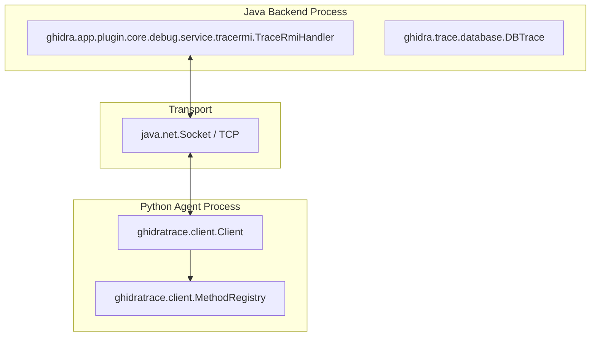
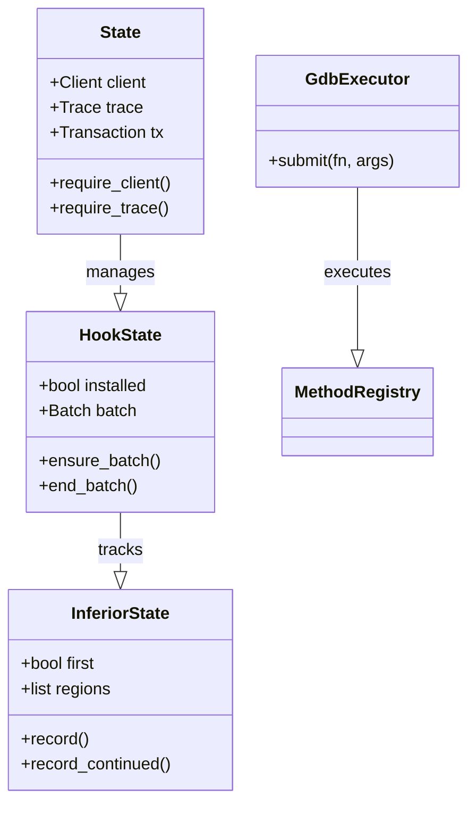

<!-- source: DeepWiki mcp.deepwiki.com · repo NationalSecurityAgency/ghidra · page 5.3 Trace RMI Protocol and Debugger Agents · fetched 2026-11-09 -->

# Trace RMI Protocol and Debugger Agents

Relevant source files

The following files were used as context for generating this wiki page:

- [Ghidra/Debug/Debugger-agent-dbgeng/certification.manifest](Ghidra/Debug/Debugger-agent-dbgeng/certification.manifest)
- [Ghidra/Debug/Debugger-agent-dbgeng/data/debugger-launchers/kernel-dbgeng.bat](Ghidra/Debug/Debugger-agent-dbgeng/data/debugger-launchers/kernel-dbgeng.bat)
- [Ghidra/Debug/Debugger-agent-dbgeng/data/debugger-launchers/local-dbgeng-attach.bat](Ghidra/Debug/Debugger-agent-dbgeng/data/debugger-launchers/local-dbgeng-attach.bat)
- [Ghidra/Debug/Debugger-agent-dbgeng/data/debugger-launchers/local-dbgeng-ext.bat](Ghidra/Debug/Debugger-agent-dbgeng/data/debugger-launchers/local-dbgeng-ext.bat)
- [Ghidra/Debug/Debugger-agent-dbgeng/data/debugger-launchers/local-dbgeng-trace.bat](Ghidra/Debug/Debugger-agent-dbgeng/data/debugger-launchers/local-dbgeng-trace.bat)
- [Ghidra/Debug/Debugger-agent-dbgeng/data/debugger-launchers/remote-dbgeng.bat](Ghidra/Debug/Debugger-agent-dbgeng/data/debugger-launchers/remote-dbgeng.bat)
- [Ghidra/Debug/Debugger-agent-dbgeng/data/debugger-launchers/svrcx-dbgeng.bat](Ghidra/Debug/Debugger-agent-dbgeng/data/debugger-launchers/svrcx-dbgeng.bat)
- [Ghidra/Debug/Debugger-agent-dbgeng/data/support/kernel-dbgeng.py](Ghidra/Debug/Debugger-agent-dbgeng/data/support/kernel-dbgeng.py)
- [Ghidra/Debug/Debugger-agent-dbgeng/data/support/local-dbgeng-ext.py](Ghidra/Debug/Debugger-agent-dbgeng/data/support/local-dbgeng-ext.py)
- [Ghidra/Debug/Debugger-agent-dbgeng/data/support/remote-dbgeng.py](Ghidra/Debug/Debugger-agent-dbgeng/data/support/remote-dbgeng.py)
- [Ghidra/Debug/Debugger-agent-dbgeng/data/support/svrcx-dbgeng.py](Ghidra/Debug/Debugger-agent-dbgeng/data/support/svrcx-dbgeng.py)
- [Ghidra/Debug/Debugger-agent-dbgeng/src/main/py/MANIFEST.in](Ghidra/Debug/Debugger-agent-dbgeng/src/main/py/MANIFEST.in)
- [Ghidra/Debug/Debugger-agent-dbgeng/src/main/py/pyproject.toml](Ghidra/Debug/Debugger-agent-dbgeng/src/main/py/pyproject.toml)
- [Ghidra/Debug/Debugger-agent-dbgeng/src/main/py/src/ghidradbg/__init__.py](Ghidra/Debug/Debugger-agent-dbgeng/src/main/py/src/ghidradbg/__init__.py)
- [Ghidra/Debug/Debugger-agent-dbgeng/src/main/py/src/ghidradbg/arch.py](Ghidra/Debug/Debugger-agent-dbgeng/src/main/py/src/ghidradbg/arch.py)
- [Ghidra/Debug/Debugger-agent-dbgeng/src/main/py/src/ghidradbg/commands.py](Ghidra/Debug/Debugger-agent-dbgeng/src/main/py/src/ghidradbg/commands.py)
- [Ghidra/Debug/Debugger-agent-dbgeng/src/main/py/src/ghidradbg/dbgmodel/DbgModel.idl](Ghidra/Debug/Debugger-agent-dbgeng/src/main/py/src/ghidradbg/dbgmodel/DbgModel.idl)
- [Ghidra/Debug/Debugger-agent-dbgeng/src/main/py/src/ghidradbg/dbgmodel/imodeliterator.py](Ghidra/Debug/Debugger-agent-dbgeng/src/main/py/src/ghidradbg/dbgmodel/imodeliterator.py)
- [Ghidra/Debug/Debugger-agent-dbgeng/src/main/py/src/ghidradbg/dbgmodel/imodelobject.py](Ghidra/Debug/Debugger-agent-dbgeng/src/main/py/src/ghidradbg/dbgmodel/imodelobject.py)
- [Ghidra/Debug/Debugger-agent-dbgeng/src/main/py/src/ghidradbg/dbgmodel/istringdisplayableconcept.py](Ghidra/Debug/Debugger-agent-dbgeng/src/main/py/src/ghidradbg/dbgmodel/istringdisplayableconcept.py)
- [Ghidra/Debug/Debugger-agent-dbgeng/src/main/py/src/ghidradbg/exdi/exdi_commands.py](Ghidra/Debug/Debugger-agent-dbgeng/src/main/py/src/ghidradbg/exdi/exdi_commands.py)
- [Ghidra/Debug/Debugger-agent-dbgeng/src/main/py/src/ghidradbg/exdi/exdi_methods.py](Ghidra/Debug/Debugger-agent-dbgeng/src/main/py/src/ghidradbg/exdi/exdi_methods.py)
- [Ghidra/Debug/Debugger-agent-dbgeng/src/main/py/src/ghidradbg/hooks.py](Ghidra/Debug/Debugger-agent-dbgeng/src/main/py/src/ghidradbg/hooks.py)
- [Ghidra/Debug/Debugger-agent-dbgeng/src/main/py/src/ghidradbg/libraries.py](Ghidra/Debug/Debugger-agent-dbgeng/src/main/py/src/ghidradbg/libraries.py)
- [Ghidra/Debug/Debugger-agent-dbgeng/src/main/py/src/ghidradbg/methods.py](Ghidra/Debug/Debugger-agent-dbgeng/src/main/py/src/ghidradbg/methods.py)
- [Ghidra/Debug/Debugger-agent-dbgeng/src/main/py/src/ghidradbg/schema.xml](Ghidra/Debug/Debugger-agent-dbgeng/src/main/py/src/ghidradbg/schema.xml)
- [Ghidra/Debug/Debugger-agent-dbgeng/src/main/py/src/ghidradbg/schema_exdi.xml](Ghidra/Debug/Debugger-agent-dbgeng/src/main/py/src/ghidradbg/schema_exdi.xml)
- [Ghidra/Debug/Debugger-agent-dbgeng/src/main/py/src/ghidradbg/util.py](Ghidra/Debug/Debugger-agent-dbgeng/src/main/py/src/ghidradbg/util.py)
- [Ghidra/Debug/Debugger-agent-drgn/src/main/py/pyproject.toml](Ghidra/Debug/Debugger-agent-drgn/src/main/py/pyproject.toml)
- [Ghidra/Debug/Debugger-agent-gdb/data/debugger-launchers/local-rr.sh](Ghidra/Debug/Debugger-agent-gdb/data/debugger-launchers/local-rr.sh)
- [Ghidra/Debug/Debugger-agent-gdb/src/main/py/pyproject.toml](Ghidra/Debug/Debugger-agent-gdb/src/main/py/pyproject.toml)
- [Ghidra/Debug/Debugger-agent-gdb/src/main/py/src/ghidragdb/arch.py](Ghidra/Debug/Debugger-agent-gdb/src/main/py/src/ghidragdb/arch.py)
- [Ghidra/Debug/Debugger-agent-gdb/src/main/py/src/ghidragdb/commands.py](Ghidra/Debug/Debugger-agent-gdb/src/main/py/src/ghidragdb/commands.py)
- [Ghidra/Debug/Debugger-agent-gdb/src/main/py/src/ghidragdb/hooks.py](Ghidra/Debug/Debugger-agent-gdb/src/main/py/src/ghidragdb/hooks.py)
- [Ghidra/Debug/Debugger-agent-gdb/src/main/py/src/ghidragdb/methods.py](Ghidra/Debug/Debugger-agent-gdb/src/main/py/src/ghidragdb/methods.py)
- [Ghidra/Debug/Debugger-agent-gdb/src/main/py/src/ghidragdb/schema.xml](Ghidra/Debug/Debugger-agent-gdb/src/main/py/src/ghidragdb/schema.xml)
- [Ghidra/Debug/Debugger-agent-gdb/src/main/py/src/ghidragdb/util.py](Ghidra/Debug/Debugger-agent-gdb/src/main/py/src/ghidragdb/util.py)
- [Ghidra/Debug/Debugger-agent-lldb/data/debugger-launchers/kernel-lldb.sh](Ghidra/Debug/Debugger-agent-lldb/data/debugger-launchers/kernel-lldb.sh)
- [Ghidra/Debug/Debugger-agent-lldb/src/main/py/pyproject.toml](Ghidra/Debug/Debugger-agent-lldb/src/main/py/pyproject.toml)
- [Ghidra/Debug/Debugger-agent-lldb/src/main/py/src/ghidralldb/arch.py](Ghidra/Debug/Debugger-agent-lldb/src/main/py/src/ghidralldb/arch.py)
- [Ghidra/Debug/Debugger-agent-lldb/src/main/py/src/ghidralldb/commands.py](Ghidra/Debug/Debugger-agent-lldb/src/main/py/src/ghidralldb/commands.py)
- [Ghidra/Debug/Debugger-agent-lldb/src/main/py/src/ghidralldb/hooks.py](Ghidra/Debug/Debugger-agent-lldb/src/main/py/src/ghidralldb/hooks.py)
- [Ghidra/Debug/Debugger-agent-lldb/src/main/py/src/ghidralldb/methods.py](Ghidra/Debug/Debugger-agent-lldb/src/main/py/src/ghidralldb/methods.py)
- [Ghidra/Debug/Debugger-agent-lldb/src/main/py/src/ghidralldb/schema.xml](Ghidra/Debug/Debugger-agent-lldb/src/main/py/src/ghidralldb/schema.xml)
- [Ghidra/Debug/Debugger-agent-lldb/src/main/py/src/ghidralldb/util.py](Ghidra/Debug/Debugger-agent-lldb/src/main/py/src/ghidralldb/util.py)
- [Ghidra/Debug/Debugger-agent-x64dbg/src/main/py/pyproject.toml](Ghidra/Debug/Debugger-agent-x64dbg/src/main/py/pyproject.toml)
- [Ghidra/Debug/Debugger-api/src/main/java/ghidra/debug/api/tracermi/TerminalSession.java](Ghidra/Debug/Debugger-api/src/main/java/ghidra/debug/api/tracermi/TerminalSession.java)
- [Ghidra/Debug/Debugger-api/src/main/java/ghidra/debug/api/tracermi/TraceRmiLaunchOffer.java](Ghidra/Debug/Debugger-api/src/main/java/ghidra/debug/api/tracermi/TraceRmiLaunchOffer.java)
- [Ghidra/Debug/Debugger-rmi-trace/Module.manifest](Ghidra/Debug/Debugger-rmi-trace/Module.manifest)
- [Ghidra/Debug/Debugger-rmi-trace/data/debugger-launchers/raw-python3.sh](Ghidra/Debug/Debugger-rmi-trace/data/debugger-launchers/raw-python3.sh)
- [Ghidra/Debug/Debugger-rmi-trace/data/support/raw-python3.py](Ghidra/Debug/Debugger-rmi-trace/data/support/raw-python3.py)
- [Ghidra/Debug/Debugger-rmi-trace/src/main/help/help/topics/TraceRmiLauncherServicePlugin/TraceRmiLauncherServicePlugin.html](Ghidra/Debug/Debugger-rmi-trace/src/main/help/help/topics/TraceRmiLauncherServicePlugin/TraceRmiLauncherServicePlugin.html)
- [Ghidra/Debug/Debugger-rmi-trace/src/main/java/ghidra/app/plugin/core/debug/gui/tracermi/launcher/AbstractScriptTraceRmiLaunchOffer.java](Ghidra/Debug/Debugger-rmi-trace/src/main/java/ghidra/app/plugin/core/debug/gui/tracermi/launcher/AbstractScriptTraceRmiLaunchOffer.java)
- [Ghidra/Debug/Debugger-rmi-trace/src/main/java/ghidra/app/plugin/core/debug/gui/tracermi/launcher/AbstractTraceRmiLaunchOffer.java](Ghidra/Debug/Debugger-rmi-trace/src/main/java/ghidra/app/plugin/core/debug/gui/tracermi/launcher/AbstractTraceRmiLaunchOffer.java)
- [Ghidra/Debug/Debugger-rmi-trace/src/main/java/ghidra/app/plugin/core/debug/gui/tracermi/launcher/AbstractTraceRmiLaunchOpinion.java](Ghidra/Debug/Debugger-rmi-trace/src/main/java/ghidra/app/plugin/core/debug/gui/tracermi/launcher/AbstractTraceRmiLaunchOpinion.java)
- [Ghidra/Debug/Debugger-rmi-trace/src/main/java/ghidra/app/plugin/core/debug/gui/tracermi/launcher/LaunchAction.java](Ghidra/Debug/Debugger-rmi-trace/src/main/java/ghidra/app/plugin/core/debug/gui/tracermi/launcher/LaunchAction.java)
- [Ghidra/Debug/Debugger-rmi-trace/src/main/java/ghidra/app/plugin/core/debug/gui/tracermi/launcher/LaunchFailureDialog.java](Ghidra/Debug/Debugger-rmi-trace/src/main/java/ghidra/app/plugin/core/debug/gui/tracermi/launcher/LaunchFailureDialog.java)
- [Ghidra/Debug/Debugger-rmi-trace/src/main/java/ghidra/app/plugin/core/debug/gui/tracermi/launcher/ScriptAttributesParser.java](Ghidra/Debug/Debugger-rmi-trace/src/main/java/ghidra/app/plugin/core/debug/gui/tracermi/launcher/ScriptAttributesParser.java)
- [Ghidra/Debug/Debugger-rmi-trace/src/main/java/ghidra/app/plugin/core/debug/gui/tracermi/launcher/TraceRmiLauncherServicePlugin.java](Ghidra/Debug/Debugger-rmi-trace/src/main/java/ghidra/app/plugin/core/debug/gui/tracermi/launcher/TraceRmiLauncherServicePlugin.java)
- [Ghidra/Debug/Debugger-rmi-trace/src/main/java/ghidra/app/plugin/core/debug/service/tracermi/TraceRmiHandler.java](Ghidra/Debug/Debugger-rmi-trace/src/main/java/ghidra/app/plugin/core/debug/service/tracermi/TraceRmiHandler.java)
- [Ghidra/Debug/Debugger-rmi-trace/src/main/java/ghidra/app/plugin/core/debug/service/tracermi/ValueDecoder.java](Ghidra/Debug/Debugger-rmi-trace/src/main/java/ghidra/app/plugin/core/debug/service/tracermi/ValueDecoder.java)
- [Ghidra/Debug/Debugger-rmi-trace/src/main/java/ghidra/debug/spi/tracermi/TraceRmiLaunchOpinion.java](Ghidra/Debug/Debugger-rmi-trace/src/main/java/ghidra/debug/spi/tracermi/TraceRmiLaunchOpinion.java)
- [Ghidra/Debug/Debugger-rmi-trace/src/main/py/pyproject.toml](Ghidra/Debug/Debugger-rmi-trace/src/main/py/pyproject.toml)
- [Ghidra/Debug/Debugger-rmi-trace/src/main/py/src/ghidratrace/client.py](Ghidra/Debug/Debugger-rmi-trace/src/main/py/src/ghidratrace/client.py)
- [Ghidra/Debug/Debugger/src/main/java/ghidra/app/plugin/core/debug/service/modules/AbstractMapProposal.java](Ghidra/Debug/Debugger/src/main/java/ghidra/app/plugin/core/debug/service/modules/AbstractMapProposal.java)
- [Ghidra/Debug/Debugger/src/test/java/ghidra/app/plugin/core/debug/gui/AbstractGhidraHeadedDebuggerTest.java](Ghidra/Debug/Debugger/src/test/java/ghidra/app/plugin/core/debug/gui/AbstractGhidraHeadedDebuggerTest.java)
- [Ghidra/Debug/Framework-TraceModeling/src/main/java/ghidra/trace/database/target/DBTraceObjectInterface.java](Ghidra/Debug/Framework-TraceModeling/src/main/java/ghidra/trace/database/target/DBTraceObjectInterface.java)
- [Ghidra/Debug/Framework-TraceModeling/src/main/java/ghidra/trace/database/target/DBTraceObjectValue.java](Ghidra/Debug/Framework-TraceModeling/src/main/java/ghidra/trace/database/target/DBTraceObjectValue.java)
- [Ghidra/Debug/Framework-TraceModeling/src/main/java/ghidra/trace/database/target/DBTraceObjectValueBehind.java](Ghidra/Debug/Framework-TraceModeling/src/main/java/ghidra/trace/database/target/DBTraceObjectValueBehind.java)
- [Ghidra/Debug/Framework-TraceModeling/src/main/java/ghidra/trace/database/target/DBTraceObjectValueWriteBehindCache.java](Ghidra/Debug/Framework-TraceModeling/src/main/java/ghidra/trace/database/target/DBTraceObjectValueWriteBehindCache.java)
- [Ghidra/Debug/ProposedUtils/src/main/java/ghidra/util/StreamUtils.java](Ghidra/Debug/ProposedUtils/src/main/java/ghidra/util/StreamUtils.java)
- [Ghidra/Debug/ProposedUtils/src/main/java/ghidra/util/database/DBSynchronizedSpliterator.java](Ghidra/Debug/ProposedUtils/src/main/java/ghidra/util/database/DBSynchronizedSpliterator.java)
- [Ghidra/Debug/ProposedUtils/src/main/java/ghidra/util/database/SynchronizedSpliterator.java](Ghidra/Debug/ProposedUtils/src/main/java/ghidra/util/database/SynchronizedSpliterator.java)
- [Ghidra/Features/Base/src/main/java/ghidra/app/plugin/core/terminal/DefaultTerminal.java](Ghidra/Features/Base/src/main/java/ghidra/app/plugin/core/terminal/DefaultTerminal.java)
- [Ghidra/Features/Base/src/main/java/ghidra/app/plugin/core/terminal/TerminalAwtEventEncoder.java](Ghidra/Features/Base/src/main/java/ghidra/app/plugin/core/terminal/TerminalAwtEventEncoder.java)
- [Ghidra/Features/Base/src/main/java/ghidra/app/plugin/core/terminal/TerminalListener.java](Ghidra/Features/Base/src/main/java/ghidra/app/plugin/core/terminal/TerminalListener.java)
- [Ghidra/Features/Base/src/main/java/ghidra/app/plugin/core/terminal/TerminalPlugin.java](Ghidra/Features/Base/src/main/java/ghidra/app/plugin/core/terminal/TerminalPlugin.java)
- [Ghidra/Features/Base/src/main/java/ghidra/app/services/Terminal.java](Ghidra/Features/Base/src/main/java/ghidra/app/services/Terminal.java)
- [Ghidra/Features/SystemEmulation/src/test/java/ghidra/pcode/emu/sys/EmuAmd64SyscallUseropLibraryTest.java](Ghidra/Features/SystemEmulation/src/test/java/ghidra/pcode/emu/sys/EmuAmd64SyscallUseropLibraryTest.java)
- [Ghidra/Framework/Docking/src/main/java/docking/menu/MenuManager.java](Ghidra/Framework/Docking/src/main/java/docking/menu/MenuManager.java)
- [Ghidra/Framework/Pty/src/main/java/ghidra/pty/windows/AnsiBufferedInputStream.java](Ghidra/Framework/Pty/src/main/java/ghidra/pty/windows/AnsiBufferedInputStream.java)
- [Ghidra/Framework/Pty/src/test/java/ghidra/pty/testutil/DummyProc.java](Ghidra/Framework/Pty/src/test/java/ghidra/pty/testutil/DummyProc.java)
- [Ghidra/Test/DebuggerIntegrationTest/src/expPrint/c/expPrint.c](Ghidra/Test/DebuggerIntegrationTest/src/expPrint/c/expPrint.c)
- [Ghidra/Test/DebuggerIntegrationTest/src/expRead/c/expRead.c](Ghidra/Test/DebuggerIntegrationTest/src/expRead/c/expRead.c)
- [Ghidra/Test/DebuggerIntegrationTest/src/test.slow/java/agent/dbgeng/rmi/DbgEngCommandsTest.java](Ghidra/Test/DebuggerIntegrationTest/src/test.slow/java/agent/dbgeng/rmi/DbgEngCommandsTest.java)
- [Ghidra/Test/DebuggerIntegrationTest/src/test.slow/java/agent/dbgeng/rmi/DbgEngHooksTest.java](Ghidra/Test/DebuggerIntegrationTest/src/test.slow/java/agent/dbgeng/rmi/DbgEngHooksTest.java)
- [Ghidra/Test/DebuggerIntegrationTest/src/test.slow/java/agent/dbgeng/rmi/DbgEngMethodsTest.java](Ghidra/Test/DebuggerIntegrationTest/src/test.slow/java/agent/dbgeng/rmi/DbgEngMethodsTest.java)
- [Ghidra/Test/DebuggerIntegrationTest/src/test.slow/java/agent/dbgeng/rmi/DbgEngStackUnwindTest.java](Ghidra/Test/DebuggerIntegrationTest/src/test.slow/java/agent/dbgeng/rmi/DbgEngStackUnwindTest.java)
- [Ghidra/Test/DebuggerIntegrationTest/src/test.slow/java/agent/gdb/rmi/AbstractGdbTraceRmiTest.java](Ghidra/Test/DebuggerIntegrationTest/src/test.slow/java/agent/gdb/rmi/AbstractGdbTraceRmiTest.java)
- [Ghidra/Test/DebuggerIntegrationTest/src/test.slow/java/agent/gdb/rmi/GdbCommandsTest.java](Ghidra/Test/DebuggerIntegrationTest/src/test.slow/java/agent/gdb/rmi/GdbCommandsTest.java)
- [Ghidra/Test/DebuggerIntegrationTest/src/test.slow/java/agent/gdb/rmi/GdbConnectorsTest.java](Ghidra/Test/DebuggerIntegrationTest/src/test.slow/java/agent/gdb/rmi/GdbConnectorsTest.java)
- [Ghidra/Test/DebuggerIntegrationTest/src/test.slow/java/agent/gdb/rmi/GdbHooksTest.java](Ghidra/Test/DebuggerIntegrationTest/src/test.slow/java/agent/gdb/rmi/GdbHooksTest.java)
- [Ghidra/Test/DebuggerIntegrationTest/src/test.slow/java/agent/gdb/rmi/GdbMethodsTest.java](Ghidra/Test/DebuggerIntegrationTest/src/test.slow/java/agent/gdb/rmi/GdbMethodsTest.java)
- [Ghidra/Test/DebuggerIntegrationTest/src/test.slow/java/agent/lldb/rmi/AbstractLldbTraceRmiTest.java](Ghidra/Test/DebuggerIntegrationTest/src/test.slow/java/agent/lldb/rmi/AbstractLldbTraceRmiTest.java)
- [Ghidra/Test/DebuggerIntegrationTest/src/test.slow/java/agent/lldb/rmi/LldbCommandsTest.java](Ghidra/Test/DebuggerIntegrationTest/src/test.slow/java/agent/lldb/rmi/LldbCommandsTest.java)
- [Ghidra/Test/DebuggerIntegrationTest/src/test.slow/java/agent/lldb/rmi/LldbHooksTest.java](Ghidra/Test/DebuggerIntegrationTest/src/test.slow/java/agent/lldb/rmi/LldbHooksTest.java)
- [Ghidra/Test/DebuggerIntegrationTest/src/test.slow/java/agent/lldb/rmi/LldbMethodsTest.java](Ghidra/Test/DebuggerIntegrationTest/src/test.slow/java/agent/lldb/rmi/LldbMethodsTest.java)
- [Ghidra/Test/DebuggerIntegrationTest/src/test.slow/java/agent/lldb/rmi/LldbStackUnwindTest.java](Ghidra/Test/DebuggerIntegrationTest/src/test.slow/java/agent/lldb/rmi/LldbStackUnwindTest.java)
- [Ghidra/Test/DebuggerIntegrationTest/src/test/java/ghidra/app/plugin/core/debug/gui/breakpoint/AbstractDebuggerBreakpointMarkerPluginTest.java](Ghidra/Test/DebuggerIntegrationTest/src/test/java/ghidra/app/plugin/core/debug/gui/breakpoint/AbstractDebuggerBreakpointMarkerPluginTest.java)
- [Ghidra/Test/DebuggerIntegrationTest/src/test/java/ghidra/app/plugin/core/debug/service/breakpoint/AbstractDebuggerLogicalBreakpointServiceTest.java](Ghidra/Test/DebuggerIntegrationTest/src/test/java/ghidra/app/plugin/core/debug/service/breakpoint/AbstractDebuggerLogicalBreakpointServiceTest.java)
- [Ghidra/Test/DebuggerIntegrationTest/src/test/java/ghidra/app/plugin/core/debug/service/breakpoint/DebuggerRmiLogicalBreakpointServiceTest.java](Ghidra/Test/DebuggerIntegrationTest/src/test/java/ghidra/app/plugin/core/debug/service/breakpoint/DebuggerRmiLogicalBreakpointServiceTest.java)
- [GhidraDocs/GhidraClass/Debugger/A1-GettingStarted.html](GhidraDocs/GhidraClass/Debugger/A1-GettingStarted.html)
- [GhidraDocs/GhidraClass/Debugger/A1-GettingStarted.md](GhidraDocs/GhidraClass/Debugger/A1-GettingStarted.md)

## Purpose and Scope

This document details the Trace RMI (Remote Method Invocation) protocol, `TraceRmiHandler`, launcher services, launch offers, Python-based debugger agents (GDB, LLDB, DBG-ENG, drgn, x64dbg), the command/hook/method architecture, Pty/terminal support, and bidirectional state synchronization within Ghidra's Debugger framework.

Sources: [Ghidra/Debug/Debugger-rmi-trace/src/main/java/ghidra/app/plugin/core/debug/service/tracermi/TraceRmiHandler.java:72-148](), [Ghidra/Debug/Debugger-rmi-trace/src/main/help/help/topics/TraceRmiLauncherServicePlugin/TraceRmiLauncherServicePlugin.html:14-43]()

## Architecture Overview and Trace RMI Protocol

The Trace RMI protocol establishes a bidirectional communication channel using Protocol Buffers over TCP sockets between Ghidra's Java-based UI/Trace Database (`TraceRmiHandler`) and native Python-based debugger agents.

**Diagram 1: Trace RMI Protocol Bridge (Natural Language to Code Entities)**

Sources: [Ghidra/Debug/Debugger-rmi-trace/src/main/java/ghidra/app/plugin/core/debug/service/tracermi/TraceRmiHandler.java:72-134](), [Ghidra/Debug/Debugger-agent-gdb/src/main/py/src/ghidragdb/commands.py:163-187]()

## Launcher Service and Launch Offers

Launcher services automate the establishment of Trace RMI acceptors, execution of shell scripts inside terminal windows, and subsequent connection handshakes. `AbstractTraceRmiLaunchOffer` coordinates launcher configuration, target mapping discovery, and terminal session lifecycles.

- **Acceptors and Connection**: `TraceRmiAcceptor` listens on an ephemeral or specified port [Ghidra/Test/DebuggerIntegrationTest/src/test.slow/java/agent/gdb/rmi/GdbCommandsTest.java:64-67]().
- **Terminal Integration**: `PtyTerminalSession` manages PTY-backed terminal sessions, allowing terminal input/output and process control [Ghidra/Debug/Debugger-rmi-trace/src/main/java/ghidra/app/plugin/core/debug/gui/tracermi/launcher/AbstractTraceRmiLaunchOffer.java:68-82]().

Sources: [Ghidra/Debug/Debugger-rmi-trace/src/main/java/ghidra/app/plugin/core/debug/gui/tracermi/launcher/AbstractTraceRmiLaunchOffer.java:61-127](), [Ghidra/Test/DebuggerIntegrationTest/src/test.slow/java/agent/gdb/rmi/GdbCommandsTest.java:60-71]()

## Python-Based Debugger Agents

Python debugger agents for GDB, LLDB, and DBG-ENG share a common internal structural design split across modules:

- **`commands.py`**: Manages the `State` singleton (`STATE`), client connections (`Client`), and user CLI commands (`ghidra trace connect`, `ghidra trace start`) [Ghidra/Debug/Debugger-agent-gdb/src/main/py/src/ghidragdb/commands.py:89-135]().
- **`hooks.py`**: Installs event listeners (`HookState`, `InferiorState`) that automatically trigger trace updates upon debugger stops or step events [Ghidra/Debug/Debugger-agent-gdb/src/main/py/src/ghidragdb/hooks.py:39-120]().
- **`methods.py`**: Defines the `MethodRegistry` and remote-callable procedures (`GdbExecutor`) [Ghidra/Debug/Debugger-agent-gdb/src/main/py/src/ghidragdb/methods.py:45-62]().
- **`arch.py`**: Maps target architectures, register names, and memory mappers to Ghidra expectations [Ghidra/Debug/Debugger-agent-gdb/src/main/py/src/ghidragdb/arch.py:23-104]().
- **`util.py`**: Implements helper routines for version checking and stream readers [Ghidra/Debug/Debugger-agent-gdb/src/main/py/src/ghidragdb/util.py:27-43]().

Sources: [Ghidra/Debug/Debugger-agent-gdb/src/main/py/src/ghidragdb/commands.py:89-135](), [Ghidra/Debug/Debugger-agent-gdb/src/main/py/src/ghidragdb/hooks.py:39-153](), [Ghidra/Debug/Debugger-agent-gdb/src/main/py/src/ghidragdb/methods.py:45-64]()

## Command, Hook, and Method Architecture

The agent executes actions via three primary pillars: CLI Commands, Event Hooks, and RMI Methods.

**Diagram 2: Agent Internal Control Classes (Code Entity Space)**

Sources: [Ghidra/Debug/Debugger-agent-gdb/src/main/py/src/ghidragdb/commands.py:89-135](), [Ghidra/Debug/Debugger-agent-gdb/src/main/py/src/ghidragdb/hooks.py:39-120](), [Ghidra/Debug/Debugger-agent-gdb/src/main/py/src/ghidragdb/methods.py:45-62]()

## Pty and Terminal Support

Launchers integrate pseudo-terminals (`Pty`) and terminal widgets (`Terminal`) to provide a fully interactive VT-100 emulation interface. Users can execute native commands directly while maintaining complete standard I/O synchronization.

- `PtyTerminalSession` wraps `Pty`, `PtySession`, and `Terminal` instances [Ghidra/Debug/Debugger-rmi-trace/src/main/java/ghidra/app/plugin/core/debug/gui/tracermi/launcher/AbstractTraceRmiLaunchOffer.java:68-82]().
- Termination actions destroy the underlying pseudoterminal session safely [Ghidra/Debug/Debugger-rmi-trace/src/main/java/ghidra/app/plugin/core/debug/gui/tracermi/launcher/AbstractTraceRmiLaunchOffer.java:98-115]().

Sources: [Ghidra/Debug/Debugger-rmi-trace/src/main/java/ghidra/app/plugin/core/debug/gui/tracermi/launcher/AbstractTraceRmiLaunchOffer.java:61-127](), [Ghidra/Debug/Debugger-rmi-trace/src/main/help/help/topics/TraceRmiLauncherServicePlugin/TraceRmiLauncherServicePlugin.html:16-37]()

## Bidirectional State Synchronization

State synchronization operates bidirectionally between Ghidra and the native debugger agent:

1. **Agent-to-Ghidra**: Event hooks (`hooks.py`) intercept stop/breakpoint/thread creation events, bundling updates into a batch transaction via `ensure_batch()` and pushing memory/register state via `commands.py` functions (`putmem`, `putreg`) [Ghidra/Debug/Debugger-agent-gdb/src/main/py/src/ghidragdb/hooks.py:46-108]().
2. **Ghidra-to-Agent**: User actions in Ghidra invoke RMI methods registered in `methods.py`, dispatching execution commands (resume, step, breakpoint modification) to the underlying native debugger [Ghidra/Debug/Debugger-agent-gdb/src/main/py/src/ghidragdb/methods.py:45-64]().

Sources: [Ghidra/Debug/Debugger-agent-gdb/src/main/py/src/ghidragdb/hooks.py:46-120](), [Ghidra/Debug/Debugger-agent-gdb/src/main/py/src/ghidragdb/methods.py:45-64](), [Ghidra/Debug/Debugger-agent-dbgeng/src/main/py/src/ghidradbg/hooks.py:60-111]()

---

