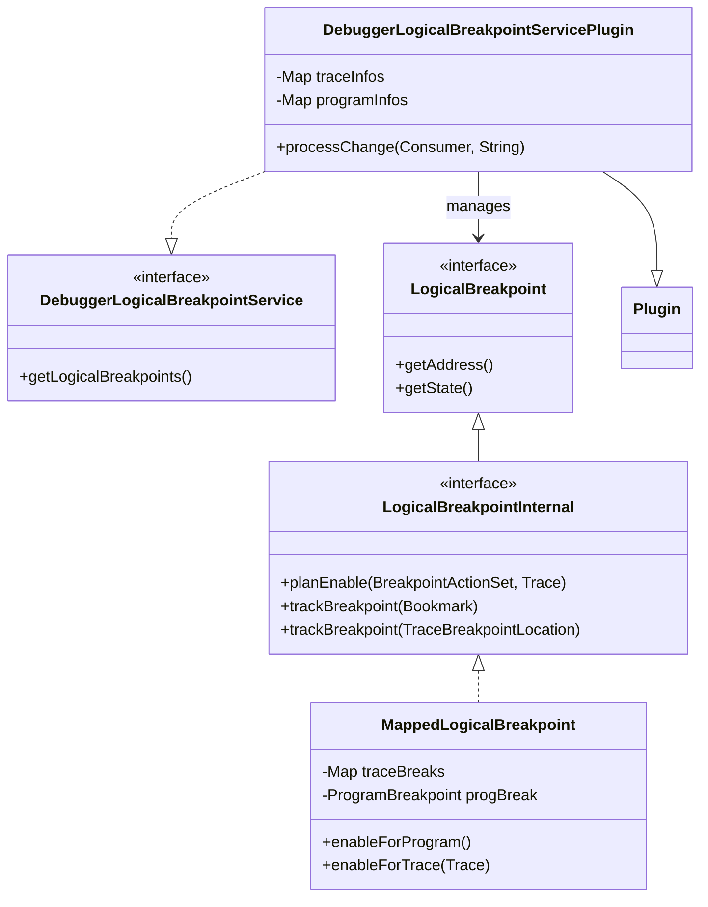
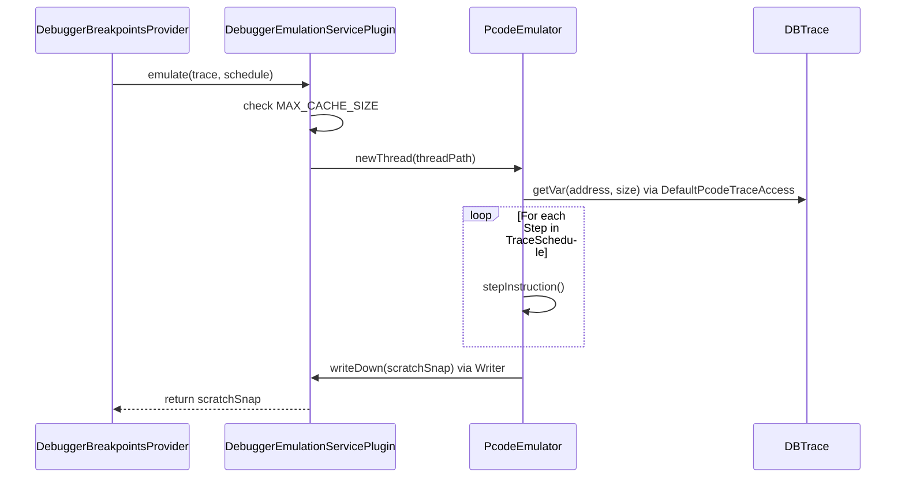

<!-- source: DeepWiki mcp.deepwiki.com · repo NationalSecurityAgency/ghidra · page 5.4 Breakpoints and Emulation · fetched 2026-11-09 -->

# Breakpoints and Emulation

Relevant source files

The following files were used as context for generating this wiki page:

- [Ghidra/Debug/Debugger-api/src/main/java/ghidra/debug/api/modules/IdentityDebuggerAddressTranslator.java](Ghidra/Debug/Debugger-api/src/main/java/ghidra/debug/api/modules/IdentityDebuggerAddressTranslator.java)
- [Ghidra/Debug/Debugger/ghidra_scripts/ListAllKnownMemoryScript.java](Ghidra/Debug/Debugger/ghidra_scripts/ListAllKnownMemoryScript.java)
- [Ghidra/Debug/Debugger/src/main/help/help/topics/DebuggerEmulationServicePlugin/DebuggerEmulationServicePlugin.html](Ghidra/Debug/Debugger/src/main/help/help/topics/DebuggerEmulationServicePlugin/DebuggerEmulationServicePlugin.html)
- [Ghidra/Debug/Debugger/src/main/help/help/topics/DebuggerEmulationServicePlugin/images/DebuggerEmulateFunctionDialog.png](Ghidra/Debug/Debugger/src/main/help/help/topics/DebuggerEmulationServicePlugin/images/DebuggerEmulateFunctionDialog.png)
- [Ghidra/Debug/Debugger/src/main/java/ghidra/app/plugin/core/debug/gui/action/BasicAutoReadMemorySpec.java](Ghidra/Debug/Debugger/src/main/java/ghidra/app/plugin/core/debug/gui/action/BasicAutoReadMemorySpec.java)
- [Ghidra/Debug/Debugger/src/main/java/ghidra/app/plugin/core/debug/gui/breakpoint/DebuggerBreakpointMarkerPlugin.java](Ghidra/Debug/Debugger/src/main/java/ghidra/app/plugin/core/debug/gui/breakpoint/DebuggerBreakpointMarkerPlugin.java)
- [Ghidra/Debug/Debugger/src/main/java/ghidra/app/plugin/core/debug/gui/breakpoint/DebuggerBreakpointsProvider.java](Ghidra/Debug/Debugger/src/main/java/ghidra/app/plugin/core/debug/gui/breakpoint/DebuggerBreakpointsProvider.java)
- [Ghidra/Debug/Debugger/src/main/java/ghidra/app/plugin/core/debug/gui/breakpoint/DebuggerPlaceBreakpointDialog.java](Ghidra/Debug/Debugger/src/main/java/ghidra/app/plugin/core/debug/gui/breakpoint/DebuggerPlaceBreakpointDialog.java)
- [Ghidra/Debug/Debugger/src/main/java/ghidra/app/plugin/core/debug/gui/breakpoint/LogicalBreakpointRow.java](Ghidra/Debug/Debugger/src/main/java/ghidra/app/plugin/core/debug/gui/breakpoint/LogicalBreakpointRow.java)
- [Ghidra/Debug/Debugger/src/main/java/ghidra/app/plugin/core/debug/gui/memory/CachedBytePage.java](Ghidra/Debug/Debugger/src/main/java/ghidra/app/plugin/core/debug/gui/memory/CachedBytePage.java)
- [Ghidra/Debug/Debugger/src/main/java/ghidra/app/plugin/core/debug/service/breakpoint/DebuggerLogicalBreakpointServicePlugin.java](Ghidra/Debug/Debugger/src/main/java/ghidra/app/plugin/core/debug/service/breakpoint/DebuggerLogicalBreakpointServicePlugin.java)
- [Ghidra/Debug/Debugger/src/main/java/ghidra/app/plugin/core/debug/service/breakpoint/LogicalBreakpointInternal.java](Ghidra/Debug/Debugger/src/main/java/ghidra/app/plugin/core/debug/service/breakpoint/LogicalBreakpointInternal.java)
- [Ghidra/Debug/Debugger/src/main/java/ghidra/app/plugin/core/debug/service/breakpoint/LoneLogicalBreakpoint.java](Ghidra/Debug/Debugger/src/main/java/ghidra/app/plugin/core/debug/service/breakpoint/LoneLogicalBreakpoint.java)
- [Ghidra/Debug/Debugger/src/main/java/ghidra/app/plugin/core/debug/service/breakpoint/MappedLogicalBreakpoint.java](Ghidra/Debug/Debugger/src/main/java/ghidra/app/plugin/core/debug/service/breakpoint/MappedLogicalBreakpoint.java)
- [Ghidra/Debug/Debugger/src/main/java/ghidra/app/plugin/core/debug/service/breakpoint/PlaceEmuBreakpointActionItem.java](Ghidra/Debug/Debugger/src/main/java/ghidra/app/plugin/core/debug/service/breakpoint/PlaceEmuBreakpointActionItem.java)
- [Ghidra/Debug/Debugger/src/main/java/ghidra/app/plugin/core/debug/service/emulation/DebuggerEmulationServicePlugin.java](Ghidra/Debug/Debugger/src/main/java/ghidra/app/plugin/core/debug/service/emulation/DebuggerEmulationServicePlugin.java)
- [Ghidra/Debug/Debugger/src/main/java/ghidra/app/plugin/core/debug/service/emulation/ProgramEmulationUtils.java](Ghidra/Debug/Debugger/src/main/java/ghidra/app/plugin/core/debug/service/emulation/ProgramEmulationUtils.java)
- [Ghidra/Debug/Debugger/src/main/java/ghidra/app/plugin/core/debug/taint/ExtKeyValue.java](Ghidra/Debug/Debugger/src/main/java/ghidra/app/plugin/core/debug/taint/ExtKeyValue.java)
- [Ghidra/Debug/Debugger/src/main/java/ghidra/app/plugin/core/debug/taint/SarifKeyValueWriter.java](Ghidra/Debug/Debugger/src/main/java/ghidra/app/plugin/core/debug/taint/SarifKeyValueWriter.java)
- [Ghidra/Debug/Debugger/src/main/java/ghidra/app/plugin/core/debug/taint/SarifLogicalLocationWriter.java](Ghidra/Debug/Debugger/src/main/java/ghidra/app/plugin/core/debug/taint/SarifLogicalLocationWriter.java)
- [Ghidra/Debug/Debugger/src/test/java/ghidra/app/plugin/core/debug/service/emulation/DebuggerEmulationServiceTest.java](Ghidra/Debug/Debugger/src/test/java/ghidra/app/plugin/core/debug/service/emulation/DebuggerEmulationServiceTest.java)
- [Ghidra/Debug/Framework-TraceModeling/src/main/java/ghidra/trace/database/DBTrace.java](Ghidra/Debug/Framework-TraceModeling/src/main/java/ghidra/trace/database/DBTrace.java)
- [Ghidra/Debug/Framework-TraceModeling/src/main/java/ghidra/trace/database/target/DBTraceObject.java](Ghidra/Debug/Framework-TraceModeling/src/main/java/ghidra/trace/database/target/DBTraceObject.java)
- [Ghidra/Debug/Framework-TraceModeling/src/main/java/ghidra/trace/model/property/TracePropertyMapSpace.java](Ghidra/Debug/Framework-TraceModeling/src/main/java/ghidra/trace/model/property/TracePropertyMapSpace.java)
- [Ghidra/Debug/Framework-TraceModeling/src/main/java/ghidra/trace/model/target/TraceObject.java](Ghidra/Debug/Framework-TraceModeling/src/main/java/ghidra/trace/model/target/TraceObject.java)
- [Ghidra/Debug/Framework-TraceModeling/src/main/java/ghidra/trace/model/target/schema/TraceObjectSchema.java](Ghidra/Debug/Framework-TraceModeling/src/main/java/ghidra/trace/model/target/schema/TraceObjectSchema.java)
- [Ghidra/Debug/Framework-TraceModeling/src/main/java/ghidra/trace/util/TraceRegisterUtils.java](Ghidra/Debug/Framework-TraceModeling/src/main/java/ghidra/trace/util/TraceRegisterUtils.java)
- [Ghidra/Debug/Framework-TraceModeling/src/test/java/ghidra/pcode/exec/trace/BytesTracePcodeEmulatorTest.java](Ghidra/Debug/Framework-TraceModeling/src/test/java/ghidra/pcode/exec/trace/BytesTracePcodeEmulatorTest.java)
- [Ghidra/Debug/TaintAnalysis/src/main/java/ghidra/pcode/emu/taint/TaintPcodeArithmetic.java](Ghidra/Debug/TaintAnalysis/src/main/java/ghidra/pcode/emu/taint/TaintPcodeArithmetic.java)
- [Ghidra/Debug/TaintAnalysis/src/main/java/ghidra/pcode/emu/taint/TaintPcodeUseropLibrary.java](Ghidra/Debug/TaintAnalysis/src/main/java/ghidra/pcode/emu/taint/TaintPcodeUseropLibrary.java)
- [Ghidra/Debug/TaintAnalysis/src/main/java/ghidra/pcode/emu/taint/state/TaintPieceHandler.java](Ghidra/Debug/TaintAnalysis/src/main/java/ghidra/pcode/emu/taint/state/TaintPieceHandler.java)
- [Ghidra/Debug/TaintAnalysis/src/main/java/ghidra/taint/model/TaintVec.java](Ghidra/Debug/TaintAnalysis/src/main/java/ghidra/taint/model/TaintVec.java)
- [Ghidra/Debug/TaintAnalysis/src/test/java/ghidra/pcode/emu/taint/full/TaintDebuggerPcodeEmulatorTest.java](Ghidra/Debug/TaintAnalysis/src/test/java/ghidra/pcode/emu/taint/full/TaintDebuggerPcodeEmulatorTest.java)
- [Ghidra/Debug/TaintAnalysis/src/test/java/ghidra/pcode/emu/taint/trace/TaintTracePcodeEmulatorTest.java](Ghidra/Debug/TaintAnalysis/src/test/java/ghidra/pcode/emu/taint/trace/TaintTracePcodeEmulatorTest.java)
- [Ghidra/Features/ByteViewer/src/main/java/ghidra/app/plugin/core/byteviewer/ByteBlockChangeManager.java](Ghidra/Features/ByteViewer/src/main/java/ghidra/app/plugin/core/byteviewer/ByteBlockChangeManager.java)
- [Ghidra/Framework/SoftwareModeling/src/test/java/ghidra/app/plugin/assembler/sleigh/x64AssemblyTest.java](Ghidra/Framework/SoftwareModeling/src/test/java/ghidra/app/plugin/assembler/sleigh/x64AssemblyTest.java)
- [Ghidra/Test/DebuggerIntegrationTest/src/test/java/ghidra/app/plugin/core/debug/gui/breakpoint/AbstractDebuggerBreakpointsProviderTest.java](Ghidra/Test/DebuggerIntegrationTest/src/test/java/ghidra/app/plugin/core/debug/gui/breakpoint/AbstractDebuggerBreakpointsProviderTest.java)
- [Ghidra/Test/DebuggerIntegrationTest/src/test/java/ghidra/app/plugin/core/debug/gui/breakpoint/DebuggerRmiBreakpointsProviderTest.java](Ghidra/Test/DebuggerIntegrationTest/src/test/java/ghidra/app/plugin/core/debug/gui/breakpoint/DebuggerRmiBreakpointsProviderTest.java)
- [Ghidra/Test/DebuggerIntegrationTest/src/test/java/ghidra/app/plugin/core/debug/gui/memory/DebuggerMemoryBytesProviderTest.java](Ghidra/Test/DebuggerIntegrationTest/src/test/java/ghidra/app/plugin/core/debug/gui/memory/DebuggerMemoryBytesProviderTest.java)
- [Ghidra/Test/IntegrationTest/src/test.slow/java/ghidra/program/model/lang/RegisterValueContextTest.java](Ghidra/Test/IntegrationTest/src/test.slow/java/ghidra/program/model/lang/RegisterValueContextTest.java)
- [Ghidra/Test/IntegrationTest/src/test.slow/java/ghidra/program/model/lang/RegisterValueTest.java](Ghidra/Test/IntegrationTest/src/test.slow/java/ghidra/program/model/lang/RegisterValueTest.java)

This section explains Ghidra's dynamic analysis capabilities for execution control across static programs and live traces. Specifically, it details the logical breakpoint service (`DebuggerLogicalBreakpointServicePlugin`) which maps breakpoints between static bookmarks and live trace locations [Ghidra/Debug/Debugger/src/main/java/ghidra/app/plugin/core/debug/service/breakpoint/DebuggerLogicalBreakpointServicePlugin.java:59-81](), breakpoint marker visualization [Ghidra/Debug/Debugger/src/main/java/ghidra/app/plugin/core/debug/gui/breakpoint/DebuggerBreakpointMarkerPlugin.java:73-90](), and the P-code emulation service (`DebuggerEmulationServicePlugin`) that supports time-travel debugging via `TraceSchedule` [Ghidra/Debug/Debugger/src/main/java/ghidra/app/plugin/core/debug/service/emulation/DebuggerEmulationServicePlugin.java:86-104]().

## Logical Breakpoint Service

The `DebuggerLogicalBreakpointServicePlugin` aggregates breakpoint information from open static programs (`Program`), live trace databases (`Trace`), and active target recorders (`Target`) [Ghidra/Debug/Debugger/src/main/java/ghidra/app/plugin/core/debug/service/breakpoint/DebuggerLogicalBreakpointServicePlugin.java:59-81](). It provides a unified `LogicalBreakpoint` abstraction that represents an execution control point regardless of whether it is currently bound to a live process [Ghidra/Debug/Debugger/src/main/java/ghidra/app/plugin/core/debug/service/breakpoint/DebuggerLogicalBreakpointServicePlugin.java:36-39]().

### Architecture and Data Flow

The service maintains synchronization between static program addresses and dynamic trace addresses using the `DebuggerStaticMappingService` [Ghidra/Debug/Debugger/src/main/java/ghidra/app/plugin/core/debug/service/breakpoint/DebuggerLogicalBreakpointServicePlugin.java:73-76](). 

When a breakpoint is toggled or updated, the service groups individual physical trace breakpoints and static program bookmarks into a single `LogicalBreakpoint` managed by `MappedLogicalBreakpoint` [Ghidra/Debug/Debugger/src/main/java/ghidra/app/plugin/core/debug/service/breakpoint/MappedLogicalBreakpoint.java:34-53]().

**Breakpoint Entity Mapping**

Sources: [Ghidra/Debug/Debugger/src/main/java/ghidra/app/plugin/core/debug/service/breakpoint/DebuggerLogicalBreakpointServicePlugin.java:59-81](), [Ghidra/Debug/Debugger/src/main/java/ghidra/app/plugin/core/debug/service/breakpoint/LogicalBreakpointInternal.java:28-109](), [Ghidra/Debug/Debugger/src/main/java/ghidra/app/plugin/core/debug/service/breakpoint/MappedLogicalBreakpoint.java:34-53]()

### Breakpoint Marker Visualization

The `DebuggerBreakpointMarkerPlugin` manages visual markers in the Listing and Decompiler view margins by registering with the core `MarkerService` [Ghidra/Debug/Debugger/src/main/java/ghidra/app/plugin/core/debug/gui/breakpoint/DebuggerBreakpointMarkerPlugin.java:73-90](). The associated table provider `DebuggerBreakpointsProvider` displays logical breakpoints and allows interactive state changes [Ghidra/Debug/Debugger/src/main/java/ghidra/app/plugin/core/debug/gui/breakpoint/DebuggerBreakpointsProvider.java:66-83]().

Sources: [Ghidra/Debug/Debugger/src/main/java/ghidra/app/plugin/core/debug/gui/breakpoint/DebuggerBreakpointMarkerPlugin.java:73-90](), [Ghidra/Debug/Debugger/src/main/java/ghidra/app/plugin/core/debug/gui/breakpoint/DebuggerBreakpointsProvider.java:66-83]()

## Emulation Service

The `DebuggerEmulationServicePlugin` provides time-travel and forward emulation capabilities integrated directly with the `DBTrace` database schema [Ghidra/Debug/Debugger/src/main/java/ghidra/app/plugin/core/debug/service/emulation/DebuggerEmulationServicePlugin.java:86-104](). It manages `PcodeMachine` instances and caches execution states across snapshots [Ghidra/Debug/Debugger/src/main/java/ghidra/app/plugin/core/debug/service/emulation/DebuggerEmulationServicePlugin.java:104-105]().

### TraceSchedule and Execution Flow

Time-travel execution is directed via a `TraceSchedule`, which encapsulates a starting snapshot snap ID and an ordered sequence of instruction ticks or steps [Ghidra/Debug/Debugger/src/main/java/ghidra/app/plugin/core/debug/service/emulation/DebuggerEmulationServicePlugin.java:73-76](). 

**Emulation Execution Flow**

Sources: [Ghidra/Debug/Debugger/src/main/java/ghidra/app/plugin/core/debug/service/emulation/DebuggerEmulationServicePlugin.java:101-130](), [Ghidra/Debug/Framework-TraceModeling/src/test/java/ghidra/pcode/exec/trace/BytesTracePcodeEmulatorTest.java:136-165]()

### Pure Emulation

Ghidra supports pure program emulation without a live native debugger process through `ProgramEmulationUtils` [Ghidra/Debug/Debugger/src/main/java/ghidra/app/plugin/core/debug/service/emulation/ProgramEmulationUtils.java:55-65](). This utility initializes a `DBTrace` instance using `EMU_SESSION_SCHEMA` to build standard memory spaces, registers, and threads from static programs [Ghidra/Debug/Debugger/src/main/java/ghidra/app/plugin/core/debug/service/emulation/ProgramEmulationUtils.java:66-144]().

Sources: [Ghidra/Debug/Debugger/src/main/java/ghidra/app/plugin/core/debug/service/emulation/ProgramEmulationUtils.java:55-144](), [Ghidra/Debug/Debugger/src/test/java/ghidra/app/plugin/core/debug/service/emulation/DebuggerEmulationServiceTest.java:77-138]()

---

