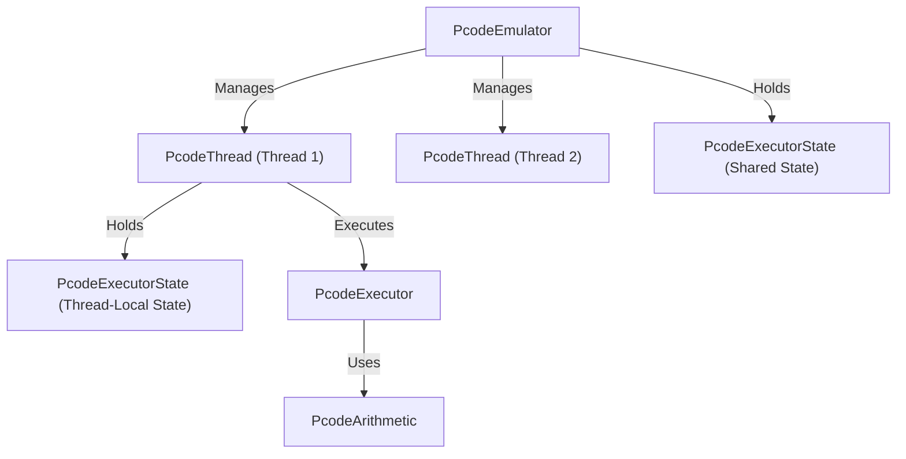
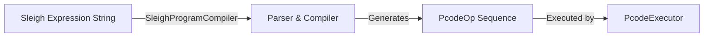
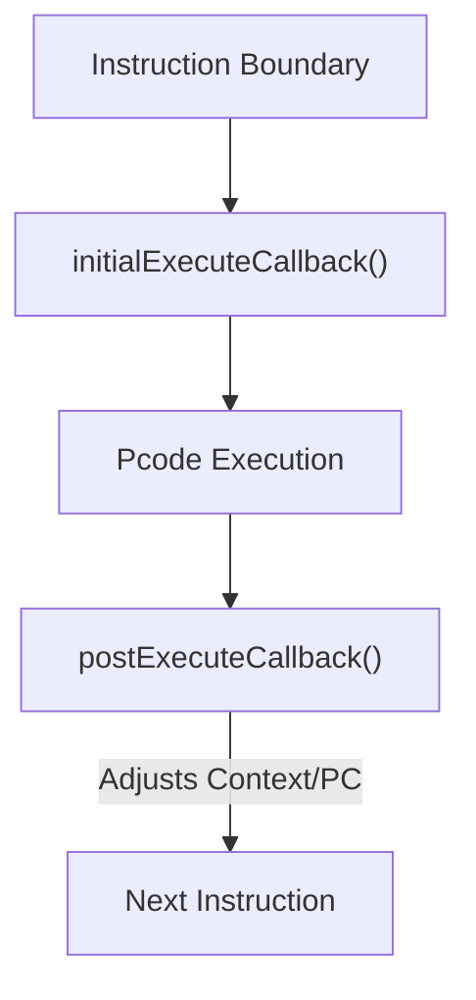
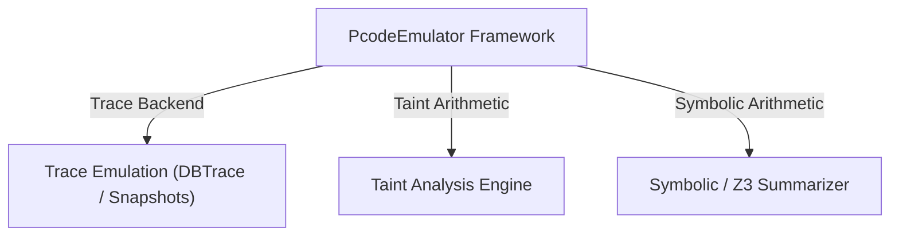

<!-- source: DeepWiki mcp.deepwiki.com · repo NationalSecurityAgency/ghidra · page 5.5 P-code Emulation Framework · fetched 2026-11-09 -->

# P-code Emulation Framework

<details>
<summary>Relevant source files</summary>

The following files were used as context for generating this wiki page:

- [Ghidra/Debug/Debugger-api/src/main/java/ghidra/debug/api/modules/IdentityDebuggerAddressTranslator.java](Ghidra/Debug/Debugger-api/src/main/java/ghidra/debug/api/modules/IdentityDebuggerAddressTranslator.java)
- [Ghidra/Debug/Debugger/ghidra_scripts/ListAllKnownMemoryScript.java](Ghidra/Debug/Debugger/ghidra_scripts/ListAllKnownMemoryScript.java)
- [Ghidra/Debug/Debugger/src/main/help/help/topics/DebuggerEmulationServicePlugin/DebuggerEmulationServicePlugin.html](Ghidra/Debug/Debugger/src/main/help/help/topics/DebuggerEmulationServicePlugin/DebuggerEmulationServicePlugin.html)
- [Ghidra/Debug/Debugger/src/main/help/help/topics/DebuggerEmulationServicePlugin/images/DebuggerEmulateFunctionDialog.png](Ghidra/Debug/Debugger/src/main/help/help/topics/DebuggerEmulationServicePlugin/images/DebuggerEmulateFunctionDialog.png)
- [Ghidra/Debug/Debugger/src/main/help/help/topics/DebuggerListingPlugin/images/DebuggerGoToDialog.png](Ghidra/Debug/Debugger/src/main/help/help/topics/DebuggerListingPlugin/images/DebuggerGoToDialog.png)
- [Ghidra/Debug/Debugger/src/main/help/help/topics/DebuggerRegistersPlugin/DebuggerRegistersPlugin.html](Ghidra/Debug/Debugger/src/main/help/help/topics/DebuggerRegistersPlugin/DebuggerRegistersPlugin.html)
- [Ghidra/Debug/Debugger/src/main/help/help/topics/DebuggerRegistersPlugin/images/DebuggerRegistersPlugin.png](Ghidra/Debug/Debugger/src/main/help/help/topics/DebuggerRegistersPlugin/images/DebuggerRegistersPlugin.png)
- [Ghidra/Debug/Debugger/src/main/help/help/topics/DebuggerStackPlugin/images/DebuggerStackPlugin.png](Ghidra/Debug/Debugger/src/main/help/help/topics/DebuggerStackPlugin/images/DebuggerStackPlugin.png)
- [Ghidra/Debug/Debugger/src/main/help/help/topics/DebuggerWatchesPlugin/DebuggerWatchesPlugin.html](Ghidra/Debug/Debugger/src/main/help/help/topics/DebuggerWatchesPlugin/DebuggerWatchesPlugin.html)
- [Ghidra/Debug/Debugger/src/main/help/help/topics/DebuggerWatchesPlugin/images/DebuggerWatchesPlugin.png](Ghidra/Debug/Debugger/src/main/help/help/topics/DebuggerWatchesPlugin/images/DebuggerWatchesPlugin.png)
- [Ghidra/Debug/Debugger/src/main/java/ghidra/app/plugin/core/debug/gui/action/BasicAutoReadMemorySpec.java](Ghidra/Debug/Debugger/src/main/java/ghidra/app/plugin/core/debug/gui/action/BasicAutoReadMemorySpec.java)
- [Ghidra/Debug/Debugger/src/main/java/ghidra/app/plugin/core/debug/gui/action/DebuggerGoToDialog.java](Ghidra/Debug/Debugger/src/main/java/ghidra/app/plugin/core/debug/gui/action/DebuggerGoToDialog.java)
- [Ghidra/Debug/Debugger/src/main/java/ghidra/app/plugin/core/debug/gui/action/DebuggerGoToTrait.java](Ghidra/Debug/Debugger/src/main/java/ghidra/app/plugin/core/debug/gui/action/DebuggerGoToTrait.java)
- [Ghidra/Debug/Debugger/src/main/java/ghidra/app/plugin/core/debug/gui/memory/CachedBytePage.java](Ghidra/Debug/Debugger/src/main/java/ghidra/app/plugin/core/debug/gui/memory/CachedBytePage.java)
- [Ghidra/Debug/Debugger/src/main/java/ghidra/app/plugin/core/debug/gui/platform/DebuggerPlatformPlugin.java](Ghidra/Debug/Debugger/src/main/java/ghidra/app/plugin/core/debug/gui/platform/DebuggerPlatformPlugin.java)
- [Ghidra/Debug/Debugger/src/main/java/ghidra/app/plugin/core/debug/gui/register/DebuggerRegistersProvider.java](Ghidra/Debug/Debugger/src/main/java/ghidra/app/plugin/core/debug/gui/register/DebuggerRegistersProvider.java)
- [Ghidra/Debug/Debugger/src/main/java/ghidra/app/plugin/core/debug/gui/register/RegisterRow.java](Ghidra/Debug/Debugger/src/main/java/ghidra/app/plugin/core/debug/gui/register/RegisterRow.java)
- [Ghidra/Debug/Debugger/src/main/java/ghidra/app/plugin/core/debug/gui/watch/DebuggerWatchesProvider.java](Ghidra/Debug/Debugger/src/main/java/ghidra/app/plugin/core/debug/gui/watch/DebuggerWatchesProvider.java)
- [Ghidra/Debug/Debugger/src/main/java/ghidra/app/plugin/core/debug/mapping/AbstractDebuggerPlatformMapper.java](Ghidra/Debug/Debugger/src/main/java/ghidra/app/plugin/core/debug/mapping/AbstractDebuggerPlatformMapper.java)
- [Ghidra/Debug/Debugger/src/main/java/ghidra/app/plugin/core/debug/mapping/DefaultDebuggerPlatformMapper.java](Ghidra/Debug/Debugger/src/main/java/ghidra/app/plugin/core/debug/mapping/DefaultDebuggerPlatformMapper.java)
- [Ghidra/Debug/Debugger/src/main/java/ghidra/app/plugin/core/debug/platform/dbgeng/DbgengDebuggerPlatformOpinion.java](Ghidra/Debug/Debugger/src/main/java/ghidra/app/plugin/core/debug/platform/dbgeng/DbgengDebuggerPlatformOpinion.java)
- [Ghidra/Debug/Debugger/src/main/java/ghidra/app/plugin/core/debug/service/emulation/DebuggerEmulationServicePlugin.java](Ghidra/Debug/Debugger/src/main/java/ghidra/app/plugin/core/debug/service/emulation/DebuggerEmulationServicePlugin.java)
- [Ghidra/Debug/Debugger/src/main/java/ghidra/app/plugin/core/debug/service/emulation/ProgramEmulationUtils.java](Ghidra/Debug/Debugger/src/main/java/ghidra/app/plugin/core/debug/service/emulation/ProgramEmulationUtils.java)
- [Ghidra/Debug/Debugger/src/main/java/ghidra/app/plugin/core/debug/service/platform/DebuggerPlatformServicePlugin.java](Ghidra/Debug/Debugger/src/main/java/ghidra/app/plugin/core/debug/service/platform/DebuggerPlatformServicePlugin.java)
- [Ghidra/Debug/Debugger/src/main/java/ghidra/app/plugin/core/debug/taint/ExtKeyValue.java](Ghidra/Debug/Debugger/src/main/java/ghidra/app/plugin/core/debug/taint/ExtKeyValue.java)
- [Ghidra/Debug/Debugger/src/main/java/ghidra/app/plugin/core/debug/taint/SarifKeyValueWriter.java](Ghidra/Debug/Debugger/src/main/java/ghidra/app/plugin/core/debug/taint/SarifKeyValueWriter.java)
- [Ghidra/Debug/Debugger/src/main/java/ghidra/app/plugin/core/debug/taint/SarifLogicalLocationWriter.java](Ghidra/Debug/Debugger/src/main/java/ghidra/app/plugin/core/debug/taint/SarifLogicalLocationWriter.java)
- [Ghidra/Debug/Debugger/src/main/java/ghidra/pcode/exec/DebuggerPcodeUtils.java](Ghidra/Debug/Debugger/src/main/java/ghidra/pcode/exec/DebuggerPcodeUtils.java)
- [Ghidra/Debug/Debugger/src/screen/java/ghidra/app/plugin/core/debug/gui/listing/DebuggerListingPluginScreenShots.java](Ghidra/Debug/Debugger/src/screen/java/ghidra/app/plugin/core/debug/gui/listing/DebuggerListingPluginScreenShots.java)
- [Ghidra/Debug/Debugger/src/screen/java/ghidra/app/plugin/core/debug/gui/pcode/DebuggerPcodeStepperPluginScreenShots.java](Ghidra/Debug/Debugger/src/screen/java/ghidra/app/plugin/core/debug/gui/pcode/DebuggerPcodeStepperPluginScreenShots.java)
- [Ghidra/Debug/Debugger/src/screen/java/ghidra/app/plugin/core/debug/gui/watch/DebuggerWatchesPluginScreenShots.java](Ghidra/Debug/Debugger/src/screen/java/ghidra/app/plugin/core/debug/gui/watch/DebuggerWatchesPluginScreenShots.java)
- [Ghidra/Debug/Debugger/src/test/java/ghidra/app/plugin/core/debug/gui/platform/DebuggerPlatformPluginTest.java](Ghidra/Debug/Debugger/src/test/java/ghidra/app/plugin/core/debug/gui/platform/DebuggerPlatformPluginTest.java)
- [Ghidra/Debug/Debugger/src/test/java/ghidra/app/plugin/core/debug/service/emulation/DebuggerEmulationServiceTest.java](Ghidra/Debug/Debugger/src/test/java/ghidra/app/plugin/core/debug/service/emulation/DebuggerEmulationServiceTest.java)
- [Ghidra/Debug/Framework-TraceModeling/src/main/java/ghidra/trace/database/DBTrace.java](Ghidra/Debug/Framework-TraceModeling/src/main/java/ghidra/trace/database/DBTrace.java)
- [Ghidra/Debug/Framework-TraceModeling/src/main/java/ghidra/trace/database/guest/DBTraceGuestPlatform.java](Ghidra/Debug/Framework-TraceModeling/src/main/java/ghidra/trace/database/guest/DBTraceGuestPlatform.java)
- [Ghidra/Debug/Framework-TraceModeling/src/main/java/ghidra/trace/database/guest/DBTracePlatformManager.java](Ghidra/Debug/Framework-TraceModeling/src/main/java/ghidra/trace/database/guest/DBTracePlatformManager.java)
- [Ghidra/Debug/Framework-TraceModeling/src/main/java/ghidra/trace/database/listing/AbstractDBTraceDataComponent.java](Ghidra/Debug/Framework-TraceModeling/src/main/java/ghidra/trace/database/listing/AbstractDBTraceDataComponent.java)
- [Ghidra/Debug/Framework-TraceModeling/src/main/java/ghidra/trace/database/listing/UndefinedDBTraceData.java](Ghidra/Debug/Framework-TraceModeling/src/main/java/ghidra/trace/database/listing/UndefinedDBTraceData.java)
- [Ghidra/Debug/Framework-TraceModeling/src/main/java/ghidra/trace/database/map/DBTraceAddressSnapRangePropertyMapAddressSetView.java](Ghidra/Debug/Framework-TraceModeling/src/main/java/ghidra/trace/database/map/DBTraceAddressSnapRangePropertyMapAddressSetView.java)
- [Ghidra/Debug/Framework-TraceModeling/src/main/java/ghidra/trace/database/target/DBTraceObject.java](Ghidra/Debug/Framework-TraceModeling/src/main/java/ghidra/trace/database/target/DBTraceObject.java)
- [Ghidra/Debug/Framework-TraceModeling/src/main/java/ghidra/trace/model/listing/TraceInstructionsView.java](Ghidra/Debug/Framework-TraceModeling/src/main/java/ghidra/trace/model/listing/TraceInstructionsView.java)
- [Ghidra/Debug/Framework-TraceModeling/src/main/java/ghidra/trace/model/property/TracePropertyMapSpace.java](Ghidra/Debug/Framework-TraceModeling/src/main/java/ghidra/trace/model/property/TracePropertyMapSpace.java)
- [Ghidra/Debug/Framework-TraceModeling/src/main/java/ghidra/trace/model/target/TraceObject.java](Ghidra/Debug/Framework-TraceModeling/src/main/java/ghidra/trace/model/target/TraceObject.java)
- [Ghidra/Debug/Framework-TraceModeling/src/main/java/ghidra/trace/model/target/schema/TraceObjectSchema.java](Ghidra/Debug/Framework-TraceModeling/src/main/java/ghidra/trace/model/target/schema/TraceObjectSchema.java)
- [Ghidra/Debug/Framework-TraceModeling/src/main/java/ghidra/trace/util/TraceRegisterUtils.java](Ghidra/Debug/Framework-TraceModeling/src/main/java/ghidra/trace/util/TraceRegisterUtils.java)
- [Ghidra/Debug/Framework-TraceModeling/src/test/java/ghidra/pcode/exec/trace/BytesTracePcodeEmulatorTest.java](Ghidra/Debug/Framework-TraceModeling/src/test/java/ghidra/pcode/exec/trace/BytesTracePcodeEmulatorTest.java)
- [Ghidra/Debug/Framework-TraceModeling/src/test/java/ghidra/trace/database/program/DBTraceProgramViewListingTest.java](Ghidra/Debug/Framework-TraceModeling/src/test/java/ghidra/trace/database/program/DBTraceProgramViewListingTest.java)
- [Ghidra/Debug/Framework-TraceModeling/src/test/java/ghidra/trace/database/program/DBTraceProgramViewMemoryTest.java](Ghidra/Debug/Framework-TraceModeling/src/test/java/ghidra/trace/database/program/DBTraceProgramViewMemoryTest.java)
- [Ghidra/Debug/TaintAnalysis/src/main/java/ghidra/pcode/emu/taint/TaintPcodeArithmetic.java](Ghidra/Debug/TaintAnalysis/src/main/java/ghidra/pcode/emu/taint/TaintPcodeArithmetic.java)
- [Ghidra/Debug/TaintAnalysis/src/main/java/ghidra/pcode/emu/taint/TaintPcodeUseropLibrary.java](Ghidra/Debug/TaintAnalysis/src/main/java/ghidra/pcode/emu/taint/TaintPcodeUseropLibrary.java)
- [Ghidra/Debug/TaintAnalysis/src/main/java/ghidra/pcode/emu/taint/state/TaintPieceHandler.java](Ghidra/Debug/TaintAnalysis/src/main/java/ghidra/pcode/emu/taint/state/TaintPieceHandler.java)
- [Ghidra/Debug/TaintAnalysis/src/main/java/ghidra/taint/gui/field/TaintDebuggerRegisterColumnFactory.java](Ghidra/Debug/TaintAnalysis/src/main/java/ghidra/taint/gui/field/TaintDebuggerRegisterColumnFactory.java)
- [Ghidra/Debug/TaintAnalysis/src/main/java/ghidra/taint/model/TaintVec.java](Ghidra/Debug/TaintAnalysis/src/main/java/ghidra/taint/model/TaintVec.java)
- [Ghidra/Debug/TaintAnalysis/src/test/java/ghidra/pcode/emu/taint/full/TaintDebuggerPcodeEmulatorTest.java](Ghidra/Debug/TaintAnalysis/src/test/java/ghidra/pcode/emu/taint/full/TaintDebuggerPcodeEmulatorTest.java)
- [Ghidra/Debug/TaintAnalysis/src/test/java/ghidra/pcode/emu/taint/trace/TaintTracePcodeEmulatorTest.java](Ghidra/Debug/TaintAnalysis/src/test/java/ghidra/pcode/emu/taint/trace/TaintTracePcodeEmulatorTest.java)
- [Ghidra/Features/ByteViewer/src/main/java/ghidra/app/plugin/core/byteviewer/ByteBlockChangeManager.java](Ghidra/Features/ByteViewer/src/main/java/ghidra/app/plugin/core/byteviewer/ByteBlockChangeManager.java)
- [Ghidra/Framework/Emulation/src/main/java/ghidra/pcode/emulate/EmulateInstructionStateModifier.java](Ghidra/Framework/Emulation/src/main/java/ghidra/pcode/emulate/EmulateInstructionStateModifier.java)
- [Ghidra/Framework/Emulation/src/main/java/ghidra/pcode/emulate/callother/OpBehaviorOther.java](Ghidra/Framework/Emulation/src/main/java/ghidra/pcode/emulate/callother/OpBehaviorOther.java)
- [Ghidra/Framework/Emulation/src/main/java/ghidra/pcode/exec/SleighProgramCompiler.java](Ghidra/Framework/Emulation/src/main/java/ghidra/pcode/exec/SleighProgramCompiler.java)
- [Ghidra/Framework/Emulation/src/main/java/ghidra/pcode/exec/SleighUtils.java](Ghidra/Framework/Emulation/src/main/java/ghidra/pcode/exec/SleighUtils.java)
- [Ghidra/Framework/SoftwareModeling/src/test/java/ghidra/app/plugin/assembler/sleigh/x64AssemblyTest.java](Ghidra/Framework/SoftwareModeling/src/test/java/ghidra/app/plugin/assembler/sleigh/x64AssemblyTest.java)
- [Ghidra/Processors/68000/certification.manifest](Ghidra/Processors/68000/certification.manifest)
- [Ghidra/Processors/68000/data/languages/68000.cspec](Ghidra/Processors/68000/data/languages/68000.cspec)
- [Ghidra/Processors/68000/data/languages/68000.ldefs](Ghidra/Processors/68000/data/languages/68000.ldefs)
- [Ghidra/Processors/68000/data/languages/68000.sinc](Ghidra/Processors/68000/data/languages/68000.sinc)
- [Ghidra/Processors/68000/data/languages/68000_register.cspec](Ghidra/Processors/68000/data/languages/68000_register.cspec)
- [Ghidra/Processors/68000/data/languages/68030.slaspec](Ghidra/Processors/68000/data/languages/68030.slaspec)
- [Ghidra/Processors/68000/data/languages/68040.slaspec](Ghidra/Processors/68000/data/languages/68040.slaspec)
- [Ghidra/Processors/68000/data/languages/CPU32.slaspec](Ghidra/Processors/68000/data/languages/CPU32.slaspec)
- [Ghidra/Processors/68000/data/languages/coldfire.slaspec](Ghidra/Processors/68000/data/languages/coldfire.slaspec)
- [Ghidra/Processors/68000/data/patterns/68000_patterns.xml](Ghidra/Processors/68000/data/patterns/68000_patterns.xml)
- [Ghidra/Processors/68000/data/patterns/patternconstraints.xml](Ghidra/Processors/68000/data/patterns/patternconstraints.xml)
- [Ghidra/Processors/68000/src/main/java/ghidra/program/emulation/m68kEmulateInstructionStateModifier.java](Ghidra/Processors/68000/src/main/java/ghidra/program/emulation/m68kEmulateInstructionStateModifier.java)
- [Ghidra/Processors/68000/src/test.processors/java/ghidra/test/processors/CPU32_O0_EmulatorTest.java](Ghidra/Processors/68000/src/test.processors/java/ghidra/test/processors/CPU32_O0_EmulatorTest.java)
- [Ghidra/Processors/68000/src/test.processors/java/ghidra/test/processors/CPU32_O3_EmulatorTest.java](Ghidra/Processors/68000/src/test.processors/java/ghidra/test/processors/CPU32_O3_EmulatorTest.java)
- [Ghidra/Processors/AARCH64/src/main/java/ghidra/program/emulation/AARCH64EmulateInstructionStateModifier.java](Ghidra/Processors/AARCH64/src/main/java/ghidra/program/emulation/AARCH64EmulateInstructionStateModifier.java)
- [Ghidra/Processors/PowerPC/src/main/java/ghidra/program/emulation/PPCEmulateInstructionStateModifier.java](Ghidra/Processors/PowerPC/src/main/java/ghidra/program/emulation/PPCEmulateInstructionStateModifier.java)
- [Ghidra/Processors/Xtensa/src/main/java/ghidra/program/emulation/XtensaEmulateInstructionStateModifier.java](Ghidra/Processors/Xtensa/src/main/java/ghidra/program/emulation/XtensaEmulateInstructionStateModifier.java)
- [Ghidra/Processors/tricore/src/main/java/ghidra/program/emulation/TRICOREEmulateInstructionStateModifier.java](Ghidra/Processors/tricore/src/main/java/ghidra/program/emulation/TRICOREEmulateInstructionStateModifier.java)
- [Ghidra/Test/DebuggerIntegrationTest/src/test/java/ghidra/app/plugin/core/debug/gui/memory/DebuggerMemoryBytesProviderTest.java](Ghidra/Test/DebuggerIntegrationTest/src/test/java/ghidra/app/plugin/core/debug/gui/memory/DebuggerMemoryBytesProviderTest.java)
- [Ghidra/Test/IntegrationTest/src/test.slow/java/ghidra/program/model/lang/RegisterValueContextTest.java](Ghidra/Test/IntegrationTest/src/test.slow/java/ghidra/program/model/lang/RegisterValueContextTest.java)
- [Ghidra/Test/IntegrationTest/src/test.slow/java/ghidra/program/model/lang/RegisterValueTest.java](Ghidra/Test/IntegrationTest/src/test.slow/java/ghidra/program/model/lang/RegisterValueTest.java)

</details>


This page details Ghidra's P-code Emulation Framework, which provides virtual machine execution capabilities driven by processor-agnostic P-code semantics. The framework enables instruction-level emulation, time-travel debugging support via traces, dynamic taint analysis, and runtime Sleigh expression evaluation.

---

## 1. Core Emulation Architecture (`PcodeEmulator` and `PcodeThread`)

The emulation framework centers around the `PcodeEmulator` class, which manages shared memory/register state, and `PcodeThread`, which tracks thread-specific execution contexts, program counters, and call stacks. 

When an emulator executes, it fetches machine instructions, decodes them into sequences of P-code operations (`PcodeOp`), and interprets them using pluggable arithmetic and state backends.


*Sources: [Ghidra/Debug/Framework-TraceModeling/src/test/java/ghidra/pcode/exec/trace/BytesTracePcodeEmulatorTest.java:55-58](), [Ghidra/Debug/Framework-TraceModeling/src/test/java/ghidra/pcode/exec/trace/BytesTracePcodeEmulatorTest.java:146-148]()*

---

## 2. State & Arithmetic Abstractions (`PcodeExecutorState` & `PcodeArithmetic`)

Execution state and mathematical operations are decoupled from the core emulator loop through generic interfaces:

*   **`PcodeExecutorState`**: Manages storage spaces (RAM, registers, constants, and temporaries/uniques) across memory hierarchies. It allows reading and writing variables of arbitrary sizes.
*   **`PcodeArithmetic`**: Defines how arithmetic operations (such as integer addition, bitwise shifts, floating-point math, and logical comparisons) manipulate data values. Implementations of this interface allow the same execution engine to perform standard concrete evaluation, taint propagation, or symbolic analysis.

```
+------------------------------------------------------------+
|                       PcodeExecutor                        |
+-----------------------------+------------------------------+
                              | evaluates ops using
                              v
+-----------------------------+------------------------------+
|                     PcodeArithmetic                        |
+-----------------------------+------------------------------+
                              | reads/writes state via
                              v
+-----------------------------+------------------------------+
|                  PcodeExecutorState                        |
+------------------------------------------------------------+
```
*Sources: [Ghidra/Debug/Framework-TraceModeling/src/test/java/ghidra/pcode/exec/trace/BytesTracePcodeEmulatorTest.java:86-90]()*

---

## 3. Runtime Sleigh Compilation & Userop Libraries (`SleighProgramCompiler`)

The framework includes utilities to parse and compile arbitrary Sleigh expressions or user-defined snippets at runtime into executable P-code blocks. 

*   **`SleighProgramCompiler`**: Takes raw strings representing Sleigh expressions (such as register names, memory dereferences like `*:8 (RSP+8)`, or mathematical formulas) and compiles them into executable P-code byte sequences using language specifications.
*   **Userop Libraries**: Allow custom extension functions (e.g., `findFirstOne`) to be injected into the emulation environment, intercepting `CALLOTHER` P-code operations.


*Sources: [Ghidra/Debug/Debugger/src/main/java/ghidra/pcode/exec/DebuggerPcodeUtils.java:72-97]()*

---

## 4. Processor Quirks & State Modifiers (`EmulateInstructionStateModifier`)

Different processor architectures require contextual adjustments before or after executing instructions or handling specific control-flow transitions (e.g., switching between ARM and Thumb modes, managing hardware registers not fully modeled by standard P-code).

*   **`EmulateInstructionStateModifier`**: Provides callback hooks such as `initialExecuteCallback` and `postExecuteCallback` to inspect and modify execution state around instruction boundaries.
*   **Architecture-Specific Subclasses**: Implementations like `m68kEmulateInstructionStateModifier` handle architecture-specific quirks (such as Motorola 68000 mode bits and special condition flags).


*Sources: [Ghidra/Processors/68000/src/main/java/ghidra/program/emulation/m68kEmulateInstructionStateModifier.java:26-36](), [Ghidra/Processors/68000/src/main/java/ghidra/program/emulation/m68kEmulateInstructionStateModifier.java:78-80]*

---

## 5. Specialized and Trace-Integrated Emulators

The emulation framework is extended across several analysis subsystems in Ghidra:

| Emulator Type | Core Class / Module | Purpose |
| :--- | :--- | :--- |
| **Trace-Based Emulator** | `BytesTracePcodeEmulatorTest`, `TraceEmulationIntegration` | Bridges P-code execution with `DBTrace` time-travel databases, recording state changes across snapshots. |
| **Taint Analysis** | `TaintPcodeArithmetic`, `TaintDebuggerPcodeEmulatorTest` | Tracks data flow and taint tags through P-code operations for vulnerability and dependency analysis. |
| **Symbolic Z3 Summary** | `ghidra.pcode.emu` / symbolic modules | Builds symbolic path constraints and summaries of functions using SMT solvers. |


*Sources: [Ghidra/Debug/Framework-TraceModeling/src/test/java/ghidra/pcode/exec/trace/BytesTracePcodeEmulatorTest.java:55-58](), [Ghidra/Debug/TaintAnalysis/src/main/java/ghidra/pcode/emu/taint/TaintPcodeArithmetic.java]()*

---

