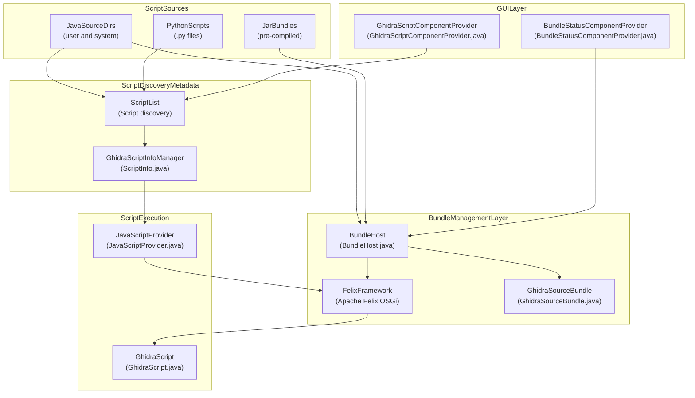

<!-- source: DeepWiki mcp.deepwiki.com · repo NationalSecurityAgency/ghidra · page 6 Scripting and Extension System · fetched 2026-11-09 -->

# Scripting and Extension System

Relevant source files

The following files were used as context for generating this wiki page:

- [Ghidra/Features/BSim/src/main/java/ghidra/features/bsim/query/ingest/HeadlessBSimApplicationConfiguration.java](Ghidra/Features/BSim/src/main/java/ghidra/features/bsim/query/ingest/HeadlessBSimApplicationConfiguration.java)
- [Ghidra/Features/Base/src/main/java/ghidra/app/plugin/core/osgi/BundleHost.java](Ghidra/Features/Base/src/main/java/ghidra/app/plugin/core/osgi/BundleHost.java)
- [Ghidra/Features/Base/src/main/java/ghidra/app/plugin/core/osgi/BundleHostListener.java](Ghidra/Features/Base/src/main/java/ghidra/app/plugin/core/osgi/BundleHostListener.java)
- [Ghidra/Features/Base/src/main/java/ghidra/app/plugin/core/osgi/BundleStatus.java](Ghidra/Features/Base/src/main/java/ghidra/app/plugin/core/osgi/BundleStatus.java)
- [Ghidra/Features/Base/src/main/java/ghidra/app/plugin/core/osgi/BundleStatusChangeRequestListener.java](Ghidra/Features/Base/src/main/java/ghidra/app/plugin/core/osgi/BundleStatusChangeRequestListener.java)
- [Ghidra/Features/Base/src/main/java/ghidra/app/plugin/core/osgi/BundleStatusComponentProvider.java](Ghidra/Features/Base/src/main/java/ghidra/app/plugin/core/osgi/BundleStatusComponentProvider.java)
- [Ghidra/Features/Base/src/main/java/ghidra/app/plugin/core/osgi/BundleStatusTableModel.java](Ghidra/Features/Base/src/main/java/ghidra/app/plugin/core/osgi/BundleStatusTableModel.java)
- [Ghidra/Features/Base/src/main/java/ghidra/app/plugin/core/osgi/GhidraBundle.java](Ghidra/Features/Base/src/main/java/ghidra/app/plugin/core/osgi/GhidraBundle.java)
- [Ghidra/Features/Base/src/main/java/ghidra/app/plugin/core/osgi/GhidraBundleException.java](Ghidra/Features/Base/src/main/java/ghidra/app/plugin/core/osgi/GhidraBundleException.java)
- [Ghidra/Features/Base/src/main/java/ghidra/app/plugin/core/osgi/GhidraJarBundle.java](Ghidra/Features/Base/src/main/java/ghidra/app/plugin/core/osgi/GhidraJarBundle.java)
- [Ghidra/Features/Base/src/main/java/ghidra/app/plugin/core/osgi/GhidraPlaceholderBundle.java](Ghidra/Features/Base/src/main/java/ghidra/app/plugin/core/osgi/GhidraPlaceholderBundle.java)
- [Ghidra/Features/Base/src/main/java/ghidra/app/plugin/core/osgi/GhidraSourceBundle.java](Ghidra/Features/Base/src/main/java/ghidra/app/plugin/core/osgi/GhidraSourceBundle.java)
- [Ghidra/Features/Base/src/main/java/ghidra/app/plugin/core/osgi/OSGiUtils.java](Ghidra/Features/Base/src/main/java/ghidra/app/plugin/core/osgi/OSGiUtils.java)
- [Ghidra/Features/Base/src/main/java/ghidra/app/plugin/core/script/GhidraScriptActionManager.java](Ghidra/Features/Base/src/main/java/ghidra/app/plugin/core/script/GhidraScriptActionManager.java)
- [Ghidra/Features/Base/src/main/java/ghidra/app/plugin/core/script/GhidraScriptComponentProvider.java](Ghidra/Features/Base/src/main/java/ghidra/app/plugin/core/script/GhidraScriptComponentProvider.java)
- [Ghidra/Features/Base/src/main/java/ghidra/app/plugin/core/script/GhidraScriptTableModel.java](Ghidra/Features/Base/src/main/java/ghidra/app/plugin/core/script/GhidraScriptTableModel.java)
- [Ghidra/Features/Base/src/main/java/ghidra/app/plugin/core/script/RunScriptTask.java](Ghidra/Features/Base/src/main/java/ghidra/app/plugin/core/script/RunScriptTask.java)
- [Ghidra/Features/Base/src/main/java/ghidra/app/plugin/core/script/ScriptAction.java](Ghidra/Features/Base/src/main/java/ghidra/app/plugin/core/script/ScriptAction.java)
- [Ghidra/Features/Base/src/main/java/ghidra/app/script/GhidraScriptProvider.java](Ghidra/Features/Base/src/main/java/ghidra/app/script/GhidraScriptProvider.java)
- [Ghidra/Features/Base/src/main/java/ghidra/app/script/GhidraScriptUtil.java](Ghidra/Features/Base/src/main/java/ghidra/app/script/GhidraScriptUtil.java)
- [Ghidra/Features/Base/src/main/java/ghidra/app/script/JavaScriptProvider.java](Ghidra/Features/Base/src/main/java/ghidra/app/script/JavaScriptProvider.java)
- [Ghidra/Features/Base/src/main/java/ghidra/app/script/ScriptInfo.java](Ghidra/Features/Base/src/main/java/ghidra/app/script/ScriptInfo.java)
- [Ghidra/Features/Base/src/main/java/ghidra/app/util/headless/GhidraScriptRunner.java](Ghidra/Features/Base/src/main/java/ghidra/app/util/headless/GhidraScriptRunner.java)
- [Ghidra/Features/Base/src/main/java/ghidra/app/util/headless/HeadlessAnalyzer.java](Ghidra/Features/Base/src/main/java/ghidra/app/util/headless/HeadlessAnalyzer.java)
- [Ghidra/Features/Base/src/main/java/ghidra/framework/HeadlessGhidraApplicationConfiguration.java](Ghidra/Features/Base/src/main/java/ghidra/framework/HeadlessGhidraApplicationConfiguration.java)
- [Ghidra/Features/Base/src/test.slow/java/ghidra/app/plugin/core/script/AbstractGhidraScriptMgrPluginTest.java](Ghidra/Features/Base/src/test.slow/java/ghidra/app/plugin/core/script/AbstractGhidraScriptMgrPluginTest.java)
- [Ghidra/Features/Base/src/test.slow/java/ghidra/app/plugin/core/script/BundleHostTest.java](Ghidra/Features/Base/src/test.slow/java/ghidra/app/plugin/core/script/BundleHostTest.java)
- [Ghidra/Features/Base/src/test.slow/java/ghidra/app/plugin/core/script/GhidraScriptMgrPlugin2Test.java](Ghidra/Features/Base/src/test.slow/java/ghidra/app/plugin/core/script/GhidraScriptMgrPlugin2Test.java)
- [Ghidra/Features/Base/src/test.slow/java/ghidra/app/plugin/core/script/GhidraScriptMgrPlugin3Test.java](Ghidra/Features/Base/src/test.slow/java/ghidra/app/plugin/core/script/GhidraScriptMgrPlugin3Test.java)
- [Ghidra/Features/Base/src/test.slow/java/ghidra/app/plugin/core/script/JavaScriptInfoTest.java](Ghidra/Features/Base/src/test.slow/java/ghidra/app/plugin/core/script/JavaScriptInfoTest.java)
- [Ghidra/Features/GhidraServer/src/main/java/ghidra/server/remote/RemoteLoggingUtil.java](Ghidra/Features/GhidraServer/src/main/java/ghidra/server/remote/RemoteLoggingUtil.java)
- [Ghidra/Test/IntegrationTest/src/screen/java/help/screenshot/GhidraScriptMgrPluginScreenShots.java](Ghidra/Test/IntegrationTest/src/screen/java/help/screenshot/GhidraScriptMgrPluginScreenShots.java)
- [Ghidra/Test/IntegrationTest/src/test.slow/java/ghidra/app/script/GhidraScriptUtilTest.java](Ghidra/Test/IntegrationTest/src/test.slow/java/ghidra/app/script/GhidraScriptUtilTest.java)

Ghidra provides a robust scripting and extension framework designed to automate reverse engineering tasks and extend core functionality. The system supports multiple languages and runtime environments, primarily centered around a Java-based OSGi infrastructure, a comprehensive script development API, and a Python integration layer via PyGhidra.

As a parent page, this document provides a high-level overview of the extension architecture. Detailed mechanics for each subsystem are covered in the respective child pages:
- [OSGi Bundle Management](#6.1)
- [Script Development and Execution](#6.2)
- [PyGhidra - Python Integration](#6.3)

---

## System Architecture

The scripting and extension system operates through several core components that manage the lifecycle from script discovery and OSGi bundle hosting through execution and GUI integration:

**Sources:**
* [Ghidra/Features/Base/src/main/java/ghidra/app/plugin/core/osgi/BundleHost.java:59-72]()
* [Ghidra/Features/Base/src/main/java/ghidra/app/plugin/core/script/GhidraScriptComponentProvider.java:63-140]()
* [Ghidra/Features/Base/src/main/java/ghidra/app/script/GhidraScriptUtil.java:39-85]()

---

## 6.1. OSGi Bundle Management

Ghidra uses an embedded Apache Felix OSGi container managed by `BundleHost` to load extensions and compile Java source bundles dynamically. Source directories, pre-compiled JARs, and placeholder bundles are wrapped as `GhidraBundle` implementations.

For full details on framework integration, bundle types (`GhidraSourceBundle`, `GhidraJarBundle`, `GhidraPlaceholderBundle`), automatic Java source compilation, and manifest generation, see [OSGi Bundle Management](#6.1).

**Sources:**
* [Ghidra/Features/Base/src/main/java/ghidra/app/plugin/core/osgi/BundleHost.java:59-173]()
* [Ghidra/Features/Base/src/main/java/ghidra/app/plugin/core/osgi/GhidraSourceBundle.java:59-132]()

---

## 6.2. Script Development and Execution

Scripts are written using APIs such as `GhidraScript` and `FlatProgramAPI`. The `JavaScriptProvider` bridges script files to the OSGi runtime, while script metadata (such as `@category`, `@keybinding`, and `@toolbar`) is parsed by `ScriptInfo` and managed via `GhidraScriptComponentProvider`. Headless execution is supported through `HeadlessAnalyzer`.

For details on script providers, result tables (`TableChooserDialog`), UI components, and headless execution, see [Script Development and Execution](#6.2).

**Sources:**
* [Ghidra/Features/Base/src/main/java/ghidra/app/script/JavaScriptProvider.java:34-174]()
* [Ghidra/Features/Base/src/main/java/ghidra/app/plugin/core/script/GhidraScriptComponentProvider.java:63-140]()
* [Ghidra/Features/Base/src/main/java/ghidra/app/util/headless/HeadlessAnalyzer.java:74-140]()

---

## 6.3. PyGhidra - Python Integration

PyGhidra enables Python-based automation and interactive sessions by bridging a native CPython interpreter to the Ghidra JVM using JPype. It handles JVM initialization via `PyGhidraLauncher`, provides convenient wrapper functions (`pyghidra.start()`, `open_project()`), and integrates cleanly with both headless scripts and GUI environments.

For details on PyGhidra architecture, startup sequences, support scripts, and type stubs, see [PyGhidra - Python Integration](#6.3).

**Sources:**
* [Ghidra/Features/Base/src/main/java/ghidra/app/util/headless/HeadlessAnalyzer.java:33-136]()

---

## GUI Management Tools

The GUI exposes script and bundle controls through dedicated component providers:
- **Script Manager (`GhidraScriptComponentProvider`)**: Provides a hierarchical category tree (`GTree`), a filterable table of scripts (`GTable`), a description viewer, and direct execution triggers [Ghidra/Features/Base/src/main/java/ghidra/app/plugin/core/script/GhidraScriptComponentProvider.java:63-140]().
- **Bundle Manager (`BundleStatusComponentProvider`)**: Visualizes OSGi bundle states, enabling users to add, remove, enable, disable, clean build caches, and refresh bundles [Ghidra/Features/Base/src/main/java/ghidra/app/plugin/core/osgi/BundleStatusComponentProvider.java:51-100]().

**Sources:**
* [Ghidra/Features/Base/src/main/java/ghidra/app/plugin/core/script/GhidraScriptComponentProvider.java:63-140]()
* [Ghidra/Features/Base/src/main/java/ghidra/app/plugin/core/osgi/BundleStatusComponentProvider.java:51-100]()

---

