<!-- source: DeepWiki mcp.deepwiki.com · repo NationalSecurityAgency/ghidra · page 6.1 OSGi Bundle Management · fetched 2026-11-09 -->

# OSGi Bundle Management

Relevant source files

The following files were used as context for generating this wiki page:

- [Ghidra/Features/BSim/src/main/java/ghidra/features/bsim/query/ingest/HeadlessBSimApplicationConfiguration.java](Ghidra/Features/BSim/src/main/java/ghidra/features/bsim/query/ingest/HeadlessBSimApplicationConfiguration.java)
- [Ghidra/Features/Base/src/main/java/ghidra/app/plugin/core/osgi/BundleHost.java](Ghidra/Features/Base/src/main/java/ghidra/app/plugin/core/osgi/BundleHost.java)
- [Ghidra/Features/Base/src/main/java/ghidra/app/plugin/core/osgi/BundleHostListener.java](Ghidra/Features/Base/src/main/java/ghidra/app/plugin/core/osgi/BundleHostListener.java)
- [Ghidra/Features/Base/src/main/java/ghidra/app/plugin/core/osgi/BundleStatus.java](Ghidra/Features/Base/src/main/java/ghidra/app/plugin/core/osgi/BundleStatus.java)
- [Ghidra/Features/Base/src/main/java/ghidra/app/plugin/core/osgi/BundleStatusChangeRequestListener.java](Ghidra/Features/Base/src/main/java/ghidra/app/plugin/core/osgi/BundleStatusChangeRequestListener.java)
- [Ghidra/Features/Base/src/main/java/ghidra/app/plugin/core/osgi/BundleStatusComponentProvider.java](Ghidra/Features/Base/src/main/java/ghidra/app/plugin/core/osgi/BundleStatusComponentProvider.java)
- [Ghidra/Features/Base/src/main/java/ghidra/app/plugin/core/osgi/BundleStatusTableModel.java](Ghidra/Features/Base/src/main/java/ghidra/app/plugin/core/osgi/BundleStatusTableModel.java)
- [Ghidra/Features/Base/src/main/java/ghidra/app/plugin/core/osgi/GhidraBundle.java](Ghidra/Features/Base/src/main/java/ghidra/app/plugin/core/osgi/GhidraBundle.java)
- [Ghidra/Features/Base/src/main/java/ghidra/app/plugin/core/osgi/GhidraBundleException.java](Ghidra/Features/Base/src/main/java/ghidra/app/plugin/core/osgi/GhidraBundleException.java)
- [Ghidra/Features/Base/src/main/java/ghidra/app/plugin/core/osgi/GhidraJarBundle.java](Ghidra/Features/Base/src/main/java/ghidra/app/plugin/core/osgi/GhidraJarBundle.java)
- [Ghidra/Features/Base/src/main/java/ghidra/app/plugin/core/osgi/GhidraPlaceholderBundle.java](Ghidra/Features/Base/src/main/java/ghidra/app/plugin/core/osgi/GhidraPlaceholderBundle.java)
- [Ghidra/Features/Base/src/main/java/ghidra/app/plugin/core/osgi/GhidraSourceBundle.java](Ghidra/Features/Base/src/main/java/ghidra/app/plugin/core/osgi/GhidraSourceBundle.java)
- [Ghidra/Features/Base/src/main/java/ghidra/app/plugin/core/osgi/OSGiUtils.java](Ghidra/Features/Base/src/main/java/ghidra/app/plugin/core/osgi/OSGiUtils.java)
- [Ghidra/Features/Base/src/main/java/ghidra/app/plugin/core/script/GhidraScriptActionManager.java](Ghidra/Features/Base/src/main/java/ghidra/app/plugin/core/script/GhidraScriptActionManager.java)
- [Ghidra/Features/Base/src/main/java/ghidra/app/plugin/core/script/GhidraScriptComponentProvider.java](Ghidra/Features/Base/src/main/java/ghidra/app/plugin/core/script/GhidraScriptComponentProvider.java)
- [Ghidra/Features/Base/src/main/java/ghidra/app/plugin/core/script/GhidraScriptTableModel.java](Ghidra/Features/Base/src/main/java/ghidra/app/plugin/core/script/GhidraScriptTableModel.java)
- [Ghidra/Features/Base/src/main/java/ghidra/app/plugin/core/script/RunScriptTask.java](Ghidra/Features/Base/src/main/java/ghidra/app/plugin/core/script/RunScriptTask.java)
- [Ghidra/Features/Base/src/main/java/ghidra/app/plugin/core/script/ScriptAction.java](Ghidra/Features/Base/src/main/java/ghidra/app/plugin/core/script/ScriptAction.java)
- [Ghidra/Features/Base/src/main/java/ghidra/app/script/GhidraScriptProvider.java](Ghidra/Features/Base/src/main/java/ghidra/app/script/GhidraScriptProvider.java)
- [Ghidra/Features/Base/src/main/java/ghidra/app/script/GhidraScriptUtil.java](Ghidra/Features/Base/src/main/java/ghidra/app/script/GhidraScriptUtil.java)
- [Ghidra/Features/Base/src/main/java/ghidra/app/script/JavaScriptProvider.java](Ghidra/Features/Base/src/main/java/ghidra/app/script/JavaScriptProvider.java)
- [Ghidra/Features/Base/src/main/java/ghidra/app/script/ScriptInfo.java](Ghidra/Features/Base/src/main/java/ghidra/app/script/ScriptInfo.java)
- [Ghidra/Features/Base/src/main/java/ghidra/app/util/headless/GhidraScriptRunner.java](Ghidra/Features/Base/src/main/java/ghidra/app/util/headless/GhidraScriptRunner.java)
- [Ghidra/Features/Base/src/main/java/ghidra/app/util/headless/HeadlessAnalyzer.java](Ghidra/Features/Base/src/main/java/ghidra/app/util/headless/HeadlessAnalyzer.java)
- [Ghidra/Features/Base/src/main/java/ghidra/framework/HeadlessGhidraApplicationConfiguration.java](Ghidra/Features/Base/src/main/java/ghidra/framework/HeadlessGhidraApplicationConfiguration.java)
- [Ghidra/Features/Base/src/test.slow/java/ghidra/app/plugin/core/script/AbstractGhidraScriptMgrPluginTest.java](Ghidra/Features/Base/src/test.slow/java/ghidra/app/plugin/core/script/AbstractGhidraScriptMgrPluginTest.java)
- [Ghidra/Features/Base/src/test.slow/java/ghidra/app/plugin/core/script/BundleHostTest.java](Ghidra/Features/Base/src/test.slow/java/ghidra/app/plugin/core/script/BundleHostTest.java)
- [Ghidra/Features/Base/src/test.slow/java/ghidra/app/plugin/core/script/GhidraScriptMgrPlugin2Test.java](Ghidra/Features/Base/src/test.slow/java/ghidra/app/plugin/core/script/GhidraScriptMgrPlugin2Test.java)
- [Ghidra/Features/Base/src/test.slow/java/ghidra/app/plugin/core/script/GhidraScriptMgrPlugin3Test.java](Ghidra/Features/Base/src/test.slow/java/ghidra/app/plugin/core/script/GhidraScriptMgrPlugin3Test.java)
- [Ghidra/Features/Base/src/test.slow/java/ghidra/app/plugin/core/script/JavaScriptInfoTest.java](Ghidra/Features/Base/src/test.slow/java/ghidra/app/plugin/core/script/JavaScriptInfoTest.java)
- [Ghidra/Features/GhidraServer/src/main/java/ghidra/server/remote/RemoteLoggingUtil.java](Ghidra/Features/GhidraServer/src/main/java/ghidra/server/remote/RemoteLoggingUtil.java)
- [Ghidra/Test/IntegrationTest/src/screen/java/help/screenshot/GhidraScriptMgrPluginScreenShots.java](Ghidra/Test/IntegrationTest/src/screen/java/help/screenshot/GhidraScriptMgrPluginScreenShots.java)
- [Ghidra/Test/IntegrationTest/src/test.slow/java/ghidra/app/script/GhidraScriptUtilTest.java](Ghidra/Test/IntegrationTest/src/test.slow/java/ghidra/app/script/GhidraScriptUtilTest.java)

## Purpose and Scope

This document describes Ghidra's OSGi bundle management system, which provides dynamic compilation, class loading, and dependency resolution for Java scripts and extensions. The `BundleHost` class manages an embedded Apache Felix OSGi framework, treating script directories and JAR files as OSGi bundles. For information about script execution and the scripting API, see [6.2 Script Development and Execution](). For Python integration through PyGhidra, see [6.3 PyGhidra - Python Integration]().

Sources: [Ghidra/Features/Base/src/main/java/ghidra/app/plugin/core/osgi/BundleHost.java:45-58]()

## Architecture Overview

### Core Components and Relationships

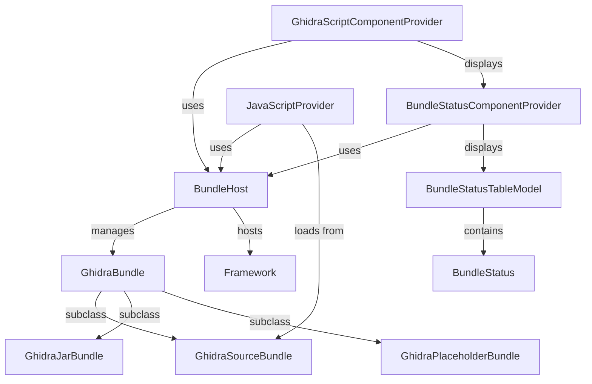

Sources: [Ghidra/Features/Base/src/main/java/ghidra/app/plugin/core/osgi/BundleHost.java:59-73](), [Ghidra/Features/Base/src/main/java/ghidra/app/plugin/core/osgi/GhidraBundle.java:31-57](), [Ghidra/Features/Base/src/main/java/ghidra/app/plugin/core/osgi/BundleStatusComponentProvider.java:51-81]()

### BundleHost Initialization and Lifecycle

The `BundleHost` class serves as the central manager for all bundle operations. It is initialized and started via `startFramework()`, which configures the Felix environment. `GhidraScriptUtil` coordinates the lifecycle of the singleton `BundleHost` used for scripting.

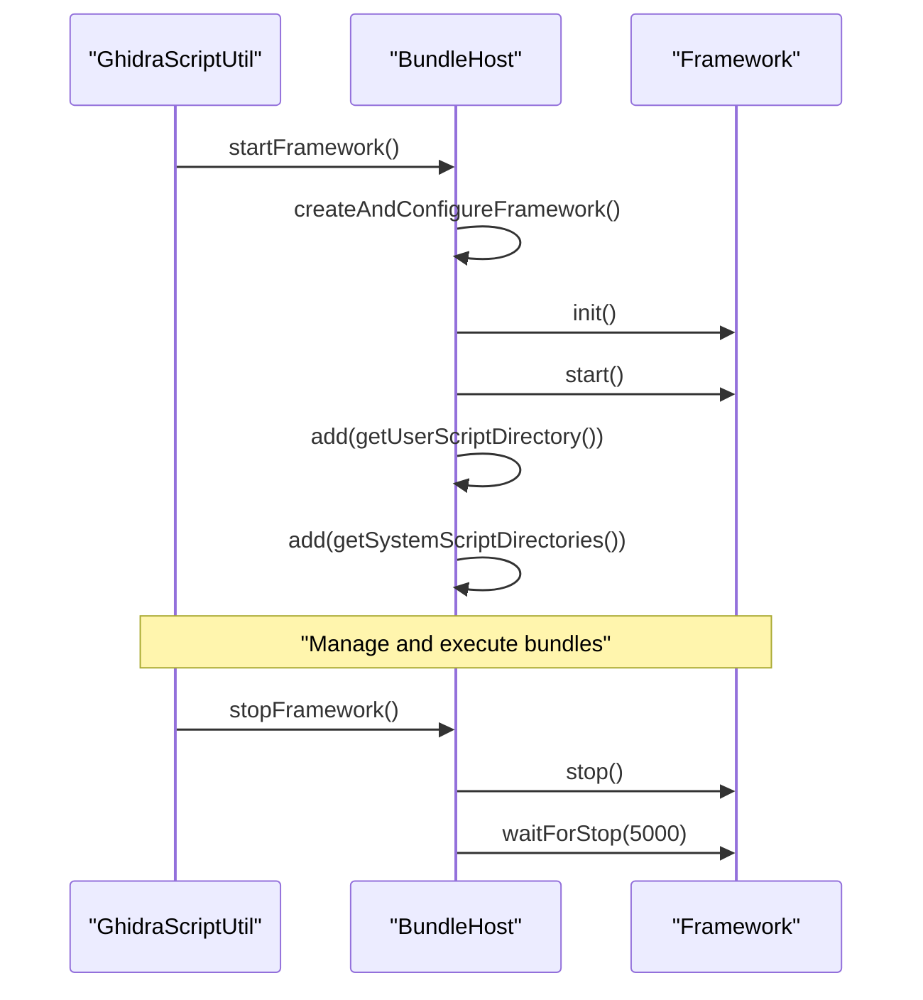

Sources: [Ghidra/Features/Base/src/main/java/ghidra/app/script/GhidraScriptUtil.java:70-85](), [Ghidra/Features/Base/src/main/java/ghidra/app/plugin/core/osgi/BundleHost.java:464-518]()

## Bundle Types

Ghidra supports three types of bundles, determined by the `GhidraBundle.getType()` method:

| Bundle Type | Class | File Type | Build Required | Description |
|-------------|-------|-----------|----------------|-------------|
| `SOURCE_DIR` | `GhidraSourceBundle` | Directory | Yes | Java source directory compiled on-demand to OSGi bundle |
| `JAR` | `GhidraJarBundle` | .jar file | No | Pre-compiled OSGi bundle JAR |
| `BND_SCRIPT` | N/A | .bnd file | Yes | Scripts using BND for complex bundle definitions |
| `INVALID` | `GhidraPlaceholderBundle` | Any | N/A | Placeholder for missing/invalid bundles |

Sources: [Ghidra/Features/Base/src/main/java/ghidra/app/plugin/core/osgi/GhidraBundle.java:32-44](), [Ghidra/Features/Base/src/main/java/ghidra/app/plugin/core/osgi/BundleHost.java:155-173]()

### GhidraSourceBundle Architecture

`GhidraSourceBundle` represents a Java source directory that is compiled to an OSGi bundle. It implements automatic manifest generation, incremental compilation, and dependency resolution.

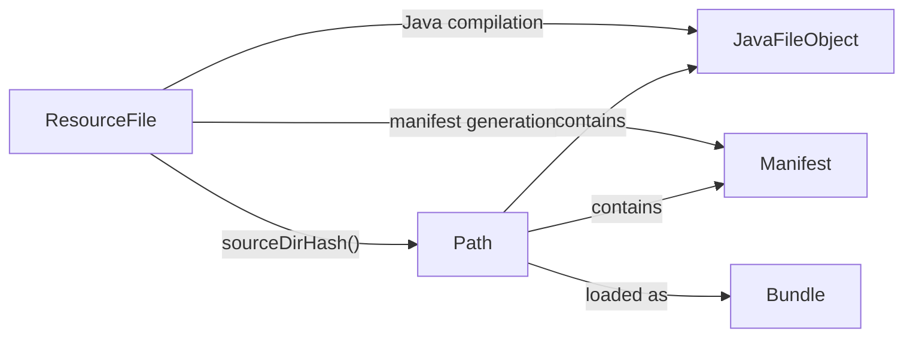

**Key GhidraSourceBundle Properties:**

- **Symbolic Name**: Computed as hash of source directory path via `sourceDirHash()` [Ghidra/Features/Base/src/main/java/ghidra/app/plugin/core/osgi/GhidraSourceBundle.java:165-168]()
- **Binary Directory**: `<user settings>/osgi/compiled-bundles/<sourceDirHash>` [Ghidra/Features/Base/src/main/java/ghidra/app/plugin/core/osgi/GhidraSourceBundle.java:143-152]()
- **Location Identifier**: `reference:file://<binaryDir>` [Ghidra/Features/Base/src/main/java/ghidra/app/plugin/core/osgi/GhidraSourceBundle.java:130-132]()

Sources: [Ghidra/Features/Base/src/main/java/ghidra/app/plugin/core/osgi/GhidraSourceBundle.java:54-132]()

## Bundle Lifecycle and State Management

### Bundle States and Transitions

Bundles transition through states managed by the `BundleHost`. Enablement is a Ghidra-specific state, while activation corresponds to the OSGi framework state.

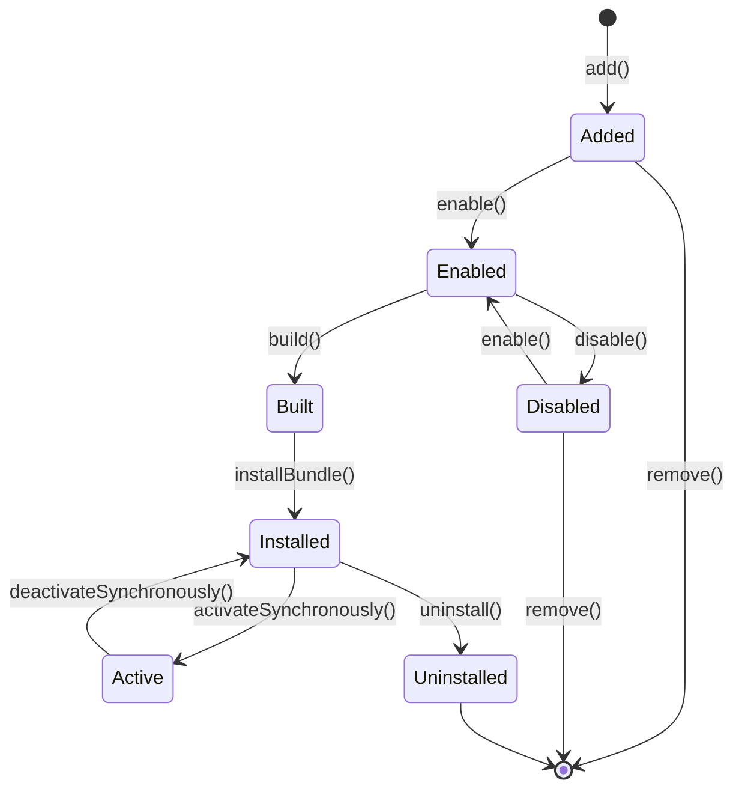

Sources: [Ghidra/Features/Base/src/main/java/ghidra/app/plugin/core/osgi/BundleHost.java:83-125](), [Ghidra/Features/Base/src/main/java/ghidra/app/plugin/core/osgi/BundleHost.java:543-626]()

### Bundle Activation Process

The `BundleHost` provides two activation strategies:

1. **activateAll()**: Activates bundles in topological dependency order, loading inactive dependencies [Ghidra/Features/Base/src/main/java/ghidra/app/plugin/core/osgi/BundleHost.java:664-700]()
2. **activateInStages()**: Activates only requested bundles by resolving against currently active bundles [Ghidra/Features/Base/src/main/java/ghidra/app/plugin/core/osgi/BundleHost.java:703-770]()

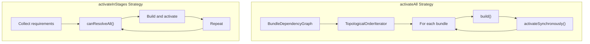

Sources: [Ghidra/Features/Base/src/main/java/ghidra/app/plugin/core/osgi/BundleHost.java:664-770]()

## Felix Framework Integration

### Framework Configuration

The `BundleHost` configures the Apache Felix OSGi framework with specific settings to accommodate Ghidra's environment:

| Configuration Property | Value | Purpose |
|------------------------|-------|---------|
| `FRAMEWORK_BSNVERSION` | `FRAMEWORK_BSNVERSION_MULTIPLE` | Allow multiple bundles with same symbolic name |
| `FRAMEWORK_SYSTEMPACKAGES_EXTRA` | Computed from classpath | Export all packages from Ghidra's classpath |
| `FRAMEWORK_STORAGE_CLEAN` | `FRAMEWORK_STORAGE_CLEAN_ONFIRSTINIT` | Clean cache on first startup only |
| `FRAMEWORK_STORAGE` | `<user settings>/osgi/felixcache` | Felix cache directory |

Sources: [Ghidra/Features/Base/src/main/java/ghidra/app/plugin/core/osgi/BundleHost.java:398-429]()

### System Package Export

The framework exports all packages from Ghidra's classpath via `buildExtraSystemPackages()`, allowing bundles to import Ghidra classes without explicit dependencies. This uses `OSGiUtils.getPackagesFromClasspath()` to scan for available packages.

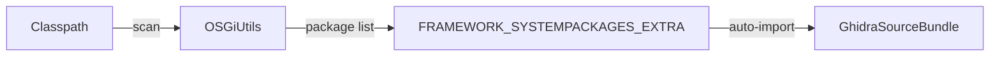

Sources: [Ghidra/Features/Base/src/main/java/ghidra/app/plugin/core/osgi/BundleHost.java:365-369](), [Ghidra/Features/Base/src/main/java/ghidra/app/plugin/core/osgi/OSGiUtils.java:165-205]()

## Script Compilation and Class Loading

### Java Script Provider Integration

The `JavaScriptProvider` uses `GhidraSourceBundle` to compile and load script classes. It ensures the bundle is built and activated before attempting to load the class via the bundle's OSGi class loader.

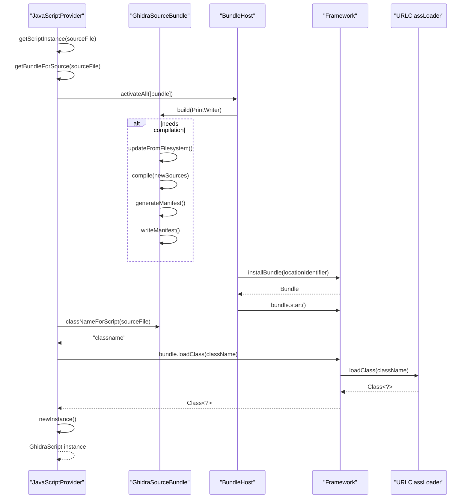

Sources: [Ghidra/Features/Base/src/main/java/ghidra/app/script/JavaScriptProvider.java:94-174](), [Ghidra/Features/Base/src/main/java/ghidra/app/plugin/core/osgi/GhidraSourceBundle.java:176-187]()

### Incremental Compilation

`GhidraSourceBundle` tracks source-to-class file timestamps to determine when recompilation is needed via `visitDiscrepancies()`.

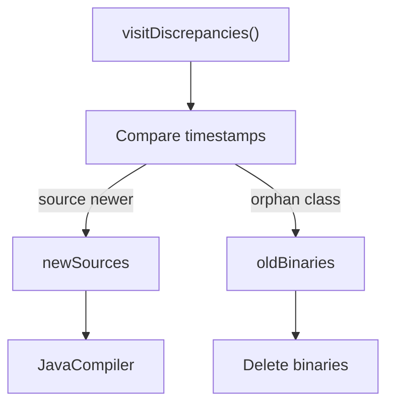

Sources: [Ghidra/Features/Base/src/main/java/ghidra/app/plugin/core/osgi/GhidraSourceBundle.java:387-419](), [Ghidra/Features/Base/src/main/java/ghidra/app/plugin/core/osgi/GhidraSourceBundle.java:668-727]()

### Manifest Generation

When a source bundle lacks a `META-INF/MANIFEST.MF`, `GhidraSourceBundle` automatically generates one using BND.

**Manifest Components:**

- **Bundle-SymbolicName**: Hash of source directory path
- **Bundle-Version**: `"1.0"`
- **Export-Package**: All packages containing Java files (excluding `internal` and `private` subdirectories)
- **Import-Package**: Computed from `@importpackage` metadata in root-level Java files
- **Bundle-Activator**: `GeneratedActivator` (auto-generated class)

Sources: [Ghidra/Features/Base/src/main/java/ghidra/app/plugin/core/osgi/GhidraSourceBundle.java:739-853]()

### @importpackage Metadata

Scripts in the root (unnamed) package can declare dependencies using `@importpackage` JavaDoc tags. These are parsed by `ScriptInfo` and converted to OSGi `Import-Package` requirements during manifest generation.

Sources: [Ghidra/Features/Base/src/main/java/ghidra/app/plugin/core/osgi/GhidraSourceBundle.java:229-277](), [Ghidra/Features/Base/src/main/java/ghidra/app/script/ScriptInfo.java:164-180]()

## Dependency Resolution

### Requirement and Capability Model

OSGi bundles declare `BundleRequirement` objects (what they need) and `BundleCapability` objects (what they provide). The framework matches requirements to capabilities during bundle resolution.

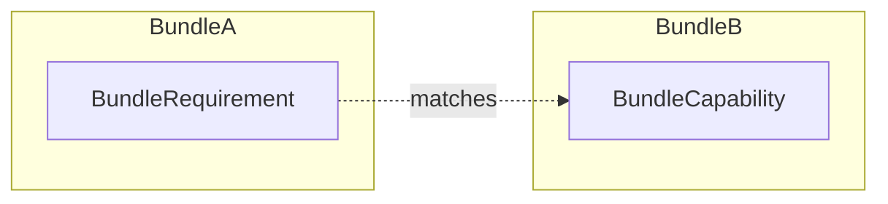

Sources: [Ghidra/Features/Base/src/main/java/ghidra/app/plugin/core/osgi/BundleHost.java:322-363]()

### Dependency Graph Construction

The `BundleHost.BundleDependencyGraph` class builds a directed graph of bundle dependencies for topological activation.

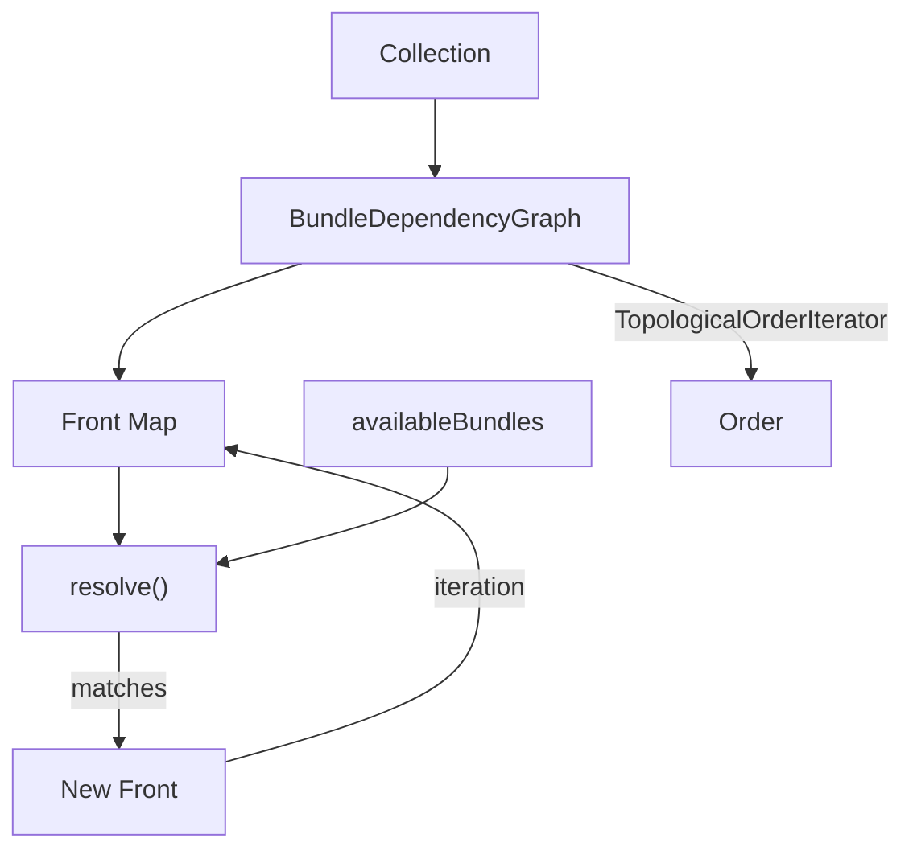

Sources: [Ghidra/Features/Base/src/main/java/ghidra/app/plugin/core/osgi/BundleHost.java:939-1071]()

## Bundle Management UI

### BundleStatusComponentProvider

The `BundleStatusComponentProvider` provides a graphical interface for managing bundle state, exposing actions for adding, removing, enabling, and cleaning bundles.

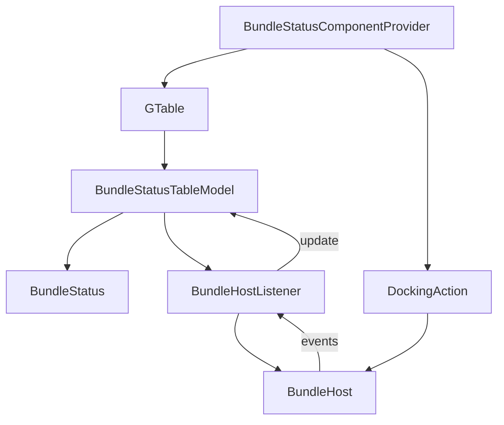

Sources: [Ghidra/Features/Base/src/main/java/ghidra/app/plugin/core/osgi/BundleStatusComponentProvider.java:51-194]()

### Persistence

Bundle state is persisted to Ghidra's tool configuration via `SaveState`. On startup, `BundleHost.restoreManagedBundleState()` recreates bundle objects and reactivates those that were previously active.

Sources: [Ghidra/Features/Base/src/main/java/ghidra/app/plugin/core/osgi/BundleHost.java:840-925]()

## Error Handling and Diagnostics

### GhidraBundleException

`GhidraBundleException` captures context for bundle operation failures, extracting package names from OSGi resolution failure messages via `OSGiUtils.extractPackageNamesFromFailedResolution()`.

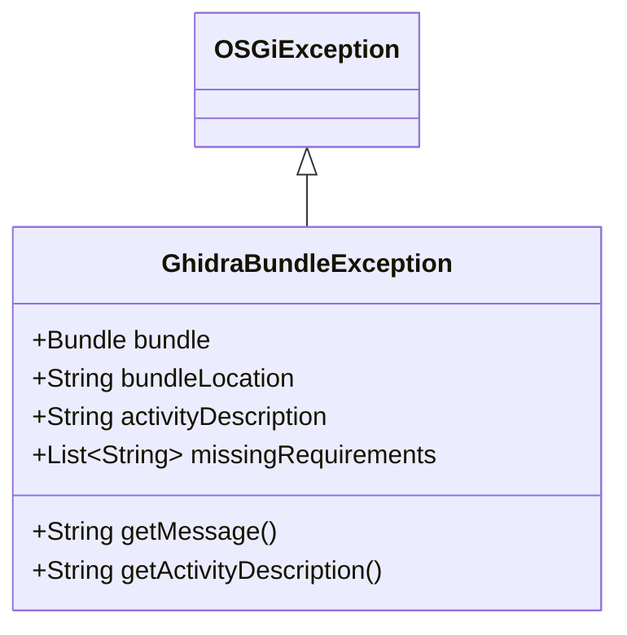

Sources: [Ghidra/Features/Base/src/main/java/ghidra/app/plugin/core/osgi/GhidraBundleException.java:23-128](), [Ghidra/Features/Base/src/main/java/ghidra/app/plugin/core/osgi/OSGiUtils.java:59-75]()

---

