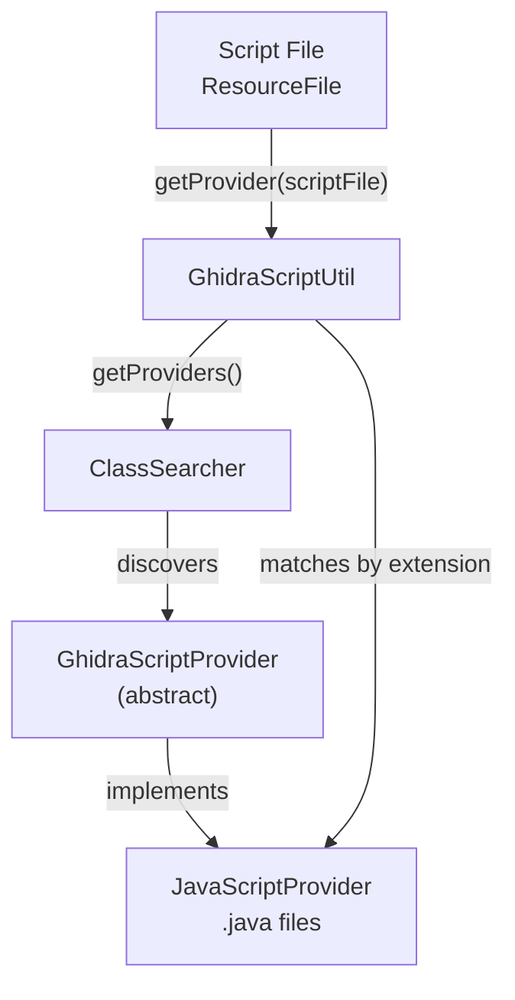
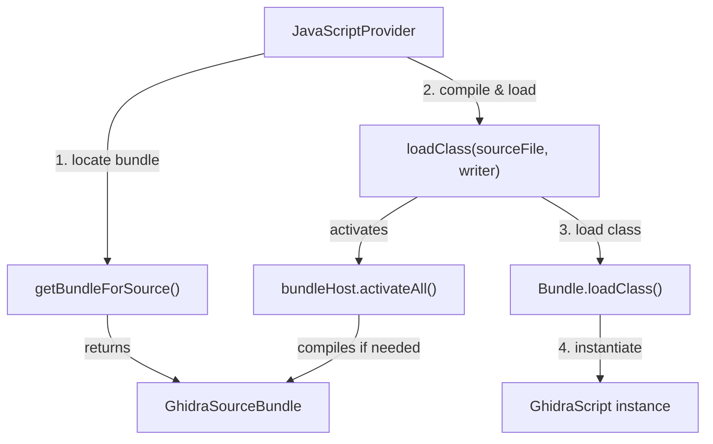
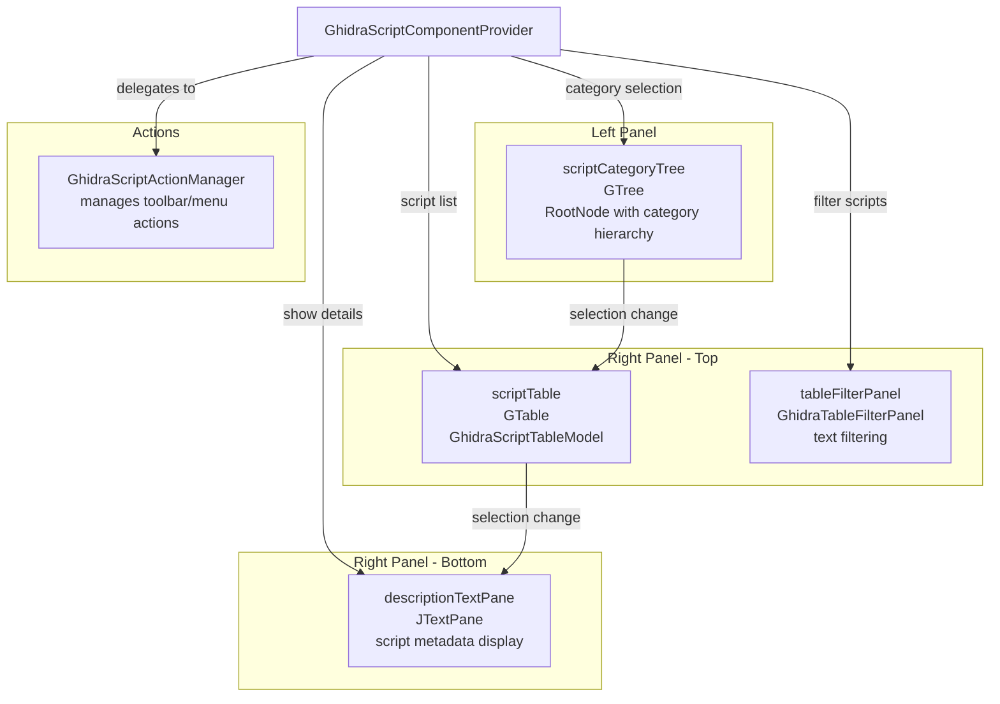
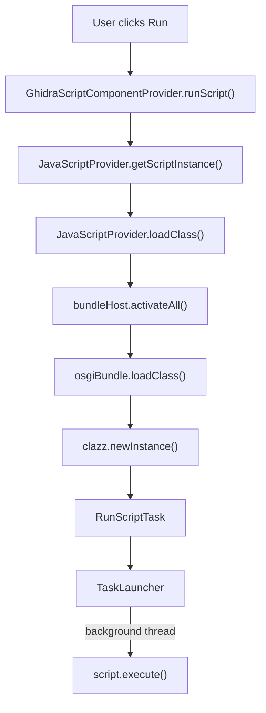
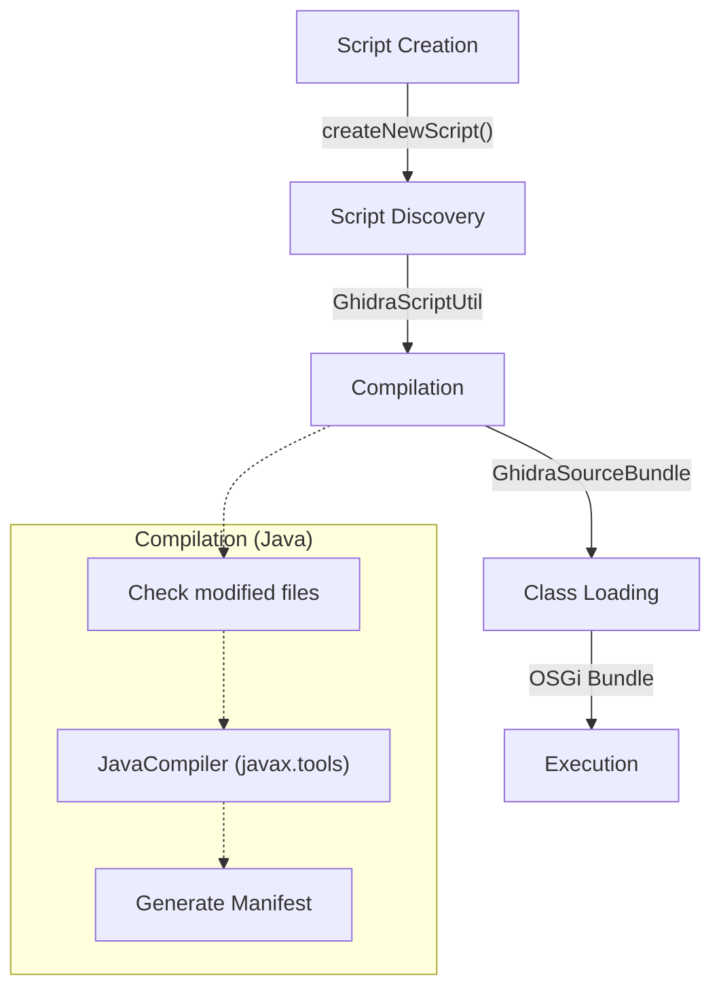

<!-- source: DeepWiki mcp.deepwiki.com · repo NationalSecurityAgency/ghidra · page 6.2 Script Development and Execution · fetched 2026-11-09 -->

# Script Development and Execution

Relevant source files

The following files were used as context for generating this wiki page:

- [Ghidra/Debug/Framework-TraceModeling/src/main/java/ghidra/trace/model/Trace.java](Ghidra/Debug/Framework-TraceModeling/src/main/java/ghidra/trace/model/Trace.java)
- [Ghidra/Features/BSim/src/main/java/ghidra/features/bsim/query/ingest/HeadlessBSimApplicationConfiguration.java](Ghidra/Features/BSim/src/main/java/ghidra/features/bsim/query/ingest/HeadlessBSimApplicationConfiguration.java)
- [Ghidra/Features/Base/ghidra_scripts/FindSharedReturnFunctionsScript.java](Ghidra/Features/Base/ghidra_scripts/FindSharedReturnFunctionsScript.java)
- [Ghidra/Features/Base/ghidra_scripts/FixupNoReturnFunctionsScript.java](Ghidra/Features/Base/ghidra_scripts/FixupNoReturnFunctionsScript.java)
- [Ghidra/Features/Base/ghidra_scripts/HelloWorldScript.java](Ghidra/Features/Base/ghidra_scripts/HelloWorldScript.java)
- [Ghidra/Features/Base/src/main/java/ghidra/app/plugin/core/analysis/FindNoReturnFunctionsAnalyzer.java](Ghidra/Features/Base/src/main/java/ghidra/app/plugin/core/analysis/FindNoReturnFunctionsAnalyzer.java)
- [Ghidra/Features/Base/src/main/java/ghidra/app/plugin/core/disassembler/CallFixupAnalyzer.java](Ghidra/Features/Base/src/main/java/ghidra/app/plugin/core/disassembler/CallFixupAnalyzer.java)
- [Ghidra/Features/Base/src/main/java/ghidra/app/plugin/core/osgi/BundleHost.java](Ghidra/Features/Base/src/main/java/ghidra/app/plugin/core/osgi/BundleHost.java)
- [Ghidra/Features/Base/src/main/java/ghidra/app/plugin/core/osgi/BundleHostListener.java](Ghidra/Features/Base/src/main/java/ghidra/app/plugin/core/osgi/BundleHostListener.java)
- [Ghidra/Features/Base/src/main/java/ghidra/app/plugin/core/osgi/BundleStatus.java](Ghidra/Features/Base/src/main/java/ghidra/app/plugin/core/osgi/BundleStatus.java)
- [Ghidra/Features/Base/src/main/java/ghidra/app/plugin/core/osgi/BundleStatusChangeRequestListener.java](Ghidra/Features/Base/src/main/java/ghidra/app/plugin/core/osgi/BundleStatusChangeRequestListener.java)
- [Ghidra/Features/Base/src/main/java/ghidra/app/plugin/core/osgi/BundleStatusComponentProvider.java](Ghidra/Features/Base/src/main/java/ghidra/app/plugin/core/osgi/BundleStatusComponentProvider.java)
- [Ghidra/Features/Base/src/main/java/ghidra/app/plugin/core/osgi/BundleStatusTableModel.java](Ghidra/Features/Base/src/main/java/ghidra/app/plugin/core/osgi/BundleStatusTableModel.java)
- [Ghidra/Features/Base/src/main/java/ghidra/app/plugin/core/osgi/GhidraBundle.java](Ghidra/Features/Base/src/main/java/ghidra/app/plugin/core/osgi/GhidraBundle.java)
- [Ghidra/Features/Base/src/main/java/ghidra/app/plugin/core/osgi/GhidraBundleException.java](Ghidra/Features/Base/src/main/java/ghidra/app/plugin/core/osgi/GhidraBundleException.java)
- [Ghidra/Features/Base/src/main/java/ghidra/app/plugin/core/osgi/GhidraJarBundle.java](Ghidra/Features/Base/src/main/java/ghidra/app/plugin/core/osgi/GhidraJarBundle.java)
- [Ghidra/Features/Base/src/main/java/ghidra/app/plugin/core/osgi/GhidraPlaceholderBundle.java](Ghidra/Features/Base/src/main/java/ghidra/app/plugin/core/osgi/GhidraPlaceholderBundle.java)
- [Ghidra/Features/Base/src/main/java/ghidra/app/plugin/core/osgi/GhidraSourceBundle.java](Ghidra/Features/Base/src/main/java/ghidra/app/plugin/core/osgi/GhidraSourceBundle.java)
- [Ghidra/Features/Base/src/main/java/ghidra/app/plugin/core/osgi/OSGiUtils.java](Ghidra/Features/Base/src/main/java/ghidra/app/plugin/core/osgi/OSGiUtils.java)
- [Ghidra/Features/Base/src/main/java/ghidra/app/plugin/core/script/GhidraScriptActionManager.java](Ghidra/Features/Base/src/main/java/ghidra/app/plugin/core/script/GhidraScriptActionManager.java)
- [Ghidra/Features/Base/src/main/java/ghidra/app/plugin/core/script/GhidraScriptComponentProvider.java](Ghidra/Features/Base/src/main/java/ghidra/app/plugin/core/script/GhidraScriptComponentProvider.java)
- [Ghidra/Features/Base/src/main/java/ghidra/app/plugin/core/script/GhidraScriptTableModel.java](Ghidra/Features/Base/src/main/java/ghidra/app/plugin/core/script/GhidraScriptTableModel.java)
- [Ghidra/Features/Base/src/main/java/ghidra/app/plugin/core/script/RunScriptTask.java](Ghidra/Features/Base/src/main/java/ghidra/app/plugin/core/script/RunScriptTask.java)
- [Ghidra/Features/Base/src/main/java/ghidra/app/plugin/core/script/ScriptAction.java](Ghidra/Features/Base/src/main/java/ghidra/app/plugin/core/script/ScriptAction.java)
- [Ghidra/Features/Base/src/main/java/ghidra/app/script/GhidraScript.java](Ghidra/Features/Base/src/main/java/ghidra/app/script/GhidraScript.java)
- [Ghidra/Features/Base/src/main/java/ghidra/app/script/GhidraScriptProperties.java](Ghidra/Features/Base/src/main/java/ghidra/app/script/GhidraScriptProperties.java)
- [Ghidra/Features/Base/src/main/java/ghidra/app/script/GhidraScriptProvider.java](Ghidra/Features/Base/src/main/java/ghidra/app/script/GhidraScriptProvider.java)
- [Ghidra/Features/Base/src/main/java/ghidra/app/script/GhidraScriptUtil.java](Ghidra/Features/Base/src/main/java/ghidra/app/script/GhidraScriptUtil.java)
- [Ghidra/Features/Base/src/main/java/ghidra/app/script/JavaScriptProvider.java](Ghidra/Features/Base/src/main/java/ghidra/app/script/JavaScriptProvider.java)
- [Ghidra/Features/Base/src/main/java/ghidra/app/script/ResourceFileJavaFileManager.java](Ghidra/Features/Base/src/main/java/ghidra/app/script/ResourceFileJavaFileManager.java)
- [Ghidra/Features/Base/src/main/java/ghidra/app/script/ScriptInfo.java](Ghidra/Features/Base/src/main/java/ghidra/app/script/ScriptInfo.java)
- [Ghidra/Features/Base/src/main/java/ghidra/app/tablechooser/TableChooserDialog.java](Ghidra/Features/Base/src/main/java/ghidra/app/tablechooser/TableChooserDialog.java)
- [Ghidra/Features/Base/src/main/java/ghidra/app/tablechooser/TableChooserExecutor.java](Ghidra/Features/Base/src/main/java/ghidra/app/tablechooser/TableChooserExecutor.java)
- [Ghidra/Features/Base/src/main/java/ghidra/app/tablechooser/TableChooserTableModel.java](Ghidra/Features/Base/src/main/java/ghidra/app/tablechooser/TableChooserTableModel.java)
- [Ghidra/Features/Base/src/main/java/ghidra/app/util/demangler/Demangled.java](Ghidra/Features/Base/src/main/java/ghidra/app/util/demangler/Demangled.java)
- [Ghidra/Features/Base/src/main/java/ghidra/app/util/demangler/DemanglerUtil.java](Ghidra/Features/Base/src/main/java/ghidra/app/util/demangler/DemanglerUtil.java)
- [Ghidra/Features/Base/src/main/java/ghidra/app/util/headless/GhidraScriptRunner.java](Ghidra/Features/Base/src/main/java/ghidra/app/util/headless/GhidraScriptRunner.java)
- [Ghidra/Features/Base/src/main/java/ghidra/app/util/headless/HeadlessAnalyzer.java](Ghidra/Features/Base/src/main/java/ghidra/app/util/headless/HeadlessAnalyzer.java)
- [Ghidra/Features/Base/src/main/java/ghidra/app/util/headless/HeadlessScript.java](Ghidra/Features/Base/src/main/java/ghidra/app/util/headless/HeadlessScript.java)
- [Ghidra/Features/Base/src/main/java/ghidra/framework/HeadlessGhidraApplicationConfiguration.java](Ghidra/Features/Base/src/main/java/ghidra/framework/HeadlessGhidraApplicationConfiguration.java)
- [Ghidra/Features/Base/src/main/java/ghidra/program/flatapi/FlatProgramAPI.java](Ghidra/Features/Base/src/main/java/ghidra/program/flatapi/FlatProgramAPI.java)
- [Ghidra/Features/Base/src/test.slow/java/ghidra/app/plugin/core/script/AbstractGhidraScriptMgrPluginTest.java](Ghidra/Features/Base/src/test.slow/java/ghidra/app/plugin/core/script/AbstractGhidraScriptMgrPluginTest.java)
- [Ghidra/Features/Base/src/test.slow/java/ghidra/app/plugin/core/script/BundleHostTest.java](Ghidra/Features/Base/src/test.slow/java/ghidra/app/plugin/core/script/BundleHostTest.java)
- [Ghidra/Features/Base/src/test.slow/java/ghidra/app/plugin/core/script/GhidraScriptMgrPlugin2Test.java](Ghidra/Features/Base/src/test.slow/java/ghidra/app/plugin/core/script/GhidraScriptMgrPlugin2Test.java)
- [Ghidra/Features/Base/src/test.slow/java/ghidra/app/plugin/core/script/GhidraScriptMgrPlugin3Test.java](Ghidra/Features/Base/src/test.slow/java/ghidra/app/plugin/core/script/GhidraScriptMgrPlugin3Test.java)
- [Ghidra/Features/Base/src/test.slow/java/ghidra/app/plugin/core/script/JavaScriptInfoTest.java](Ghidra/Features/Base/src/test.slow/java/ghidra/app/plugin/core/script/JavaScriptInfoTest.java)
- [Ghidra/Features/Base/src/test.slow/java/ghidra/app/tablechooser/TableChooserDialogTest.java](Ghidra/Features/Base/src/test.slow/java/ghidra/app/tablechooser/TableChooserDialogTest.java)
- [Ghidra/Features/Decompiler/ghidra_scripts/ShowConstantUse.java](Ghidra/Features/Decompiler/ghidra_scripts/ShowConstantUse.java)
- [Ghidra/Features/GhidraServer/src/main/java/ghidra/server/remote/RemoteLoggingUtil.java](Ghidra/Features/GhidraServer/src/main/java/ghidra/server/remote/RemoteLoggingUtil.java)
- [Ghidra/Framework/Pty/src/main/java/ghidra/pty/windows/HandleOutputStream.java](Ghidra/Framework/Pty/src/main/java/ghidra/pty/windows/HandleOutputStream.java)
- [Ghidra/Framework/SoftwareModeling/src/main/java/ghidra/program/database/data/FileDataTypeManagerDB.java](Ghidra/Framework/SoftwareModeling/src/main/java/ghidra/program/database/data/FileDataTypeManagerDB.java)
- [Ghidra/Framework/SoftwareModeling/src/main/java/ghidra/program/database/data/ProjectDataTypeManagerDB.java](Ghidra/Framework/SoftwareModeling/src/main/java/ghidra/program/database/data/ProjectDataTypeManagerDB.java)
- [Ghidra/Framework/SoftwareModeling/src/main/java/ghidra/program/database/dtarchive/FileDtArchiveDB.java](Ghidra/Framework/SoftwareModeling/src/main/java/ghidra/program/database/dtarchive/FileDtArchiveDB.java)
- [Ghidra/Framework/SoftwareModeling/src/main/java/ghidra/program/model/data/ArchiveDataTypeManager.java](Ghidra/Framework/SoftwareModeling/src/main/java/ghidra/program/model/data/ArchiveDataTypeManager.java)
- [Ghidra/Framework/SoftwareModeling/src/main/java/ghidra/program/model/data/FileDataTypeManager.java](Ghidra/Framework/SoftwareModeling/src/main/java/ghidra/program/model/data/FileDataTypeManager.java)
- [Ghidra/Framework/SoftwareModeling/src/main/java/ghidra/program/model/dtarchive/ArchiveWarning.java](Ghidra/Framework/SoftwareModeling/src/main/java/ghidra/program/model/dtarchive/ArchiveWarning.java)
- [Ghidra/Framework/SoftwareModeling/src/main/java/ghidra/program/model/dtarchive/DataTypeArchive.java](Ghidra/Framework/SoftwareModeling/src/main/java/ghidra/program/model/dtarchive/DataTypeArchive.java)
- [Ghidra/Framework/SoftwareModeling/src/main/java/ghidra/program/model/dtarchive/FileDataTypeArchive.java](Ghidra/Framework/SoftwareModeling/src/main/java/ghidra/program/model/dtarchive/FileDataTypeArchive.java)
- [Ghidra/Framework/SoftwareModeling/src/main/java/ghidra/program/model/symbol/IllegalCharCppTransformer.java](Ghidra/Framework/SoftwareModeling/src/main/java/ghidra/program/model/symbol/IllegalCharCppTransformer.java)
- [Ghidra/Test/IntegrationTest/src/screen/java/help/screenshot/GhidraScriptMgrPluginScreenShots.java](Ghidra/Test/IntegrationTest/src/screen/java/help/screenshot/GhidraScriptMgrPluginScreenShots.java)
- [Ghidra/Test/IntegrationTest/src/test.slow/java/ghidra/app/script/GhidraScriptUtilTest.java](Ghidra/Test/IntegrationTest/src/test.slow/java/ghidra/app/script/GhidraScriptUtilTest.java)

This page describes Ghidra's scripting system, focusing on how scripts are developed, managed, and executed. It covers the `GhidraScript` API and `FlatProgramAPI`, script providers (particularly `JavaScriptProvider`), the Script Manager UI (`GhidraScriptComponentProvider`), interactive result tables (`TableChooserDialog`), and headless script execution through `HeadlessAnalyzer`.

For information about the underlying OSGi bundle system used to compile and load Java scripts, see [6.1 OSGi Bundle Management](). For Python script integration via PyGhidra, see [6.3 PyGhidra - Python Integration]().

## Script Provider Architecture

Ghidra uses a plugin-based architecture to support multiple scripting languages. The `GhidraScriptProvider` abstraction allows different script types to be added without modifying the core system.

### Script Provider Discovery and Selection

**Natural Language to Code: Script Provider System**

Sources: [ghidra/app/script/GhidraScriptUtil.java:39-85](), [ghidra/app/script/GhidraScriptProvider.java:34-40]()

The script provider selection process examines both the file extension and optional `@runtime` metadata tags in the script file. The system maintains a priority-sorted list of providers discovered via `ClassSearcher` [ghidra/app/script/GhidraScriptUtil.java:39-53](). The `GhidraScriptUtil` class serves as the central manager for these providers and script directories, initializing the `BundleHost` and standard system/user script paths [ghidra/app/script/GhidraScriptUtil.java:70-85]().

### JavaScriptProvider Implementation

`JavaScriptProvider` handles Java-based Ghidra scripts. It integrates with the OSGi bundle system to compile source directories on-demand and load script classes.

**Key Responsibilities:**
- **Script Discovery**: Identifies `.java` files as valid scripts via `getExtension()` [ghidra/app/script/JavaScriptProvider.java:69-71]().
- **Class Loading**: Uses `GhidraSourceBundle` to compile and load script classes via OSGi. It triggers `bundleHost.activateAll()` to ensure the script's bundle is ready [ghidra/app/script/JavaScriptProvider.java:151-174]().
- **Script Instantiation**: Creates `GhidraScript` instances via reflection in `getScriptInstance()`. It ensures the script extends the required base class [ghidra/app/script/JavaScriptProvider.java:94-140]().
- **Script Creation**: Generates new script templates with proper imports and structure via `createNewScript()` [ghidra/app/script/JavaScriptProvider.java:177-209]().

**Script Loading Flow:**

Sources: [ghidra/app/script/JavaScriptProvider.java:94-174](), [ghidra/app/plugin/core/osgi/GhidraSourceBundle.java:177-187](), [ghidra/app/plugin/core/osgi/BundleHost.java:155-188]()

## Script Management UI

The Script Manager provides a graphical interface for browsing, editing, and executing scripts. It is implemented by `GhidraScriptComponentProvider`.

### Component Structure

**Natural Language to Code: Script Manager UI Components**

Sources: [ghidra/app/plugin/core/script/GhidraScriptComponentProvider.java:149-243](), [ghidra/app/plugin/core/script/GhidraScriptTableModel.java:45-80]()

The UI organizes scripts into categories defined by the `@category` tag in the script header. `GhidraScriptTableModel` drives the script list, providing columns for status, name, description, and keybindings [ghidra/app/plugin/core/script/GhidraScriptComponentProvider.java:188-204]().

### Bundle Status Management

The Script Manager includes a `BundleStatusComponentProvider` which visualizes the status of OSGi bundles. It allows users to add, remove, enable, or clean bundle build caches [ghidra/app/plugin/core/osgi/BundleStatusComponentProvider.java:68-74]().

**Bundle Status Actions:**
- **Add Bundles**: Displays a `GhidraFileChooser` to add new source directories or JARs [ghidra/app/plugin/core/osgi/BundleStatusComponentProvider.java:170-179]().
- **Enable/Disable**: Toggles the `isEnabled` state of a bundle via the `BundleHost` [ghidra/app/plugin/core/osgi/BundleStatusComponentProvider.java:160-164]().
- **Refresh**: Cleans and reactivates all enabled bundles to resolve build inconsistencies [ghidra/app/plugin/core/osgi/BundleStatusComponentProvider.java:149-158]().

Sources: [ghidra/app/plugin/core/osgi/BundleStatusComponentProvider.java:147-193](), [ghidra/app/plugin/core/osgi/BundleStatusTableModel.java:45-80]()

## Script Execution and APIs

### GUI Execution Flow

When a script is executed from the Script Manager, it is typically wrapped in a `RunScriptTask`. The system tracks running tasks in a `WeakSet` to manage cleanup [ghidra/app/plugin/core/script/GhidraScriptComponentProvider.java:93-105]().

**Script Execution Pipeline**

Sources: [ghidra/app/plugin/core/script/GhidraScriptComponentProvider.java:93-105](), [ghidra/app/script/JavaScriptProvider.java:94-140](), [ghidra/app/plugin/core/script/RunScriptTask.java:30-50]()

### GhidraScript and FlatProgramAPI

Scripts extend `GhidraScript`, which in turn extends `FlatProgramAPI` [ghidra/app/script/GhidraScript.java:137](). This provides a flattened, easy-to-use programming interface over Ghidra's internal core program model.

**GhidraScript State Variables** [ghidra/app/script/GhidraScript.java:142-151]():
- `currentProgram`: The active program being analyzed.
- `currentAddress`: The current cursor address in the active tool.
- `currentLocation`: The program location of the current cursor.
- `currentSelection`: The user's current selection in the tool.
- `currentHighlight`: The current highlight in the tool.

**FlatProgramAPI Core Features:**
- **Transaction Management**: `start()` and `end(boolean commit)` manage undo/redo transactions on the program database [ghidra/program/flatapi/FlatProgramAPI.java:140-161]().
- **Disassembly and Analysis**: Built-in helper methods like `disassemble(Address)` and `analyzeAll(Program)` trigger analysis tasks [ghidra/program/flatapi/FlatProgramAPI.java:180-205]().

Sources: [ghidra/app/script/GhidraScript.java:137-180](), [ghidra/program/flatapi/FlatProgramAPI.java:75-161]()

## Result Tables and Interactive Selection

Scripts frequently need to present results to users in a tabular format allowing navigation and interactive operations. Ghidra provides `TableChooserDialog` for this purpose.

### TableChooserDialog Architecture

`TableChooserDialog` allows scripts to create custom result tables populated with program addresses, custom columns, and action buttons (such as "Accept" or "Edit").

- **Initialization**: Created via `createTableChooserDialog(String title, TableChooserExecutor executor)` from within `GhidraScript`.
- **Entries**: Entries are added using `addEntry(Address address, String... columnValues)`.
- **Execution**: The `TableChooserExecutor` interface handles user actions when entries are accepted or double-clicked, allowing scripts to modify program data interactively [ghidra/app/tablechooser/TableChooserExecutor.java]().

Sources: [ghidra/app/script/GhidraScript.java:39-43](), [ghidra/app/tablechooser/TableChooserDialog.java]()

## Headless Execution Framework

The `HeadlessAnalyzer` class enables script execution without a GUI, supporting batch processing, continuous integration, and large-scale automation.

### HeadlessAnalyzer Architecture

`HeadlessAnalyzer` is a singleton designed to be used by the `AnalyzeHeadless` command-line utility or embedded as a library [ghidra/app/util/headless/HeadlessAnalyzer.java:62-74]().

**Headless Execution Flow:**

1. **Initialization**: The analyzer initializes the Ghidra application in headless mode via `getLoggableInstance()` [ghidra/app/util/headless/HeadlessAnalyzer.java:103-141]().
2. **Project Management**: It uses a `HeadlessGhidraProjectManager` to manage projects without UI interaction [ghidra/app/util/headless/HeadlessAnalyzer.java:79-80]().
3. **Logging Configuration**: Supports log4j or custom `HeadlessErrorLogger` for capturing analysis output [ghidra/app/util/headless/HeadlessAnalyzer.java:124-135]().

Sources: [ghidra/app/util/headless/HeadlessAnalyzer.java:74-170]()

### Headless Options and Script Runner

Headless execution is controlled via `HeadlessOptions`, defining pre-analysis/post-analysis scripts, timeouts, and file import settings [ghidra/app/util/headless/HeadlessAnalyzer.java:78-79](). Scripts run via `GhidraScriptRunner` can manage execution flow and continuation options (`HeadlessContinuationOption`) [ghidra/app/util/headless/HeadlessScript.java:34-40]().

Sources: [ghidra/app/util/headless/HeadlessAnalyzer.java:78-79](), [ghidra/app/util/headless/HeadlessScript.java:34-40](), [ghidra/app/util/headless/GhidraScriptRunner.java]()

## Script Lifecycle Summary

**Complete Script Lifecycle**

Sources: [ghidra/app/script/JavaScriptProvider.java:177-209](), [ghidra/app/plugin/core/osgi/GhidraSourceBundle.java:105-132]()

---

