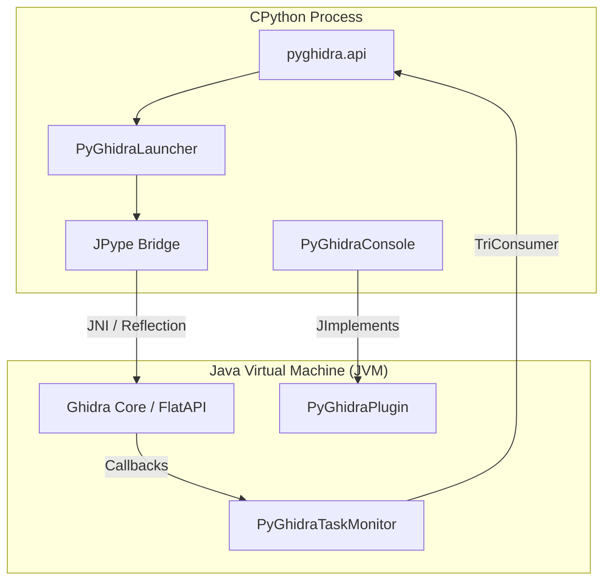
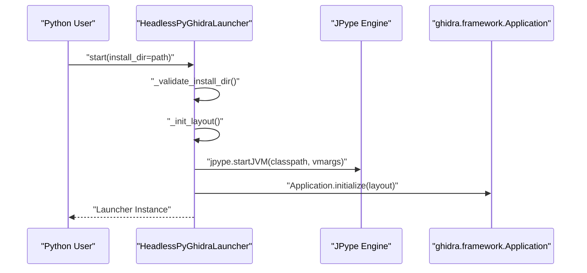
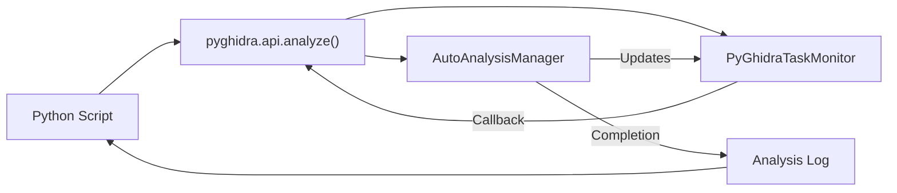

<!-- source: DeepWiki mcp.deepwiki.com · repo NationalSecurityAgency/ghidra · page 6.3 PyGhidra - Python Integration · fetched 2026-11-09 -->

# PyGhidra - Python Integration

Relevant source files

The following files were used as context for generating this wiki page:

- [GPL/DemanglerGnu/build.gradle](GPL/DemanglerGnu/build.gradle)
- [GPL/DemanglerGnu/certification.manifest](GPL/DemanglerGnu/certification.manifest)
- [GPL/DemanglerGnu/src/demangler_gnu_v2_24/README.txt](GPL/DemanglerGnu/src/demangler_gnu_v2_24/README.txt)
- [GPL/DemanglerGnu/src/demangler_gnu_v2_24/c/alloca.c](GPL/DemanglerGnu/src/demangler_gnu_v2_24/c/alloca.c)
- [GPL/DemanglerGnu/src/demangler_gnu_v2_24/c/argv.c](GPL/DemanglerGnu/src/demangler_gnu_v2_24/c/argv.c)
- [GPL/DemanglerGnu/src/demangler_gnu_v2_24/c/cp-demangle.c](GPL/DemanglerGnu/src/demangler_gnu_v2_24/c/cp-demangle.c)
- [GPL/DemanglerGnu/src/demangler_gnu_v2_24/c/cplus-dem.c](GPL/DemanglerGnu/src/demangler_gnu_v2_24/c/cplus-dem.c)
- [GPL/DemanglerGnu/src/demangler_gnu_v2_24/c/dyn-string.c](GPL/DemanglerGnu/src/demangler_gnu_v2_24/c/dyn-string.c)
- [GPL/DemanglerGnu/src/demangler_gnu_v2_24/c/getopt.c](GPL/DemanglerGnu/src/demangler_gnu_v2_24/c/getopt.c)
- [GPL/DemanglerGnu/src/demangler_gnu_v2_24/c/getopt1.c](GPL/DemanglerGnu/src/demangler_gnu_v2_24/c/getopt1.c)
- [GPL/DemanglerGnu/src/demangler_gnu_v2_24/c/safe-ctype.c](GPL/DemanglerGnu/src/demangler_gnu_v2_24/c/safe-ctype.c)
- [GPL/DemanglerGnu/src/demangler_gnu_v2_24/headers/demangle.h](GPL/DemanglerGnu/src/demangler_gnu_v2_24/headers/demangle.h)
- [GPL/DemanglerGnu/src/demangler_gnu_v2_41/c/cplus-dem.c](GPL/DemanglerGnu/src/demangler_gnu_v2_41/c/cplus-dem.c)
- [GPL/nativePlatforms.gradle](GPL/nativePlatforms.gradle)
- [Ghidra/Features/Decompiler/buildNatives.gradle](Ghidra/Features/Decompiler/buildNatives.gradle)
- [Ghidra/Features/Decompiler/src/decompile/cpp/types.h](Ghidra/Features/Decompiler/src/decompile/cpp/types.h)
- [Ghidra/Features/FileFormats/buildNatives.gradle](Ghidra/Features/FileFormats/buildNatives.gradle)
- [Ghidra/Features/PyGhidra/.pydevproject](Ghidra/Features/PyGhidra/.pydevproject)
- [Ghidra/Features/PyGhidra/Module.manifest](Ghidra/Features/PyGhidra/Module.manifest)
- [Ghidra/Features/PyGhidra/certification.manifest](Ghidra/Features/PyGhidra/certification.manifest)
- [Ghidra/Features/PyGhidra/ghidra_scripts/PyGhidraBasics.py](Ghidra/Features/PyGhidra/ghidra_scripts/PyGhidraBasics.py)
- [Ghidra/Features/PyGhidra/src/main/java/ghidra/pyghidra/PyGhidraPlugin.java](Ghidra/Features/PyGhidra/src/main/java/ghidra/pyghidra/PyGhidraPlugin.java)
- [Ghidra/Features/PyGhidra/src/main/java/ghidra/pyghidra/PyGhidraProject.java](Ghidra/Features/PyGhidra/src/main/java/ghidra/pyghidra/PyGhidraProject.java)
- [Ghidra/Features/PyGhidra/src/main/java/ghidra/pyghidra/PyGhidraScriptProvider.java](Ghidra/Features/PyGhidra/src/main/java/ghidra/pyghidra/PyGhidraScriptProvider.java)
- [Ghidra/Features/PyGhidra/src/main/java/ghidra/pyghidra/PyGhidraTaskMonitor.java](Ghidra/Features/PyGhidra/src/main/java/ghidra/pyghidra/PyGhidraTaskMonitor.java)
- [Ghidra/Features/PyGhidra/src/main/java/ghidra/pyghidra/PythonFieldExposer.java](Ghidra/Features/PyGhidra/src/main/java/ghidra/pyghidra/PythonFieldExposer.java)
- [Ghidra/Features/PyGhidra/src/main/java/ghidra/pyghidra/interpreter/CancelAction.java](Ghidra/Features/PyGhidra/src/main/java/ghidra/pyghidra/interpreter/CancelAction.java)
- [Ghidra/Features/PyGhidra/src/main/java/ghidra/pyghidra/interpreter/InterpreterGhidraScript.java](Ghidra/Features/PyGhidra/src/main/java/ghidra/pyghidra/interpreter/InterpreterGhidraScript.java)
- [Ghidra/Features/PyGhidra/src/main/java/ghidra/pyghidra/interpreter/InterpreterTaskMonitor.java](Ghidra/Features/PyGhidra/src/main/java/ghidra/pyghidra/interpreter/InterpreterTaskMonitor.java)
- [Ghidra/Features/PyGhidra/src/main/java/ghidra/pyghidra/interpreter/PyGhidraConsole.java](Ghidra/Features/PyGhidra/src/main/java/ghidra/pyghidra/interpreter/PyGhidraConsole.java)
- [Ghidra/Features/PyGhidra/src/main/py/README.md](Ghidra/Features/PyGhidra/src/main/py/README.md)
- [Ghidra/Features/PyGhidra/src/main/py/pyproject.toml](Ghidra/Features/PyGhidra/src/main/py/pyproject.toml)
- [Ghidra/Features/PyGhidra/src/main/py/src/pyghidra/__init__.py](Ghidra/Features/PyGhidra/src/main/py/src/pyghidra/__init__.py)
- [Ghidra/Features/PyGhidra/src/main/py/src/pyghidra/__main__.py](Ghidra/Features/PyGhidra/src/main/py/src/pyghidra/__main__.py)
- [Ghidra/Features/PyGhidra/src/main/py/src/pyghidra/api.py](Ghidra/Features/PyGhidra/src/main/py/src/pyghidra/api.py)
- [Ghidra/Features/PyGhidra/src/main/py/src/pyghidra/core.py](Ghidra/Features/PyGhidra/src/main/py/src/pyghidra/core.py)
- [Ghidra/Features/PyGhidra/src/main/py/src/pyghidra/ghidra_launch.py](Ghidra/Features/PyGhidra/src/main/py/src/pyghidra/ghidra_launch.py)
- [Ghidra/Features/PyGhidra/src/main/py/src/pyghidra/ghidradoc.py](Ghidra/Features/PyGhidra/src/main/py/src/pyghidra/ghidradoc.py)
- [Ghidra/Features/PyGhidra/src/main/py/src/pyghidra/gui.py](Ghidra/Features/PyGhidra/src/main/py/src/pyghidra/gui.py)
- [Ghidra/Features/PyGhidra/src/main/py/src/pyghidra/internal/plugin/completions.py](Ghidra/Features/PyGhidra/src/main/py/src/pyghidra/internal/plugin/completions.py)
- [Ghidra/Features/PyGhidra/src/main/py/src/pyghidra/internal/plugin/plugin.py](Ghidra/Features/PyGhidra/src/main/py/src/pyghidra/internal/plugin/plugin.py)
- [Ghidra/Features/PyGhidra/src/main/py/src/pyghidra/javac.py](Ghidra/Features/PyGhidra/src/main/py/src/pyghidra/javac.py)
- [Ghidra/Features/PyGhidra/src/main/py/src/pyghidra/launcher.py](Ghidra/Features/PyGhidra/src/main/py/src/pyghidra/launcher.py)
- [Ghidra/Features/PyGhidra/src/main/py/src/pyghidra/script.py](Ghidra/Features/PyGhidra/src/main/py/src/pyghidra/script.py)
- [Ghidra/Features/PyGhidra/src/main/py/src/pyghidra/version.py](Ghidra/Features/PyGhidra/src/main/py/src/pyghidra/version.py)
- [Ghidra/Features/PyGhidra/src/main/py/tests/test_core.py](Ghidra/Features/PyGhidra/src/main/py/tests/test_core.py)
- [Ghidra/Features/PyGhidra/src/main/py/tests/test_version.py](Ghidra/Features/PyGhidra/src/main/py/tests/test_version.py)
- [Ghidra/Features/PyGhidra/support/pyghidra_launcher.py](Ghidra/Features/PyGhidra/support/pyghidra_launcher.py)
- [Ghidra/Framework/Generic/src/main/java/ghidra/framework/Platform.java](Ghidra/Framework/Generic/src/main/java/ghidra/framework/Platform.java)
- [Ghidra/Framework/Utility/src/main/java/ghidra/framework/OperatingSystem.java](Ghidra/Framework/Utility/src/main/java/ghidra/framework/OperatingSystem.java)
- [GhidraBuild/BuildFiles/Doclets/src/main/java/ghidra/doclets/typestubs/GhidraBuiltinsBuilder.java](GhidraBuild/BuildFiles/Doclets/src/main/java/ghidra/doclets/typestubs/GhidraBuiltinsBuilder.java)
- [GhidraBuild/BuildFiles/Doclets/src/main/java/ghidra/doclets/typestubs/PythonTypeStubPackage.java](GhidraBuild/BuildFiles/Doclets/src/main/java/ghidra/doclets/typestubs/PythonTypeStubPackage.java)
- [GhidraBuild/BuildFiles/Doclets/src/main/java/ghidra/doclets/typestubs/PythonTypeStubType.java](GhidraBuild/BuildFiles/Doclets/src/main/java/ghidra/doclets/typestubs/PythonTypeStubType.java)
- [GhidraBuild/LaunchSupport/src/main/java/ghidra/launch/AppConfig.java](GhidraBuild/LaunchSupport/src/main/java/ghidra/launch/AppConfig.java)
- [GhidraBuild/LaunchSupport/src/main/java/ghidra/launch/JavaFinder.java](GhidraBuild/LaunchSupport/src/main/java/ghidra/launch/JavaFinder.java)

## Purpose and Scope

PyGhidra provides direct access to the Ghidra API within a native CPython 3 interpreter using the [JPype](https://jpype.readthedocs.io/en/latest) bridge [Ghidra/Features/PyGhidra/src/main/py/README.md:3-8](). It allows for high-performance scripting, automation, and integration with the Ghidra GUI. Unlike Jython-based scripting, PyGhidra enables the use of modern Python libraries (e.g., NumPy, Pandas, TensorFlow) alongside Ghidra's analysis engine. Ghidra officially supports Python versions 3.9 through 3.14 for this integration [Ghidra/Features/PyGhidra/src/main/py/pyproject.toml:10-31]().

This integration includes a standalone Python library (`pyghidra`), a launcher system for JVM orchestration, and a Ghidra plugin to host a CPython REPL and script provider within the Swing GUI [Ghidra/Features/PyGhidra/src/main/py/README.md:3-8]().

**Sources:** [Ghidra/Features/PyGhidra/src/main/py/README.md:3-8](), [Ghidra/Features/PyGhidra/src/main/py/pyproject.toml:10-31](), [Ghidra/Features/PyGhidra/src/main/py/src/pyghidra/launcher.py:185-190]()

## Architecture Overview

PyGhidra's architecture is centered around the `PyGhidraLauncher`, which handles the complexities of starting a Java Virtual Machine (JVM) from a CPython process. It manages the classpath, VM arguments, and Ghidra's application layout [Ghidra/Features/PyGhidra/src/main/py/src/pyghidra/launcher.py:185-210]().

### System Component Interaction

**Sources:** [Ghidra/Features/PyGhidra/src/main/py/src/pyghidra/launcher.py:185-210](), [Ghidra/Features/PyGhidra/src/main/java/ghidra/pyghidra/PyGhidraTaskMonitor.java:33-44](), [Ghidra/Features/PyGhidra/src/main/py/src/pyghidra/internal/plugin/plugin.py:147-155]()

## Launcher System

The `PyGhidraLauncher` class and its specializations manage the lifecycle of the Ghidra environment [Ghidra/Features/PyGhidra/src/main/py/src/pyghidra/launcher.py:185-190](). It supports three primary modes: Headless, GUI, and Deferred (for when the JVM is already running) [Ghidra/Features/PyGhidra/src/main/py/src/pyghidra/__init__.py:63-63]().

### Launcher Hierarchy and Initialization

| Class | Role | Context |
| :--- | :--- | :--- |
| `PyGhidraLauncher` | Base class for JVM startup and environment validation. | [Ghidra/Features/PyGhidra/src/main/py/src/pyghidra/launcher.py:185-190]() |
| `HeadlessPyGhidraLauncher` | Initializes Ghidra in headless mode for CLI scripts. | [Ghidra/Features/PyGhidra/src/main/py/src/pyghidra/api.py:38-50]() |
| `GuiPyGhidraLauncher` | Starts the Ghidra Swing GUI from Python. | [Ghidra/Features/PyGhidra/src/main/py/src/pyghidra/__init__.py:63-63]() |
| `DeferredPyGhidraLauncher` | Used when Python is invoked from within a running Ghidra instance. | [Ghidra/Features/PyGhidra/src/main/py/src/pyghidra/__init__.py:63-63]() |

The launcher validates the `GHIDRA_INSTALL_DIR` by checking for the existence of `support/launch.properties` or by reading the `lastrun` file stored in platform-specific config directories (e.g., `%APPDATA%\ghidra\lastrun` on Windows) [Ghidra/Features/PyGhidra/src/main/py/src/pyghidra/launcher.py:155-177]().

**Sources:** [Ghidra/Features/PyGhidra/src/main/py/src/pyghidra/launcher.py:155-177](), [Ghidra/Features/PyGhidra/src/main/py/src/pyghidra/launcher.py:185-190](), [Ghidra/Features/PyGhidra/src/main/py/src/pyghidra/__init__.py:63-63]()

### JVM Startup Sequence

**Sources:** [Ghidra/Features/PyGhidra/src/main/py/src/pyghidra/launcher.py:185-210]()

## Python API and Core Utilities

The `pyghidra` package provides high-level Pythonic wrappers for common Ghidra tasks, abstracting the verbose Java API [Ghidra/Features/PyGhidra/src/main/py/README.md:43-47]().

### Key API Functions

| Function | Description | File Reference |
| :--- | :--- | :--- |
| `pyghidra.start()` | Entry point to initialize the JVM and Ghidra environment in headless mode. | [Ghidra/Features/PyGhidra/src/main/py/src/pyghidra/api.py:38-50]() |
| `open_project()` | Opens or creates a Ghidra project using `PyGhidraProjectManager`. | [Ghidra/Features/PyGhidra/src/main/py/src/pyghidra/api.py:60-84]() |
| `open_filesystem()` | Opens a `GFileSystem` container for various file formats. | [Ghidra/Features/PyGhidra/src/main/py/src/pyghidra/api.py:85-103]() |
| `program_context()` | A context manager for safely opening and releasing a `Program`. | [Ghidra/Features/PyGhidra/src/main/py/src/pyghidra/api.py:141-161]() |
| `analyze()` | Invokes `AutoAnalysisManager` to process a program. | [Ghidra/Features/PyGhidra/src/main/py/src/pyghidra/api.py:162-171]() |
| `ghidra_script()` | Executes an existing Ghidra script (Java, Python, or Jython). | [Ghidra/Features/PyGhidra/src/main/py/src/pyghidra/api.py:160-160]() |

### Program Consumption and Memory Management

Because Ghidra uses a consumer-based reference counting system for `DomainObject`s (like `Program`), PyGhidra provides `consume_program` and `program_context` [Ghidra/Features/PyGhidra/src/main/py/src/pyghidra/api.py:105-140](). These ensure that the Java `release(consumer)` method is called, preventing memory leaks and file locks in the Ghidra database [Ghidra/Features/PyGhidra/src/main/py/src/pyghidra/api.py:105-161]().

**Sources:** [Ghidra/Features/PyGhidra/src/main/py/src/pyghidra/api.py:105-161]()

## Ghidra GUI Integration

When running inside the Ghidra GUI, PyGhidra provides an interactive console and a script provider.

### The PyGhidraConsole REPL

The `PyConsole` class and its Python counterparts implement the GUI REPL [Ghidra/Features/PyGhidra/src/main/py/src/pyghidra/internal/plugin/plugin.py:148-155](). It uses a custom `PyJavaThread` to allow Python execution to be interrupted or killed by the Ghidra task manager without crashing the JVM [Ghidra/Features/PyGhidra/src/main/py/src/pyghidra/internal/plugin/plugin.py:85-110]().

**Key Implementation Details:**
- **Trace Hook:** `_interpreter_trace` is set on the Python interpreter to check for interruption/kill signals at every "line" event, except when inside `jpype` internal calls to prevent bridge corruption [Ghidra/Features/PyGhidra/src/main/py/src/pyghidra/internal/plugin/plugin.py:62-83]().
- **Thread Management:** `PyJavaThread` wraps `threading.Thread` and handles `JThread.attachAsDaemon()` to ensure Python threads are correctly registered with the JVM [Ghidra/Features/PyGhidra/src/main/py/src/pyghidra/internal/plugin/plugin.py:85-110]().

### Script Environment

The `PyGhidraScript` class acts as a wrapper around a Java `GhidraScript` instance [Ghidra/Features/PyGhidra/src/main/py/src/pyghidra/script.py:147-158](). It populates the Python global namespace with standard Ghidra variables like `currentProgram`, `currentAddress`, and `askString`, mimicking the behavior of the Java `FlatProgramAPI` [Ghidra/Features/PyGhidra/src/main/py/src/pyghidra/script.py:147-181]().

**Sources:** [Ghidra/Features/PyGhidra/src/main/py/src/pyghidra/script.py:147-181](), [Ghidra/Features/PyGhidra/src/main/py/src/pyghidra/internal/plugin/plugin.py:62-110](), [Ghidra/Features/PyGhidra/src/main/py/src/pyghidra/internal/plugin/plugin.py:148-155]()

## Data Flow: Program Analysis

The following diagram illustrates the data flow when a user initiates analysis via the PyGhidra API.

**Sources:** [Ghidra/Features/PyGhidra/src/main/py/src/pyghidra/api.py:162-171](), [Ghidra/Features/PyGhidra/src/main/java/ghidra/pyghidra/PyGhidraTaskMonitor.java:33-44]()

## Type Stubs and Development

To facilitate development, PyGhidra supports type stubs for the Ghidra API. These are generated by the doclet build utilities during the Ghidra build process [GhidraBuild/BuildFiles/Doclets/src/main/java/ghidra/doclets/typestubs/GhidraBuiltinsBuilder.java:27-44](). The builder extracts methods and fields from `FlatProgramAPI` and `GhidraScript` to create type information packages that provide autocomplete for the Python API used in development environments.

**Sources:** [GhidraBuild/BuildFiles/Doclets/src/main/java/ghidra/doclets/typestubs/GhidraBuiltinsBuilder.java:27-44]()

---

