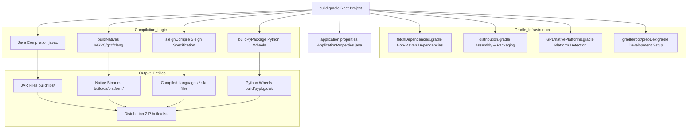
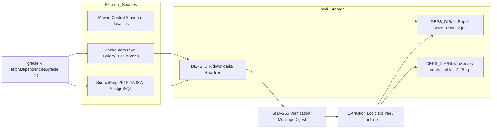
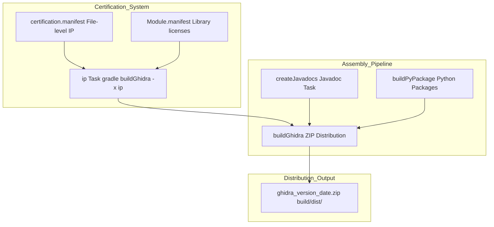

<!-- source: DeepWiki mcp.deepwiki.com · repo NationalSecurityAgency/ghidra · page 7 Development and Build Infrastructure · fetched 2026-11-09 -->

# Development and Build Infrastructure

Relevant source files

The following files were used as context for generating this wiki page:

- [.github/ISSUE_TEMPLATE/bug_report.md](.github/ISSUE_TEMPLATE/bug_report.md)
- [.github/ISSUE_TEMPLATE/feature_request.md](.github/ISSUE_TEMPLATE/feature_request.md)
- [.github/ISSUE_TEMPLATE/question.md](.github/ISSUE_TEMPLATE/question.md)
- [CONTRIBUTING.md](CONTRIBUTING.md)
- [DISCLAIMER.md](DISCLAIMER.md)
- [DevGuide.md](DevGuide.md)
- [GPL/DMG/build.gradle](GPL/DMG/build.gradle)
- [GPL/nativeBuildProperties.gradle](GPL/nativeBuildProperties.gradle)
- [GPL/vsconfig.gradle](GPL/vsconfig.gradle)
- [Ghidra/Debug/AnnotationValidator/build.gradle](Ghidra/Debug/AnnotationValidator/build.gradle)
- [Ghidra/Debug/Debugger-agent-dbgeng/Module.manifest](Ghidra/Debug/Debugger-agent-dbgeng/Module.manifest)
- [Ghidra/Debug/Debugger-agent-dbgeng/build.gradle](Ghidra/Debug/Debugger-agent-dbgeng/build.gradle)
- [Ghidra/Debug/Debugger-agent-dbgeng/src/main/py/README.md](Ghidra/Debug/Debugger-agent-dbgeng/src/main/py/README.md)
- [Ghidra/Debug/Debugger-agent-gdb/build.gradle](Ghidra/Debug/Debugger-agent-gdb/build.gradle)
- [Ghidra/Debug/Debugger-agent-lldb/build.gradle](Ghidra/Debug/Debugger-agent-lldb/build.gradle)
- [Ghidra/Debug/Debugger-jpda/build.gradle](Ghidra/Debug/Debugger-jpda/build.gradle)
- [Ghidra/Debug/Debugger-jpda/certification.manifest](Ghidra/Debug/Debugger-jpda/certification.manifest)
- [Ghidra/Debug/Debugger-rmi-trace/build.gradle](Ghidra/Debug/Debugger-rmi-trace/build.gradle)
- [Ghidra/Debug/Framework-TraceModeling/build.gradle](Ghidra/Debug/Framework-TraceModeling/build.gradle)
- [Ghidra/Debug/ProposedUtils/certification.manifest](Ghidra/Debug/ProposedUtils/certification.manifest)
- [Ghidra/Debug/TaintAnalysis/build.gradle](Ghidra/Debug/TaintAnalysis/build.gradle)
- [Ghidra/Extensions/bundle_examples/build.gradle](Ghidra/Extensions/bundle_examples/build.gradle)
- [Ghidra/Features/Base/data/PEFunctionsThatDoNotReturn](Ghidra/Features/Base/data/PEFunctionsThatDoNotReturn)
- [Ghidra/Features/FileFormats/build.gradle](Ghidra/Features/FileFormats/build.gradle)
- [Ghidra/Features/GhidraServer/Module.manifest](Ghidra/Features/GhidraServer/Module.manifest)
- [Ghidra/Features/GhidraServer/build.gradle](Ghidra/Features/GhidraServer/build.gradle)
- [Ghidra/Features/PDB/build.gradle](Ghidra/Features/PDB/build.gradle)
- [Ghidra/Features/PDB/buildNatives.gradle](Ghidra/Features/PDB/buildNatives.gradle)
- [Ghidra/Features/PDB/src/pdb/pdb.sln](Ghidra/Features/PDB/src/pdb/pdb.sln)
- [Ghidra/Features/PDB/src/pdb/pdb.vcxproj](Ghidra/Features/PDB/src/pdb/pdb.vcxproj)
- [Ghidra/Features/PyGhidra/build.gradle](Ghidra/Features/PyGhidra/build.gradle)
- [Ghidra/Framework/Utility/src/main/java/ghidra/framework/ApplicationProperties.java](Ghidra/Framework/Utility/src/main/java/ghidra/framework/ApplicationProperties.java)
- [Ghidra/Test/DebuggerIntegrationTest/build.gradle](Ghidra/Test/DebuggerIntegrationTest/build.gradle)
- [Ghidra/application.properties](Ghidra/application.properties)
- [GhidraBuild/BuildFiles/Doclets/support/GhidraStubs_README.md](GhidraBuild/BuildFiles/Doclets/support/GhidraStubs_README.md)
- [GhidraBuild/BuildFiles/certification.manifest](GhidraBuild/BuildFiles/certification.manifest)
- [GhidraBuild/BuildFiles/sleighDevBuild.template](GhidraBuild/BuildFiles/sleighDevBuild.template)
- [GhidraBuild/BuildFiles/sleighDistBuild.template](GhidraBuild/BuildFiles/sleighDistBuild.template)
- [NOTICE](NOTICE)
- [README.md](README.md)
- [SECURITY.md](SECURITY.md)
- [build.gradle](build.gradle)
- [certification.local.manifest](certification.local.manifest)
- [gradle.properties](gradle.properties)
- [gradle/distributableGPLExtension.gradle](gradle/distributableGPLExtension.gradle)
- [gradle/distributableGPLModule.gradle](gradle/distributableGPLModule.gradle)
- [gradle/distributableGhidraExtension.gradle](gradle/distributableGhidraExtension.gradle)
- [gradle/distributableGhidraModule.gradle](gradle/distributableGhidraModule.gradle)
- [gradle/hasProtobuf.gradle](gradle/hasProtobuf.gradle)
- [gradle/hasPythonPackage.gradle](gradle/hasPythonPackage.gradle)
- [gradle/processorProject.gradle](gradle/processorProject.gradle)
- [gradle/root/distribution.gradle](gradle/root/distribution.gradle)
- [gradle/root/svg.gradle](gradle/root/svg.gradle)
- [gradle/root/venv.gradle](gradle/root/venv.gradle)
- [gradle/support/distributionCommon.gradle](gradle/support/distributionCommon.gradle)
- [gradle/support/extensionCommon.gradle](gradle/support/extensionCommon.gradle)
- [gradle/support/fetchDependencies.gradle](gradle/support/fetchDependencies.gradle)
- [gradle/support/ip.gradle](gradle/support/ip.gradle)
- [gradle/support/loadApplicationProperties.gradle](gradle/support/loadApplicationProperties.gradle)
- [gradlew](gradlew)
- [gradlew.bat](gradlew.bat)

This page documents Ghidra's build system, development environment setup, and release pipeline infrastructure. It covers the Gradle-based build system, native compilation process, dependency management, distribution assembly, and development tooling including the GhidraDev Eclipse plugin.

For information about running and using Ghidra in development mode, see the `DevGuide.md` file. For specific subsystem build details, see:
- [Gradle Build System](#7.1) for build configuration
- [GhidraDev Eclipse Plugin](#7.2) for Eclipse development setup
- [Launch Configuration and Application Properties](#7.3) for runtime configuration
- [Documentation and Release Pipeline](#7.4) for release processes
- [Docker Containerization](#7.5) for containerized deployment
- [Testing Infrastructure](#7.6) for unit and integration testing

---

## Build System Overview

Ghidra uses a Gradle-based multi-project build system that coordinates compilation of Java sources, native C++ binaries, Sleigh processor specifications, Python packages, and documentation. The build supports development mode (Eclipse integration) and production distribution builds across multiple platforms [DevGuide.md:3-8]().

### Build Architecture

Title: Ghidra Build System Coordination

**Sources:**
- [build.gradle:16-147]()
- [DevGuide.md:13-86]()
- [README.md:44-87]()

### Key Build Properties

The `application.properties` file defines core build parameters read by both Gradle and runtime code via `ApplicationProperties` [Ghidra/Framework/Utility/src/main/java/ghidra/framework/ApplicationProperties.java:1-40]().

| Property | Purpose | Example Value |
|----------|---------|---------------|
| `application.name` | Application name | `Ghidra` [Ghidra/application.properties:1]() |
| `application.version` | Release version | `12.3` [Ghidra/application.properties:2]() |
| `application.release.name` | Release identifier | `DEV` [Ghidra/application.properties:3]() |
| `application.gradle.min` | Minimum Gradle version | `9.1` [Ghidra/application.properties:5]() |
| `application.java.min` | Minimum Java version | `25` [Ghidra/application.properties:7]() |
| `application.java.compiler` | Java compiler version | `25` [Ghidra/application.properties:9]() |
| `application.python.supported` | Supported Python versions | `3.14, 3.13, 3.12, 3.11, 3.10, 3.9` [Ghidra/application.properties:10]() |

**Sources:**
- [Ghidra/application.properties:1-10]()
- [build.gradle:16-28]()

---

## Dependency Management

Ghidra dependencies are sourced from Maven Central and a flat repository for non-Maven artifacts. The `fetchDependencies.gradle` script downloads and verifies non-Maven dependencies (like Z3, YAJSW, and BSim PostgreSQL) before the build begins [gradle/support/fetchDependencies.gradle:16-34]().

### Dependency Fetching Process

Title: Dependency Acquisition Pipeline

**Sources:**
- [gradle/support/fetchDependencies.gradle:48-118]()
- [build.gradle:89-98]()

### Dependency Structure

The `fetchDependencies.gradle` script maintains a list of dependencies with URLs, SHA-256 checksums, and destination logic. Examples include `java-sarif`, `yajsw` for Ghidra Server, and `postgresql` for BSim [gradle/support/fetchDependencies.gradle:74-104](). For details, see [Gradle Build System](#7.1).

**Sources:**
- [gradle/support/fetchDependencies.gradle:74-158]()
- [DevGuide.md:31-36]()

---

## Native Compilation

Ghidra includes native C++ components (primarily the decompiler and PDB parser) that must be compiled for each target platform. The build system uses the `buildNatives` task which coordinates with platform-specific toolchains [DevGuide.md:56-59](). This requires GCC or Clang on Linux/macOS and Microsoft Visual Studio on Windows [README.md:53-59](). The `nativeBuildProperties.gradle` script defines the platform model (architecture and OS) used for these builds [GPL/nativeBuildProperties.gradle:25-35]().

For details, see [Gradle Build System](#7.1).

---

## GhidraDev Eclipse Plugin

GhidraDev is an Eclipse plugin that provides project wizards, launch configurations, and integration with PyDev and CDT for Ghidra development. It simplifies creating Ghidra script and module projects with proper classpath configuration [README.md:90-101](). For core tool development, Ghidra's build provides `gradle prepdev eclipse buildNatives` to generate native Eclipse projects and dependencies [README.md:111-113]().

For details, see [GhidraDev Eclipse Plugin](#7.2).

---

## Launch Configuration and Application Properties

Ghidra's launch behavior is controlled by `application.properties` (metadata) and `launch.properties` (JVM configuration). The system uses specific VM arguments and properties like `application.settingsdir` to manage user configurations [Ghidra/application.properties:1-10](). Java 25 is required at minimum for the current development version [Ghidra/application.properties:7]().

For details, see [Launch Configuration and Application Properties](#7.3).

---

## Documentation and Release Pipeline

The release pipeline coordinates version management, IP tracking, and distribution packaging. Distribution builds are created using `gradle buildGhidra` (compressed) or `gradle assembleAll` (uncompressed for the local platform) [DevGuide.md:76-86](). Release notes are tracked in documentation files and certification manifests [GhidraBuild/BuildFiles/certification.manifest:1-5]().

### Release Build Process

Title: IP Tracking and Release Packaging

**Sources:**
- [DevGuide.md:66-94]()
- [build.gradle:129-143]()
- [gradle/root/distribution.gradle:106-142]()

For details, see [Documentation and Release Pipeline](#7.4).

---

## Docker Containerization

Ghidra supports containerization for headless analysis, the Ghidra Server, and BSim services. The infrastructure handles environment configuration such as `JAVA_TOOL_OPTIONS="-DUSER_AGREEMENT=ACCEPT"` for automated GUI acceptance and Xvfb for headless AWT support in CI/Docker environments [DevGuide.md:169-184]().

For details, see [Docker Containerization](#7.5).

---

## Testing Infrastructure

Ghidra includes a comprehensive test suite managed via Gradle, covering unit tests, integration tests, and test coverage tracking with JaCoCo. Tests utilize base classes such as `AbstractGenericTest`, `AbstractDockingTest`, and `AbstractGhidraHeadlessIntegrationTest` alongside fixtures like `TestEnv` and `ProgramBuilder`.

For details, see [Testing Infrastructure](#7.6).

---

