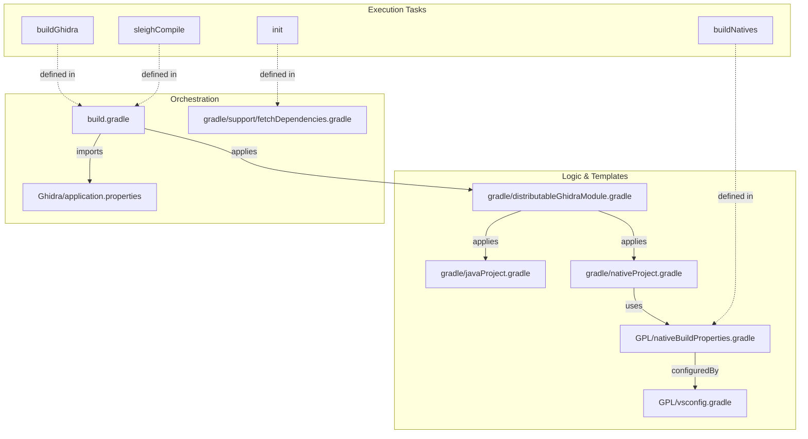
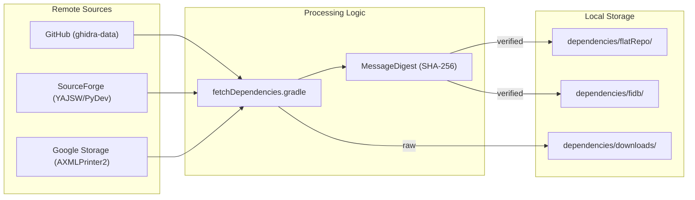
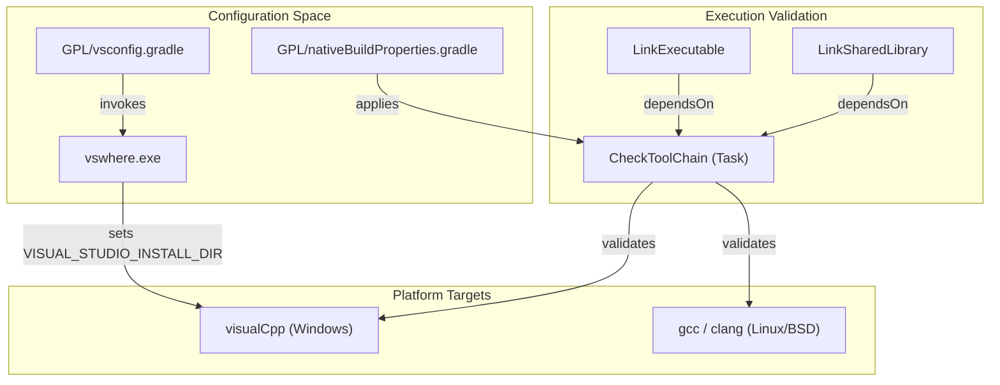

<!-- source: DeepWiki mcp.deepwiki.com · repo NationalSecurityAgency/ghidra · page 7.1 Gradle Build System · fetched 2026-11-09 -->

# Gradle Build System

Relevant source files

The following files were used as context for generating this wiki page:

- [.github/ISSUE_TEMPLATE/bug_report.md](.github/ISSUE_TEMPLATE/bug_report.md)
- [.github/ISSUE_TEMPLATE/feature_request.md](.github/ISSUE_TEMPLATE/feature_request.md)
- [.github/ISSUE_TEMPLATE/question.md](.github/ISSUE_TEMPLATE/question.md)
- [CONTRIBUTING.md](CONTRIBUTING.md)
- [DISCLAIMER.md](DISCLAIMER.md)
- [DevGuide.md](DevGuide.md)
- [GPL/DMG/build.gradle](GPL/DMG/build.gradle)
- [GPL/nativeBuildProperties.gradle](GPL/nativeBuildProperties.gradle)
- [GPL/vsconfig.gradle](GPL/vsconfig.gradle)
- [Ghidra/Debug/AnnotationValidator/build.gradle](Ghidra/Debug/AnnotationValidator/build.gradle)
- [Ghidra/Debug/Debugger-agent-dbgeng/Module.manifest](Ghidra/Debug/Debugger-agent-dbgeng/Module.manifest)
- [Ghidra/Debug/Debugger-agent-dbgeng/build.gradle](Ghidra/Debug/Debugger-agent-dbgeng/build.gradle)
- [Ghidra/Debug/Debugger-agent-dbgeng/src/main/py/README.md](Ghidra/Debug/Debugger-agent-dbgeng/src/main/py/README.md)
- [Ghidra/Debug/Debugger-agent-gdb/build.gradle](Ghidra/Debug/Debugger-agent-gdb/build.gradle)
- [Ghidra/Debug/Debugger-agent-lldb/build.gradle](Ghidra/Debug/Debugger-agent-lldb/build.gradle)
- [Ghidra/Debug/Debugger-jpda/build.gradle](Ghidra/Debug/Debugger-jpda/build.gradle)
- [Ghidra/Debug/Debugger-jpda/certification.manifest](Ghidra/Debug/Debugger-jpda/certification.manifest)
- [Ghidra/Debug/Debugger-rmi-trace/build.gradle](Ghidra/Debug/Debugger-rmi-trace/build.gradle)
- [Ghidra/Debug/Framework-TraceModeling/build.gradle](Ghidra/Debug/Framework-TraceModeling/build.gradle)
- [Ghidra/Debug/ProposedUtils/certification.manifest](Ghidra/Debug/ProposedUtils/certification.manifest)
- [Ghidra/Debug/TaintAnalysis/build.gradle](Ghidra/Debug/TaintAnalysis/build.gradle)
- [Ghidra/Extensions/bundle_examples/build.gradle](Ghidra/Extensions/bundle_examples/build.gradle)
- [Ghidra/Features/Base/Module.manifest](Ghidra/Features/Base/Module.manifest)
- [Ghidra/Features/Base/build.gradle](Ghidra/Features/Base/build.gradle)
- [Ghidra/Features/Base/data/PEFunctionsThatDoNotReturn](Ghidra/Features/Base/data/PEFunctionsThatDoNotReturn)
- [Ghidra/Features/FileFormats/build.gradle](Ghidra/Features/FileFormats/build.gradle)
- [Ghidra/Features/GhidraServer/Module.manifest](Ghidra/Features/GhidraServer/Module.manifest)
- [Ghidra/Features/GhidraServer/build.gradle](Ghidra/Features/GhidraServer/build.gradle)
- [Ghidra/Features/GraphServices/Module.manifest](Ghidra/Features/GraphServices/Module.manifest)
- [Ghidra/Features/GraphServices/build.gradle](Ghidra/Features/GraphServices/build.gradle)
- [Ghidra/Features/GraphServices/src/main/java/ghidra/graph/visualization/LayoutFunction.java](Ghidra/Features/GraphServices/src/main/java/ghidra/graph/visualization/LayoutFunction.java)
- [Ghidra/Features/GraphServices/src/main/java/ghidra/graph/visualization/LayoutTransitionManager.java](Ghidra/Features/GraphServices/src/main/java/ghidra/graph/visualization/LayoutTransitionManager.java)
- [Ghidra/Features/GraphServices/src/main/resources/jungrapht.properties](Ghidra/Features/GraphServices/src/main/resources/jungrapht.properties)
- [Ghidra/Features/PDB/build.gradle](Ghidra/Features/PDB/build.gradle)
- [Ghidra/Features/PDB/buildNatives.gradle](Ghidra/Features/PDB/buildNatives.gradle)
- [Ghidra/Features/PDB/src/pdb/pdb.sln](Ghidra/Features/PDB/src/pdb/pdb.sln)
- [Ghidra/Features/PDB/src/pdb/pdb.vcxproj](Ghidra/Features/PDB/src/pdb/pdb.vcxproj)
- [Ghidra/Features/PyGhidra/build.gradle](Ghidra/Features/PyGhidra/build.gradle)
- [Ghidra/Framework/DB/build.gradle](Ghidra/Framework/DB/build.gradle)
- [Ghidra/Framework/Docking/build.gradle](Ghidra/Framework/Docking/build.gradle)
- [Ghidra/Framework/FileSystem/build.gradle](Ghidra/Framework/FileSystem/build.gradle)
- [Ghidra/Framework/Generic/Module.manifest](Ghidra/Framework/Generic/Module.manifest)
- [Ghidra/Framework/Generic/build.gradle](Ghidra/Framework/Generic/build.gradle)
- [Ghidra/Framework/Generic/src/main/java/ghidra/net/DefaultKeyManagerFactory.java](Ghidra/Framework/Generic/src/main/java/ghidra/net/DefaultKeyManagerFactory.java)
- [Ghidra/Framework/Generic/src/main/java/ghidra/net/PKIUtils.java](Ghidra/Framework/Generic/src/main/java/ghidra/net/PKIUtils.java)
- [Ghidra/Framework/Graph/Module.manifest](Ghidra/Framework/Graph/Module.manifest)
- [Ghidra/Framework/Graph/build.gradle](Ghidra/Framework/Graph/build.gradle)
- [Ghidra/Framework/Graph/src/main/java/ghidra/service/graph/LayoutAlgorithmNames.java](Ghidra/Framework/Graph/src/main/java/ghidra/service/graph/LayoutAlgorithmNames.java)
- [Ghidra/Framework/Help/build.gradle](Ghidra/Framework/Help/build.gradle)
- [Ghidra/Framework/Utility/src/main/java/ghidra/framework/ApplicationProperties.java](Ghidra/Framework/Utility/src/main/java/ghidra/framework/ApplicationProperties.java)
- [Ghidra/Test/DebuggerIntegrationTest/build.gradle](Ghidra/Test/DebuggerIntegrationTest/build.gradle)
- [Ghidra/application.properties](Ghidra/application.properties)
- [GhidraBuild/BuildFiles/Doclets/build.gradle](GhidraBuild/BuildFiles/Doclets/build.gradle)
- [GhidraBuild/BuildFiles/Doclets/support/GhidraStubs_README.md](GhidraBuild/BuildFiles/Doclets/support/GhidraStubs_README.md)
- [GhidraBuild/BuildFiles/certification.manifest](GhidraBuild/BuildFiles/certification.manifest)
- [GhidraBuild/BuildFiles/sleighDevBuild.template](GhidraBuild/BuildFiles/sleighDevBuild.template)
- [GhidraBuild/BuildFiles/sleighDistBuild.template](GhidraBuild/BuildFiles/sleighDistBuild.template)
- [NOTICE](NOTICE)
- [README.md](README.md)
- [SECURITY.md](SECURITY.md)
- [build.gradle](build.gradle)
- [certification.local.manifest](certification.local.manifest)
- [gradle.properties](gradle.properties)
- [gradle/distributableGPLExtension.gradle](gradle/distributableGPLExtension.gradle)
- [gradle/distributableGPLModule.gradle](gradle/distributableGPLModule.gradle)
- [gradle/distributableGhidraExtension.gradle](gradle/distributableGhidraExtension.gradle)
- [gradle/distributableGhidraModule.gradle](gradle/distributableGhidraModule.gradle)
- [gradle/hasProtobuf.gradle](gradle/hasProtobuf.gradle)
- [gradle/hasPythonPackage.gradle](gradle/hasPythonPackage.gradle)
- [gradle/processorProject.gradle](gradle/processorProject.gradle)
- [gradle/root/distribution.gradle](gradle/root/distribution.gradle)
- [gradle/root/svg.gradle](gradle/root/svg.gradle)
- [gradle/root/venv.gradle](gradle/root/venv.gradle)
- [gradle/support/distributionCommon.gradle](gradle/support/distributionCommon.gradle)
- [gradle/support/extensionCommon.gradle](gradle/support/extensionCommon.gradle)
- [gradle/support/fetchDependencies.gradle](gradle/support/fetchDependencies.gradle)
- [gradle/support/ip.gradle](gradle/support/ip.gradle)
- [gradle/support/loadApplicationProperties.gradle](gradle/support/loadApplicationProperties.gradle)
- [gradlew](gradlew)
- [gradlew.bat](gradlew.bat)

## Purpose and Scope

This document details Ghidra's Gradle-based multi-module build system, which manages the compilation, dependency resolution, native component building, Sleigh compilation, IP verification, and distribution assembly across Java, C++, Sleigh, and Python components. The build system supports Windows, Linux, and macOS platforms and handles both development and release workflows. The minimum required Gradle version is defined as 9.1 [Ghidra/application.properties:5-5]().

## Build System Architecture & Root Configuration

Ghidra uses a hierarchical Gradle multi-project build structure with over 50 modules organized under framework and feature directories. The root `build.gradle` configures global settings, platform definitions, and coordinates all subprojects [build.gradle:1-175]().

### Build Entity Relationship
The following diagram bridges the natural language concepts of the build system to the specific code entities and files that implement them.

**Title: Build System Entity Mapping**

**Sources:** [build.gradle:16-132](), [gradle/distributableGhidraModule.gradle:18-22](), [GPL/nativeBuildProperties.gradle:131-178](), [GPL/vsconfig.gradle:12-97]()

### Module Organization and Conventions

Each module features its own `build.gradle` configuration and a `Module.manifest` file detailing its bundled third-party files and licenses.

| Module Category | Location | Purpose | Example Modules |
|----------------|----------|---------|-----------------|
| Framework | `Ghidra/Framework/` | Core infrastructure | `Base`, `Docking`, `Generic` [Ghidra/Framework/Generic/build.gradle:25-25]() |
| Features | `Ghidra/Features/` | Application features | `Decompiler`, `PDB`, `PyGhidra`, `BSim` |
| Processors | `Ghidra/Processors/` | CPU architecture support | `x86`, `ARM`, `MIPS` |
| GPL | `GPL/` | GPL-licensed components | `DemanglerGnu`, `GnuDisassembler` [DevGuide.md:23-24]() |

Each module applies standard Gradle scripts based on its characteristics. For example, `Framework/Generic` applies `javaProject.gradle` and `distributableGhidraModule.gradle` [Ghidra/Framework/Generic/build.gradle:18-22]().

**Sources:** [Ghidra/Framework/Generic/build.gradle:18-22](), [build.gradle:138-147](), [DevGuide.md:23-24]()

## Dependency Management & Non-Maven Artifacts

Ghidra's dependency management handles both standard Maven artifacts and non-Maven artifacts (like native libraries, specialized JARs, and Function ID databases).

### Non-Maven Artifact Resolution (`fetchDependencies`)
The `fetchDependencies.gradle` script downloads and verifies required dependencies that aren't available in standard online repositories [gradle/support/fetchDependencies.gradle:19-23]().

**Title: fetchDependencies Data Flow**

**Sources:** [gradle/support/fetchDependencies.gradle:38-52](), [gradle/support/fetchDependencies.gradle:74-158]()

Key characteristics:
- **Verification:** Every download is checked against a hardcoded SHA-256 hash [gradle/support/fetchDependencies.gradle:74-158]().
- **Flat Repository:** Verified JARs are placed in `dependencies/flatRepo`, which is then added to the Gradle repository list in `build.gradle` [build.gradle:89-98]().
- **Artifacts:** Handles items like `Z3` solvers (version 4.13.0), `PostgreSQL` (version 15.18) sources for BSim, and Visual Studio `FID` databases [gradle/support/fetchDependencies.gradle:68-158]().

**Sources:** [gradle/support/fetchDependencies.gradle:74-158](), [build.gradle:89-98]()

## Multi-Platform Native Build System

Ghidra builds native components (C++, C) for Windows, Linux, and macOS using platform-specific toolchains. This includes GPL modules like `DemanglerGnu` and `GnuDisassembler`.

### Toolchain Configuration and Native Pipeline
Native builds are governed by `GPL/nativeBuildProperties.gradle` and `GPL/vsconfig.gradle`. They define the supported platforms (e.g., `win_x86_64`, `linux_x86_64`) based on the `PLATFORMS` list [GPL/nativeBuildProperties.gradle:25-35]().

**Title: Native Toolchain and Build Pipeline**

**Sources:** [GPL/nativeBuildProperties.gradle:25-78](), [GPL/vsconfig.gradle:12-97]()

- **Windows:** The system uses `visualCpp` toolchain. If `VISUAL_STUDIO_INSTALL_DIR` is set via `vswhere.exe`, it configures the installation directory [GPL/nativeBuildProperties.gradle:56-62](), [GPL/vsconfig.gradle:22-96](). The `CheckToolChain` task ensures a supported Windows native toolchain is found [GPL/nativeBuildProperties.gradle:68-78]().
- **Linux/FreeBSD/OpenBSD:** Configures `gcc` and `clang` toolchains targeting the current platform [GPL/nativeBuildProperties.gradle:40-55]().
- **Native Task Generation:** The build system uses a pattern rule `buildNatives[_PlatformName]` to dynamically create tasks for building all native executables and shared libraries for a specific platform [GPL/nativeBuildProperties.gradle:131-178](). Example: `gradle buildNatives_win_x86_64` triggers all `LinkExecutable` and `LinkSharedLibrary` tasks targeting that platform [GPL/nativeBuildProperties.gradle:145-150]().

**Sources:** [GPL/nativeBuildProperties.gradle:25-178](), [GPL/vsconfig.gradle:12-97](), [DevGuide.md:56-59]()

## Sleigh Compilation & Specialized Assets

Beyond standard Java compilation, specific modules require processor compilation and help document generation.

- **Sleigh Compilation:** Processor definitions are compiled into `.sla` files. The `sleighCompile` task can be run manually, though Ghidra also performs this at runtime if necessary [DevGuide.md:61-64]().
- **Markdown Support:** The build includes a task to process markdown documentation into HTML using the `MarkdownToHtml` utility [build.gradle:125-125](), [build.gradle:143-143]().

**Sources:** [DevGuide.md:61-64](), [build.gradle:125-143]()

## IP/License Verification and Module Manifest Conventions

Ghidra maintains strict intellectual property and licensing boundaries across its modules.
- **License Directory:** Third-party licenses are tracked against the top-level `licenses/` directory [DevGuide.md:17-20]().
- **GPL Isolation:** Any GPL code must live in the top-level `GPL/` directory as a totally standalone, independently buildable Ghidra module [DevGuide.md:23-24]().
- **Module Manifests:** Every distributable module contains a `Module.manifest` file (e.g., `Ghidra/Framework/Generic/Module.manifest`) that explicitly declares the license for each bundled file or JAR under `lib/` [Ghidra/Framework/Generic/Module.manifest:1-15]().

**Sources:** [DevGuide.md:17-24](), [Ghidra/Framework/Generic/Module.manifest:1-15]()

## Distribution Assembly

The final Ghidra distribution is assembled by tasks defined in `gradle/root/distribution.gradle`.

### Assembly Process
1. **Module Packaging:** Each module contributes its `lib/`, `data/`, and `os/` directories. For example, `Framework/Generic` defines its API dependencies (e.g., Guava 32.1.3, JDOM 2.0.6.1) which are bundled into the distribution [Ghidra/Framework/Generic/build.gradle:27-49]().
2. **Native Inclusion:** Native binaries built for the current platform are copied into the `build/os/<platform>` directory [GPL/nativeBuildProperties.gradle:181-188]().
3. **Documentation:** Javadocs and JSON documentation (for Python help) are generated via `createJavadocs` and `createJsondocs` [gradle/root/distribution.gradle:106-166]().
4. **License Verification:** Each module includes a `Module.manifest` that lists the licenses for bundled third-party libraries [Ghidra/Framework/Generic/Module.manifest:1-15]().

**Sources:** [gradle/root/distribution.gradle:106-166](), [Ghidra/Framework/Generic/build.gradle:27-49](), [Ghidra/Framework/Generic/Module.manifest:1-15](), [GPL/nativeBuildProperties.gradle:181-188]()

## Common Gradle Tasks Reference

| Task | Purpose | Implementation Source |
| :--- | :--- | :--- |
| `gradle -I gradle/support/fetchDependencies.gradle` | Downloads non-Maven artifacts like Z3 and FIDBs | `gradle/support/fetchDependencies.gradle` [DevGuide.md:31-36]() |
| `prepdev` | Downloads Maven dependencies and sets up repo for development | `build.gradle` [DevGuide.md:38-42]() |
| `buildNatives` | Compiles C/C++ components for the current platform | `GPL/nativeBuildProperties.gradle` [DevGuide.md:56-59]() |
| `sleighCompile` | Manually compiles Sleigh files to `.sla` | `DevGuide.md` [DevGuide.md:61-64]() |
| `buildGhidra` | Creates the final release zip in `build/dist` | `gradle/root/distribution.gradle` [DevGuide.md:82-86]() |
| `assembleAll` | Builds Ghidra in an uncompressed form for the current platform | `gradle/root/distribution.gradle` [DevGuide.md:76-80]() |
| `createJavadocs` | Generates HTML API documentation | `gradle/root/distribution.gradle` [DevGuide.md:66-69]() |

**Sources:** [DevGuide.md:31-86](), [gradle/support/fetchDependencies.gradle:25-34](), [GPL/nativeBuildProperties.gradle:131-178]()

---

