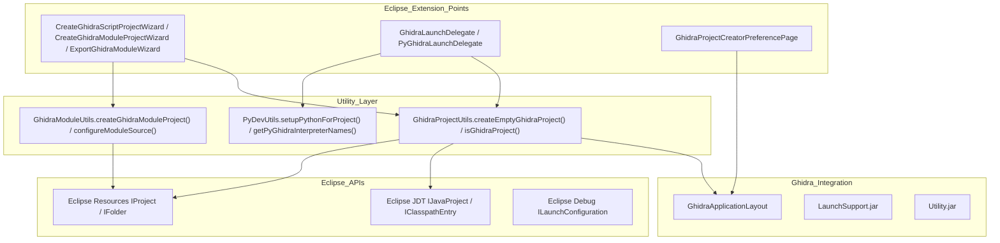
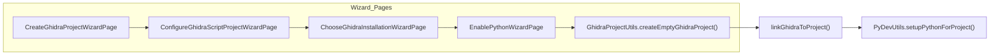
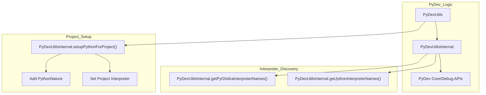

<!-- source: DeepWiki mcp.deepwiki.com · repo NationalSecurityAgency/ghidra · page 7.2 GhidraDev Eclipse Plugin · fetched 2026-11-09 -->

# GhidraDev Eclipse Plugin

Relevant source files

The following files were used as context for generating this wiki page:

- [Ghidra/Framework/Help/src/main/java/help/validator/ReferenceTagProcessor.java](Ghidra/Framework/Help/src/main/java/help/validator/ReferenceTagProcessor.java)
- [GhidraBuild/EclipsePlugins/GhidraDev/GhidraDevFeature/build.gradle](GhidraBuild/EclipsePlugins/GhidraDev/GhidraDevFeature/build.gradle)
- [GhidraBuild/EclipsePlugins/GhidraDev/GhidraDevFeature/category.xml](GhidraBuild/EclipsePlugins/GhidraDev/GhidraDevFeature/category.xml)
- [GhidraBuild/EclipsePlugins/GhidraDev/GhidraDevFeature/feature.xml](GhidraBuild/EclipsePlugins/GhidraDev/GhidraDevFeature/feature.xml)
- [GhidraBuild/EclipsePlugins/GhidraDev/GhidraDevPlugin/.launch/GhidraDev.launch](GhidraBuild/EclipsePlugins/GhidraDev/GhidraDevPlugin/.launch/GhidraDev.launch)
- [GhidraBuild/EclipsePlugins/GhidraDev/GhidraDevPlugin/META-INF/MANIFEST.MF](GhidraBuild/EclipsePlugins/GhidraDev/GhidraDevPlugin/META-INF/MANIFEST.MF)
- [GhidraBuild/EclipsePlugins/GhidraDev/GhidraDevPlugin/README.md](GhidraBuild/EclipsePlugins/GhidraDev/GhidraDevPlugin/README.md)
- [GhidraBuild/EclipsePlugins/GhidraDev/GhidraDevPlugin/icons/GhidraIcon16_bw.png](GhidraBuild/EclipsePlugins/GhidraDev/GhidraDevPlugin/icons/GhidraIcon16_bw.png)
- [GhidraBuild/EclipsePlugins/GhidraDev/GhidraDevPlugin/icons/python_bw.png](GhidraBuild/EclipsePlugins/GhidraDev/GhidraDevPlugin/icons/python_bw.png)
- [GhidraBuild/EclipsePlugins/GhidraDev/GhidraDevPlugin/plugin.xml](GhidraBuild/EclipsePlugins/GhidraDev/GhidraDevPlugin/plugin.xml)
- [GhidraBuild/EclipsePlugins/GhidraDev/GhidraDevPlugin/src/main/java/ghidradev/ghidraprojectcreator/launchers/GhidraLaunchDelegate.java](GhidraBuild/EclipsePlugins/GhidraDev/GhidraDevPlugin/src/main/java/ghidradev/ghidraprojectcreator/launchers/GhidraLaunchDelegate.java)
- [GhidraBuild/EclipsePlugins/GhidraDev/GhidraDevPlugin/src/main/java/ghidradev/ghidraprojectcreator/launchers/GhidraLaunchTabGroup.java](GhidraBuild/EclipsePlugins/GhidraDev/GhidraDevPlugin/src/main/java/ghidradev/ghidraprojectcreator/launchers/GhidraLaunchTabGroup.java)
- [GhidraBuild/EclipsePlugins/GhidraDev/GhidraDevPlugin/src/main/java/ghidradev/ghidraprojectcreator/launchers/PyGhidraGuiLaunchShortcut.java](GhidraBuild/EclipsePlugins/GhidraDev/GhidraDevPlugin/src/main/java/ghidradev/ghidraprojectcreator/launchers/PyGhidraGuiLaunchShortcut.java)
- [GhidraBuild/EclipsePlugins/GhidraDev/GhidraDevPlugin/src/main/java/ghidradev/ghidraprojectcreator/launchers/PyGhidraHeadlessLaunchShortcut.java](GhidraBuild/EclipsePlugins/GhidraDev/GhidraDevPlugin/src/main/java/ghidradev/ghidraprojectcreator/launchers/PyGhidraHeadlessLaunchShortcut.java)
- [GhidraBuild/EclipsePlugins/GhidraDev/GhidraDevPlugin/src/main/java/ghidradev/ghidraprojectcreator/launchers/PyGhidraLaunchDelegate.java](GhidraBuild/EclipsePlugins/GhidraDev/GhidraDevPlugin/src/main/java/ghidradev/ghidraprojectcreator/launchers/PyGhidraLaunchDelegate.java)
- [GhidraBuild/EclipsePlugins/GhidraDev/GhidraDevPlugin/src/main/java/ghidradev/ghidraprojectcreator/launchers/PyGhidraLaunchTabGroup.java](GhidraBuild/EclipsePlugins/GhidraDev/GhidraDevPlugin/src/main/java/ghidradev/ghidraprojectcreator/launchers/PyGhidraLaunchTabGroup.java)
- [GhidraBuild/EclipsePlugins/GhidraDev/GhidraDevPlugin/src/main/java/ghidradev/ghidraprojectcreator/preferences/GhidraProjectCreatorPreferencePage.java](GhidraBuild/EclipsePlugins/GhidraDev/GhidraDevPlugin/src/main/java/ghidradev/ghidraprojectcreator/preferences/GhidraProjectCreatorPreferencePage.java)
- [GhidraBuild/EclipsePlugins/GhidraDev/GhidraDevPlugin/src/main/java/ghidradev/ghidraprojectcreator/utils/GhidraLaunchUtils.java](GhidraBuild/EclipsePlugins/GhidraDev/GhidraDevPlugin/src/main/java/ghidradev/ghidraprojectcreator/utils/GhidraLaunchUtils.java)
- [GhidraBuild/EclipsePlugins/GhidraDev/GhidraDevPlugin/src/main/java/ghidradev/ghidraprojectcreator/utils/GhidraModuleUtils.java](GhidraBuild/EclipsePlugins/GhidraDev/GhidraDevPlugin/src/main/java/ghidradev/ghidraprojectcreator/utils/GhidraModuleUtils.java)
- [GhidraBuild/EclipsePlugins/GhidraDev/GhidraDevPlugin/src/main/java/ghidradev/ghidraprojectcreator/utils/GhidraProjectUtils.java](GhidraBuild/EclipsePlugins/GhidraDev/GhidraDevPlugin/src/main/java/ghidradev/ghidraprojectcreator/utils/GhidraProjectUtils.java)
- [GhidraBuild/EclipsePlugins/GhidraDev/GhidraDevPlugin/src/main/java/ghidradev/ghidraprojectcreator/utils/GhidraScriptUtils.java](GhidraBuild/EclipsePlugins/GhidraDev/GhidraDevPlugin/src/main/java/ghidradev/ghidraprojectcreator/utils/GhidraScriptUtils.java)
- [GhidraBuild/EclipsePlugins/GhidraDev/GhidraDevPlugin/src/main/java/ghidradev/ghidraprojectcreator/utils/PyDevUtils.java](GhidraBuild/EclipsePlugins/GhidraDev/GhidraDevPlugin/src/main/java/ghidradev/ghidraprojectcreator/utils/PyDevUtils.java)
- [GhidraBuild/EclipsePlugins/GhidraDev/GhidraDevPlugin/src/main/java/ghidradev/ghidraprojectcreator/utils/PyDevUtilsInternal.java](GhidraBuild/EclipsePlugins/GhidraDev/GhidraDevPlugin/src/main/java/ghidradev/ghidraprojectcreator/utils/PyDevUtilsInternal.java)
- [GhidraBuild/EclipsePlugins/GhidraDev/GhidraDevPlugin/src/main/java/ghidradev/ghidraprojectcreator/wizards/CreateGhidraModuleProjectWizard.java](GhidraBuild/EclipsePlugins/GhidraDev/GhidraDevPlugin/src/main/java/ghidradev/ghidraprojectcreator/wizards/CreateGhidraModuleProjectWizard.java)
- [GhidraBuild/EclipsePlugins/GhidraDev/GhidraDevPlugin/src/main/java/ghidradev/ghidraprojectcreator/wizards/CreateGhidraScriptProjectWizard.java](GhidraBuild/EclipsePlugins/GhidraDev/GhidraDevPlugin/src/main/java/ghidradev/ghidraprojectcreator/wizards/CreateGhidraScriptProjectWizard.java)
- [GhidraBuild/EclipsePlugins/GhidraDev/GhidraDevPlugin/src/main/java/ghidradev/ghidraprojectcreator/wizards/ExportGhidraModuleWizard.java](GhidraBuild/EclipsePlugins/GhidraDev/GhidraDevPlugin/src/main/java/ghidradev/ghidraprojectcreator/wizards/ExportGhidraModuleWizard.java)
- [GhidraBuild/EclipsePlugins/GhidraDev/GhidraDevPlugin/src/main/java/ghidradev/ghidraprojectcreator/wizards/pages/ConfigureGhidraModuleProjectWizardPage.java](GhidraBuild/EclipsePlugins/GhidraDev/GhidraDevPlugin/src/main/java/ghidradev/ghidraprojectcreator/wizards/pages/ConfigureGhidraModuleProjectWizardPage.java)
- [GhidraBuild/EclipsePlugins/GhidraDev/GhidraDevPlugin/src/main/java/ghidradev/ghidraprojectcreator/wizards/pages/ConfigureGradleWizardPage.java](GhidraBuild/EclipsePlugins/GhidraDev/GhidraDevPlugin/src/main/java/ghidradev/ghidraprojectcreator/wizards/pages/ConfigureGradleWizardPage.java)
- [GhidraBuild/EclipsePlugins/GhidraDev/GhidraDevPlugin/src/main/java/ghidradev/ghidraprojectcreator/wizards/pages/EnablePythonWizardPage.java](GhidraBuild/EclipsePlugins/GhidraDev/GhidraDevPlugin/src/main/java/ghidradev/ghidraprojectcreator/wizards/pages/EnablePythonWizardPage.java)
- [GhidraBuild/EclipsePlugins/GhidraDev/certification.manifest](GhidraBuild/EclipsePlugins/GhidraDev/certification.manifest)
- [GhidraBuild/Skeleton/build.gradle](GhidraBuild/Skeleton/build.gradle)
- [GhidraBuild/Skeleton/data/README.txt](GhidraBuild/Skeleton/data/README.txt)
- [GhidraBuild/Skeleton/gitignore](GhidraBuild/Skeleton/gitignore)
- [GhidraBuild/Skeleton/src/main/help/help/topics/skeleton/help.html](GhidraBuild/Skeleton/src/main/help/help/topics/skeleton/help.html)

## Purpose and Scope

GhidraDev is an Eclipse plugin that provides integrated development and debugging support for Ghidra scripts and modules within the Eclipse IDE. The plugin facilitates creating, linking, launching, and exporting Ghidra projects, enabling developers to work with Ghidra's codebase using Eclipse's standard Java development tools. This page covers the plugin's architecture, project creation wizards, launch configurations, integration points with Ghidra installations, PyDev integration, Eclipse formatting configurations, and Sleigh language support.

For information about Ghidra's build system infrastructure, see [7.1 Gradle Build System](). For details on launch configuration and JVM setup, see [7.3 Launch Configuration and Application Properties]().

Sources: [GhidraBuild/EclipsePlugins/GhidraDev/GhidraDevPlugin/README.md:1-2()](GhidraBuild/EclipsePlugins/GhidraDev/GhidraDevPlugin/README.md:1-2)

## Plugin Structure and Dependencies

GhidraDev is packaged as an Eclipse plugin bundle with the following structure:

| Component | Purpose |
|-----------|---------|
| `GhidraDevPlugin` | Core plugin implementation containing wizards, utilities, and launchers. |
| `GhidraDevFeature` | Eclipse feature wrapper for plugin distribution. |
| `META-INF/MANIFEST.MF` | OSGi bundle manifest declaring dependencies and metadata. |
| `plugin.xml` | Eclipse extension point contributions (wizards, launchers, commands). |

The plugin requires Eclipse 2023-12 (4.30) or later, JDK 21, and declares dependencies on Eclipse JDT, debug UI, and build infrastructure `[GhidraBuild/EclipsePlugins/GhidraDev/GhidraDevPlugin/META-INF/MANIFEST.MF:1-36]()`. PyDev 9.3.0+ integration is optional but required for Python/PyGhidra support `[GhidraBuild/EclipsePlugins/GhidraDev/GhidraDevPlugin/README.md:141-149]()`.

Sources: [GhidraBuild/EclipsePlugins/GhidraDev/GhidraDevPlugin/META-INF/MANIFEST.MF:1-36](), [GhidraBuild/EclipsePlugins/GhidraDev/GhidraDevPlugin/README.md:141-149](), [GhidraBuild/EclipsePlugins/GhidraDev/GhidraDevFeature/feature.xml:1-50]()

## System Architecture

The GhidraDev architecture bridges the Eclipse platform with Ghidra's installation layout and internal application properties.

Title: GhidraDev System Components

Sources: [GhidraBuild/EclipsePlugins/GhidraDev/GhidraDevPlugin/src/main/java/ghidradev/ghidraprojectcreator/utils/GhidraProjectUtils.java:49-132](), [GhidraBuild/EclipsePlugins/GhidraDev/GhidraDevPlugin/src/main/java/ghidradev/ghidraprojectcreator/utils/GhidraModuleUtils.java:39-64]()

## Project Types and Creation Wizards

GhidraDev supports two primary project types, each with dedicated creation wizards:

### Ghidra Script Projects

Script projects provide a lightweight development environment for single-file Ghidra scripts. The `CreateGhidraScriptProjectWizard` creates projects that link to script directories, typically defaulting to `~/ghidra_scripts`.

Title: Script Project Creation Data Flow

Sources: [GhidraBuild/EclipsePlugins/GhidraDev/GhidraDevPlugin/README.md:98-101](), [GhidraBuild/EclipsePlugins/GhidraDev/GhidraDevPlugin/src/main/java/ghidradev/ghidraprojectcreator/utils/GhidraProjectUtils.java:91-106]()

### Ghidra Module Projects

Module projects support complex extensions. The `createGhidraModuleProject` method in `GhidraModuleUtils` defines the standard source and output directory mapping for Eclipse compatibility `[GhidraBuild/EclipsePlugins/GhidraDev/GhidraDevPlugin/src/main/java/ghidradev/ghidraprojectcreator/utils/GhidraModuleUtils.java:91-117]`.

| Source Directory | Output Directory | Purpose |
|------------------|------------------|---------|
| `src/main/java` | `bin/main` | Java source code |
| `src/main/help` | `bin/main` | Help documentation |
| `src/main/resources` | `bin/main` | Resource files |
| `src/test/java` | `bin/test` | Test source code |
| `ghidra_scripts` | `bin/scripts` | Project-specific scripts |

The `ModuleTemplateType` enum defines the available templates: `ANALYZER`, `PLUGIN`, `LOADER`, `FILESYSTEM`, `EXPORTER`, and `PROCESSOR` `[GhidraBuild/EclipsePlugins/GhidraDev/GhidraDevPlugin/src/main/java/ghidradev/ghidraprojectcreator/utils/GhidraModuleUtils.java:41-64]`.

Sources: [GhidraBuild/EclipsePlugins/GhidraDev/GhidraDevPlugin/src/main/java/ghidradev/ghidraprojectcreator/utils/GhidraModuleUtils.java:41-74,91-117]()

## Project Linking and Configuration

The `GhidraProjectUtils` class provides the logic for determining if an Eclipse project is a Ghidra-related project and managing its dependencies `[GhidraBuild/EclipsePlugins/GhidraDev/GhidraDevPlugin/src/main/java/ghidradev/ghidraprojectcreator/utils/GhidraProjectUtils.java:49-132]`:

- `isGhidraProject(IProject)`: Returns true if the project is a Java project and contains a folder named `Ghidra` `[GhidraBuild/EclipsePlugins/GhidraDev/GhidraDevPlugin/src/main/java/ghidradev/ghidraprojectcreator/utils/GhidraProjectUtils.java:104-106]`.
- `isGhidraModuleProject(IProject)`: Returns true if it is a Ghidra project and contains a `Module.manifest` file `[GhidraBuild/EclipsePlugins/GhidraDev/GhidraDevPlugin/src/main/java/ghidradev/ghidraprojectcreator/utils/GhidraProjectUtils.java:114-117]`.

Key validation occurs in `GhidraProjectCreatorPreferencePage.validateGhidraInstallation()`:
- Verifies `GhidraApplicationLayout` can be initialized from the directory `[GhidraBuild/EclipsePlugins/GhidraDev/GhidraDevPlugin/src/main/java/ghidradev/ghidraprojectcreator/preferences/GhidraProjectCreatorPreferencePage.java:210]`.
- Rejects Ghidra source repositories by checking for `certification.local.manifest` `[GhidraBuild/EclipsePlugins/GhidraDev/GhidraDevPlugin/src/main/java/ghidradev/ghidraprojectcreator/preferences/GhidraProjectCreatorPreferencePage.java:215]`.
- Enforces a minimum Ghidra version (currently 11.2) `[GhidraBuild/EclipsePlugins/GhidraDev/GhidraDevPlugin/src/main/java/ghidradev/ghidraprojectcreator/preferences/GhidraProjectCreatorPreferencePage.java:46]`.

Sources: [GhidraBuild/EclipsePlugins/GhidraDev/GhidraDevPlugin/src/main/java/ghidradev/ghidraprojectcreator/utils/GhidraProjectUtils.java:49-132](), [GhidraBuild/EclipsePlugins/GhidraDev/GhidraDevPlugin/src/main/java/ghidradev/ghidraprojectcreator/preferences/GhidraProjectCreatorPreferencePage.java:46-216]()

## Launch Configuration System

Ghidra projects are launched using specialized Eclipse launch configurations (e.g., `GhidraGuiLaunchConfigurationType`) that configure the JVM environment specifically for Ghidra's classloader `[GhidraBuild/EclipsePlugins/GhidraDev/GhidraDevPlugin/src/main/java/ghidradev/ghidraprojectcreator/utils/GhidraLaunchUtils.java:45-63]`.

### JVM Configuration
The plugin ensures that Ghidra is launched with `Utility.jar` on the initial classpath `[GhidraBuild/EclipsePlugins/GhidraDev/GhidraDevPlugin/README.md:56-59]`. Standard JVM arguments used for internal development include `-Djava.system.class.loader=ghidra.GhidraClassLoader` and specific garbage collection settings `[GhidraBuild/EclipsePlugins/GhidraDev/GhidraDevPlugin/.launch/GhidraDev.launch:33]`.

Title: Ghidra Launch Attributes
| Attribute | Code Symbol | Purpose |
|----------|-------|---------|
| Program Arguments | `ATTR_PROGAM_ARGUMENTS` | Appended to required Ghidra launch args `[GhidraBuild/EclipsePlugins/GhidraDev/GhidraDevPlugin/src/main/java/ghidradev/ghidraprojectcreator/utils/GhidraLaunchUtils.java:70]` |
| VM Arguments | `ATTR_VM_ARGUMENTS` | Appended to required JVM args, including `-Xmx` `[GhidraBuild/EclipsePlugins/GhidraDev/GhidraDevPlugin/src/main/java/ghidradev/ghidraprojectcreator/utils/GhidraLaunchUtils.java:77]` |
| Main Type | `ghidra.Ghidra` | The standard Ghidra entry point `[GhidraBuild/EclipsePlugins/GhidraDev/GhidraDevPlugin/src/main/java/ghidradev/ghidraprojectcreator/utils/GhidraLaunchUtils.java:157-158]` |

Sources: [GhidraBuild/EclipsePlugins/GhidraDev/GhidraDevPlugin/src/main/java/ghidradev/ghidraprojectcreator/utils/GhidraLaunchUtils.java:41-105,155-183](), [GhidraBuild/EclipsePlugins/GhidraDev/GhidraDevPlugin/README.md:56-59](), [GhidraBuild/EclipsePlugins/GhidraDev/GhidraDevPlugin/.launch/GhidraDev.launch:31-33]()

## PyDev and PyGhidra Integration

GhidraDev integrates with PyDev to provide development support for PyGhidra and Jython scripts. Recent updates added support for PyGhidra Headless and GUI run configurations `[GhidraBuild/EclipsePlugins/GhidraDev/GhidraDevPlugin/README.md:34-43]`.

### Interpreter Management

The `PyDevUtils` class manages the interaction with PyDev's interpreter manager. It supports two main types: `PYGHIDRA` and `JYTHON` `[GhidraBuild/EclipsePlugins/GhidraDev/GhidraDevPlugin/src/main/java/ghidradev/ghidraprojectcreator/utils/PyDevUtils.java:48-52]`.

Title: Python Support Integration

The plugin enforces version compatibility, requiring PyDev 9.3.0 or later `[GhidraBuild/EclipsePlugins/GhidraDev/GhidraDevPlugin/src/main/java/ghidradev/ghidraprojectcreator/utils/PyDevUtils.java:42-43]`. It can automatically add the Jython interpreter found in the Ghidra installation directory to PyDev `[GhidraBuild/EclipsePlugins/GhidraDev/GhidraDevPlugin/README.md:124-126]`.

Sources: [GhidraBuild/EclipsePlugins/GhidraDev/GhidraDevPlugin/src/main/java/ghidradev/ghidraprojectcreator/utils/PyDevUtils.java:40-60,112-136](), [GhidraBuild/EclipsePlugins/GhidraDev/GhidraDevPlugin/README.md:124-126]()

## Sleigh Language Support and Eclipse Formatter

While primarily focused on Java/Python development, the Ghidra ecosystem includes support for Sleigh language editing and formatting configuration. Module projects that include a `PROCESSOR` template will automatically include Sleigh-related files like `buildLanguage.xml` and `sleighArgs.txt` `[GhidraBuild/EclipsePlugins/GhidraDev/GhidraDevPlugin/src/main/java/ghidradev/ghidraprojectcreator/utils/GhidraModuleUtils.java:147-151]`.

The repository also includes Eclipse formatter configurations in the `eclipse/` directory (such as `GhidraEclipseFormatter.xml`) to ensure consistent code formatting rules across modules and plugins.

Sources: [GhidraBuild/EclipsePlugins/GhidraDev/GhidraDevPlugin/src/main/java/ghidradev/ghidraprojectcreator/utils/GhidraModuleUtils.java:145-156](), [GhidraBuild/EclipsePlugins/GhidraDev/GhidraDevPlugin/README.md:15-22]()

---

