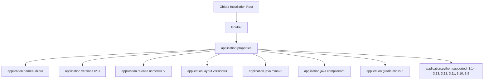
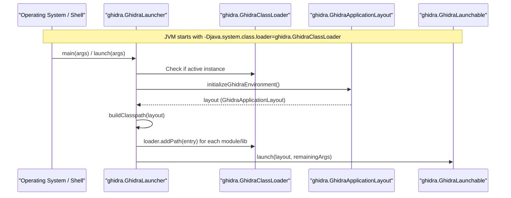
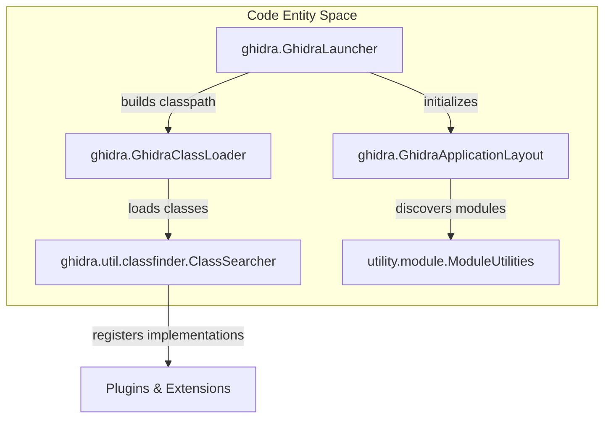

<!-- source: DeepWiki mcp.deepwiki.com · repo NationalSecurityAgency/ghidra · page 7.3 Launch Configuration and Application Properties · fetched 2026-11-09 -->

# Launch Configuration and Application Properties

Relevant source files

The following files were used as context for generating this wiki page:

- [.github/ISSUE_TEMPLATE/bug_report.md](.github/ISSUE_TEMPLATE/bug_report.md)
- [.github/ISSUE_TEMPLATE/feature_request.md](.github/ISSUE_TEMPLATE/feature_request.md)
- [.github/ISSUE_TEMPLATE/question.md](.github/ISSUE_TEMPLATE/question.md)
- [CONTRIBUTING.md](CONTRIBUTING.md)
- [DISCLAIMER.md](DISCLAIMER.md)
- [DevGuide.md](DevGuide.md)
- [GPL/DMG/build.gradle](GPL/DMG/build.gradle)
- [GPL/nativeBuildProperties.gradle](GPL/nativeBuildProperties.gradle)
- [GPL/vsconfig.gradle](GPL/vsconfig.gradle)
- [Ghidra/Debug/AnnotationValidator/build.gradle](Ghidra/Debug/AnnotationValidator/build.gradle)
- [Ghidra/Debug/Debugger-agent-dbgeng/Module.manifest](Ghidra/Debug/Debugger-agent-dbgeng/Module.manifest)
- [Ghidra/Debug/Debugger-agent-dbgeng/build.gradle](Ghidra/Debug/Debugger-agent-dbgeng/build.gradle)
- [Ghidra/Debug/Debugger-agent-dbgeng/src/main/py/README.md](Ghidra/Debug/Debugger-agent-dbgeng/src/main/py/README.md)
- [Ghidra/Debug/Debugger-agent-gdb/build.gradle](Ghidra/Debug/Debugger-agent-gdb/build.gradle)
- [Ghidra/Debug/Debugger-agent-lldb/build.gradle](Ghidra/Debug/Debugger-agent-lldb/build.gradle)
- [Ghidra/Debug/Debugger-jpda/build.gradle](Ghidra/Debug/Debugger-jpda/build.gradle)
- [Ghidra/Debug/Debugger-jpda/certification.manifest](Ghidra/Debug/Debugger-jpda/certification.manifest)
- [Ghidra/Debug/Debugger-rmi-trace/build.gradle](Ghidra/Debug/Debugger-rmi-trace/build.gradle)
- [Ghidra/Debug/Debugger-rmi-trace/src/main/java/ghidra/app/plugin/core/debug/gui/tracermi/launcher/ScriptPathsPropertyEditor.java](Ghidra/Debug/Debugger-rmi-trace/src/main/java/ghidra/app/plugin/core/debug/gui/tracermi/launcher/ScriptPathsPropertyEditor.java)
- [Ghidra/Debug/Framework-TraceModeling/build.gradle](Ghidra/Debug/Framework-TraceModeling/build.gradle)
- [Ghidra/Debug/ProposedUtils/certification.manifest](Ghidra/Debug/ProposedUtils/certification.manifest)
- [Ghidra/Debug/TaintAnalysis/build.gradle](Ghidra/Debug/TaintAnalysis/build.gradle)
- [Ghidra/Extensions/bundle_examples/build.gradle](Ghidra/Extensions/bundle_examples/build.gradle)
- [Ghidra/Features/Base/data/PEFunctionsThatDoNotReturn](Ghidra/Features/Base/data/PEFunctionsThatDoNotReturn)
- [Ghidra/Features/Base/ghidra_scripts/BuildGhidraJarScript.java](Ghidra/Features/Base/ghidra_scripts/BuildGhidraJarScript.java)
- [Ghidra/Features/Base/src/main/help/help/topics/HeadlessAnalyzer/HeadlessAnalyzer.htm](Ghidra/Features/Base/src/main/help/help/topics/HeadlessAnalyzer/HeadlessAnalyzer.htm)
- [Ghidra/Features/Base/src/main/java/ghidra/GhidraRun.java](Ghidra/Features/Base/src/main/java/ghidra/GhidraRun.java)
- [Ghidra/Features/Base/src/main/java/ghidra/app/plugin/runtimeinfo/RuntimeInfoProvider.java](Ghidra/Features/Base/src/main/java/ghidra/app/plugin/runtimeinfo/RuntimeInfoProvider.java)
- [Ghidra/Features/Base/src/main/java/ghidra/app/util/headless/AnalyzeHeadless.java](Ghidra/Features/Base/src/main/java/ghidra/app/util/headless/AnalyzeHeadless.java)
- [Ghidra/Features/Base/src/main/java/ghidra/app/util/opinion/LibraryPathsDialog.java](Ghidra/Features/Base/src/main/java/ghidra/app/util/opinion/LibraryPathsDialog.java)
- [Ghidra/Features/Base/src/main/java/ghidra/app/util/viewer/field/CommentFieldMouseHandler.java](Ghidra/Features/Base/src/main/java/ghidra/app/util/viewer/field/CommentFieldMouseHandler.java)
- [Ghidra/Features/Base/src/main/java/ghidra/util/GhidraJarBuilder.java](Ghidra/Features/Base/src/main/java/ghidra/util/GhidraJarBuilder.java)
- [Ghidra/Features/DebugUtils/src/main/java/db/DbViewer.java](Ghidra/Features/DebugUtils/src/main/java/db/DbViewer.java)
- [Ghidra/Features/FileFormats/build.gradle](Ghidra/Features/FileFormats/build.gradle)
- [Ghidra/Features/GhidraServer/Module.manifest](Ghidra/Features/GhidraServer/Module.manifest)
- [Ghidra/Features/GhidraServer/build.gradle](Ghidra/Features/GhidraServer/build.gradle)
- [Ghidra/Features/GhidraServer/src/main/java/ghidra/server/remote/GhidraServerApplicationLayout.java](Ghidra/Features/GhidraServer/src/main/java/ghidra/server/remote/GhidraServerApplicationLayout.java)
- [Ghidra/Features/PDB/build.gradle](Ghidra/Features/PDB/build.gradle)
- [Ghidra/Features/PDB/buildNatives.gradle](Ghidra/Features/PDB/buildNatives.gradle)
- [Ghidra/Features/PDB/src/pdb/pdb.sln](Ghidra/Features/PDB/src/pdb/pdb.sln)
- [Ghidra/Features/PDB/src/pdb/pdb.vcxproj](Ghidra/Features/PDB/src/pdb/pdb.vcxproj)
- [Ghidra/Features/PyGhidra/build.gradle](Ghidra/Features/PyGhidra/build.gradle)
- [Ghidra/Framework/Docking/src/main/java/docking/widgets/pathmanager/AbstractPathsDialog.java](Ghidra/Framework/Docking/src/main/java/docking/widgets/pathmanager/AbstractPathsDialog.java)
- [Ghidra/Framework/Generic/src/main/java/generic/application/GenericApplicationLayout.java](Ghidra/Framework/Generic/src/main/java/generic/application/GenericApplicationLayout.java)
- [Ghidra/Framework/Generic/src/main/java/generic/jar/ApplicationModule.java](Ghidra/Framework/Generic/src/main/java/generic/jar/ApplicationModule.java)
- [Ghidra/Framework/Generic/src/main/java/ghidra/util/StringUtilities.java](Ghidra/Framework/Generic/src/main/java/ghidra/util/StringUtilities.java)
- [Ghidra/Framework/Generic/src/main/java/ghidra/util/classfinder/ClassDir.java](Ghidra/Framework/Generic/src/main/java/ghidra/util/classfinder/ClassDir.java)
- [Ghidra/Framework/Generic/src/main/java/ghidra/util/classfinder/ClassJar.java](Ghidra/Framework/Generic/src/main/java/ghidra/util/classfinder/ClassJar.java)
- [Ghidra/Framework/Generic/src/main/java/ghidra/util/classfinder/ClassLocation.java](Ghidra/Framework/Generic/src/main/java/ghidra/util/classfinder/ClassLocation.java)
- [Ghidra/Framework/Generic/src/main/java/ghidra/util/classfinder/ClassPackage.java](Ghidra/Framework/Generic/src/main/java/ghidra/util/classfinder/ClassPackage.java)
- [Ghidra/Framework/Generic/src/main/java/ghidra/util/classfinder/ClassSearcher.java](Ghidra/Framework/Generic/src/main/java/ghidra/util/classfinder/ClassSearcher.java)
- [Ghidra/Framework/Generic/src/main/java/ghidra/util/extensions/ExtensionDetails.java](Ghidra/Framework/Generic/src/main/java/ghidra/util/extensions/ExtensionDetails.java)
- [Ghidra/Framework/Generic/src/test/java/ghidra/util/StringUtilitiesTest.java](Ghidra/Framework/Generic/src/test/java/ghidra/util/StringUtilitiesTest.java)
- [Ghidra/Framework/Utility/src/main/java/generic/jar/GClassLoader.java](Ghidra/Framework/Utility/src/main/java/generic/jar/GClassLoader.java)
- [Ghidra/Framework/Utility/src/main/java/ghidra/GhidraApplicationLayout.java](Ghidra/Framework/Utility/src/main/java/ghidra/GhidraApplicationLayout.java)
- [Ghidra/Framework/Utility/src/main/java/ghidra/GhidraClassLoader.java](Ghidra/Framework/Utility/src/main/java/ghidra/GhidraClassLoader.java)
- [Ghidra/Framework/Utility/src/main/java/ghidra/GhidraJarApplicationLayout.java](Ghidra/Framework/Utility/src/main/java/ghidra/GhidraJarApplicationLayout.java)
- [Ghidra/Framework/Utility/src/main/java/ghidra/GhidraLauncher.java](Ghidra/Framework/Utility/src/main/java/ghidra/GhidraLauncher.java)
- [Ghidra/Framework/Utility/src/main/java/ghidra/GhidraTestApplicationLayout.java](Ghidra/Framework/Utility/src/main/java/ghidra/GhidraTestApplicationLayout.java)
- [Ghidra/Framework/Utility/src/main/java/ghidra/framework/ApplicationProperties.java](Ghidra/Framework/Utility/src/main/java/ghidra/framework/ApplicationProperties.java)
- [Ghidra/Framework/Utility/src/main/java/utility/application/ApplicationLayout.java](Ghidra/Framework/Utility/src/main/java/utility/application/ApplicationLayout.java)
- [Ghidra/Framework/Utility/src/main/java/utility/module/ClasspathFilter.java](Ghidra/Framework/Utility/src/main/java/utility/module/ClasspathFilter.java)
- [Ghidra/Test/DebuggerIntegrationTest/build.gradle](Ghidra/Test/DebuggerIntegrationTest/build.gradle)
- [Ghidra/application.properties](Ghidra/application.properties)
- [GhidraBuild/BuildFiles/Doclets/support/GhidraStubs_README.md](GhidraBuild/BuildFiles/Doclets/support/GhidraStubs_README.md)
- [GhidraBuild/BuildFiles/certification.manifest](GhidraBuild/BuildFiles/certification.manifest)
- [GhidraBuild/BuildFiles/sleighDevBuild.template](GhidraBuild/BuildFiles/sleighDevBuild.template)
- [GhidraBuild/BuildFiles/sleighDistBuild.template](GhidraBuild/BuildFiles/sleighDistBuild.template)
- [GhidraBuild/patch/README.txt](GhidraBuild/patch/README.txt)
- [GhidraBuild/patch/certification.local.manifest](GhidraBuild/patch/certification.local.manifest)
- [GhidraDocs/GhidraClass/Intermediate/HeadlessAnalyzer.html](GhidraDocs/GhidraClass/Intermediate/HeadlessAnalyzer.html)
- [NOTICE](NOTICE)
- [README.md](README.md)
- [SECURITY.md](SECURITY.md)
- [build.gradle](build.gradle)
- [certification.local.manifest](certification.local.manifest)
- [gradle.properties](gradle.properties)
- [gradle/distributableGPLExtension.gradle](gradle/distributableGPLExtension.gradle)
- [gradle/distributableGPLModule.gradle](gradle/distributableGPLModule.gradle)
- [gradle/distributableGhidraExtension.gradle](gradle/distributableGhidraExtension.gradle)
- [gradle/distributableGhidraModule.gradle](gradle/distributableGhidraModule.gradle)
- [gradle/hasProtobuf.gradle](gradle/hasProtobuf.gradle)
- [gradle/hasPythonPackage.gradle](gradle/hasPythonPackage.gradle)
- [gradle/processorProject.gradle](gradle/processorProject.gradle)
- [gradle/root/distribution.gradle](gradle/root/distribution.gradle)
- [gradle/root/svg.gradle](gradle/root/svg.gradle)
- [gradle/root/venv.gradle](gradle/root/venv.gradle)
- [gradle/support/distributionCommon.gradle](gradle/support/distributionCommon.gradle)
- [gradle/support/extensionCommon.gradle](gradle/support/extensionCommon.gradle)
- [gradle/support/fetchDependencies.gradle](gradle/support/fetchDependencies.gradle)
- [gradle/support/ip.gradle](gradle/support/ip.gradle)
- [gradle/support/loadApplicationProperties.gradle](gradle/support/loadApplicationProperties.gradle)
- [gradlew](gradlew)
- [gradlew.bat](gradlew.bat)

## Purpose and Scope

This document describes the configuration files and properties that control how Ghidra is launched, initialized, and integrated with the underlying Java Virtual Machine (JVM). It covers the `application.properties` file defining version metadata and system requirements [Ghidra/application.properties:1-10](), the launch sequence orchestrated by `GhidraLauncher` [Ghidra/Framework/Utility/src/main/java/ghidra/GhidraLauncher.java:35-79](), module discovery and class loading subsystems, and JVM configuration required for running the framework in interactive, headless, and development environments.

---

## Application Properties File Structure

The `application.properties` file is the canonical source of metadata about the Ghidra application. It is located at `Ghidra/application.properties` and contains key-value pairs that define version information, platform requirements, and supported capabilities.

**File Location: [Ghidra/application.properties:1-10]()**

Sources: [Ghidra/application.properties:1-10]()

### Core Application Properties

These properties are used by the build system and the runtime framework to ensure environment compatibility and validate toolchains.

| Property Key | Purpose | Current Value |
|--------------|---------|---------------|
| `application.name` | Application name | `Ghidra` |
| `application.version` | Semantic version | `12.3` |
| `application.release.name` | Release name (e.g., DEV, PUBLIC) | `DEV` |
| `application.layout.version` | Layout version for tool compatibility | `3` |
| `application.java.min` | Minimum Java major version | `25` |
| `application.java.compiler` | Java compiler version for builds | `25` |
| `application.gradle.min` | Minimum Gradle version for extensions | `9.1` |
| `application.python.supported` | Supported Python versions for PyGhidra | `3.14, 3.13, 3.12, 3.11, 3.10, 3.9` |

Sources: [Ghidra/application.properties:1-10](), [README.md:50-52]()

---

## Launch Configuration and JVM Initialization

Ghidra uses a custom launching mechanism to manage a complex modular classpath and JVM environment.

### GhidraLauncher and Class Loading
The `GhidraLauncher` class (`ghidra.GhidraLauncher`) is responsible for initializing the environment. It enforces the use of the `GhidraClassLoader` via the `-Djava.system.class.loader` JVM argument. If this property is not set correctly to `ghidra.GhidraClassLoader`, the launcher throws a `ClassNotFoundException` [Ghidra/Framework/Utility/src/main/java/ghidra/GhidraLauncher.java:102-106]().

Sources: [Ghidra/Framework/Utility/src/main/java/ghidra/GhidraLauncher.java:48-79](), [Ghidra/Framework/Utility/src/main/java/ghidra/GhidraLauncher.java:98-119]()

### Java Home and Build Requirements
Ghidra's build system and runtime enforce strict Java version requirements. The framework requires JDK 25 64-bit for building [README.md:50]() and running. The `build.gradle` script verifies that the JVM is 64-bit by checking the `sun.arch.data.model` property [build.gradle:44-46](). Additionally, `build.gradle` configures `JAVA_HOME` from the system environment or falls back to the current Java runtime home [build.gradle:33-39]().

Sources: [README.md:50-52](), [build.gradle:33-46]()

---

## Runtime Application Layout and Module Discovery

The `GhidraApplicationLayout` class (extending `ApplicationLayout`) defines the directory structure for a running instance [Ghidra/Framework/Utility/src/main/java/ghidra/GhidraLauncher.java:110](). It identifies the application root and discovers all constituent modules, patches, and external libraries.

### Module Discovery via ClassSearcher
Ghidra utilizes `ClassSearcher` (`ghidra.util.classfinder.ClassSearcher`) for dynamic plugin and extension discovery across discovered modules on the classpath. During initialization, `ClassSearcher` scans loaded classes matching specific interfaces (such as `PlugIn`, `GhidraLaunchable`, or analysis services) without requiring hardcoded registry configurations.

Sources: [Ghidra/Framework/Utility/src/main/java/ghidra/GhidraLauncher.java:98-119](), [Ghidra/Framework/Generic/src/main/java/ghidra/util/classfinder/ClassSearcher.java:1-50]()

---

## Specialized Launch Modes

### Headless Execution
Automated analysis is performed via `AnalyzeHeadless`, which implements `GhidraLaunchable` [Ghidra/Features/Base/src/main/java/ghidra/app/util/headless/AnalyzeHeadless.java:37-116](). This mode is invoked via the `analyzeHeadless` script and processes command-line arguments to perform batch imports, script execution, and analysis without starting a graphical user interface.

### PyGhidra Support
PyGhidra enables Python 3 integration via a JPype bridge. Supported Python versions (3.9 to 3.14) are defined in `application.properties` [Ghidra/application.properties:10](). Development requires the `prepPyGhidra` task which creates a Python virtual environment at `build/venv/` [DevGuide.md:101-105]().

### Ghidra Standalone JAR
Ghidra can be packaged into a single executable JAR using `GhidraJarBuilder` (`ghidra.util.GhidraJarBuilder`). This utility aggregates classes and resources from included modules into a single archive, using `ghidra.JarRun` as the entry point [Ghidra/Features/Base/src/main/java/ghidra/util/GhidraJarBuilder.java:38-49]().

Sources: [Ghidra/Features/Base/src/main/java/ghidra/app/util/headless/AnalyzeHeadless.java:37-116](), [Ghidra/application.properties:10](), [DevGuide.md:101-105](), [Ghidra/Features/Base/src/main/java/ghidra/util/GhidraJarBuilder.java:38-49]()

---

## Development Environment Configuration

### Gradle Build Configuration
The build system uses `application.properties` to validate the environment and parse version expectations. The `fetchDependencies.gradle` script reads `application.version` to construct download URLs for non-Maven artifacts (such as Z3 solvers and debug symbol binaries) [gradle/support/fetchDependencies.gradle:58-62]().

### Eclipse and GhidraDev Integration
Ghidra development is heavily customized for Eclipse:
- `gradle prepdev eclipse`: Generates nested Eclipse project files [DevGuide.md:50-54]().
- `GhidraDev` Plugin: Provides wizards for script and module development and manages launch configurations for debugging Ghidra [README.md:90-100]().
- **Launch Configurations**: Default Eclipse launch files configure JVM arguments, system class loaders (`ghidra.GhidraClassLoader`), native library paths, and heap memory settings.

Sources: [DevGuide.md:31-54](), [README.md:90-125](), [gradle/support/fetchDependencies.gradle:58-62]()

---

