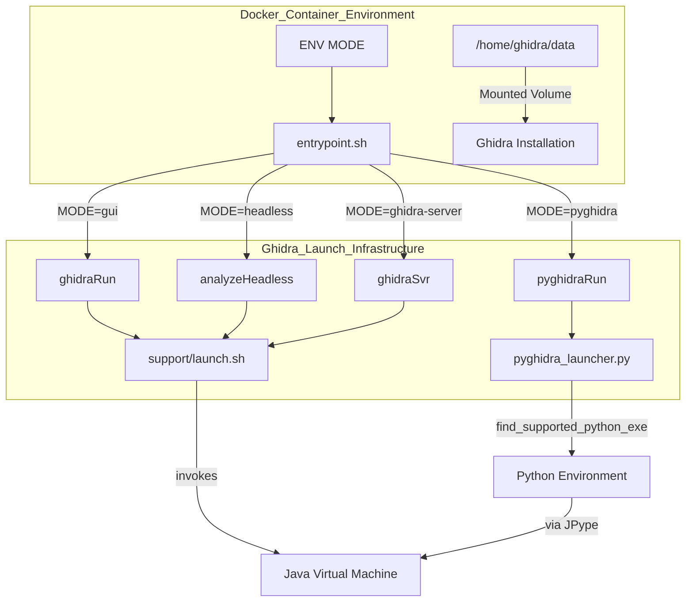
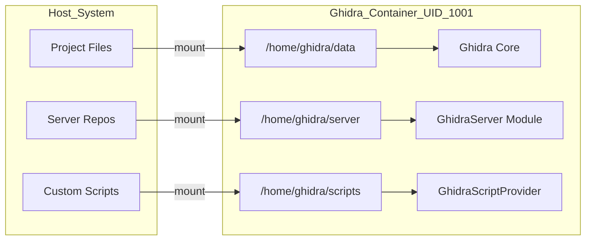

<!-- source: DeepWiki mcp.deepwiki.com · repo NationalSecurityAgency/ghidra · page 7.5 Docker Containerization · fetched 2026-11-09 -->

# Docker Containerization

Relevant source files

The following files were used as context for generating this wiki page:

- [.github/ISSUE_TEMPLATE/bug_report.md](.github/ISSUE_TEMPLATE/bug_report.md)
- [.github/ISSUE_TEMPLATE/feature_request.md](.github/ISSUE_TEMPLATE/feature_request.md)
- [.github/ISSUE_TEMPLATE/question.md](.github/ISSUE_TEMPLATE/question.md)
- [CONTRIBUTING.md](CONTRIBUTING.md)
- [DISCLAIMER.md](DISCLAIMER.md)
- [DevGuide.md](DevGuide.md)
- [GPL/DMG/build.gradle](GPL/DMG/build.gradle)
- [GPL/nativeBuildProperties.gradle](GPL/nativeBuildProperties.gradle)
- [GPL/vsconfig.gradle](GPL/vsconfig.gradle)
- [Ghidra/Debug/AnnotationValidator/build.gradle](Ghidra/Debug/AnnotationValidator/build.gradle)
- [Ghidra/Debug/Debugger-agent-dbgeng/Module.manifest](Ghidra/Debug/Debugger-agent-dbgeng/Module.manifest)
- [Ghidra/Debug/Debugger-agent-dbgeng/build.gradle](Ghidra/Debug/Debugger-agent-dbgeng/build.gradle)
- [Ghidra/Debug/Debugger-agent-dbgeng/src/main/py/README.md](Ghidra/Debug/Debugger-agent-dbgeng/src/main/py/README.md)
- [Ghidra/Debug/Debugger-agent-gdb/build.gradle](Ghidra/Debug/Debugger-agent-gdb/build.gradle)
- [Ghidra/Debug/Debugger-agent-lldb/build.gradle](Ghidra/Debug/Debugger-agent-lldb/build.gradle)
- [Ghidra/Debug/Debugger-jpda/build.gradle](Ghidra/Debug/Debugger-jpda/build.gradle)
- [Ghidra/Debug/Debugger-jpda/certification.manifest](Ghidra/Debug/Debugger-jpda/certification.manifest)
- [Ghidra/Debug/Debugger-rmi-trace/build.gradle](Ghidra/Debug/Debugger-rmi-trace/build.gradle)
- [Ghidra/Debug/Framework-TraceModeling/build.gradle](Ghidra/Debug/Framework-TraceModeling/build.gradle)
- [Ghidra/Debug/ProposedUtils/certification.manifest](Ghidra/Debug/ProposedUtils/certification.manifest)
- [Ghidra/Debug/TaintAnalysis/build.gradle](Ghidra/Debug/TaintAnalysis/build.gradle)
- [Ghidra/Extensions/bundle_examples/build.gradle](Ghidra/Extensions/bundle_examples/build.gradle)
- [Ghidra/Features/Base/data/PEFunctionsThatDoNotReturn](Ghidra/Features/Base/data/PEFunctionsThatDoNotReturn)
- [Ghidra/Features/FileFormats/build.gradle](Ghidra/Features/FileFormats/build.gradle)
- [Ghidra/Features/FileFormats/src/main/java/ghidra/file/formats/ios/dmg/DmgServerProcessManager.java](Ghidra/Features/FileFormats/src/main/java/ghidra/file/formats/ios/dmg/DmgServerProcessManager.java)
- [Ghidra/Features/GhidraServer/Module.manifest](Ghidra/Features/GhidraServer/Module.manifest)
- [Ghidra/Features/GhidraServer/build.gradle](Ghidra/Features/GhidraServer/build.gradle)
- [Ghidra/Features/GhidraServer/certification.manifest](Ghidra/Features/GhidraServer/certification.manifest)
- [Ghidra/Features/GhidraServer/data/serial.filter](Ghidra/Features/GhidraServer/data/serial.filter)
- [Ghidra/Features/GhidraServer/os/readme.txt](Ghidra/Features/GhidraServer/os/readme.txt)
- [Ghidra/Features/GhidraServer/src/main/java/ghidra/server/remote/GhidraServer.java](Ghidra/Features/GhidraServer/src/main/java/ghidra/server/remote/GhidraServer.java)
- [Ghidra/Features/GhidraServer/src/main/java/ghidra/server/remote/RemoteBufferFileImpl.java](Ghidra/Features/GhidraServer/src/main/java/ghidra/server/remote/RemoteBufferFileImpl.java)
- [Ghidra/Features/GhidraServer/src/main/java/ghidra/server/remote/RemoteExceptionUtil.java](Ghidra/Features/GhidraServer/src/main/java/ghidra/server/remote/RemoteExceptionUtil.java)
- [Ghidra/Features/GhidraServer/src/main/java/ghidra/server/remote/RemoteManagedBufferFileImpl.java](Ghidra/Features/GhidraServer/src/main/java/ghidra/server/remote/RemoteManagedBufferFileImpl.java)
- [Ghidra/Features/GhidraServer/src/main/java/ghidra/server/remote/ServerHelp.txt](Ghidra/Features/GhidraServer/src/main/java/ghidra/server/remote/ServerHelp.txt)
- [Ghidra/Features/GhidraServer/src/main/java/ghidra/server/security/AnonymousAuthenticationModule.java](Ghidra/Features/GhidraServer/src/main/java/ghidra/server/security/AnonymousAuthenticationModule.java)
- [Ghidra/Features/GhidraServer/src/main/java/ghidra/server/security/AuthenticationModule.java](Ghidra/Features/GhidraServer/src/main/java/ghidra/server/security/AuthenticationModule.java)
- [Ghidra/Features/GhidraServer/src/main/java/ghidra/server/security/JAASAuthenticationModule.java](Ghidra/Features/GhidraServer/src/main/java/ghidra/server/security/JAASAuthenticationModule.java)
- [Ghidra/Features/GhidraServer/src/main/java/ghidra/server/security/Krb5ActiveDirectoryAuthenticationModule.java](Ghidra/Features/GhidraServer/src/main/java/ghidra/server/security/Krb5ActiveDirectoryAuthenticationModule.java)
- [Ghidra/Features/GhidraServer/src/main/java/ghidra/server/security/PasswordFileAuthenticationModule.java](Ghidra/Features/GhidraServer/src/main/java/ghidra/server/security/PasswordFileAuthenticationModule.java)
- [Ghidra/Features/GhidraServer/src/main/java/ghidra/server/security/loginmodule/ExternalProgramLoginModule.java](Ghidra/Features/GhidraServer/src/main/java/ghidra/server/security/loginmodule/ExternalProgramLoginModule.java)
- [Ghidra/Features/GhidraServer/src/test.slow/java/ghidra/server/remote/GhidraServerAWTTest.java](Ghidra/Features/GhidraServer/src/test.slow/java/ghidra/server/remote/GhidraServerAWTTest.java)
- [Ghidra/Features/PDB/build.gradle](Ghidra/Features/PDB/build.gradle)
- [Ghidra/Features/PDB/buildNatives.gradle](Ghidra/Features/PDB/buildNatives.gradle)
- [Ghidra/Features/PDB/src/pdb/pdb.sln](Ghidra/Features/PDB/src/pdb/pdb.sln)
- [Ghidra/Features/PDB/src/pdb/pdb.vcxproj](Ghidra/Features/PDB/src/pdb/pdb.vcxproj)
- [Ghidra/Features/PyGhidra/build.gradle](Ghidra/Features/PyGhidra/build.gradle)
- [Ghidra/Framework/FileSystem/src/main/java/ghidra/framework/client/RepositoryServerAdapter.java](Ghidra/Framework/FileSystem/src/main/java/ghidra/framework/client/RepositoryServerAdapter.java)
- [Ghidra/Framework/FileSystem/src/main/java/ghidra/framework/client/ServerConnectTask.java](Ghidra/Framework/FileSystem/src/main/java/ghidra/framework/client/ServerConnectTask.java)
- [Ghidra/Framework/FileSystem/src/main/java/ghidra/framework/remote/GhidraServerHandle.java](Ghidra/Framework/FileSystem/src/main/java/ghidra/framework/remote/GhidraServerHandle.java)
- [Ghidra/Framework/Generic/src/main/java/ghidra/util/timer/Watchdog.java](Ghidra/Framework/Generic/src/main/java/ghidra/util/timer/Watchdog.java)
- [Ghidra/Framework/Generic/src/test/java/ghidra/util/timer/WatchdogTest.java](Ghidra/Framework/Generic/src/test/java/ghidra/util/timer/WatchdogTest.java)
- [Ghidra/Framework/Project/src/main/java/ghidra/framework/main/ProjectInfoDialog.java](Ghidra/Framework/Project/src/main/java/ghidra/framework/main/ProjectInfoDialog.java)
- [Ghidra/Framework/Utility/src/main/java/ghidra/framework/ApplicationProperties.java](Ghidra/Framework/Utility/src/main/java/ghidra/framework/ApplicationProperties.java)
- [Ghidra/Test/DebuggerIntegrationTest/build.gradle](Ghidra/Test/DebuggerIntegrationTest/build.gradle)
- [Ghidra/Test/IntegrationTest/src/test.slow/java/ghidra/framework/client/GhidraServerSerialFilterFailureTest.java](Ghidra/Test/IntegrationTest/src/test.slow/java/ghidra/framework/client/GhidraServerSerialFilterFailureTest.java)
- [Ghidra/application.properties](Ghidra/application.properties)
- [GhidraBuild/BuildFiles/Doclets/support/GhidraStubs_README.md](GhidraBuild/BuildFiles/Doclets/support/GhidraStubs_README.md)
- [GhidraBuild/BuildFiles/certification.manifest](GhidraBuild/BuildFiles/certification.manifest)
- [GhidraBuild/BuildFiles/sleighDevBuild.template](GhidraBuild/BuildFiles/sleighDevBuild.template)
- [GhidraBuild/BuildFiles/sleighDistBuild.template](GhidraBuild/BuildFiles/sleighDistBuild.template)
- [NOTICE](NOTICE)
- [README.md](README.md)
- [SECURITY.md](SECURITY.md)
- [build.gradle](build.gradle)
- [certification.local.manifest](certification.local.manifest)
- [gradle.properties](gradle.properties)
- [gradle/distributableGPLExtension.gradle](gradle/distributableGPLExtension.gradle)
- [gradle/distributableGPLModule.gradle](gradle/distributableGPLModule.gradle)
- [gradle/distributableGhidraExtension.gradle](gradle/distributableGhidraExtension.gradle)
- [gradle/distributableGhidraModule.gradle](gradle/distributableGhidraModule.gradle)
- [gradle/hasProtobuf.gradle](gradle/hasProtobuf.gradle)
- [gradle/hasPythonPackage.gradle](gradle/hasPythonPackage.gradle)
- [gradle/processorProject.gradle](gradle/processorProject.gradle)
- [gradle/root/distribution.gradle](gradle/root/distribution.gradle)
- [gradle/root/svg.gradle](gradle/root/svg.gradle)
- [gradle/root/venv.gradle](gradle/root/venv.gradle)
- [gradle/support/distributionCommon.gradle](gradle/support/distributionCommon.gradle)
- [gradle/support/extensionCommon.gradle](gradle/support/extensionCommon.gradle)
- [gradle/support/fetchDependencies.gradle](gradle/support/fetchDependencies.gradle)
- [gradle/support/ip.gradle](gradle/support/ip.gradle)
- [gradle/support/loadApplicationProperties.gradle](gradle/support/loadApplicationProperties.gradle)
- [gradlew](gradlew)
- [gradlew.bat](gradlew.bat)

Ghidra provides integrated support for running its various components within Docker containers. This containerization strategy allows for consistent deployment of Ghidra services, such as the Ghidra Server and BSim, while also providing isolated environments for headless analysis, GUI usage, and Python-integrated workflows via PyGhidra.

## Docker Architecture and Dispatch Logic

The Ghidra Docker implementation uses a multi-purpose entrypoint script, `entrypoint.sh`, which acts as a central dispatcher. The behavior of the container is determined by the `MODE` environment variable, which selects the appropriate startup script from the Ghidra installation.

### Supported MODE Values

The `MODE` variable controls which Ghidra subsystem is launched upon container startup. These modes correspond to the different ways Ghidra can be executed.

| MODE | Description | Entrypoint Target |
| :--- | :--- | :--- |
| `gui` | Launches the standard interactive Ghidra GUI. | `ghidraRun` [README.md:37-37]() |
| `headless` | Runs the Ghidra Headless Analyzer for batch processing. | `support/analyzeHeadless` [GhidraDocs/GettingStarted.md:19-19]() |
| `ghidra-server` | Starts the Ghidra Server for collaborative projects. | `server/ghidraSvr` [GhidraDocs/GettingStarted.md:18-18]() |
| `bsim` | Executes BSim command-line utilities for binary similarity. | `support/bsim` [GhidraDocs/GettingStarted.md:22-22]() |
| `bsim-server` | Starts a BSim-specific server instance (PostgreSQL-based). | `support/bsim_ctl` [gradle/support/fetchDependencies.gradle:100-104]() |
| `pyghidra` | Launches the PyGhidra Python 3 integration. | `support/pyghidraRun` [README.md:38-38]() |

### Implementation Flow

The following diagram illustrates how the `entrypoint.sh` script dispatches calls based on the environment configuration to the internal Ghidra launch infrastructure.

**Container Entrypoint Dispatch Flow**

Sources: [README.md:37-38](), [GhidraDocs/GettingStarted.md:16-22](), [build.gradle:65-69](), [Ghidra/Features/PyGhidra/support/pyghidra_launcher.py:84-111]()

## User Permissions and Security

To adhere to security best practices, Ghidra containers are designed to run as a non-root user named `ghidra`.

*   **User ID (UID):** 1001
*   **Group ID (GID):** 1001
*   **Home Directory:** `/home/ghidra`

### Permission Requirements
When mounting host directories into the container, the host filesystem must grant read/write permissions to UID 1001. This is critical for several subsystems:

1.  **Ghidra Server Repositories:** The server requires write access to manage repository files and the `yajsw` (Yet Another Java Service Wrapper) core files used for service management [gradle/support/fetchDependencies.gradle:94-98]().
2.  **Configuration Data:** Ghidra relies on directories outside its installation for temporary and cache files, often determined by `ApplicationProperties` [Ghidra/Framework/Utility/src/main/java/ghidra/framework/ApplicationProperties.java:1-20](). The `get_user_settings_dir` function in the PyGhidra launcher specifically checks for `application.settingsdir` or `XDG_CONFIG_HOME` [Ghidra/Features/PyGhidra/support/pyghidra_launcher.py:54-82]().
3.  **Python Virtual Environments:** For `pyghidra` mode, the container requires permissions to manage the virtual environment, typically located in `build/venv/` during development [DevGuide.md:101-107](). The `create_ghidra_venv` function handles the environment setup [Ghidra/Features/PyGhidra/support/pyghidra_launcher.py:152-154]().

Sources: [Ghidra/application.properties:1-10](), [DevGuide.md:101-107](), [gradle/support/fetchDependencies.gradle:94-98](), [Ghidra/Features/PyGhidra/support/pyghidra_launcher.py:54-82]()

## Volume Mounting Patterns

Ghidra containers typically utilize volume mount points to ensure data persistence across container restarts.

| Container Path | Purpose | Code Entity Association |
| :--- | :--- | :--- |
| `/home/ghidra/data` | Persistent storage for Ghidra projects and BSim databases. | `ApplicationProperties` [Ghidra/Framework/Utility/src/main/java/ghidra/framework/ApplicationProperties.java:1-20]() |
| `/home/ghidra/server` | Storage for Ghidra Server repository files. | `yajsw-stable-13.18` [gradle/support/fetchDependencies.gradle:94-98]() |
| `/home/ghidra/scripts` | External directory for custom Java or Python scripts. | `GhidraScript` [README.md:10-11]() |

**Volume Data Flow**

Sources: [GhidraDocs/GettingStarted.md:91-97](), [DevGuide.md:138-151](), [gradle/support/fetchDependencies.gradle:94-98]()

## Headless and CI Integration

For CI/CD pipelines or automated analysis, the Docker container supports running in a virtual framebuffer (`Xvfb`) to satisfy Java AWT requirements for headless environments [DevGuide.md:171-176]().

### CI Environment Configuration
1.  **Xvfb Setup:** The container must initialize a virtual display (e.g., `:99`) to allow AWT to function without a physical monitor [DevGuide.md:173-174]().
2.  **User Agreement:** To avoid blocking on the first-run dialog in non-interactive environments, the `USER_AGREEMENT` property must be set to `ACCEPT` via `JAVA_TOOL_OPTIONS` [DevGuide.md:178-183]().
3.  **JVM Headless Mode:** Internal Ghidra processes are forced into headless mode using `-Djava.awt.headless=true` to prevent focus stealing during forked tasks [build.gradle:65-69]().

Sources: [DevGuide.md:169-183](), [build.gradle:65-69]()

---

