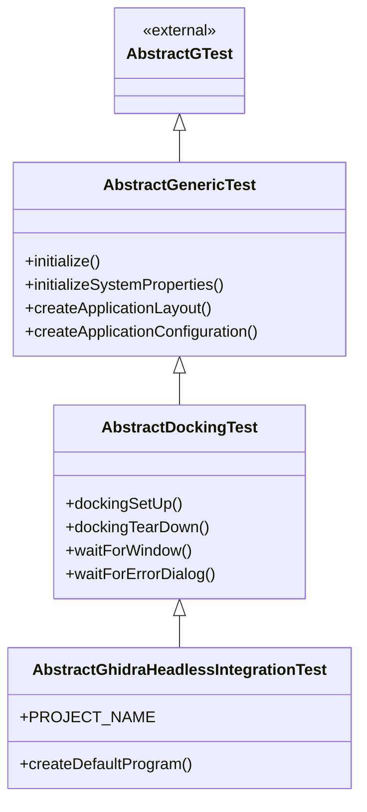
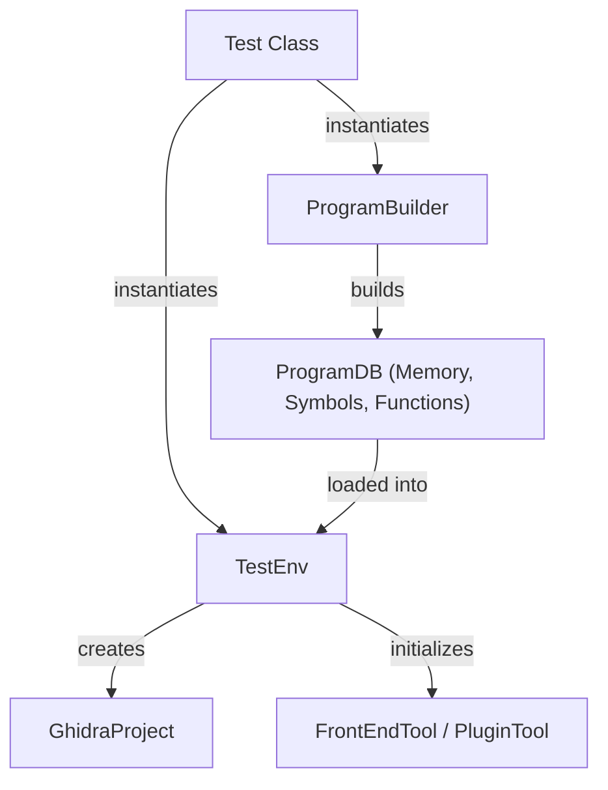

<!-- source: DeepWiki mcp.deepwiki.com · repo NationalSecurityAgency/ghidra · page 7.6 Testing Infrastructure · fetched 2026-11-09 -->

# Testing Infrastructure

<details>
<summary>Relevant source files</summary>

The following files were used as context for generating this wiki page:

- [Ghidra/Features/Base/src/main/help/help/topics/CodeBrowserPlugin/images/SelectionTable.png](Ghidra/Features/Base/src/main/help/help/topics/CodeBrowserPlugin/images/SelectionTable.png)
- [Ghidra/Features/Base/src/main/help/help/topics/CommentsPlugin/Comments.htm](Ghidra/Features/Base/src/main/help/help/topics/CommentsPlugin/Comments.htm)
- [Ghidra/Features/Base/src/main/help/help/topics/SymbolTablePlugin/symbol_table_transient.htm](Ghidra/Features/Base/src/main/help/help/topics/SymbolTablePlugin/symbol_table_transient.htm)
- [Ghidra/Features/Base/src/main/java/ghidra/app/plugin/core/commentwindow/CommentTableModel.java](Ghidra/Features/Base/src/main/java/ghidra/app/plugin/core/commentwindow/CommentTableModel.java)
- [Ghidra/Features/Base/src/main/java/ghidra/app/plugin/core/datamgr/tree/DataTypesTableProvider.java](Ghidra/Features/Base/src/main/java/ghidra/app/plugin/core/datamgr/tree/DataTypesTableProvider.java)
- [Ghidra/Features/Base/src/main/java/ghidra/app/plugin/core/reloc/RelocationTableModel.java](Ghidra/Features/Base/src/main/java/ghidra/app/plugin/core/reloc/RelocationTableModel.java)
- [Ghidra/Features/Base/src/main/java/ghidra/app/plugin/core/symtable/AbstractSymbolTableModel.java](Ghidra/Features/Base/src/main/java/ghidra/app/plugin/core/symtable/AbstractSymbolTableModel.java)
- [Ghidra/Features/Base/src/main/java/ghidra/app/plugin/core/symtable/ReferenceProvider.java](Ghidra/Features/Base/src/main/java/ghidra/app/plugin/core/symtable/ReferenceProvider.java)
- [Ghidra/Features/Base/src/main/java/ghidra/app/plugin/core/symtable/SymbolPanel.java](Ghidra/Features/Base/src/main/java/ghidra/app/plugin/core/symtable/SymbolPanel.java)
- [Ghidra/Features/Base/src/main/java/ghidra/app/plugin/core/symtable/SymbolProvider.java](Ghidra/Features/Base/src/main/java/ghidra/app/plugin/core/symtable/SymbolProvider.java)
- [Ghidra/Features/Base/src/main/java/ghidra/app/plugin/core/symtable/SymbolReferenceModel.java](Ghidra/Features/Base/src/main/java/ghidra/app/plugin/core/symtable/SymbolReferenceModel.java)
- [Ghidra/Features/Base/src/main/java/ghidra/app/plugin/core/symtable/SymbolTableModel.java](Ghidra/Features/Base/src/main/java/ghidra/app/plugin/core/symtable/SymbolTableModel.java)
- [Ghidra/Features/Base/src/main/java/ghidra/app/plugin/core/symtable/SymbolTablePlugin.java](Ghidra/Features/Base/src/main/java/ghidra/app/plugin/core/symtable/SymbolTablePlugin.java)
- [Ghidra/Features/Base/src/main/java/ghidra/app/plugin/core/symtable/TransientSymbolTableModel.java](Ghidra/Features/Base/src/main/java/ghidra/app/plugin/core/symtable/TransientSymbolTableModel.java)
- [Ghidra/Features/Base/src/main/java/ghidra/app/util/EolComments.java](Ghidra/Features/Base/src/main/java/ghidra/app/util/EolComments.java)
- [Ghidra/Features/Base/src/main/java/ghidra/app/util/SymbolInspector.java](Ghidra/Features/Base/src/main/java/ghidra/app/util/SymbolInspector.java)
- [Ghidra/Features/Base/src/main/java/ghidra/app/util/viewer/field/AbstractVariableFieldFactory.java](Ghidra/Features/Base/src/main/java/ghidra/app/util/viewer/field/AbstractVariableFieldFactory.java)
- [Ghidra/Features/Base/src/main/java/ghidra/app/util/viewer/field/EolCommentFieldFactory.java](Ghidra/Features/Base/src/main/java/ghidra/app/util/viewer/field/EolCommentFieldFactory.java)
- [Ghidra/Features/Base/src/main/java/ghidra/app/util/viewer/field/ListingColors.java](Ghidra/Features/Base/src/main/java/ghidra/app/util/viewer/field/ListingColors.java)
- [Ghidra/Features/Base/src/main/java/ghidra/app/util/viewer/field/OperandFieldHelper.java](Ghidra/Features/Base/src/main/java/ghidra/app/util/viewer/field/OperandFieldHelper.java)
- [Ghidra/Features/Base/src/main/java/ghidra/app/util/viewer/field/PlateFieldFactory.java](Ghidra/Features/Base/src/main/java/ghidra/app/util/viewer/field/PlateFieldFactory.java)
- [Ghidra/Features/Base/src/main/java/ghidra/app/util/viewer/field/PreCommentFieldFactory.java](Ghidra/Features/Base/src/main/java/ghidra/app/util/viewer/field/PreCommentFieldFactory.java)
- [Ghidra/Features/Base/src/main/java/ghidra/app/util/viewer/field/SeparatorFieldFactory.java](Ghidra/Features/Base/src/main/java/ghidra/app/util/viewer/field/SeparatorFieldFactory.java)
- [Ghidra/Features/Base/src/main/java/ghidra/app/util/viewer/field/VariableNameFieldFactory.java](Ghidra/Features/Base/src/main/java/ghidra/app/util/viewer/field/VariableNameFieldFactory.java)
- [Ghidra/Features/Base/src/main/java/ghidra/app/util/viewer/options/ListingDisplayOptionsEditor.java](Ghidra/Features/Base/src/main/java/ghidra/app/util/viewer/options/ListingDisplayOptionsEditor.java)
- [Ghidra/Features/Base/src/main/java/ghidra/app/util/viewer/options/OptionsGui.java](Ghidra/Features/Base/src/main/java/ghidra/app/util/viewer/options/OptionsGui.java)
- [Ghidra/Features/Base/src/main/java/ghidra/app/util/viewer/options/ScreenElement.java](Ghidra/Features/Base/src/main/java/ghidra/app/util/viewer/options/ScreenElement.java)
- [Ghidra/Features/Base/src/main/java/ghidra/program/database/ProgramBuilder.java](Ghidra/Features/Base/src/main/java/ghidra/program/database/ProgramBuilder.java)
- [Ghidra/Features/Base/src/main/java/ghidra/test/AbstractGhidraHeadlessIntegrationTest.java](Ghidra/Features/Base/src/main/java/ghidra/test/AbstractGhidraHeadlessIntegrationTest.java)
- [Ghidra/Features/Base/src/main/java/ghidra/test/TestEnv.java](Ghidra/Features/Base/src/main/java/ghidra/test/TestEnv.java)
- [Ghidra/Features/Base/src/main/java/ghidra/util/table/ReferencesFromTableModel.java](Ghidra/Features/Base/src/main/java/ghidra/util/table/ReferencesFromTableModel.java)
- [Ghidra/Features/Base/src/main/java/ghidra/util/table/field/NamespaceTableColumn.java](Ghidra/Features/Base/src/main/java/ghidra/util/table/field/NamespaceTableColumn.java)
- [Ghidra/Features/Base/src/main/java/ghidra/util/table/field/ReferenceTypeTableColumn.java](Ghidra/Features/Base/src/main/java/ghidra/util/table/field/ReferenceTypeTableColumn.java)
- [Ghidra/Features/Base/src/main/java/help/screenshot/AbstractScreenShotGenerator.java](Ghidra/Features/Base/src/main/java/help/screenshot/AbstractScreenShotGenerator.java)
- [Ghidra/Features/Base/src/main/java/help/screenshot/GhidraScreenShotGenerator.java](Ghidra/Features/Base/src/main/java/help/screenshot/GhidraScreenShotGenerator.java)
- [Ghidra/Features/Base/src/test.slow/java/ghidra/app/merge/datatypes/DataTypeMerge6Test.java](Ghidra/Features/Base/src/test.slow/java/ghidra/app/merge/datatypes/DataTypeMerge6Test.java)
- [Ghidra/Features/Base/src/test.slow/java/ghidra/app/plugin/core/analysis/AnalysisOptions2Test.java](Ghidra/Features/Base/src/test.slow/java/ghidra/app/plugin/core/analysis/AnalysisOptions2Test.java)
- [Ghidra/Features/Base/src/test.slow/java/ghidra/app/plugin/core/commentwindow/CommentWindowPluginTest.java](Ghidra/Features/Base/src/test.slow/java/ghidra/app/plugin/core/commentwindow/CommentWindowPluginTest.java)
- [Ghidra/Features/Base/src/test.slow/java/ghidra/app/plugin/core/compositeeditor/StructureEditorLockedCellEditTest.java](Ghidra/Features/Base/src/test.slow/java/ghidra/app/plugin/core/compositeeditor/StructureEditorLockedCellEditTest.java)
- [Ghidra/Features/Base/src/test.slow/java/ghidra/app/plugin/core/compositeeditor/StructureEditorNotifiedTest.java](Ghidra/Features/Base/src/test.slow/java/ghidra/app/plugin/core/compositeeditor/StructureEditorNotifiedTest.java)
- [Ghidra/Features/Base/src/test.slow/java/ghidra/app/plugin/core/compositeeditor/UnionEditorNotifiedTest.java](Ghidra/Features/Base/src/test.slow/java/ghidra/app/plugin/core/compositeeditor/UnionEditorNotifiedTest.java)
- [Ghidra/Features/Base/src/test.slow/java/ghidra/app/plugin/core/functionwindow/FunctionWindowPluginTest.java](Ghidra/Features/Base/src/test.slow/java/ghidra/app/plugin/core/functionwindow/FunctionWindowPluginTest.java)
- [Ghidra/Features/Base/src/test.slow/java/ghidra/app/plugin/core/stackeditor/StackEditorActions2Test.java](Ghidra/Features/Base/src/test.slow/java/ghidra/app/plugin/core/stackeditor/StackEditorActions2Test.java)
- [Ghidra/Features/Base/src/test.slow/java/ghidra/app/plugin/core/symtable/SymbolTablePluginTest.java](Ghidra/Features/Base/src/test.slow/java/ghidra/app/plugin/core/symtable/SymbolTablePluginTest.java)
- [Ghidra/Features/Base/src/test.slow/java/ghidra/app/util/viewer/field/EolCommentFieldFactoryTest.java](Ghidra/Features/Base/src/test.slow/java/ghidra/app/util/viewer/field/EolCommentFieldFactoryTest.java)
- [Ghidra/Features/Base/src/test.slow/java/ghidra/program/database/data/ConflictHandlerTest.java](Ghidra/Features/Base/src/test.slow/java/ghidra/program/database/data/ConflictHandlerTest.java)
- [Ghidra/Features/BytePatterns/build.gradle](Ghidra/Features/BytePatterns/build.gradle)
- [Ghidra/Features/ByteViewer/build.gradle](Ghidra/Features/ByteViewer/build.gradle)
- [Ghidra/Features/ByteViewer/src/test.slow/java/ghidra/app/plugin/core/byteviewer/ByteViewerClipboardProviderTest.java](Ghidra/Features/ByteViewer/src/test.slow/java/ghidra/app/plugin/core/byteviewer/ByteViewerClipboardProviderTest.java)
- [Ghidra/Features/GraphFunctionCalls/build.gradle](Ghidra/Features/GraphFunctionCalls/build.gradle)
- [Ghidra/Features/MicrosoftDmang/build.gradle](Ghidra/Features/MicrosoftDmang/build.gradle)
- [Ghidra/Features/MicrosoftDmang/src/test/java/mdemangler/MDMangBaseWorkingTests.java](Ghidra/Features/MicrosoftDmang/src/test/java/mdemangler/MDMangBaseWorkingTests.java)
- [Ghidra/Features/MicrosoftDmang/src/test/java/mdemangler/MDMangFailingTestCategory.java](Ghidra/Features/MicrosoftDmang/src/test/java/mdemangler/MDMangFailingTestCategory.java)
- [Ghidra/Framework/Docking/src/main/java/docking/Node.java](Ghidra/Framework/Docking/src/main/java/docking/Node.java)
- [Ghidra/Framework/Docking/src/main/java/docking/SplitNode.java](Ghidra/Framework/Docking/src/main/java/docking/SplitNode.java)
- [Ghidra/Framework/Docking/src/main/java/docking/TaskScheduler.java](Ghidra/Framework/Docking/src/main/java/docking/TaskScheduler.java)
- [Ghidra/Framework/Docking/src/main/java/docking/WindowActionManager.java](Ghidra/Framework/Docking/src/main/java/docking/WindowActionManager.java)
- [Ghidra/Framework/Docking/src/main/java/docking/WindowNode.java](Ghidra/Framework/Docking/src/main/java/docking/WindowNode.java)
- [Ghidra/Framework/Docking/src/main/java/docking/options/editor/FontPropertyEditor.java](Ghidra/Framework/Docking/src/main/java/docking/options/editor/FontPropertyEditor.java)
- [Ghidra/Framework/Docking/src/main/java/docking/resources/icons/NumberIcon.java](Ghidra/Framework/Docking/src/main/java/docking/resources/icons/NumberIcon.java)
- [Ghidra/Framework/Docking/src/main/java/docking/test/AbstractDockingTest.java](Ghidra/Framework/Docking/src/main/java/docking/test/AbstractDockingTest.java)
- [Ghidra/Framework/Docking/src/main/java/docking/widgets/dialogs/ObjectChooserDialog.java](Ghidra/Framework/Docking/src/main/java/docking/widgets/dialogs/ObjectChooserDialog.java)
- [Ghidra/Framework/Docking/src/main/java/docking/widgets/fieldpanel/field/AbstractTextFieldElement.java](Ghidra/Framework/Docking/src/main/java/docking/widgets/fieldpanel/field/AbstractTextFieldElement.java)
- [Ghidra/Framework/Docking/src/main/java/docking/widgets/fieldpanel/field/ClippingTextField.java](Ghidra/Framework/Docking/src/main/java/docking/widgets/fieldpanel/field/ClippingTextField.java)
- [Ghidra/Framework/Docking/src/main/java/docking/widgets/fieldpanel/field/CompositeFieldElement.java](Ghidra/Framework/Docking/src/main/java/docking/widgets/fieldpanel/field/CompositeFieldElement.java)
- [Ghidra/Framework/Docking/src/main/java/docking/widgets/fieldpanel/field/CompositeVerticalLayoutTextField.java](Ghidra/Framework/Docking/src/main/java/docking/widgets/fieldpanel/field/CompositeVerticalLayoutTextField.java)
- [Ghidra/Framework/Docking/src/main/java/docking/widgets/fieldpanel/field/Field.java](Ghidra/Framework/Docking/src/main/java/docking/widgets/fieldpanel/field/Field.java)
- [Ghidra/Framework/Docking/src/main/java/docking/widgets/fieldpanel/field/TextField.java](Ghidra/Framework/Docking/src/main/java/docking/widgets/fieldpanel/field/TextField.java)
- [Ghidra/Framework/Docking/src/main/java/docking/widgets/fieldpanel/field/VerticalLayoutTextField.java](Ghidra/Framework/Docking/src/main/java/docking/widgets/fieldpanel/field/VerticalLayoutTextField.java)
- [Ghidra/Framework/Docking/src/main/java/docking/widgets/fieldpanel/support/RowColLocation.java](Ghidra/Framework/Docking/src/main/java/docking/widgets/fieldpanel/support/RowColLocation.java)
- [Ghidra/Framework/Docking/src/main/java/docking/widgets/table/GFilterTable.java](Ghidra/Framework/Docking/src/main/java/docking/widgets/table/GFilterTable.java)
- [Ghidra/Framework/Docking/src/main/java/docking/widgets/table/GTableWidget.java](Ghidra/Framework/Docking/src/main/java/docking/widgets/table/GTableWidget.java)
- [Ghidra/Framework/Docking/src/main/java/docking/widgets/table/ObjectSelectedListener.java](Ghidra/Framework/Docking/src/main/java/docking/widgets/table/ObjectSelectedListener.java)
- [Ghidra/Framework/Docking/src/main/java/docking/widgets/table/threaded/CoalescingAddRemoveStrategy.java](Ghidra/Framework/Docking/src/main/java/docking/widgets/table/threaded/CoalescingAddRemoveStrategy.java)
- [Ghidra/Framework/Docking/src/main/java/docking/widgets/table/threaded/IncrementalLoadJob.java](Ghidra/Framework/Docking/src/main/java/docking/widgets/table/threaded/IncrementalLoadJob.java)
- [Ghidra/Framework/Docking/src/main/java/docking/widgets/table/threaded/TableData.java](Ghidra/Framework/Docking/src/main/java/docking/widgets/table/threaded/TableData.java)
- [Ghidra/Framework/Docking/src/main/java/docking/widgets/table/threaded/TableUpdateJob.java](Ghidra/Framework/Docking/src/main/java/docking/widgets/table/threaded/TableUpdateJob.java)
- [Ghidra/Framework/Docking/src/main/java/docking/widgets/table/threaded/ThreadedTableModel.java](Ghidra/Framework/Docking/src/main/java/docking/widgets/table/threaded/ThreadedTableModel.java)
- [Ghidra/Framework/Docking/src/main/java/docking/widgets/table/threaded/ThreadedTableModelUpdateMgr.java](Ghidra/Framework/Docking/src/main/java/docking/widgets/table/threaded/ThreadedTableModelUpdateMgr.java)
- [Ghidra/Framework/Docking/src/test/java/docking/widgets/fieldpanel/FlowLayoutTextFieldTest.java](Ghidra/Framework/Docking/src/test/java/docking/widgets/fieldpanel/FlowLayoutTextFieldTest.java)
- [Ghidra/Framework/Docking/src/test/java/docking/widgets/fieldpanel/VerticalLayoutTextFieldTest.java](Ghidra/Framework/Docking/src/test/java/docking/widgets/fieldpanel/VerticalLayoutTextFieldTest.java)
- [Ghidra/Framework/Docking/src/test/java/docking/widgets/fieldpanel/field/CompositeVerticalLayoutTextFieldTest.java](Ghidra/Framework/Docking/src/test/java/docking/widgets/fieldpanel/field/CompositeVerticalLayoutTextFieldTest.java)
- [Ghidra/Framework/Docking/src/test/java/docking/widgets/table/threaded/CoalescingAddRemoveStrategyTest.java](Ghidra/Framework/Docking/src/test/java/docking/widgets/table/threaded/CoalescingAddRemoveStrategyTest.java)
- [Ghidra/Framework/Generic/src/main/java/generic/concurrent/ConcurrentListenerSet.java](Ghidra/Framework/Generic/src/main/java/generic/concurrent/ConcurrentListenerSet.java)
- [Ghidra/Framework/Generic/src/main/java/generic/test/AbstractGTest.java](Ghidra/Framework/Generic/src/main/java/generic/test/AbstractGTest.java)
- [Ghidra/Framework/Generic/src/main/java/generic/test/AbstractGenericTest.java](Ghidra/Framework/Generic/src/main/java/generic/test/AbstractGenericTest.java)
- [Ghidra/Framework/Generic/src/main/java/ghidra/framework/Application.java](Ghidra/Framework/Generic/src/main/java/ghidra/framework/Application.java)
- [Ghidra/Framework/Generic/src/main/java/ghidra/framework/GenericRunInfo.java](Ghidra/Framework/Generic/src/main/java/ghidra/framework/GenericRunInfo.java)
- [Ghidra/Framework/Generic/src/main/java/ghidra/framework/TestApplicationUtils.java](Ghidra/Framework/Generic/src/main/java/ghidra/framework/TestApplicationUtils.java)
- [Ghidra/Framework/Generic/src/main/java/ghidra/util/classfinder/ClassFileInfo.java](Ghidra/Framework/Generic/src/main/java/ghidra/util/classfinder/ClassFileInfo.java)
- [Ghidra/Framework/Generic/src/main/java/ghidra/util/worker/AbstractWorker.java](Ghidra/Framework/Generic/src/main/java/ghidra/util/worker/AbstractWorker.java)
- [Ghidra/Framework/Generic/src/test/java/ghidra/framework/ApplicationIdentifierTest.java](Ghidra/Framework/Generic/src/test/java/ghidra/framework/ApplicationIdentifierTest.java)
- [Ghidra/Framework/Generic/src/test/java/ghidra/framework/ApplicationVersionTest.java](Ghidra/Framework/Generic/src/test/java/ghidra/framework/ApplicationVersionTest.java)
- [Ghidra/Framework/Gui/src/main/java/ghidra/util/ColorUtils.java](Ghidra/Framework/Gui/src/main/java/ghidra/util/ColorUtils.java)
- [Ghidra/Framework/Gui/src/test/java/ghidra/util/HTMLUtilitiesTest.java](Ghidra/Framework/Gui/src/test/java/ghidra/util/HTMLUtilitiesTest.java)
- [Ghidra/Framework/Project/Module.manifest](Ghidra/Framework/Project/Module.manifest)
- [Ghidra/Framework/Project/build.gradle](Ghidra/Framework/Project/build.gradle)
- [Ghidra/Framework/SoftwareModeling/src/main/java/ghidra/app/plugin/core/datamgr/archive/BuiltInSourceArchive.java](Ghidra/Framework/SoftwareModeling/src/main/java/ghidra/app/plugin/core/datamgr/archive/BuiltInSourceArchive.java)
- [Ghidra/Framework/SoftwareModeling/src/main/java/ghidra/program/database/data/SourceArchiveDB.java](Ghidra/Framework/SoftwareModeling/src/main/java/ghidra/program/database/data/SourceArchiveDB.java)
- [Ghidra/Framework/SoftwareModeling/src/main/java/ghidra/program/database/data/SourceArchiveUpgradeMap.java](Ghidra/Framework/SoftwareModeling/src/main/java/ghidra/program/database/data/SourceArchiveUpgradeMap.java)
- [Ghidra/Framework/SoftwareModeling/src/main/java/ghidra/program/database/reloc/RelocationDBAdapter.java](Ghidra/Framework/SoftwareModeling/src/main/java/ghidra/program/database/reloc/RelocationDBAdapter.java)
- [Ghidra/Framework/SoftwareModeling/src/main/java/ghidra/program/database/reloc/RelocationDBAdapterNoTable.java](Ghidra/Framework/SoftwareModeling/src/main/java/ghidra/program/database/reloc/RelocationDBAdapterNoTable.java)
- [Ghidra/Framework/SoftwareModeling/src/main/java/ghidra/program/database/reloc/RelocationDBAdapterV1.java](Ghidra/Framework/SoftwareModeling/src/main/java/ghidra/program/database/reloc/RelocationDBAdapterV1.java)
- [Ghidra/Framework/SoftwareModeling/src/main/java/ghidra/program/database/reloc/RelocationDBAdapterV2.java](Ghidra/Framework/SoftwareModeling/src/main/java/ghidra/program/database/reloc/RelocationDBAdapterV2.java)
- [Ghidra/Framework/SoftwareModeling/src/main/java/ghidra/program/database/reloc/RelocationDBAdapterV3.java](Ghidra/Framework/SoftwareModeling/src/main/java/ghidra/program/database/reloc/RelocationDBAdapterV3.java)
- [Ghidra/Framework/SoftwareModeling/src/main/java/ghidra/program/model/data/DynamicDataType.java](Ghidra/Framework/SoftwareModeling/src/main/java/ghidra/program/model/data/DynamicDataType.java)
- [Ghidra/Framework/SoftwareModeling/src/main/java/ghidra/program/model/listing/CodeUnit.java](Ghidra/Framework/SoftwareModeling/src/main/java/ghidra/program/model/listing/CodeUnit.java)
- [Ghidra/Framework/SoftwareModeling/src/main/java/ghidra/program/model/symbol/RefType.java](Ghidra/Framework/SoftwareModeling/src/main/java/ghidra/program/model/symbol/RefType.java)
- [Ghidra/Framework/SoftwareModeling/src/main/java/ghidra/program/model/symbol/RefTypeFactory.java](Ghidra/Framework/SoftwareModeling/src/main/java/ghidra/program/model/symbol/RefTypeFactory.java)
- [Ghidra/Framework/Utility/src/main/java/ghidra/framework/ApplicationIdentifier.java](Ghidra/Framework/Utility/src/main/java/ghidra/framework/ApplicationIdentifier.java)
- [Ghidra/Framework/Utility/src/main/java/ghidra/framework/ApplicationVersion.java](Ghidra/Framework/Utility/src/main/java/ghidra/framework/ApplicationVersion.java)
- [Ghidra/Framework/Utility/src/main/java/ghidra/util/datastruct/Range.java](Ghidra/Framework/Utility/src/main/java/ghidra/util/datastruct/Range.java)
- [Ghidra/Framework/Utility/src/main/java/utility/application/AppCleaner.java](Ghidra/Framework/Utility/src/main/java/utility/application/AppCleaner.java)
- [Ghidra/Framework/Utility/src/main/java/utility/application/ApplicationUtilities.java](Ghidra/Framework/Utility/src/main/java/utility/application/ApplicationUtilities.java)
- [Ghidra/Processors/AARCH64/build.gradle](Ghidra/Processors/AARCH64/build.gradle)
- [Ghidra/Processors/Atmel/build.gradle](Ghidra/Processors/Atmel/build.gradle)
- [Ghidra/Processors/Dalvik/build.gradle](Ghidra/Processors/Dalvik/build.gradle)
- [Ghidra/Processors/HCS08/build.gradle](Ghidra/Processors/HCS08/build.gradle)
- [Ghidra/Processors/HCS12/build.gradle](Ghidra/Processors/HCS12/build.gradle)
- [Ghidra/Processors/MCS96/build.gradle](Ghidra/Processors/MCS96/build.gradle)
- [Ghidra/Processors/MIPS/build.gradle](Ghidra/Processors/MIPS/build.gradle)
- [Ghidra/Test/IntegrationTest/build.gradle](Ghidra/Test/IntegrationTest/build.gradle)
- [Ghidra/Test/IntegrationTest/src/screen/java/help/screenshot/CodeBrowserPluginScreenShots.java](Ghidra/Test/IntegrationTest/src/screen/java/help/screenshot/CodeBrowserPluginScreenShots.java)
- [Ghidra/Test/IntegrationTest/src/test.slow/java/ghidra/framework/main/NewProjectWizardTest.java](Ghidra/Test/IntegrationTest/src/test.slow/java/ghidra/framework/main/NewProjectWizardTest.java)
- [gradle/certification.manifest](gradle/certification.manifest)
- [gradle/jacocoProject.gradle](gradle/jacocoProject.gradle)
- [gradle/javaProject.gradle](gradle/javaProject.gradle)
- [gradle/javaTestProject.gradle](gradle/javaTestProject.gradle)
- [gradle/root/jacoco.gradle](gradle/root/jacoco.gradle)
- [gradle/root/test.gradle](gradle/root/test.gradle)
- [gradle/support/app_config_breakout.txt](gradle/support/app_config_breakout.txt)
- [gradle/support/testUtils.gradle](gradle/support/testUtils.gradle)

</details>


The testing infrastructure in Ghidra is a robust, multi-layered framework designed to support automated unit testing, GUI/docking integration testing, headless integration testing, processor instruction semantics verification (P-code and C-spec tests), and code coverage analysis. Built on top of JUnit 4 and orchestrated via Gradle, the test harness provides specialized base classes, test environment fixtures, and dedicated source sets to test everything from low-level database operations to complex UI workflows.

---

## Gradle Testing and Coverage Configuration

Ghidra uses a modular Gradle build system configured via root support scripts and per-project mix-ins to execute tests across distinct execution contexts. Task definitions for testing are established in `gradle/javaTestProject.gradle` and `gradle/root/test.gradle`, while code coverage is coordinated through `gradle/root/jacoco.gradle`.

### Test Tasks and Source Sets

The build system defines several primary test tasks, each mapped to a distinct source set (`src/test/java`, `src/test.slow/java`, `src/test.processors/java`, and `src/screen/java`) defined in `gradle/javaProject.gradle`:

*   **`test`**: Executes standard unit tests located in `src/test/java`. These tests typically do not require heavy GUI or integration scaffolding.
*   **`integrationTest`**: Executes slower integration and UI tests located in `src/test.slow/java` using the `integrationTest` source set [gradle/javaProject.gradle:92-101]().
*   **`pcodeTest`**: Executes processor-specific P-code semantics tests located in `src/test.processors/java` (`pcodeTest` source set) [gradle/javaProject.gradle:112-121]().
*   **`cspecTest`**: A specialized filter of `pcodeTest` that targets compiler specification tests under the `ghidra.test.processors.cspec` package [gradle/javaTestProject.gradle:97-110]().
*   **`screenShots`**: Compiles and runs screenshot generation routines located in `src/screen/java` to capture UI states for documentation [gradle/javaProject.gradle:102-111]().

Test JVMs are initialized via the `initTestJVM` function in `gradle/javaTestProject.gradle`, which configures standard test properties such as headless behavior, memory limits (`xms`, `xmx`), temporary directories, and log4j configurations [gradle/javaTestProject.gradle:143-205]().

### JaCoCo Code Coverage Integration

Code coverage across subprojects is managed by `gradle/root/jacoco.gradle`, which applies the JaCoCo plugin and defines an aggregate `jacocoReport` task [gradle/root/jacoco.gradle:18-70](). 

The coverage report combines execution data (`*.exec`) from both unit and integration tests across all subprojects that implement the JaCoCo plugin:

```groovy
task jacocoReport(type: JacocoReport, group: 'Coverage reports') {
   description = 'Generates an aggregate Jacoco report from all subprojects'
   dependsOn { subprojects.findAll { p -> p.plugins.hasPlugin('jacoco') }.test }
   dependsOn { subprojects.findAll { p -> p.plugins.hasPlugin('jacoco') }.integrationTest }
   ...
}
```[gradle/root/jacoco.gradle:70-76]()

Exclusions are dynamically read from `gradle/support/jacoco.excludes.src.txt` using `generateExcludesList()` to strip out generated code, test fixtures, and mock classes from coverage metrics [gradle/root/jacoco.gradle:35-64]().

```
Sources:
- gradle/root/test.gradle [gradle/root/test.gradle:1-180]()
- gradle/javaTestProject.gradle [gradle/javaTestProject.gradle:1-123]()
- gradle/javaProject.gradle [gradle/javaProject.gradle:1-155]()
- gradle/root/jacoco.gradle [gradle/root/jacoco.gradle:1-96]()
```

---

## Test Base Classes Hierarchy

Ghidra provides an inheritance hierarchy of test base classes that progressively add application layout initialization, GUI event dispatching, and headless integration support.


*Figure 1: Test Base Class Inheritance Hierarchy*

### 1. `AbstractGenericTest`
Defined in `generic.test.AbstractGenericTest`, this base class is designed for non-GUI unit tests [Ghidra/Framework/Generic/src/main/java/generic/test/AbstractGenericTest.java:52-56](). 
*   **Initialization**: Automatically initializes the Ghidra application environment (`Application.initializeApplication()`) on first use using `createApplicationLayout()` and `createApplicationConfiguration()` [Ghidra/Framework/Generic/src/main/java/generic/test/AbstractGenericTest.java:125-159]().
*   **Test Rules**: Uses a JUnit `TestWatcher` (`watchman`) to log test lifecycle events (`STARTING`, `PASSED`, `FAILED`) and integrates `ConcurrentTestExceptionStatement` to catch asynchronous exceptions thrown on background threads [Ghidra/Framework/Generic/src/main/java/generic/test/AbstractGenericTest.java:76-110]().

### 2. `AbstractDockingTest`
Defined in `docking.test.AbstractDockingTest`, this class extends `AbstractGuiTest` and provides comprehensive support for Swing GUI and docking component testing [Ghidra/Framework/Docking/src/main/java/docking/test/AbstractDockingTest.java:69]().
*   **Error GUI Integration**: Wires `TestFailingErrorDisplayWrapper` during `dockingSetUp()` to catch unhandled GUI exceptions and route them to test failures [Ghidra/Framework/Docking/src/main/java/docking/test/AbstractDockingTest.java:78-99]().
*   **Synchronization Helpers**: Provides helper methods like `waitForSwing()`, `waitForWindow()`, `waitForErrorDialog()`, and `waitForInfoDialog()` to synchronize test execution with the Swing event dispatch thread (EDT) [Ghidra/Framework/Docking/src/main/java/docking/test/AbstractDockingTest.java:187-208]().

### 3. `AbstractGhidraHeadlessIntegrationTest`
Defined in `ghidra.test.AbstractGhidraHeadlessIntegrationTest`, this class extends `AbstractDockingTest` and serves as the primary base class for headless integration tests [Ghidra/Features/Base/src/main/java/ghidra/test/AbstractGhidraHeadlessIntegrationTest.java:57]().
*   **Headless Configuration**: Forces `HeadlessGhidraApplicationConfiguration` and disables GUI popups for error messages, routing them instead to the console [Ghidra/Features/Base/src/main/java/ghidra/test/AbstractGhidraHeadlessIntegrationTest.java:73-87]().
*   **Program Creation Helpers**: Exposes utility methods such as `createDefaultProgram()` to quickly provision in-memory `ProgramDB` instances for testing [Ghidra/Features/Base/src/main/java/ghidra/test/AbstractGhidraHeadlessIntegrationTest.java:145-153]().

```
Sources:
- Ghidra/Framework/Generic/src/main/java/generic/test/AbstractGenericTest.java [Ghidra/Framework/Generic/src/main/java/generic/test/AbstractGenericTest.java:1-214]()
- Ghidra/Framework/Docking/src/main/java/docking/test/AbstractDockingTest.java [Ghidra/Framework/Docking/src/main/java/docking/test/AbstractDockingTest.java:1-208]()
- Ghidra/Features/Base/src/main/java/ghidra/test/AbstractGhidraHeadlessIntegrationTest.java [Ghidra/Features/Base/src/main/java/ghidra/test/AbstractGhidraHeadlessIntegrationTest.java:1-105]()
```

---

## Test Fixtures: `TestEnv` and `ProgramBuilder`

Complex integration tests rely on specialized fixtures to provision test projects, plugin tools, and mock binaries.


*Figure 2: Test Fixture Data Flow and Component Relationships*

### `TestEnv`
The `TestEnv` class (`ghidra.test.TestEnv`) manages a complete test project environment, including domain files, projects, and plugin tools [Ghidra/Features/Base/src/main/java/ghidra/test/TestEnv.java:66]().
*   **Project Management**: Automatically creates a temporary test project (`GhidraProject`) upon instantiation, wiping any pre-existing project with the same name [Ghidra/Features/Base/src/main/java/ghidra/test/TestEnv.java:99-138]().
*   **Tool Management**: Provides access to the default test tool (`PluginTool`) or `FrontEndTool`, and ensures all opened tools and programs are properly closed and disposed of during teardown [Ghidra/Features/Base/src/main/java/ghidra/test/TestEnv.java:176-198]().

### `ProgramBuilder`
The `ProgramBuilder` class (`ghidra.program.database.ProgramBuilder`) provides a fluent API for programmatically constructing `ProgramDB` instances without needing to parse external binary files [Ghidra/Features/Base/src/main/java/ghidra/program/database/ProgramBuilder.java:61]().
*   **Language Support**: Supports a wide range of architectures via Sleigh language ID strings, including Toy (`_TOY`), x86 (`_X86`, `_X64`), ARM (`_ARM`, `_AARCH64`), MIPS, and PowerPC [Ghidra/Features/Base/src/main/java/ghidra/program/database/ProgramBuilder.java:65-86]().
*   **Memory & Assembly Markup**: Allows tests to define memory blocks, write assembly bytes, create functions, define labels, and add data structures programmatically within managed database transactions.

```
Sources:
- Ghidra/Features/Base/src/main/java/ghidra/test/TestEnv.java [Ghidra/Features/Base/src/main/java/ghidra/test/TestEnv.java:1-198]()
- Ghidra/Features/Base/src/main/java/ghidra/program/database/ProgramBuilder.java [Ghidra/Features/Base/src/main/java/ghidra/program/database/ProgramBuilder.java:1-163]()
```

---

## Specialized Test Suites and Integration Modules

### Processor Emulator and C-Spec Tests
Processor architectures are rigorously tested using P-code emulation and compiler specification (`cspec`) test suites. 
*   **P-Code Tests (`pcodeTest`)**: Located in `src/test.processors/java`, these tests execute compiled Sleigh instruction snippets against emulated processor states to verify that instruction semantics correctly translate into expected P-code operations.
*   **Compiler Spec Tests (`cspecTest`)**: Targeted via `ghidra.test.processors.cspec`, these verify calling conventions, parameter passing storage locations (registers vs. stack), and return value handling across different compiler specifications.

### Screenshot Generation for Help Documentation
To maintain up-to-date visual documentation for help files, Ghidra uses screenshot generation classes extending `AbstractScreenShotGenerator` (`help.screenshot.AbstractScreenShotGenerator`). These classes launch headless tools, load preset program states, open specific dialogs or component providers, and capture high-resolution images which are embedded directly into user manuals.

### `Ghidra/Test/IntegrationTest` Module
The `Ghidra/Test/IntegrationTest` module acts as a central aggregation point for cross-subsystem integration tests [Ghidra/Test/IntegrationTest/build.gradle:19-48](). 
*   **Module Dependencies**: It declares `testArtifacts` and `integrationTestArtifacts` dependencies on core modules such as `:Base`, `:Emulation`, `:FunctionGraph`, `:PDB`, `:Generic`, and `:Debugger` [Ghidra/Test/IntegrationTest/build.gradle:50-62]().
*   **Native Agent Integration**: Configures Gradle tasks to assemble Python packages for native debugger agents (GDB, LLDB, DBG-ENG) prior to running integration test suites that involve dynamic analysis and trace RMI [Ghidra/Test/IntegrationTest/build.gradle:73-78]().

```
Sources:
- gradle/javaProject.gradle [gradle/javaProject.gradle:92-121]()
- Ghidra/Test/IntegrationTest/build.gradle [Ghidra/Test/IntegrationTest/build.gradle:1-78]()
```

---

