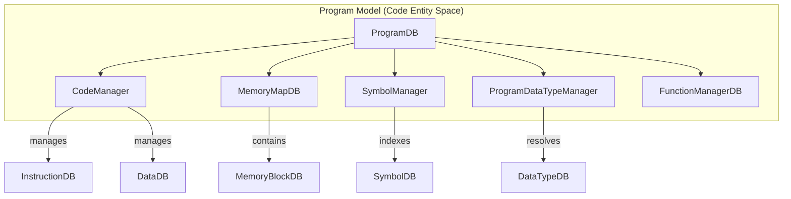

<!-- source: DeepWiki mcp.deepwiki.com · repo NationalSecurityAgency/ghidra · page 8 Program Model and Analysis Framework · fetched 2026-11-09 -->

# Program Model and Analysis Framework

Relevant source files

The following files were used as context for generating this wiki page:

- [Ghidra/Debug/Framework-TraceModeling/src/main/java/ghidra/trace/database/DBTraceContentHandler.java](Ghidra/Debug/Framework-TraceModeling/src/main/java/ghidra/trace/database/DBTraceContentHandler.java)
- [Ghidra/Features/Base/src/main/java/ghidra/app/plugin/core/misc/MyProgramChangesDisplayPlugin.java](Ghidra/Features/Base/src/main/java/ghidra/app/plugin/core/misc/MyProgramChangesDisplayPlugin.java)
- [Ghidra/Features/Base/src/main/java/ghidra/app/plugin/core/navigation/NextHighlightedRangeAction.java](Ghidra/Features/Base/src/main/java/ghidra/app/plugin/core/navigation/NextHighlightedRangeAction.java)
- [Ghidra/Features/Base/src/main/java/ghidra/app/plugin/core/navigation/NextSelectedRangeAction.java](Ghidra/Features/Base/src/main/java/ghidra/app/plugin/core/navigation/NextSelectedRangeAction.java)
- [Ghidra/Features/Base/src/main/java/ghidra/app/plugin/core/navigation/PreviousHighlightedRangeAction.java](Ghidra/Features/Base/src/main/java/ghidra/app/plugin/core/navigation/PreviousHighlightedRangeAction.java)
- [Ghidra/Features/Base/src/main/java/ghidra/app/plugin/core/navigation/PreviousSelectedRangeAction.java](Ghidra/Features/Base/src/main/java/ghidra/app/plugin/core/navigation/PreviousSelectedRangeAction.java)
- [Ghidra/Features/Base/src/main/java/ghidra/test/TestProgramManager.java](Ghidra/Features/Base/src/main/java/ghidra/test/TestProgramManager.java)
- [Ghidra/Features/Base/src/test.slow/java/ghidra/framework/data/TransactionLockingTest.java](Ghidra/Features/Base/src/test.slow/java/ghidra/framework/data/TransactionLockingTest.java)
- [Ghidra/Features/Base/src/test.slow/java/ghidra/program/database/ProgramUserDataTest.java](Ghidra/Features/Base/src/test.slow/java/ghidra/program/database/ProgramUserDataTest.java)
- [Ghidra/Features/Base/src/test.slow/java/ghidra/program/database/data/DataManagerTest.java](Ghidra/Features/Base/src/test.slow/java/ghidra/program/database/data/DataManagerTest.java)
- [Ghidra/Framework/Project/src/main/java/ghidra/framework/data/AbstractTransactionManager.java](Ghidra/Framework/Project/src/main/java/ghidra/framework/data/AbstractTransactionManager.java)
- [Ghidra/Framework/Project/src/main/java/ghidra/framework/data/DomainObjectAdapterDB.java](Ghidra/Framework/Project/src/main/java/ghidra/framework/data/DomainObjectAdapterDB.java)
- [Ghidra/Framework/Project/src/main/java/ghidra/framework/data/DomainObjectTransactionManager.java](Ghidra/Framework/Project/src/main/java/ghidra/framework/data/DomainObjectTransactionManager.java)
- [Ghidra/Framework/Project/src/main/java/ghidra/framework/data/SynchronizedTransactionManager.java](Ghidra/Framework/Project/src/main/java/ghidra/framework/data/SynchronizedTransactionManager.java)
- [Ghidra/Framework/Project/src/main/java/ghidra/framework/model/DomainObject.java](Ghidra/Framework/Project/src/main/java/ghidra/framework/model/DomainObject.java)
- [Ghidra/Framework/SoftwareModeling/src/main/java/ghidra/program/database/ProgramContentHandler.java](Ghidra/Framework/SoftwareModeling/src/main/java/ghidra/program/database/ProgramContentHandler.java)
- [Ghidra/Framework/SoftwareModeling/src/main/java/ghidra/program/database/ProgramDB.java](Ghidra/Framework/SoftwareModeling/src/main/java/ghidra/program/database/ProgramDB.java)
- [Ghidra/Framework/SoftwareModeling/src/main/java/ghidra/program/database/ProgramDBChangeSet.java](Ghidra/Framework/SoftwareModeling/src/main/java/ghidra/program/database/ProgramDBChangeSet.java)
- [Ghidra/Framework/SoftwareModeling/src/main/java/ghidra/program/database/ProgramUserDataDB.java](Ghidra/Framework/SoftwareModeling/src/main/java/ghidra/program/database/ProgramUserDataDB.java)
- [Ghidra/Framework/SoftwareModeling/src/main/java/ghidra/program/database/code/CodeManager.java](Ghidra/Framework/SoftwareModeling/src/main/java/ghidra/program/database/code/CodeManager.java)
- [Ghidra/Framework/SoftwareModeling/src/main/java/ghidra/program/database/data/DataTypeDB.java](Ghidra/Framework/SoftwareModeling/src/main/java/ghidra/program/database/data/DataTypeDB.java)
- [Ghidra/Framework/SoftwareModeling/src/main/java/ghidra/program/database/data/DataTypeManagerDB.java](Ghidra/Framework/SoftwareModeling/src/main/java/ghidra/program/database/data/DataTypeManagerDB.java)
- [Ghidra/Framework/SoftwareModeling/src/main/java/ghidra/program/database/data/ProgramDataTypeManager.java](Ghidra/Framework/SoftwareModeling/src/main/java/ghidra/program/database/data/ProgramDataTypeManager.java)
- [Ghidra/Framework/SoftwareModeling/src/main/java/ghidra/program/model/data/BuiltInDataTypeManager.java](Ghidra/Framework/SoftwareModeling/src/main/java/ghidra/program/model/data/BuiltInDataTypeManager.java)
- [Ghidra/Framework/SoftwareModeling/src/main/java/ghidra/program/model/data/DataTypeManager.java](Ghidra/Framework/SoftwareModeling/src/main/java/ghidra/program/model/data/DataTypeManager.java)
- [Ghidra/Framework/SoftwareModeling/src/main/java/ghidra/program/model/data/StandAloneDataTypeManager.java](Ghidra/Framework/SoftwareModeling/src/main/java/ghidra/program/model/data/StandAloneDataTypeManager.java)
- [Ghidra/Framework/SoftwareModeling/src/main/java/ghidra/program/model/listing/ProgramUserData.java](Ghidra/Framework/SoftwareModeling/src/main/java/ghidra/program/model/listing/ProgramUserData.java)
- [Ghidra/Framework/SoftwareModeling/src/main/java/ghidra/program/util/RegisterValueStore.java](Ghidra/Framework/SoftwareModeling/src/main/java/ghidra/program/util/RegisterValueStore.java)
- [Ghidra/Test/IntegrationTest/src/test.slow/java/ghidra/framework/main/ProjectInfoFilesystemTest.java](Ghidra/Test/IntegrationTest/src/test.slow/java/ghidra/framework/main/ProjectInfoFilesystemTest.java)

This section describes Ghidra's core representation of a program and the automated pipeline used to populate that representation. Ghidra utilizes a database-backed model to store all information recovered during reverse engineering, including memory bytes, instructions, symbols, and data types.

### Program Representation Overview

The central entity in Ghidra's software modeling is the `ProgramDB` [Ghidra/Framework/SoftwareModeling/src/main/java/ghidra/program/database/ProgramDB.java:71-72](). It acts as a container for various managers that handle specific aspects of the program's data. These managers are backed by Ghidra's custom database framework (`DomainObjectAdapterDB`) [Ghidra/Framework/Project/src/main/java/ghidra/framework/data/DomainObjectAdapterDB.java:42-42]() to ensure persistence, versioning [Ghidra/Framework/SoftwareModeling/src/main/java/ghidra/program/database/ProgramDB.java:128-128](), and undo/redo capabilities.

#### Core Program Components
*   **Memory Model**: Managed by `MemoryMapDB`, which handles address spaces and memory blocks.
*   **Code and Data**: Managed by `CodeManager` [Ghidra/Framework/SoftwareModeling/src/main/java/ghidra/program/database/code/CodeManager.java:50-50](). This manager tracks `Instruction` and `Data` objects (collectively `CodeUnits`) mapped to specific addresses.
*   **Symbol Table**: Managed by `SymbolManager`, providing a mapping between names and addresses.
*   **Data Type Management**: Handled by `ProgramDataTypeManager` [Ghidra/Framework/SoftwareModeling/src/main/java/ghidra/program/database/data/ProgramDataTypeManager.java:44-46](), which maintains the program-specific type library.
*   **Function Management**: Managed by `FunctionManagerDB`, which defines function boundaries, parameters, and local variables.

Sources: [Ghidra/Framework/SoftwareModeling/src/main/java/ghidra/program/database/ProgramDB.java:71-128](), [Ghidra/Framework/SoftwareModeling/src/main/java/ghidra/program/database/code/CodeManager.java:50-50](), [Ghidra/Framework/SoftwareModeling/src/main/java/ghidra/program/database/data/ProgramDataTypeManager.java:44-46](), [Ghidra/Framework/Project/src/main/java/ghidra/framework/data/DomainObjectAdapterDB.java:42-42]()

### Program Model Architecture

The following diagram illustrates the relationship between the high-level `ProgramDB` and its specialized database-backed managers, bridging natural language entities to code classes.

Diagram: Program Database Manager Hierarchy

Sources: [Ghidra/Framework/SoftwareModeling/src/main/java/ghidra/program/database/ProgramDB.java:71-72](), [Ghidra/Framework/SoftwareModeling/src/main/java/ghidra/program/database/code/CodeManager.java:50-50](), [Ghidra/Framework/SoftwareModeling/src/main/java/ghidra/program/database/data/ProgramDataTypeManager.java:44-46]()

---

### [Program Database and Memory Model](#8.1)
The `ProgramDB` implementation uses a `DBHandle` to interact with the underlying database. It coordinates complex operations like address mapping via `AddressMapDB`, which translates between `Address` objects and long values used as primary keys in database tables. The `MemoryMapDB` provides a view of the program's memory, organized into `MemoryBlock` instances, while the persistence model relies on `ChainedBuffer` and transaction management.

For details, see [Program Database and Memory Model](#8.1).

Sources: [Ghidra/Framework/SoftwareModeling/src/main/java/ghidra/program/database/ProgramDB.java:71-72](), [Ghidra/Framework/Project/src/main/java/ghidra/framework/data/DomainObjectAdapterDB.java:42-42]()

### [Data Type System](#8.2)
Ghidra features a sophisticated data type management system centered around `DataTypeManagerDB` [Ghidra/Framework/SoftwareModeling/src/main/java/ghidra/program/database/data/DataTypeManagerDB.java:67-67](). This system supports complex types including structures, unions, and function definitions. Types are organized into a `CategoryPath` hierarchy. The system distinguishes between the `ProgramDataTypeManager` [Ghidra/Framework/SoftwareModeling/src/main/java/ghidra/program/database/data/ProgramDataTypeManager.java:44-46]() and file-based data type managers used for sharing type libraries via `.gdt` archives.

For details, see [Data Type System](#8.2).

Sources: [Ghidra/Framework/SoftwareModeling/src/main/java/ghidra/program/database/data/DataTypeManagerDB.java:67-67](), [Ghidra/Framework/SoftwareModeling/src/main/java/ghidra/program/database/data/ProgramDataTypeManager.java:44-46]()

### [Auto-Analysis Pipeline](#8.3)
The analysis framework coordinates the background process of discovering code and data. The `AutoAnalysisManager` and `AutoAnalysisPlugin` coordinate the background analysis process, maintaining a priority-based system for executing `Analyzer` instances. Analyzers are categorized by type and execute based on registered priorities and dependencies to incrementally enrich the program database.

For details, see [Auto-Analysis Pipeline](#8.3).

Sources: [Ghidra/Framework/SoftwareModeling/src/main/java/ghidra/program/database/ProgramDB.java:71-72]()

### [Debug Symbol Import (DWARF and PDB)](#8.4)
Ghidra provides specialized importers for debug information. The DWARF system maps DWARF debugging structures into the Ghidra `ProgramDB`. For Windows binaries, the PDB system utilizes specialized applicators (`PdbApplicator`, `DefaultPdbApplicator`) to apply types and symbols recovered from Microsoft PDB files, often integrating with symbol server services.

For details, see [Debug Symbol Import (DWARF and PDB)](#8.4).

Sources: [Ghidra/Framework/SoftwareModeling/src/main/java/ghidra/program/database/ProgramDB.java:71-72]()

### [BSim Binary Similarity Analysis](#8.5)
BSim provides binary similarity search capabilities. It works by generating function signatures via the decompiler and analysis pipeline and storing them in a searchable database backend (PostgreSQL, H2, or ElasticSearch). The system supports CLI tools (`bsim_ctl`) and GUI search interfaces for cross-binary similarity analysis.

For details, see [BSim Binary Similarity Analysis](#8.5).

Sources: [Ghidra/Framework/SoftwareModeling/src/main/java/ghidra/program/database/ProgramDB.java:71-72]()

### [Version Tracking and Program Comparison](#8.6)
The VersionTracking subsystem correlates two program versions through a session and match data model, utilizing correlators, markup types (`FunctionSignatureStringable`, `DataTypeMarkupType`), and apply-markup options. It is complemented by comparison utilities like `ProgramDiff` and `CodeCompare`.

For details, see [Version Tracking and Program Comparison](#8.6).

Sources: [Ghidra/Framework/SoftwareModeling/src/main/java/ghidra/program/database/ProgramDB.java:71-72]()

### [Projects, Multi-User Server, and Program Management](#8.7)
This layer covers project data structures (`ProjectData`, `DomainFile`, `DomainFolder`), the `ProgramManagerPlugin` multi-program model with undo/redo support, Ghidra Server management (`GhidraServer`, `RepositoryManager`, `UserManager`), and Ghidra URL navigation.

For details, see [Projects, Multi-User Server, and Program Management](#8.7).

Sources: [Ghidra/Framework/SoftwareModeling/src/main/java/ghidra/program/database/ProgramDB.java:71-72]()

---

