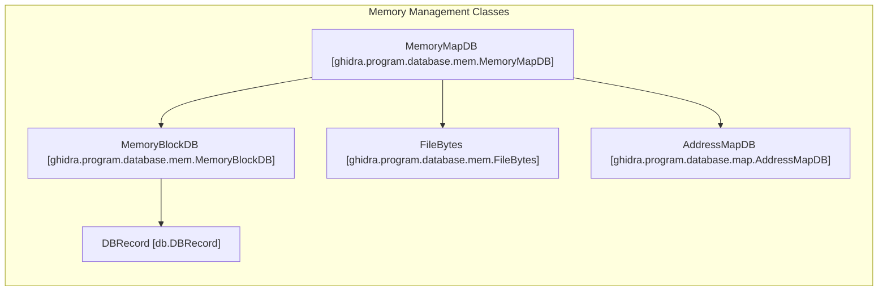
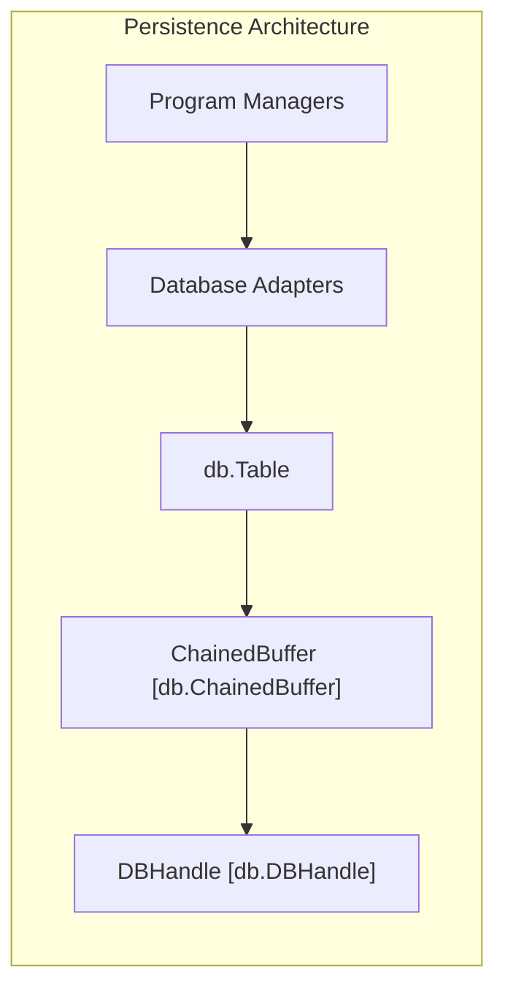

<!-- source: DeepWiki mcp.deepwiki.com · repo NationalSecurityAgency/ghidra · page 8.1 Program Database and Memory Model · fetched 2026-11-09 -->

# Program Database and Memory Model

Relevant source files

The following files were used as context for generating this wiki page:

- [Ghidra/Debug/Framework-TraceModeling/src/main/java/ghidra/trace/database/DBTraceContentHandler.java](Ghidra/Debug/Framework-TraceModeling/src/main/java/ghidra/trace/database/DBTraceContentHandler.java)
- [Ghidra/Features/Base/ghidra_scripts/LocateMemoryAddressesForFileOffset.java](Ghidra/Features/Base/ghidra_scripts/LocateMemoryAddressesForFileOffset.java)
- [Ghidra/Features/Base/ghidra_scripts/LocateMemoryAddressesForFileOffset.py](Ghidra/Features/Base/ghidra_scripts/LocateMemoryAddressesForFileOffset.py)
- [Ghidra/Features/Base/ghidra_scripts/PropagateExternalParametersScript.java](Ghidra/Features/Base/ghidra_scripts/PropagateExternalParametersScript.java)
- [Ghidra/Features/Base/src/main/help/help/topics/MemoryMapPlugin/Memory_Map.htm](Ghidra/Features/Base/src/main/help/help/topics/MemoryMapPlugin/Memory_Map.htm)
- [Ghidra/Features/Base/src/main/help/help/topics/MemoryMapPlugin/images/MemoryMap.png](Ghidra/Features/Base/src/main/help/help/topics/MemoryMapPlugin/images/MemoryMap.png)
- [Ghidra/Features/Base/src/main/java/ghidra/app/plugin/core/misc/MyProgramChangesDisplayPlugin.java](Ghidra/Features/Base/src/main/java/ghidra/app/plugin/core/misc/MyProgramChangesDisplayPlugin.java)
- [Ghidra/Features/Base/src/main/java/ghidra/app/plugin/core/navigation/NextHighlightedRangeAction.java](Ghidra/Features/Base/src/main/java/ghidra/app/plugin/core/navigation/NextHighlightedRangeAction.java)
- [Ghidra/Features/Base/src/main/java/ghidra/app/plugin/core/navigation/NextSelectedRangeAction.java](Ghidra/Features/Base/src/main/java/ghidra/app/plugin/core/navigation/NextSelectedRangeAction.java)
- [Ghidra/Features/Base/src/main/java/ghidra/app/plugin/core/navigation/PreviousHighlightedRangeAction.java](Ghidra/Features/Base/src/main/java/ghidra/app/plugin/core/navigation/PreviousHighlightedRangeAction.java)
- [Ghidra/Features/Base/src/main/java/ghidra/app/plugin/core/navigation/PreviousSelectedRangeAction.java](Ghidra/Features/Base/src/main/java/ghidra/app/plugin/core/navigation/PreviousSelectedRangeAction.java)
- [Ghidra/Features/Base/src/main/java/ghidra/app/util/bin/FileBytesProvider.java](Ghidra/Features/Base/src/main/java/ghidra/app/util/bin/FileBytesProvider.java)
- [Ghidra/Features/Base/src/main/java/ghidra/app/util/bin/format/elf/ElfSymbolNameUtils.java](Ghidra/Features/Base/src/main/java/ghidra/app/util/bin/format/elf/ElfSymbolNameUtils.java)
- [Ghidra/Features/Base/src/main/java/ghidra/test/TestProgramManager.java](Ghidra/Features/Base/src/main/java/ghidra/test/TestProgramManager.java)
- [Ghidra/Features/Base/src/test.slow/java/ghidra/framework/data/TransactionLockingTest.java](Ghidra/Features/Base/src/test.slow/java/ghidra/framework/data/TransactionLockingTest.java)
- [Ghidra/Features/Base/src/test.slow/java/ghidra/program/database/ProgramUserDataTest.java](Ghidra/Features/Base/src/test.slow/java/ghidra/program/database/ProgramUserDataTest.java)
- [Ghidra/Features/Base/src/test.slow/java/ghidra/program/database/data/DataManagerTest.java](Ghidra/Features/Base/src/test.slow/java/ghidra/program/database/data/DataManagerTest.java)
- [Ghidra/Features/Base/src/test.slow/java/ghidra/program/database/mem/MemoryManagerTest.java](Ghidra/Features/Base/src/test.slow/java/ghidra/program/database/mem/MemoryManagerTest.java)
- [Ghidra/Features/Base/src/test.slow/java/ghidra/program/database/symbol/SymbolManagerTest.java](Ghidra/Features/Base/src/test.slow/java/ghidra/program/database/symbol/SymbolManagerTest.java)
- [Ghidra/Features/Base/src/test.slow/java/ghidra/program/util/ProgramDiff1Test.java](Ghidra/Features/Base/src/test.slow/java/ghidra/program/util/ProgramDiff1Test.java)
- [Ghidra/Features/Base/src/test/java/ghidra/app/cmd/memory/AddMemoryBlockCmdTest.java](Ghidra/Features/Base/src/test/java/ghidra/app/cmd/memory/AddMemoryBlockCmdTest.java)
- [Ghidra/Features/Base/src/test/java/ghidra/app/plugin/core/checksums/MyTestMemoryBlock.java](Ghidra/Features/Base/src/test/java/ghidra/app/plugin/core/checksums/MyTestMemoryBlock.java)
- [Ghidra/Features/Base/src/test/java/ghidra/program/model/symbol/SymbolUtilitiesNamingTest.java](Ghidra/Features/Base/src/test/java/ghidra/program/model/symbol/SymbolUtilitiesNamingTest.java)
- [Ghidra/Features/GnuDemangler/ghidra_scripts/VxWorksSymTab_Finder.java](Ghidra/Features/GnuDemangler/ghidra_scripts/VxWorksSymTab_Finder.java)
- [Ghidra/Framework/DB/src/main/java/db/ChainedBuffer.java](Ghidra/Framework/DB/src/main/java/db/ChainedBuffer.java)
- [Ghidra/Framework/DB/src/test/java/db/AbstractChainedBufferTest.java](Ghidra/Framework/DB/src/test/java/db/AbstractChainedBufferTest.java)
- [Ghidra/Framework/DB/src/test/java/db/ChainedBufferTest.java](Ghidra/Framework/DB/src/test/java/db/ChainedBufferTest.java)
- [Ghidra/Framework/DB/src/test/java/db/ObfuscatedChaninedBufferTest.java](Ghidra/Framework/DB/src/test/java/db/ObfuscatedChaninedBufferTest.java)
- [Ghidra/Framework/DB/src/test/java/db/ObfuscatedSourcedChaninedBufferTest.java](Ghidra/Framework/DB/src/test/java/db/ObfuscatedSourcedChaninedBufferTest.java)
- [Ghidra/Framework/Project/src/main/java/ghidra/framework/data/AbstractTransactionManager.java](Ghidra/Framework/Project/src/main/java/ghidra/framework/data/AbstractTransactionManager.java)
- [Ghidra/Framework/Project/src/main/java/ghidra/framework/data/DomainObjectAdapterDB.java](Ghidra/Framework/Project/src/main/java/ghidra/framework/data/DomainObjectAdapterDB.java)
- [Ghidra/Framework/Project/src/main/java/ghidra/framework/data/DomainObjectTransactionManager.java](Ghidra/Framework/Project/src/main/java/ghidra/framework/data/DomainObjectTransactionManager.java)
- [Ghidra/Framework/Project/src/main/java/ghidra/framework/data/SynchronizedTransactionManager.java](Ghidra/Framework/Project/src/main/java/ghidra/framework/data/SynchronizedTransactionManager.java)
- [Ghidra/Framework/Project/src/main/java/ghidra/framework/model/DomainObject.java](Ghidra/Framework/Project/src/main/java/ghidra/framework/model/DomainObject.java)
- [Ghidra/Framework/Project/src/main/java/ghidra/util/Lock.java](Ghidra/Framework/Project/src/main/java/ghidra/util/Lock.java)
- [Ghidra/Framework/SoftwareModeling/src/main/java/ghidra/program/database/ProgramContentHandler.java](Ghidra/Framework/SoftwareModeling/src/main/java/ghidra/program/database/ProgramContentHandler.java)
- [Ghidra/Framework/SoftwareModeling/src/main/java/ghidra/program/database/ProgramDB.java](Ghidra/Framework/SoftwareModeling/src/main/java/ghidra/program/database/ProgramDB.java)
- [Ghidra/Framework/SoftwareModeling/src/main/java/ghidra/program/database/ProgramDBChangeSet.java](Ghidra/Framework/SoftwareModeling/src/main/java/ghidra/program/database/ProgramDBChangeSet.java)
- [Ghidra/Framework/SoftwareModeling/src/main/java/ghidra/program/database/ProgramUserDataDB.java](Ghidra/Framework/SoftwareModeling/src/main/java/ghidra/program/database/ProgramUserDataDB.java)
- [Ghidra/Framework/SoftwareModeling/src/main/java/ghidra/program/database/code/CodeManager.java](Ghidra/Framework/SoftwareModeling/src/main/java/ghidra/program/database/code/CodeManager.java)
- [Ghidra/Framework/SoftwareModeling/src/main/java/ghidra/program/database/code/PrototypeManager.java](Ghidra/Framework/SoftwareModeling/src/main/java/ghidra/program/database/code/PrototypeManager.java)
- [Ghidra/Framework/SoftwareModeling/src/main/java/ghidra/program/database/data/DataTypeDB.java](Ghidra/Framework/SoftwareModeling/src/main/java/ghidra/program/database/data/DataTypeDB.java)
- [Ghidra/Framework/SoftwareModeling/src/main/java/ghidra/program/database/data/DataTypeManagerDB.java](Ghidra/Framework/SoftwareModeling/src/main/java/ghidra/program/database/data/DataTypeManagerDB.java)
- [Ghidra/Framework/SoftwareModeling/src/main/java/ghidra/program/database/data/ProgramBasedDataTypeManagerDB.java](Ghidra/Framework/SoftwareModeling/src/main/java/ghidra/program/database/data/ProgramBasedDataTypeManagerDB.java)
- [Ghidra/Framework/SoftwareModeling/src/main/java/ghidra/program/database/data/ProgramDataTypeManager.java](Ghidra/Framework/SoftwareModeling/src/main/java/ghidra/program/database/data/ProgramDataTypeManager.java)
- [Ghidra/Framework/SoftwareModeling/src/main/java/ghidra/program/database/external/ExternalManagerDB.java](Ghidra/Framework/SoftwareModeling/src/main/java/ghidra/program/database/external/ExternalManagerDB.java)
- [Ghidra/Framework/SoftwareModeling/src/main/java/ghidra/program/database/mem/BitMappedSubMemoryBlock.java](Ghidra/Framework/SoftwareModeling/src/main/java/ghidra/program/database/mem/BitMappedSubMemoryBlock.java)
- [Ghidra/Framework/SoftwareModeling/src/main/java/ghidra/program/database/mem/BufferSubMemoryBlock.java](Ghidra/Framework/SoftwareModeling/src/main/java/ghidra/program/database/mem/BufferSubMemoryBlock.java)
- [Ghidra/Framework/SoftwareModeling/src/main/java/ghidra/program/database/mem/ByteMappedSubMemoryBlock.java](Ghidra/Framework/SoftwareModeling/src/main/java/ghidra/program/database/mem/ByteMappedSubMemoryBlock.java)
- [Ghidra/Framework/SoftwareModeling/src/main/java/ghidra/program/database/mem/FileBytes.java](Ghidra/Framework/SoftwareModeling/src/main/java/ghidra/program/database/mem/FileBytes.java)
- [Ghidra/Framework/SoftwareModeling/src/main/java/ghidra/program/database/mem/FileBytesAdapter.java](Ghidra/Framework/SoftwareModeling/src/main/java/ghidra/program/database/mem/FileBytesAdapter.java)
- [Ghidra/Framework/SoftwareModeling/src/main/java/ghidra/program/database/mem/FileBytesAdapterNoTable.java](Ghidra/Framework/SoftwareModeling/src/main/java/ghidra/program/database/mem/FileBytesAdapterNoTable.java)
- [Ghidra/Framework/SoftwareModeling/src/main/java/ghidra/program/database/mem/FileBytesAdapterV0.java](Ghidra/Framework/SoftwareModeling/src/main/java/ghidra/program/database/mem/FileBytesAdapterV0.java)
- [Ghidra/Framework/SoftwareModeling/src/main/java/ghidra/program/database/mem/FileBytesSubMemoryBlock.java](Ghidra/Framework/SoftwareModeling/src/main/java/ghidra/program/database/mem/FileBytesSubMemoryBlock.java)
- [Ghidra/Framework/SoftwareModeling/src/main/java/ghidra/program/database/mem/MemoryBlockDB.java](Ghidra/Framework/SoftwareModeling/src/main/java/ghidra/program/database/mem/MemoryBlockDB.java)
- [Ghidra/Framework/SoftwareModeling/src/main/java/ghidra/program/database/mem/MemoryBlockSourceInfoDB.java](Ghidra/Framework/SoftwareModeling/src/main/java/ghidra/program/database/mem/MemoryBlockSourceInfoDB.java)
- [Ghidra/Framework/SoftwareModeling/src/main/java/ghidra/program/database/mem/MemoryMapDB.java](Ghidra/Framework/SoftwareModeling/src/main/java/ghidra/program/database/mem/MemoryMapDB.java)
- [Ghidra/Framework/SoftwareModeling/src/main/java/ghidra/program/database/mem/MemoryMapDBAdapter.java](Ghidra/Framework/SoftwareModeling/src/main/java/ghidra/program/database/mem/MemoryMapDBAdapter.java)
- [Ghidra/Framework/SoftwareModeling/src/main/java/ghidra/program/database/mem/MemoryMapDBAdapterV0.java](Ghidra/Framework/SoftwareModeling/src/main/java/ghidra/program/database/mem/MemoryMapDBAdapterV0.java)
- [Ghidra/Framework/SoftwareModeling/src/main/java/ghidra/program/database/mem/MemoryMapDBAdapterV1.java](Ghidra/Framework/SoftwareModeling/src/main/java/ghidra/program/database/mem/MemoryMapDBAdapterV1.java)
- [Ghidra/Framework/SoftwareModeling/src/main/java/ghidra/program/database/mem/MemoryMapDBAdapterV2.java](Ghidra/Framework/SoftwareModeling/src/main/java/ghidra/program/database/mem/MemoryMapDBAdapterV2.java)
- [Ghidra/Framework/SoftwareModeling/src/main/java/ghidra/program/database/mem/MemoryMapDBAdapterV3.java](Ghidra/Framework/SoftwareModeling/src/main/java/ghidra/program/database/mem/MemoryMapDBAdapterV3.java)
- [Ghidra/Framework/SoftwareModeling/src/main/java/ghidra/program/database/mem/SubMemoryBlock.java](Ghidra/Framework/SoftwareModeling/src/main/java/ghidra/program/database/mem/SubMemoryBlock.java)
- [Ghidra/Framework/SoftwareModeling/src/main/java/ghidra/program/database/mem/UninitializedSubMemoryBlock.java](Ghidra/Framework/SoftwareModeling/src/main/java/ghidra/program/database/mem/UninitializedSubMemoryBlock.java)
- [Ghidra/Framework/SoftwareModeling/src/main/java/ghidra/program/database/module/TreeManager.java](Ghidra/Framework/SoftwareModeling/src/main/java/ghidra/program/database/module/TreeManager.java)
- [Ghidra/Framework/SoftwareModeling/src/main/java/ghidra/program/database/properties/DBPropertyMapManager.java](Ghidra/Framework/SoftwareModeling/src/main/java/ghidra/program/database/properties/DBPropertyMapManager.java)
- [Ghidra/Framework/SoftwareModeling/src/main/java/ghidra/program/database/references/BigRefListV0.java](Ghidra/Framework/SoftwareModeling/src/main/java/ghidra/program/database/references/BigRefListV0.java)
- [Ghidra/Framework/SoftwareModeling/src/main/java/ghidra/program/database/references/FromAdapterV0.java](Ghidra/Framework/SoftwareModeling/src/main/java/ghidra/program/database/references/FromAdapterV0.java)
- [Ghidra/Framework/SoftwareModeling/src/main/java/ghidra/program/database/references/RefListV0.java](Ghidra/Framework/SoftwareModeling/src/main/java/ghidra/program/database/references/RefListV0.java)
- [Ghidra/Framework/SoftwareModeling/src/main/java/ghidra/program/database/references/ReferenceDBManager.java](Ghidra/Framework/SoftwareModeling/src/main/java/ghidra/program/database/references/ReferenceDBManager.java)
- [Ghidra/Framework/SoftwareModeling/src/main/java/ghidra/program/database/symbol/ClassSymbol.java](Ghidra/Framework/SoftwareModeling/src/main/java/ghidra/program/database/symbol/ClassSymbol.java)
- [Ghidra/Framework/SoftwareModeling/src/main/java/ghidra/program/database/symbol/CodeSymbol.java](Ghidra/Framework/SoftwareModeling/src/main/java/ghidra/program/database/symbol/CodeSymbol.java)
- [Ghidra/Framework/SoftwareModeling/src/main/java/ghidra/program/database/symbol/FunctionSymbol.java](Ghidra/Framework/SoftwareModeling/src/main/java/ghidra/program/database/symbol/FunctionSymbol.java)
- [Ghidra/Framework/SoftwareModeling/src/main/java/ghidra/program/database/symbol/GlobalVariableSymbolDB.java](Ghidra/Framework/SoftwareModeling/src/main/java/ghidra/program/database/symbol/GlobalVariableSymbolDB.java)
- [Ghidra/Framework/SoftwareModeling/src/main/java/ghidra/program/database/symbol/LibrarySymbol.java](Ghidra/Framework/SoftwareModeling/src/main/java/ghidra/program/database/symbol/LibrarySymbol.java)
- [Ghidra/Framework/SoftwareModeling/src/main/java/ghidra/program/database/symbol/NamespaceSymbol.java](Ghidra/Framework/SoftwareModeling/src/main/java/ghidra/program/database/symbol/NamespaceSymbol.java)
- [Ghidra/Framework/SoftwareModeling/src/main/java/ghidra/program/database/symbol/SymbolDB.java](Ghidra/Framework/SoftwareModeling/src/main/java/ghidra/program/database/symbol/SymbolDB.java)
- [Ghidra/Framework/SoftwareModeling/src/main/java/ghidra/program/database/symbol/SymbolDatabaseAdapter.java](Ghidra/Framework/SoftwareModeling/src/main/java/ghidra/program/database/symbol/SymbolDatabaseAdapter.java)
- [Ghidra/Framework/SoftwareModeling/src/main/java/ghidra/program/database/symbol/SymbolDatabaseAdapterV0.java](Ghidra/Framework/SoftwareModeling/src/main/java/ghidra/program/database/symbol/SymbolDatabaseAdapterV0.java)
- [Ghidra/Framework/SoftwareModeling/src/main/java/ghidra/program/database/symbol/SymbolDatabaseAdapterV1.java](Ghidra/Framework/SoftwareModeling/src/main/java/ghidra/program/database/symbol/SymbolDatabaseAdapterV1.java)
- [Ghidra/Framework/SoftwareModeling/src/main/java/ghidra/program/database/symbol/SymbolDatabaseAdapterV2.java](Ghidra/Framework/SoftwareModeling/src/main/java/ghidra/program/database/symbol/SymbolDatabaseAdapterV2.java)
- [Ghidra/Framework/SoftwareModeling/src/main/java/ghidra/program/database/symbol/SymbolDatabaseAdapterV3.java](Ghidra/Framework/SoftwareModeling/src/main/java/ghidra/program/database/symbol/SymbolDatabaseAdapterV3.java)
- [Ghidra/Framework/SoftwareModeling/src/main/java/ghidra/program/database/symbol/SymbolManager.java](Ghidra/Framework/SoftwareModeling/src/main/java/ghidra/program/database/symbol/SymbolManager.java)
- [Ghidra/Framework/SoftwareModeling/src/main/java/ghidra/program/database/symbol/VariableSymbolDB.java](Ghidra/Framework/SoftwareModeling/src/main/java/ghidra/program/database/symbol/VariableSymbolDB.java)
- [Ghidra/Framework/SoftwareModeling/src/main/java/ghidra/program/model/address/GlobalSymbol.java](Ghidra/Framework/SoftwareModeling/src/main/java/ghidra/program/model/address/GlobalSymbol.java)
- [Ghidra/Framework/SoftwareModeling/src/main/java/ghidra/program/model/data/BuiltInDataTypeManager.java](Ghidra/Framework/SoftwareModeling/src/main/java/ghidra/program/model/data/BuiltInDataTypeManager.java)
- [Ghidra/Framework/SoftwareModeling/src/main/java/ghidra/program/model/data/DataTypeManager.java](Ghidra/Framework/SoftwareModeling/src/main/java/ghidra/program/model/data/DataTypeManager.java)
- [Ghidra/Framework/SoftwareModeling/src/main/java/ghidra/program/model/data/StandAloneDataTypeManager.java](Ghidra/Framework/SoftwareModeling/src/main/java/ghidra/program/model/data/StandAloneDataTypeManager.java)
- [Ghidra/Framework/SoftwareModeling/src/main/java/ghidra/program/model/listing/ProgramUserData.java](Ghidra/Framework/SoftwareModeling/src/main/java/ghidra/program/model/listing/ProgramUserData.java)
- [Ghidra/Framework/SoftwareModeling/src/main/java/ghidra/program/model/mem/Memory.java](Ghidra/Framework/SoftwareModeling/src/main/java/ghidra/program/model/mem/Memory.java)
- [Ghidra/Framework/SoftwareModeling/src/main/java/ghidra/program/model/mem/MemoryBlock.java](Ghidra/Framework/SoftwareModeling/src/main/java/ghidra/program/model/mem/MemoryBlock.java)
- [Ghidra/Framework/SoftwareModeling/src/main/java/ghidra/program/model/mem/MemoryBlockSourceInfo.java](Ghidra/Framework/SoftwareModeling/src/main/java/ghidra/program/model/mem/MemoryBlockSourceInfo.java)
- [Ghidra/Framework/SoftwareModeling/src/main/java/ghidra/program/model/mem/MemoryBlockStub.java](Ghidra/Framework/SoftwareModeling/src/main/java/ghidra/program/model/mem/MemoryBlockStub.java)
- [Ghidra/Framework/SoftwareModeling/src/main/java/ghidra/program/model/symbol/ExternalManager.java](Ghidra/Framework/SoftwareModeling/src/main/java/ghidra/program/model/symbol/ExternalManager.java)
- [Ghidra/Framework/SoftwareModeling/src/main/java/ghidra/program/model/symbol/Symbol.java](Ghidra/Framework/SoftwareModeling/src/main/java/ghidra/program/model/symbol/Symbol.java)
- [Ghidra/Framework/SoftwareModeling/src/main/java/ghidra/program/model/symbol/SymbolTable.java](Ghidra/Framework/SoftwareModeling/src/main/java/ghidra/program/model/symbol/SymbolTable.java)
- [Ghidra/Framework/SoftwareModeling/src/main/java/ghidra/program/model/symbol/SymbolUtilities.java](Ghidra/Framework/SoftwareModeling/src/main/java/ghidra/program/model/symbol/SymbolUtilities.java)
- [Ghidra/Framework/SoftwareModeling/src/main/java/ghidra/program/model/util/PropertyMapManager.java](Ghidra/Framework/SoftwareModeling/src/main/java/ghidra/program/model/util/PropertyMapManager.java)
- [Ghidra/Framework/SoftwareModeling/src/main/java/ghidra/program/util/RegisterValueStore.java](Ghidra/Framework/SoftwareModeling/src/main/java/ghidra/program/util/RegisterValueStore.java)
- [Ghidra/Framework/SoftwareModeling/src/test/java/ghidra/program/database/mem/FileBytesTest.java](Ghidra/Framework/SoftwareModeling/src/test/java/ghidra/program/database/mem/FileBytesTest.java)
- [Ghidra/Framework/SoftwareModeling/src/test/java/ghidra/program/database/mem/MemBlockDBTest.java](Ghidra/Framework/SoftwareModeling/src/test/java/ghidra/program/database/mem/MemBlockDBTest.java)
- [Ghidra/Framework/SoftwareModeling/src/test/java/ghidra/program/model/symbol/StubSymbol.java](Ghidra/Framework/SoftwareModeling/src/test/java/ghidra/program/model/symbol/StubSymbol.java)
- [Ghidra/Test/IntegrationTest/src/test.slow/java/ghidra/framework/main/ProjectInfoFilesystemTest.java](Ghidra/Test/IntegrationTest/src/test.slow/java/ghidra/framework/main/ProjectInfoFilesystemTest.java)

The Program Database (`ProgramDB`) is the central repository for all data related to a single program in Ghidra. It serves as the primary implementation of the `Program` interface, providing a persistent, transactional store for memory, code units, symbols, functions, references, and data types. This model is built upon Ghidra's custom database framework (`db` package), allowing for high-performance record storage, versioning, schema migration, and undo/redo capabilities through a manager-based architecture.

## Architecture Overview

`ProgramDB` extends `DomainObjectAdapterDB` and acts as a coordinator for several specialized managers [Ghidra/Framework/SoftwareModeling/src/main/java/ghidra/program/database/ProgramDB.java:30-72](). Each manager is responsible for a specific aspect of the program's representation and interacts with its own set of database tables via versioned database adapters. The current database version is `33`, which introduced support for Library symbol ordinal assignment [Ghidra/Framework/SoftwareModeling/src/main/java/ghidra/program/database/ProgramDB.java:125-128]().

### Core Management Structure

The relationship between `ProgramDB` and its primary subsystems bridges natural language reverse-engineering concepts to specific database manager classes:

**Program Database Subsystems and Code Entities**

```mermaid
graph TD
    subgraph "Natural Language Concepts"
        N1[""The Bytes""]
        N2[""Instructions and Data""]
        N3[""Names and Symbols""]
        N4[""Functions""]
        N5[""Cross-References""]
    end

    subgraph "ProgramDB [ghidra.program.database.ProgramDB]"
        PM["ProgramDB"] --> MM["MemoryMapDB [ghidra.program.database.mem.MemoryMapDB]"]
        PM --> CM["CodeManager [ghidra.program.database.code.CodeManager]"]
        PM --> SM["SymbolManager [ghidra.program.database.symbol.SymbolManager]"]
        PM --> FM["FunctionManagerDB [ghidra.program.database.function.FunctionManagerDB]"]
        PM --> RM["ReferenceDBManager [ghidra.program.database.references.ReferenceDBManager]"]
        PM --> DTM["ProgramDataTypeManager [ghidra.program.database.data.ProgramDataTypeManager]"]
    end

    N1 -.-> MM
    N2 -.-> CM
    N3 -.-> SM
    N4 -.-> FM
    N5 -.-> RM

    subgraph "Storage Layer [db]"
        MM --> DBH["DBHandle [db.DBHandle]"]
        CM --> DBH
        SM --> DBH
        FM --> DBH
        RM --> DBH
    end
```

Sources: [Ghidra/Framework/SoftwareModeling/src/main/java/ghidra/program/database/ProgramDB.java:36-68](), [Ghidra/Framework/SoftwareModeling/src/main/java/ghidra/program/database/ProgramDB.java:70-128]()

---

## Address Space and Memory Management (`MemoryMapDB`, `MemoryBlockDB`, `FileBytes`)

`MemoryMapDB` manages the program's address space and physical bytes contained within [Ghidra/Framework/SoftwareModeling/src/main/java/ghidra/program/database/mem/MemoryMapDB.java:41-44](). It organizes memory into `MemoryBlockDB` objects, which represent contiguous ranges of addresses with specific execution permissions, block types, and underlying storage backing [Ghidra/Framework/SoftwareModeling/src/main/java/ghidra/program/database/mem/MemoryBlockDB.java:34-54]().

### Memory Block Types and FileBytes
*   **Initialized**: Defines a memory region with specific data. Data can be backed by `FileBytes` (representing imported file byte streams), an `InputStream`, or zero-filled [Ghidra/Framework/SoftwareModeling/src/main/java/ghidra/program/model/mem/Memory.java:44-47]().
*   **Uninitialized**: Defines a memory region whose initial contents are unknown (e.g., `.bss` sections) [Ghidra/Framework/SoftwareModeling/src/main/java/ghidra/program/model/mem/Memory.java:48-48]().
*   **Byte-Mapped**: Bytes are mapped to another memory region using a 1:1 or specified `ByteMappingScheme` [Ghidra/Framework/SoftwareModeling/src/main/java/ghidra/program/model/mem/Memory.java:49-52]().
*   **Bit-Mapped**: Bytes are mapped to corresponding bits in another memory region [Ghidra/Framework/SoftwareModeling/src/main/java/ghidra/program/model/mem/Memory.java:53-56]().
*   **Overlay**: Provides alternate content for a physical memory region to reflect different execution contexts or overlapping address spaces [Ghidra/Framework/SoftwareModeling/src/main/java/ghidra/program/model/mem/Memory.java:58-62]().

`FileBytes` objects store raw binary streams loaded from imported files, allowing multiple memory blocks or non-loaded sections to reference sub-ranges of the same underlying file buffer without duplication. `MemoryMapDB` utilizes `MemoryMapDBAdapter` and `FileBytesAdapter` to persist block definitions in the database [Ghidra/Framework/SoftwareModeling/src/main/java/ghidra/program/database/mem/MemoryMapDB.java:48-49]().

**Memory Subsystem Code Mapping**

Sources: [Ghidra/Framework/SoftwareModeling/src/main/java/ghidra/program/database/mem/MemoryMapDB.java:41-96](), [Ghidra/Framework/SoftwareModeling/src/main/java/ghidra/program/database/mem/MemoryBlockDB.java:34-54](), [Ghidra/Framework/SoftwareModeling/src/main/java/ghidra/program/model/mem/Memory.java:31-78]()

---

## Code and Listing Model (`CodeManager`)

The `CodeManager` manages `CodeUnit` objects, encompassing both `Instruction` and `Data` instances [Ghidra/Framework/SoftwareModeling/src/main/java/ghidra/program/database/code/CodeManager.java:47-56](). It maintains the program's listing view and coordinates closely with the symbol table and reference manager.

### Implementation Details
*   **Adapters**: Uses `InstDBAdapter`, `DataDBAdapter`, and `CommentsDBAdapter` for structured database access [Ghidra/Framework/SoftwareModeling/src/main/java/ghidra/program/database/code/CodeManager.java:54-57]().
*   **Prototypes**: Common instruction and data patterns are stored as shared prototypes via `PrototypeManager` to optimize database space [Ghidra/Framework/SoftwareModeling/src/main/java/ghidra/program/database/code/CodeManager.java:98-100]().
*   **Caching**: Employs a `CodeUnitCache` (`CodeUnitFactory`) to maintain active in-memory representations of instructions and data [Ghidra/Framework/SoftwareModeling/src/main/java/ghidra/program/database/code/CodeManager.java:98-99]().
*   **Length Management**: Tracks instruction length overrides and metadata using `IntPropertyMapDB` (`lengthMgr`) [Ghidra/Framework/SoftwareModeling/src/main/java/ghidra/program/database/code/CodeManager.java:68-69](), [Ghidra/Framework/SoftwareModeling/src/main/java/ghidra/program/database/code/CodeManager.java:100-102]().

Sources: [Ghidra/Framework/SoftwareModeling/src/main/java/ghidra/program/database/code/CodeManager.java:47-104]()

---

## Symbol Table, Functions, and References (`FunctionManagerDB`, `SymbolManager`, `ReferenceDBManager`)

Symbolic and structural relationships are managed by three core managers coordinated by `ProgramDB`:

### SymbolManager
`SymbolManager` implements `SymbolTable` and manages the association between names, memory/register addresses, and namespaces [Ghidra/Framework/SoftwareModeling/src/main/java/ghidra/program/database/symbol/SymbolManager.java:48-81](). 
*   **SymbolDB**: The persistence wrapper for symbol records [Ghidra/Framework/SoftwareModeling/src/main/java/ghidra/program/database/symbol/SymbolDB.java:44-62](). Symbols can be global or scoped under a `Namespace` [Ghidra/Framework/SoftwareModeling/src/main/java/ghidra/program/model/symbol/SymbolTable.java:37-40]().
*   **Dynamic Symbols**: When an address lacks an explicit label, `SymbolUtilities.getDynamicName` generates on-the-fly names using standard prefixes (e.g., `FUN_`, `DAT_`, `LAB_`) [Ghidra/Framework/SoftwareModeling/src/main/java/ghidra/program/database/symbol/SymbolDB.java:157-162](), [Ghidra/Framework/SoftwareModeling/src/main/java/ghidra/program/model/symbol/SymbolUtilities.java:33-87]().

### FunctionManagerDB
Manages function boundaries, calling conventions, return types, and local variable scopes by organizing function records and linking them to corresponding symbol entries.

### ReferenceDBManager
`ReferenceDBManager` implements `ReferenceManager`, tracking references from code/data sources to memory, register, stack, or external destinations (`FromAdapter` and `ToAdapter`) [Ghidra/Framework/SoftwareModeling/src/main/java/ghidra/program/database/references/ReferenceDBManager.java:46-61](). It maintains indices for fast lookup of incoming and outgoing cross-references.

Sources: [Ghidra/Framework/SoftwareModeling/src/main/java/ghidra/program/database/symbol/SymbolManager.java:48-81](), [Ghidra/Framework/SoftwareModeling/src/main/java/ghidra/program/database/symbol/SymbolDB.java:44-162](), [Ghidra/Framework/SoftwareModeling/src/main/java/ghidra/program/model/symbol/SymbolTable.java:27-50](), [Ghidra/Framework/SoftwareModeling/src/main/java/ghidra/program/database/references/ReferenceDBManager.java:46-127]()

---

## Persistence Model and Database Framework (`ChainedBuffer`, Transactions)

Ghidra uses a proprietary `db` framework rather than an external SQL engine. This allows specialized control over binary layouts, memory-mapped buffering, transactional atomicity, and multi-user synchronization.

### Core Persistence Components
1.  **DBHandle**: Represents an open database file container managed by Ghidra's storage layer [Ghidra/Framework/Project/src/main/java/ghidra/framework/data/DomainObjectAdapterDB.java:46-49]().
2.  **ChainedBuffer**: The underlying data structure used by `db` tables to manage variable-length records and block allocations across buffer files.
3.  **Transactions**: `DomainObjectAdapterDB` provides `startTransaction` and `endTransaction` semantics, ensuring all database updates across managers are atomic and supporting full undo/redo stacks [Ghidra/Framework/Project/src/main/java/ghidra/framework/data/DomainObjectAdapterDB.java:36-42](), [Ghidra/Framework/Project/src/main/java/ghidra/framework/data/DomainObjectAdapterDB.java:83-89]().
4.  **Schema Versioning**: Each manager validates its adapter against expected schema versions (`DB_VERSION`), triggering automated database upgrades when opening older program files [Ghidra/Framework/SoftwareModeling/src/main/java/ghidra/program/database/ProgramDB.java:78-128](), [Ghidra/Framework/SoftwareModeling/src/main/java/ghidra/program/database/data/DataTypeManagerDB.java:71-81]().

**Database Storage Stack**

Sources: [Ghidra/Framework/SoftwareModeling/src/main/java/ghidra/program/database/ProgramDB.java:78-128](), [Ghidra/Framework/SoftwareModeling/src/main/java/ghidra/program/database/data/DataTypeManagerDB.java:71-81](), [Ghidra/Framework/Project/src/main/java/ghidra/framework/data/DomainObjectAdapterDB.java:36-89](), [Ghidra/Framework/DB/src/main/java/db/ChainedBuffer.java:1-30]()

---

