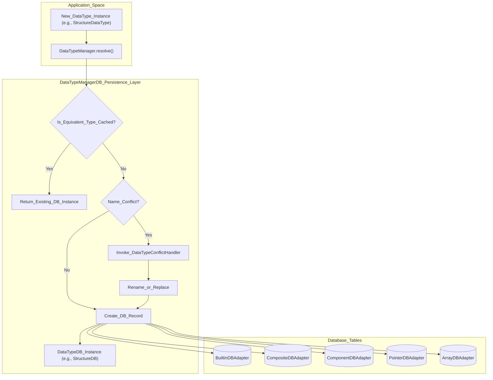
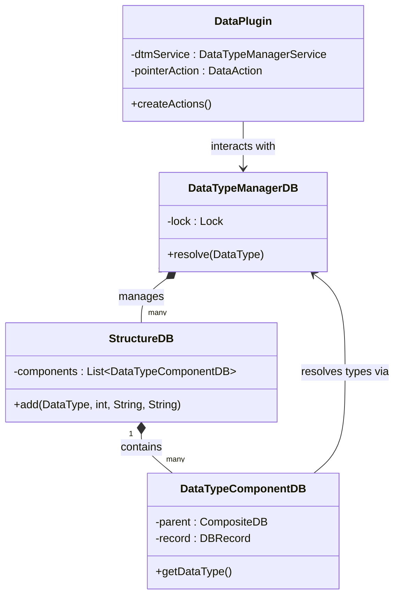

<!-- source: DeepWiki mcp.deepwiki.com · repo NationalSecurityAgency/ghidra · page 8.2 Data Type System · fetched 2026-11-09 -->

# Data Type System

Relevant source files

The following files were used as context for generating this wiki page:

- [Ghidra/Debug/Framework-TraceModeling/src/main/java/ghidra/trace/database/DBTraceContentHandler.java](Ghidra/Debug/Framework-TraceModeling/src/main/java/ghidra/trace/database/DBTraceContentHandler.java)
- [Ghidra/Features/Base/src/main/help/help/topics/DataPlugin/Data.htm](Ghidra/Features/Base/src/main/help/help/topics/DataPlugin/Data.htm)
- [Ghidra/Features/Base/src/main/help/help/topics/DataPlugin/images/EditFieldDialog.png](Ghidra/Features/Base/src/main/help/help/topics/DataPlugin/images/EditFieldDialog.png)
- [Ghidra/Features/Base/src/main/java/ghidra/app/merge/datatypes/DataTypeMergeManager.java](Ghidra/Features/Base/src/main/java/ghidra/app/merge/datatypes/DataTypeMergeManager.java)
- [Ghidra/Features/Base/src/main/java/ghidra/app/plugin/core/data/AbstractSettingsDialog.java](Ghidra/Features/Base/src/main/java/ghidra/app/plugin/core/data/AbstractSettingsDialog.java)
- [Ghidra/Features/Base/src/main/java/ghidra/app/plugin/core/data/DataPlugin.java](Ghidra/Features/Base/src/main/java/ghidra/app/plugin/core/data/DataPlugin.java)
- [Ghidra/Features/Base/src/main/java/ghidra/app/plugin/core/data/DataSettingsDialog.java](Ghidra/Features/Base/src/main/java/ghidra/app/plugin/core/data/DataSettingsDialog.java)
- [Ghidra/Features/Base/src/main/java/ghidra/app/plugin/core/data/DataTypeSettingsDialog.java](Ghidra/Features/Base/src/main/java/ghidra/app/plugin/core/data/DataTypeSettingsDialog.java)
- [Ghidra/Features/Base/src/main/java/ghidra/app/plugin/core/data/EditDataFieldDialog.java](Ghidra/Features/Base/src/main/java/ghidra/app/plugin/core/data/EditDataFieldDialog.java)
- [Ghidra/Features/Base/src/main/java/ghidra/app/plugin/core/equate/ConvertToCharAction.java](Ghidra/Features/Base/src/main/java/ghidra/app/plugin/core/equate/ConvertToCharAction.java)
- [Ghidra/Features/Base/src/main/java/ghidra/app/plugin/core/misc/MyProgramChangesDisplayPlugin.java](Ghidra/Features/Base/src/main/java/ghidra/app/plugin/core/misc/MyProgramChangesDisplayPlugin.java)
- [Ghidra/Features/Base/src/main/java/ghidra/app/plugin/core/navigation/NextHighlightedRangeAction.java](Ghidra/Features/Base/src/main/java/ghidra/app/plugin/core/navigation/NextHighlightedRangeAction.java)
- [Ghidra/Features/Base/src/main/java/ghidra/app/plugin/core/navigation/NextSelectedRangeAction.java](Ghidra/Features/Base/src/main/java/ghidra/app/plugin/core/navigation/NextSelectedRangeAction.java)
- [Ghidra/Features/Base/src/main/java/ghidra/app/plugin/core/navigation/PreviousHighlightedRangeAction.java](Ghidra/Features/Base/src/main/java/ghidra/app/plugin/core/navigation/PreviousHighlightedRangeAction.java)
- [Ghidra/Features/Base/src/main/java/ghidra/app/plugin/core/navigation/PreviousSelectedRangeAction.java](Ghidra/Features/Base/src/main/java/ghidra/app/plugin/core/navigation/PreviousSelectedRangeAction.java)
- [Ghidra/Features/Base/src/main/java/ghidra/app/plugin/core/stackeditor/StackFrameDataType.java](Ghidra/Features/Base/src/main/java/ghidra/app/plugin/core/stackeditor/StackFrameDataType.java)
- [Ghidra/Features/Base/src/main/java/ghidra/app/plugin/core/strings/HasEncodingErrorColumnConstraint.java](Ghidra/Features/Base/src/main/java/ghidra/app/plugin/core/strings/HasEncodingErrorColumnConstraint.java)
- [Ghidra/Features/Base/src/main/java/ghidra/app/util/DataTypeNamingUtil.java](Ghidra/Features/Base/src/main/java/ghidra/app/util/DataTypeNamingUtil.java)
- [Ghidra/Features/Base/src/main/java/ghidra/test/TestProgramManager.java](Ghidra/Features/Base/src/main/java/ghidra/test/TestProgramManager.java)
- [Ghidra/Features/Base/src/main/java/ghidra/util/table/GhidraTable.java](Ghidra/Features/Base/src/main/java/ghidra/util/table/GhidraTable.java)
- [Ghidra/Features/Base/src/test.slow/java/docking/widgets/table/GhidraTableTest.java](Ghidra/Features/Base/src/test.slow/java/docking/widgets/table/GhidraTableTest.java)
- [Ghidra/Features/Base/src/test.slow/java/ghidra/app/merge/datatypes/DataTypeMerge1Test.java](Ghidra/Features/Base/src/test.slow/java/ghidra/app/merge/datatypes/DataTypeMerge1Test.java)
- [Ghidra/Features/Base/src/test.slow/java/ghidra/app/merge/datatypes/DataTypeMerge3Test.java](Ghidra/Features/Base/src/test.slow/java/ghidra/app/merge/datatypes/DataTypeMerge3Test.java)
- [Ghidra/Features/Base/src/test.slow/java/ghidra/app/merge/datatypes/DataTypeMerge4Test.java](Ghidra/Features/Base/src/test.slow/java/ghidra/app/merge/datatypes/DataTypeMerge4Test.java)
- [Ghidra/Features/Base/src/test.slow/java/ghidra/app/merge/datatypes/DataTypeMerge5Test.java](Ghidra/Features/Base/src/test.slow/java/ghidra/app/merge/datatypes/DataTypeMerge5Test.java)
- [Ghidra/Features/Base/src/test.slow/java/ghidra/app/merge/datatypes/DataTypeMerge8Test.java](Ghidra/Features/Base/src/test.slow/java/ghidra/app/merge/datatypes/DataTypeMerge8Test.java)
- [Ghidra/Features/Base/src/test.slow/java/ghidra/app/merge/datatypes/DataTypeMergeFixupTest.java](Ghidra/Features/Base/src/test.slow/java/ghidra/app/merge/datatypes/DataTypeMergeFixupTest.java)
- [Ghidra/Features/Base/src/test.slow/java/ghidra/app/plugin/core/data/AbstractDataActionTest.java](Ghidra/Features/Base/src/test.slow/java/ghidra/app/plugin/core/data/AbstractDataActionTest.java)
- [Ghidra/Features/Base/src/test.slow/java/ghidra/app/plugin/core/data/DataAction4Test.java](Ghidra/Features/Base/src/test.slow/java/ghidra/app/plugin/core/data/DataAction4Test.java)
- [Ghidra/Features/Base/src/test.slow/java/ghidra/app/plugin/core/data/EditFieldDialogTest.java](Ghidra/Features/Base/src/test.slow/java/ghidra/app/plugin/core/data/EditFieldDialogTest.java)
- [Ghidra/Features/Base/src/test.slow/java/ghidra/app/plugin/core/datapreview/DataTypePreviewPluginTest.java](Ghidra/Features/Base/src/test.slow/java/ghidra/app/plugin/core/datapreview/DataTypePreviewPluginTest.java)
- [Ghidra/Features/Base/src/test.slow/java/ghidra/app/plugin/core/script/EditBytesScriptTest.java](Ghidra/Features/Base/src/test.slow/java/ghidra/app/plugin/core/script/EditBytesScriptTest.java)
- [Ghidra/Features/Base/src/test.slow/java/ghidra/framework/data/TransactionLockingTest.java](Ghidra/Features/Base/src/test.slow/java/ghidra/framework/data/TransactionLockingTest.java)
- [Ghidra/Features/Base/src/test.slow/java/ghidra/program/database/ProgramUserDataTest.java](Ghidra/Features/Base/src/test.slow/java/ghidra/program/database/ProgramUserDataTest.java)
- [Ghidra/Features/Base/src/test.slow/java/ghidra/program/database/data/CategoryTest.java](Ghidra/Features/Base/src/test.slow/java/ghidra/program/database/data/CategoryTest.java)
- [Ghidra/Features/Base/src/test.slow/java/ghidra/program/database/data/DataManagerTest.java](Ghidra/Features/Base/src/test.slow/java/ghidra/program/database/data/DataManagerTest.java)
- [Ghidra/Features/Base/src/test.slow/java/ghidra/program/database/data/InstanceSettingsTest.java](Ghidra/Features/Base/src/test.slow/java/ghidra/program/database/data/InstanceSettingsTest.java)
- [Ghidra/Features/Base/src/test.slow/java/ghidra/program/database/data/SettingsTest.java](Ghidra/Features/Base/src/test.slow/java/ghidra/program/database/data/SettingsTest.java)
- [Ghidra/Features/Base/src/test.slow/java/ghidra/program/model/symbol/SymbolUtilities2Test.java](Ghidra/Features/Base/src/test.slow/java/ghidra/program/model/symbol/SymbolUtilities2Test.java)
- [Ghidra/Features/Base/src/test/java/ghidra/program/model/data/StructureDataTypeTest.java](Ghidra/Features/Base/src/test/java/ghidra/program/model/data/StructureDataTypeTest.java)
- [Ghidra/Features/Base/src/test/java/ghidra/program/model/data/UnionDataTypeTest.java](Ghidra/Features/Base/src/test/java/ghidra/program/model/data/UnionDataTypeTest.java)
- [Ghidra/Features/Decompiler/src/main/java/ghidra/app/plugin/core/decompile/actions/EditFieldAction.java](Ghidra/Features/Decompiler/src/main/java/ghidra/app/plugin/core/decompile/actions/EditFieldAction.java)
- [Ghidra/Features/Decompiler/src/test.slow/java/ghidra/app/plugin/core/decompile/DecompilerEditDataFieldTest.java](Ghidra/Features/Decompiler/src/test.slow/java/ghidra/app/plugin/core/decompile/DecompilerEditDataFieldTest.java)
- [Ghidra/Features/Decompiler/src/test.slow/java/ghidra/app/plugin/core/decompile/DecompilerEquateTest.java](Ghidra/Features/Decompiler/src/test.slow/java/ghidra/app/plugin/core/decompile/DecompilerEquateTest.java)
- [Ghidra/Features/Decompiler/src/test.slow/java/ghidra/app/plugin/core/decompile/DecompilerHighSymbolTest.java](Ghidra/Features/Decompiler/src/test.slow/java/ghidra/app/plugin/core/decompile/DecompilerHighSymbolTest.java)
- [Ghidra/Features/Decompiler/src/test.slow/java/ghidra/app/plugin/core/decompile/DecompilerSpecExtensionTest.java](Ghidra/Features/Decompiler/src/test.slow/java/ghidra/app/plugin/core/decompile/DecompilerSpecExtensionTest.java)
- [Ghidra/Features/PDB/src/main/java/ghidra/app/util/pdb/PdbCategories.java](Ghidra/Features/PDB/src/main/java/ghidra/app/util/pdb/PdbCategories.java)
- [Ghidra/Framework/Docking/src/main/java/ghidra/docking/settings/Settings.java](Ghidra/Framework/Docking/src/main/java/ghidra/docking/settings/Settings.java)
- [Ghidra/Framework/Docking/src/main/java/ghidra/docking/settings/SettingsImpl.java](Ghidra/Framework/Docking/src/main/java/ghidra/docking/settings/SettingsImpl.java)
- [Ghidra/Framework/Project/src/main/java/ghidra/framework/data/AbstractTransactionManager.java](Ghidra/Framework/Project/src/main/java/ghidra/framework/data/AbstractTransactionManager.java)
- [Ghidra/Framework/Project/src/main/java/ghidra/framework/data/DomainObjectAdapterDB.java](Ghidra/Framework/Project/src/main/java/ghidra/framework/data/DomainObjectAdapterDB.java)
- [Ghidra/Framework/Project/src/main/java/ghidra/framework/data/DomainObjectTransactionManager.java](Ghidra/Framework/Project/src/main/java/ghidra/framework/data/DomainObjectTransactionManager.java)
- [Ghidra/Framework/Project/src/main/java/ghidra/framework/data/SynchronizedTransactionManager.java](Ghidra/Framework/Project/src/main/java/ghidra/framework/data/SynchronizedTransactionManager.java)
- [Ghidra/Framework/Project/src/main/java/ghidra/framework/model/DomainObject.java](Ghidra/Framework/Project/src/main/java/ghidra/framework/model/DomainObject.java)
- [Ghidra/Framework/SoftwareModeling/src/main/java/ghidra/program/database/ProgramContentHandler.java](Ghidra/Framework/SoftwareModeling/src/main/java/ghidra/program/database/ProgramContentHandler.java)
- [Ghidra/Framework/SoftwareModeling/src/main/java/ghidra/program/database/ProgramDB.java](Ghidra/Framework/SoftwareModeling/src/main/java/ghidra/program/database/ProgramDB.java)
- [Ghidra/Framework/SoftwareModeling/src/main/java/ghidra/program/database/ProgramDBChangeSet.java](Ghidra/Framework/SoftwareModeling/src/main/java/ghidra/program/database/ProgramDBChangeSet.java)
- [Ghidra/Framework/SoftwareModeling/src/main/java/ghidra/program/database/ProgramUserDataDB.java](Ghidra/Framework/SoftwareModeling/src/main/java/ghidra/program/database/ProgramUserDataDB.java)
- [Ghidra/Framework/SoftwareModeling/src/main/java/ghidra/program/database/code/CodeManager.java](Ghidra/Framework/SoftwareModeling/src/main/java/ghidra/program/database/code/CodeManager.java)
- [Ghidra/Framework/SoftwareModeling/src/main/java/ghidra/program/database/code/DataComponent.java](Ghidra/Framework/SoftwareModeling/src/main/java/ghidra/program/database/code/DataComponent.java)
- [Ghidra/Framework/SoftwareModeling/src/main/java/ghidra/program/database/data/ArrayDB.java](Ghidra/Framework/SoftwareModeling/src/main/java/ghidra/program/database/data/ArrayDB.java)
- [Ghidra/Framework/SoftwareModeling/src/main/java/ghidra/program/database/data/CategoryDB.java](Ghidra/Framework/SoftwareModeling/src/main/java/ghidra/program/database/data/CategoryDB.java)
- [Ghidra/Framework/SoftwareModeling/src/main/java/ghidra/program/database/data/ComponentDBAdapter.java](Ghidra/Framework/SoftwareModeling/src/main/java/ghidra/program/database/data/ComponentDBAdapter.java)
- [Ghidra/Framework/SoftwareModeling/src/main/java/ghidra/program/database/data/ComponentDBAdapterV0.java](Ghidra/Framework/SoftwareModeling/src/main/java/ghidra/program/database/data/ComponentDBAdapterV0.java)
- [Ghidra/Framework/SoftwareModeling/src/main/java/ghidra/program/database/data/CompositeDB.java](Ghidra/Framework/SoftwareModeling/src/main/java/ghidra/program/database/data/CompositeDB.java)
- [Ghidra/Framework/SoftwareModeling/src/main/java/ghidra/program/database/data/CompositeDBAdapterV5V6.java](Ghidra/Framework/SoftwareModeling/src/main/java/ghidra/program/database/data/CompositeDBAdapterV5V6.java)
- [Ghidra/Framework/SoftwareModeling/src/main/java/ghidra/program/database/data/DataTypeComponentDB.java](Ghidra/Framework/SoftwareModeling/src/main/java/ghidra/program/database/data/DataTypeComponentDB.java)
- [Ghidra/Framework/SoftwareModeling/src/main/java/ghidra/program/database/data/DataTypeDB.java](Ghidra/Framework/SoftwareModeling/src/main/java/ghidra/program/database/data/DataTypeDB.java)
- [Ghidra/Framework/SoftwareModeling/src/main/java/ghidra/program/database/data/DataTypeManagerDB.java](Ghidra/Framework/SoftwareModeling/src/main/java/ghidra/program/database/data/DataTypeManagerDB.java)
- [Ghidra/Framework/SoftwareModeling/src/main/java/ghidra/program/database/data/DataTypeSettingsDB.java](Ghidra/Framework/SoftwareModeling/src/main/java/ghidra/program/database/data/DataTypeSettingsDB.java)
- [Ghidra/Framework/SoftwareModeling/src/main/java/ghidra/program/database/data/LazyLoadingCachingMap.java](Ghidra/Framework/SoftwareModeling/src/main/java/ghidra/program/database/data/LazyLoadingCachingMap.java)
- [Ghidra/Framework/SoftwareModeling/src/main/java/ghidra/program/database/data/PointerDB.java](Ghidra/Framework/SoftwareModeling/src/main/java/ghidra/program/database/data/PointerDB.java)
- [Ghidra/Framework/SoftwareModeling/src/main/java/ghidra/program/database/data/ProgramDataTypeManager.java](Ghidra/Framework/SoftwareModeling/src/main/java/ghidra/program/database/data/ProgramDataTypeManager.java)
- [Ghidra/Framework/SoftwareModeling/src/main/java/ghidra/program/database/data/StructureDB.java](Ghidra/Framework/SoftwareModeling/src/main/java/ghidra/program/database/data/StructureDB.java)
- [Ghidra/Framework/SoftwareModeling/src/main/java/ghidra/program/database/data/TypedefDB.java](Ghidra/Framework/SoftwareModeling/src/main/java/ghidra/program/database/data/TypedefDB.java)
- [Ghidra/Framework/SoftwareModeling/src/main/java/ghidra/program/database/data/UnionDB.java](Ghidra/Framework/SoftwareModeling/src/main/java/ghidra/program/database/data/UnionDB.java)
- [Ghidra/Framework/SoftwareModeling/src/main/java/ghidra/program/model/data/AbstractIntegerDataType.java](Ghidra/Framework/SoftwareModeling/src/main/java/ghidra/program/model/data/AbstractIntegerDataType.java)
- [Ghidra/Framework/SoftwareModeling/src/main/java/ghidra/program/model/data/AbstractStringDataType.java](Ghidra/Framework/SoftwareModeling/src/main/java/ghidra/program/model/data/AbstractStringDataType.java)
- [Ghidra/Framework/SoftwareModeling/src/main/java/ghidra/program/model/data/AlignedComponentPacker.java](Ghidra/Framework/SoftwareModeling/src/main/java/ghidra/program/model/data/AlignedComponentPacker.java)
- [Ghidra/Framework/SoftwareModeling/src/main/java/ghidra/program/model/data/AlignedStructureInspector.java](Ghidra/Framework/SoftwareModeling/src/main/java/ghidra/program/model/data/AlignedStructureInspector.java)
- [Ghidra/Framework/SoftwareModeling/src/main/java/ghidra/program/model/data/AlignedStructurePacker.java](Ghidra/Framework/SoftwareModeling/src/main/java/ghidra/program/model/data/AlignedStructurePacker.java)
- [Ghidra/Framework/SoftwareModeling/src/main/java/ghidra/program/model/data/BitFieldDataType.java](Ghidra/Framework/SoftwareModeling/src/main/java/ghidra/program/model/data/BitFieldDataType.java)
- [Ghidra/Framework/SoftwareModeling/src/main/java/ghidra/program/model/data/BitFieldPackingImpl.java](Ghidra/Framework/SoftwareModeling/src/main/java/ghidra/program/model/data/BitFieldPackingImpl.java)
- [Ghidra/Framework/SoftwareModeling/src/main/java/ghidra/program/model/data/BuiltInDataTypeManager.java](Ghidra/Framework/SoftwareModeling/src/main/java/ghidra/program/model/data/BuiltInDataTypeManager.java)
- [Ghidra/Framework/SoftwareModeling/src/main/java/ghidra/program/model/data/Category.java](Ghidra/Framework/SoftwareModeling/src/main/java/ghidra/program/model/data/Category.java)
- [Ghidra/Framework/SoftwareModeling/src/main/java/ghidra/program/model/data/CategoryPath.java](Ghidra/Framework/SoftwareModeling/src/main/java/ghidra/program/model/data/CategoryPath.java)
- [Ghidra/Framework/SoftwareModeling/src/main/java/ghidra/program/model/data/Composite.java](Ghidra/Framework/SoftwareModeling/src/main/java/ghidra/program/model/data/Composite.java)
- [Ghidra/Framework/SoftwareModeling/src/main/java/ghidra/program/model/data/CompositeDataTypeImpl.java](Ghidra/Framework/SoftwareModeling/src/main/java/ghidra/program/model/data/CompositeDataTypeImpl.java)
- [Ghidra/Framework/SoftwareModeling/src/main/java/ghidra/program/model/data/CompositeInternal.java](Ghidra/Framework/SoftwareModeling/src/main/java/ghidra/program/model/data/CompositeInternal.java)
- [Ghidra/Framework/SoftwareModeling/src/main/java/ghidra/program/model/data/DataOrganizationImpl.java](Ghidra/Framework/SoftwareModeling/src/main/java/ghidra/program/model/data/DataOrganizationImpl.java)
- [Ghidra/Framework/SoftwareModeling/src/main/java/ghidra/program/model/data/DataTypeArchiveIdDumper.java](Ghidra/Framework/SoftwareModeling/src/main/java/ghidra/program/model/data/DataTypeArchiveIdDumper.java)
- [Ghidra/Framework/SoftwareModeling/src/main/java/ghidra/program/model/data/DataTypeComponent.java](Ghidra/Framework/SoftwareModeling/src/main/java/ghidra/program/model/data/DataTypeComponent.java)
- [Ghidra/Framework/SoftwareModeling/src/main/java/ghidra/program/model/data/DataTypeComponentImpl.java](Ghidra/Framework/SoftwareModeling/src/main/java/ghidra/program/model/data/DataTypeComponentImpl.java)
- [Ghidra/Framework/SoftwareModeling/src/main/java/ghidra/program/model/data/DataTypeManager.java](Ghidra/Framework/SoftwareModeling/src/main/java/ghidra/program/model/data/DataTypeManager.java)
- [Ghidra/Framework/SoftwareModeling/src/main/java/ghidra/program/model/data/DataTypePath.java](Ghidra/Framework/SoftwareModeling/src/main/java/ghidra/program/model/data/DataTypePath.java)
- [Ghidra/Framework/SoftwareModeling/src/main/java/ghidra/program/model/data/InternalDataTypeComponent.java](Ghidra/Framework/SoftwareModeling/src/main/java/ghidra/program/model/data/InternalDataTypeComponent.java)
- [Ghidra/Framework/SoftwareModeling/src/main/java/ghidra/program/model/data/OffsetMaskSettingsDefinition.java](Ghidra/Framework/SoftwareModeling/src/main/java/ghidra/program/model/data/OffsetMaskSettingsDefinition.java)
- [Ghidra/Framework/SoftwareModeling/src/main/java/ghidra/program/model/data/PointerDataType.java](Ghidra/Framework/SoftwareModeling/src/main/java/ghidra/program/model/data/PointerDataType.java)
- [Ghidra/Framework/SoftwareModeling/src/main/java/ghidra/program/model/data/ReadOnlyDataTypeComponent.java](Ghidra/Framework/SoftwareModeling/src/main/java/ghidra/program/model/data/ReadOnlyDataTypeComponent.java)
- [Ghidra/Framework/SoftwareModeling/src/main/java/ghidra/program/model/data/StandAloneDataTypeManager.java](Ghidra/Framework/SoftwareModeling/src/main/java/ghidra/program/model/data/StandAloneDataTypeManager.java)
- [Ghidra/Framework/SoftwareModeling/src/main/java/ghidra/program/model/data/StringDataInstance.java](Ghidra/Framework/SoftwareModeling/src/main/java/ghidra/program/model/data/StringDataInstance.java)
- [Ghidra/Framework/SoftwareModeling/src/main/java/ghidra/program/model/data/StringLayoutEnum.java](Ghidra/Framework/SoftwareModeling/src/main/java/ghidra/program/model/data/StringLayoutEnum.java)
- [Ghidra/Framework/SoftwareModeling/src/main/java/ghidra/program/model/data/StringRenderBuilder.java](Ghidra/Framework/SoftwareModeling/src/main/java/ghidra/program/model/data/StringRenderBuilder.java)
- [Ghidra/Framework/SoftwareModeling/src/main/java/ghidra/program/model/data/Structure.java](Ghidra/Framework/SoftwareModeling/src/main/java/ghidra/program/model/data/Structure.java)
- [Ghidra/Framework/SoftwareModeling/src/main/java/ghidra/program/model/data/StructureDataType.java](Ghidra/Framework/SoftwareModeling/src/main/java/ghidra/program/model/data/StructureDataType.java)
- [Ghidra/Framework/SoftwareModeling/src/main/java/ghidra/program/model/data/TypedefDataType.java](Ghidra/Framework/SoftwareModeling/src/main/java/ghidra/program/model/data/TypedefDataType.java)
- [Ghidra/Framework/SoftwareModeling/src/main/java/ghidra/program/model/data/Union.java](Ghidra/Framework/SoftwareModeling/src/main/java/ghidra/program/model/data/Union.java)
- [Ghidra/Framework/SoftwareModeling/src/main/java/ghidra/program/model/data/UnionDataType.java](Ghidra/Framework/SoftwareModeling/src/main/java/ghidra/program/model/data/UnionDataType.java)
- [Ghidra/Framework/SoftwareModeling/src/main/java/ghidra/program/model/listing/ProgramUserData.java](Ghidra/Framework/SoftwareModeling/src/main/java/ghidra/program/model/listing/ProgramUserData.java)
- [Ghidra/Framework/SoftwareModeling/src/main/java/ghidra/program/util/RegisterValueStore.java](Ghidra/Framework/SoftwareModeling/src/main/java/ghidra/program/util/RegisterValueStore.java)
- [Ghidra/Framework/SoftwareModeling/src/test/java/ghidra/program/database/data/StructureDBTest.java](Ghidra/Framework/SoftwareModeling/src/test/java/ghidra/program/database/data/StructureDBTest.java)
- [Ghidra/Framework/SoftwareModeling/src/test/java/ghidra/program/database/data/UnionDBTest.java](Ghidra/Framework/SoftwareModeling/src/test/java/ghidra/program/database/data/UnionDBTest.java)
- [Ghidra/Framework/SoftwareModeling/src/test/java/ghidra/program/model/data/CategoryPathTest.java](Ghidra/Framework/SoftwareModeling/src/test/java/ghidra/program/model/data/CategoryPathTest.java)
- [Ghidra/Framework/SoftwareModeling/src/test/java/ghidra/program/model/data/CharDataTypesRenderTest.java](Ghidra/Framework/SoftwareModeling/src/test/java/ghidra/program/model/data/CharDataTypesRenderTest.java)
- [Ghidra/Framework/SoftwareModeling/src/test/java/ghidra/program/model/data/DataOrganizationTestUtils.java](Ghidra/Framework/SoftwareModeling/src/test/java/ghidra/program/model/data/DataOrganizationTestUtils.java)
- [Ghidra/Framework/SoftwareModeling/src/test/java/ghidra/program/model/data/SettingsBuilder.java](Ghidra/Framework/SoftwareModeling/src/test/java/ghidra/program/model/data/SettingsBuilder.java)
- [Ghidra/Framework/SoftwareModeling/src/test/java/ghidra/program/model/data/StringDataTypeTest.java](Ghidra/Framework/SoftwareModeling/src/test/java/ghidra/program/model/data/StringDataTypeTest.java)
- [Ghidra/Framework/SoftwareModeling/src/test/java/ghidra/program/model/data/StringRenderBuilderTest.java](Ghidra/Framework/SoftwareModeling/src/test/java/ghidra/program/model/data/StringRenderBuilderTest.java)
- [Ghidra/Test/IntegrationTest/src/screen/java/help/screenshot/DataPluginScreenShots.java](Ghidra/Test/IntegrationTest/src/screen/java/help/screenshot/DataPluginScreenShots.java)
- [Ghidra/Test/IntegrationTest/src/test.slow/java/ghidra/framework/main/ProjectInfoFilesystemTest.java](Ghidra/Test/IntegrationTest/src/test.slow/java/ghidra/framework/main/ProjectInfoFilesystemTest.java)

The Ghidra Data Type System is a comprehensive framework for modeling, managing, and persisting information about data structures, function signatures, and primitive types. It provides a hierarchical organization for types, supports complex composite types like structures and unions, and manages the lifecycle of types across programs and external archives.

## Overview of DataTypeManager Hierarchy

The `DataTypeManager` is the central interface for managing a collection of data types. It handles the resolution of type conflicts, maintains the category hierarchy, and provides lookup mechanisms.

### Key Implementations

| Class | Purpose |
| :--- | :--- |
| `ProgramDataTypeManager` | Manages types specific to a single `ProgramDB`. It is backed by the program's database. [Ghidra/Features/Base/src/main/java/ghidra/app/plugin/core/data/DataPlugin.java:46-46]() |
| `DataTypeManagerDB` | The base database-backed implementation. It handles the persistence layer for types using Ghidra's internal DB framework and manages specialized adapters for different type kinds. [Ghidra/Features/Base/src/main/java/ghidra/app/plugin/core/data/DataPlugin.java:45-45]() |
| `StandAloneDataTypeManager` | Used for independent type collections, such as temporary managers used during testing or analysis. [Ghidra/Framework/SoftwareModeling/src/test/java/ghidra/program/database/data/StructureDBTest.java:34-40]() |

### Data Flow: Type Resolution
When a type is added to a manager, it undergoes a resolution process to ensure consistency and handle name/structure conflicts. The `DataTypeManagerDB` maintains several adapters to interface with the underlying database tables.

Title: DataType Resolution and Persistence Flow

Sources: [Ghidra/Framework/SoftwareModeling/src/main/java/ghidra/program/database/data/DataTypeManagerDB.java:67-128](), [Ghidra/Framework/SoftwareModeling/src/main/java/ghidra/program/database/data/StructureDB.java:37-97](), [Ghidra/Framework/SoftwareModeling/src/main/java/ghidra/program/database/data/CompositeDB.java:36-56]()

## Composite Types: Structures and Unions

Composite types aggregate multiple data types into a single entity.

### StructureDB
`StructureDB` is the database-backed implementation of a C-style structure. It maintains a list of `DataTypeComponentDB` objects, which represent the fields within the structure.

*   **Alignment and Packing:** Supports both manual offset placement and automatic packing based on `DataOrganization` rules. The `getAlignment()` function triggers packing if enabled via `AlignedStructureInspector`. [Ghidra/Framework/SoftwareModeling/src/main/java/ghidra/program/model/data/StructureDataType.java:136-148]()
*   **Flex-Array Migration:** Handles legacy "flexible array members" (trailing arrays) by converting them to zero-length arrays during database upgrades via `migrateOldFlexArray`. [Ghidra/Framework/SoftwareModeling/src/main/java/ghidra/program/database/data/StructureDB.java:125-171]()
*   **Component Management:** Components are stored in a `List<DataTypeComponentDB>` and sorted by offset using a `ComponentComparator`. [Ghidra/Framework/SoftwareModeling/src/main/java/ghidra/program/database/data/StructureDB.java:44-78]()

### UnionDB
`UnionDB` represents a type where all components share the same starting offset (0). The size of the union is determined by its largest component.

Sources: [Ghidra/Framework/SoftwareModeling/src/main/java/ghidra/program/database/data/StructureDB.java:37-97](), [Ghidra/Framework/SoftwareModeling/src/main/java/ghidra/program/model/data/StructureDataType.java:33-40](), [Ghidra/Framework/SoftwareModeling/src/main/java/ghidra/program/database/data/UnionDB.java:33-74]()

## Primitive and Derived Types

### Pointers and Arrays
*   **PointerDataType:** Represents a memory address. It can point to a specific `DataType` or be a "void" pointer. Pointers have language-dependent lengths (e.g., 4 or 8 bytes) unless explicitly set. [Ghidra/Framework/SoftwareModeling/src/main/java/ghidra/program/model/data/PointerDataType.java:34-45](), [Ghidra/Framework/SoftwareModeling/src/main/java/ghidra/program/model/data/PointerDataType.java:172-174]()
*   **ArrayDataType:** A collection of identical types stored contiguously. Flexible arrays (size 0) are supported for trailing structure members. [Ghidra/Framework/SoftwareModeling/src/main/java/ghidra/program/database/data/StructureDB.java:125-131]()

### Enums and Typedefs
*   **EnumDataType:** Maps symbolic names to integer values. Ghidra tracks signedness and value bounds to manage enumeration representations. [Ghidra/Framework/SoftwareModeling/src/main/java/ghidra/program/model/data/EnumDataType.java:45-45]()
*   **TypedefDataType:** Creates an alias for an existing type, inheriting the base type's properties. [Ghidra/Framework/SoftwareModeling/src/main/java/ghidra/program/model/data/StringDataInstance.java:79-85]()

### Bitfields
Bitfields allow sub-byte data modeling. They are defined by a base type and a bit size. The `BitFieldDataType` implementation calculates the minimum storage size required to contain the bits at a given offset. [Ghidra/Framework/SoftwareModeling/src/main/java/ghidra/program/model/data/BitFieldDataType.java:29-40]()

### String Data Instances
The `StringDataInstance` class represents a specific instance of a string in memory, handling character encoding (ASCII, UTF-8, UTF-16), termination detection, and rendering. [Ghidra/Framework/SoftwareModeling/src/main/java/ghidra/program/model/data/StringDataInstance.java:47-70]()

Sources: [Ghidra/Framework/SoftwareModeling/src/main/java/ghidra/program/model/data/PointerDataType.java:137-150](), [Ghidra/Framework/SoftwareModeling/src/main/java/ghidra/program/model/data/EnumDataType.java:45-45](), [Ghidra/Framework/SoftwareModeling/src/main/java/ghidra/program/model/data/AbstractIntegerDataType.java:38-57]()

## Organization and Sharing

### CategoryPath and CategoryDB
Data types are organized into a virtual filesystem hierarchy using `CategoryPath`. Every type belongs to a category (e.g., `/Graphics/Structures`). This organization is maintained by category adapters and database tables. [Ghidra/Framework/SoftwareModeling/src/main/java/ghidra/program/model/data/CategoryPath.java:25-35]()

### Data Type Archives (.gdt)
Ghidra uses the `.gdt` (Ghidra Data Type) format to share type libraries. These are essentially `StandAloneDataTypeManager` instances persisted to disk.

Title: Data Type UI to Code Entity Mapping

Sources: [Ghidra/Features/Base/src/main/java/ghidra/app/plugin/core/data/DataPlugin.java:80-109](), [Ghidra/Framework/SoftwareModeling/src/main/java/ghidra/program/database/data/DataTypeManagerDB.java:67-136](), [Ghidra/Framework/SoftwareModeling/src/main/java/ghidra/program/database/data/StructureDB.java:37-56]()

## Sub-Topics and Child Pages

For further details on specific data type subsystems, consult the following child pages:
- [C Header Parsing and Data Type Import](#8.2.1) — Details the JavaCC-based C/C++ parsers, preprocessor utilities, header parsing workflows, and prebuilt typeinfo archives.
- [Data Type Manager UI and Composite Editors](#8.2.2) — Explains the Data Type Manager window, tree nodes, filtering, composite editors for structures/unions/enums, stack frame editors, and conflict resolution.

Sources: [Ghidra/Features/Base/src/main/java/ghidra/app/plugin/core/data/DataPlugin.java:80-120]()

---

