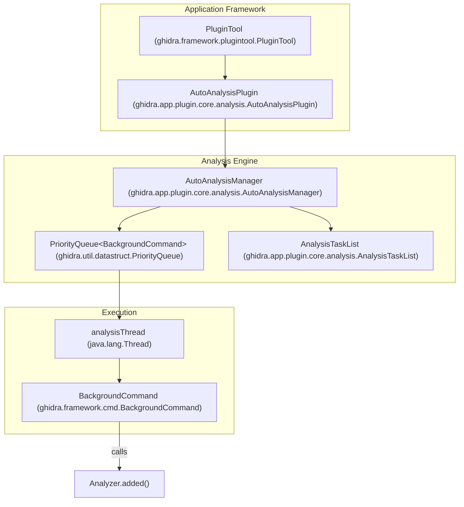
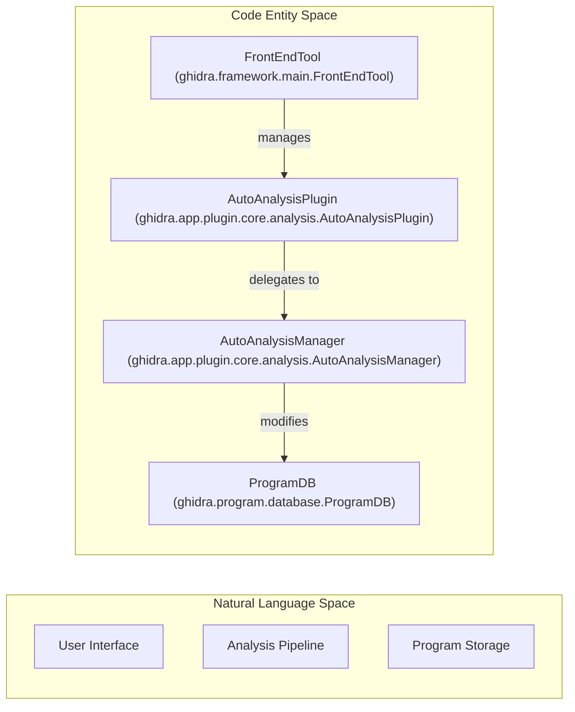
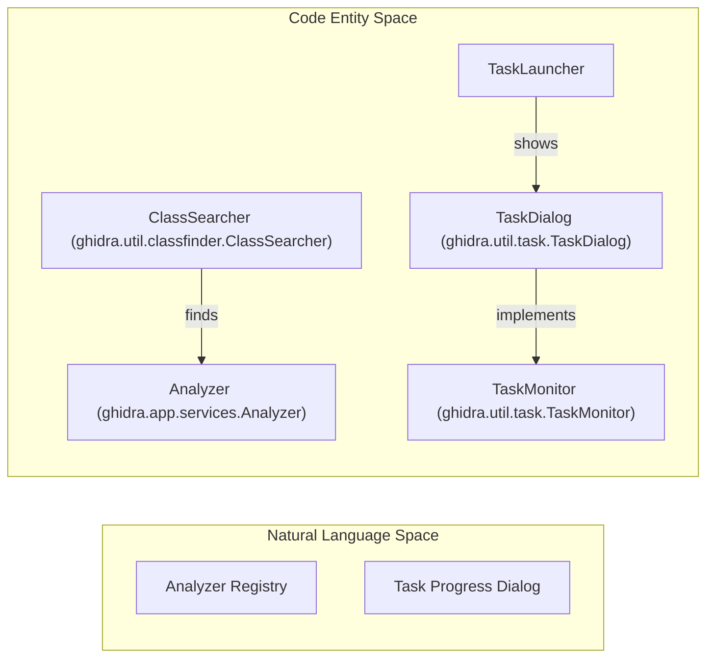

<!-- source: DeepWiki mcp.deepwiki.com · repo NationalSecurityAgency/ghidra · page 8.3 Auto-Analysis Pipeline · fetched 2026-11-09 -->

# Auto-Analysis Pipeline

Relevant source files

The following files were used as context for generating this wiki page:

- [Ghidra/Configurations/Public_Release/data/DWARF.debuginfod_urls](Ghidra/Configurations/Public_Release/data/DWARF.debuginfod_urls)
- [Ghidra/Features/Base/certification.manifest](Ghidra/Features/Base/certification.manifest)
- [Ghidra/Features/Base/data/base.icons.theme.properties](Ghidra/Features/Base/data/base.icons.theme.properties)
- [Ghidra/Features/Base/ghidra_scripts/DWARFSetExternalDebugFilesLocationPrescript.java](Ghidra/Features/Base/ghidra_scripts/DWARFSetExternalDebugFilesLocationPrescript.java)
- [Ghidra/Features/Base/ghidra_scripts/MultiInstructionMemReference.java](Ghidra/Features/Base/ghidra_scripts/MultiInstructionMemReference.java)
- [Ghidra/Features/Base/ghidra_scripts/PropagateConstantReferences.java](Ghidra/Features/Base/ghidra_scripts/PropagateConstantReferences.java)
- [Ghidra/Features/Base/ghidra_scripts/PropagateX86ConstantReferences.java](Ghidra/Features/Base/ghidra_scripts/PropagateX86ConstantReferences.java)
- [Ghidra/Features/Base/ghidra_scripts/ResolveX86orX64LinuxSyscallsScript.java](Ghidra/Features/Base/ghidra_scripts/ResolveX86orX64LinuxSyscallsScript.java)
- [Ghidra/Features/Base/src/main/help/help/TOC_Source.xml](Ghidra/Features/Base/src/main/help/help/TOC_Source.xml)
- [Ghidra/Features/Base/src/main/help/help/topics/Accessibility/AccessibilityOverview.html](Ghidra/Features/Base/src/main/help/help/topics/Accessibility/AccessibilityOverview.html)
- [Ghidra/Features/Base/src/main/help/help/topics/DWARFExternalDebugFilesPlugin/DWARFExternalDebugFilesPlugin.html](Ghidra/Features/Base/src/main/help/help/topics/DWARFExternalDebugFilesPlugin/DWARFExternalDebugFilesPlugin.html)
- [Ghidra/Features/Base/src/main/help/help/topics/DWARFExternalDebugFilesPlugin/images/ExternalDebugFilesConfigDialog.png](Ghidra/Features/Base/src/main/help/help/topics/DWARFExternalDebugFilesPlugin/images/ExternalDebugFilesConfigDialog.png)
- [Ghidra/Features/Base/src/main/help/help/topics/DataTypeManagerPlugin/data_type_manager_archives.html](Ghidra/Features/Base/src/main/help/help/topics/DataTypeManagerPlugin/data_type_manager_archives.html)
- [Ghidra/Features/Base/src/main/help/help/topics/GhidraScriptMgrPlugin/GhidraScriptMgrPlugin.htm](Ghidra/Features/Base/src/main/help/help/topics/GhidraScriptMgrPlugin/GhidraScriptMgrPlugin.htm)
- [Ghidra/Features/Base/src/main/help/help/topics/ResourceActionsPlugin/ResourceActions.html](Ghidra/Features/Base/src/main/help/help/topics/ResourceActionsPlugin/ResourceActions.html)
- [Ghidra/Features/Base/src/main/help/help/topics/Tool/ToolOptions_Dialog.htm](Ghidra/Features/Base/src/main/help/help/topics/Tool/ToolOptions_Dialog.htm)
- [Ghidra/Features/Base/src/main/java/ghidra/app/cmd/function/CreateThunkFunctionCmd.java](Ghidra/Features/Base/src/main/java/ghidra/app/cmd/function/CreateThunkFunctionCmd.java)
- [Ghidra/Features/Base/src/main/java/ghidra/app/cmd/function/NewFunctionStackAnalysisCmd.java](Ghidra/Features/Base/src/main/java/ghidra/app/cmd/function/NewFunctionStackAnalysisCmd.java)
- [Ghidra/Features/Base/src/main/java/ghidra/app/plugin/core/analysis/AnalysisOptionsDialog.java](Ghidra/Features/Base/src/main/java/ghidra/app/plugin/core/analysis/AnalysisOptionsDialog.java)
- [Ghidra/Features/Base/src/main/java/ghidra/app/plugin/core/analysis/AnalysisOptionsUpdater.java](Ghidra/Features/Base/src/main/java/ghidra/app/plugin/core/analysis/AnalysisOptionsUpdater.java)
- [Ghidra/Features/Base/src/main/java/ghidra/app/plugin/core/analysis/AnalysisPanel.java](Ghidra/Features/Base/src/main/java/ghidra/app/plugin/core/analysis/AnalysisPanel.java)
- [Ghidra/Features/Base/src/main/java/ghidra/app/plugin/core/analysis/AutoAnalysisManager.java](Ghidra/Features/Base/src/main/java/ghidra/app/plugin/core/analysis/AutoAnalysisManager.java)
- [Ghidra/Features/Base/src/main/java/ghidra/app/plugin/core/analysis/AutoAnalysisPlugin.java](Ghidra/Features/Base/src/main/java/ghidra/app/plugin/core/analysis/AutoAnalysisPlugin.java)
- [Ghidra/Features/Base/src/main/java/ghidra/app/plugin/core/analysis/ConstantPropagationAnalyzer.java](Ghidra/Features/Base/src/main/java/ghidra/app/plugin/core/analysis/ConstantPropagationAnalyzer.java)
- [Ghidra/Features/Base/src/main/java/ghidra/app/plugin/core/analysis/ConstantPropagationContextEvaluator.java](Ghidra/Features/Base/src/main/java/ghidra/app/plugin/core/analysis/ConstantPropagationContextEvaluator.java)
- [Ghidra/Features/Base/src/main/java/ghidra/app/plugin/core/analysis/DWARFAnalyzer.java](Ghidra/Features/Base/src/main/java/ghidra/app/plugin/core/analysis/DWARFAnalyzer.java)
- [Ghidra/Features/Base/src/main/java/ghidra/app/plugin/core/analysis/OneShotAnalysisCommand.java](Ghidra/Features/Base/src/main/java/ghidra/app/plugin/core/analysis/OneShotAnalysisCommand.java)
- [Ghidra/Features/Base/src/main/java/ghidra/app/plugin/core/function/EditThunkFunctionAction.java](Ghidra/Features/Base/src/main/java/ghidra/app/plugin/core/function/EditThunkFunctionAction.java)
- [Ghidra/Features/Base/src/main/java/ghidra/app/plugin/core/printing/PrintingPlugin.java](Ghidra/Features/Base/src/main/java/ghidra/app/plugin/core/printing/PrintingPlugin.java)
- [Ghidra/Features/Base/src/main/java/ghidra/app/plugin/core/resources/ResourceActionsPlugin.java](Ghidra/Features/Base/src/main/java/ghidra/app/plugin/core/resources/ResourceActionsPlugin.java)
- [Ghidra/Features/Base/src/main/java/ghidra/app/plugin/core/totd/TipOfTheDayPlugin.java](Ghidra/Features/Base/src/main/java/ghidra/app/plugin/core/totd/TipOfTheDayPlugin.java)
- [Ghidra/Features/Base/src/main/java/ghidra/app/plugin/runtimeinfo/RuntimeInfoPlugin.java](Ghidra/Features/Base/src/main/java/ghidra/app/plugin/runtimeinfo/RuntimeInfoPlugin.java)
- [Ghidra/Features/Base/src/main/java/ghidra/app/util/headless/HeadlessTimedTaskMonitor.java](Ghidra/Features/Base/src/main/java/ghidra/app/util/headless/HeadlessTimedTaskMonitor.java)
- [Ghidra/Features/Base/src/main/java/ghidra/app/util/viewer/field/ResourceFieldLocation.java](Ghidra/Features/Base/src/main/java/ghidra/app/util/viewer/field/ResourceFieldLocation.java)
- [Ghidra/Features/Base/src/main/java/ghidra/program/util/GhidraProgramUtilities.java](Ghidra/Features/Base/src/main/java/ghidra/program/util/GhidraProgramUtilities.java)
- [Ghidra/Features/Base/src/main/java/ghidra/program/util/SymbolicPropogator.java](Ghidra/Features/Base/src/main/java/ghidra/program/util/SymbolicPropogator.java)
- [Ghidra/Features/Base/src/main/java/ghidra/program/util/VarnodeContext.java](Ghidra/Features/Base/src/main/java/ghidra/program/util/VarnodeContext.java)
- [Ghidra/Features/Base/src/test.slow/java/docking/widgets/table/model/DirData.java](Ghidra/Features/Base/src/test.slow/java/docking/widgets/table/model/DirData.java)
- [Ghidra/Features/Base/src/test.slow/java/ghidra/app/plugin/core/analysis/AnalysisOptionsTest.java](Ghidra/Features/Base/src/test.slow/java/ghidra/app/plugin/core/analysis/AnalysisOptionsTest.java)
- [Ghidra/Features/Base/src/test.slow/java/ghidra/app/plugin/core/datamgr/DataTypeArchiveIDTest.java](Ghidra/Features/Base/src/test.slow/java/ghidra/app/plugin/core/datamgr/DataTypeArchiveIDTest.java)
- [Ghidra/Features/Base/src/test/java/ghidra/program/util/ConstantPropogationReferenceTest.java](Ghidra/Features/Base/src/test/java/ghidra/program/util/ConstantPropogationReferenceTest.java)
- [Ghidra/Features/Base/src/test/java/ghidra/program/util/SymbolicPropogatorTest.java](Ghidra/Features/Base/src/test/java/ghidra/program/util/SymbolicPropogatorTest.java)
- [Ghidra/Features/BytePatterns/src/main/java/ghidra/app/analyzers/FunctionStartAnalyzer.java](Ghidra/Features/BytePatterns/src/main/java/ghidra/app/analyzers/FunctionStartAnalyzer.java)
- [Ghidra/Features/BytePatterns/src/main/java/ghidra/app/analyzers/FunctionStartPreFuncAnalyzer.java](Ghidra/Features/BytePatterns/src/main/java/ghidra/app/analyzers/FunctionStartPreFuncAnalyzer.java)
- [Ghidra/Features/BytePatterns/src/main/java/ghidra/app/analyzers/Patterns.java](Ghidra/Features/BytePatterns/src/main/java/ghidra/app/analyzers/Patterns.java)
- [Ghidra/Features/Decompiler/src/main/java/ghidra/app/plugin/core/analysis/DecompilerSwitchAnalyzer.java](Ghidra/Features/Decompiler/src/main/java/ghidra/app/plugin/core/analysis/DecompilerSwitchAnalyzer.java)
- [Ghidra/Features/FunctionID/src/main/java/ghidra/feature/fid/analyzer/FidAnalyzer.java](Ghidra/Features/FunctionID/src/main/java/ghidra/feature/fid/analyzer/FidAnalyzer.java)
- [Ghidra/Features/FunctionID/src/main/java/ghidra/feature/fid/db/FidFileManager.java](Ghidra/Features/FunctionID/src/main/java/ghidra/feature/fid/db/FidFileManager.java)
- [Ghidra/Features/FunctionID/src/main/java/ghidra/feature/fid/plugin/FidPlugin.java](Ghidra/Features/FunctionID/src/main/java/ghidra/feature/fid/plugin/FidPlugin.java)
- [Ghidra/Features/Rust/src/test.slow/java/ghidra/app/plugin/core/datamgr/RustDataTypeArchiveIDTest.java](Ghidra/Features/Rust/src/test.slow/java/ghidra/app/plugin/core/datamgr/RustDataTypeArchiveIDTest.java)
- [Ghidra/Features/VersionTracking/src/main/java/ghidra/feature/vt/gui/actions/RemoveMatchAction.java](Ghidra/Features/VersionTracking/src/main/java/ghidra/feature/vt/gui/actions/RemoveMatchAction.java)
- [Ghidra/Features/VersionTracking/src/main/java/ghidra/feature/vt/gui/filters/AbstractAddressRangeFilter.java](Ghidra/Features/VersionTracking/src/main/java/ghidra/feature/vt/gui/filters/AbstractAddressRangeFilter.java)
- [Ghidra/Features/VersionTracking/src/main/java/ghidra/feature/vt/gui/filters/Filter.java](Ghidra/Features/VersionTracking/src/main/java/ghidra/feature/vt/gui/filters/Filter.java)
- [Ghidra/Features/VersionTracking/src/main/java/ghidra/feature/vt/gui/provider/matchtable/AbstractDoubleRangeFilter.java](Ghidra/Features/VersionTracking/src/main/java/ghidra/feature/vt/gui/provider/matchtable/AbstractDoubleRangeFilter.java)
- [Ghidra/Features/VersionTracking/src/main/java/ghidra/feature/vt/gui/provider/matchtable/LengthFilter.java](Ghidra/Features/VersionTracking/src/main/java/ghidra/feature/vt/gui/provider/matchtable/LengthFilter.java)
- [Ghidra/Features/VersionTracking/src/main/java/ghidra/feature/vt/gui/util/AbstractTextFilter.java](Ghidra/Features/VersionTracking/src/main/java/ghidra/feature/vt/gui/util/AbstractTextFilter.java)
- [Ghidra/Framework/Docking/src/main/help/help/topics/KeyboardNavigation/KeyboardNavigation.html](Ghidra/Framework/Docking/src/main/help/help/topics/KeyboardNavigation/KeyboardNavigation.html)
- [Ghidra/Framework/Docking/src/main/java/docking/options/editor/ColorEditor.java](Ghidra/Framework/Docking/src/main/java/docking/options/editor/ColorEditor.java)
- [Ghidra/Framework/Docking/src/main/java/docking/options/editor/OptionsDialog.java](Ghidra/Framework/Docking/src/main/java/docking/options/editor/OptionsDialog.java)
- [Ghidra/Framework/Docking/src/main/java/docking/options/editor/OptionsPanel.java](Ghidra/Framework/Docking/src/main/java/docking/options/editor/OptionsPanel.java)
- [Ghidra/Framework/Docking/src/main/java/docking/tool/ToolConstants.java](Ghidra/Framework/Docking/src/main/java/docking/tool/ToolConstants.java)
- [Ghidra/Framework/Docking/src/main/java/docking/widgets/table/AddRemoveListItem.java](Ghidra/Framework/Docking/src/main/java/docking/widgets/table/AddRemoveListItem.java)
- [Ghidra/Framework/Docking/src/main/java/ghidra/util/task/BasicTaskMonitor.java](Ghidra/Framework/Docking/src/main/java/ghidra/util/task/BasicTaskMonitor.java)
- [Ghidra/Framework/Docking/src/main/java/ghidra/util/task/TaskDialog.java](Ghidra/Framework/Docking/src/main/java/ghidra/util/task/TaskDialog.java)
- [Ghidra/Framework/Docking/src/main/java/ghidra/util/task/TaskLauncher.java](Ghidra/Framework/Docking/src/main/java/ghidra/util/task/TaskLauncher.java)
- [Ghidra/Framework/Docking/src/main/java/ghidra/util/task/TaskMonitorComponent.java](Ghidra/Framework/Docking/src/main/java/ghidra/util/task/TaskMonitorComponent.java)
- [Ghidra/Framework/Docking/src/main/java/ghidra/util/task/TaskRunner.java](Ghidra/Framework/Docking/src/main/java/ghidra/util/task/TaskRunner.java)
- [Ghidra/Framework/Docking/src/test/java/ghidra/util/task/AbstractTaskTest.java](Ghidra/Framework/Docking/src/test/java/ghidra/util/task/AbstractTaskTest.java)
- [Ghidra/Framework/Docking/src/test/java/ghidra/util/task/TaskDialogTest.java](Ghidra/Framework/Docking/src/test/java/ghidra/util/task/TaskDialogTest.java)
- [Ghidra/Framework/Docking/src/test/java/ghidra/util/task/TaskLauncherTest.java](Ghidra/Framework/Docking/src/test/java/ghidra/util/task/TaskLauncherTest.java)
- [Ghidra/Framework/Generic/src/main/java/generic/concurrent/FutureTaskMonitor.java](Ghidra/Framework/Generic/src/main/java/generic/concurrent/FutureTaskMonitor.java)
- [Ghidra/Framework/Generic/src/main/java/ghidra/util/task/TaskMonitorAdapter.java](Ghidra/Framework/Generic/src/main/java/ghidra/util/task/TaskMonitorAdapter.java)
- [Ghidra/Framework/Generic/src/main/java/ghidra/util/task/TaskMonitorSplitter.java](Ghidra/Framework/Generic/src/main/java/ghidra/util/task/TaskMonitorSplitter.java)
- [Ghidra/Framework/Generic/src/main/java/ghidra/util/task/TimeoutTaskMonitor.java](Ghidra/Framework/Generic/src/main/java/ghidra/util/task/TimeoutTaskMonitor.java)
- [Ghidra/Framework/Generic/src/main/java/ghidra/util/task/WrappingTaskMonitor.java](Ghidra/Framework/Generic/src/main/java/ghidra/util/task/WrappingTaskMonitor.java)
- [Ghidra/Framework/Generic/src/main/java/ghidra/util/timer/GTimerMonitor.java](Ghidra/Framework/Generic/src/main/java/ghidra/util/timer/GTimerMonitor.java)
- [Ghidra/Framework/Gui/src/main/java/ghidra/framework/options/OptionsEditor.java](Ghidra/Framework/Gui/src/main/java/ghidra/framework/options/OptionsEditor.java)
- [Ghidra/Framework/Gui/src/main/java/ghidra/util/WebColors.java](Ghidra/Framework/Gui/src/main/java/ghidra/util/WebColors.java)
- [Ghidra/Framework/Project/src/main/java/ghidra/framework/data/LockingTaskMonitor.java](Ghidra/Framework/Project/src/main/java/ghidra/framework/data/LockingTaskMonitor.java)
- [Ghidra/Framework/Project/src/main/java/ghidra/framework/main/FrontEndTool.java](Ghidra/Framework/Project/src/main/java/ghidra/framework/main/FrontEndTool.java)
- [Ghidra/Framework/Project/src/main/java/ghidra/framework/plugintool/PluginTool.java](Ghidra/Framework/Project/src/main/java/ghidra/framework/plugintool/PluginTool.java)
- [Ghidra/Framework/Project/src/main/java/ghidra/framework/task/GTaskMonitor.java](Ghidra/Framework/Project/src/main/java/ghidra/framework/task/GTaskMonitor.java)
- [Ghidra/Framework/Utility/src/main/java/ghidra/util/Swing.java](Ghidra/Framework/Utility/src/main/java/ghidra/util/Swing.java)
- [Ghidra/Framework/Utility/src/main/java/ghidra/util/SystemUtilities.java](Ghidra/Framework/Utility/src/main/java/ghidra/util/SystemUtilities.java)
- [Ghidra/Framework/Utility/src/main/java/ghidra/util/task/TaskMonitor.java](Ghidra/Framework/Utility/src/main/java/ghidra/util/task/TaskMonitor.java)
- [Ghidra/Processors/68000/src/main/java/ghidra/app/plugin/core/analysis/Motorola68KAnalyzer.java](Ghidra/Processors/68000/src/main/java/ghidra/app/plugin/core/analysis/Motorola68KAnalyzer.java)
- [Ghidra/Processors/AARCH64/data/languages/AARCH64.dwarf](Ghidra/Processors/AARCH64/data/languages/AARCH64.dwarf)
- [Ghidra/Processors/AARCH64/data/languages/AARCH64_golang.register.info](Ghidra/Processors/AARCH64/data/languages/AARCH64_golang.register.info)
- [Ghidra/Processors/AARCH64/data/patterns/AARCH64_LE_patterns.xml](Ghidra/Processors/AARCH64/data/patterns/AARCH64_LE_patterns.xml)
- [Ghidra/Processors/AARCH64/src/main/java/ghidra/app/plugin/core/analysis/AARCH64PltThunkAnalyzer.java](Ghidra/Processors/AARCH64/src/main/java/ghidra/app/plugin/core/analysis/AARCH64PltThunkAnalyzer.java)
- [Ghidra/Processors/ARM/src/main/java/ghidra/app/plugin/core/analysis/ArmAnalyzer.java](Ghidra/Processors/ARM/src/main/java/ghidra/app/plugin/core/analysis/ArmAnalyzer.java)
- [Ghidra/Processors/MIPS/src/main/java/ghidra/app/plugin/core/analysis/MipsAddressAnalyzer.java](Ghidra/Processors/MIPS/src/main/java/ghidra/app/plugin/core/analysis/MipsAddressAnalyzer.java)
- [Ghidra/Processors/PIC/data/languages/pic16.ldefs](Ghidra/Processors/PIC/data/languages/pic16.ldefs)
- [Ghidra/Processors/PIC/data/languages/pic16.pspec](Ghidra/Processors/PIC/data/languages/pic16.pspec)
- [Ghidra/Processors/PIC/data/languages/pic16.sinc](Ghidra/Processors/PIC/data/languages/pic16.sinc)
- [Ghidra/Processors/PIC/data/languages/pic16_instructions.sinc](Ghidra/Processors/PIC/data/languages/pic16_instructions.sinc)
- [Ghidra/Processors/PIC/data/languages/pic16f.pspec](Ghidra/Processors/PIC/data/languages/pic16f.pspec)
- [Ghidra/Processors/PIC/src/main/java/ghidra/app/plugin/core/analysis/Pic16Analyzer.java](Ghidra/Processors/PIC/src/main/java/ghidra/app/plugin/core/analysis/Pic16Analyzer.java)
- [Ghidra/Processors/PowerPC/certification.manifest](Ghidra/Processors/PowerPC/certification.manifest)
- [Ghidra/Processors/PowerPC/data/languages/SPE_FloatMulAdd.sinc](Ghidra/Processors/PowerPC/data/languages/SPE_FloatMulAdd.sinc)
- [Ghidra/Processors/PowerPC/data/languages/ppc.ldefs](Ghidra/Processors/PowerPC/data/languages/ppc.ldefs)
- [Ghidra/Processors/PowerPC/data/languages/ppc_64_isa_vle_be.slaspec](Ghidra/Processors/PowerPC/data/languages/ppc_64_isa_vle_be.slaspec)
- [Ghidra/Processors/PowerPC/data/patterns/PPC_BE_patterns.xml](Ghidra/Processors/PowerPC/data/patterns/PPC_BE_patterns.xml)
- [Ghidra/Processors/PowerPC/data/patterns/PPC_BE_prepatterns.xml](Ghidra/Processors/PowerPC/data/patterns/PPC_BE_prepatterns.xml)
- [Ghidra/Processors/PowerPC/data/patterns/PPC_LE_patterns.xml](Ghidra/Processors/PowerPC/data/patterns/PPC_LE_patterns.xml)
- [Ghidra/Processors/PowerPC/data/patterns/PPC_LE_prepatterns.xml](Ghidra/Processors/PowerPC/data/patterns/PPC_LE_prepatterns.xml)
- [Ghidra/Processors/PowerPC/data/patterns/patternconstraints.xml](Ghidra/Processors/PowerPC/data/patterns/patternconstraints.xml)
- [Ghidra/Processors/PowerPC/data/patterns/prepatternconstraints.xml](Ghidra/Processors/PowerPC/data/patterns/prepatternconstraints.xml)
- [Ghidra/Processors/PowerPC/src/main/java/ghidra/app/plugin/core/analysis/PowerPCAddressAnalyzer.java](Ghidra/Processors/PowerPC/src/main/java/ghidra/app/plugin/core/analysis/PowerPCAddressAnalyzer.java)
- [Ghidra/Processors/RISCV/src/main/java/ghidra/app/plugin/core/analysis/RISCVAddressAnalyzer.java](Ghidra/Processors/RISCV/src/main/java/ghidra/app/plugin/core/analysis/RISCVAddressAnalyzer.java)
- [Ghidra/Processors/Sparc/src/main/java/ghidra/app/plugin/core/analysis/SparcAnalyzer.java](Ghidra/Processors/Sparc/src/main/java/ghidra/app/plugin/core/analysis/SparcAnalyzer.java)
- [Ghidra/Processors/SuperH4/data/languages/SuperH4.ldefs](Ghidra/Processors/SuperH4/data/languages/SuperH4.ldefs)
- [Ghidra/Processors/SuperH4/src/main/java/ghidra/app/plugin/core/analysis/SH4AddressAnalyzer.java](Ghidra/Processors/SuperH4/src/main/java/ghidra/app/plugin/core/analysis/SH4AddressAnalyzer.java)
- [Ghidra/Processors/SuperH4/src/main/java/ghidra/app/plugin/core/analysis/SH4EarlyAddressAnalyzer.java](Ghidra/Processors/SuperH4/src/main/java/ghidra/app/plugin/core/analysis/SH4EarlyAddressAnalyzer.java)
- [Ghidra/Processors/x86/data/languages/x86-64-golang.register.info](Ghidra/Processors/x86/data/languages/x86-64-golang.register.info)
- [Ghidra/Processors/x86/data/patterns/prepatternconstraints.xml](Ghidra/Processors/x86/data/patterns/prepatternconstraints.xml)
- [Ghidra/Processors/x86/data/patterns/x86gcc_prepatterns.xml](Ghidra/Processors/x86/data/patterns/x86gcc_prepatterns.xml)

The Auto-Analysis Pipeline is Ghidra's central coordination subsystem for automatically populating a `ProgramDB` with semantic information, transforming raw bytes into structured functions, data types, and references. It orchestrates a modular registry of `Analyzer` implementations through background task execution managed by `AutoAnalysisManager` and integrated into the user interface via `AutoAnalysisPlugin` [Ghidra/Features/Base/src/main/java/ghidra/app/plugin/core/analysis/AutoAnalysisManager.java:63-65](), [Ghidra/Features/Base/src/main/java/ghidra/app/plugin/core/analysis/AutoAnalysisPlugin.java:67-67]().

---

## Pipeline Architecture and Coordination

The auto-analysis system is driven by two core classes that bridge the UI tool environment and the background task queue:

*   **`AutoAnalysisPlugin`**: A `Plugin` that registers the auto-analysis UI actions (`Auto Analyze...`, `Analyze All Open...`) within the `PluginTool` and exposes configuration dialogs [Ghidra/Features/Base/src/main/java/ghidra/app/plugin/core/analysis/AutoAnalysisPlugin.java:67-135]().
*   **`AutoAnalysisManager`**: A per-program singleton manager that monitors program changes via a private event queue (`DomainObjectListener`), schedules tasks into prioritized queues (`PriorityQueue`), and executes them using background threads [Ghidra/Features/Base/src/main/java/ghidra/app/plugin/core/analysis/AutoAnalysisManager.java:63-154]().

### Analysis Coordination Diagram

The following diagram illustrates the relationship between the tool framework, the manager, and the background execution thread.

**Ghidra Analysis Coordination**

**Sources:** [Ghidra/Features/Base/src/main/java/ghidra/app/plugin/core/analysis/AutoAnalysisManager.java:111-154](), [Ghidra/Framework/Project/src/main/java/ghidra/framework/plugintool/PluginTool.java:79-115]()

---

## Analyzer Priority, Dependencies, and Options UI

Analyzers declare their execution ordering using `AnalysisPriority` constants (e.g., reference analysis, byte analysis, decompiler parameter analysis) [Ghidra/Features/Base/src/main/java/ghidra/app/plugin/core/analysis/ConstantPropagationAnalyzer.java:120-120](). The `AutoAnalysisManager` groups analyzers into task lists by `AnalyzerType` (`BYTE_ANALYZER`, `FUNCTION_ANALYZER`, `INSTRUCTION_ANALYZER`, `DATA_ANALYZER`) [Ghidra/Features/Base/src/main/java/ghidra/app/plugin/core/analysis/AutoAnalysisManager.java:157-164]().

Users can inspect and toggle individual analyzers or configure their options through the `AnalysisPanel` and `AnalysisOptionsDialog` [Ghidra/Features/Base/src/main/java/ghidra/app/plugin/core/analysis/AnalysisPanel.java:56-141](). Options are stored within program properties (`Program.ANALYSIS_PROPERTIES`) and support custom profiles and defaults [Ghidra/Features/Base/src/main/java/ghidra/app/plugin/core/analysis/AnalysisPanel.java:78-80]().

**Sources:** [Ghidra/Features/Base/src/main/java/ghidra/app/plugin/core/analysis/AutoAnalysisManager.java:157-168](), [Ghidra/Features/Base/src/main/java/ghidra/app/plugin/core/analysis/AnalysisPanel.java:109-141]()

---

## Key Built-in Analyzers

Ghidra ships with numerous built-in analyzers that execute during the pipeline:

*   **Constant Propagation (`ConstantPropagationAnalyzer`)**: Uses `SymbolicPropogator` and `VarnodeContext` to trace constants and register values across instructions, discovering memory references, switch tables, and pointer parameters [Ghidra/Features/Base/src/main/java/ghidra/app/plugin/core/analysis/ConstantPropagationAnalyzer.java:38-44](), [Ghidra/Features/Base/src/main/java/ghidra/program/util/SymbolicPropogator.java:43-63]().
*   **Entry Point Analyzer**: Identifies program entry points (e.g., `main`, initialization routines) and initiates function creation.
*   **Thunk and No-Return Detection**: Detects thunk wrappers (`CreateThunkFunctionCmd`) and functions that never return (utilizing constraints from XML files like `noReturnFunctionConstraints.xml`) [Ghidra/Features/Base/src/main/java/ghidra/app/cmd/function/CreateThunkFunctionCmd.java:42-56](), [Ghidra/Features/Base/certification.manifest:33-33]().
*   **Byte-Pattern Function Start Analyzers**: Scans raw memory sections for architecture-specific function prologue byte patterns to seed disassembly [Ghidra/Features/BytePatterns/src/main/java/ghidra/app/analyzers/FunctionStartAnalyzer.java:1-50]().
*   **DWARF Analyzer (`DWARFAnalyzer`)**: Parses DWARF debug sections to recover types, local variables, and source file mappings [Ghidra/Features/Base/src/main/java/ghidra/app/plugin/core/analysis/DWARFAnalyzer.java:1-50]().
*   **Demanglers**: Recovers structured C++ names. For details on the demangling framework, GNU, and Microsoft demanglers, see [Demanglers](#8.3.2).
*   **Language-Specific Metadata Analyzers**: Recovers high-level runtime metadata (Golang RTTI, Rust, Swift, Objective-C, and Function ID database matching). For details, see [Language-Specific Metadata Analyzers](#8.3.1).

**Sources:** [Ghidra/Features/Base/src/main/java/ghidra/app/plugin/core/analysis/ConstantPropagationAnalyzer.java:38-125](), [Ghidra/Program/Util/SymbolicPropogator.java:43-63](), [Ghidra/Features/Base/src/main/java/ghidra/app/cmd/function/CreateThunkFunctionCmd.java:42-56](), [Ghidra/Features/Base/certification.manifest:20-33]()

---

## Application Framework Integration

The analysis subsystem relies heavily on the `PluginTool` and `FrontEndTool` architecture for hosting services, managing background task progress via `TaskMonitor`, and logging messages through `MessageLog` [Ghidra/Features/Base/src/main/java/ghidra/app/plugin/core/analysis/AutoAnalysisManager.java:138-138](), [Ghidra/Framework/Project/src/main/java/ghidra/framework/plugintool/PluginTool.java:79-115]().

### Framework Entity Mapping

The following diagrams bridge natural language concepts to code entities within Ghidra.

**Analysis Pipeline Entity Mapping**

**Sources:** [Ghidra/Framework/Project/src/main/java/ghidra/framework/main/FrontEndTool.java:90-145](), [Ghidra/Features/Base/src/main/java/ghidra/app/plugin/core/analysis/AutoAnalysisManager.java:149-154]()

**Analyzer & Execution Entity Mapping**

**Sources:** [Ghidra/Features/Base/src/main/java/ghidra/app/plugin/core/analysis/AutoAnalysisPlugin.java:98-103](), [Ghidra/Framework/Docking/src/main/java/ghidra/util/task/TaskDialog.java:63-65]()

### Core Framework Components

| Component | Class | Responsibility |
| :--- | :--- | :--- |
| **Project Tool** | `FrontEndTool` | Manages the main project window and global options [Ghidra/Framework/Project/src/main/java/ghidra/framework/main/FrontEndTool.java:90-145](). |
| **Plugin Container** | `PluginTool` | Container managing tool plugins, services, and actions [Ghidra/Framework/Project/src/main/java/ghidra/framework/plugintool/PluginTool.java:79-115](). |
| **Analysis Manager** | `AutoAnalysisManager` | Coordinates analyzer scheduling and background queue execution per program [Ghidra/Features/Base/src/main/java/ghidra/app/plugin/core/analysis/AutoAnalysisManager.java:63-65](). |
| **Task Monitor** | `TaskMonitor` / `TaskDialog` | Provides cancellation and progress feedback for background analysis tasks [Ghidra/Framework/Docking/src/main/java/ghidra/util/task/TaskDialog.java:63-65](). |

**Sources:** [Ghidra/Framework/Project/src/main/java/ghidra/framework/main/FrontEndTool.java:90-145](), [Ghidra/Framework/Project/src/main/java/ghidra/framework/plugintool/PluginTool.java:79-115](), [Ghidra/Features/Base/src/main/java/ghidra/app/plugin/core/analysis/AutoAnalysisManager.java:63-65](), [Ghidra/Framework/Docking/src/main/java/ghidra/util/task/TaskDialog.java:63-65]()

---

