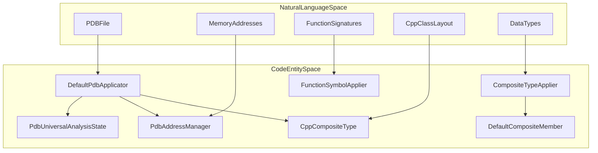
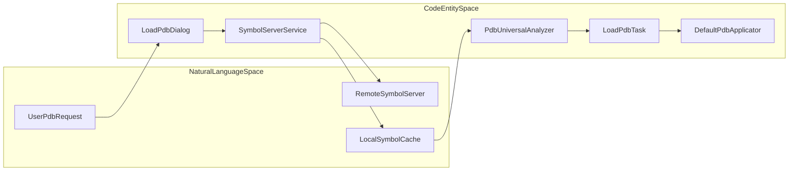

<!-- source: DeepWiki mcp.deepwiki.com · repo NationalSecurityAgency/ghidra · page 8.4 Debug Symbol Import (DWARF and PDB) · fetched 2026-11-09 -->

# Debug Symbol Import (DWARF and PDB)

Relevant source files

The following files were used as context for generating this wiki page:

- [.gitignore](.gitignore)
- [Ghidra/Features/Base/src/main/java/ghidra/formats/gfilesystem/RefdInputStream.java](Ghidra/Features/Base/src/main/java/ghidra/formats/gfilesystem/RefdInputStream.java)
- [Ghidra/Features/PDB/certification.manifest](Ghidra/Features/PDB/certification.manifest)
- [Ghidra/Features/PDB/developer_scripts/PdbSymbolServerExamplePrescript.java](Ghidra/Features/PDB/developer_scripts/PdbSymbolServerExamplePrescript.java)
- [Ghidra/Features/PDB/ghidra_scripts/GetMSDownloadLinkScript.java](Ghidra/Features/PDB/ghidra_scripts/GetMSDownloadLinkScript.java)
- [Ghidra/Features/PDB/src/main/help/help/TOC_Source.xml](Ghidra/Features/PDB/src/main/help/help/TOC_Source.xml)
- [Ghidra/Features/PDB/src/main/help/help/topics/Pdb/LoadPDB.html](Ghidra/Features/PDB/src/main/help/help/topics/Pdb/LoadPDB.html)
- [Ghidra/Features/PDB/src/main/help/help/topics/Pdb/PDB.htm](Ghidra/Features/PDB/src/main/help/help/topics/Pdb/PDB.htm)
- [Ghidra/Features/PDB/src/main/help/help/topics/Pdb/images/LoadPdb_Advanced_NeedsConfig.png](Ghidra/Features/PDB/src/main/help/help/topics/Pdb/images/LoadPdb_Advanced_NeedsConfig.png)
- [Ghidra/Features/PDB/src/main/help/help/topics/Pdb/images/LoadPdb_Advanced_Screenshot.png](Ghidra/Features/PDB/src/main/help/help/topics/Pdb/images/LoadPdb_Advanced_Screenshot.png)
- [Ghidra/Features/PDB/src/main/help/help/topics/Pdb/images/LoadPdb_Initial_Screenshot.png](Ghidra/Features/PDB/src/main/help/help/topics/Pdb/images/LoadPdb_Initial_Screenshot.png)
- [Ghidra/Features/PDB/src/main/help/help/topics/Pdb/images/SymbolServerConfig_Configured.png](Ghidra/Features/PDB/src/main/help/help/topics/Pdb/images/SymbolServerConfig_Configured.png)
- [Ghidra/Features/PDB/src/main/java/ghidra/app/plugin/core/analysis/PdbAnalyzer.java](Ghidra/Features/PDB/src/main/java/ghidra/app/plugin/core/analysis/PdbAnalyzer.java)
- [Ghidra/Features/PDB/src/main/java/ghidra/app/plugin/core/analysis/PdbAnalyzerCommon.java](Ghidra/Features/PDB/src/main/java/ghidra/app/plugin/core/analysis/PdbAnalyzerCommon.java)
- [Ghidra/Features/PDB/src/main/java/ghidra/app/plugin/core/analysis/PdbUniversalAnalyzer.java](Ghidra/Features/PDB/src/main/java/ghidra/app/plugin/core/analysis/PdbUniversalAnalyzer.java)
- [Ghidra/Features/PDB/src/main/java/ghidra/app/util/bin/format/pdb/ApplyDataTypes.java](Ghidra/Features/PDB/src/main/java/ghidra/app/util/bin/format/pdb/ApplyDataTypes.java)
- [Ghidra/Features/PDB/src/main/java/ghidra/app/util/bin/format/pdb/ApplyEnums.java](Ghidra/Features/PDB/src/main/java/ghidra/app/util/bin/format/pdb/ApplyEnums.java)
- [Ghidra/Features/PDB/src/main/java/ghidra/app/util/bin/format/pdb/ApplyFunctions.java](Ghidra/Features/PDB/src/main/java/ghidra/app/util/bin/format/pdb/ApplyFunctions.java)
- [Ghidra/Features/PDB/src/main/java/ghidra/app/util/bin/format/pdb/ApplyLineNumbers.java](Ghidra/Features/PDB/src/main/java/ghidra/app/util/bin/format/pdb/ApplyLineNumbers.java)
- [Ghidra/Features/PDB/src/main/java/ghidra/app/util/bin/format/pdb/ApplyStackVariables.java](Ghidra/Features/PDB/src/main/java/ghidra/app/util/bin/format/pdb/ApplyStackVariables.java)
- [Ghidra/Features/PDB/src/main/java/ghidra/app/util/bin/format/pdb/ApplySymbols.java](Ghidra/Features/PDB/src/main/java/ghidra/app/util/bin/format/pdb/ApplySymbols.java)
- [Ghidra/Features/PDB/src/main/java/ghidra/app/util/bin/format/pdb/ApplyTypeDefs.java](Ghidra/Features/PDB/src/main/java/ghidra/app/util/bin/format/pdb/ApplyTypeDefs.java)
- [Ghidra/Features/PDB/src/main/java/ghidra/app/util/bin/format/pdb/BitFieldGroupCompositeMember.java](Ghidra/Features/PDB/src/main/java/ghidra/app/util/bin/format/pdb/BitFieldGroupCompositeMember.java)
- [Ghidra/Features/PDB/src/main/java/ghidra/app/util/bin/format/pdb/CompositeMember.java](Ghidra/Features/PDB/src/main/java/ghidra/app/util/bin/format/pdb/CompositeMember.java)
- [Ghidra/Features/PDB/src/main/java/ghidra/app/util/bin/format/pdb/DefaultCompositeMember.java](Ghidra/Features/PDB/src/main/java/ghidra/app/util/bin/format/pdb/DefaultCompositeMember.java)
- [Ghidra/Features/PDB/src/main/java/ghidra/app/util/bin/format/pdb/DefaultPdbMember.java](Ghidra/Features/PDB/src/main/java/ghidra/app/util/bin/format/pdb/DefaultPdbMember.java)
- [Ghidra/Features/PDB/src/main/java/ghidra/app/util/bin/format/pdb/PdbDataTypeParser.java](Ghidra/Features/PDB/src/main/java/ghidra/app/util/bin/format/pdb/PdbDataTypeParser.java)
- [Ghidra/Features/PDB/src/main/java/ghidra/app/util/bin/format/pdb/PdbMember.java](Ghidra/Features/PDB/src/main/java/ghidra/app/util/bin/format/pdb/PdbMember.java)
- [Ghidra/Features/PDB/src/main/java/ghidra/app/util/bin/format/pdb/PdbParser.java](Ghidra/Features/PDB/src/main/java/ghidra/app/util/bin/format/pdb/PdbParser.java)
- [Ghidra/Features/PDB/src/main/java/ghidra/app/util/bin/format/pdb/WrappedDataType.java](Ghidra/Features/PDB/src/main/java/ghidra/app/util/bin/format/pdb/WrappedDataType.java)
- [Ghidra/Features/PDB/src/main/java/ghidra/app/util/bin/format/pdb2/pdbreader/PdbLog.java](Ghidra/Features/PDB/src/main/java/ghidra/app/util/bin/format/pdb2/pdbreader/PdbLog.java)
- [Ghidra/Features/PDB/src/main/java/ghidra/app/util/bin/format/pdb2/pdbreader/PdbReaderMetrics.java](Ghidra/Features/PDB/src/main/java/ghidra/app/util/bin/format/pdb2/pdbreader/PdbReaderMetrics.java)
- [Ghidra/Features/PDB/src/main/java/ghidra/app/util/bin/format/pdb2/pdbreader/PdbReaderOptions.java](Ghidra/Features/PDB/src/main/java/ghidra/app/util/bin/format/pdb2/pdbreader/PdbReaderOptions.java)
- [Ghidra/Features/PDB/src/main/java/ghidra/app/util/pdb/PdbNamespaceUtils.java](Ghidra/Features/PDB/src/main/java/ghidra/app/util/pdb/PdbNamespaceUtils.java)
- [Ghidra/Features/PDB/src/main/java/ghidra/app/util/pdb/PdbProgramAttributes.java](Ghidra/Features/PDB/src/main/java/ghidra/app/util/pdb/PdbProgramAttributes.java)
- [Ghidra/Features/PDB/src/main/java/ghidra/app/util/pdb/classtype/MsVxtManager.java](Ghidra/Features/PDB/src/main/java/ghidra/app/util/pdb/classtype/MsVxtManager.java)
- [Ghidra/Features/PDB/src/main/java/ghidra/app/util/pdb/classtype/PlaceholderVirtualBaseTable.java](Ghidra/Features/PDB/src/main/java/ghidra/app/util/pdb/classtype/PlaceholderVirtualBaseTable.java)
- [Ghidra/Features/PDB/src/main/java/ghidra/app/util/pdb/classtype/ProgramVirtualBaseTable.java](Ghidra/Features/PDB/src/main/java/ghidra/app/util/pdb/classtype/ProgramVirtualBaseTable.java)
- [Ghidra/Features/PDB/src/main/java/ghidra/app/util/pdb/classtype/ProgramVirtualFunctionTable.java](Ghidra/Features/PDB/src/main/java/ghidra/app/util/pdb/classtype/ProgramVirtualFunctionTable.java)
- [Ghidra/Features/PDB/src/main/java/ghidra/app/util/pdb/classtype/VBTableEntry.java](Ghidra/Features/PDB/src/main/java/ghidra/app/util/pdb/classtype/VBTableEntry.java)
- [Ghidra/Features/PDB/src/main/java/ghidra/app/util/pdb/classtype/VirtualBaseTable.java](Ghidra/Features/PDB/src/main/java/ghidra/app/util/pdb/classtype/VirtualBaseTable.java)
- [Ghidra/Features/PDB/src/main/java/ghidra/app/util/pdb/classtype/VirtualBaseTableEntry.java](Ghidra/Features/PDB/src/main/java/ghidra/app/util/pdb/classtype/VirtualBaseTableEntry.java)
- [Ghidra/Features/PDB/src/main/java/ghidra/app/util/pdb/classtype/VirtualFunctionTable.java](Ghidra/Features/PDB/src/main/java/ghidra/app/util/pdb/classtype/VirtualFunctionTable.java)
- [Ghidra/Features/PDB/src/main/java/ghidra/app/util/pdb/pdbapplicator/AbstractComplexTypeApplier.java](Ghidra/Features/PDB/src/main/java/ghidra/app/util/pdb/pdbapplicator/AbstractComplexTypeApplier.java)
- [Ghidra/Features/PDB/src/main/java/ghidra/app/util/pdb/pdbapplicator/BlockNestingContext.java](Ghidra/Features/PDB/src/main/java/ghidra/app/util/pdb/pdbapplicator/BlockNestingContext.java)
- [Ghidra/Features/PDB/src/main/java/ghidra/app/util/pdb/pdbapplicator/BlockSymbolApplier.java](Ghidra/Features/PDB/src/main/java/ghidra/app/util/pdb/pdbapplicator/BlockSymbolApplier.java)
- [Ghidra/Features/PDB/src/main/java/ghidra/app/util/pdb/pdbapplicator/CompositeTypeApplier.java](Ghidra/Features/PDB/src/main/java/ghidra/app/util/pdb/pdbapplicator/CompositeTypeApplier.java)
- [Ghidra/Features/PDB/src/main/java/ghidra/app/util/pdb/pdbapplicator/CppCompositeType.java](Ghidra/Features/PDB/src/main/java/ghidra/app/util/pdb/pdbapplicator/CppCompositeType.java)
- [Ghidra/Features/PDB/src/main/java/ghidra/app/util/pdb/pdbapplicator/DataSymbolApplier.java](Ghidra/Features/PDB/src/main/java/ghidra/app/util/pdb/pdbapplicator/DataSymbolApplier.java)
- [Ghidra/Features/PDB/src/main/java/ghidra/app/util/pdb/pdbapplicator/DefaultPdbApplicator.java](Ghidra/Features/PDB/src/main/java/ghidra/app/util/pdb/pdbapplicator/DefaultPdbApplicator.java)
- [Ghidra/Features/PDB/src/main/java/ghidra/app/util/pdb/pdbapplicator/DefaultPdbUniversalMember.java](Ghidra/Features/PDB/src/main/java/ghidra/app/util/pdb/pdbapplicator/DefaultPdbUniversalMember.java)
- [Ghidra/Features/PDB/src/main/java/ghidra/app/util/pdb/pdbapplicator/DisassembleableAddressSymbolApplier.java](Ghidra/Features/PDB/src/main/java/ghidra/app/util/pdb/pdbapplicator/DisassembleableAddressSymbolApplier.java)
- [Ghidra/Features/PDB/src/main/java/ghidra/app/util/pdb/pdbapplicator/EndSymbolApplier.java](Ghidra/Features/PDB/src/main/java/ghidra/app/util/pdb/pdbapplicator/EndSymbolApplier.java)
- [Ghidra/Features/PDB/src/main/java/ghidra/app/util/pdb/pdbapplicator/FunctionSymbolApplier.java](Ghidra/Features/PDB/src/main/java/ghidra/app/util/pdb/pdbapplicator/FunctionSymbolApplier.java)
- [Ghidra/Features/PDB/src/main/java/ghidra/app/util/pdb/pdbapplicator/LabelSymbolApplier.java](Ghidra/Features/PDB/src/main/java/ghidra/app/util/pdb/pdbapplicator/LabelSymbolApplier.java)
- [Ghidra/Features/PDB/src/main/java/ghidra/app/util/pdb/pdbapplicator/LocalOptimizedSymbolApplier.java](Ghidra/Features/PDB/src/main/java/ghidra/app/util/pdb/pdbapplicator/LocalOptimizedSymbolApplier.java)
- [Ghidra/Features/PDB/src/main/java/ghidra/app/util/pdb/pdbapplicator/ManagedProcedureSymbolApplier.java](Ghidra/Features/PDB/src/main/java/ghidra/app/util/pdb/pdbapplicator/ManagedProcedureSymbolApplier.java)
- [Ghidra/Features/PDB/src/main/java/ghidra/app/util/pdb/pdbapplicator/PdbAddressManager.java](Ghidra/Features/PDB/src/main/java/ghidra/app/util/pdb/pdbapplicator/PdbAddressManager.java)
- [Ghidra/Features/PDB/src/main/java/ghidra/app/util/pdb/pdbapplicator/PdbApplicator.java](Ghidra/Features/PDB/src/main/java/ghidra/app/util/pdb/pdbapplicator/PdbApplicator.java)
- [Ghidra/Features/PDB/src/main/java/ghidra/app/util/pdb/pdbapplicator/PdbApplicatorMetrics.java](Ghidra/Features/PDB/src/main/java/ghidra/app/util/pdb/pdbapplicator/PdbApplicatorMetrics.java)
- [Ghidra/Features/PDB/src/main/java/ghidra/app/util/pdb/pdbapplicator/PdbApplicatorOptions.java](Ghidra/Features/PDB/src/main/java/ghidra/app/util/pdb/pdbapplicator/PdbApplicatorOptions.java)
- [Ghidra/Features/PDB/src/main/java/ghidra/app/util/pdb/pdbapplicator/PdbResearch.java](Ghidra/Features/PDB/src/main/java/ghidra/app/util/pdb/pdbapplicator/PdbResearch.java)
- [Ghidra/Features/PDB/src/main/java/ghidra/app/util/pdb/pdbapplicator/PdbSourceLinesApplicator.java](Ghidra/Features/PDB/src/main/java/ghidra/app/util/pdb/pdbapplicator/PdbSourceLinesApplicator.java)
- [Ghidra/Features/PDB/src/main/java/ghidra/app/util/pdb/pdbapplicator/PdbVbtManager.java](Ghidra/Features/PDB/src/main/java/ghidra/app/util/pdb/pdbapplicator/PdbVbtManager.java)
- [Ghidra/Features/PDB/src/main/java/ghidra/app/util/pdb/pdbapplicator/PeCoffGroupSymbolApplier.java](Ghidra/Features/PDB/src/main/java/ghidra/app/util/pdb/pdbapplicator/PeCoffGroupSymbolApplier.java)
- [Ghidra/Features/PDB/src/main/java/ghidra/app/util/pdb/pdbapplicator/PublicSymbolApplier.java](Ghidra/Features/PDB/src/main/java/ghidra/app/util/pdb/pdbapplicator/PublicSymbolApplier.java)
- [Ghidra/Features/PDB/src/main/java/ghidra/app/util/pdb/pdbapplicator/ReferenceSymbolApplier.java](Ghidra/Features/PDB/src/main/java/ghidra/app/util/pdb/pdbapplicator/ReferenceSymbolApplier.java)
- [Ghidra/Features/PDB/src/main/java/ghidra/app/util/pdb/pdbapplicator/SeparatedCodeSymbolApplier.java](Ghidra/Features/PDB/src/main/java/ghidra/app/util/pdb/pdbapplicator/SeparatedCodeSymbolApplier.java)
- [Ghidra/Features/PDB/src/main/java/ghidra/app/util/pdb/pdbapplicator/SymbolApplierFactory.java](Ghidra/Features/PDB/src/main/java/ghidra/app/util/pdb/pdbapplicator/SymbolApplierFactory.java)
- [Ghidra/Features/PDB/src/main/java/ghidra/app/util/pdb/pdbapplicator/SymbolGroup.java](Ghidra/Features/PDB/src/main/java/ghidra/app/util/pdb/pdbapplicator/SymbolGroup.java)
- [Ghidra/Features/PDB/src/main/java/ghidra/app/util/pdb/pdbapplicator/TrampolineSymbolApplier.java](Ghidra/Features/PDB/src/main/java/ghidra/app/util/pdb/pdbapplicator/TrampolineSymbolApplier.java)
- [Ghidra/Features/PDB/src/main/java/pdb/LoadPdbTask.java](Ghidra/Features/PDB/src/main/java/pdb/LoadPdbTask.java)
- [Ghidra/Features/PDB/src/main/java/pdb/PdbPlugin.java](Ghidra/Features/PDB/src/main/java/pdb/PdbPlugin.java)
- [Ghidra/Features/PDB/src/main/java/pdb/symbolserver/AbstractSymbolServer.java](Ghidra/Features/PDB/src/main/java/pdb/symbolserver/AbstractSymbolServer.java)
- [Ghidra/Features/PDB/src/main/java/pdb/symbolserver/ContainerFileSymbolServer.java](Ghidra/Features/PDB/src/main/java/pdb/symbolserver/ContainerFileSymbolServer.java)
- [Ghidra/Features/PDB/src/main/java/pdb/symbolserver/DisabledSymbolServer.java](Ghidra/Features/PDB/src/main/java/pdb/symbolserver/DisabledSymbolServer.java)
- [Ghidra/Features/PDB/src/main/java/pdb/symbolserver/FindOption.java](Ghidra/Features/PDB/src/main/java/pdb/symbolserver/FindOption.java)
- [Ghidra/Features/PDB/src/main/java/pdb/symbolserver/HttpSymbolServer.java](Ghidra/Features/PDB/src/main/java/pdb/symbolserver/HttpSymbolServer.java)
- [Ghidra/Features/PDB/src/main/java/pdb/symbolserver/LocalSymbolStore.java](Ghidra/Features/PDB/src/main/java/pdb/symbolserver/LocalSymbolStore.java)
- [Ghidra/Features/PDB/src/main/java/pdb/symbolserver/SameDirSymbolStore.java](Ghidra/Features/PDB/src/main/java/pdb/symbolserver/SameDirSymbolStore.java)
- [Ghidra/Features/PDB/src/main/java/pdb/symbolserver/SymbolFileInfo.java](Ghidra/Features/PDB/src/main/java/pdb/symbolserver/SymbolFileInfo.java)
- [Ghidra/Features/PDB/src/main/java/pdb/symbolserver/SymbolServer.java](Ghidra/Features/PDB/src/main/java/pdb/symbolserver/SymbolServer.java)
- [Ghidra/Features/PDB/src/main/java/pdb/symbolserver/SymbolServerInstanceCreatorContext.java](Ghidra/Features/PDB/src/main/java/pdb/symbolserver/SymbolServerInstanceCreatorContext.java)
- [Ghidra/Features/PDB/src/main/java/pdb/symbolserver/SymbolServerInstanceCreatorRegistry.java](Ghidra/Features/PDB/src/main/java/pdb/symbolserver/SymbolServerInstanceCreatorRegistry.java)
- [Ghidra/Features/PDB/src/main/java/pdb/symbolserver/SymbolServerService.java](Ghidra/Features/PDB/src/main/java/pdb/symbolserver/SymbolServerService.java)
- [Ghidra/Features/PDB/src/main/java/pdb/symbolserver/ui/ConfigPdbDialog.java](Ghidra/Features/PDB/src/main/java/pdb/symbolserver/ui/ConfigPdbDialog.java)
- [Ghidra/Features/PDB/src/main/java/pdb/symbolserver/ui/LoadPdbDialog.java](Ghidra/Features/PDB/src/main/java/pdb/symbolserver/ui/LoadPdbDialog.java)
- [Ghidra/Features/PDB/src/main/java/pdb/symbolserver/ui/SymbolFilePanel.java](Ghidra/Features/PDB/src/main/java/pdb/symbolserver/ui/SymbolFilePanel.java)
- [Ghidra/Features/PDB/src/test/java/ghidra/app/util/bin/format/pdb/CompositeMemberTest.java](Ghidra/Features/PDB/src/test/java/ghidra/app/util/bin/format/pdb/CompositeMemberTest.java)
- [Ghidra/Features/PDB/src/test/java/ghidra/app/util/bin/format/pdb/PdbParserTest.java](Ghidra/Features/PDB/src/test/java/ghidra/app/util/bin/format/pdb/PdbParserTest.java)
- [Ghidra/Features/PDB/src/test/java/ghidra/app/util/pdb/Cfb432ProgramCreator.java](Ghidra/Features/PDB/src/test/java/ghidra/app/util/pdb/Cfb432ProgramCreator.java)
- [Ghidra/Features/PDB/src/test/java/ghidra/app/util/pdb/Cfb464ProgramCreator.java](Ghidra/Features/PDB/src/test/java/ghidra/app/util/pdb/Cfb464ProgramCreator.java)
- [Ghidra/Features/PDB/src/test/java/ghidra/app/util/pdb/Egray832ProgramCreator.java](Ghidra/Features/PDB/src/test/java/ghidra/app/util/pdb/Egray832ProgramCreator.java)
- [Ghidra/Features/PDB/src/test/java/ghidra/app/util/pdb/Egray864ProgramCreator.java](Ghidra/Features/PDB/src/test/java/ghidra/app/util/pdb/Egray864ProgramCreator.java)
- [Ghidra/Features/PDB/src/test/java/ghidra/app/util/pdb/ProgramCreator.java](Ghidra/Features/PDB/src/test/java/ghidra/app/util/pdb/ProgramCreator.java)
- [Ghidra/Features/PDB/src/test/java/ghidra/app/util/pdb/Vftm32ProgramCreator.java](Ghidra/Features/PDB/src/test/java/ghidra/app/util/pdb/Vftm32ProgramCreator.java)
- [Ghidra/Features/PDB/src/test/java/ghidra/app/util/pdb/Vftm64ProgramCreator.java](Ghidra/Features/PDB/src/test/java/ghidra/app/util/pdb/Vftm64ProgramCreator.java)
- [Ghidra/Features/PDB/src/test/java/ghidra/app/util/pdb/classtype/MsVxtManagerTest.java](Ghidra/Features/PDB/src/test/java/ghidra/app/util/pdb/classtype/MsVxtManagerTest.java)
- [Ghidra/Features/PDB/src/test/java/ghidra/app/util/pdb/pdbapplicator/ConflictHandler2Test.java](Ghidra/Features/PDB/src/test/java/ghidra/app/util/pdb/pdbapplicator/ConflictHandler2Test.java)
- [Ghidra/Features/PDB/src/test/java/ghidra/app/util/pdb/pdbapplicator/CppCompositeTypeTest.java](Ghidra/Features/PDB/src/test/java/ghidra/app/util/pdb/pdbapplicator/CppCompositeTypeTest.java)
- [Ghidra/Framework/Docking/src/main/java/docking/widgets/textfield/HexOrDecimalInput.java](Ghidra/Framework/Docking/src/main/java/docking/widgets/textfield/HexOrDecimalInput.java)
- [Ghidra/Framework/SoftwareModeling/src/main/java/ghidra/program/model/gclass/ClassUtils.java](Ghidra/Framework/SoftwareModeling/src/main/java/ghidra/program/model/gclass/ClassUtils.java)
- [Ghidra/Test/IntegrationTest/src/screen/java/help/screenshot/PdbScreenShots.java](Ghidra/Test/IntegrationTest/src/screen/java/help/screenshot/PdbScreenShots.java)

Ghidra provides robust support for importing debug information from various formats to enhance the reverse engineering process. This includes full support for the DWARF (Debugging With Attributed Record Formats) standard, commonly found in ELF and Mach-O binaries, and the PDB (Program Database) format used by Microsoft Windows binaries. These systems recover high-level information such as data types, function signatures, local variables, and C++ class hierarchies.

## DWARF Debug Information Import

The DWARF import process is managed by the `DWARFAnalyzer`, which automatically extracts info from ELF, Mach-O, and PE files.

### Core DWARF Components

The DWARF subsystem utilizes several key classes to map debug entries to Ghidra program elements:

*   **DWARFProgram**: The central coordinator that manages the DWARF section provider and register mappings.
*   **DWARFDataTypeImporter**: Responsible for traversing DWARF DIEs (Debugging Information Entries) to reconstruct Ghidra `DataType` objects, including structures, unions, and enums [Ghidra/Features/Base/src/main/java/ghidra/app/util/bin/format/dwarf/DWARFDataTypeManager.java:1-30]().
*   **DWARFFunctionImporter**: Recovers function boundaries, names, return types, and parameter information. It also handles the creation of Ghidra `Function` objects.
*   **External Debug File Lookup**: Automatically detects separate debug info files (such as `.debug` files or build-id links in ELF/Mach-O) and resolves them via registered lookup paths.

Sources: [Ghidra/Features/Base/src/main/java/ghidra/app/util/bin/format/dwarf/DWARFDataTypeManager.java:1-30]()

## PDB Symbol Loading

PDB loading in Ghidra is handled by a "Universal" provider that is platform-independent and written in Java [Ghidra/Features/PDB/src/main/java/ghidra/app/plugin/core/analysis/PdbUniversalAnalyzer.java:47-51](). The loading task is encapsulated in `LoadPdbTask`, which coordinates with the `AutoAnalysisManager` to schedule the PDB application worker [Ghidra/Features/PDB/src/main/java/pdb/LoadPdbTask.java:38-55]().

### PdbApplicator Architecture

The `PdbApplicator` interface and its primary implementation, `DefaultPdbApplicator`, serve as the main engine for applying an `AbstractPdb` to a Ghidra `Program` or `DataTypeManager` [Ghidra/Features/PDB/src/main/java/ghidra/app/util/pdb/pdbapplicator/DefaultPdbApplicator.java:58-62](). It manages state across analysis phases using `PdbUniversalAnalysisState` [Ghidra/Features/PDB/src/main/java/ghidra/app/util/pdb/pdbapplicator/DefaultPdbApplicator.java:95-109]().

*   **PdbAddressManager**: Manages the mapping of PDB section/segment relative addresses to Ghidra `Address` objects, handling address remapping and OMAP transformations [Ghidra/Features/PDB/src/main/java/ghidra/app/util/pdb/pdbapplicator/PdbAddressManager.java:35-44](). It uses a `PdbAddressCalculator` to resolve real addresses [Ghidra/Features/PDB/src/main/java/ghidra/app/util/pdb/pdbapplicator/PdbAddressManager.java:100-103]().
*   **Symbol Appliers**: Specialized classes like `FunctionSymbolApplier` process specific PDB symbol records, such as `AbstractProcedureMsSymbol` and `AbstractThunkMsSymbol` [Ghidra/Features/PDB/src/main/java/ghidra/app/util/pdb/pdbapplicator/FunctionSymbolApplier.java:38-41](). These appliers handle the creation of functions, signatures, and primary symbols [Ghidra/Features/PDB/src/main/java/ghidra/app/util/pdb/pdbapplicator/FunctionSymbolApplier.java:98-108]().

Sources: [Ghidra/Features/PDB/src/main/java/ghidra/app/util/pdb/pdbapplicator/DefaultPdbApplicator.java:58-130](), [Ghidra/Features/PDB/src/main/java/ghidra/app/util/pdb/pdbapplicator/PdbAddressManager.java:35-103](), [Ghidra/Features/PDB/src/main/java/ghidra/app/util/pdb/pdbapplicator/FunctionSymbolApplier.java:38-108]()

### C++ Class Layout and Recovery

For complex C++ binaries, the PDB applicator reconstructs class hierarchies and memory layouts using the `CppCompositeType` class [Ghidra/Features/PDB/src/main/java/ghidra/app/util/pdb/pdbapplicator/CppCompositeType.java:39-39]().

*   **Virtual Function Tables (VFTs)**: The system tracks `mainVft` and `mainVftPtrOffset` to identify virtual method dispatch mechanisms [Ghidra/Features/PDB/src/main/java/ghidra/app/util/pdb/pdbapplicator/CppCompositeType.java:110-120](). It supports complex propagation of VFT pointers from base classes [Ghidra/Features/PDB/src/main/java/ghidra/app/util/pdb/pdbapplicator/CppCompositeType.java:158-170]().
*   **Base Classes**: Supports direct, virtual, and indirect virtual base classes to calculate correct offsets for inherited members [Ghidra/Features/PDB/src/main/java/ghidra/app/util/pdb/pdbapplicator/CppCompositeType.java:73-76]().
*   **Composite Building**: `CompositeTypeApplier` uses `DefaultCompositeMember` or the legacy `PdbParser`/`DefaultCompositeMember` path to incrementally build Ghidra `Structure` or `Union` types from PDB records [Ghidra/Features/PDB/src/main/java/ghidra/app/util/pdb/pdbapplicator/CompositeTypeApplier.java:81-105](). `DefaultCompositeMember` handles the flattening of offset-based member lists into Ghidra's component model, including embedded anonymous composites and bitfield groups [Ghidra/Features/PDB/src/main/java/ghidra/app/util/bin/format/pdb/DefaultCompositeMember.java:30-61]().

Sources: [Ghidra/Features/PDB/src/main/java/ghidra/app/util/pdb/pdbapplicator/CppCompositeType.java:39-170](), [Ghidra/Features/PDB/src/main/java/ghidra/app/util/pdb/pdbapplicator/CompositeTypeApplier.java:81-105](), [Ghidra/Features/PDB/src/main/java/ghidra/app/util/bin/format/pdb/DefaultCompositeMember.java:30-61]()

### Code Entity Relationship: PDB Applicator

Title: "PDB Applicator Component Mapping"

Sources: [Ghidra/Features/PDB/src/main/java/ghidra/app/util/pdb/pdbapplicator/DefaultPdbApplicator.java:80-130](), [Ghidra/Features/PDB/src/main/java/ghidra/app/util/pdb/pdbapplicator/CppCompositeType.java:39-60](), [Ghidra/Features/PDB/src/main/java/ghidra/app/util/pdb/pdbapplicator/PdbAddressManager.java:35-71](), [Ghidra/Features/PDB/src/main/java/ghidra/app/util/pdb/pdbapplicator/CompositeTypeApplier.java:81-105](), [Ghidra/Features/PDB/src/main/java/ghidra/app/util/bin/format/pdb/DefaultCompositeMember.java:30-38]()

## PDB Symbol Server Integration

Ghidra supports retrieving PDB files from symbol servers (such as the Microsoft Symbol Server) using `SymbolServerService` and UI integration via `LoadPdbDialog` [Ghidra/Features/PDB/src/main/java/ghidra/app/plugin/core/analysis/PdbUniversalAnalyzer.java:63-63]().

*   **Configuration & Service**: Configured via `Edit -> Symbol Server Config`, backed by `SymbolServerService` to query configured repositories and local caches.
*   **Search Logic**: The `PdbUniversalAnalyzer` searches local caches (defaulting to `C:\Symbols` on Windows or `~/Symbols` on other platforms) and remote symbol servers for a PDB matching the GUID and Age specified in the PE header [Ghidra/Features/PDB/src/main/java/ghidra/app/plugin/core/analysis/PdbUniversalAnalyzer.java:77-85]().
*   **Dialog Integration**: `LoadPdbDialog` provides the user interface for manually locating, downloading, and loading PDB files into the current program workspace.
*   **LoadPdbTask**: The background task (`LoadPdbTask`) executes the PDB loading process asynchronously, supporting both the legacy MS DIA parser and the platform-independent universal analyzer [Ghidra/Features/PDB/src/main/java/pdb/LoadPdbTask.java:38-147]().

Sources: [Ghidra/Features/PDB/src/main/java/ghidra/app/plugin/core/analysis/PdbUniversalAnalyzer.java:57-85](), [Ghidra/Features/PDB/src/main/java/pdb/LoadPdbTask.java:38-147](), [Ghidra/Features/PDB/src/main/java/pdb/symbolserver/SymbolServerService.java:1-30]()

### Code Entity Relationship: Symbol Server Integration

Title: "Symbol Server and Loading Data Flow"

Sources: [Ghidra/Features/PDB/src/main/java/ghidra/app/plugin/core/analysis/PdbUniversalAnalyzer.java:57-85](), [Ghidra/Features/PDB/src/main/java/pdb/LoadPdbTask.java:38-147](), [Ghidra/Features/PDB/src/main/java/pdb/symbolserver/SymbolServerService.java:1-30]()

---

