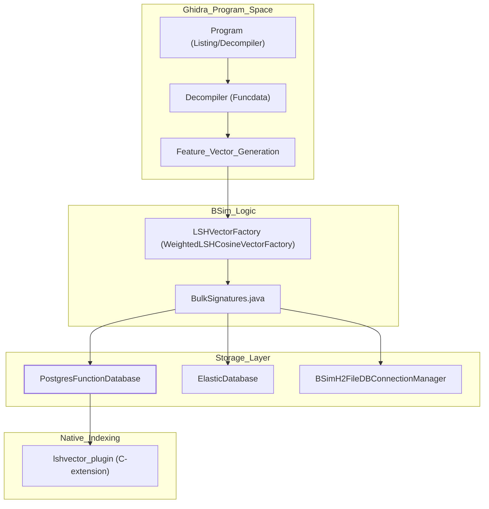
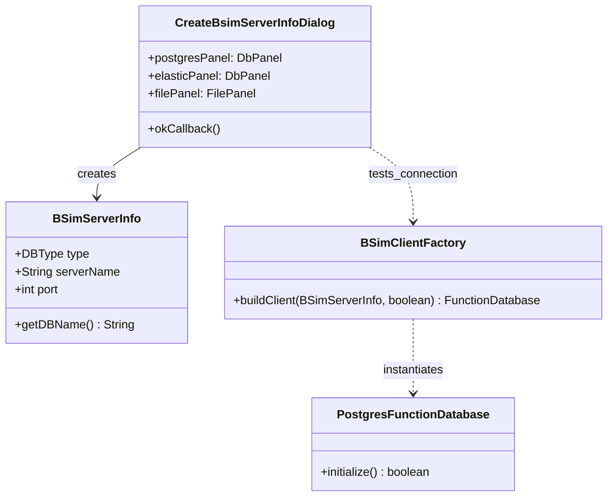

<!-- source: DeepWiki mcp.deepwiki.com · repo NationalSecurityAgency/ghidra · page 8.5 BSim Binary Similarity Analysis · fetched 2026-11-09 -->

# BSim Binary Similarity Analysis

Relevant source files

The following files were used as context for generating this wiki page:

- [Ghidra/Features/BSim/Module.manifest](Ghidra/Features/BSim/Module.manifest)
- [Ghidra/Features/BSim/build.gradle](Ghidra/Features/BSim/build.gradle)
- [Ghidra/Features/BSim/data/serverconfig.xml](Ghidra/Features/BSim/data/serverconfig.xml)
- [Ghidra/Features/BSim/src/main/help/help/topics/BSim/BSimOverview.html](Ghidra/Features/BSim/src/main/help/help/topics/BSim/BSimOverview.html)
- [Ghidra/Features/BSim/src/main/help/help/topics/BSim/CommandLineReference.html](Ghidra/Features/BSim/src/main/help/help/topics/BSim/CommandLineReference.html)
- [Ghidra/Features/BSim/src/main/help/help/topics/BSim/DatabaseConfiguration.html](Ghidra/Features/BSim/src/main/help/help/topics/BSim/DatabaseConfiguration.html)
- [Ghidra/Features/BSim/src/main/help/help/topics/BSim/FeatureWeight.html](Ghidra/Features/BSim/src/main/help/help/topics/BSim/FeatureWeight.html)
- [Ghidra/Features/BSim/src/main/help/help/topics/BSim/IngestProcess.html](Ghidra/Features/BSim/src/main/help/help/topics/BSim/IngestProcess.html)
- [Ghidra/Features/BSim/src/main/java/ghidra/features/bsim/gui/filters/ExecutableNameBSimFilterType.java](Ghidra/Features/BSim/src/main/java/ghidra/features/bsim/gui/filters/ExecutableNameBSimFilterType.java)
- [Ghidra/Features/BSim/src/main/java/ghidra/features/bsim/gui/filters/NotExecutableNameBSimFilterType.java](Ghidra/Features/BSim/src/main/java/ghidra/features/bsim/gui/filters/NotExecutableNameBSimFilterType.java)
- [Ghidra/Features/BSim/src/main/java/ghidra/features/bsim/gui/filters/PathStartsBSimFilterType.java](Ghidra/Features/BSim/src/main/java/ghidra/features/bsim/gui/filters/PathStartsBSimFilterType.java)
- [Ghidra/Features/BSim/src/main/java/ghidra/features/bsim/gui/search/dialog/AbstractBSimSearchDialog.java](Ghidra/Features/BSim/src/main/java/ghidra/features/bsim/gui/search/dialog/AbstractBSimSearchDialog.java)
- [Ghidra/Features/BSim/src/main/java/ghidra/features/bsim/gui/search/dialog/BSimSearchDialog.java](Ghidra/Features/BSim/src/main/java/ghidra/features/bsim/gui/search/dialog/BSimSearchDialog.java)
- [Ghidra/Features/BSim/src/main/java/ghidra/features/bsim/gui/search/dialog/CreateBsimServerInfoDialog.java](Ghidra/Features/BSim/src/main/java/ghidra/features/bsim/gui/search/dialog/CreateBsimServerInfoDialog.java)
- [Ghidra/Features/BSim/src/main/java/ghidra/features/bsim/gui/search/dialog/FilterWidget.java](Ghidra/Features/BSim/src/main/java/ghidra/features/bsim/gui/search/dialog/FilterWidget.java)
- [Ghidra/Features/BSim/src/main/java/ghidra/features/bsim/query/BSimControlLaunchable.java](Ghidra/Features/BSim/src/main/java/ghidra/features/bsim/query/BSimControlLaunchable.java)
- [Ghidra/Features/BSim/src/main/java/ghidra/features/bsim/query/BSimPostgresDBConnectionManager.java](Ghidra/Features/BSim/src/main/java/ghidra/features/bsim/query/BSimPostgresDBConnectionManager.java)
- [Ghidra/Features/BSim/src/main/java/ghidra/features/bsim/query/BSimServerInfo.java](Ghidra/Features/BSim/src/main/java/ghidra/features/bsim/query/BSimServerInfo.java)
- [Ghidra/Features/BSim/src/main/java/ghidra/features/bsim/query/FunctionDatabase.java](Ghidra/Features/BSim/src/main/java/ghidra/features/bsim/query/FunctionDatabase.java)
- [Ghidra/Features/BSim/src/main/java/ghidra/features/bsim/query/ServerConfig.java](Ghidra/Features/BSim/src/main/java/ghidra/features/bsim/query/ServerConfig.java)
- [Ghidra/Features/BSim/src/main/java/ghidra/features/bsim/query/client/AbstractSQLFunctionDatabase.java](Ghidra/Features/BSim/src/main/java/ghidra/features/bsim/query/client/AbstractSQLFunctionDatabase.java)
- [Ghidra/Features/BSim/src/main/java/ghidra/features/bsim/query/client/PostgresFunctionDatabase.java](Ghidra/Features/BSim/src/main/java/ghidra/features/bsim/query/client/PostgresFunctionDatabase.java)
- [Ghidra/Features/BSim/src/main/java/ghidra/features/bsim/query/client/tables/CachedStatement.java](Ghidra/Features/BSim/src/main/java/ghidra/features/bsim/query/client/tables/CachedStatement.java)
- [Ghidra/Features/BSim/src/main/java/ghidra/features/bsim/query/client/tables/SQLComplexTable.java](Ghidra/Features/BSim/src/main/java/ghidra/features/bsim/query/client/tables/SQLComplexTable.java)
- [Ghidra/Features/BSim/src/main/java/ghidra/features/bsim/query/description/FunctionDescriptionMapper.java](Ghidra/Features/BSim/src/main/java/ghidra/features/bsim/query/description/FunctionDescriptionMapper.java)
- [Ghidra/Features/BSim/src/main/java/ghidra/features/bsim/query/elastic/ElasticConnection.java](Ghidra/Features/BSim/src/main/java/ghidra/features/bsim/query/elastic/ElasticConnection.java)
- [Ghidra/Features/BSim/src/main/java/ghidra/features/bsim/query/elastic/ElasticDatabase.java](Ghidra/Features/BSim/src/main/java/ghidra/features/bsim/query/elastic/ElasticDatabase.java)
- [Ghidra/Features/BSim/src/main/java/ghidra/features/bsim/query/file/BSimH2FileDBConnectionManager.java](Ghidra/Features/BSim/src/main/java/ghidra/features/bsim/query/file/BSimH2FileDBConnectionManager.java)
- [Ghidra/Features/BSim/src/main/java/ghidra/features/bsim/query/file/H2FileFunctionDatabase.java](Ghidra/Features/BSim/src/main/java/ghidra/features/bsim/query/file/H2FileFunctionDatabase.java)
- [Ghidra/Features/BSim/src/main/java/ghidra/features/bsim/query/ingest/BSimLaunchable.java](Ghidra/Features/BSim/src/main/java/ghidra/features/bsim/query/ingest/BSimLaunchable.java)
- [Ghidra/Features/BSim/src/main/java/ghidra/features/bsim/query/ingest/BulkSignatures.java](Ghidra/Features/BSim/src/main/java/ghidra/features/bsim/query/ingest/BulkSignatures.java)
- [Ghidra/Features/BSim/src/main/java/ghidra/features/bsim/query/ingest/IterateRepository.java](Ghidra/Features/BSim/src/main/java/ghidra/features/bsim/query/ingest/IterateRepository.java)
- [Ghidra/Features/BSim/src/main/java/ghidra/features/bsim/query/protocol/BSimFilter.java](Ghidra/Features/BSim/src/main/java/ghidra/features/bsim/query/protocol/BSimFilter.java)
- [Ghidra/Features/BSim/src/test.slow/java/ghidra/features/bsim/query/file/BSimH2DatabaseManagerTest.java](Ghidra/Features/BSim/src/test.slow/java/ghidra/features/bsim/query/file/BSimH2DatabaseManagerTest.java)
- [Ghidra/Features/BSim/src/test/java/ghidra/features/bsim/query/client/BSimServerInfoTest.java](Ghidra/Features/BSim/src/test/java/ghidra/features/bsim/query/client/BSimServerInfoTest.java)
- [Ghidra/Features/BSim/support/make-postgres.sh](Ghidra/Features/BSim/support/make-postgres.sh)
- [Ghidra/Features/Base/src/test/java/ghidra/app/util/cparser/C/CParserUtilsTest.java](Ghidra/Features/Base/src/test/java/ghidra/app/util/cparser/C/CParserUtilsTest.java)
- [Ghidra/Features/Base/src/test/java/ghidra/program/database/MergeProgram.java](Ghidra/Features/Base/src/test/java/ghidra/program/database/MergeProgram.java)
- [Ghidra/Features/GhidraGo/src/test.slow/java/ghidra/app/plugin/core/go/GhidraGoPluginTest.java](Ghidra/Features/GhidraGo/src/test.slow/java/ghidra/app/plugin/core/go/GhidraGoPluginTest.java)
- [Ghidra/Framework/Docking/src/main/java/docking/widgets/PasswordDialog.java](Ghidra/Framework/Docking/src/main/java/docking/widgets/PasswordDialog.java)
- [Ghidra/Framework/Docking/src/main/java/docking/widgets/PopupKeyStorePasswordProvider.java](Ghidra/Framework/Docking/src/main/java/docking/widgets/PopupKeyStorePasswordProvider.java)
- [Ghidra/Framework/FileSystem/src/main/java/ghidra/framework/client/ClientAuthenticator.java](Ghidra/Framework/FileSystem/src/main/java/ghidra/framework/client/ClientAuthenticator.java)
- [Ghidra/Framework/FileSystem/src/main/java/ghidra/framework/client/DefaultClientAuthenticator.java](Ghidra/Framework/FileSystem/src/main/java/ghidra/framework/client/DefaultClientAuthenticator.java)
- [Ghidra/Framework/Generic/src/main/java/ghidra/net/DefaultSSLSocketFactory.java](Ghidra/Framework/Generic/src/main/java/ghidra/net/DefaultSSLSocketFactory.java)
- [Ghidra/Framework/Project/src/main/java/ghidra/framework/protocol/ghidra/GhidraURLQueryTask.java](Ghidra/Framework/Project/src/main/java/ghidra/framework/protocol/ghidra/GhidraURLQueryTask.java)
- [Ghidra/Framework/Utility/build.gradle](Ghidra/Framework/Utility/build.gradle)
- [GhidraBuild/LaunchSupport/build.gradle](GhidraBuild/LaunchSupport/build.gradle)
- [gradle/support/sbom.gradle](gradle/support/sbom.gradle)

BSim is a Ghidra feature designed to find similar functions across large collections of binaries. It works by generating a unique signature for every function based on its decompiler representation and storing these signatures in a searchable database. This allows analysts to identify code reuse, port annotations between binaries, and detect statically linked libraries.

## 1. System Architecture

The BSim architecture consists of three primary layers: the signature generation pipeline, the database backend (storage and indexing), and the query interface (GUI and CLI).

### 1.1 Signature Generation Pipeline
BSim signatures are derived from the decompiler's P-code. The process transforms a function's control flow and data flow into a high-dimensional feature vector. These vectors are then reduced using Locality Sensitive Hashing (LSH) to allow for efficient similarity searching. The decompiler is a core dependency for this process [Ghidra/Features/BSim/src/main/java/ghidra/features/bsim/query/ingest/BulkSignatures.java:29-32]().

### 1.2 Data Flow Diagram: From Code to Database
The following diagram illustrates the flow from a Ghidra `Program` to a BSim `FunctionDatabase`.

**BSim Ingestion Pipeline**

Sources: [Ghidra/Features/BSim/src/main/java/ghidra/features/bsim/query/ingest/BulkSignatures.java:48-81](), [Ghidra/Features/BSim/src/main/java/ghidra/features/bsim/query/client/PostgresFunctionDatabase.java:47-81](), [Ghidra/Features/BSim/src/main/java/ghidra/features/bsim/query/elastic/ElasticDatabase.java:42-49](), [Ghidra/Features/BSim/support/make-postgres.sh:133-153]()

## 2. Database Backends

BSim supports three different backend implementations, each suited for different scales of analysis [Ghidra/Features/BSim/src/main/help/help/topics/BSim/DatabaseConfiguration.html:43-51]().

| Backend | Implementation Class | Use Case |
| :--- | :--- | :--- |
| **PostgreSQL** | `PostgresFunctionDatabase` | High-performance, multi-user shared repository. Requires a BSim-specific extension. |
| **Elasticsearch** | `ElasticDatabase` | Highly scalable, cluster-based storage for massive datasets. |
| **H2** | `BSimH2FileDBConnectionManager` | Local, single-user file-based database for small to medium projects. |

### 2.1 PostgreSQL Support
PostgreSQL is the preferred production backend. It requires a custom extension called `lshvector` to handle similarity indexing [Ghidra/Features/BSim/src/main/help/help/topics/BSim/DatabaseConfiguration.html:53-60]().
* **Server Setup**: The `make-postgres.sh` script builds the server and the `lshvector` plugin from source [Ghidra/Features/BSim/support/make-postgres.sh:1-149]().
* **Authentication**: Supports PKI (certificates), password (SCRAM-SHA-256), and trust-based authentication [Ghidra/Features/BSim/src/main/java/ghidra/features/bsim/query/BSimControlLaunchable.java:124-134]().
* **Connection Management**: Managed via `BSimPostgresDBConnectionManager`, which handles pooled connections using `BasicDataSource` [Ghidra/Features/BSim/src/main/java/ghidra/features/bsim/query/BSimPostgresDBConnectionManager.java:111-117]().
* **SQL Operations**: `PostgresFunctionDatabase` defines custom PL/pgSQL functions like `insert_vec` and `remove_vec` to manage LSH vector counts and hashing [Ghidra/Features/BSim/src/main/java/ghidra/features/bsim/query/client/PostgresFunctionDatabase.java:130-151]().

### 2.2 Elasticsearch Support
The `ElasticDatabase` implementation stores BSim records as JSON documents. It utilizes several indices to manage executable and function metadata along with LSH vectors [Ghidra/Features/BSim/src/main/java/ghidra/features/bsim/query/elastic/ElasticDatabase.java:42-49](). It requires a BSim-specific plug-in installed on the Elasticsearch cluster [Ghidra/Features/BSim/src/main/help/help/topics/BSim/DatabaseConfiguration.html:62-68]().

### 2.3 H2 File Backend
The H2 backend provides a zero-install option for local similarity analysis. It is managed by `BSimH2FileDBConnectionManager`, which provides a pooled data source for `.mv.db` files [Ghidra/Features/BSim/src/main/java/ghidra/features/bsim/query/file/BSimH2FileDBConnectionManager.java:33-43]().

Sources: [Ghidra/Features/BSim/src/main/java/ghidra/features/bsim/query/client/PostgresFunctionDatabase.java:47-81](), [Ghidra/Features/BSim/src/main/help/help/topics/BSim/DatabaseConfiguration.html:43-68](), [Ghidra/Features/BSim/src/main/java/ghidra/features/bsim/query/file/BSimH2FileDBConnectionManager.java:134-156]()

## 3. Command-Line Utilities

BSim provides two primary CLI entry points for headless operation and server management.

### 3.1 bsim_ctl (BSimControlLaunchable)
This utility manages the PostgreSQL BSim server lifecycle. It is only used for PostgreSQL backends and must run on the host machine [Ghidra/Features/BSim/src/main/help/help/topics/BSim/CommandLineReference.html:59-62]().

| Command | Role |
| :--- | :--- |
| `start` | Initializes and starts the PostgreSQL server [Ghidra/Features/BSim/src/main/java/ghidra/features/bsim/query/BSimControlLaunchable.java:54-54](). |
| `stop` | Shuts down the server [Ghidra/Features/BSim/src/main/java/ghidra/features/bsim/query/BSimControlLaunchable.java:55-55](). |
| `adduser` | Adds a new database user with specific Distinguished Name (DN) for PKI [Ghidra/Features/BSim/src/main/java/ghidra/features/bsim/query/BSimControlLaunchable.java:59-59](). |
| `changeauth` | Modifies authentication settings (pki, password, or trust) [Ghidra/Features/BSim/src/main/java/ghidra/features/bsim/query/BSimControlLaunchable.java:61-61](). |

Sources: [Ghidra/Features/BSim/src/main/help/help/topics/BSim/CommandLineReference.html:33-55](), [Ghidra/Features/BSim/src/main/java/ghidra/features/bsim/query/BSimControlLaunchable.java:53-62]()

### 3.2 bsim (BSimLaunchable)
This utility performs analysis and database population tasks.

**Key Operations:**
* `generatesigs`: Extracts functions from a Ghidra project and creates XML signature files [Ghidra/Features/BSim/src/main/java/ghidra/features/bsim/query/ingest/BSimLaunchable.java:68-68]().
* `commitsigs`: Ingests generated XML signatures into a remote or local BSim database [Ghidra/Features/BSim/src/main/java/ghidra/features/bsim/query/ingest/BSimLaunchable.java:69-69]().
* `listexes` / `listfuncs`: Queries the database for existing metadata [Ghidra/Features/BSim/src/main/java/ghidra/features/bsim/query/ingest/BSimLaunchable.java:73-74]().
* `createdatabase`: Creates a new BSim database schema on a supported backend [Ghidra/Features/BSim/src/main/java/ghidra/features/bsim/query/ingest/BSimLaunchable.java:59-59]().

Sources: [Ghidra/Features/BSim/src/main/java/ghidra/features/bsim/query/ingest/BSimLaunchable.java:59-77]()

## 4. Bulk Ingestion and Signatures

The `BulkSignatures` class is the primary engine for high-volume data movement between Ghidra and the BSim database.

### 4.1 Implementation Detail
`BulkSignatures` coordinates the connection to the `FunctionDatabase` and manages the `InsertRequest` protocol.
1. **Connection**: Uses a `BSimServerInfo` object to establish connectivity via `BSimClientFactory.buildClient` [Ghidra/Features/BSim/src/main/java/ghidra/features/bsim/query/ingest/BulkSignatures.java:114-118]().
2. **XML Processing**: Signatures are staged as XML files. The ingestion process restores vectors from XML using a `LSHVectorFactory` [Ghidra/Features/BSim/src/main/java/ghidra/features/bsim/query/ingest/BulkSignatures.java:167-172]().
3. **Commit**: Signatures are sent to the server as bulk insert requests. It can also handle repository URL overrides for mapping signatures to specific Ghidra projects [Ghidra/Features/BSim/src/main/java/ghidra/features/bsim/query/ingest/BulkSignatures.java:197-202]().

Sources: [Ghidra/Features/BSim/src/main/java/ghidra/features/bsim/query/ingest/BulkSignatures.java:48-210]()

## 5. GUI Interface

The GUI allows users to configure server connections and perform similarity searches interactively.

### 5.1 Server Configuration
The `CreateBsimServerInfoDialog` provides a card-based layout to configure different database types, including PostgreSQL, Elasticsearch, and H2 [Ghidra/Features/BSim/src/main/java/ghidra/features/bsim/gui/search/dialog/CreateBsimServerInfoDialog.java:49-75]().

**GUI Entity Relationship**

Sources: [Ghidra/Features/BSim/src/main/java/ghidra/features/bsim/gui/search/dialog/CreateBsimServerInfoDialog.java:49-75](), [Ghidra/Features/BSim/src/main/java/ghidra/features/bsim/query/BSimServerInfo.java:26-45](), [Ghidra/Features/BSim/src/main/java/ghidra/features/bsim/query/client/PostgresFunctionDatabase.java:47-50]()

### 5.2 Search and Filters
Users can define similarity thresholds and filters using widgets like `FilterWidget`. The system supports complex filtering through the `BSimFilter` protocol, allowing queries to be restricted by executable name, architecture, or compiler.

* **Executable Filters**: Filters like `ExecutableNameBSimFilterType` and `NotExecutableNameBSimFilterType` allow inclusion or exclusion of specific binary names [Ghidra/Features/BSim/src/main/java/ghidra/features/bsim/gui/filters/ExecutableNameBSimFilterType.java:23-26](), [Ghidra/Features/BSim/src/main/java/ghidra/features/bsim/gui/filters/NotExecutableNameBSimFilterType.java:23-26]().
* **Path Filters**: `PathStartsBSimFilterType` allows filtering based on the storage path of the executable [Ghidra/Features/BSim/src/main/java/ghidra/features/bsim/gui/filters/PathStartsBSimFilterType.java:23-26]().

Sources: [Ghidra/Features/BSim/src/main/java/ghidra/features/bsim/query/ingest/BSimLaunchable.java:144-145](), [Ghidra/Features/BSim/src/main/java/ghidra/features/bsim/gui/filters/ExecutableNameBSimFilterType.java:23-32]()

---

