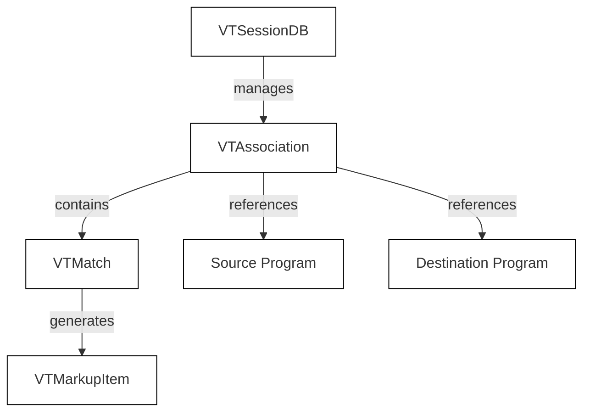
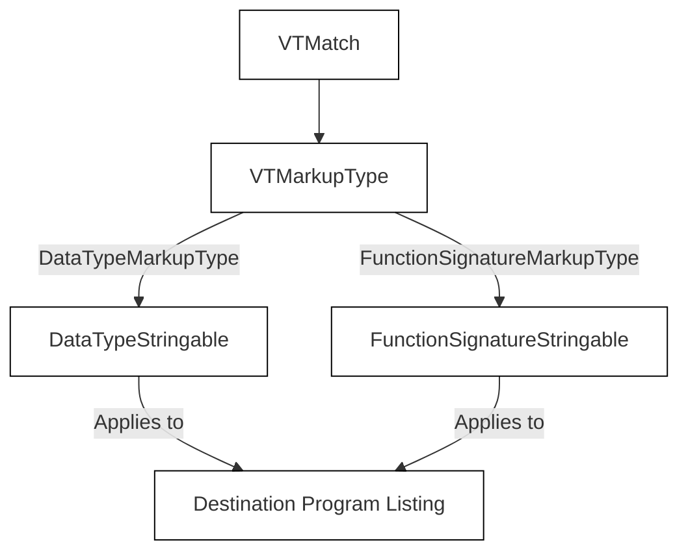
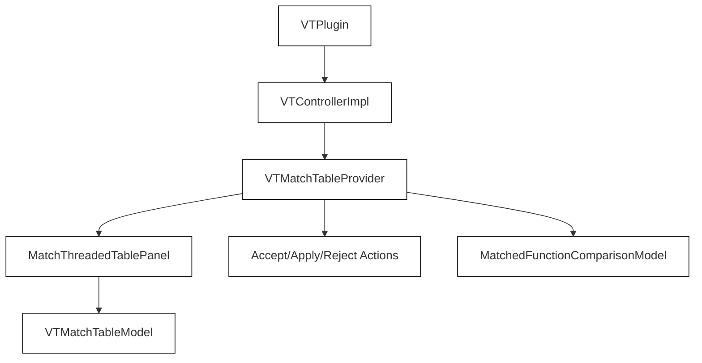

<!-- source: DeepWiki mcp.deepwiki.com · repo NationalSecurityAgency/ghidra · page 8.6 Version Tracking and Program Comparison · fetched 2026-11-09 -->

# Version Tracking and Program Comparison

<details>
<summary>Relevant source files</summary>

The following files were used as context for generating this wiki page:

- [Ghidra/Features/Base/src/main/java/ghidra/app/merge/ProgramMultiUserMergeManager.java](Ghidra/Features/Base/src/main/java/ghidra/app/merge/ProgramMultiUserMergeManager.java)
- [Ghidra/Features/Base/src/main/java/ghidra/app/merge/listing/ExternalFunctionMerger.java](Ghidra/Features/Base/src/main/java/ghidra/app/merge/listing/ExternalFunctionMerger.java)
- [Ghidra/Features/Base/src/main/java/ghidra/app/merge/listing/FunctionMerger.java](Ghidra/Features/Base/src/main/java/ghidra/app/merge/listing/FunctionMerger.java)
- [Ghidra/Features/Base/src/main/java/ghidra/app/merge/listing/ListingMergeManager.java](Ghidra/Features/Base/src/main/java/ghidra/app/merge/listing/ListingMergeManager.java)
- [Ghidra/Features/Base/src/main/java/ghidra/app/nav/Navigatable.java](Ghidra/Features/Base/src/main/java/ghidra/app/nav/Navigatable.java)
- [Ghidra/Features/Base/src/main/java/ghidra/app/plugin/core/datamgr/NextPreviousDataTypeAction.java](Ghidra/Features/Base/src/main/java/ghidra/app/plugin/core/datamgr/NextPreviousDataTypeAction.java)
- [Ghidra/Features/Base/src/main/java/ghidra/app/util/dialog/CheckoutDialog.java](Ghidra/Features/Base/src/main/java/ghidra/app/util/dialog/CheckoutDialog.java)
- [Ghidra/Features/Base/src/main/java/ghidra/app/util/task/ProgramOpener.java](Ghidra/Features/Base/src/main/java/ghidra/app/util/task/ProgramOpener.java)
- [Ghidra/Features/Base/src/main/java/ghidra/app/util/viewer/field/LabelCodeUnitFormat.java](Ghidra/Features/Base/src/main/java/ghidra/app/util/viewer/field/LabelCodeUnitFormat.java)
- [Ghidra/Features/Base/src/main/java/ghidra/app/util/viewer/field/LabelFieldFactory.java](Ghidra/Features/Base/src/main/java/ghidra/app/util/viewer/field/LabelFieldFactory.java)
- [Ghidra/Features/Base/src/main/java/ghidra/app/util/viewer/field/LabelFieldSymbolLoader.java](Ghidra/Features/Base/src/main/java/ghidra/app/util/viewer/field/LabelFieldSymbolLoader.java)
- [Ghidra/Features/Base/src/main/java/ghidra/program/model/listing/CodeUnitFormat.java](Ghidra/Features/Base/src/main/java/ghidra/program/model/listing/CodeUnitFormat.java)
- [Ghidra/Features/Base/src/main/java/ghidra/program/util/DataTypeCleaner.java](Ghidra/Features/Base/src/main/java/ghidra/program/util/DataTypeCleaner.java)
- [Ghidra/Features/Base/src/test.slow/java/ghidra/app/merge/listing/ExternalMergerTest.java](Ghidra/Features/Base/src/test.slow/java/ghidra/app/merge/listing/ExternalMergerTest.java)
- [Ghidra/Features/Base/src/test.slow/java/ghidra/app/merge/listing/FunctionMergerThunkTest.java](Ghidra/Features/Base/src/test.slow/java/ghidra/app/merge/listing/FunctionMergerThunkTest.java)
- [Ghidra/Features/Base/src/test.slow/java/ghidra/app/merge/listing/RefMergerExtTest.java](Ghidra/Features/Base/src/test.slow/java/ghidra/app/merge/listing/RefMergerExtTest.java)
- [Ghidra/Features/Base/src/test.slow/java/ghidra/app/util/viewer/field/LabelFieldFactoryTest.java](Ghidra/Features/Base/src/test.slow/java/ghidra/app/util/viewer/field/LabelFieldFactoryTest.java)
- [Ghidra/Features/Base/src/test.slow/java/ghidra/app/util/viewer/field/OperandFieldFactoryTest.java](Ghidra/Features/Base/src/test.slow/java/ghidra/app/util/viewer/field/OperandFieldFactoryTest.java)
- [Ghidra/Features/Base/src/test/java/ghidra/app/nav/TestDummyNavigatable.java](Ghidra/Features/Base/src/test/java/ghidra/app/nav/TestDummyNavigatable.java)
- [Ghidra/Features/Base/src/test/java/ghidra/base/project/FakeSharedProject.java](Ghidra/Features/Base/src/test/java/ghidra/base/project/FakeSharedProject.java)
- [Ghidra/Features/ProgramDiff/src/main/java/ghidra/app/plugin/core/diff/DiffNavigatable.java](Ghidra/Features/ProgramDiff/src/main/java/ghidra/app/plugin/core/diff/DiffNavigatable.java)
- [Ghidra/Features/VersionTracking/src/main/help/help/topics/VersionTrackingPlugin/images/VTOptions_ApplyMarkupDialog.png](Ghidra/Features/VersionTracking/src/main/help/help/topics/VersionTrackingPlugin/images/VTOptions_ApplyMarkupDialog.png)
- [Ghidra/Features/VersionTracking/src/main/help/help/topics/VersionTrackingPlugin/providers/VT_Apply_Options.html](Ghidra/Features/VersionTracking/src/main/help/help/topics/VersionTrackingPlugin/providers/VT_Apply_Options.html)
- [Ghidra/Features/VersionTracking/src/main/java/ghidra/feature/vt/api/markuptype/DataTypeMarkupType.java](Ghidra/Features/VersionTracking/src/main/java/ghidra/feature/vt/api/markuptype/DataTypeMarkupType.java)
- [Ghidra/Features/VersionTracking/src/main/java/ghidra/feature/vt/api/markuptype/FunctionNameMarkupType.java](Ghidra/Features/VersionTracking/src/main/java/ghidra/feature/vt/api/markuptype/FunctionNameMarkupType.java)
- [Ghidra/Features/VersionTracking/src/main/java/ghidra/feature/vt/api/markuptype/FunctionSignatureMarkupType.java](Ghidra/Features/VersionTracking/src/main/java/ghidra/feature/vt/api/markuptype/FunctionSignatureMarkupType.java)
- [Ghidra/Features/VersionTracking/src/main/java/ghidra/feature/vt/api/stringable/FunctionSignatureStringable.java](Ghidra/Features/VersionTracking/src/main/java/ghidra/feature/vt/api/stringable/FunctionSignatureStringable.java)
- [Ghidra/Features/VersionTracking/src/main/java/ghidra/feature/vt/gui/duallisting/VTListingNavigator.java](Ghidra/Features/VersionTracking/src/main/java/ghidra/feature/vt/gui/duallisting/VTListingNavigator.java)
- [Ghidra/Features/VersionTracking/src/main/java/ghidra/feature/vt/gui/provider/matchtable/ApplyMarkupPropertyEditor.java](Ghidra/Features/VersionTracking/src/main/java/ghidra/feature/vt/gui/provider/matchtable/ApplyMarkupPropertyEditor.java)
- [Ghidra/Features/VersionTracking/src/main/java/ghidra/feature/vt/gui/provider/matchtable/VTMatchTableProvider.java](Ghidra/Features/VersionTracking/src/main/java/ghidra/feature/vt/gui/provider/matchtable/VTMatchTableProvider.java)
- [Ghidra/Features/VersionTracking/src/main/java/ghidra/feature/vt/gui/util/VTMatchApplyChoices.java](Ghidra/Features/VersionTracking/src/main/java/ghidra/feature/vt/gui/util/VTMatchApplyChoices.java)
- [Ghidra/Features/VersionTracking/src/main/java/ghidra/feature/vt/gui/util/VTOptionDefines.java](Ghidra/Features/VersionTracking/src/main/java/ghidra/feature/vt/gui/util/VTOptionDefines.java)
- [Ghidra/Features/VersionTracking/src/test.slow/java/ghidra/feature/vt/api/VTMatchApplyFunctionSignatureTest.java](Ghidra/Features/VersionTracking/src/test.slow/java/ghidra/feature/vt/api/VTMatchApplyFunctionSignatureTest.java)
- [Ghidra/Features/VersionTracking/src/test.slow/java/ghidra/feature/vt/api/markupitem/DataTypeMarkupItemTest.java](Ghidra/Features/VersionTracking/src/test.slow/java/ghidra/feature/vt/api/markupitem/DataTypeMarkupItemTest.java)
- [Ghidra/Features/VersionTracking/src/test.slow/java/ghidra/feature/vt/api/markupitem/FunctionNameMarkupItemTest.java](Ghidra/Features/VersionTracking/src/test.slow/java/ghidra/feature/vt/api/markupitem/FunctionNameMarkupItemTest.java)
- [Ghidra/Framework/DB/src/main/java/db/buffers/LocalManagedBufferFile.java](Ghidra/Framework/DB/src/main/java/db/buffers/LocalManagedBufferFile.java)
- [Ghidra/Framework/Generic/src/main/java/util/HistoryList.java](Ghidra/Framework/Generic/src/main/java/util/HistoryList.java)
- [Ghidra/Framework/Generic/src/test/java/util/HistoryListTest.java](Ghidra/Framework/Generic/src/test/java/util/HistoryListTest.java)
- [Ghidra/Framework/Project/src/main/java/ghidra/framework/data/DBContentHandler.java](Ghidra/Framework/Project/src/main/java/ghidra/framework/data/DBContentHandler.java)
- [Ghidra/Framework/Project/src/main/java/ghidra/framework/main/projectdata/actions/ProjectDataRefreshAction.java](Ghidra/Framework/Project/src/main/java/ghidra/framework/main/projectdata/actions/ProjectDataRefreshAction.java)
- [Ghidra/Framework/Project/src/main/java/ghidra/framework/model/ProjectData.java](Ghidra/Framework/Project/src/main/java/ghidra/framework/model/ProjectData.java)
- [Ghidra/Framework/Project/src/test/java/ghidra/framework/model/TestDummyProjectData.java](Ghidra/Framework/Project/src/test/java/ghidra/framework/model/TestDummyProjectData.java)
- [Ghidra/Framework/SoftwareModeling/src/main/java/ghidra/program/model/listing/VariableOffset.java](Ghidra/Framework/SoftwareModeling/src/main/java/ghidra/program/model/listing/VariableOffset.java)
- [Ghidra/Framework/SoftwareModeling/src/main/java/ghidra/program/model/listing/VariableStorage.java](Ghidra/Framework/SoftwareModeling/src/main/java/ghidra/program/model/listing/VariableStorage.java)
- [Ghidra/Framework/SoftwareModeling/src/main/java/ghidra/program/util/SimpleDiffUtility.java](Ghidra/Framework/SoftwareModeling/src/main/java/ghidra/program/util/SimpleDiffUtility.java)
- [Ghidra/Processors/PIC/src/main/java/ghidra/app/util/bin/format/elf/extend/PIC30_ElfExtension.java](Ghidra/Processors/PIC/src/main/java/ghidra/app/util/bin/format/elf/extend/PIC30_ElfExtension.java)
- [Ghidra/Test/IntegrationTest/src/screen/java/help/screenshot/FrontEndPluginScreenShots.java](Ghidra/Test/IntegrationTest/src/screen/java/help/screenshot/FrontEndPluginScreenShots.java)

</details>


## Purpose and Scope
This section covers Ghidra's Version Tracking (VT) subsystem and program comparison utilities. The Version Tracking framework correlates two versions of a program (a source program and a destination program) to map functions, data, and instructions, allowing analysts to port analysis markup (symbols, data types, comments, and signatures) from an older or reference binary to a newer target binary. Additionally, this section details the dual-listing comparison and diff tools (`ProgramDiff` and `CodeCompare`) used to visually inspect structural and code discrepancies between programs.

---

## 1. Version Tracking Session and Match Data Model
The Version Tracking architecture is centered around a session database (`VTSessionDB`) that manages associations, matches, and markup items. 

* **`VTSession`**: The top-level interface representing a version tracking session linking a source `Program` and a destination `Program`.
* **`VTAssociation`**: Represents a structural link between an address or set of addresses in the source program and destination program (e.g., function-to-function or data-to-data).
* **`VTMatch`**: A scored correlation result associated with a `VTAssociation`. Multiple matches can exist for a single association, scored by confidence and similarity metrics.
* **`VTMarkupItem`**: Individual pieces of analysis data (e.g., a function name, comment, or data type) that can be applied across the association.


*Sources: Ghidra/Features/VersionTracking/src/main/java/ghidra/feature/vt/api/main/VTAssociation.java*, `[Ghidra/Features/VersionTracking/src/main/java/ghidra/feature/vt/api/main/VTMatch.java]()`

---

## 2. Correlators and Association Engines
Version Tracking employs various algorithms called *Correlators* to discover matches between source and destination programs:
* **Exact Function Correlator**: Matches functions whose body bytes or hashes are identical.
* **Function Name Correlator**: Correlates functions based on matching symbol names.
* **Data Correlator**: Identifies matching data structures and constants.
* **Program-Level Correlators**: Decompiler-based and instruction-based graph matching algorithms that compare control flow graph (CFG) topology and mnemonic sequences.

Correlator execution populates the session with `VTAssociation` objects and candidate `VTMatch` items, which are then evaluated by the analyst or auto-accept filters.

*Sources: `[Ghidra/Features/VersionTracking/src/main/java/ghidra/feature/vt/api/main/VTAssociation.java]()`, `[Ghidra/Features/VersionTracking/src/test.slow/java/ghidra/feature/vt/api/VTMatchApplyFunctionSignatureTest.java]()`*

---

## 3. Markup Types and Stringables
To display and transfer data between programs, Ghidra uses `Stringable` representations and `VTMarkupType` implementations.

### FunctionSignatureStringable
`FunctionSignatureStringable` captures function signature attributes—including return type, calling convention, parameter types, names, storage, inline flags, no-return flags, and varargs—for serialization and comparison in version tracking views.

```java
public class FunctionSignatureStringable extends Stringable {
    private String signatureString;
    private String originalName;
    private SourceType signatureSource;
    private String callingConventionName;
    // ...
}
```
*Sources: `[Ghidra/Features/VersionTracking/src/main/java/ghidra/feature/vt/api/stringable/FunctionSignatureStringable.java:43-66]()`*

### DataTypeMarkupType
`DataTypeMarkupType` defines how data type associations are validated, displayed, and applied. It retrieves source and destination `Data` units, computes differences using `DataTypeStringable`, and determines applicable actions.

```java
public class DataTypeMarkupType extends VTMarkupType {
    public static final VTMarkupType INSTANCE = new DataTypeMarkupType();
    // ...
}
```
*Sources: `[Ghidra/Features/VersionTracking/src/main/java/ghidra/feature/vt/api/markuptype/DataTypeMarkupType.java:41-50]()`*


*Sources: `[Ghidra/Features/VersionTracking/src/main/java/ghidra/feature/vt/api/markuptype/DataTypeMarkupType.java:41-105]()`, `[Ghidra/Features/VersionTracking/src/main/java/ghidra/feature/vt/api/stringable/FunctionSignatureStringable.java:43-70]()`*

---

## 4. Apply-Markup Options and Workflow
When applying markup items from source to destination, options control conflict resolution and replacement behaviors. The `ApplyMarkupPropertyEditor` provides a customized property editor UI for configuring these bulk-apply choices.

* **Data Type Conflicts**: Handled via `DataTypeConflictChoices` (e.g., `USE_EXISTING`, `RENAME_AND_ADD`).
* **Replace Choices**: Dictates whether to overwrite existing user-defined data types, comments, or symbols.
* **Exclusions**: Incomplete or ignored markup items can be automatically skipped during batch application.

*Sources: `[Ghidra/Features/VersionTracking/src/main/java/ghidra/feature/vt/gui/provider/matchtable/ApplyMarkupPropertyEditor.java:49-60]()`, `[Ghidra/Features/VersionTracking/src/test.slow/java/ghidra/feature/vt/api/markupitem/DataTypeMarkupItemTest.java:91-115]()`*

---

## 5. VTMatchTableProvider UI
The `VTMatchTableProvider` serves as the primary table-based user interface for inspecting version tracking matches.

* **Match Table**: Displays matches with columns for match score, similarity, confidence, correlator name, source name, and destination name.
* **Filtering & Tags**: Supports ancillary filter dialogs and tag management (`ChooseMatchTagAction`, `RemoveMatchTagAction`) to organize review states.
* **Dual-Listing Integration**: Selecting a match synchronizes the source and destination listing panels to highlight correlated addresses.
* **Function Comparison Action**: Right-clicking matches allows launching the `MatchedFunctionComparisonModel` to compare functions side-by-side.


*Sources: `[Ghidra/Features/VersionTracking/src/main/java/ghidra/feature/vt/gui/provider/matchtable/VTMatchTableProvider.java:67-115]()`*

---

## 6. ProgramDiff and CodeCompare Tools
Beyond Version Tracking, Ghidra includes general-purpose program comparison and diffing infrastructure:
* **ProgramDiff**: Compares two programs within the same workspace to identify added, removed, or modified code units, functions, data, and symbols.
* **CodeCompare / FunctionComparisonService**: Provides side-by-side dual listing views for comparing individual functions (`MatchedFunctionComparisonModel`), synchronizing navigation, and highlighting differences in control flow or instructions.

*Sources: `[Ghidra/Features/VersionTracking/src/main/java/ghidra/feature/vt/gui/provider/matchtable/VTMatchTableProvider.java:41-55]()`, `[Ghidra/Features/VersionTracking/src/main/java/ghidra/feature/vt/gui/provider/matchtable/VTMatchTableProvider.java:143-169]()`*

---

