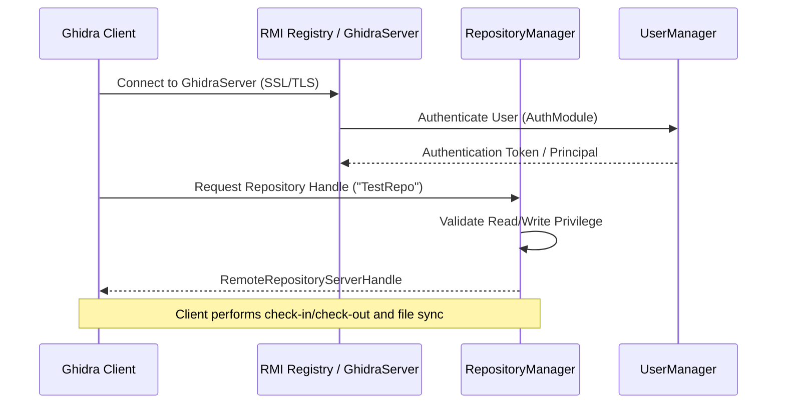

<!-- source: DeepWiki mcp.deepwiki.com · repo NationalSecurityAgency/ghidra · page 8.7 Projects, Multi-User Server, and Program Management · fetched 2026-11-09 -->

# Projects, Multi-User Server, and Program Management

<details>
<summary>Relevant source files</summary>

The following files were used as context for generating this wiki page:

- [Ghidra/Features/Base/src/main/help/help/topics/FrontEndPlugin/Ghidra_Front_end.htm](Ghidra/Features/Base/src/main/help/help/topics/FrontEndPlugin/Ghidra_Front_end.htm)
- [Ghidra/Features/Base/src/main/help/help/topics/FrontEndPlugin/Ghidra_Front_end_Menus.htm](Ghidra/Features/Base/src/main/help/help/topics/FrontEndPlugin/Ghidra_Front_end_Menus.htm)
- [Ghidra/Features/Base/src/main/java/ghidra/app/plugin/core/datamgr/actions/CreateTypeDefDialog.java](Ghidra/Features/Base/src/main/java/ghidra/app/plugin/core/datamgr/actions/CreateTypeDefDialog.java)
- [Ghidra/Features/Base/src/main/java/ghidra/app/plugin/core/datamgr/actions/CreateTypeDefFromDialogAction.java](Ghidra/Features/Base/src/main/java/ghidra/app/plugin/core/datamgr/actions/CreateTypeDefFromDialogAction.java)
- [Ghidra/Features/Base/src/main/java/ghidra/app/plugin/core/equate/AbstractConvertAction.java](Ghidra/Features/Base/src/main/java/ghidra/app/plugin/core/equate/AbstractConvertAction.java)
- [Ghidra/Features/Base/src/main/java/ghidra/app/plugin/core/function/editor/ParameterDataTypeCellEditor.java](Ghidra/Features/Base/src/main/java/ghidra/app/plugin/core/function/editor/ParameterDataTypeCellEditor.java)
- [Ghidra/Features/Base/src/main/java/ghidra/app/plugin/core/gotoquery/GoToHelper.java](Ghidra/Features/Base/src/main/java/ghidra/app/plugin/core/gotoquery/GoToHelper.java)
- [Ghidra/Features/Base/src/main/java/ghidra/app/plugin/core/help/AboutProgramPlugin.java](Ghidra/Features/Base/src/main/java/ghidra/app/plugin/core/help/AboutProgramPlugin.java)
- [Ghidra/Features/Base/src/main/java/ghidra/app/plugin/core/navigation/FindAppliedDataTypesService.java](Ghidra/Features/Base/src/main/java/ghidra/app/plugin/core/navigation/FindAppliedDataTypesService.java)
- [Ghidra/Features/Base/src/main/java/ghidra/app/plugin/core/navigation/locationreferences/GenericCompositeDataTypeLocationDescriptor.java](Ghidra/Features/Base/src/main/java/ghidra/app/plugin/core/navigation/locationreferences/GenericCompositeDataTypeLocationDescriptor.java)
- [Ghidra/Features/Base/src/main/java/ghidra/app/plugin/core/navigation/locationreferences/GenericCompositeDataTypeProgramLocation.java](Ghidra/Features/Base/src/main/java/ghidra/app/plugin/core/navigation/locationreferences/GenericCompositeDataTypeProgramLocation.java)
- [Ghidra/Features/Base/src/main/java/ghidra/app/plugin/core/processors/LanguageProviderPlugin.java](Ghidra/Features/Base/src/main/java/ghidra/app/plugin/core/processors/LanguageProviderPlugin.java)
- [Ghidra/Features/Base/src/main/java/ghidra/app/plugin/core/progmgr/AbstractProgramNameSwitchingAction.java](Ghidra/Features/Base/src/main/java/ghidra/app/plugin/core/progmgr/AbstractProgramNameSwitchingAction.java)
- [Ghidra/Features/Base/src/main/java/ghidra/app/plugin/core/progmgr/AbstractUndoRedoAction.java](Ghidra/Features/Base/src/main/java/ghidra/app/plugin/core/progmgr/AbstractUndoRedoAction.java)
- [Ghidra/Features/Base/src/main/java/ghidra/app/plugin/core/progmgr/CloseProgramAction.java](Ghidra/Features/Base/src/main/java/ghidra/app/plugin/core/progmgr/CloseProgramAction.java)
- [Ghidra/Features/Base/src/main/java/ghidra/app/plugin/core/progmgr/MultiProgramManager.java](Ghidra/Features/Base/src/main/java/ghidra/app/plugin/core/progmgr/MultiProgramManager.java)
- [Ghidra/Features/Base/src/main/java/ghidra/app/plugin/core/progmgr/ProgramCache.java](Ghidra/Features/Base/src/main/java/ghidra/app/plugin/core/progmgr/ProgramCache.java)
- [Ghidra/Features/Base/src/main/java/ghidra/app/plugin/core/progmgr/ProgramManagerPlugin.java](Ghidra/Features/Base/src/main/java/ghidra/app/plugin/core/progmgr/ProgramManagerPlugin.java)
- [Ghidra/Features/Base/src/main/java/ghidra/app/plugin/core/progmgr/ProgramOptionsAction.java](Ghidra/Features/Base/src/main/java/ghidra/app/plugin/core/progmgr/ProgramOptionsAction.java)
- [Ghidra/Features/Base/src/main/java/ghidra/app/plugin/core/progmgr/RedoAction.java](Ghidra/Features/Base/src/main/java/ghidra/app/plugin/core/progmgr/RedoAction.java)
- [Ghidra/Features/Base/src/main/java/ghidra/app/plugin/core/progmgr/SaveAsProgramAction.java](Ghidra/Features/Base/src/main/java/ghidra/app/plugin/core/progmgr/SaveAsProgramAction.java)
- [Ghidra/Features/Base/src/main/java/ghidra/app/plugin/core/progmgr/SaveProgramAction.java](Ghidra/Features/Base/src/main/java/ghidra/app/plugin/core/progmgr/SaveProgramAction.java)
- [Ghidra/Features/Base/src/main/java/ghidra/app/plugin/core/progmgr/UndoAction.java](Ghidra/Features/Base/src/main/java/ghidra/app/plugin/core/progmgr/UndoAction.java)
- [Ghidra/Features/Base/src/main/java/ghidra/app/script/ScriptMessage.java](Ghidra/Features/Base/src/main/java/ghidra/app/script/ScriptMessage.java)
- [Ghidra/Features/Base/src/main/java/ghidra/app/util/datatype/DataTypeSelectionDialog.java](Ghidra/Features/Base/src/main/java/ghidra/app/util/datatype/DataTypeSelectionDialog.java)
- [Ghidra/Features/Base/src/main/java/ghidra/app/util/datatype/DataTypeSelectionEditor.java](Ghidra/Features/Base/src/main/java/ghidra/app/util/datatype/DataTypeSelectionEditor.java)
- [Ghidra/Features/Base/src/main/java/ghidra/app/util/headless/HeadlessOptions.java](Ghidra/Features/Base/src/main/java/ghidra/app/util/headless/HeadlessOptions.java)
- [Ghidra/Features/Base/src/main/java/ghidra/app/util/headless/UpdateServerAllowList.java](Ghidra/Features/Base/src/main/java/ghidra/app/util/headless/UpdateServerAllowList.java)
- [Ghidra/Features/Base/src/test.slow/java/ghidra/app/util/datatype/DataTypeSelectionDialogTest.java](Ghidra/Features/Base/src/test.slow/java/ghidra/app/util/datatype/DataTypeSelectionDialogTest.java)
- [Ghidra/Features/DataGraph/src/main/help/help/topics/DataGraphPlugin/Data_Graph.html](Ghidra/Features/DataGraph/src/main/help/help/topics/DataGraphPlugin/Data_Graph.html)
- [Ghidra/Features/DataGraph/src/main/java/datagraph/DataGraphPlugin.java](Ghidra/Features/DataGraph/src/main/java/datagraph/DataGraphPlugin.java)
- [Ghidra/Features/DataGraph/src/main/java/datagraph/DataGraphProvider.java](Ghidra/Features/DataGraph/src/main/java/datagraph/DataGraphProvider.java)
- [Ghidra/Features/DataGraph/src/main/java/datagraph/DegSharedConfig.java](Ghidra/Features/DataGraph/src/main/java/datagraph/DegSharedConfig.java)
- [Ghidra/Features/DataGraph/src/main/java/datagraph/data/graph/DegController.java](Ghidra/Features/DataGraph/src/main/java/datagraph/data/graph/DegController.java)
- [Ghidra/Features/DataGraph/src/main/java/datagraph/data/graph/panel/DataVertexPanel.java](Ghidra/Features/DataGraph/src/main/java/datagraph/data/graph/panel/DataVertexPanel.java)
- [Ghidra/Features/Decompiler/src/test.slow/java/ghidra/app/plugin/core/decompile/AbstractDecompilerFindReferencesActionTest.java](Ghidra/Features/Decompiler/src/test.slow/java/ghidra/app/plugin/core/decompile/AbstractDecompilerFindReferencesActionTest.java)
- [Ghidra/Features/Decompiler/src/test.slow/java/ghidra/app/plugin/core/decompile/DecompilerNavigationTest.java](Ghidra/Features/Decompiler/src/test.slow/java/ghidra/app/plugin/core/decompile/DecompilerNavigationTest.java)
- [Ghidra/Features/FileFormats/src/main/java/ghidra/file/formats/ios/dmg/DmgServerProcessManager.java](Ghidra/Features/FileFormats/src/main/java/ghidra/file/formats/ios/dmg/DmgServerProcessManager.java)
- [Ghidra/Features/GhidraServer/certification.manifest](Ghidra/Features/GhidraServer/certification.manifest)
- [Ghidra/Features/GhidraServer/data/serial.filter](Ghidra/Features/GhidraServer/data/serial.filter)
- [Ghidra/Features/GhidraServer/os/readme.txt](Ghidra/Features/GhidraServer/os/readme.txt)
- [Ghidra/Features/GhidraServer/src/main/java/ghidra/server/CommandProcessor.java](Ghidra/Features/GhidraServer/src/main/java/ghidra/server/CommandProcessor.java)
- [Ghidra/Features/GhidraServer/src/main/java/ghidra/server/CommandWatcher.java](Ghidra/Features/GhidraServer/src/main/java/ghidra/server/CommandWatcher.java)
- [Ghidra/Features/GhidraServer/src/main/java/ghidra/server/Repository.java](Ghidra/Features/GhidraServer/src/main/java/ghidra/server/Repository.java)
- [Ghidra/Features/GhidraServer/src/main/java/ghidra/server/RepositoryManager.java](Ghidra/Features/GhidraServer/src/main/java/ghidra/server/RepositoryManager.java)
- [Ghidra/Features/GhidraServer/src/main/java/ghidra/server/ServerAdmin.java](Ghidra/Features/GhidraServer/src/main/java/ghidra/server/ServerAdmin.java)
- [Ghidra/Features/GhidraServer/src/main/java/ghidra/server/UserManager.java](Ghidra/Features/GhidraServer/src/main/java/ghidra/server/UserManager.java)
- [Ghidra/Features/GhidraServer/src/main/java/ghidra/server/remote/GhidraServer.java](Ghidra/Features/GhidraServer/src/main/java/ghidra/server/remote/GhidraServer.java)
- [Ghidra/Features/GhidraServer/src/main/java/ghidra/server/remote/RemoteBufferFileImpl.java](Ghidra/Features/GhidraServer/src/main/java/ghidra/server/remote/RemoteBufferFileImpl.java)
- [Ghidra/Features/GhidraServer/src/main/java/ghidra/server/remote/RemoteExceptionUtil.java](Ghidra/Features/GhidraServer/src/main/java/ghidra/server/remote/RemoteExceptionUtil.java)
- [Ghidra/Features/GhidraServer/src/main/java/ghidra/server/remote/RemoteManagedBufferFileImpl.java](Ghidra/Features/GhidraServer/src/main/java/ghidra/server/remote/RemoteManagedBufferFileImpl.java)
- [Ghidra/Features/GhidraServer/src/main/java/ghidra/server/remote/RepositoryHandleImpl.java](Ghidra/Features/GhidraServer/src/main/java/ghidra/server/remote/RepositoryHandleImpl.java)
- [Ghidra/Features/GhidraServer/src/main/java/ghidra/server/remote/ServerHelp.txt](Ghidra/Features/GhidraServer/src/main/java/ghidra/server/remote/ServerHelp.txt)
- [Ghidra/Features/GhidraServer/src/main/java/ghidra/server/security/AnonymousAuthenticationModule.java](Ghidra/Features/GhidraServer/src/main/java/ghidra/server/security/AnonymousAuthenticationModule.java)
- [Ghidra/Features/GhidraServer/src/main/java/ghidra/server/security/AuthenticationModule.java](Ghidra/Features/GhidraServer/src/main/java/ghidra/server/security/AuthenticationModule.java)
- [Ghidra/Features/GhidraServer/src/main/java/ghidra/server/security/JAASAuthenticationModule.java](Ghidra/Features/GhidraServer/src/main/java/ghidra/server/security/JAASAuthenticationModule.java)
- [Ghidra/Features/GhidraServer/src/main/java/ghidra/server/security/Krb5ActiveDirectoryAuthenticationModule.java](Ghidra/Features/GhidraServer/src/main/java/ghidra/server/security/Krb5ActiveDirectoryAuthenticationModule.java)
- [Ghidra/Features/GhidraServer/src/main/java/ghidra/server/security/PKIAuthenticationModule.java](Ghidra/Features/GhidraServer/src/main/java/ghidra/server/security/PKIAuthenticationModule.java)
- [Ghidra/Features/GhidraServer/src/main/java/ghidra/server/security/PasswordFileAuthenticationModule.java](Ghidra/Features/GhidraServer/src/main/java/ghidra/server/security/PasswordFileAuthenticationModule.java)
- [Ghidra/Features/GhidraServer/src/main/java/ghidra/server/security/SSHAuthenticationModule.java](Ghidra/Features/GhidraServer/src/main/java/ghidra/server/security/SSHAuthenticationModule.java)
- [Ghidra/Features/GhidraServer/src/main/java/ghidra/server/security/TokenGenerator.java](Ghidra/Features/GhidraServer/src/main/java/ghidra/server/security/TokenGenerator.java)
- [Ghidra/Features/GhidraServer/src/main/java/ghidra/server/security/loginmodule/ExternalProgramLoginModule.java](Ghidra/Features/GhidraServer/src/main/java/ghidra/server/security/loginmodule/ExternalProgramLoginModule.java)
- [Ghidra/Features/GhidraServer/src/test.slow/java/ghidra/server/remote/GhidraServerAWTTest.java](Ghidra/Features/GhidraServer/src/test.slow/java/ghidra/server/remote/GhidraServerAWTTest.java)
- [Ghidra/Framework/FileSystem/Module.manifest](Ghidra/Framework/FileSystem/Module.manifest)
- [Ghidra/Framework/FileSystem/certification.manifest](Ghidra/Framework/FileSystem/certification.manifest)
- [Ghidra/Framework/FileSystem/src/main/java/ghidra/framework/client/HeadlessClientAuthenticator.java](Ghidra/Framework/FileSystem/src/main/java/ghidra/framework/client/HeadlessClientAuthenticator.java)
- [Ghidra/Framework/FileSystem/src/main/java/ghidra/framework/client/PasswordClientAuthenticator.java](Ghidra/Framework/FileSystem/src/main/java/ghidra/framework/client/PasswordClientAuthenticator.java)
- [Ghidra/Framework/FileSystem/src/main/java/ghidra/framework/client/RepositoryAdapter.java](Ghidra/Framework/FileSystem/src/main/java/ghidra/framework/client/RepositoryAdapter.java)
- [Ghidra/Framework/FileSystem/src/main/java/ghidra/framework/client/RepositoryServerAdapter.java](Ghidra/Framework/FileSystem/src/main/java/ghidra/framework/client/RepositoryServerAdapter.java)
- [Ghidra/Framework/FileSystem/src/main/java/ghidra/framework/client/ServerConnectTask.java](Ghidra/Framework/FileSystem/src/main/java/ghidra/framework/client/ServerConnectTask.java)
- [Ghidra/Framework/FileSystem/src/main/java/ghidra/framework/remote/GhidraServerHandle.java](Ghidra/Framework/FileSystem/src/main/java/ghidra/framework/remote/GhidraServerHandle.java)
- [Ghidra/Framework/FileSystem/src/main/java/ghidra/framework/remote/SSHSignatureCallback.java](Ghidra/Framework/FileSystem/src/main/java/ghidra/framework/remote/SSHSignatureCallback.java)
- [Ghidra/Framework/FileSystem/src/main/java/ghidra/framework/remote/SignatureCallback.java](Ghidra/Framework/FileSystem/src/main/java/ghidra/framework/remote/SignatureCallback.java)
- [Ghidra/Framework/FileSystem/src/main/java/ghidra/framework/remote/security/SSHKeyManager.java](Ghidra/Framework/FileSystem/src/main/java/ghidra/framework/remote/security/SSHKeyManager.java)
- [Ghidra/Framework/Generic/certification.manifest](Ghidra/Framework/Generic/certification.manifest)
- [Ghidra/Framework/Generic/src/main/java/ghidra/framework/LoggingInitialization.java](Ghidra/Framework/Generic/src/main/java/ghidra/framework/LoggingInitialization.java)
- [Ghidra/Framework/Generic/src/main/java/ghidra/net/ApplicationKeyManagerFactory.java](Ghidra/Framework/Generic/src/main/java/ghidra/net/ApplicationKeyManagerFactory.java)
- [Ghidra/Framework/Generic/src/main/java/ghidra/util/datastruct/AlphaNumericComparator.java](Ghidra/Framework/Generic/src/main/java/ghidra/util/datastruct/AlphaNumericComparator.java)
- [Ghidra/Framework/Generic/src/main/java/ghidra/util/timer/Watchdog.java](Ghidra/Framework/Generic/src/main/java/ghidra/util/timer/Watchdog.java)
- [Ghidra/Framework/Generic/src/main/resources/generic.log4j.xml](Ghidra/Framework/Generic/src/main/resources/generic.log4j.xml)
- [Ghidra/Framework/Generic/src/main/resources/generic.log4jdev.xml](Ghidra/Framework/Generic/src/main/resources/generic.log4jdev.xml)
- [Ghidra/Framework/Generic/src/main/resources/generic.log4jtest.xml](Ghidra/Framework/Generic/src/main/resources/generic.log4jtest.xml)
- [Ghidra/Framework/Generic/src/main/resources/log4j-appender-rolling-file-default.xml](Ghidra/Framework/Generic/src/main/resources/log4j-appender-rolling-file-default.xml)
- [Ghidra/Framework/Generic/src/main/resources/log4j-appender-rolling-file-scripts-default.xml](Ghidra/Framework/Generic/src/main/resources/log4j-appender-rolling-file-scripts-default.xml)
- [Ghidra/Framework/Generic/src/main/resources/log4j-appender-rolling-file-scripts.xml](Ghidra/Framework/Generic/src/main/resources/log4j-appender-rolling-file-scripts.xml)
- [Ghidra/Framework/Generic/src/main/resources/log4j-appender-rolling-file.xml](Ghidra/Framework/Generic/src/main/resources/log4j-appender-rolling-file.xml)
- [Ghidra/Framework/Generic/src/test/java/ghidra/net/ApplicationKeyManagerFactoryTest.java](Ghidra/Framework/Generic/src/test/java/ghidra/net/ApplicationKeyManagerFactoryTest.java)
- [Ghidra/Framework/Generic/src/test/java/ghidra/util/datastruct/AlphaNumericComparatorTest.java](Ghidra/Framework/Generic/src/test/java/ghidra/util/datastruct/AlphaNumericComparatorTest.java)
- [Ghidra/Framework/Generic/src/test/java/ghidra/util/timer/WatchdogTest.java](Ghidra/Framework/Generic/src/test/java/ghidra/util/timer/WatchdogTest.java)
- [Ghidra/Framework/Generic/src/test/java/utilities/util/FileUtilitiesTest.java](Ghidra/Framework/Generic/src/test/java/utilities/util/FileUtilitiesTest.java)
- [Ghidra/Framework/Project/src/main/java/ghidra/framework/main/EditActionManager.java](Ghidra/Framework/Project/src/main/java/ghidra/framework/main/EditActionManager.java)
- [Ghidra/Framework/Project/src/main/java/ghidra/framework/main/FrontEndPlugin.java](Ghidra/Framework/Project/src/main/java/ghidra/framework/main/FrontEndPlugin.java)
- [Ghidra/Framework/Project/src/main/java/ghidra/framework/main/ProjectDataPanel.java](Ghidra/Framework/Project/src/main/java/ghidra/framework/main/ProjectDataPanel.java)
- [Ghidra/Framework/Project/src/main/java/ghidra/framework/main/ProjectInfoDialog.java](Ghidra/Framework/Project/src/main/java/ghidra/framework/main/ProjectInfoDialog.java)
- [Ghidra/Framework/Project/src/main/java/ghidra/framework/main/ToolActionManager.java](Ghidra/Framework/Project/src/main/java/ghidra/framework/main/ToolActionManager.java)
- [Ghidra/Framework/Project/src/main/java/ghidra/framework/main/ToolButton.java](Ghidra/Framework/Project/src/main/java/ghidra/framework/main/ToolButton.java)
- [Ghidra/Framework/Project/src/main/java/ghidra/framework/main/datatable/ProjectDataTableModel.java](Ghidra/Framework/Project/src/main/java/ghidra/framework/main/datatable/ProjectDataTableModel.java)
- [Ghidra/Framework/Project/src/main/java/ghidra/framework/main/datatable/ProjectDataTablePanel.java](Ghidra/Framework/Project/src/main/java/ghidra/framework/main/datatable/ProjectDataTablePanel.java)
- [Ghidra/Framework/Project/src/main/java/ghidra/framework/main/datatree/DataTree.java](Ghidra/Framework/Project/src/main/java/ghidra/framework/main/datatree/DataTree.java)
- [Ghidra/Framework/Project/src/main/java/ghidra/framework/main/datatree/DataTreeNode.java](Ghidra/Framework/Project/src/main/java/ghidra/framework/main/datatree/DataTreeNode.java)
- [Ghidra/Framework/Project/src/main/java/ghidra/framework/main/datatree/DomainFileNode.java](Ghidra/Framework/Project/src/main/java/ghidra/framework/main/datatree/DomainFileNode.java)
- [Ghidra/Framework/Project/src/main/java/ghidra/framework/main/datatree/DomainFolderNode.java](Ghidra/Framework/Project/src/main/java/ghidra/framework/main/datatree/DomainFolderNode.java)
- [Ghidra/Framework/Project/src/main/java/ghidra/framework/main/datatree/ProjectDataTreePanel.java](Ghidra/Framework/Project/src/main/java/ghidra/framework/main/datatree/ProjectDataTreePanel.java)
- [Ghidra/Framework/Project/src/main/java/ghidra/framework/main/projectdata/actions/ProjectDataCopyGhidraURLAction.java](Ghidra/Framework/Project/src/main/java/ghidra/framework/main/projectdata/actions/ProjectDataCopyGhidraURLAction.java)
- [Ghidra/Framework/Project/src/main/java/ghidra/framework/main/projectdata/actions/ProjectDataOpenDefaultToolAction.java](Ghidra/Framework/Project/src/main/java/ghidra/framework/main/projectdata/actions/ProjectDataOpenDefaultToolAction.java)
- [Ghidra/Framework/Project/src/main/java/ghidra/framework/model/ToolServices.java](Ghidra/Framework/Project/src/main/java/ghidra/framework/model/ToolServices.java)
- [Ghidra/Framework/Project/src/main/java/ghidra/framework/plugintool/ToolServicesAdapter.java](Ghidra/Framework/Project/src/main/java/ghidra/framework/plugintool/ToolServicesAdapter.java)
- [Ghidra/Framework/Project/src/main/java/ghidra/framework/project/tool/ToolManagerImpl.java](Ghidra/Framework/Project/src/main/java/ghidra/framework/project/tool/ToolManagerImpl.java)
- [Ghidra/Framework/Project/src/main/java/ghidra/framework/project/tool/ToolServicesImpl.java](Ghidra/Framework/Project/src/main/java/ghidra/framework/project/tool/ToolServicesImpl.java)
- [Ghidra/Framework/Utility/src/main/java/utilities/util/FileUtilities.java](Ghidra/Framework/Utility/src/main/java/utilities/util/FileUtilities.java)
- [Ghidra/Test/IntegrationTest/src/test.slow/java/ghidra/framework/client/GhidraServerSerialFilterFailureTest.java](Ghidra/Test/IntegrationTest/src/test.slow/java/ghidra/framework/client/GhidraServerSerialFilterFailureTest.java)
- [Ghidra/Test/IntegrationTest/src/test.slow/java/ghidra/framework/main/ToolActionManagerTest.java](Ghidra/Test/IntegrationTest/src/test.slow/java/ghidra/framework/main/ToolActionManagerTest.java)
- [Ghidra/Test/IntegrationTest/src/test.slow/java/ghidra/server/remote/ServerTestUtil.java](Ghidra/Test/IntegrationTest/src/test.slow/java/ghidra/server/remote/ServerTestUtil.java)
- [Ghidra/Test/IntegrationTest/src/test/java/docking/widgets/formatter/HexIntegerFormatterTest.java](Ghidra/Test/IntegrationTest/src/test/java/docking/widgets/formatter/HexIntegerFormatterTest.java)

</details>


## Purpose and Scope
This document details Ghidra's project management subsystem, multi-user server architecture, and program management framework. It covers the core project data layers (`ProjectData`, `DomainFile`, `DomainFolder`), the front-end user interface components (`FrontEndPlugin`, `ProjectDataTreePanel`, `ProjectDataTablePanel`), the `ProgramManagerPlugin` multi-program model and its transaction/undo/redo system, the Ghidra Server backend (`GhidraServer`, `RepositoryManager`, `UserManager`, `ServerAdmin`), transport security (TLS and authentication modules), and `GhidraURL` protocol navigation.

Sources:
- `Ghidra/Framework/Project/src/main/java/ghidra/framework/main/FrontEndPlugin.java:1-171`
- `Ghidra/Features/GhidraServer/src/main/java/ghidra/server/remote/GhidraServer.java:1-174`
- `Ghidra/Features/Base/src/main/java/ghidra/app/plugin/core/progmgr/ProgramManagerPlugin.java:1-182`

---

## 1. Project Data and Domain Object Layer

Ghidra projects organize binary reverse-engineering artifacts into hierarchical structures called domain folders (`DomainFolder`) containing domain files (`DomainFile`). 

### Core Abstractions
* **`Project`**: Represents an open Ghidra project container managed by a `ProjectManager`. It maintains a reference to `ProjectData`, which exposes the root domain folder.
* **`DomainFolder`**: Represents a folder within a project workspace or shared repository. Folders can contain nested sub-folders and `DomainFile` instances.
* **`DomainFile`**: Represents a versioned data item on disk or within a repository (e.g., a `Program`, data type archive `.gdt`, or tool configuration). It encapsulates version control operations such as check-in, check-out, undo checkout, and history viewing.
* **`DomainObject`**: The in-memory runtime representation of a `DomainFile` (most commonly a `ProgramDB`). Domain objects handle transactions, changes, and modifications.

```mermaid
graph TD
    Project["Project"] --> ProjectData["ProjectData"]
    ProjectData --> RootFolder["DomainFolder (Root)"]
    RootFolder --> SubFolder["DomainFolder"]
    RootFolder --> File["DomainFile"]
    File --> DomainObject["DomainObject (Program)"]
    
    subclassDef code fill:none,stroke:none;
```
*Figure 1.1: Project and Domain Object Hierarchy.*

Sources:
- `Ghidra/Framework/Project/src/main/java/ghidra/framework/main/FrontEndPlugin.java:77-100`
- `Ghidra/Framework/Project/src/main/java/ghidra/framework/main/datatree/ProjectDataTreePanel.java:78-90`

---

## 2. Project UI — Front-End Data Tree and Table Panels

The main project window is driven by `FrontEndPlugin` [Ghidra/Framework/Project/src/main/java/ghidra/framework/main/FrontEndPlugin.java:77-79] acting as a plugin tool. It partitions project visualization into two primary views: a hierarchical tree and a flat searchable table.

### Components
* **`ProjectDataTreePanel`**: Wraps a `DataTree` component to render the recursive folder and file hierarchy [Ghidra/Framework/Project/src/main/java/ghidra/framework/main/datatree/ProjectDataTreePanel.java:43-46]. It manages drag-and-drop operations via `DataTreeDragNDropHandler` and reacts to active project state changes.
* **`ProjectDataTablePanel`**: Provides a threaded, filterable tabular representation (`ProjectDataTableModel`) of all domain files within the project [Ghidra/Framework/Project/src/main/java/ghidra/framework/main/datatable/ProjectDataTablePanel.java:44-57]. To prevent performance degradation in large-scale repositories, `ProjectDataTablePanel` enforces a maximum file capacity limit (`MAX_FILE_COUNT`, default 2,000 files) [Ghidra/Framework/Project/src/main/java/ghidra/framework/main/datatable/ProjectDataTablePanel.java:46-48]. If exceeded, the table view is disabled and replaced with a glass-pane notification banner [Ghidra/Framework/Project/src/main/java/ghidra/framework/main/datatable/ProjectDataTablePanel.java:60-64].

Sources:
- `Ghidra/Framework/Project/src/main/java/ghidra/framework/main/FrontEndPlugin.java:86-93`
- `Ghidra/Framework/Project/src/main/java/ghidra/framework/main/datatree/ProjectDataTreePanel.java:43-124`
- `Ghidra/Framework/Project/src/main/java/ghidra/framework/main/datatable/ProjectDataTablePanel.java:44-110`

---

## 3. ProgramManagerPlugin and Multi-Program Session Model

`ProgramManagerPlugin` implements the `ProgramManager` service, coordinating open programs, active states, and lifecycle events across the tool plugin architecture [Ghidra/Features/Base/src/main/java/ghidra/app/plugin/core/progmgr/ProgramManagerPlugin.java:65-78].

### Multi-Program Management & Caching
* **`MultiProgramManager`**: Manages the collection of currently open programs in the tool, keeping track of the active program and emitting activation events (`ProgramActivatedPluginEvent`) [Ghidra/Features/Base/src/main/java/ghidra/app/plugin/core/progmgr/ProgramManagerPlugin.java:71-76].
* **`ProgramCache`**: Implements a Least-Recently-Used (LRU) program cache governed by tool options for cache size (`Program Cache.Program Cache Size`) and duration (`Program Cache.Program Cache Time`) [Ghidra/Features/Base/src/main/java/ghidra/app/plugin/core/progmgr/ProgramManagerPlugin.java:79-84]. When programs are closed or pushed out of active view, they reside in the cache until timeout or memory pressure forces disposal.
* **Undo/Redo Framework**: Integrates domain object transaction management into the UI action set via `UndoAction` and `RedoAction` [Ghidra/Features/Base/src/main/java/ghidra/app/plugin/core/progmgr/ProgramManagerPlugin.java:91-92]. Transactions opened on a `Program` track modifications to the database layer, allowing step-by-step rollbacks.

Sources:
- `Ghidra/Features/Base/src/main/java/ghidra/app/plugin/core/progmgr/ProgramManagerPlugin.java:34-133`

---

## 4. Ghidra Server Architecture and Administration

Ghidra supports multi-user collaboration via a client-server architecture built on Java RMI and custom streaming protocols.

### Key Server Components
* **`GhidraServer`**: The main server application and RMI remote object (`GhidraServerHandle`) [Ghidra/Features/GhidraServer/src/main/java/ghidra/server/remote/GhidraServer.java:90-95]. It initializes secure RMI sockets, binds services, and coordinates authentication.
* **`RepositoryManager`**: Manages the collection of independent repositories stored under the server's root directory (`ghidra.repositories.dir`) [Ghidra/Features/GhidraServer/src/main/java/ghidra/server/RepositoryManager.java:39-42]. It validates user access privileges (read/write/admin) before permitting repository creation, lookup, or deletion.
* **`UserManager`**: Manages user identities, local password hashes (`users` file), SSH public keys (`.ssh/*.pub`), and X.500 Distinguished Name (DN) mappings [Ghidra/Features/GhidraServer/src/main/java/ghidra/server/UserManager.java:36-55].
* **`ServerAdmin`**: A command-line utility implementing `GhidraLaunchable` for administrative actions such as adding users, resetting passwords, granting repository permissions (`-grant`), revoking access (`-revoke`), and index migrations (`-migrate-all`) [Ghidra/Features/GhidraServer/src/main/java/ghidra/server/ServerAdmin.java:33-51].


*Figure 4.1: Ghidra Server Connection and Repository Authorization Flow.*

Sources:
- `Ghidra/Features/GhidraServer/src/main/java/ghidra/server/remote/GhidraServer.java:90-100`
- `Ghidra/Features/GhidraServer/src/main/java/ghidra/server/RepositoryManager.java:39-80`
- `Ghidra/Features/GhidraServer/src/main/java/ghidra/server/UserManager.java:36-75`
- `Ghidra/Features/GhidraServer/src/main/java/ghidra/server/ServerAdmin.java:33-72`

---

## 5. Authentication Modules and Transport Security (TLS)

Ghidra Server supports multiple pluggable authentication modes (`AuthMode` enumeration) [Ghidra/Features/GhidraServer/src/main/java/ghidra/server/remote/GhidraServer.java:117-124]:

| Authentication Mode | Description | Key Classes / Modules |
| :--- | :--- | :--- |
| `NO_AUTH_LOGIN` | Unauthenticated access (if enabled) | `AnonymousAuthenticationModule` [Ghidra/Features/GhidraServer/src/main/java/ghidra/server/remote/GhidraServer.java:74-74] |
| `PASSWORD_FILE_LOGIN` | Local hashed passwords | `PasswordFileAuthenticationManager` |
| `KRB5_AD_LOGIN` | Active Directory / Kerberos | `Krb5ActiveDirectoryAuthenticationModule` [Ghidra/Features/GhidraServer/src/main/java/ghidra/server/remote/GhidraServer.java:77-77] |
| `PKI` | X.509 Client Certificates | `PKIAuthenticationModule` [Ghidra/Features/GhidraServer/src/main/java/ghidra/server/remote/GhidraServer.java:78-78] |
| `JAAS` | Java Authentication and Authorization Service | `JAASAuthenticationModule` [Ghidra/Features/GhidraServer/src/main/java/ghidra/server/remote/GhidraServer.java:76-76] |

### Transport Layer Security (TLS)
Communication between Ghidra clients and `GhidraServer` is secured using Java RMI over SSL/TLS (`SslRMIClientSocketFactory` and `SslRMIServerSocketFactory`) [Ghidra/Features/GhidraServer/src/main/java/ghidra/server/remote/GhidraServer.java:46-47]. Key and trust management are initialized via `DefaultSSLContextInitializer`, `DefaultKeyManagerFactory`, and `DefaultTrustManagerFactory` [Ghidra/Features/GhidraServer/src/main/java/ghidra/server/remote/GhidraServer.java:68-70], supporting custom server keystores and client trust verification.

Sources:
- `Ghidra/Features/GhidraServer/src/main/java/ghidra/server/remote/GhidraServer.java:45-80, 117-146`
- `Ghidra/Test/IntegrationTest/src/test.slow/java/ghidra/server/remote/ServerTestUtil.java:70-78`

---

## 6. Ghidra URLs and Navigation

Ghidra uses custom URIs (`ghidra://` protocol) to enable deep linking into projects, shared repositories, specific domain files, and program memory locations.

### URL Structure and Resolution
* **Format**: `ghidra://<host>:<port>/<repository>/<path_to_file>[#<address_or_element>]` or local file URLs (`ghidra:/<absolute_path_to_project>...`).
* **`GhidraURL`**: Provides static utility methods for constructing, parsing, and resolving URLs [Ghidra/Framework/Project/src/main/java/ghidra/framework/main/FrontEndPlugin.java:55-55].
* **Action Integration**: `ProjectDataCopyGhidraURLAction` allows users to copy a `ghidra://` link to the clipboard from the project window [Ghidra/Framework/Project/src/main/java/ghidra/framework/main/FrontEndPlugin.java:138-138]. When another tool or user opens a `ghidra://` URL (via `ProgramManagerPlugin.accept(URL)`), Ghidra automatically connects to the server, opens the target repository/project, loads the domain file, and navigates to the specified program counter location [Ghidra/Features/Base/src/main/java/ghidra/app/plugin/core/progmgr/ProgramManagerPlugin.java:163-165].

Sources:
- `Ghidra/Framework/Project/src/main/java/ghidra/framework/main/FrontEndPlugin.java:55-55, 138-138`
- `Ghidra/Features/Base/src/main/java/ghidra/app/plugin/core/progmgr/ProgramManagerPlugin.java:163-165`
- `Ghidra/Test/IntegrationTest/src/test.slow/java/ghidra/server/remote/ServerTestUtil.java:80-84`

---

