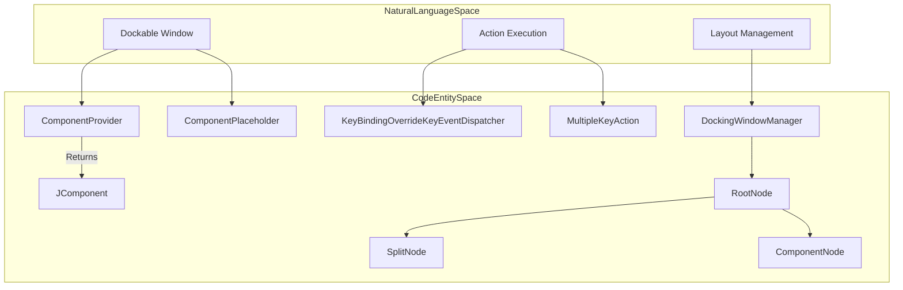
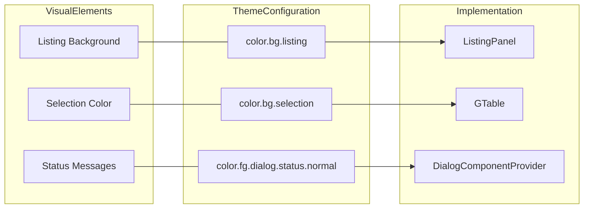

<!-- source: DeepWiki mcp.deepwiki.com · repo NationalSecurityAgency/ghidra · page 9 GUI Framework · fetched 2026-11-09 -->

# GUI Framework

Relevant source files

The following files were used as context for generating this wiki page:

- [Ghidra/Features/Base/src/main/help/help/topics/DockingWindows/Docking_Windows.htm](Ghidra/Features/Base/src/main/help/help/topics/DockingWindows/Docking_Windows.htm)
- [Ghidra/Features/Base/src/main/help/help/topics/RegisterPlugin/Registers.htm](Ghidra/Features/Base/src/main/help/help/topics/RegisterPlugin/Registers.htm)
- [Ghidra/Features/Base/src/main/java/ghidra/app/plugin/core/codebrowser/CodeViewerProvider.java](Ghidra/Features/Base/src/main/java/ghidra/app/plugin/core/codebrowser/CodeViewerProvider.java)
- [Ghidra/Features/Base/src/main/java/ghidra/app/plugin/core/console/ConsoleComponentProvider.java](Ghidra/Features/Base/src/main/java/ghidra/app/plugin/core/console/ConsoleComponentProvider.java)
- [Ghidra/Features/Base/src/main/java/ghidra/app/plugin/core/cparser/ParseDialog.java](Ghidra/Features/Base/src/main/java/ghidra/app/plugin/core/cparser/ParseDialog.java)
- [Ghidra/Features/Base/src/main/java/ghidra/app/plugin/core/navigation/ProviderNavigationPlugin.java](Ghidra/Features/Base/src/main/java/ghidra/app/plugin/core/navigation/ProviderNavigationPlugin.java)
- [Ghidra/Features/Base/src/main/java/ghidra/app/plugin/core/register/RegisterManagerProvider.java](Ghidra/Features/Base/src/main/java/ghidra/app/plugin/core/register/RegisterManagerProvider.java)
- [Ghidra/Features/Base/src/test.slow/java/ghidra/app/plugin/core/cparser/ParseDialogParsingAndPromptsTest.java](Ghidra/Features/Base/src/test.slow/java/ghidra/app/plugin/core/cparser/ParseDialogParsingAndPromptsTest.java)
- [Ghidra/Features/Base/src/test.slow/java/ghidra/app/plugin/core/cparser/ParseDialogTest.java](Ghidra/Features/Base/src/test.slow/java/ghidra/app/plugin/core/cparser/ParseDialogTest.java)
- [Ghidra/Features/Base/src/test.slow/java/ghidra/framework/plugintool/dialog/ManagePluginsTest.java](Ghidra/Features/Base/src/test.slow/java/ghidra/framework/plugintool/dialog/ManagePluginsTest.java)
- [Ghidra/Features/ByteViewer/src/main/java/ghidra/app/plugin/core/byteviewer/ProgramByteViewerComponentProvider.java](Ghidra/Features/ByteViewer/src/main/java/ghidra/app/plugin/core/byteviewer/ProgramByteViewerComponentProvider.java)
- [Ghidra/Framework/Docking/src/main/java/docking/ComponentNode.java](Ghidra/Framework/Docking/src/main/java/docking/ComponentNode.java)
- [Ghidra/Framework/Docking/src/main/java/docking/ComponentPlaceholder.java](Ghidra/Framework/Docking/src/main/java/docking/ComponentPlaceholder.java)
- [Ghidra/Framework/Docking/src/main/java/docking/ComponentProvider.java](Ghidra/Framework/Docking/src/main/java/docking/ComponentProvider.java)
- [Ghidra/Framework/Docking/src/main/java/docking/DetachedWindowNode.java](Ghidra/Framework/Docking/src/main/java/docking/DetachedWindowNode.java)
- [Ghidra/Framework/Docking/src/main/java/docking/DockingWindowManager.java](Ghidra/Framework/Docking/src/main/java/docking/DockingWindowManager.java)
- [Ghidra/Framework/Docking/src/main/java/docking/GlobalMenuAndToolBarManager.java](Ghidra/Framework/Docking/src/main/java/docking/GlobalMenuAndToolBarManager.java)
- [Ghidra/Framework/Docking/src/main/java/docking/PlaceholderManager.java](Ghidra/Framework/Docking/src/main/java/docking/PlaceholderManager.java)
- [Ghidra/Framework/Docking/src/main/java/docking/RootNode.java](Ghidra/Framework/Docking/src/main/java/docking/RootNode.java)
- [Ghidra/Framework/Docking/src/main/java/docking/widgets/tabbedpane/DockingTabRenderer.java](Ghidra/Framework/Docking/src/main/java/docking/widgets/tabbedpane/DockingTabRenderer.java)
- [Ghidra/Framework/Project/src/main/java/ghidra/framework/plugintool/dialog/ManagePluginsDialog.java](Ghidra/Framework/Project/src/main/java/ghidra/framework/plugintool/dialog/ManagePluginsDialog.java)

Ghidra’s user interface is built on a sophisticated Swing-based framework designed to handle the complex, multi-window requirements of reverse engineering. The framework provides a robust docking system, a highly optimized code listing component, a comprehensive theming infrastructure, interactive graph visualization, and specialized editors that ensure consistency across hundreds of different plugins and tools.

## Docking Window System

The core of Ghidra's UI is the **Docking Window System**, managed primarily by the `DockingWindowManager` [Ghidra/Framework/Docking/src/main/java/docking/DockingWindowManager.java:63-63](). This system allows users to arrange, stack, and detach various UI components (Providers) within a single tool or across multiple windows.

Components are integrated into the docking system via `ComponentProvider` [Ghidra/Framework/Docking/src/main/java/docking/ComponentProvider.java:75-75](). The lifecycle of these providers (showing, hiding, and disposing) is managed by the framework, which also handles the persistence of window layouts. The internal structure of a Ghidra window is represented as a tree of nodes, including `RootNode` [Ghidra/Framework/Docking/src/main/java/docking/RootNode.java:39-39](), `DetachedWindowNode` [Ghidra/Framework/Docking/src/main/java/docking/DetachedWindowNode.java:37-37](), and `ComponentNode` [Ghidra/Framework/Docking/src/main/java/docking/ComponentNode.java:37-37](). The `PlaceholderManager` tracks `ComponentPlaceholder` objects which represent the state of a provider within the layout [Ghidra/Framework/Docking/src/main/java/docking/PlaceholderManager.java:32-32]().

For details, see [Docking Window System](#9.1).

### Key Entity Mapping: Docking Lifecycle
The following diagram illustrates how the logical docking actions map to the underlying code entities that manage the window hierarchy.

Sources: [Ghidra/Framework/Docking/src/main/java/docking/DockingWindowManager.java:82-84](), [Ghidra/Framework/Docking/src/main/java/docking/ComponentProvider.java:176-176](), [Ghidra/Framework/Docking/src/main/java/docking/RootNode.java:39-45](), [Ghidra/Framework/Docking/src/main/java/docking/ComponentNode.java:37-37](), [Ghidra/Framework/Docking/src/main/java/docking/PlaceholderManager.java:32-32]().

## Listing Panel and Code Browser

The `CodeBrowserPlugin` is the primary interface for viewing and navigating program code. It utilizes the `ListingPanel` to render assembly instructions, data, and comments [Ghidra/Features/Base/src/main/java/ghidra/app/plugin/core/codebrowser/CodeViewerProvider.java:152-152](). 

Unlike standard text components, the Listing Panel uses a specialized model (e.g., `ProgramBigListingModel`) to handle programs with billions of addresses without loading the entire text into memory. It employs a pipeline of "Field Factories" to render specific parts of an instruction line. The `CodeViewerProvider` coordinates the `ListingPanel` with the rest of the tool, managing selection and location changes [Ghidra/Features/Base/src/main/java/ghidra/app/plugin/core/codebrowser/CodeViewerProvider.java:70-72](). Navigation is handled through services like `GoToService`, allowing synchronized movement between the Listing, Decompiler, and other address-aware components.

For details, see [Listing Panel and Code Browser](#9.2).

Sources: [Ghidra/Features/Base/src/main/java/ghidra/app/plugin/core/codebrowser/CodeViewerProvider.java:70-152]()

## Common Widgets and Theming

Ghidra provides a suite of high-level Swing widgets tailored for reverse engineering workflows, including `GTable` (threaded table models, sorting, and filtering), `GTree` (lazy-loading tree models), `GhidraFileChooser`, and `TaskDialog`/`TaskLauncher` for asynchronous background operations.

### Theming Infrastructure
The UI's look and feel is controlled by a centralized theme system using `.theme.properties` files, palette definitions, and Look-and-Feel integration. `ComponentProvider` instances integrate with this system via `ThemeListener` to respond to global look-and-feel changes [Ghidra/Framework/Docking/src/main/java/docking/ComponentProvider.java:125-126]().

For details, see [Common Widgets and Theming](#9.3).

### Theme Entity Association
This diagram bridges the visual properties seen by the user to the management classes and UI components.

Sources: [Ghidra/Framework/Docking/src/main/java/docking/ComponentProvider.java:125-126](), [Ghidra/Features/Base/src/main/java/ghidra/app/plugin/core/codebrowser/CodeViewerProvider.java:152-152]().

## Graph Visualization

Ghidra includes a graph services layer centered around `AttributedGraph`, `GraphDisplay`, and `GraphDisplayBroker` service APIs. Powered by JGraphT, the framework supports layout functions, smooth transitions, graph export, and specific visualization plugins like the `ProgramGraph` plugin (for block, call, and data graphs) and the interactive Function Graph.

For details, see [Graph Visualization](#9.4).

Sources: [Ghidra/Framework/Docking/src/main/java/docking/ComponentProvider.java:75-75]()

## Symbol, Function, and Program Structure Editors

To support deep code analysis and modification, Ghidra provides dedicated symbol-oriented UI providers such as the Symbol Table and Symbol Tree, function signature editors (`FunctionEditorModel`, `StorageAddressEditorDialog`), memory map editors, and program tree/module organization tools.

For details, see [Symbol, Function, and Program Structure Editors](#9.5).

Sources: [Ghidra/Framework/Docking/src/main/java/docking/ComponentProvider.java:75-75]()

---

