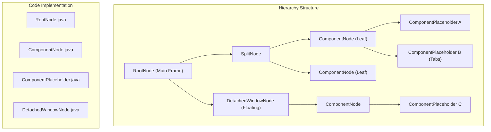
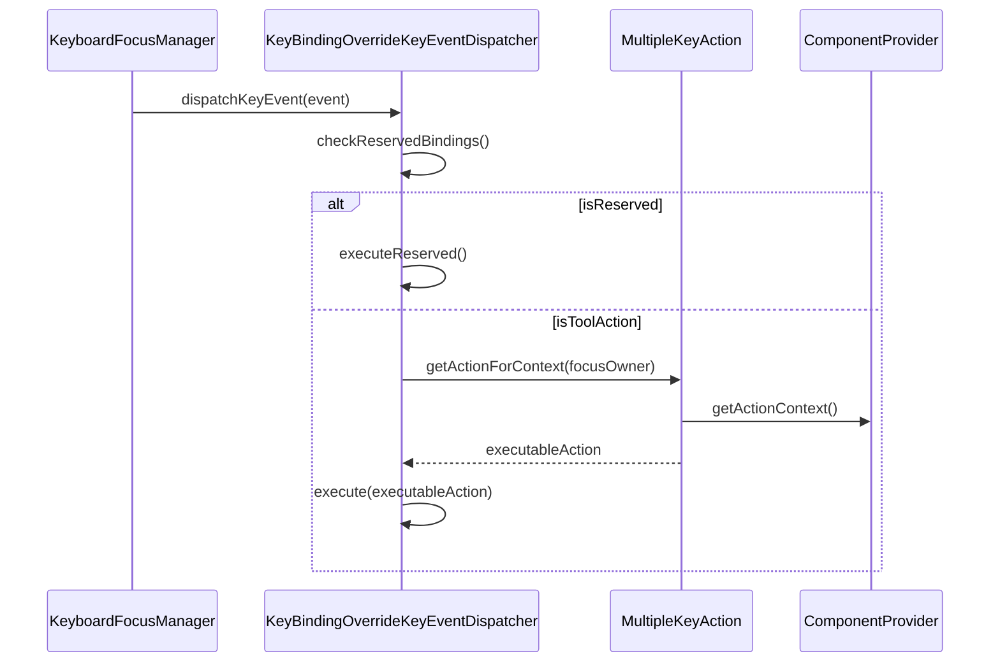

<!-- source: DeepWiki mcp.deepwiki.com · repo NationalSecurityAgency/ghidra · page 9.1 Docking Window System · fetched 2026-11-09 -->

# Docking Window System

<details>
<summary>Relevant source files</summary>

The following files were used as context for generating this wiki page:

- [Ghidra/Debug/Debugger-api/src/main/java/ghidra/debug/api/watch/WatchRow.java](Ghidra/Debug/Debugger-api/src/main/java/ghidra/debug/api/watch/WatchRow.java)
- [Ghidra/Debug/Debugger/src/main/java/ghidra/app/plugin/core/debug/gui/watch/DefaultWatchRow.java](Ghidra/Debug/Debugger/src/main/java/ghidra/app/plugin/core/debug/gui/watch/DefaultWatchRow.java)
- [Ghidra/Debug/Framework-TraceModeling/src/main/java/ghidra/trace/model/target/info/TraceObjectInterfaceUtils.java](Ghidra/Debug/Framework-TraceModeling/src/main/java/ghidra/trace/model/target/info/TraceObjectInterfaceUtils.java)
- [Ghidra/Features/Base/src/main/help/help/topics/DockingWindows/Docking_Windows.htm](Ghidra/Features/Base/src/main/help/help/topics/DockingWindows/Docking_Windows.htm)
- [Ghidra/Features/Base/src/main/help/help/topics/RegisterPlugin/Registers.htm](Ghidra/Features/Base/src/main/help/help/topics/RegisterPlugin/Registers.htm)
- [Ghidra/Features/Base/src/main/help/help/topics/Tool/images/KeyBindings.png](Ghidra/Features/Base/src/main/help/help/topics/Tool/images/KeyBindings.png)
- [Ghidra/Features/Base/src/main/help/help/topics/Tool/images/SetKeyBindings.png](Ghidra/Features/Base/src/main/help/help/topics/Tool/images/SetKeyBindings.png)
- [Ghidra/Features/Base/src/main/java/ghidra/app/plugin/core/codebrowser/CodeViewerProvider.java](Ghidra/Features/Base/src/main/java/ghidra/app/plugin/core/codebrowser/CodeViewerProvider.java)
- [Ghidra/Features/Base/src/main/java/ghidra/app/plugin/core/compositeeditor/CreateInternalStructureAction.java](Ghidra/Features/Base/src/main/java/ghidra/app/plugin/core/compositeeditor/CreateInternalStructureAction.java)
- [Ghidra/Features/Base/src/main/java/ghidra/app/plugin/core/compositeeditor/DeleteAction.java](Ghidra/Features/Base/src/main/java/ghidra/app/plugin/core/compositeeditor/DeleteAction.java)
- [Ghidra/Features/Base/src/main/java/ghidra/app/plugin/core/compositeeditor/EditComponentAction.java](Ghidra/Features/Base/src/main/java/ghidra/app/plugin/core/compositeeditor/EditComponentAction.java)
- [Ghidra/Features/Base/src/main/java/ghidra/app/plugin/core/compositeeditor/HexNumbersAction.java](Ghidra/Features/Base/src/main/java/ghidra/app/plugin/core/compositeeditor/HexNumbersAction.java)
- [Ghidra/Features/Base/src/main/java/ghidra/app/plugin/core/console/ConsoleComponentProvider.java](Ghidra/Features/Base/src/main/java/ghidra/app/plugin/core/console/ConsoleComponentProvider.java)
- [Ghidra/Features/Base/src/main/java/ghidra/app/plugin/core/cparser/ParseDialog.java](Ghidra/Features/Base/src/main/java/ghidra/app/plugin/core/cparser/ParseDialog.java)
- [Ghidra/Features/Base/src/main/java/ghidra/app/plugin/core/datamgr/actions/ClearCutAction.java](Ghidra/Features/Base/src/main/java/ghidra/app/plugin/core/datamgr/actions/ClearCutAction.java)
- [Ghidra/Features/Base/src/main/java/ghidra/app/plugin/core/datamgr/editor/EditorOptionManager.java](Ghidra/Features/Base/src/main/java/ghidra/app/plugin/core/datamgr/editor/EditorOptionManager.java)
- [Ghidra/Features/Base/src/main/java/ghidra/app/plugin/core/instructionsearch/ui/PreviewTable.java](Ghidra/Features/Base/src/main/java/ghidra/app/plugin/core/instructionsearch/ui/PreviewTable.java)
- [Ghidra/Features/Base/src/main/java/ghidra/app/plugin/core/memory/MemoryMapModel.java](Ghidra/Features/Base/src/main/java/ghidra/app/plugin/core/memory/MemoryMapModel.java)
- [Ghidra/Features/Base/src/main/java/ghidra/app/plugin/core/navigation/ProviderNavigationPlugin.java](Ghidra/Features/Base/src/main/java/ghidra/app/plugin/core/navigation/ProviderNavigationPlugin.java)
- [Ghidra/Features/Base/src/main/java/ghidra/app/plugin/core/register/RegisterManagerProvider.java](Ghidra/Features/Base/src/main/java/ghidra/app/plugin/core/register/RegisterManagerProvider.java)
- [Ghidra/Features/Base/src/main/java/ghidra/app/plugin/core/script/KeyBindingInputDialog.java](Ghidra/Features/Base/src/main/java/ghidra/app/plugin/core/script/KeyBindingInputDialog.java)
- [Ghidra/Features/Base/src/test.slow/java/docking/ComponentProviderActionsTest.java](Ghidra/Features/Base/src/test.slow/java/docking/ComponentProviderActionsTest.java)
- [Ghidra/Features/Base/src/test.slow/java/docking/action/KeyEntryDialogTest.java](Ghidra/Features/Base/src/test.slow/java/docking/action/KeyEntryDialogTest.java)
- [Ghidra/Features/Base/src/test.slow/java/ghidra/app/plugin/core/cparser/ParseDialogParsingAndPromptsTest.java](Ghidra/Features/Base/src/test.slow/java/ghidra/app/plugin/core/cparser/ParseDialogParsingAndPromptsTest.java)
- [Ghidra/Features/Base/src/test.slow/java/ghidra/app/plugin/core/cparser/ParseDialogTest.java](Ghidra/Features/Base/src/test.slow/java/ghidra/app/plugin/core/cparser/ParseDialogTest.java)
- [Ghidra/Features/Base/src/test.slow/java/ghidra/app/plugin/core/memory/MemoryMapPluginTest.java](Ghidra/Features/Base/src/test.slow/java/ghidra/app/plugin/core/memory/MemoryMapPluginTest.java)
- [Ghidra/Features/Base/src/test.slow/java/ghidra/app/plugin/core/memory/MemoryMapProvider1Test.java](Ghidra/Features/Base/src/test.slow/java/ghidra/app/plugin/core/memory/MemoryMapProvider1Test.java)
- [Ghidra/Features/Base/src/test.slow/java/ghidra/app/plugin/core/memory/MemoryMapProvider2Test.java](Ghidra/Features/Base/src/test.slow/java/ghidra/app/plugin/core/memory/MemoryMapProvider2Test.java)
- [Ghidra/Features/Base/src/test.slow/java/ghidra/app/plugin/core/memory/MemoryMapProvider3Test.java](Ghidra/Features/Base/src/test.slow/java/ghidra/app/plugin/core/memory/MemoryMapProvider3Test.java)
- [Ghidra/Features/Base/src/test.slow/java/ghidra/app/plugin/core/memory/MemoryMapProvider4Test.java](Ghidra/Features/Base/src/test.slow/java/ghidra/app/plugin/core/memory/MemoryMapProvider4Test.java)
- [Ghidra/Features/Base/src/test.slow/java/ghidra/app/plugin/core/programtree/AbstractProgramTreePluginTest.java](Ghidra/Features/Base/src/test.slow/java/ghidra/app/plugin/core/programtree/AbstractProgramTreePluginTest.java)
- [Ghidra/Features/Base/src/test.slow/java/ghidra/app/plugin/core/programtree/ProgramTreePlugin1Test.java](Ghidra/Features/Base/src/test.slow/java/ghidra/app/plugin/core/programtree/ProgramTreePlugin1Test.java)
- [Ghidra/Features/Base/src/test.slow/java/ghidra/app/plugin/core/programtree/ProgramTreePlugin2Test.java](Ghidra/Features/Base/src/test.slow/java/ghidra/app/plugin/core/programtree/ProgramTreePlugin2Test.java)
- [Ghidra/Features/Base/src/test.slow/java/ghidra/app/plugin/core/programtree/ProgramTreePlugin3Test.java](Ghidra/Features/Base/src/test.slow/java/ghidra/app/plugin/core/programtree/ProgramTreePlugin3Test.java)
- [Ghidra/Features/Base/src/test.slow/java/ghidra/framework/plugintool/dialog/KeyBindingUtilsTest.java](Ghidra/Features/Base/src/test.slow/java/ghidra/framework/plugintool/dialog/KeyBindingUtilsTest.java)
- [Ghidra/Features/Base/src/test.slow/java/ghidra/framework/plugintool/dialog/KeyBindingsTest.java](Ghidra/Features/Base/src/test.slow/java/ghidra/framework/plugintool/dialog/KeyBindingsTest.java)
- [Ghidra/Features/Base/src/test.slow/java/ghidra/framework/plugintool/dialog/ManagePluginsTest.java](Ghidra/Features/Base/src/test.slow/java/ghidra/framework/plugintool/dialog/ManagePluginsTest.java)
- [Ghidra/Features/Base/src/test.slow/java/ghidra/util/bean/opteditor/OptionsDialogTest.java](Ghidra/Features/Base/src/test.slow/java/ghidra/util/bean/opteditor/OptionsDialogTest.java)
- [Ghidra/Features/ByteViewer/src/main/java/ghidra/app/plugin/core/byteviewer/ProgramByteViewerComponentProvider.java](Ghidra/Features/ByteViewer/src/main/java/ghidra/app/plugin/core/byteviewer/ProgramByteViewerComponentProvider.java)
- [Ghidra/Features/GraphServices/src/main/java/ghidra/graph/visualization/SetLayoutTask.java](Ghidra/Features/GraphServices/src/main/java/ghidra/graph/visualization/SetLayoutTask.java)
- [Ghidra/Framework/Docking/src/main/java/docking/ActionBindingPanel.java](Ghidra/Framework/Docking/src/main/java/docking/ActionBindingPanel.java)
- [Ghidra/Framework/Docking/src/main/java/docking/ActionToGuiMapper.java](Ghidra/Framework/Docking/src/main/java/docking/ActionToGuiMapper.java)
- [Ghidra/Framework/Docking/src/main/java/docking/ComponentNode.java](Ghidra/Framework/Docking/src/main/java/docking/ComponentNode.java)
- [Ghidra/Framework/Docking/src/main/java/docking/ComponentPlaceholder.java](Ghidra/Framework/Docking/src/main/java/docking/ComponentPlaceholder.java)
- [Ghidra/Framework/Docking/src/main/java/docking/ComponentProvider.java](Ghidra/Framework/Docking/src/main/java/docking/ComponentProvider.java)
- [Ghidra/Framework/Docking/src/main/java/docking/DetachedWindowNode.java](Ghidra/Framework/Docking/src/main/java/docking/DetachedWindowNode.java)
- [Ghidra/Framework/Docking/src/main/java/docking/DialogComponentProvider.java](Ghidra/Framework/Docking/src/main/java/docking/DialogComponentProvider.java)
- [Ghidra/Framework/Docking/src/main/java/docking/DockingActionProxy.java](Ghidra/Framework/Docking/src/main/java/docking/DockingActionProxy.java)
- [Ghidra/Framework/Docking/src/main/java/docking/DockingDialog.java](Ghidra/Framework/Docking/src/main/java/docking/DockingDialog.java)
- [Ghidra/Framework/Docking/src/main/java/docking/DockingFrame.java](Ghidra/Framework/Docking/src/main/java/docking/DockingFrame.java)
- [Ghidra/Framework/Docking/src/main/java/docking/DockingKeyBindingAction.java](Ghidra/Framework/Docking/src/main/java/docking/DockingKeyBindingAction.java)
- [Ghidra/Framework/Docking/src/main/java/docking/DockingWindowManager.java](Ghidra/Framework/Docking/src/main/java/docking/DockingWindowManager.java)
- [Ghidra/Framework/Docking/src/main/java/docking/ExecutableAction.java](Ghidra/Framework/Docking/src/main/java/docking/ExecutableAction.java)
- [Ghidra/Framework/Docking/src/main/java/docking/GlobalMenuAndToolBarManager.java](Ghidra/Framework/Docking/src/main/java/docking/GlobalMenuAndToolBarManager.java)
- [Ghidra/Framework/Docking/src/main/java/docking/KbEnabledState.java](Ghidra/Framework/Docking/src/main/java/docking/KbEnabledState.java)
- [Ghidra/Framework/Docking/src/main/java/docking/KeyBindingOverrideKeyEventDispatcher.java](Ghidra/Framework/Docking/src/main/java/docking/KeyBindingOverrideKeyEventDispatcher.java)
- [Ghidra/Framework/Docking/src/main/java/docking/KeyEntryPanel.java](Ghidra/Framework/Docking/src/main/java/docking/KeyEntryPanel.java)
- [Ghidra/Framework/Docking/src/main/java/docking/KeyEntryTextField.java](Ghidra/Framework/Docking/src/main/java/docking/KeyEntryTextField.java)
- [Ghidra/Framework/Docking/src/main/java/docking/MouseBindingMouseEventDispatcher.java](Ghidra/Framework/Docking/src/main/java/docking/MouseBindingMouseEventDispatcher.java)
- [Ghidra/Framework/Docking/src/main/java/docking/MouseEntryTextField.java](Ghidra/Framework/Docking/src/main/java/docking/MouseEntryTextField.java)
- [Ghidra/Framework/Docking/src/main/java/docking/MultiActionDialog.java](Ghidra/Framework/Docking/src/main/java/docking/MultiActionDialog.java)
- [Ghidra/Framework/Docking/src/main/java/docking/PlaceholderManager.java](Ghidra/Framework/Docking/src/main/java/docking/PlaceholderManager.java)
- [Ghidra/Framework/Docking/src/main/java/docking/PopupActionManager.java](Ghidra/Framework/Docking/src/main/java/docking/PopupActionManager.java)
- [Ghidra/Framework/Docking/src/main/java/docking/PopupMenuContext.java](Ghidra/Framework/Docking/src/main/java/docking/PopupMenuContext.java)
- [Ghidra/Framework/Docking/src/main/java/docking/RootNode.java](Ghidra/Framework/Docking/src/main/java/docking/RootNode.java)
- [Ghidra/Framework/Docking/src/main/java/docking/SystemExecutableAction.java](Ghidra/Framework/Docking/src/main/java/docking/SystemExecutableAction.java)
- [Ghidra/Framework/Docking/src/main/java/docking/action/DockingAction.java](Ghidra/Framework/Docking/src/main/java/docking/action/DockingAction.java)
- [Ghidra/Framework/Docking/src/main/java/docking/action/DockingActionIf.java](Ghidra/Framework/Docking/src/main/java/docking/action/DockingActionIf.java)
- [Ghidra/Framework/Docking/src/main/java/docking/action/KeyBindingData.java](Ghidra/Framework/Docking/src/main/java/docking/action/KeyBindingData.java)
- [Ghidra/Framework/Docking/src/main/java/docking/action/KeyBindingType.java](Ghidra/Framework/Docking/src/main/java/docking/action/KeyBindingType.java)
- [Ghidra/Framework/Docking/src/main/java/docking/action/KeyBindingsManager.java](Ghidra/Framework/Docking/src/main/java/docking/action/KeyBindingsManager.java)
- [Ghidra/Framework/Docking/src/main/java/docking/action/MultipleKeyAction.java](Ghidra/Framework/Docking/src/main/java/docking/action/MultipleKeyAction.java)
- [Ghidra/Framework/Docking/src/main/java/docking/action/ShowContextMenuAction.java](Ghidra/Framework/Docking/src/main/java/docking/action/ShowContextMenuAction.java)
- [Ghidra/Framework/Docking/src/main/java/docking/action/SystemKeyBindingAction.java](Ghidra/Framework/Docking/src/main/java/docking/action/SystemKeyBindingAction.java)
- [Ghidra/Framework/Docking/src/main/java/docking/action/ToggleDockingAction.java](Ghidra/Framework/Docking/src/main/java/docking/action/ToggleDockingAction.java)
- [Ghidra/Framework/Docking/src/main/java/docking/action/builder/AbstractActionBuilder.java](Ghidra/Framework/Docking/src/main/java/docking/action/builder/AbstractActionBuilder.java)
- [Ghidra/Framework/Docking/src/main/java/docking/action/builder/ActionBuilder.java](Ghidra/Framework/Docking/src/main/java/docking/action/builder/ActionBuilder.java)
- [Ghidra/Framework/Docking/src/main/java/docking/action/builder/MultiActionBuilder.java](Ghidra/Framework/Docking/src/main/java/docking/action/builder/MultiActionBuilder.java)
- [Ghidra/Framework/Docking/src/main/java/docking/action/builder/MultiStateActionBuilder.java](Ghidra/Framework/Docking/src/main/java/docking/action/builder/MultiStateActionBuilder.java)
- [Ghidra/Framework/Docking/src/main/java/docking/action/builder/ToggleActionBuilder.java](Ghidra/Framework/Docking/src/main/java/docking/action/builder/ToggleActionBuilder.java)
- [Ghidra/Framework/Docking/src/main/java/docking/actions/KeyBindingUtils.java](Ghidra/Framework/Docking/src/main/java/docking/actions/KeyBindingUtils.java)
- [Ghidra/Framework/Docking/src/main/java/docking/actions/KeyEntryDialog.java](Ghidra/Framework/Docking/src/main/java/docking/actions/KeyEntryDialog.java)
- [Ghidra/Framework/Docking/src/main/java/docking/actions/SetKeyBindingAction.java](Ghidra/Framework/Docking/src/main/java/docking/actions/SetKeyBindingAction.java)
- [Ghidra/Framework/Docking/src/main/java/docking/actions/SharedStubKeyBindingAction.java](Ghidra/Framework/Docking/src/main/java/docking/actions/SharedStubKeyBindingAction.java)
- [Ghidra/Framework/Docking/src/main/java/docking/actions/ToolActions.java](Ghidra/Framework/Docking/src/main/java/docking/actions/ToolActions.java)
- [Ghidra/Framework/Docking/src/main/java/docking/widgets/MultiLineLabel.java](Ghidra/Framework/Docking/src/main/java/docking/widgets/MultiLineLabel.java)
- [Ghidra/Framework/Docking/src/main/java/docking/widgets/filechooser/FileChooserActionManager.java](Ghidra/Framework/Docking/src/main/java/docking/widgets/filechooser/FileChooserActionManager.java)
- [Ghidra/Framework/Docking/src/main/java/docking/widgets/tabbedpane/DockingTabRenderer.java](Ghidra/Framework/Docking/src/main/java/docking/widgets/tabbedpane/DockingTabRenderer.java)
- [Ghidra/Framework/Docking/src/test.slow/java/docking/actions/SharedKeyBindingDockingActionTest.java](Ghidra/Framework/Docking/src/test.slow/java/docking/actions/SharedKeyBindingDockingActionTest.java)
- [Ghidra/Framework/Docking/src/test/java/docking/action/ActionBuilderTest.java](Ghidra/Framework/Docking/src/test/java/docking/action/ActionBuilderTest.java)
- [Ghidra/Framework/Emulation/src/test/java/ghidra/app/plugin/processors/sleigh/SleighLanguageHelper.java](Ghidra/Framework/Emulation/src/test/java/ghidra/app/plugin/processors/sleigh/SleighLanguageHelper.java)
- [Ghidra/Framework/Gui/src/main/java/resources/ResourceManager.java](Ghidra/Framework/Gui/src/main/java/resources/ResourceManager.java)
- [Ghidra/Framework/Project/src/main/java/ghidra/framework/main/datatree/ClearCutAction.java](Ghidra/Framework/Project/src/main/java/ghidra/framework/main/datatree/ClearCutAction.java)
- [Ghidra/Framework/Project/src/main/java/ghidra/framework/plugintool/dialog/KeyBindingsPanel.java](Ghidra/Framework/Project/src/main/java/ghidra/framework/plugintool/dialog/KeyBindingsPanel.java)
- [Ghidra/Framework/Project/src/main/java/ghidra/framework/plugintool/dialog/ManagePluginsDialog.java](Ghidra/Framework/Project/src/main/java/ghidra/framework/plugintool/dialog/ManagePluginsDialog.java)
- [Ghidra/Framework/Utility/src/main/java/generic/jar/ResourceFile.java](Ghidra/Framework/Utility/src/main/java/generic/jar/ResourceFile.java)
- [Ghidra/Test/DebuggerIntegrationTest/src/test/java/ghidra/app/plugin/core/debug/gui/register/DebuggerTraceRegistersProviderTest.java](Ghidra/Test/DebuggerIntegrationTest/src/test/java/ghidra/app/plugin/core/debug/gui/register/DebuggerTraceRegistersProviderTest.java)
- [Ghidra/Test/DebuggerIntegrationTest/src/test/java/ghidra/app/plugin/core/debug/gui/watch/DebuggerWatchesProviderTest.java](Ghidra/Test/DebuggerIntegrationTest/src/test/java/ghidra/app/plugin/core/debug/gui/watch/DebuggerWatchesProviderTest.java)

</details>


The Docking Window System is the core GUI management framework for Ghidra, responsible for organizing components, managing window lifecycles, and dispatching user actions. It allows various `ComponentProvider` instances to be "docked" into a single main frame, split into side-by-side views, or "detached" into independent floating windows.

## DockingWindowManager

The `DockingWindowManager` is the central coordinator for a tool's user interface [Ghidra/Framework/Docking/src/main/java/docking/DockingWindowManager.java:63-63](). It manages the layout of components, handles focus changes, and maps actions to the GUI [Ghidra/Framework/Docking/src/main/java/docking/DockingWindowManager.java:155-156]().

### ComponentProvider Lifecycle
Components are introduced to the system via `ComponentProvider` objects [Ghidra/Framework/Docking/src/main/java/docking/ComponentProvider.java:75-75](). The lifecycle is managed through the following key transitions:

*   **Add**: A provider is added to the tool via `DockingWindowManager.addComponentProvider()` [Ghidra/Framework/Docking/src/main/java/docking/DockingWindowManager.java:756-756]().
*   **Show**: Calling `showComponent()` makes the provider's component visible within the window hierarchy [Ghidra/Framework/Docking/src/main/java/docking/DockingWindowManager.java:825-825]().
*   **Hide**: Closing a tab or calling `hideComponent()` removes the component from the visible hierarchy but retains the provider's registration [Ghidra/Framework/Docking/src/main/java/docking/DockingWindowManager.java:872-872]().
*   **Dispose**: When a tool is closed or a plugin removed, `dispose()` is called on the provider to clean up resources [Ghidra/Framework/Docking/src/main/java/docking/ComponentProvider.java:318-318]().

### Data Flow: Component Registration to Display
The following diagram illustrates how a `ComponentProvider` is transformed into a visible UI element within the `DockingWindowManager`.

Title: Component Provider to UI Transformation
```mermaid
graph TD
    subgraph "Code Entity Space"
        A["ComponentProvider"] -- "doGetComponent()" --> B["JComponent"]
        C["DockingWindowManager"] -- "addComponentProvider()" --> D["ComponentPlaceholder"]
        D -- "setNode()" --> E["ComponentNode"]
        E -- "parent" --> F["SplitNode / RootNode"]
    end

    subgraph "System Names"
        "Provider Implementation" --> "Swing Widget"
        "Manager Logic" --> "Placeholder Tracking"
        "Node Hierarchy" --> "Visual Layout"
    end

    A -.-> C
    D -.-> B
```
Sources: [Ghidra/Framework/Docking/src/main/java/docking/ComponentProvider.java:163-170](), [Ghidra/Framework/Docking/src/main/java/docking/DockingWindowManager.java:756-760](), [Ghidra/Framework/Docking/src/main/java/docking/ComponentNode.java:169-179]()

## Window Node Hierarchy

The visual arrangement of Ghidra is maintained as a tree of `Node` objects. This hierarchy defines how space is partitioned and where components are located.

### Node Types
*   **RootNode**: The base of the window tree, typically associated with a `JFrame` or `JDialog` [Ghidra/Framework/Docking/src/main/java/docking/RootNode.java:39-39](). It manages the `StatusBar` and a list of `DetachedWindowNode`s [Ghidra/Framework/Docking/src/main/java/docking/RootNode.java:46-48]().
*   **SplitNode**: A non-leaf node that divides its available space between two child nodes (left/right or top/bottom).
*   **ComponentNode**: A leaf node that contains one or more `ComponentPlaceholder` objects [Ghidra/Framework/Docking/src/main/java/docking/ComponentNode.java:37-37](). If multiple placeholders are present, it renders them as a tabbed pane [Ghidra/Framework/Docking/src/main/java/docking/ComponentNode.java:34-35]().
*   **DetachedWindowNode**: Represents a secondary top-level window that has been "torn off" from the main tool frame [Ghidra/Framework/Docking/src/main/java/docking/DetachedWindowNode.java:21-26]().

### ComponentPlaceholder
A `ComponentPlaceholder` acts as a proxy for a `ComponentProvider` within the node hierarchy [Ghidra/Framework/Docking/src/main/java/docking/ComponentPlaceholder.java:43-43](). It stores metadata such as the provider's name, owner, and current docking state (active, visible, or minimized) [Ghidra/Framework/Docking/src/main/java/docking/ComponentNode.java:78-86]().

Title: Window Hierarchy Architecture

Sources: [Ghidra/Framework/Docking/src/main/java/docking/RootNode.java:44-50](), [Ghidra/Framework/Docking/src/main/java/docking/ComponentNode.java:37-46](), [Ghidra/Framework/Docking/src/main/java/docking/DockingWindowManager.java:83-83]()

## Dialog Management

`DialogComponentProvider` is the base class for modal and non-modal dialogs [Ghidra/Framework/Docking/src/main/java/docking/DialogComponentProvider.java:49-49](). Unlike docked components, dialogs exist outside the primary node hierarchy and are managed as standard Java `JDialog` instances wrapped in `DockingDialog` [Ghidra/Framework/Docking/src/main/java/docking/DialogComponentProvider.java:91-91]().

Key features include:
*   **Status Management**: Built-in support for status text and colored alerts (Error, Warning, Normal) [Ghidra/Framework/Docking/src/main/java/docking/DialogComponentProvider.java:53-56]().
*   **Task Execution**: Ability to run background tasks with a built-in progress monitor via `executeProgressTask()` [Ghidra/Framework/Docking/src/main/java/docking/DialogComponentProvider.java:140-142]().
*   **Action Support**: Dialogs can have their own toolbars and key bindings [Ghidra/Framework/Docking/src/main/java/docking/DialogComponentProvider.java:93-102]().

Sources: [Ghidra/Framework/Docking/src/main/java/docking/DialogComponentProvider.java:120-145](), [Ghidra/Framework/Docking/src/main/java/docking/DialogComponentProvider.java:168-176]()

## Key Binding and Action Dispatch

Ghidra overrides the default Swing key event dispatching to ensure that tool-level actions and plugin-specific key bindings take precedence over standard component behaviors.

### KeyBindingOverrideKeyEventDispatcher
This class is installed into the `KeyboardFocusManager` to intercept all `KeyEvent`s [Ghidra/Framework/Docking/src/main/java/docking/KeyBindingOverrideKeyEventDispatcher.java:88-94](). It enforces a specific precedence for action execution [Ghidra/Framework/Docking/src/main/java/docking/KeyBindingOverrideKeyEventDispatcher.java:43-51]():

1.  **Reserved Keybindings**: System-level actions (e.g., F1 for Help) [Ghidra/Framework/Docking/src/main/java/docking/KeyBindingOverrideKeyEventDispatcher.java:107-107]().
2.  **Java Text Components**: Standard text editing keys are prioritized to prevent global actions from stealing input [Ghidra/Framework/Docking/src/main/java/docking/KeyBindingOverrideKeyEventDispatcher.java:158-160]().
3.  **Component KeyListeners**: Direct listeners on the focused widget [Ghidra/Framework/Docking/src/main/java/docking/KeyBindingOverrideKeyEventDispatcher.java:166-168]().
4.  **Ghidra Tool Actions**: Actions registered by plugins or the tool itself [Ghidra/Framework/Docking/src/main/java/docking/KeyBindingOverrideKeyEventDispatcher.java:110-110]().
5.  **Standard Swing Actions**: InputMap/ActionMap bindings on the component hierarchy [Ghidra/Framework/Docking/src/main/java/docking/KeyBindingOverrideKeyEventDispatcher.java:111-113]().

### MultipleKeyAction
When multiple actions are bound to the same key stroke, the `MultipleKeyAction` class resolves the conflict [Ghidra/Framework/Docking/src/main/java/docking/action/MultipleKeyAction.java:38-38](). It evaluates the `ActionContext` of each candidate action to determine which is currently valid for the focused component [Ghidra/Framework/Docking/src/main/java/docking/action/MultipleKeyAction.java:136-187](). If multiple actions remain valid, a selection dialog is presented to the user.

### ActionBuilder System
Actions are typically constructed fluently using `ActionBuilder` (or subclasses like `ToggleActionBuilder`), which streamlines configuring names, owners, menu paths, toolbar icons, tooltips, key bindings, and context predicates [Ghidra/Framework/Docking/src/main/java/docking/action/builder/AbstractActionBuilder.java:34-54]().

### Action Dispatch Sequence
Title: Key Event Dispatch Flow

Sources: [Ghidra/Framework/Docking/src/main/java/docking/KeyBindingOverrideKeyEventDispatcher.java:129-150](), [Ghidra/Framework/Docking/src/main/java/docking/KeyBindingOverrideKeyEventDispatcher.java:152-156](), [Ghidra/Framework/Docking/src/main/java/docking/action/MultipleKeyAction.java:136-187]()

---

