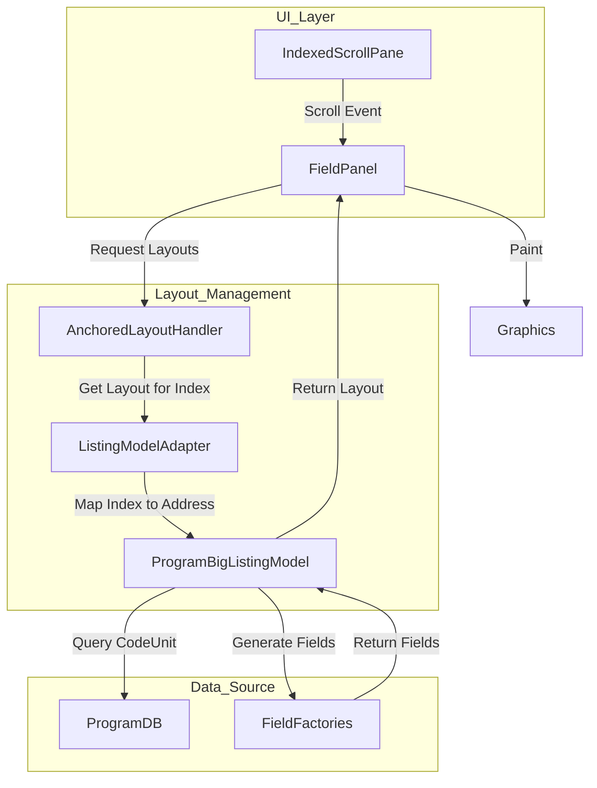
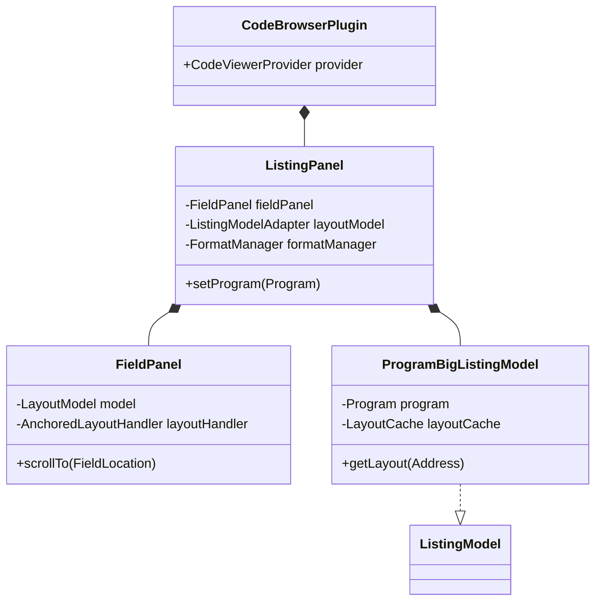

<!-- source: DeepWiki mcp.deepwiki.com · repo NationalSecurityAgency/ghidra · page 9.2 Listing Panel and Code Browser · fetched 2026-11-09 -->

# Listing Panel and Code Browser

Relevant source files

The following files were used as context for generating this wiki page:

- [Ghidra/Features/Base/src/main/help/help/topics/ClipboardPlugin/Clipboard.htm](Ghidra/Features/Base/src/main/help/help/topics/ClipboardPlugin/Clipboard.htm)
- [Ghidra/Features/Base/src/main/help/help/topics/ClipboardPlugin/images/CopySpecial.png](Ghidra/Features/Base/src/main/help/help/topics/ClipboardPlugin/images/CopySpecial.png)
- [Ghidra/Features/Base/src/main/help/help/topics/ClipboardPlugin/images/CopySpecialAgain.png](Ghidra/Features/Base/src/main/help/help/topics/ClipboardPlugin/images/CopySpecialAgain.png)
- [Ghidra/Features/Base/src/main/help/help/topics/CommentsPlugin/Comments.htm](Ghidra/Features/Base/src/main/help/help/topics/CommentsPlugin/Comments.htm)
- [Ghidra/Features/Base/src/main/help/help/topics/Navigation/Navigation.htm](Ghidra/Features/Base/src/main/help/help/topics/Navigation/Navigation.htm)
- [Ghidra/Features/Base/src/main/java/ghidra/GhidraOptions.java](Ghidra/Features/Base/src/main/java/ghidra/GhidraOptions.java)
- [Ghidra/Features/Base/src/main/java/ghidra/app/merge/MergeManagerProvider.java](Ghidra/Features/Base/src/main/java/ghidra/app/merge/MergeManagerProvider.java)
- [Ghidra/Features/Base/src/main/java/ghidra/app/plugin/core/checksums/BasicChecksumAlgorithm.java](Ghidra/Features/Base/src/main/java/ghidra/app/plugin/core/checksums/BasicChecksumAlgorithm.java)
- [Ghidra/Features/Base/src/main/java/ghidra/app/plugin/core/checksums/CRC16CCITTChecksumAlgorithm.java](Ghidra/Features/Base/src/main/java/ghidra/app/plugin/core/checksums/CRC16CCITTChecksumAlgorithm.java)
- [Ghidra/Features/Base/src/main/java/ghidra/app/plugin/core/checksums/CRC16ChecksumAlgorithm.java](Ghidra/Features/Base/src/main/java/ghidra/app/plugin/core/checksums/CRC16ChecksumAlgorithm.java)
- [Ghidra/Features/Base/src/main/java/ghidra/app/plugin/core/checksums/DigestChecksumAlgorithm.java](Ghidra/Features/Base/src/main/java/ghidra/app/plugin/core/checksums/DigestChecksumAlgorithm.java)
- [Ghidra/Features/Base/src/main/java/ghidra/app/plugin/core/checksums/MemoryInputStream.java](Ghidra/Features/Base/src/main/java/ghidra/app/plugin/core/checksums/MemoryInputStream.java)
- [Ghidra/Features/Base/src/main/java/ghidra/app/plugin/core/clipboard/ClipboardPlugin.java](Ghidra/Features/Base/src/main/java/ghidra/app/plugin/core/clipboard/ClipboardPlugin.java)
- [Ghidra/Features/Base/src/main/java/ghidra/app/plugin/core/clipboard/CodeBrowserClipboardProvider.java](Ghidra/Features/Base/src/main/java/ghidra/app/plugin/core/clipboard/CodeBrowserClipboardProvider.java)
- [Ghidra/Features/Base/src/main/java/ghidra/app/plugin/core/codebrowser/AbstractCodeBrowserPlugin.java](Ghidra/Features/Base/src/main/java/ghidra/app/plugin/core/codebrowser/AbstractCodeBrowserPlugin.java)
- [Ghidra/Features/Base/src/main/java/ghidra/app/plugin/core/codebrowser/AddressRangeTableModel.java](Ghidra/Features/Base/src/main/java/ghidra/app/plugin/core/codebrowser/AddressRangeTableModel.java)
- [Ghidra/Features/Base/src/main/java/ghidra/app/plugin/core/codebrowser/CodeBrowserSelectionPlugin.java](Ghidra/Features/Base/src/main/java/ghidra/app/plugin/core/codebrowser/CodeBrowserSelectionPlugin.java)
- [Ghidra/Features/Base/src/main/java/ghidra/app/plugin/core/commentwindow/CommentTableModel.java](Ghidra/Features/Base/src/main/java/ghidra/app/plugin/core/commentwindow/CommentTableModel.java)
- [Ghidra/Features/Base/src/main/java/ghidra/app/plugin/core/function/SetStackDepthChangeAction.java](Ghidra/Features/Base/src/main/java/ghidra/app/plugin/core/function/SetStackDepthChangeAction.java)
- [Ghidra/Features/Base/src/main/java/ghidra/app/plugin/core/gotoquery/GoToServicePlugin.java](Ghidra/Features/Base/src/main/java/ghidra/app/plugin/core/gotoquery/GoToServicePlugin.java)
- [Ghidra/Features/Base/src/main/java/ghidra/app/plugin/core/navigation/ProgramStartingLocationOptions.java](Ghidra/Features/Base/src/main/java/ghidra/app/plugin/core/navigation/ProgramStartingLocationOptions.java)
- [Ghidra/Features/Base/src/main/java/ghidra/app/plugin/core/navigation/ProgramStartingLocationPlugin.java](Ghidra/Features/Base/src/main/java/ghidra/app/plugin/core/navigation/ProgramStartingLocationPlugin.java)
- [Ghidra/Features/Base/src/main/java/ghidra/app/plugin/core/navigation/locationreferences/FunctionDefinitionLocationDescriptor.java](Ghidra/Features/Base/src/main/java/ghidra/app/plugin/core/navigation/locationreferences/FunctionDefinitionLocationDescriptor.java)
- [Ghidra/Features/Base/src/main/java/ghidra/app/plugin/core/navigation/locationreferences/LocationReference.java](Ghidra/Features/Base/src/main/java/ghidra/app/plugin/core/navigation/locationreferences/LocationReference.java)
- [Ghidra/Features/Base/src/main/java/ghidra/app/plugin/core/navigation/locationreferences/LocationReferencesHighlighter.java](Ghidra/Features/Base/src/main/java/ghidra/app/plugin/core/navigation/locationreferences/LocationReferencesHighlighter.java)
- [Ghidra/Features/Base/src/main/java/ghidra/app/plugin/core/navigation/locationreferences/LocationReferencesPanel.java](Ghidra/Features/Base/src/main/java/ghidra/app/plugin/core/navigation/locationreferences/LocationReferencesPanel.java)
- [Ghidra/Features/Base/src/main/java/ghidra/app/plugin/core/navigation/locationreferences/LocationReferencesPlugin.java](Ghidra/Features/Base/src/main/java/ghidra/app/plugin/core/navigation/locationreferences/LocationReferencesPlugin.java)
- [Ghidra/Features/Base/src/main/java/ghidra/app/plugin/core/navigation/locationreferences/LocationReferencesProvider.java](Ghidra/Features/Base/src/main/java/ghidra/app/plugin/core/navigation/locationreferences/LocationReferencesProvider.java)
- [Ghidra/Features/Base/src/main/java/ghidra/app/plugin/core/navigation/locationreferences/LocationReferencesTableModel.java](Ghidra/Features/Base/src/main/java/ghidra/app/plugin/core/navigation/locationreferences/LocationReferencesTableModel.java)
- [Ghidra/Features/Base/src/main/java/ghidra/app/plugin/core/navigation/locationreferences/ReferenceUtils.java](Ghidra/Features/Base/src/main/java/ghidra/app/plugin/core/navigation/locationreferences/ReferenceUtils.java)
- [Ghidra/Features/Base/src/main/java/ghidra/app/plugin/core/navigation/locationreferences/StructureMemberLocationDescriptor.java](Ghidra/Features/Base/src/main/java/ghidra/app/plugin/core/navigation/locationreferences/StructureMemberLocationDescriptor.java)
- [Ghidra/Features/Base/src/main/java/ghidra/app/plugin/core/navigation/locationreferences/XRefLocationDescriptor.java](Ghidra/Features/Base/src/main/java/ghidra/app/plugin/core/navigation/locationreferences/XRefLocationDescriptor.java)
- [Ghidra/Features/Base/src/main/java/ghidra/app/plugin/core/reachability/FunctionReachabilityTableModel.java](Ghidra/Features/Base/src/main/java/ghidra/app/plugin/core/reachability/FunctionReachabilityTableModel.java)
- [Ghidra/Features/Base/src/main/java/ghidra/app/plugin/core/references/CreateDefaultReferenceAction.java](Ghidra/Features/Base/src/main/java/ghidra/app/plugin/core/references/CreateDefaultReferenceAction.java)
- [Ghidra/Features/Base/src/main/java/ghidra/app/plugin/core/references/ReferencesPlugin.java](Ghidra/Features/Base/src/main/java/ghidra/app/plugin/core/references/ReferencesPlugin.java)
- [Ghidra/Features/Base/src/main/java/ghidra/app/plugin/core/searchtext/AbstractSearchTableModel.java](Ghidra/Features/Base/src/main/java/ghidra/app/plugin/core/searchtext/AbstractSearchTableModel.java)
- [Ghidra/Features/Base/src/main/java/ghidra/app/plugin/core/searchtext/SearchTextPlugin.java](Ghidra/Features/Base/src/main/java/ghidra/app/plugin/core/searchtext/SearchTextPlugin.java)
- [Ghidra/Features/Base/src/main/java/ghidra/app/services/ClipboardContentProviderService.java](Ghidra/Features/Base/src/main/java/ghidra/app/services/ClipboardContentProviderService.java)
- [Ghidra/Features/Base/src/main/java/ghidra/app/services/CodeViewerService.java](Ghidra/Features/Base/src/main/java/ghidra/app/services/CodeViewerService.java)
- [Ghidra/Features/Base/src/main/java/ghidra/app/services/DataTypeReference.java](Ghidra/Features/Base/src/main/java/ghidra/app/services/DataTypeReference.java)
- [Ghidra/Features/Base/src/main/java/ghidra/app/services/FieldMatcher.java](Ghidra/Features/Base/src/main/java/ghidra/app/services/FieldMatcher.java)
- [Ghidra/Features/Base/src/main/java/ghidra/app/util/ByteCopier.java](Ghidra/Features/Base/src/main/java/ghidra/app/util/ByteCopier.java)
- [Ghidra/Features/Base/src/main/java/ghidra/app/util/ClipboardType.java](Ghidra/Features/Base/src/main/java/ghidra/app/util/ClipboardType.java)
- [Ghidra/Features/Base/src/main/java/ghidra/app/util/EolComments.java](Ghidra/Features/Base/src/main/java/ghidra/app/util/EolComments.java)
- [Ghidra/Features/Base/src/main/java/ghidra/app/util/SearchConstants.java](Ghidra/Features/Base/src/main/java/ghidra/app/util/SearchConstants.java)
- [Ghidra/Features/Base/src/main/java/ghidra/app/util/SymbolInspector.java](Ghidra/Features/Base/src/main/java/ghidra/app/util/SymbolInspector.java)
- [Ghidra/Features/Base/src/main/java/ghidra/app/util/bin/format/dwarf/DWARFMacroEnumCreator.java](Ghidra/Features/Base/src/main/java/ghidra/app/util/bin/format/dwarf/DWARFMacroEnumCreator.java)
- [Ghidra/Features/Base/src/main/java/ghidra/app/util/navigation/GoToAddressLabelDialog.java](Ghidra/Features/Base/src/main/java/ghidra/app/util/navigation/GoToAddressLabelDialog.java)
- [Ghidra/Features/Base/src/main/java/ghidra/app/util/navigation/GoToQuery.java](Ghidra/Features/Base/src/main/java/ghidra/app/util/navigation/GoToQuery.java)
- [Ghidra/Features/Base/src/main/java/ghidra/app/util/navigation/GoToServiceImpl.java](Ghidra/Features/Base/src/main/java/ghidra/app/util/navigation/GoToServiceImpl.java)
- [Ghidra/Features/Base/src/main/java/ghidra/app/util/viewer/field/AbstractVariableFieldFactory.java](Ghidra/Features/Base/src/main/java/ghidra/app/util/viewer/field/AbstractVariableFieldFactory.java)
- [Ghidra/Features/Base/src/main/java/ghidra/app/util/viewer/field/EolCommentFieldFactory.java](Ghidra/Features/Base/src/main/java/ghidra/app/util/viewer/field/EolCommentFieldFactory.java)
- [Ghidra/Features/Base/src/main/java/ghidra/app/util/viewer/field/ListingColors.java](Ghidra/Features/Base/src/main/java/ghidra/app/util/viewer/field/ListingColors.java)
- [Ghidra/Features/Base/src/main/java/ghidra/app/util/viewer/field/ListingFieldDescriptionProvider.java](Ghidra/Features/Base/src/main/java/ghidra/app/util/viewer/field/ListingFieldDescriptionProvider.java)
- [Ghidra/Features/Base/src/main/java/ghidra/app/util/viewer/field/OperandFieldHelper.java](Ghidra/Features/Base/src/main/java/ghidra/app/util/viewer/field/OperandFieldHelper.java)
- [Ghidra/Features/Base/src/main/java/ghidra/app/util/viewer/field/PlateFieldFactory.java](Ghidra/Features/Base/src/main/java/ghidra/app/util/viewer/field/PlateFieldFactory.java)
- [Ghidra/Features/Base/src/main/java/ghidra/app/util/viewer/field/PreCommentFieldFactory.java](Ghidra/Features/Base/src/main/java/ghidra/app/util/viewer/field/PreCommentFieldFactory.java)
- [Ghidra/Features/Base/src/main/java/ghidra/app/util/viewer/field/SeparatorFieldFactory.java](Ghidra/Features/Base/src/main/java/ghidra/app/util/viewer/field/SeparatorFieldFactory.java)
- [Ghidra/Features/Base/src/main/java/ghidra/app/util/viewer/field/VariableNameFieldFactory.java](Ghidra/Features/Base/src/main/java/ghidra/app/util/viewer/field/VariableNameFieldFactory.java)
- [Ghidra/Features/Base/src/main/java/ghidra/app/util/viewer/listingpanel/EmptyListingModel.java](Ghidra/Features/Base/src/main/java/ghidra/app/util/viewer/listingpanel/EmptyListingModel.java)
- [Ghidra/Features/Base/src/main/java/ghidra/app/util/viewer/listingpanel/ListingModel.java](Ghidra/Features/Base/src/main/java/ghidra/app/util/viewer/listingpanel/ListingModel.java)
- [Ghidra/Features/Base/src/main/java/ghidra/app/util/viewer/listingpanel/ListingModelAdapter.java](Ghidra/Features/Base/src/main/java/ghidra/app/util/viewer/listingpanel/ListingModelAdapter.java)
- [Ghidra/Features/Base/src/main/java/ghidra/app/util/viewer/listingpanel/ListingPanel.java](Ghidra/Features/Base/src/main/java/ghidra/app/util/viewer/listingpanel/ListingPanel.java)
- [Ghidra/Features/Base/src/main/java/ghidra/app/util/viewer/listingpanel/ProgramBigListingModel.java](Ghidra/Features/Base/src/main/java/ghidra/app/util/viewer/listingpanel/ProgramBigListingModel.java)
- [Ghidra/Features/Base/src/main/java/ghidra/app/util/viewer/multilisting/ListingModelConverter.java](Ghidra/Features/Base/src/main/java/ghidra/app/util/viewer/multilisting/ListingModelConverter.java)
- [Ghidra/Features/Base/src/main/java/ghidra/app/util/viewer/multilisting/MultiListingLayoutModel.java](Ghidra/Features/Base/src/main/java/ghidra/app/util/viewer/multilisting/MultiListingLayoutModel.java)
- [Ghidra/Features/Base/src/main/java/ghidra/app/util/viewer/options/ListingDisplayOptionsEditor.java](Ghidra/Features/Base/src/main/java/ghidra/app/util/viewer/options/ListingDisplayOptionsEditor.java)
- [Ghidra/Features/Base/src/main/java/ghidra/app/util/viewer/options/OptionsGui.java](Ghidra/Features/Base/src/main/java/ghidra/app/util/viewer/options/OptionsGui.java)
- [Ghidra/Features/Base/src/main/java/ghidra/app/util/viewer/options/ScreenElement.java](Ghidra/Features/Base/src/main/java/ghidra/app/util/viewer/options/ScreenElement.java)
- [Ghidra/Features/Base/src/main/java/ghidra/app/util/viewer/util/AddressBasedIndexMapper.java](Ghidra/Features/Base/src/main/java/ghidra/app/util/viewer/util/AddressBasedIndexMapper.java)
- [Ghidra/Features/Base/src/main/java/ghidra/app/util/viewer/util/AddressIndexMap.java](Ghidra/Features/Base/src/main/java/ghidra/app/util/viewer/util/AddressIndexMap.java)
- [Ghidra/Features/Base/src/main/java/ghidra/app/util/viewer/util/VerticalPixelAddressMapImpl.java](Ghidra/Features/Base/src/main/java/ghidra/app/util/viewer/util/VerticalPixelAddressMapImpl.java)
- [Ghidra/Features/Base/src/main/java/ghidra/features/base/memsearch/gui/MemorySearchOptions.java](Ghidra/Features/Base/src/main/java/ghidra/features/base/memsearch/gui/MemorySearchOptions.java)
- [Ghidra/Features/Base/src/main/java/ghidra/program/database/ProgramBuilder.java](Ghidra/Features/Base/src/main/java/ghidra/program/database/ProgramBuilder.java)
- [Ghidra/Features/Base/src/main/java/ghidra/util/table/AddressBasedTableModel.java](Ghidra/Features/Base/src/main/java/ghidra/util/table/AddressBasedTableModel.java)
- [Ghidra/Features/Base/src/test.slow/java/ghidra/app/plugin/core/clipboard/CodeBrowserClipboardProviderTest.java](Ghidra/Features/Base/src/test.slow/java/ghidra/app/plugin/core/clipboard/CodeBrowserClipboardProviderTest.java)
- [Ghidra/Features/Base/src/test.slow/java/ghidra/app/plugin/core/codebrowser/CodeBrowserScreenMovementTest.java](Ghidra/Features/Base/src/test.slow/java/ghidra/app/plugin/core/codebrowser/CodeBrowserScreenMovementTest.java)
- [Ghidra/Features/Base/src/test.slow/java/ghidra/app/plugin/core/codebrowser/CodeBrowserTest.java](Ghidra/Features/Base/src/test.slow/java/ghidra/app/plugin/core/codebrowser/CodeBrowserTest.java)
- [Ghidra/Features/Base/src/test.slow/java/ghidra/app/plugin/core/navigation/GoToAddressLabelPluginTest.java](Ghidra/Features/Base/src/test.slow/java/ghidra/app/plugin/core/navigation/GoToAddressLabelPluginTest.java)
- [Ghidra/Features/Base/src/test.slow/java/ghidra/app/plugin/core/navigation/ProgramStartPluginTest.java](Ghidra/Features/Base/src/test.slow/java/ghidra/app/plugin/core/navigation/ProgramStartPluginTest.java)
- [Ghidra/Features/Base/src/test.slow/java/ghidra/app/plugin/core/stackeditor/StackEditorActions2Test.java](Ghidra/Features/Base/src/test.slow/java/ghidra/app/plugin/core/stackeditor/StackEditorActions2Test.java)
- [Ghidra/Features/Base/src/test.slow/java/ghidra/app/util/viewer/field/EolCommentFieldFactoryTest.java](Ghidra/Features/Base/src/test.slow/java/ghidra/app/util/viewer/field/EolCommentFieldFactoryTest.java)
- [Ghidra/Features/Base/src/test.slow/java/ghidra/app/util/viewer/listingpanel/ListingPanelTest.java](Ghidra/Features/Base/src/test.slow/java/ghidra/app/util/viewer/listingpanel/ListingPanelTest.java)
- [Ghidra/Features/Base/src/test.slow/java/ghidra/program/model/util/MemoryByteIteratorTest.java](Ghidra/Features/Base/src/test.slow/java/ghidra/program/model/util/MemoryByteIteratorTest.java)
- [Ghidra/Features/Base/src/test.slow/java/ghidra/program/util/AddressEvaluatorTest.java](Ghidra/Features/Base/src/test.slow/java/ghidra/program/util/AddressEvaluatorTest.java)
- [Ghidra/Features/Base/src/test/java/ghidra/app/util/viewer/listingpanel/ProgramBigListingModelOpenDataTest.java](Ghidra/Features/Base/src/test/java/ghidra/app/util/viewer/listingpanel/ProgramBigListingModelOpenDataTest.java)
- [Ghidra/Features/ByteViewer/data/byteviewer.theme.properties](Ghidra/Features/ByteViewer/data/byteviewer.theme.properties)
- [Ghidra/Features/ByteViewer/src/main/help/help/topics/ByteViewerPlugin/ByteViewerOptions.htm](Ghidra/Features/ByteViewer/src/main/help/help/topics/ByteViewerPlugin/ByteViewerOptions.htm)
- [Ghidra/Features/ByteViewer/src/main/help/help/topics/ByteViewerPlugin/The_Byte_Viewer.htm](Ghidra/Features/ByteViewer/src/main/help/help/topics/ByteViewerPlugin/The_Byte_Viewer.htm)
- [Ghidra/Features/ByteViewer/src/main/java/ghidra/app/plugin/core/byteviewer/ByteViewerClipboardProvider.java](Ghidra/Features/ByteViewer/src/main/java/ghidra/app/plugin/core/byteviewer/ByteViewerClipboardProvider.java)
- [Ghidra/Features/ByteViewer/src/main/java/ghidra/app/plugin/core/byteviewer/ByteViewerComponent.java](Ghidra/Features/ByteViewer/src/main/java/ghidra/app/plugin/core/byteviewer/ByteViewerComponent.java)
- [Ghidra/Features/ByteViewer/src/main/java/ghidra/app/plugin/core/byteviewer/ByteViewerComponentProvider.java](Ghidra/Features/ByteViewer/src/main/java/ghidra/app/plugin/core/byteviewer/ByteViewerComponentProvider.java)
- [Ghidra/Features/ByteViewer/src/main/java/ghidra/app/plugin/core/byteviewer/ByteViewerIndexedView.java](Ghidra/Features/ByteViewer/src/main/java/ghidra/app/plugin/core/byteviewer/ByteViewerIndexedView.java)
- [Ghidra/Features/ByteViewer/src/main/java/ghidra/app/plugin/core/byteviewer/ByteViewerLayoutModel.java](Ghidra/Features/ByteViewer/src/main/java/ghidra/app/plugin/core/byteviewer/ByteViewerLayoutModel.java)
- [Ghidra/Features/ByteViewer/src/main/java/ghidra/app/plugin/core/byteviewer/ByteViewerPanel.java](Ghidra/Features/ByteViewer/src/main/java/ghidra/app/plugin/core/byteviewer/ByteViewerPanel.java)
- [Ghidra/Features/ByteViewer/src/main/java/ghidra/app/plugin/core/byteviewer/FieldFactory.java](Ghidra/Features/ByteViewer/src/main/java/ghidra/app/plugin/core/byteviewer/FieldFactory.java)
- [Ghidra/Features/ByteViewer/src/main/java/ghidra/app/plugin/core/byteviewer/FileByteBlock.java](Ghidra/Features/ByteViewer/src/main/java/ghidra/app/plugin/core/byteviewer/FileByteBlock.java)
- [Ghidra/Features/ByteViewer/src/main/java/ghidra/app/plugin/core/byteviewer/IndexFieldFactory.java](Ghidra/Features/ByteViewer/src/main/java/ghidra/app/plugin/core/byteviewer/IndexFieldFactory.java)
- [Ghidra/Features/ByteViewer/src/main/java/ghidra/app/plugin/core/byteviewer/IndexMap.java](Ghidra/Features/ByteViewer/src/main/java/ghidra/app/plugin/core/byteviewer/IndexMap.java)
- [Ghidra/Features/ByteViewer/src/main/java/ghidra/app/plugin/core/byteviewer/InteractivePanelManager.java](Ghidra/Features/ByteViewer/src/main/java/ghidra/app/plugin/core/byteviewer/InteractivePanelManager.java)
- [Ghidra/Features/ByteViewer/src/main/java/ghidra/app/plugin/core/byteviewer/MemoryByteBlock.java](Ghidra/Features/ByteViewer/src/main/java/ghidra/app/plugin/core/byteviewer/MemoryByteBlock.java)
- [Ghidra/Features/ByteViewer/src/main/java/ghidra/app/plugin/core/format/ByteBlock.java](Ghidra/Features/ByteViewer/src/main/java/ghidra/app/plugin/core/format/ByteBlock.java)
- [Ghidra/Features/ByteViewer/src/main/java/ghidra/app/plugin/core/format/HexIntegerFormatModel.java](Ghidra/Features/ByteViewer/src/main/java/ghidra/app/plugin/core/format/HexIntegerFormatModel.java)
- [Ghidra/Features/ByteViewer/src/main/java/ghidra/app/plugin/core/format/HexLongFormatModel.java](Ghidra/Features/ByteViewer/src/main/java/ghidra/app/plugin/core/format/HexLongFormatModel.java)
- [Ghidra/Features/ByteViewer/src/main/java/ghidra/app/plugin/core/format/HexLongLongFormatModel.java](Ghidra/Features/ByteViewer/src/main/java/ghidra/app/plugin/core/format/HexLongLongFormatModel.java)
- [Ghidra/Features/ByteViewer/src/main/java/ghidra/app/plugin/core/format/HexShortFormatModel.java](Ghidra/Features/ByteViewer/src/main/java/ghidra/app/plugin/core/format/HexShortFormatModel.java)
- [Ghidra/Features/ByteViewer/src/main/java/ghidra/app/plugin/core/format/HexValueFormatModel.java](Ghidra/Features/ByteViewer/src/main/java/ghidra/app/plugin/core/format/HexValueFormatModel.java)
- [Ghidra/Features/ByteViewer/src/main/java/ghidra/app/plugin/core/format/IndexedByteBlockInfo.java](Ghidra/Features/ByteViewer/src/main/java/ghidra/app/plugin/core/format/IndexedByteBlockInfo.java)
- [Ghidra/Features/ByteViewer/src/test.slow/java/ghidra/app/plugin/core/byteviewer/ByteViewerConnectedToolBehaviorTest.java](Ghidra/Features/ByteViewer/src/test.slow/java/ghidra/app/plugin/core/byteviewer/ByteViewerConnectedToolBehaviorTest.java)
- [Ghidra/Features/ByteViewer/src/test.slow/java/ghidra/app/plugin/core/byteviewer/ByteViewerPlugin1Test.java](Ghidra/Features/ByteViewer/src/test.slow/java/ghidra/app/plugin/core/byteviewer/ByteViewerPlugin1Test.java)
- [Ghidra/Features/ByteViewer/src/test.slow/java/ghidra/app/plugin/core/byteviewer/ByteViewerPlugin2Test.java](Ghidra/Features/ByteViewer/src/test.slow/java/ghidra/app/plugin/core/byteviewer/ByteViewerPlugin2Test.java)
- [Ghidra/Features/ByteViewer/src/test.slow/java/ghidra/app/plugin/core/byteviewer/ByteViewerPluginFormatsTest.java](Ghidra/Features/ByteViewer/src/test.slow/java/ghidra/app/plugin/core/byteviewer/ByteViewerPluginFormatsTest.java)
- [Ghidra/Features/Decompiler/src/main/help/help/topics/DecompilePlugin/images/DecompWindow.png](Ghidra/Features/Decompiler/src/main/help/help/topics/DecompilePlugin/images/DecompWindow.png)
- [Ghidra/Features/Decompiler/src/main/java/ghidra/app/plugin/core/decompile/OverlayMessagePainter.java](Ghidra/Features/Decompiler/src/main/java/ghidra/app/plugin/core/decompile/OverlayMessagePainter.java)
- [Ghidra/Features/DecompilerDependent/src/main/java/ghidra/app/extension/datatype/finder/AnonymousVariableAccessDR.java](Ghidra/Features/DecompilerDependent/src/main/java/ghidra/app/extension/datatype/finder/AnonymousVariableAccessDR.java)
- [Ghidra/Features/DecompilerDependent/src/main/java/ghidra/app/extension/datatype/finder/DecompilerDataTypeReferenceFinder.java](Ghidra/Features/DecompilerDependent/src/main/java/ghidra/app/extension/datatype/finder/DecompilerDataTypeReferenceFinder.java)
- [Ghidra/Features/DecompilerDependent/src/main/java/ghidra/app/extension/datatype/finder/DecompilerReference.java](Ghidra/Features/DecompilerDependent/src/main/java/ghidra/app/extension/datatype/finder/DecompilerReference.java)
- [Ghidra/Features/DecompilerDependent/src/main/java/ghidra/app/extension/datatype/finder/DecompilerVariable.java](Ghidra/Features/DecompilerDependent/src/main/java/ghidra/app/extension/datatype/finder/DecompilerVariable.java)
- [Ghidra/Features/DecompilerDependent/src/main/java/ghidra/app/extension/datatype/finder/DtrfDbg.java](Ghidra/Features/DecompilerDependent/src/main/java/ghidra/app/extension/datatype/finder/DtrfDbg.java)
- [Ghidra/Features/DecompilerDependent/src/main/java/ghidra/app/extension/datatype/finder/VariableAccessDR.java](Ghidra/Features/DecompilerDependent/src/main/java/ghidra/app/extension/datatype/finder/VariableAccessDR.java)
- [Ghidra/Features/DecompilerDependent/src/main/java/ghidra/app/extension/datatype/finder/VariableDR.java](Ghidra/Features/DecompilerDependent/src/main/java/ghidra/app/extension/datatype/finder/VariableDR.java)
- [Ghidra/Features/DecompilerDependent/src/main/java/ghidra/app/plugin/core/search/DecompilerTextFinder.java](Ghidra/Features/DecompilerDependent/src/main/java/ghidra/app/plugin/core/search/DecompilerTextFinder.java)
- [Ghidra/Features/DecompilerDependent/src/main/java/ghidra/app/plugin/core/search/DecompilerTextFinderTableModel.java](Ghidra/Features/DecompilerDependent/src/main/java/ghidra/app/plugin/core/search/DecompilerTextFinderTableModel.java)
- [Ghidra/Features/DecompilerDependent/src/main/java/ghidra/app/plugin/core/search/TextMatch.java](Ghidra/Features/DecompilerDependent/src/main/java/ghidra/app/plugin/core/search/TextMatch.java)
- [Ghidra/Framework/Docking/src/main/java/docking/actions/ActionAdapter.java](Ghidra/Framework/Docking/src/main/java/docking/actions/ActionAdapter.java)
- [Ghidra/Framework/Docking/src/main/java/docking/dnd/StringTransferable.java](Ghidra/Framework/Docking/src/main/java/docking/dnd/StringTransferable.java)
- [Ghidra/Framework/Docking/src/main/java/docking/options/editor/FontPropertyEditor.java](Ghidra/Framework/Docking/src/main/java/docking/options/editor/FontPropertyEditor.java)
- [Ghidra/Framework/Docking/src/main/java/docking/widgets/DialogRememberOption.java](Ghidra/Framework/Docking/src/main/java/docking/widgets/DialogRememberOption.java)
- [Ghidra/Framework/Docking/src/main/java/docking/widgets/FindDialogResultsProvider.java](Ghidra/Framework/Docking/src/main/java/docking/widgets/FindDialogResultsProvider.java)
- [Ghidra/Framework/Docking/src/main/java/docking/widgets/OkDialog.java](Ghidra/Framework/Docking/src/main/java/docking/widgets/OkDialog.java)
- [Ghidra/Framework/Docking/src/main/java/docking/widgets/OptionDialogBuilder.java](Ghidra/Framework/Docking/src/main/java/docking/widgets/OptionDialogBuilder.java)
- [Ghidra/Framework/Docking/src/main/java/docking/widgets/TitledPanel.java](Ghidra/Framework/Docking/src/main/java/docking/widgets/TitledPanel.java)
- [Ghidra/Framework/Docking/src/main/java/docking/widgets/fieldpanel/AccessibleField.java](Ghidra/Framework/Docking/src/main/java/docking/widgets/fieldpanel/AccessibleField.java)
- [Ghidra/Framework/Docking/src/main/java/docking/widgets/fieldpanel/AccessibleFieldPanelDelegate.java](Ghidra/Framework/Docking/src/main/java/docking/widgets/fieldpanel/AccessibleFieldPanelDelegate.java)
- [Ghidra/Framework/Docking/src/main/java/docking/widgets/fieldpanel/FieldDescriptionProvider.java](Ghidra/Framework/Docking/src/main/java/docking/widgets/fieldpanel/FieldDescriptionProvider.java)
- [Ghidra/Framework/Docking/src/main/java/docking/widgets/fieldpanel/FieldPanel.java](Ghidra/Framework/Docking/src/main/java/docking/widgets/fieldpanel/FieldPanel.java)
- [Ghidra/Framework/Docking/src/main/java/docking/widgets/fieldpanel/field/AbstractTextFieldElement.java](Ghidra/Framework/Docking/src/main/java/docking/widgets/fieldpanel/field/AbstractTextFieldElement.java)
- [Ghidra/Framework/Docking/src/main/java/docking/widgets/fieldpanel/field/ClippingTextField.java](Ghidra/Framework/Docking/src/main/java/docking/widgets/fieldpanel/field/ClippingTextField.java)
- [Ghidra/Framework/Docking/src/main/java/docking/widgets/fieldpanel/field/CompositeFieldElement.java](Ghidra/Framework/Docking/src/main/java/docking/widgets/fieldpanel/field/CompositeFieldElement.java)
- [Ghidra/Framework/Docking/src/main/java/docking/widgets/fieldpanel/field/CompositeVerticalLayoutTextField.java](Ghidra/Framework/Docking/src/main/java/docking/widgets/fieldpanel/field/CompositeVerticalLayoutTextField.java)
- [Ghidra/Framework/Docking/src/main/java/docking/widgets/fieldpanel/field/Field.java](Ghidra/Framework/Docking/src/main/java/docking/widgets/fieldpanel/field/Field.java)
- [Ghidra/Framework/Docking/src/main/java/docking/widgets/fieldpanel/field/TextField.java](Ghidra/Framework/Docking/src/main/java/docking/widgets/fieldpanel/field/TextField.java)
- [Ghidra/Framework/Docking/src/main/java/docking/widgets/fieldpanel/field/VerticalLayoutTextField.java](Ghidra/Framework/Docking/src/main/java/docking/widgets/fieldpanel/field/VerticalLayoutTextField.java)
- [Ghidra/Framework/Docking/src/main/java/docking/widgets/fieldpanel/internal/TestBigLayoutModel.java](Ghidra/Framework/Docking/src/main/java/docking/widgets/fieldpanel/internal/TestBigLayoutModel.java)
- [Ghidra/Framework/Docking/src/main/java/docking/widgets/fieldpanel/listener/IndexMapper.java](Ghidra/Framework/Docking/src/main/java/docking/widgets/fieldpanel/listener/IndexMapper.java)
- [Ghidra/Framework/Docking/src/main/java/docking/widgets/fieldpanel/support/RowColLocation.java](Ghidra/Framework/Docking/src/main/java/docking/widgets/fieldpanel/support/RowColLocation.java)
- [Ghidra/Framework/Docking/src/main/java/docking/widgets/indexedscrollpane/IndexedScrollPane.java](Ghidra/Framework/Docking/src/main/java/docking/widgets/indexedscrollpane/IndexedScrollPane.java)
- [Ghidra/Framework/Docking/src/main/java/docking/widgets/indexedscrollpane/IndexedScrollable.java](Ghidra/Framework/Docking/src/main/java/docking/widgets/indexedscrollpane/IndexedScrollable.java)
- [Ghidra/Framework/Docking/src/main/java/docking/widgets/search/SearchLocationContext.java](Ghidra/Framework/Docking/src/main/java/docking/widgets/search/SearchLocationContext.java)
- [Ghidra/Framework/Docking/src/main/java/docking/widgets/search/SearchLocationContextRenderer.java](Ghidra/Framework/Docking/src/main/java/docking/widgets/search/SearchLocationContextRenderer.java)
- [Ghidra/Framework/Docking/src/test/java/docking/widgets/fieldpanel/AccessibleFieldPanelDelegateTest.java](Ghidra/Framework/Docking/src/test/java/docking/widgets/fieldpanel/AccessibleFieldPanelDelegateTest.java)
- [Ghidra/Framework/Docking/src/test/java/docking/widgets/fieldpanel/FlowLayoutTextFieldTest.java](Ghidra/Framework/Docking/src/test/java/docking/widgets/fieldpanel/FlowLayoutTextFieldTest.java)
- [Ghidra/Framework/Docking/src/test/java/docking/widgets/fieldpanel/VerticalLayoutTextFieldTest.java](Ghidra/Framework/Docking/src/test/java/docking/widgets/fieldpanel/VerticalLayoutTextFieldTest.java)
- [Ghidra/Framework/Docking/src/test/java/docking/widgets/fieldpanel/field/CompositeVerticalLayoutTextFieldTest.java](Ghidra/Framework/Docking/src/test/java/docking/widgets/fieldpanel/field/CompositeVerticalLayoutTextFieldTest.java)
- [Ghidra/Framework/Generic/src/main/java/generic/expressions/BigIntegerExpressionValue.java](Ghidra/Framework/Generic/src/main/java/generic/expressions/BigIntegerExpressionValue.java)
- [Ghidra/Framework/Generic/src/main/java/generic/expressions/ExpressionEvaluator.java](Ghidra/Framework/Generic/src/main/java/generic/expressions/ExpressionEvaluator.java)
- [Ghidra/Framework/Generic/src/main/java/generic/test/ConcurrentTestExceptionStatement.java](Ghidra/Framework/Generic/src/main/java/generic/test/ConcurrentTestExceptionStatement.java)
- [Ghidra/Framework/Gui/src/main/java/ghidra/util/ColorUtils.java](Ghidra/Framework/Gui/src/main/java/ghidra/util/ColorUtils.java)
- [Ghidra/Framework/Project/src/main/java/ghidra/framework/model/DomainObjectDisplayUtils.java](Ghidra/Framework/Project/src/main/java/ghidra/framework/model/DomainObjectDisplayUtils.java)
- [Ghidra/Framework/SoftwareModeling/src/main/java/ghidra/program/model/address/ImmutableAddressSet.java](Ghidra/Framework/SoftwareModeling/src/main/java/ghidra/program/model/address/ImmutableAddressSet.java)
- [Ghidra/Framework/SoftwareModeling/src/main/java/ghidra/program/model/data/DynamicDataType.java](Ghidra/Framework/SoftwareModeling/src/main/java/ghidra/program/model/data/DynamicDataType.java)
- [Ghidra/Framework/SoftwareModeling/src/main/java/ghidra/program/model/listing/CodeUnit.java](Ghidra/Framework/SoftwareModeling/src/main/java/ghidra/program/model/listing/CodeUnit.java)
- [Ghidra/Framework/SoftwareModeling/src/main/java/ghidra/program/model/util/MemoryByteIterator.java](Ghidra/Framework/SoftwareModeling/src/main/java/ghidra/program/model/util/MemoryByteIterator.java)
- [Ghidra/Framework/SoftwareModeling/src/main/java/ghidra/program/util/AddressEvaluator.java](Ghidra/Framework/SoftwareModeling/src/main/java/ghidra/program/util/AddressEvaluator.java)
- [Ghidra/Framework/SoftwareModeling/src/main/java/ghidra/program/util/AddressExpressionValue.java](Ghidra/Framework/SoftwareModeling/src/main/java/ghidra/program/util/AddressExpressionValue.java)
- [Ghidra/Test/IntegrationTest/src/screen/java/help/screenshot/ClipboardPluginScreenShots.java](Ghidra/Test/IntegrationTest/src/screen/java/help/screenshot/ClipboardPluginScreenShots.java)
- [Ghidra/Test/IntegrationTest/src/screen/java/help/screenshot/DecompilePluginScreenShots.java](Ghidra/Test/IntegrationTest/src/screen/java/help/screenshot/DecompilePluginScreenShots.java)

The **Listing Panel** and **Code Browser** constitute the primary interactive interface for static program analysis in Ghidra. This system is responsible for transforming a `Program` database into a human-readable, address-indexed visual representation. The architecture separates the underlying data model from the rendering pipeline, allowing for complex layouts involving instructions, data, comments, and function metadata.

## The FieldPanel Rendering Pipeline

The foundation of Ghidra's listing display is the `FieldPanel`, a Swing component designed to handle extremely large datasets (billions of lines) through an indexed scrolling mechanism [Ghidra/Framework/Docking/src/main/java/docking/widgets/fieldpanel/FieldPanel.java:48-49]().

### Core Components
1.  **LayoutModel**: An interface providing `Layout` objects for a given index. It defines the structure of each line in the panel [Ghidra/Framework/Docking/src/main/java/docking/widgets/fieldpanel/FieldPanel.java:52]().
2.  **Layout**: Represents a single "line" or logical unit. A layout contains one or more `Field` objects [Ghidra/Framework/Docking/src/main/java/docking/widgets/fieldpanel/Layout.java:18]().
3.  **Field**: The atomic unit of display (e.g., a string, hex value, or icon). Fields handle their own painting and cursor placement [Ghidra/Framework/Docking/src/main/java/docking/widgets/fieldpanel/field/Field.java:32]().
4.  **AnchoredLayoutHandler**: Manages the positioning of layouts relative to a scroll anchor to maintain visual stability during resizing [Ghidra/Framework/Docking/src/main/java/docking/widgets/fieldpanel/FieldPanel.java:61]().

### Rendering Data Flow
The `FieldPanel` requests only the layouts currently visible in the viewport.

**Sources:** [Ghidra/Framework/Docking/src/main/java/docking/widgets/fieldpanel/FieldPanel.java:92-133](), [Ghidra/Features/Base/src/main/java/ghidra/app/util/viewer/listingpanel/ListingPanel.java:130-160]()

## ProgramBigListingModel

The `ProgramBigListingModel` is the bridge between the `Program` database and the `FieldPanel`. It implements `ListingModel` to provide layouts based on program addresses [Ghidra/Features/Base/src/main/java/ghidra/app/util/viewer/listingpanel/ProgramBigListingModel.java:43-46]().

### Layout Generation Logic
When `getLayout(Address addr, boolean isGapAddress)` is called, the model performs the following:
1.  **CodeUnit Retrieval**: Fetches the `Instruction` or `Data` at the address via `listing.getCodeUnitAt(addr)` [Ghidra/Features/Base/src/main/java/ghidra/app/util/viewer/listingpanel/ProgramBigListingModel.java:135]().
2.  **Proxy Creation**: Wraps program elements in "Proxy" objects (e.g., `CodeUnitProxy`, `FunctionProxy`, `DataProxy`) to decouple the model from specific field factory implementations [Ghidra/Features/Base/src/main/java/ghidra/app/util/viewer/listingpanel/ProgramBigListingModel.java:173-177](), [Ghidra/Features/Base/src/main/java/ghidra/app/util/viewer/listingpanel/ProgramBigListingModel.java:208]().
3.  **Format Application**: Uses the `FormatManager` to determine visible fields (Plate comments, Function headers, Code units) [Ghidra/Features/Base/src/main/java/ghidra/app/util/viewer/listingpanel/ProgramBigListingModel.java:168-176]().
4.  **Multi-Row Assembly**: Combines formats into a `MultiRowLayout` [Ghidra/Features/Base/src/main/java/ghidra/app/util/viewer/listingpanel/ProgramBigListingModel.java:215-217]().

### Caching
To maintain performance during rapid scrolling, `ProgramBigListingModel` utilizes a `LayoutCache` (an LRU map) to store recently generated layouts [Ghidra/Features/Base/src/main/java/ghidra/app/util/viewer/listingpanel/ProgramBigListingModel.java:57-124]().

**Sources:** [Ghidra/Features/Base/src/main/java/ghidra/app/util/viewer/listingpanel/ProgramBigListingModel.java:122-218]()

## Field Factories

`FieldFactory` classes generate `Field` objects for specific listing components.

| Factory | Responsibility | Key Features |
| :--- | :--- | :--- |
| `EolCommentFieldFactory` | End-of-line comments | Supports word wrap, automatic comments from references, and semicolon prepending [Ghidra/Features/Base/src/main/java/ghidra/app/util/viewer/field/EolCommentFieldFactory.java:45-71](). |
| `LabelFieldFactory` | Symbol/Label display | Handles primary/secondary labels and namespace visualization [Ghidra/Features/Base/src/main/java/ghidra/app/util/viewer/field/LabelFieldFactory.java:16](). |
| `OperandFieldHelper` | Instruction operands | Handles syntax highlighting, reference markup, and scalar formatting [Ghidra/Features/Base/src/main/java/ghidra/app/util/viewer/field/OperandFieldHelper.java:52-85](). |

### Operand Rendering Implementation
The `OperandFieldHelper` manages instruction operand formatting. It utilizes `BrowserCodeUnitFormat` to generate the text representation and listens for option changes to trigger model updates [Ghidra/Features/Base/src/main/java/ghidra/app/util/viewer/field/OperandFieldHelper.java:132-135](). It handles complex logic such as underlining non-primary references based on `UNDERLINE_CHOICE` settings [Ghidra/Features/Base/src/main/java/ghidra/app/util/viewer/field/OperandFieldHelper.java:79-126]().

**Sources:** [Ghidra/Features/Base/src/main/java/ghidra/app/util/viewer/field/OperandFieldHelper.java:104-176](), [Ghidra/Features/Base/src/main/java/ghidra/app/util/viewer/field/EolCommentFieldFactory.java:81-125]()

## The ByteViewer

The `ByteViewer` subsystem provides a raw hexadecimal and character-based memory inspector view that coordinates with the `Program` database through `ByteBlock` and `IndexMap` abstractions.

### Core Components
1.  **ByteViewerPanel**: Acts as the high-level container component holding a set of formatted viewer columns (`ByteViewerComponent`) and the status bar [Ghidra/Features/ByteViewer/src/main/java/ghidra/app/plugin/core/byteviewer/ByteViewerPanel.java:50-68]().
2.  **ByteViewerComponent**: Extends `FieldPanel` to render specific data format models (e.g., Hex, Decimal, Octal, ASCII) [Ghidra/Features/ByteViewer/src/main/java/ghidra/app/plugin/core/byteviewer/ByteViewerComponent.java:51-56]().
3.  **IndexMap**: Translates continuous view indices to block-specific offsets across memory blocks or byte sources [Ghidra/Features/ByteViewer/src/main/java/ghidra/app/plugin/core/byteviewer/ByteViewerPanel.java:65]().

**Sources:** [Ghidra/Features/ByteViewer/src/main/java/ghidra/app/plugin/core/byteviewer/ByteViewerPanel.java:50-86](), [Ghidra/Features/ByteViewer/src/main/java/ghidra/app/plugin/core/byteviewer/ByteViewerComponent.java:51-90]()

## CodeBrowserPlugin

The `CodeBrowserPlugin` is the primary controller for the program listing view. It manages the `ListingPanel`, which encapsulates the `FieldPanel`, scrollbars, and margin providers [Ghidra/Features/Base/src/main/java/ghidra/app/util/viewer/listingpanel/ListingPanel.java:54-66]().

### Responsibilities
*   **Program Synchronization**: Listens for program changes and updates the `ListingModel` [Ghidra/Features/Base/src/main/java/ghidra/app/util/viewer/listingpanel/ListingPanel.java:111-122]().
*   **Marker Integration**: Integrates with the `MarkerService` to display highlights such as search results or selection markers in the listing margins [Ghidra/Features/Base/src/main/java/ghidra/app/util/viewer/listingpanel/ListingPanel.java:101-107]().
*   **Selection Management**: Converts `FieldSelection` from the `FieldPanel` into `ProgramSelection` via the `layoutModel` [Ghidra/Features/Base/src/main/java/ghidra/app/util/viewer/listingpanel/ListingPanel.java:75-85]().

**Sources:** [Ghidra/Features/Base/src/main/java/ghidra/app/util/viewer/listingpanel/ListingPanel.java:130-160](), [Ghidra/Features/Base/src/main/java/ghidra/app/util/viewer/listingpanel/ProgramBigListingModel.java:43]()

## Clipboard and Copy-Special Support

The `CodeBrowserClipboardProvider` implements `ClipboardContentProviderService` to support standard copy/paste operations as well as specialized formats (Copy-Special) [Ghidra/Features/Base/src/main/java/ghidra/app/plugin/core/clipboard/CodeBrowserClipboardProvider.java:64-95]().

### Key Features
*   **Copy Types**: Supports exporting selection or location data as formatted code, assembly code, byte strings, Python byte arrays, C++ byte arrays, and relative offsets (imagebase offset, block offset, function offset) [Ghidra/Features/Base/src/main/java/ghidra/app/plugin/core/clipboard/CodeBrowserClipboardProvider.java:69-124]().
*   **Transferable Implementation**: Packages code unit metadata and text contents into custom `Transferable` implementations for system clipboard integration [Ghidra/Features/Base/src/main/java/ghidra/app/plugin/core/clipboard/CodeBrowserClipboardProvider.java:166-176]().

**Sources:** [Ghidra/Features/Base/src/main/java/ghidra/app/plugin/core/clipboard/CodeBrowserClipboardProvider.java:64-126]()

## Navigation and Search

### GoToService
The `GoToService` provides a unified way to navigate to addresses, labels, or expressions.
*   **Implementation**: Navigation requests are handled by components like `GoToAddressLabelPlugin`. It handles ambiguous addresses (e.g., same offset in different memory spaces) by presenting results in a query results dialog [Ghidra/Features/Base/src/main/help/help/topics/Navigation/Navigation.htm:162-174]().
*   **Logic**: It first attempts to parse input as an address; if that fails, it looks for symbols in the `SymbolTable`. It supports relative namespace paths (e.g., `a::b`) and absolute paths starting with `::` [Ghidra/Features/Base/src/main/help/help/topics/Navigation/Navigation.htm:196-206]().

### SearchTextPlugin
The `SearchTextPlugin` allows users to search for strings as they appear in the Listing.
1.  **Search Modes**:
    *   **Program Database Search**: Searches underlying database tables (comments, symbols) directly for speed [Ghidra/Features/Base/src/main/java/ghidra/app/plugin/core/searchtext/SearchTextPlugin.java:80-83]().
    *   **Listing Display Search**: Renders each address through field factories to check matches in formatted text, allowing searches for values as they appear (e.g., formatted operands) [Ghidra/Features/Base/src/main/java/ghidra/app/plugin/core/searchtext/SearchTextPlugin.java:84-88]().
2.  **Highlighting**: Search results can be highlighted in the listing via `SearchTextHighlightProvider` [Ghidra/Features/Base/src/main/java/ghidra/app/plugin/core/searchtext/SearchTextPlugin.java:186]().
3.  **Selection Integration**: `CodeBrowserSelectionPlugin` provides actions to create tables from selections or navigate between range endpoints [Ghidra/Features/Base/src/main/java/ghidra/app/plugin/core/codebrowser/CodeBrowserSelectionPlugin.java:119-140]().

**Sources:** [Ghidra/Features/Base/src/main/help/help/topics/Navigation/Navigation.htm:37-58](), [Ghidra/Features/Base/src/main/java/ghidra/app/plugin/core/codebrowser/CodeBrowserSelectionPlugin.java:82-105](), [Ghidra/Features/Base/src/main/java/ghidra/app/plugin/core/searchtext/SearchTextPlugin.java:123-188]()

---

