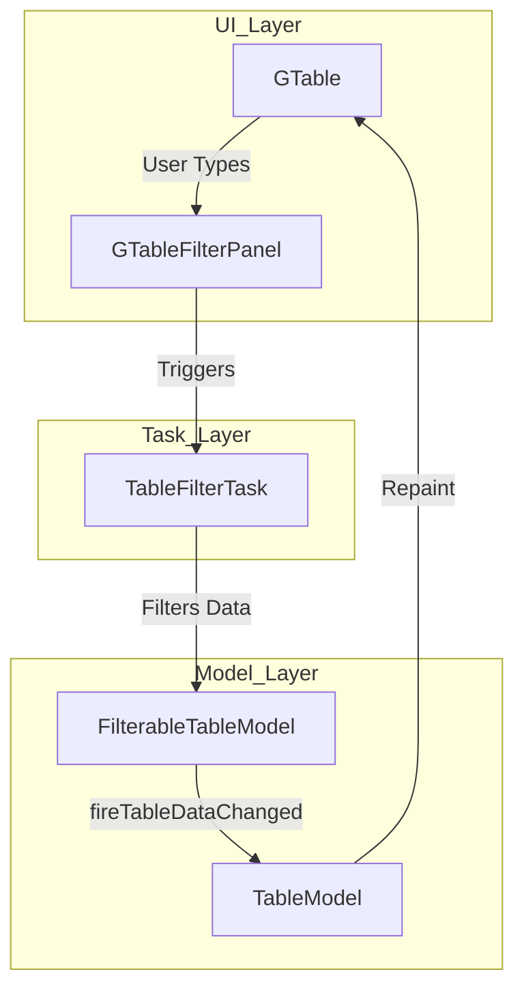
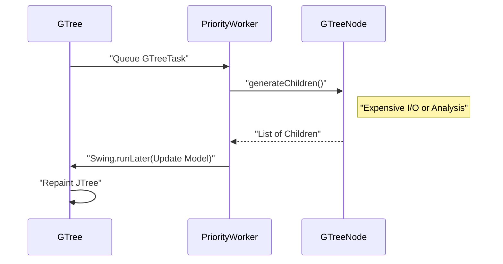
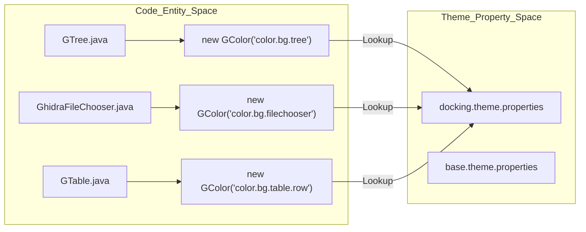

<!-- source: DeepWiki mcp.deepwiki.com · repo NationalSecurityAgency/ghidra · page 9.3 Common Widgets and Theming · fetched 2026-11-09 -->

# Common Widgets and Theming

Relevant source files

The following files were used as context for generating this wiki page:

- [Ghidra/Debug/Framework-TraceModeling/src/test/java/ghidra/trace/database/data/DBTraceDataTypeManagerTest.java](Ghidra/Debug/Framework-TraceModeling/src/test/java/ghidra/trace/database/data/DBTraceDataTypeManagerTest.java)
- [Ghidra/Features/Base/data/base.listing.theme.properties](Ghidra/Features/Base/data/base.listing.theme.properties)
- [Ghidra/Features/Base/data/base.theme.properties](Ghidra/Features/Base/data/base.theme.properties)
- [Ghidra/Features/Base/src/main/help/help/topics/SymbolTablePlugin/symbol_table_transient.htm](Ghidra/Features/Base/src/main/help/help/topics/SymbolTablePlugin/symbol_table_transient.htm)
- [Ghidra/Features/Base/src/main/java/ghidra/app/plugin/core/analysis/AnalysisEnablementTableModel.java](Ghidra/Features/Base/src/main/java/ghidra/app/plugin/core/analysis/AnalysisEnablementTableModel.java)
- [Ghidra/Features/Base/src/main/java/ghidra/app/plugin/core/analysis/AnalyzerEnablementState.java](Ghidra/Features/Base/src/main/java/ghidra/app/plugin/core/analysis/AnalyzerEnablementState.java)
- [Ghidra/Features/Base/src/main/java/ghidra/app/plugin/core/compositeeditor/PointerAction.java](Ghidra/Features/Base/src/main/java/ghidra/app/plugin/core/compositeeditor/PointerAction.java)
- [Ghidra/Features/Base/src/main/java/ghidra/app/plugin/core/datamgr/actions/CreatePointerAction.java](Ghidra/Features/Base/src/main/java/ghidra/app/plugin/core/datamgr/actions/CreatePointerAction.java)
- [Ghidra/Features/Base/src/main/java/ghidra/app/plugin/core/datamgr/actions/CreateTypeDefAction.java](Ghidra/Features/Base/src/main/java/ghidra/app/plugin/core/datamgr/actions/CreateTypeDefAction.java)
- [Ghidra/Features/Base/src/main/java/ghidra/app/plugin/core/datamgr/tree/ArchiveNode.java](Ghidra/Features/Base/src/main/java/ghidra/app/plugin/core/datamgr/tree/ArchiveNode.java)
- [Ghidra/Features/Base/src/main/java/ghidra/app/plugin/core/datamgr/tree/ArchiveRootNode.java](Ghidra/Features/Base/src/main/java/ghidra/app/plugin/core/datamgr/tree/ArchiveRootNode.java)
- [Ghidra/Features/Base/src/main/java/ghidra/app/plugin/core/datamgr/tree/ArchiveRootNodeListener.java](Ghidra/Features/Base/src/main/java/ghidra/app/plugin/core/datamgr/tree/ArchiveRootNodeListener.java)
- [Ghidra/Features/Base/src/main/java/ghidra/app/plugin/core/datamgr/tree/CategoryNode.java](Ghidra/Features/Base/src/main/java/ghidra/app/plugin/core/datamgr/tree/CategoryNode.java)
- [Ghidra/Features/Base/src/main/java/ghidra/app/plugin/core/datamgr/tree/DataTypeNode.java](Ghidra/Features/Base/src/main/java/ghidra/app/plugin/core/datamgr/tree/DataTypeNode.java)
- [Ghidra/Features/Base/src/main/java/ghidra/app/plugin/core/datamgr/tree/FileArchiveNode.java](Ghidra/Features/Base/src/main/java/ghidra/app/plugin/core/datamgr/tree/FileArchiveNode.java)
- [Ghidra/Features/Base/src/main/java/ghidra/app/plugin/core/datamgr/tree/InvalidArchiveNode.java](Ghidra/Features/Base/src/main/java/ghidra/app/plugin/core/datamgr/tree/InvalidArchiveNode.java)
- [Ghidra/Features/Base/src/main/java/ghidra/app/plugin/core/datamgr/tree/ProgramArchiveNode.java](Ghidra/Features/Base/src/main/java/ghidra/app/plugin/core/datamgr/tree/ProgramArchiveNode.java)
- [Ghidra/Features/Base/src/main/java/ghidra/app/plugin/core/datamgr/tree/ProjectArchiveNode.java](Ghidra/Features/Base/src/main/java/ghidra/app/plugin/core/datamgr/tree/ProjectArchiveNode.java)
- [Ghidra/Features/Base/src/main/java/ghidra/app/plugin/core/datamgr/util/DataTypeTreeDeleteTask.java](Ghidra/Features/Base/src/main/java/ghidra/app/plugin/core/datamgr/util/DataTypeTreeDeleteTask.java)
- [Ghidra/Features/Base/src/main/java/ghidra/app/plugin/core/reloc/RelocationTableModel.java](Ghidra/Features/Base/src/main/java/ghidra/app/plugin/core/reloc/RelocationTableModel.java)
- [Ghidra/Features/Base/src/main/java/ghidra/app/plugin/core/symtable/AbstractSymbolTableModel.java](Ghidra/Features/Base/src/main/java/ghidra/app/plugin/core/symtable/AbstractSymbolTableModel.java)
- [Ghidra/Features/Base/src/main/java/ghidra/app/plugin/core/symtable/ReferenceProvider.java](Ghidra/Features/Base/src/main/java/ghidra/app/plugin/core/symtable/ReferenceProvider.java)
- [Ghidra/Features/Base/src/main/java/ghidra/app/plugin/core/symtable/SymbolPanel.java](Ghidra/Features/Base/src/main/java/ghidra/app/plugin/core/symtable/SymbolPanel.java)
- [Ghidra/Features/Base/src/main/java/ghidra/app/plugin/core/symtable/SymbolProvider.java](Ghidra/Features/Base/src/main/java/ghidra/app/plugin/core/symtable/SymbolProvider.java)
- [Ghidra/Features/Base/src/main/java/ghidra/app/plugin/core/symtable/SymbolReferenceModel.java](Ghidra/Features/Base/src/main/java/ghidra/app/plugin/core/symtable/SymbolReferenceModel.java)
- [Ghidra/Features/Base/src/main/java/ghidra/app/plugin/core/symtable/SymbolTableModel.java](Ghidra/Features/Base/src/main/java/ghidra/app/plugin/core/symtable/SymbolTableModel.java)
- [Ghidra/Features/Base/src/main/java/ghidra/app/plugin/core/symtable/SymbolTablePlugin.java](Ghidra/Features/Base/src/main/java/ghidra/app/plugin/core/symtable/SymbolTablePlugin.java)
- [Ghidra/Features/Base/src/main/java/ghidra/app/plugin/core/symtable/TransientSymbolTableModel.java](Ghidra/Features/Base/src/main/java/ghidra/app/plugin/core/symtable/TransientSymbolTableModel.java)
- [Ghidra/Features/Base/src/main/java/ghidra/app/util/html/HTMLDataTypeRepresentationDiffInput.java](Ghidra/Features/Base/src/main/java/ghidra/app/util/html/HTMLDataTypeRepresentationDiffInput.java)
- [Ghidra/Features/Base/src/main/java/ghidra/util/table/ReferencesFromTableModel.java](Ghidra/Features/Base/src/main/java/ghidra/util/table/ReferencesFromTableModel.java)
- [Ghidra/Features/Base/src/main/java/ghidra/util/table/field/NamespaceTableColumn.java](Ghidra/Features/Base/src/main/java/ghidra/util/table/field/NamespaceTableColumn.java)
- [Ghidra/Features/Base/src/main/java/ghidra/util/table/field/ReferenceTypeTableColumn.java](Ghidra/Features/Base/src/main/java/ghidra/util/table/field/ReferenceTypeTableColumn.java)
- [Ghidra/Features/Base/src/test.slow/java/docking/widgets/table/GTableTest.java](Ghidra/Features/Base/src/test.slow/java/docking/widgets/table/GTableTest.java)
- [Ghidra/Features/Base/src/test.slow/java/ghidra/app/plugin/core/commentwindow/CommentWindowPluginTest.java](Ghidra/Features/Base/src/test.slow/java/ghidra/app/plugin/core/commentwindow/CommentWindowPluginTest.java)
- [Ghidra/Features/Base/src/test.slow/java/ghidra/app/plugin/core/functionwindow/FunctionWindowPluginTest.java](Ghidra/Features/Base/src/test.slow/java/ghidra/app/plugin/core/functionwindow/FunctionWindowPluginTest.java)
- [Ghidra/Features/Base/src/test.slow/java/ghidra/app/plugin/core/symtable/SymbolTablePluginTest.java](Ghidra/Features/Base/src/test.slow/java/ghidra/app/plugin/core/symtable/SymbolTablePluginTest.java)
- [Ghidra/Features/Decompiler/data/decompiler.theme.properties](Ghidra/Features/Decompiler/data/decompiler.theme.properties)
- [Ghidra/Features/ProgramDiff/data/programdiff.theme.properties](Ghidra/Features/ProgramDiff/data/programdiff.theme.properties)
- [Ghidra/Framework/Docking/data/docking.theme.properties](Ghidra/Framework/Docking/data/docking.theme.properties)
- [Ghidra/Framework/Docking/src/main/java/docking/Node.java](Ghidra/Framework/Docking/src/main/java/docking/Node.java)
- [Ghidra/Framework/Docking/src/main/java/docking/SplitNode.java](Ghidra/Framework/Docking/src/main/java/docking/SplitNode.java)
- [Ghidra/Framework/Docking/src/main/java/docking/TaskScheduler.java](Ghidra/Framework/Docking/src/main/java/docking/TaskScheduler.java)
- [Ghidra/Framework/Docking/src/main/java/docking/WindowActionManager.java](Ghidra/Framework/Docking/src/main/java/docking/WindowActionManager.java)
- [Ghidra/Framework/Docking/src/main/java/docking/WindowNode.java](Ghidra/Framework/Docking/src/main/java/docking/WindowNode.java)
- [Ghidra/Framework/Docking/src/main/java/docking/options/editor/IconPropertyEditor.java](Ghidra/Framework/Docking/src/main/java/docking/options/editor/IconPropertyEditor.java)
- [Ghidra/Framework/Docking/src/main/java/docking/widgets/AbstractGCellRenderer.java](Ghidra/Framework/Docking/src/main/java/docking/widgets/AbstractGCellRenderer.java)
- [Ghidra/Framework/Docking/src/main/java/docking/widgets/AutoLookup.java](Ghidra/Framework/Docking/src/main/java/docking/widgets/AutoLookup.java)
- [Ghidra/Framework/Docking/src/main/java/docking/widgets/filechooser/DirectoryList.java](Ghidra/Framework/Docking/src/main/java/docking/widgets/filechooser/DirectoryList.java)
- [Ghidra/Framework/Docking/src/main/java/docking/widgets/filechooser/DirectoryListModel.java](Ghidra/Framework/Docking/src/main/java/docking/widgets/filechooser/DirectoryListModel.java)
- [Ghidra/Framework/Docking/src/main/java/docking/widgets/filechooser/FileEditor.java](Ghidra/Framework/Docking/src/main/java/docking/widgets/filechooser/FileEditor.java)
- [Ghidra/Framework/Docking/src/main/java/docking/widgets/filechooser/FileListCellRenderer.java](Ghidra/Framework/Docking/src/main/java/docking/widgets/filechooser/FileListCellRenderer.java)
- [Ghidra/Framework/Docking/src/main/java/docking/widgets/filechooser/GhidraFileChooser.java](Ghidra/Framework/Docking/src/main/java/docking/widgets/filechooser/GhidraFileChooser.java)
- [Ghidra/Framework/Docking/src/main/java/docking/widgets/filechooser/LocalFileChooserModel.java](Ghidra/Framework/Docking/src/main/java/docking/widgets/filechooser/LocalFileChooserModel.java)
- [Ghidra/Framework/Docking/src/main/java/docking/widgets/filter/ClearFilterLabel.java](Ghidra/Framework/Docking/src/main/java/docking/widgets/filter/ClearFilterLabel.java)
- [Ghidra/Framework/Docking/src/main/java/docking/widgets/list/GList.java](Ghidra/Framework/Docking/src/main/java/docking/widgets/list/GList.java)
- [Ghidra/Framework/Docking/src/main/java/docking/widgets/list/GListAutoLookup.java](Ghidra/Framework/Docking/src/main/java/docking/widgets/list/GListAutoLookup.java)
- [Ghidra/Framework/Docking/src/main/java/docking/widgets/list/GListCellRenderer.java](Ghidra/Framework/Docking/src/main/java/docking/widgets/list/GListCellRenderer.java)
- [Ghidra/Framework/Docking/src/main/java/docking/widgets/table/GTable.java](Ghidra/Framework/Docking/src/main/java/docking/widgets/table/GTable.java)
- [Ghidra/Framework/Docking/src/main/java/docking/widgets/table/GTableAutoLookup.java](Ghidra/Framework/Docking/src/main/java/docking/widgets/table/GTableAutoLookup.java)
- [Ghidra/Framework/Docking/src/main/java/docking/widgets/table/threaded/CoalescingAddRemoveStrategy.java](Ghidra/Framework/Docking/src/main/java/docking/widgets/table/threaded/CoalescingAddRemoveStrategy.java)
- [Ghidra/Framework/Docking/src/main/java/docking/widgets/table/threaded/IncrementalLoadJob.java](Ghidra/Framework/Docking/src/main/java/docking/widgets/table/threaded/IncrementalLoadJob.java)
- [Ghidra/Framework/Docking/src/main/java/docking/widgets/table/threaded/TableData.java](Ghidra/Framework/Docking/src/main/java/docking/widgets/table/threaded/TableData.java)
- [Ghidra/Framework/Docking/src/main/java/docking/widgets/table/threaded/TableUpdateJob.java](Ghidra/Framework/Docking/src/main/java/docking/widgets/table/threaded/TableUpdateJob.java)
- [Ghidra/Framework/Docking/src/main/java/docking/widgets/table/threaded/ThreadedTableModel.java](Ghidra/Framework/Docking/src/main/java/docking/widgets/table/threaded/ThreadedTableModel.java)
- [Ghidra/Framework/Docking/src/main/java/docking/widgets/table/threaded/ThreadedTableModelUpdateMgr.java](Ghidra/Framework/Docking/src/main/java/docking/widgets/table/threaded/ThreadedTableModelUpdateMgr.java)
- [Ghidra/Framework/Docking/src/main/java/docking/widgets/tree/CoreGTreeNode.java](Ghidra/Framework/Docking/src/main/java/docking/widgets/tree/CoreGTreeNode.java)
- [Ghidra/Framework/Docking/src/main/java/docking/widgets/tree/GTree.java](Ghidra/Framework/Docking/src/main/java/docking/widgets/tree/GTree.java)
- [Ghidra/Framework/Docking/src/main/java/docking/widgets/tree/GTreeFilterTask.java](Ghidra/Framework/Docking/src/main/java/docking/widgets/tree/GTreeFilterTask.java)
- [Ghidra/Framework/Docking/src/main/java/docking/widgets/tree/GTreeLazyNode.java](Ghidra/Framework/Docking/src/main/java/docking/widgets/tree/GTreeLazyNode.java)
- [Ghidra/Framework/Docking/src/main/java/docking/widgets/tree/GTreeNode.java](Ghidra/Framework/Docking/src/main/java/docking/widgets/tree/GTreeNode.java)
- [Ghidra/Framework/Docking/src/main/java/docking/widgets/tree/GTreeRestoreTreeStateTask.java](Ghidra/Framework/Docking/src/main/java/docking/widgets/tree/GTreeRestoreTreeStateTask.java)
- [Ghidra/Framework/Docking/src/main/java/docking/widgets/tree/GTreeSlowLoadingNode.java](Ghidra/Framework/Docking/src/main/java/docking/widgets/tree/GTreeSlowLoadingNode.java)
- [Ghidra/Framework/Docking/src/main/java/docking/widgets/tree/GTreeState.java](Ghidra/Framework/Docking/src/main/java/docking/widgets/tree/GTreeState.java)
- [Ghidra/Framework/Docking/src/main/java/docking/widgets/tree/GTreeTask.java](Ghidra/Framework/Docking/src/main/java/docking/widgets/tree/GTreeTask.java)
- [Ghidra/Framework/Docking/src/main/java/docking/widgets/tree/internal/GTreeModel.java](Ghidra/Framework/Docking/src/main/java/docking/widgets/tree/internal/GTreeModel.java)
- [Ghidra/Framework/Docking/src/main/java/docking/widgets/tree/support/IgnoredNodesGtreeFilter.java](Ghidra/Framework/Docking/src/main/java/docking/widgets/tree/support/IgnoredNodesGtreeFilter.java)
- [Ghidra/Framework/Docking/src/main/java/docking/widgets/tree/tasks/GTreeExpandNodeToDepthTask.java](Ghidra/Framework/Docking/src/main/java/docking/widgets/tree/tasks/GTreeExpandNodeToDepthTask.java)
- [Ghidra/Framework/Docking/src/main/java/docking/widgets/tree/tasks/GTreeExpandPathsTask.java](Ghidra/Framework/Docking/src/main/java/docking/widgets/tree/tasks/GTreeExpandPathsTask.java)
- [Ghidra/Framework/Docking/src/main/java/docking/widgets/tree/tasks/GTreeSelectPathsTask.java](Ghidra/Framework/Docking/src/main/java/docking/widgets/tree/tasks/GTreeSelectPathsTask.java)
- [Ghidra/Framework/Docking/src/main/java/docking/widgets/tree/tasks/GTreeStartEditingTask.java](Ghidra/Framework/Docking/src/main/java/docking/widgets/tree/tasks/GTreeStartEditingTask.java)
- [Ghidra/Framework/Docking/src/test.slow/java/docking/widgets/filechooser/GhidraFileChooserTest.java](Ghidra/Framework/Docking/src/test.slow/java/docking/widgets/filechooser/GhidraFileChooserTest.java)
- [Ghidra/Framework/Docking/src/test.slow/java/docking/widgets/tree/GTreeTest.java](Ghidra/Framework/Docking/src/test.slow/java/docking/widgets/tree/GTreeTest.java)
- [Ghidra/Framework/Docking/src/test/java/docking/widgets/AbstractDropDownTextFieldTest.java](Ghidra/Framework/Docking/src/test/java/docking/widgets/AbstractDropDownTextFieldTest.java)
- [Ghidra/Framework/Docking/src/test/java/docking/widgets/DropDownTextFieldTest.java](Ghidra/Framework/Docking/src/test/java/docking/widgets/DropDownTextFieldTest.java)
- [Ghidra/Framework/Docking/src/test/java/docking/widgets/table/threaded/CoalescingAddRemoveStrategyTest.java](Ghidra/Framework/Docking/src/test/java/docking/widgets/table/threaded/CoalescingAddRemoveStrategyTest.java)
- [Ghidra/Framework/Docking/src/test/java/docking/widgets/tree/GTreeNodeTest.java](Ghidra/Framework/Docking/src/test/java/docking/widgets/tree/GTreeNodeTest.java)
- [Ghidra/Framework/Generic/src/main/java/generic/concurrent/ConcurrentListenerSet.java](Ghidra/Framework/Generic/src/main/java/generic/concurrent/ConcurrentListenerSet.java)
- [Ghidra/Framework/Generic/src/main/java/generic/test/AbstractGenericTest.java](Ghidra/Framework/Generic/src/main/java/generic/test/AbstractGenericTest.java)
- [Ghidra/Framework/Generic/src/main/java/generic/timer/ExpiringSwingTimer.java](Ghidra/Framework/Generic/src/main/java/generic/timer/ExpiringSwingTimer.java)
- [Ghidra/Framework/Generic/src/main/java/generic/timer/GhidraSwingTimer.java](Ghidra/Framework/Generic/src/main/java/generic/timer/GhidraSwingTimer.java)
- [Ghidra/Framework/Generic/src/main/java/ghidra/util/worker/AbstractWorker.java](Ghidra/Framework/Generic/src/main/java/ghidra/util/worker/AbstractWorker.java)
- [Ghidra/Framework/Generic/src/test/java/generic/timer/ExpiringSwingTimerTest.java](Ghidra/Framework/Generic/src/test/java/generic/timer/ExpiringSwingTimerTest.java)
- [Ghidra/Framework/Graph/src/main/java/ghidra/graph/viewer/renderer/VisualVertexSatelliteRenderer.java](Ghidra/Framework/Graph/src/main/java/ghidra/graph/viewer/renderer/VisualVertexSatelliteRenderer.java)
- [Ghidra/Framework/Gui/data/gui.palette.theme.properties](Ghidra/Framework/Gui/data/gui.palette.theme.properties)
- [Ghidra/Framework/Gui/src/main/java/ghidra/util/filechooser/ExtensionFileFilter.java](Ghidra/Framework/Gui/src/main/java/ghidra/util/filechooser/ExtensionFileFilter.java)
- [Ghidra/Framework/Gui/src/main/java/ghidra/util/filechooser/GhidraFileChooserModel.java](Ghidra/Framework/Gui/src/main/java/ghidra/util/filechooser/GhidraFileChooserModel.java)
- [Ghidra/Framework/Gui/src/test/java/ghidra/util/HTMLUtilitiesTest.java](Ghidra/Framework/Gui/src/test/java/ghidra/util/HTMLUtilitiesTest.java)
- [Ghidra/Framework/Project/src/main/java/ghidra/framework/plugintool/PluginManager.java](Ghidra/Framework/Project/src/main/java/ghidra/framework/plugintool/PluginManager.java)
- [Ghidra/Framework/Project/src/main/java/ghidra/framework/plugintool/mgr/OptionsManager.java](Ghidra/Framework/Project/src/main/java/ghidra/framework/plugintool/mgr/OptionsManager.java)
- [Ghidra/Framework/SoftwareModeling/src/main/java/ghidra/program/database/reloc/RelocationDBAdapter.java](Ghidra/Framework/SoftwareModeling/src/main/java/ghidra/program/database/reloc/RelocationDBAdapter.java)
- [Ghidra/Framework/SoftwareModeling/src/main/java/ghidra/program/database/reloc/RelocationDBAdapterNoTable.java](Ghidra/Framework/SoftwareModeling/src/main/java/ghidra/program/database/reloc/RelocationDBAdapterNoTable.java)
- [Ghidra/Framework/SoftwareModeling/src/main/java/ghidra/program/database/reloc/RelocationDBAdapterV1.java](Ghidra/Framework/SoftwareModeling/src/main/java/ghidra/program/database/reloc/RelocationDBAdapterV1.java)
- [Ghidra/Framework/SoftwareModeling/src/main/java/ghidra/program/database/reloc/RelocationDBAdapterV2.java](Ghidra/Framework/SoftwareModeling/src/main/java/ghidra/program/database/reloc/RelocationDBAdapterV2.java)
- [Ghidra/Framework/SoftwareModeling/src/main/java/ghidra/program/database/reloc/RelocationDBAdapterV3.java](Ghidra/Framework/SoftwareModeling/src/main/java/ghidra/program/database/reloc/RelocationDBAdapterV3.java)
- [Ghidra/Framework/SoftwareModeling/src/main/java/ghidra/program/model/symbol/RefType.java](Ghidra/Framework/SoftwareModeling/src/main/java/ghidra/program/model/symbol/RefType.java)
- [Ghidra/Framework/SoftwareModeling/src/main/java/ghidra/program/model/symbol/RefTypeFactory.java](Ghidra/Framework/SoftwareModeling/src/main/java/ghidra/program/model/symbol/RefTypeFactory.java)

Ghidra provides a suite of reusable UI components and a robust theming infrastructure built upon Java Swing. These widgets are designed to handle large datasets, asynchronous operations, and complex user interactions while maintaining a consistent visual identity across the application.

## 1. GTable: Threaded and Filterable Tables

`GTable` is a specialized subclass of `JTable` that provides advanced features such as auto-lookup, multi-column sorting, column state persistence, and filtering integration [Ghidra/Framework/Docking/src/main/java/docking/widgets/table/GTable.java:78-101](). It is frequently paired with a `GTableFilterPanel` to allow real-time filtering of large datasets without blocking the Swing Event Dispatch Thread (EDT).

### Key Features
*   **Auto-Lookup**: Allows users to navigate rows by typing prefix characters; utilizes a binary search if the underlying model implements `SortedTableModel` [Ghidra/Framework/Docking/src/main/java/docking/widgets/table/GTable.java:53-66]().
*   **Column Management**: Supports hiding and showing columns via `GTableColumnModel` and persisting state (size, position, visibility) via preference keys [Ghidra/Framework/Docking/src/main/java/docking/widgets/table/GTable.java:69-74]().
*   **Selection Management**: Preserves user selections when the underlying data is filtered or resorted [Ghidra/Framework/Docking/src/main/java/docking/widgets/table/GTable.java:73-74]().
*   **Cell Rendering**: Uses `GTableCellRenderer`, which extends `AbstractGCellRenderer` to deliver alternating row backgrounds and theme-based fonts [Ghidra/Framework/Docking/src/main/java/docking/widgets/AbstractGCellRenderer.java:54-57]().

### Implementation Diagram: Table Selection and Filtering
The following diagram illustrates the interaction between the UI component, table models, and background filtering tasks.

**GTable Data Flow**

Sources: [Ghidra/Framework/Docking/src/main/java/docking/widgets/table/GTable.java:78-133](), [Ghidra/Framework/Docking/src/main/java/docking/widgets/AbstractGCellRenderer.java:54-57]()

---

## 2. GTree: Lazy-Loading and Threaded Trees

`GTree` is a threaded implementation of `JTree` designed for deep or slow-loading hierarchical datasets [Ghidra/Framework/Docking/src/main/java/docking/widgets/tree/GTree.java:58-67](). It uses a `PriorityWorker` to perform tree traversal and node loading operations off the EDT [Ghidra/Framework/Docking/src/main/java/docking/widgets/tree/GTree.java:140-144]().

### Core Components
*   **GTreeNode**: The foundational interface/class for all tree nodes. It supports lazy loading through implementations like `GTreeSlowLoadingNode` or `GTreeLazyNode` [Ghidra/Framework/Docking/src/main/java/docking/widgets/tree/GTree.java:60-65]().
*   **GTreeFilterTask**: A background task that clones the tree's root model and prunes non-matching nodes during filter operations [Ghidra/Framework/Docking/src/main/java/docking/widgets/tree/GTree.java:72-87]().
*   **Threading Model**: Background tasks such as `GTreeStartEditingTask` or custom expansion tasks execute asynchronously via `PriorityWorker` ("GTree Worker") [Ghidra/Framework/Docking/src/main/java/docking/widgets/tree/GTree.java:140-144](), [Ghidra/Framework/Docking/src/main/java/docking/widgets/tree/tasks/GTreeStartEditingTask.java:31-48]().

### Implementation: GTree Threading Model

Sources: [Ghidra/Framework/Docking/src/main/java/docking/widgets/tree/GTree.java:129-151](), [Ghidra/Framework/Docking/src/main/java/docking/widgets/tree/tasks/GTreeStartEditingTask.java:31-48]()

---

## 3. GhidraFileChooser

`GhidraFileChooser` is a custom file chooser dialog designed to emulate standard file selection behavior while avoiding GUI hangs and network-locking issues present in standard Swing implementations [Ghidra/Framework/Docking/src/main/java/docking/widgets/filechooser/GhidraFileChooser.java:68-82]().

*   **Asynchronous Loading**: File system metadata is retrieved via background `Worker` and `Job` instances, preventing lockups during directory enumeration [Ghidra/Framework/Docking/src/main/java/docking/widgets/filechooser/GhidraFileChooser.java:61-64]().
*   **View Styles**: Supports "DetailsView" (backed by `GTable`) and "SimpleView" (backed by `DirectoryList`) [Ghidra/Framework/Docking/src/main/java/docking/widgets/filechooser/GhidraFileChooser.java:102-108](), [Ghidra/Framework/Docking/src/main/java/docking/widgets/filechooser/DirectoryList.java:37-43]().
*   **Navigation & Places**: Maintains a `HistoryList` of visited paths and sidebar shortcuts for standard system locations [Ghidra/Framework/Docking/src/main/java/docking/widgets/filechooser/GhidraFileChooser.java:120-131](), [Ghidra/Framework/Docking/src/main/java/docking/widgets/filechooser/GhidraFileChooser.java:152-158]().

Sources: [Ghidra/Framework/Docking/src/main/java/docking/widgets/filechooser/GhidraFileChooser.java:68-130](), [Ghidra/Framework/Docking/src/main/java/docking/widgets/filechooser/DirectoryList.java:37-62]()

---

## 4. Background Operations: TaskDialog and TaskLauncher

Ghidra uses a standardized task framework to manage long-running background operations with user visibility.

*   **TaskMonitor**: An interface used by background tasks to report progress percentage, update status strings, and monitor cancellation flags via `isCancelled()` [Ghidra/Framework/Docking/src/main/java/docking/widgets/tree/GTree.java:159-172]().
*   **TaskDialog**: A modal or non-modal dialog that renders a progress bar and status message for a running `Task`, utilizing throttling mechanisms to prevent visual flicker during short operations.

Sources: [Ghidra/Framework/Docking/src/main/java/docking/widgets/tree/GTree.java:159-172]()

---

## 5. Theme System

Ghidra features a comprehensive theming system configured through `.theme.properties` files. It manages colors, fonts, and icons globally and integrates cleanly with Swing Look-and-Feel (L&F) delegates.

### Theme Architecture
1.  **Palette Definitions**: Define base palette colors (e.g., `color.palette.blue`) [Ghidra/Framework/Docking/data/docking.theme.properties:8-11]().
2.  **Semantic Mapping**: Maps palette values to application-specific UI roles (`color.bg.tree`, `color.bg.filechooser`, `color.bg.table.row`) [Ghidra/Framework/Docking/src/main/java/docking/widgets/tree/GTree.java:68](), [Ghidra/Framework/Docking/src/main/java/docking/widgets/filechooser/GhidraFileChooser.java:95-98](), [Ghidra/Framework/Docking/src/main/java/docking/widgets/AbstractGCellRenderer.java:56-57]().
3.  **L&F Integration**: Components register listeners to receive updates when themes or fonts change at runtime [Ghidra/Framework/Docking/src/main/java/docking/widgets/AbstractGCellRenderer.java:54-57](), [Ghidra/Framework/Docking/src/main/java/docking/widgets/tree/GTree.java:104-108]().

### Property Files
*   `docking.theme.properties`: Core docking framework colors, window tabs, and dialog properties [Ghidra/Framework/Docking/data/docking.theme.properties:1-193]().
*   `base.listing.theme.properties`: Listing-specific syntax and highlight colors [Ghidra/Features/Base/data/base.listing.theme.properties:1-93]().
*   `base.theme.properties`: Plugin-specific themes (bookmarks, data manager, terminal) [Ghidra/Features/Base/data/base.theme.properties:1-140]().

### Code Entity to Theme Space Mapping
The following diagram bridges the code-level UI classes and `GColor` identifiers to the underlying theme property files.

**Code-to-Theme Mapping**

Sources: [Ghidra/Framework/Docking/src/main/java/docking/widgets/tree/GTree.java:68](), [Ghidra/Framework/Docking/src/main/java/docking/widgets/filechooser/GhidraFileChooser.java:95-98](), [Ghidra/Framework/Docking/src/main/java/docking/widgets/AbstractGCellRenderer.java:56-57](), [Ghidra/Framework/Docking/data/docking.theme.properties:42-45]()

---

