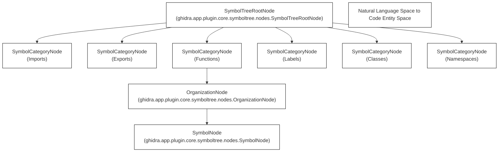
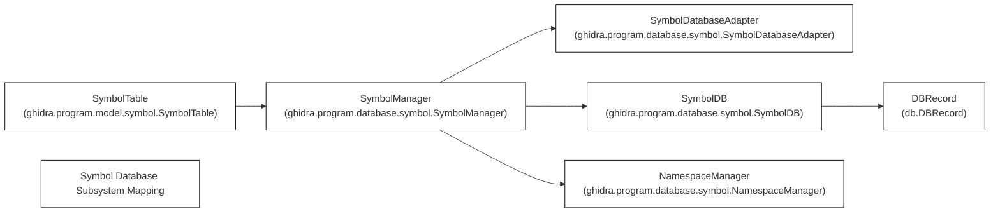
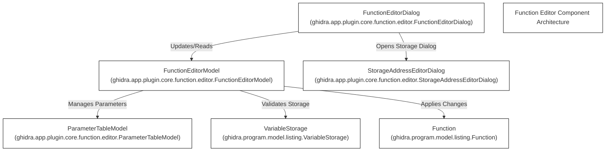
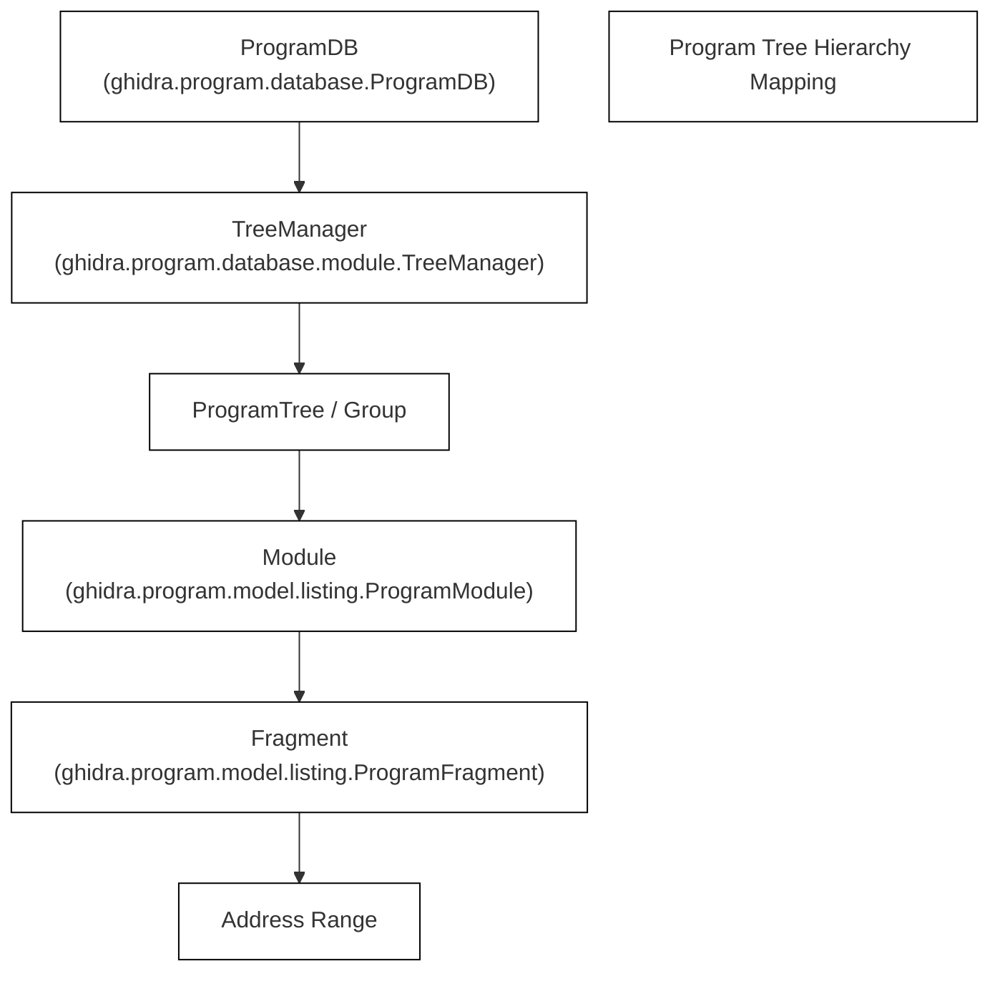

<!-- source: DeepWiki mcp.deepwiki.com · repo NationalSecurityAgency/ghidra · page 9.5 Symbol, Function, and Program Structure Editors · fetched 2026-11-09 -->

# Symbol, Function, and Program Structure Editors

Relevant source files

The following files were used as context for generating this wiki page:

- [Ghidra/Features/Base/ghidra_scripts/PropagateExternalParametersScript.java](Ghidra/Features/Base/ghidra_scripts/PropagateExternalParametersScript.java)
- [Ghidra/Features/Base/src/main/help/help/topics/FunctionPlugin/Variables.htm](Ghidra/Features/Base/src/main/help/help/topics/FunctionPlugin/Variables.htm)
- [Ghidra/Features/Base/src/main/help/help/topics/FunctionPlugin/images/FunctionEditor.png](Ghidra/Features/Base/src/main/help/help/topics/FunctionPlugin/images/FunctionEditor.png)
- [Ghidra/Features/Base/src/main/help/help/topics/SymbolTreePlugin/SymbolTree.htm](Ghidra/Features/Base/src/main/help/help/topics/SymbolTreePlugin/SymbolTree.htm)
- [Ghidra/Features/Base/src/main/java/ghidra/app/cmd/function/ApplyFunctionSignatureCmd.java](Ghidra/Features/Base/src/main/java/ghidra/app/cmd/function/ApplyFunctionSignatureCmd.java)
- [Ghidra/Features/Base/src/main/java/ghidra/app/plugin/core/datamgr/actions/RenameAction.java](Ghidra/Features/Base/src/main/java/ghidra/app/plugin/core/datamgr/actions/RenameAction.java)
- [Ghidra/Features/Base/src/main/java/ghidra/app/plugin/core/function/editor/FunctionData.java](Ghidra/Features/Base/src/main/java/ghidra/app/plugin/core/function/editor/FunctionData.java)
- [Ghidra/Features/Base/src/main/java/ghidra/app/plugin/core/function/editor/FunctionDataView.java](Ghidra/Features/Base/src/main/java/ghidra/app/plugin/core/function/editor/FunctionDataView.java)
- [Ghidra/Features/Base/src/main/java/ghidra/app/plugin/core/function/editor/FunctionEditorDialog.java](Ghidra/Features/Base/src/main/java/ghidra/app/plugin/core/function/editor/FunctionEditorDialog.java)
- [Ghidra/Features/Base/src/main/java/ghidra/app/plugin/core/function/editor/FunctionEditorModel.java](Ghidra/Features/Base/src/main/java/ghidra/app/plugin/core/function/editor/FunctionEditorModel.java)
- [Ghidra/Features/Base/src/main/java/ghidra/app/plugin/core/function/editor/FunctionVariableData.java](Ghidra/Features/Base/src/main/java/ghidra/app/plugin/core/function/editor/FunctionVariableData.java)
- [Ghidra/Features/Base/src/main/java/ghidra/app/plugin/core/function/editor/ParamInfo.java](Ghidra/Features/Base/src/main/java/ghidra/app/plugin/core/function/editor/ParamInfo.java)
- [Ghidra/Features/Base/src/main/java/ghidra/app/plugin/core/function/editor/ParameterTableModel.java](Ghidra/Features/Base/src/main/java/ghidra/app/plugin/core/function/editor/ParameterTableModel.java)
- [Ghidra/Features/Base/src/main/java/ghidra/app/plugin/core/function/editor/StorageAddressEditorDialog.java](Ghidra/Features/Base/src/main/java/ghidra/app/plugin/core/function/editor/StorageAddressEditorDialog.java)
- [Ghidra/Features/Base/src/main/java/ghidra/app/plugin/core/function/editor/StorageAddressModel.java](Ghidra/Features/Base/src/main/java/ghidra/app/plugin/core/function/editor/StorageAddressModel.java)
- [Ghidra/Features/Base/src/main/java/ghidra/app/plugin/core/function/editor/VarnodeInfo.java](Ghidra/Features/Base/src/main/java/ghidra/app/plugin/core/function/editor/VarnodeInfo.java)
- [Ghidra/Features/Base/src/main/java/ghidra/app/plugin/core/function/editor/VarnodeSizeCellEditor.java](Ghidra/Features/Base/src/main/java/ghidra/app/plugin/core/function/editor/VarnodeSizeCellEditor.java)
- [Ghidra/Features/Base/src/main/java/ghidra/app/plugin/core/function/editor/VarnodeTableModel.java](Ghidra/Features/Base/src/main/java/ghidra/app/plugin/core/function/editor/VarnodeTableModel.java)
- [Ghidra/Features/Base/src/main/java/ghidra/app/plugin/core/symboltree/DisconnectedSymbolTreeProvider.java](Ghidra/Features/Base/src/main/java/ghidra/app/plugin/core/symboltree/DisconnectedSymbolTreeProvider.java)
- [Ghidra/Features/Base/src/main/java/ghidra/app/plugin/core/symboltree/SymbolTreePlugin.java](Ghidra/Features/Base/src/main/java/ghidra/app/plugin/core/symboltree/SymbolTreePlugin.java)
- [Ghidra/Features/Base/src/main/java/ghidra/app/plugin/core/symboltree/SymbolTreeProvider.java](Ghidra/Features/Base/src/main/java/ghidra/app/plugin/core/symboltree/SymbolTreeProvider.java)
- [Ghidra/Features/Base/src/main/java/ghidra/app/plugin/core/symboltree/actions/ConvertToClassAction.java](Ghidra/Features/Base/src/main/java/ghidra/app/plugin/core/symboltree/actions/ConvertToClassAction.java)
- [Ghidra/Features/Base/src/main/java/ghidra/app/plugin/core/symboltree/actions/CreateClassAction.java](Ghidra/Features/Base/src/main/java/ghidra/app/plugin/core/symboltree/actions/CreateClassAction.java)
- [Ghidra/Features/Base/src/main/java/ghidra/app/plugin/core/symboltree/actions/CreateNamespaceAction.java](Ghidra/Features/Base/src/main/java/ghidra/app/plugin/core/symboltree/actions/CreateNamespaceAction.java)
- [Ghidra/Features/Base/src/main/java/ghidra/app/plugin/core/symboltree/actions/DeleteAction.java](Ghidra/Features/Base/src/main/java/ghidra/app/plugin/core/symboltree/actions/DeleteAction.java)
- [Ghidra/Features/Base/src/main/java/ghidra/app/plugin/core/symboltree/actions/NavigateOnIncomingAction.java](Ghidra/Features/Base/src/main/java/ghidra/app/plugin/core/symboltree/actions/NavigateOnIncomingAction.java)
- [Ghidra/Features/Base/src/main/java/ghidra/app/plugin/core/symboltree/actions/NavigateOnOutgoingActon.java](Ghidra/Features/Base/src/main/java/ghidra/app/plugin/core/symboltree/actions/NavigateOnOutgoingActon.java)
- [Ghidra/Features/Base/src/main/java/ghidra/app/plugin/core/symboltree/actions/RenameAction.java](Ghidra/Features/Base/src/main/java/ghidra/app/plugin/core/symboltree/actions/RenameAction.java)
- [Ghidra/Features/Base/src/main/java/ghidra/app/plugin/core/symboltree/nodes/ClassCategoryNode.java](Ghidra/Features/Base/src/main/java/ghidra/app/plugin/core/symboltree/nodes/ClassCategoryNode.java)
- [Ghidra/Features/Base/src/main/java/ghidra/app/plugin/core/symboltree/nodes/ConfigurableSymbolTreeRootNode.java](Ghidra/Features/Base/src/main/java/ghidra/app/plugin/core/symboltree/nodes/ConfigurableSymbolTreeRootNode.java)
- [Ghidra/Features/Base/src/main/java/ghidra/app/plugin/core/symboltree/nodes/ExportsCategoryNode.java](Ghidra/Features/Base/src/main/java/ghidra/app/plugin/core/symboltree/nodes/ExportsCategoryNode.java)
- [Ghidra/Features/Base/src/main/java/ghidra/app/plugin/core/symboltree/nodes/FunctionCategoryNode.java](Ghidra/Features/Base/src/main/java/ghidra/app/plugin/core/symboltree/nodes/FunctionCategoryNode.java)
- [Ghidra/Features/Base/src/main/java/ghidra/app/plugin/core/symboltree/nodes/MoreNode.java](Ghidra/Features/Base/src/main/java/ghidra/app/plugin/core/symboltree/nodes/MoreNode.java)
- [Ghidra/Features/Base/src/main/java/ghidra/app/plugin/core/symboltree/nodes/NamespaceCategoryNode.java](Ghidra/Features/Base/src/main/java/ghidra/app/plugin/core/symboltree/nodes/NamespaceCategoryNode.java)
- [Ghidra/Features/Base/src/main/java/ghidra/app/plugin/core/symboltree/nodes/OrganizationNode.java](Ghidra/Features/Base/src/main/java/ghidra/app/plugin/core/symboltree/nodes/OrganizationNode.java)
- [Ghidra/Features/Base/src/main/java/ghidra/app/plugin/core/symboltree/nodes/SymbolCategoryNode.java](Ghidra/Features/Base/src/main/java/ghidra/app/plugin/core/symboltree/nodes/SymbolCategoryNode.java)
- [Ghidra/Features/Base/src/main/java/ghidra/app/plugin/core/symboltree/nodes/SymbolTreeNode.java](Ghidra/Features/Base/src/main/java/ghidra/app/plugin/core/symboltree/nodes/SymbolTreeNode.java)
- [Ghidra/Features/Base/src/main/java/ghidra/app/plugin/core/symboltree/nodes/SymbolTreeRootNode.java](Ghidra/Features/Base/src/main/java/ghidra/app/plugin/core/symboltree/nodes/SymbolTreeRootNode.java)
- [Ghidra/Features/Base/src/main/java/ghidra/app/util/bin/format/elf/ElfSymbolNameUtils.java](Ghidra/Features/Base/src/main/java/ghidra/app/util/bin/format/elf/ElfSymbolNameUtils.java)
- [Ghidra/Features/Base/src/main/java/ghidra/util/table/AbstractSelectionNavigationAction.java](Ghidra/Features/Base/src/main/java/ghidra/util/table/AbstractSelectionNavigationAction.java)
- [Ghidra/Features/Base/src/test.slow/java/ghidra/app/plugin/core/navigation/locationreferences/SymbolTreeLocationReferencesTest.java](Ghidra/Features/Base/src/test.slow/java/ghidra/app/plugin/core/navigation/locationreferences/SymbolTreeLocationReferencesTest.java)
- [Ghidra/Features/Base/src/test.slow/java/ghidra/app/plugin/core/symboltree/AbstractSymbolTreePluginExternalsTest.java](Ghidra/Features/Base/src/test.slow/java/ghidra/app/plugin/core/symboltree/AbstractSymbolTreePluginExternalsTest.java)
- [Ghidra/Features/Base/src/test.slow/java/ghidra/app/plugin/core/symboltree/SymbolTreePlugin1Test.java](Ghidra/Features/Base/src/test.slow/java/ghidra/app/plugin/core/symboltree/SymbolTreePlugin1Test.java)
- [Ghidra/Features/Base/src/test.slow/java/ghidra/app/plugin/core/symboltree/SymbolTreePlugin2Test.java](Ghidra/Features/Base/src/test.slow/java/ghidra/app/plugin/core/symboltree/SymbolTreePlugin2Test.java)
- [Ghidra/Features/Base/src/test.slow/java/ghidra/app/plugin/core/symboltree/SymbolTreePluginX86Test.java](Ghidra/Features/Base/src/test.slow/java/ghidra/app/plugin/core/symboltree/SymbolTreePluginX86Test.java)
- [Ghidra/Features/Base/src/test.slow/java/ghidra/app/plugin/core/symboltree/SymbolTreeTestUtils.java](Ghidra/Features/Base/src/test.slow/java/ghidra/app/plugin/core/symboltree/SymbolTreeTestUtils.java)
- [Ghidra/Features/Base/src/test.slow/java/ghidra/framework/main/datatree/FrontEndPluginActionsTest.java](Ghidra/Features/Base/src/test.slow/java/ghidra/framework/main/datatree/FrontEndPluginActionsTest.java)
- [Ghidra/Features/Base/src/test.slow/java/ghidra/program/database/symbol/SymbolManagerTest.java](Ghidra/Features/Base/src/test.slow/java/ghidra/program/database/symbol/SymbolManagerTest.java)
- [Ghidra/Features/Base/src/test.slow/java/ghidra/program/util/ProgramDiff1Test.java](Ghidra/Features/Base/src/test.slow/java/ghidra/program/util/ProgramDiff1Test.java)
- [Ghidra/Features/Base/src/test/java/ghidra/app/plugin/core/function/editor/FunctionEditorModelTest.java](Ghidra/Features/Base/src/test/java/ghidra/app/plugin/core/function/editor/FunctionEditorModelTest.java)
- [Ghidra/Features/Base/src/test/java/ghidra/app/plugin/core/function/editor/StorageEditorModelBETest.java](Ghidra/Features/Base/src/test/java/ghidra/app/plugin/core/function/editor/StorageEditorModelBETest.java)
- [Ghidra/Features/Base/src/test/java/ghidra/app/plugin/core/function/editor/StorageEditorModelTest.java](Ghidra/Features/Base/src/test/java/ghidra/app/plugin/core/function/editor/StorageEditorModelTest.java)
- [Ghidra/Features/Base/src/test/java/ghidra/app/plugin/core/symboltree/nodes/OrganizationNodeTest.java](Ghidra/Features/Base/src/test/java/ghidra/app/plugin/core/symboltree/nodes/OrganizationNodeTest.java)
- [Ghidra/Features/Base/src/test/java/ghidra/program/model/symbol/SymbolUtilitiesNamingTest.java](Ghidra/Features/Base/src/test/java/ghidra/program/model/symbol/SymbolUtilitiesNamingTest.java)
- [Ghidra/Features/GnuDemangler/ghidra_scripts/VxWorksSymTab_Finder.java](Ghidra/Features/GnuDemangler/ghidra_scripts/VxWorksSymTab_Finder.java)
- [Ghidra/Framework/Docking/src/main/java/docking/widgets/tree/tasks/GTreeClearSelectionTask.java](Ghidra/Framework/Docking/src/main/java/docking/widgets/tree/tasks/GTreeClearSelectionTask.java)
- [Ghidra/Framework/Project/src/main/java/ghidra/framework/main/projectdata/actions/ProjectDataRenameAction.java](Ghidra/Framework/Project/src/main/java/ghidra/framework/main/projectdata/actions/ProjectDataRenameAction.java)
- [Ghidra/Framework/Project/src/main/java/ghidra/framework/model/AbstractDomainObjectListenerBuilder.java](Ghidra/Framework/Project/src/main/java/ghidra/framework/model/AbstractDomainObjectListenerBuilder.java)
- [Ghidra/Framework/SoftwareModeling/src/main/java/ghidra/program/database/data/ProgramBasedDataTypeManagerDB.java](Ghidra/Framework/SoftwareModeling/src/main/java/ghidra/program/database/data/ProgramBasedDataTypeManagerDB.java)
- [Ghidra/Framework/SoftwareModeling/src/main/java/ghidra/program/database/external/ExternalManagerDB.java](Ghidra/Framework/SoftwareModeling/src/main/java/ghidra/program/database/external/ExternalManagerDB.java)
- [Ghidra/Framework/SoftwareModeling/src/main/java/ghidra/program/database/function/ParameterDB.java](Ghidra/Framework/SoftwareModeling/src/main/java/ghidra/program/database/function/ParameterDB.java)
- [Ghidra/Framework/SoftwareModeling/src/main/java/ghidra/program/database/function/ReturnParameterDB.java](Ghidra/Framework/SoftwareModeling/src/main/java/ghidra/program/database/function/ReturnParameterDB.java)
- [Ghidra/Framework/SoftwareModeling/src/main/java/ghidra/program/database/module/TreeManager.java](Ghidra/Framework/SoftwareModeling/src/main/java/ghidra/program/database/module/TreeManager.java)
- [Ghidra/Framework/SoftwareModeling/src/main/java/ghidra/program/database/properties/DBPropertyMapManager.java](Ghidra/Framework/SoftwareModeling/src/main/java/ghidra/program/database/properties/DBPropertyMapManager.java)
- [Ghidra/Framework/SoftwareModeling/src/main/java/ghidra/program/database/references/BigRefListV0.java](Ghidra/Framework/SoftwareModeling/src/main/java/ghidra/program/database/references/BigRefListV0.java)
- [Ghidra/Framework/SoftwareModeling/src/main/java/ghidra/program/database/references/FromAdapterV0.java](Ghidra/Framework/SoftwareModeling/src/main/java/ghidra/program/database/references/FromAdapterV0.java)
- [Ghidra/Framework/SoftwareModeling/src/main/java/ghidra/program/database/references/RefListV0.java](Ghidra/Framework/SoftwareModeling/src/main/java/ghidra/program/database/references/RefListV0.java)
- [Ghidra/Framework/SoftwareModeling/src/main/java/ghidra/program/database/references/ReferenceDBManager.java](Ghidra/Framework/SoftwareModeling/src/main/java/ghidra/program/database/references/ReferenceDBManager.java)
- [Ghidra/Framework/SoftwareModeling/src/main/java/ghidra/program/database/symbol/ClassSymbol.java](Ghidra/Framework/SoftwareModeling/src/main/java/ghidra/program/database/symbol/ClassSymbol.java)
- [Ghidra/Framework/SoftwareModeling/src/main/java/ghidra/program/database/symbol/CodeSymbol.java](Ghidra/Framework/SoftwareModeling/src/main/java/ghidra/program/database/symbol/CodeSymbol.java)
- [Ghidra/Framework/SoftwareModeling/src/main/java/ghidra/program/database/symbol/FunctionSymbol.java](Ghidra/Framework/SoftwareModeling/src/main/java/ghidra/program/database/symbol/FunctionSymbol.java)
- [Ghidra/Framework/SoftwareModeling/src/main/java/ghidra/program/database/symbol/GlobalVariableSymbolDB.java](Ghidra/Framework/SoftwareModeling/src/main/java/ghidra/program/database/symbol/GlobalVariableSymbolDB.java)
- [Ghidra/Framework/SoftwareModeling/src/main/java/ghidra/program/database/symbol/LibrarySymbol.java](Ghidra/Framework/SoftwareModeling/src/main/java/ghidra/program/database/symbol/LibrarySymbol.java)
- [Ghidra/Framework/SoftwareModeling/src/main/java/ghidra/program/database/symbol/NamespaceSymbol.java](Ghidra/Framework/SoftwareModeling/src/main/java/ghidra/program/database/symbol/NamespaceSymbol.java)
- [Ghidra/Framework/SoftwareModeling/src/main/java/ghidra/program/database/symbol/SymbolDB.java](Ghidra/Framework/SoftwareModeling/src/main/java/ghidra/program/database/symbol/SymbolDB.java)
- [Ghidra/Framework/SoftwareModeling/src/main/java/ghidra/program/database/symbol/SymbolDatabaseAdapter.java](Ghidra/Framework/SoftwareModeling/src/main/java/ghidra/program/database/symbol/SymbolDatabaseAdapter.java)
- [Ghidra/Framework/SoftwareModeling/src/main/java/ghidra/program/database/symbol/SymbolDatabaseAdapterV0.java](Ghidra/Framework/SoftwareModeling/src/main/java/ghidra/program/database/symbol/SymbolDatabaseAdapterV0.java)
- [Ghidra/Framework/SoftwareModeling/src/main/java/ghidra/program/database/symbol/SymbolDatabaseAdapterV1.java](Ghidra/Framework/SoftwareModeling/src/main/java/ghidra/program/database/symbol/SymbolDatabaseAdapterV1.java)
- [Ghidra/Framework/SoftwareModeling/src/main/java/ghidra/program/database/symbol/SymbolDatabaseAdapterV2.java](Ghidra/Framework/SoftwareModeling/src/main/java/ghidra/program/database/symbol/SymbolDatabaseAdapterV2.java)
- [Ghidra/Framework/SoftwareModeling/src/main/java/ghidra/program/database/symbol/SymbolDatabaseAdapterV3.java](Ghidra/Framework/SoftwareModeling/src/main/java/ghidra/program/database/symbol/SymbolDatabaseAdapterV3.java)
- [Ghidra/Framework/SoftwareModeling/src/main/java/ghidra/program/database/symbol/SymbolManager.java](Ghidra/Framework/SoftwareModeling/src/main/java/ghidra/program/database/symbol/SymbolManager.java)
- [Ghidra/Framework/SoftwareModeling/src/main/java/ghidra/program/database/symbol/VariableSymbolDB.java](Ghidra/Framework/SoftwareModeling/src/main/java/ghidra/program/database/symbol/VariableSymbolDB.java)
- [Ghidra/Framework/SoftwareModeling/src/main/java/ghidra/program/model/address/GlobalSymbol.java](Ghidra/Framework/SoftwareModeling/src/main/java/ghidra/program/model/address/GlobalSymbol.java)
- [Ghidra/Framework/SoftwareModeling/src/main/java/ghidra/program/model/lang/DynamicVariableStorage.java](Ghidra/Framework/SoftwareModeling/src/main/java/ghidra/program/model/lang/DynamicVariableStorage.java)
- [Ghidra/Framework/SoftwareModeling/src/main/java/ghidra/program/model/lang/ParameterPieces.java](Ghidra/Framework/SoftwareModeling/src/main/java/ghidra/program/model/lang/ParameterPieces.java)
- [Ghidra/Framework/SoftwareModeling/src/main/java/ghidra/program/model/listing/VariableUtilities.java](Ghidra/Framework/SoftwareModeling/src/main/java/ghidra/program/model/listing/VariableUtilities.java)
- [Ghidra/Framework/SoftwareModeling/src/main/java/ghidra/program/model/symbol/ExternalManager.java](Ghidra/Framework/SoftwareModeling/src/main/java/ghidra/program/model/symbol/ExternalManager.java)
- [Ghidra/Framework/SoftwareModeling/src/main/java/ghidra/program/model/symbol/Symbol.java](Ghidra/Framework/SoftwareModeling/src/main/java/ghidra/program/model/symbol/Symbol.java)
- [Ghidra/Framework/SoftwareModeling/src/main/java/ghidra/program/model/symbol/SymbolTable.java](Ghidra/Framework/SoftwareModeling/src/main/java/ghidra/program/model/symbol/SymbolTable.java)
- [Ghidra/Framework/SoftwareModeling/src/main/java/ghidra/program/model/symbol/SymbolUtilities.java](Ghidra/Framework/SoftwareModeling/src/main/java/ghidra/program/model/symbol/SymbolUtilities.java)
- [Ghidra/Framework/SoftwareModeling/src/main/java/ghidra/program/model/util/PropertyMapManager.java](Ghidra/Framework/SoftwareModeling/src/main/java/ghidra/program/model/util/PropertyMapManager.java)
- [Ghidra/Framework/SoftwareModeling/src/test/java/ghidra/program/model/symbol/StubSymbol.java](Ghidra/Framework/SoftwareModeling/src/test/java/ghidra/program/model/symbol/StubSymbol.java)

### Purpose and Scope
This section covers Ghidra's symbol-oriented user interfaces, function signature editing subsystems, and program structure organization components. It details the architecture of the **Symbol Tree** and **Symbol Table** providers, category and organization nodes, the backend symbol database persistence model (`SymbolManager`), the interactive function editor (`FunctionEditorModel` and `FunctionEditorDialog`), storage address resolution (`VariableStorage` and `StorageAddressEditorDialog`), and program tree/module organization via `TreeManager`.

---

## 1. Symbol Tree and Symbol Table Architecture

The symbol architecture connects database-backed symbol definitions (`SymbolDB`) with user interface presentation components (`SymbolTreeProvider` and `SymbolGTree`). The `SymbolTreePlugin` coordinates the lifecycle of the provider and registers actions for creating namespaces, classes, labels, and managing symbol scopes [Ghidra/Features/Base/src/main/java/ghidra/app/plugin/core/symboltree/SymbolTreeProvider.java:110-129]().

### Symbol Tree Components and Hierarchy
The symbol tree UI is rendered using a specialized `GTree` implementation (`SymbolGTree`) backed by a hierarchical node structure. The root node is a `SymbolTreeRootNode`, which segregates the program's symbols into primary top-level categories: Imports, Exports, Functions, Labels, Classes, and Namespaces [ghidra/app/plugin/core/symboltree/SymbolTreeProvider.java:141-143]().

*Sources: [Ghidra/Features/Base/src/main/java/ghidra/app/plugin/core/symboltree/SymbolTreeProvider.java:141-143]()*

When categories exceed a specific display threshold (controlled by `getNodeGroupThreshold()`), `OrganizationNode` instances automatically group symbols alphabetically or numerically to maintain UI responsiveness [Ghidra/Features/Base/src/test.slow/java/ghidra/app/plugin/core/symboltree/SymbolTreePlugin1Test.java:115-116]().

### Backend Symbol Persistence (`SymbolManager`)
Underneath the UI, the `SymbolManager` class implements the `SymbolTable` interface, managing database transactions, symbol records, scopes, and namespaces [Ghidra/Framework/SoftwareModeling/src/main/java/ghidra/program/database/symbol/SymbolManager.java:48-48](). 

*Sources: [Ghidra/Framework/SoftwareModeling/src/main/java/ghidra/program/database/symbol/SymbolManager.java:48-73](), [Ghidra/Framework/SoftwareModeling/src/main/java/ghidra/program/database/symbol/SymbolDB.java:44-51]()*

- `SymbolTable`: Public API contract for creating labels, managing primary designations, and querying symbols by address or ID [Ghidra/Framework/SoftwareModeling/src/main/java/ghidra/program/model/symbol/SymbolTable.java:50-50]().
- `SymbolManager`: Concrete database implementation handling upgrade paths, schema migrations, and cache management [Ghidra/Framework/SoftwareModeling/src/main/java/ghidra/program/database/symbol/SymbolManager.java:97-115]().
- `SymbolDB`: Base abstract class for concrete symbol types (`CodeSymbol`, `FunctionSymbol`, `VariableSymbolDB`) [Ghidra/Framework/SoftwareModeling/src/main/java/ghidra/program/database/symbol/SymbolDB.java:44-44]().

Sources: 
- `Ghidra/Features/Base/src/main/java/ghidra/app/plugin/core/symboltree/SymbolTreeProvider.java`
- `Ghidra/Framework/SoftwareModeling/src/main/java/ghidra/program/database/symbol/SymbolManager.java`
- `Ghidra/Framework/SoftwareModeling/src/main/java/ghidra/program/model/symbol/SymbolTable.java`
- `Ghidra/Framework/SoftwareModeling/src/main/java/ghidra/program/database/symbol/SymbolDB.java`

---

## 2. Function Signature Editor Framework

The function signature editing framework provides programmatic and interactive interfaces to modify function names, return types, calling conventions, inline/no-return attributes, and parameter lists.

### Core Classes and Data Flow
- `FunctionEditorModel`: Maintains the working state of a function during editing, tracking parameters, return types, storage overrides, and validation rules [Ghidra/Features/Base/src/main/java/ghidra/app/plugin/core/function/editor/FunctionEditorModel.java:37-70]().
- `FunctionEditorDialog`: The Swing modal dialog presenting text fields, parameter tables (`ParameterTableModel`), and checkboxes for attributes [Ghidra/Features/Base/src/main/java/ghidra/app/plugin/core/function/editor/FunctionEditorDialog.java:62-126]().
- `StorageAddressEditorDialog`: Allows users to customize physical or register storage varnodes for parameters and return types [Ghidra/Features/Base/src/main/java/ghidra/app/plugin/core/function/editor/StorageAddressEditorDialog.java]().

*Sources: [Ghidra/Features/Base/src/main/java/ghidra/app/plugin/core/function/editor/FunctionEditorModel.java:37-70](), [Ghidra/Features/Base/src/main/java/ghidra/app/plugin/core/function/editor/FunctionEditorDialog.java:62-126]()*

### Validation and Storage Rules
`FunctionEditorModel` performs continuous validation as edits occur:
1. **Name & Namespace Validation**: Ensures the function name is non-empty and contains valid characters [Ghidra/Features/Base/src/main/java/ghidra/app/plugin/core/function/editor/FunctionEditorModel.java:125-126]().
2. **Return Storage Verification**: Verifies that custom `VariableStorage` instances match or exceed the byte size of the specified return `DataType` [Ghidra/Features/Base/src/main/java/ghidra/app/plugin/core/function/editor/FunctionEditorModel.java:134-164]().
3. **Parameter Conflict Resolution**: Detects overlapping storage slots among parameters and flags unassigned storage warnings [Ghidra/Features/Base/src/main/java/ghidra/app/plugin/core/function/editor/FunctionEditorModel.java:166-203]().

Sources:
- `Ghidra/Features/Base/src/main/java/ghidra/app/plugin/core/function/editor/FunctionEditorModel.java`
- `Ghidra/Features/Base/src/main/java/ghidra/app/plugin/core/function/editor/FunctionEditorDialog.java`
- `Ghidra/Framework/SoftwareModeling/src/main/java/ghidra/program/model/listing/VariableUtilities.java`

---

## 3. Program Structure and Module Organization

Programs in Ghidra can organize code and data into hierarchical trees (Program Trees) independent of linear memory addresses. 

### TreeManager and Modules
- `TreeManager`: Manages named program trees within a program database, allowing the creation of root folders, child modules, and fragments [Ghidra/Framework/SoftwareModeling/src/main/java/ghidra/program/database/module/TreeManager.java]().
- **Modules and Fragments**: Program trees organize code units into folders (modules) and address ranges (fragments), facilitating logical grouping for analysis and export.

*Sources: [Ghidra/Framework/SoftwareModeling/src/main/java/ghidra/program/database/module/TreeManager.java]()*

Sources:
- `Ghidra/Framework/SoftwareModeling/src/main/java/ghidra/program/database/module/TreeManager.java`

---

