# Page: Overview

# Overview

<details>
<summary>Relevant source files</summary>

The following files were used as context for generating this wiki page:

- [.github/ISSUE_TEMPLATE/bug_report.md](.github/ISSUE_TEMPLATE/bug_report.md)
- [.github/ISSUE_TEMPLATE/feature_request.md](.github/ISSUE_TEMPLATE/feature_request.md)
- [.github/ISSUE_TEMPLATE/question.md](.github/ISSUE_TEMPLATE/question.md)
- [CONTRIBUTING.md](CONTRIBUTING.md)
- [DISCLAIMER.md](DISCLAIMER.md)
- [DevGuide.md](DevGuide.md)
- [GPL/DMG/build.gradle](GPL/DMG/build.gradle)
- [GPL/nativeBuildProperties.gradle](GPL/nativeBuildProperties.gradle)
- [GPL/vsconfig.gradle](GPL/vsconfig.gradle)
- [Ghidra/Configurations/Public_Release/build.gradle](Ghidra/Configurations/Public_Release/build.gradle)
- [Ghidra/Configurations/Public_Release/certification.manifest](Ghidra/Configurations/Public_Release/certification.manifest)
- [Ghidra/Configurations/Public_Release/src/global/docs/ChangeHistory.md](Ghidra/Configurations/Public_Release/src/global/docs/ChangeHistory.md)
- [Ghidra/Configurations/Public_Release/src/global/docs/WhatsNew.md](Ghidra/Configurations/Public_Release/src/global/docs/WhatsNew.md)
- [Ghidra/Debug/AnnotationValidator/build.gradle](Ghidra/Debug/AnnotationValidator/build.gradle)
- [Ghidra/Debug/Debugger-agent-dbgeng/Module.manifest](Ghidra/Debug/Debugger-agent-dbgeng/Module.manifest)
- [Ghidra/Debug/Debugger-agent-dbgeng/build.gradle](Ghidra/Debug/Debugger-agent-dbgeng/build.gradle)
- [Ghidra/Debug/Debugger-agent-dbgeng/src/main/help/help/topics/dbgeng/dbgeng.html](Ghidra/Debug/Debugger-agent-dbgeng/src/main/help/help/topics/dbgeng/dbgeng.html)
- [Ghidra/Debug/Debugger-agent-dbgeng/src/main/py/README.md](Ghidra/Debug/Debugger-agent-dbgeng/src/main/py/README.md)
- [Ghidra/Debug/Debugger-agent-gdb/build.gradle](Ghidra/Debug/Debugger-agent-gdb/build.gradle)
- [Ghidra/Debug/Debugger-agent-lldb/build.gradle](Ghidra/Debug/Debugger-agent-lldb/build.gradle)
- [Ghidra/Debug/Debugger-jpda/build.gradle](Ghidra/Debug/Debugger-jpda/build.gradle)
- [Ghidra/Debug/Debugger-jpda/certification.manifest](Ghidra/Debug/Debugger-jpda/certification.manifest)
- [Ghidra/Debug/Debugger-rmi-trace/DEVNOTES.txt](Ghidra/Debug/Debugger-rmi-trace/DEVNOTES.txt)
- [Ghidra/Debug/Debugger-rmi-trace/build.gradle](Ghidra/Debug/Debugger-rmi-trace/build.gradle)
- [Ghidra/Debug/Debugger-rmi-trace/src/main/java/ghidra/app/plugin/core/debug/gui/tracermi/launcher/ScriptPathsPropertyEditor.java](Ghidra/Debug/Debugger-rmi-trace/src/main/java/ghidra/app/plugin/core/debug/gui/tracermi/launcher/ScriptPathsPropertyEditor.java)
- [Ghidra/Debug/Framework-TraceModeling/build.gradle](Ghidra/Debug/Framework-TraceModeling/build.gradle)
- [Ghidra/Debug/ProposedUtils/certification.manifest](Ghidra/Debug/ProposedUtils/certification.manifest)
- [Ghidra/Debug/TaintAnalysis/build.gradle](Ghidra/Debug/TaintAnalysis/build.gradle)
- [Ghidra/Extensions/bundle_examples/build.gradle](Ghidra/Extensions/bundle_examples/build.gradle)
- [Ghidra/Features/Base/.launch/Ghidra Code Coverage.launch](Ghidra/Features/Base/.launch/Ghidra Code Coverage.launch)
- [Ghidra/Features/Base/.launch/Ghidra.launch](Ghidra/Features/Base/.launch/Ghidra.launch)
- [Ghidra/Features/Base/.launch/Headless.launch](Ghidra/Features/Base/.launch/Headless.launch)
- [Ghidra/Features/Base/.launch/JShell.launch](Ghidra/Features/Base/.launch/JShell.launch)
- [Ghidra/Features/Base/data/PEFunctionsThatDoNotReturn](Ghidra/Features/Base/data/PEFunctionsThatDoNotReturn)
- [Ghidra/Features/Base/ghidra_scripts/BuildGhidraJarScript.java](Ghidra/Features/Base/ghidra_scripts/BuildGhidraJarScript.java)
- [Ghidra/Features/Base/src/main/help/help/topics/HeadlessAnalyzer/HeadlessAnalyzer.htm](Ghidra/Features/Base/src/main/help/help/topics/HeadlessAnalyzer/HeadlessAnalyzer.htm)
- [Ghidra/Features/Base/src/main/java/ghidra/GhidraRun.java](Ghidra/Features/Base/src/main/java/ghidra/GhidraRun.java)
- [Ghidra/Features/Base/src/main/java/ghidra/JShellRun.java](Ghidra/Features/Base/src/main/java/ghidra/JShellRun.java)
- [Ghidra/Features/Base/src/main/java/ghidra/app/plugin/runtimeinfo/RuntimeInfoProvider.java](Ghidra/Features/Base/src/main/java/ghidra/app/plugin/runtimeinfo/RuntimeInfoProvider.java)
- [Ghidra/Features/Base/src/main/java/ghidra/app/util/headless/AnalyzeHeadless.java](Ghidra/Features/Base/src/main/java/ghidra/app/util/headless/AnalyzeHeadless.java)
- [Ghidra/Features/Base/src/main/java/ghidra/app/util/opinion/LibraryPathsDialog.java](Ghidra/Features/Base/src/main/java/ghidra/app/util/opinion/LibraryPathsDialog.java)
- [Ghidra/Features/Base/src/main/java/ghidra/app/util/viewer/field/CommentFieldMouseHandler.java](Ghidra/Features/Base/src/main/java/ghidra/app/util/viewer/field/CommentFieldMouseHandler.java)
- [Ghidra/Features/Base/src/main/java/ghidra/util/GhidraJarBuilder.java](Ghidra/Features/Base/src/main/java/ghidra/util/GhidraJarBuilder.java)
- [Ghidra/Features/DebugUtils/src/main/java/db/DbViewer.java](Ghidra/Features/DebugUtils/src/main/java/db/DbViewer.java)
- [Ghidra/Features/FileFormats/build.gradle](Ghidra/Features/FileFormats/build.gradle)
- [Ghidra/Features/GhidraServer/Module.manifest](Ghidra/Features/GhidraServer/Module.manifest)
- [Ghidra/Features/GhidraServer/build.gradle](Ghidra/Features/GhidraServer/build.gradle)
- [Ghidra/Features/GhidraServer/src/main/java/ghidra/server/remote/GhidraServerApplicationLayout.java](Ghidra/Features/GhidraServer/src/main/java/ghidra/server/remote/GhidraServerApplicationLayout.java)
- [Ghidra/Features/PDB/build.gradle](Ghidra/Features/PDB/build.gradle)
- [Ghidra/Features/PDB/buildNatives.gradle](Ghidra/Features/PDB/buildNatives.gradle)
- [Ghidra/Features/PDB/src/pdb/pdb.sln](Ghidra/Features/PDB/src/pdb/pdb.sln)
- [Ghidra/Features/PDB/src/pdb/pdb.vcxproj](Ghidra/Features/PDB/src/pdb/pdb.vcxproj)
- [Ghidra/Features/PyGhidra/build.gradle](Ghidra/Features/PyGhidra/build.gradle)
- [Ghidra/Framework/Docking/src/main/java/docking/widgets/pathmanager/AbstractPathsDialog.java](Ghidra/Framework/Docking/src/main/java/docking/widgets/pathmanager/AbstractPathsDialog.java)
- [Ghidra/Framework/Generic/src/main/java/generic/application/GenericApplicationLayout.java](Ghidra/Framework/Generic/src/main/java/generic/application/GenericApplicationLayout.java)
- [Ghidra/Framework/Generic/src/main/java/generic/jar/ApplicationModule.java](Ghidra/Framework/Generic/src/main/java/generic/jar/ApplicationModule.java)
- [Ghidra/Framework/Generic/src/main/java/ghidra/util/StringUtilities.java](Ghidra/Framework/Generic/src/main/java/ghidra/util/StringUtilities.java)
- [Ghidra/Framework/Generic/src/main/java/ghidra/util/classfinder/ClassDir.java](Ghidra/Framework/Generic/src/main/java/ghidra/util/classfinder/ClassDir.java)
- [Ghidra/Framework/Generic/src/main/java/ghidra/util/classfinder/ClassJar.java](Ghidra/Framework/Generic/src/main/java/ghidra/util/classfinder/ClassJar.java)
- [Ghidra/Framework/Generic/src/main/java/ghidra/util/classfinder/ClassLocation.java](Ghidra/Framework/Generic/src/main/java/ghidra/util/classfinder/ClassLocation.java)
- [Ghidra/Framework/Generic/src/main/java/ghidra/util/classfinder/ClassPackage.java](Ghidra/Framework/Generic/src/main/java/ghidra/util/classfinder/ClassPackage.java)
- [Ghidra/Framework/Generic/src/main/java/ghidra/util/classfinder/ClassSearcher.java](Ghidra/Framework/Generic/src/main/java/ghidra/util/classfinder/ClassSearcher.java)
- [Ghidra/Framework/Generic/src/main/java/ghidra/util/extensions/ExtensionDetails.java](Ghidra/Framework/Generic/src/main/java/ghidra/util/extensions/ExtensionDetails.java)
- [Ghidra/Framework/Generic/src/test/java/ghidra/util/StringUtilitiesTest.java](Ghidra/Framework/Generic/src/test/java/ghidra/util/StringUtilitiesTest.java)
- [Ghidra/Framework/Utility/src/main/java/generic/jar/GClassLoader.java](Ghidra/Framework/Utility/src/main/java/generic/jar/GClassLoader.java)
- [Ghidra/Framework/Utility/src/main/java/ghidra/GhidraApplicationLayout.java](Ghidra/Framework/Utility/src/main/java/ghidra/GhidraApplicationLayout.java)
- [Ghidra/Framework/Utility/src/main/java/ghidra/GhidraClassLoader.java](Ghidra/Framework/Utility/src/main/java/ghidra/GhidraClassLoader.java)
- [Ghidra/Framework/Utility/src/main/java/ghidra/GhidraJarApplicationLayout.java](Ghidra/Framework/Utility/src/main/java/ghidra/GhidraJarApplicationLayout.java)
- [Ghidra/Framework/Utility/src/main/java/ghidra/GhidraLauncher.java](Ghidra/Framework/Utility/src/main/java/ghidra/GhidraLauncher.java)
- [Ghidra/Framework/Utility/src/main/java/ghidra/GhidraTestApplicationLayout.java](Ghidra/Framework/Utility/src/main/java/ghidra/GhidraTestApplicationLayout.java)
- [Ghidra/Framework/Utility/src/main/java/ghidra/framework/ApplicationProperties.java](Ghidra/Framework/Utility/src/main/java/ghidra/framework/ApplicationProperties.java)
- [Ghidra/Framework/Utility/src/main/java/utility/application/ApplicationLayout.java](Ghidra/Framework/Utility/src/main/java/utility/application/ApplicationLayout.java)
- [Ghidra/Framework/Utility/src/main/java/utility/module/ClasspathFilter.java](Ghidra/Framework/Utility/src/main/java/utility/module/ClasspathFilter.java)
- [Ghidra/RuntimeScripts/build.gradle](Ghidra/RuntimeScripts/build.gradle)
- [Ghidra/RuntimeScripts/support/launch.properties](Ghidra/RuntimeScripts/support/launch.properties)
- [Ghidra/Test/DebuggerIntegrationTest/build.gradle](Ghidra/Test/DebuggerIntegrationTest/build.gradle)
- [Ghidra/application.properties](Ghidra/application.properties)
- [GhidraBuild/BuildFiles/Doclets/support/GhidraStubs_README.md](GhidraBuild/BuildFiles/Doclets/support/GhidraStubs_README.md)
- [GhidraBuild/BuildFiles/certification.manifest](GhidraBuild/BuildFiles/certification.manifest)
- [GhidraBuild/BuildFiles/sleighDevBuild.template](GhidraBuild/BuildFiles/sleighDevBuild.template)
- [GhidraBuild/BuildFiles/sleighDistBuild.template](GhidraBuild/BuildFiles/sleighDistBuild.template)
- [GhidraBuild/MarkdownSupport/build.gradle](GhidraBuild/MarkdownSupport/build.gradle)
- [GhidraBuild/MarkdownSupport/src/main/java/ghidra/markdown/MarkdownToHtml.java](GhidraBuild/MarkdownSupport/src/main/java/ghidra/markdown/MarkdownToHtml.java)
- [GhidraBuild/patch/README.txt](GhidraBuild/patch/README.txt)
- [GhidraBuild/patch/certification.local.manifest](GhidraBuild/patch/certification.local.manifest)
- [GhidraDocs/GettingStarted.md](GhidraDocs/GettingStarted.md)
- [GhidraDocs/GhidraClass/Debugger/B1-RemoteTargets.html](GhidraDocs/GhidraClass/Debugger/B1-RemoteTargets.html)
- [GhidraDocs/GhidraClass/Debugger/B1-RemoteTargets.md](GhidraDocs/GhidraClass/Debugger/B1-RemoteTargets.md)
- [GhidraDocs/GhidraClass/Intermediate/HeadlessAnalyzer.html](GhidraDocs/GhidraClass/Intermediate/HeadlessAnalyzer.html)
- [NOTICE](NOTICE)
- [README.md](README.md)
- [SECURITY.md](SECURITY.md)
- [build.gradle](build.gradle)
- [certification.local.manifest](certification.local.manifest)
- [eclipse/GhidraEclipseFormatter.xml](eclipse/GhidraEclipseFormatter.xml)
- [eclipse/GhidraSharedPreferences.epf](eclipse/GhidraSharedPreferences.epf)
- [gradle.properties](gradle.properties)
- [gradle/distributableGPLExtension.gradle](gradle/distributableGPLExtension.gradle)
- [gradle/distributableGPLModule.gradle](gradle/distributableGPLModule.gradle)
- [gradle/distributableGhidraExtension.gradle](gradle/distributableGhidraExtension.gradle)
- [gradle/distributableGhidraModule.gradle](gradle/distributableGhidraModule.gradle)
- [gradle/hasProtobuf.gradle](gradle/hasProtobuf.gradle)
- [gradle/hasPythonPackage.gradle](gradle/hasPythonPackage.gradle)
- [gradle/processorProject.gradle](gradle/processorProject.gradle)
- [gradle/root/distribution.gradle](gradle/root/distribution.gradle)
- [gradle/root/svg.gradle](gradle/root/svg.gradle)
- [gradle/root/venv.gradle](gradle/root/venv.gradle)
- [gradle/support/distributionCommon.gradle](gradle/support/distributionCommon.gradle)
- [gradle/support/extensionCommon.gradle](gradle/support/extensionCommon.gradle)
- [gradle/support/fetchDependencies.gradle](gradle/support/fetchDependencies.gradle)
- [gradle/support/ip.gradle](gradle/support/ip.gradle)
- [gradle/support/loadApplicationProperties.gradle](gradle/support/loadApplicationProperties.gradle)
- [gradlew](gradlew)
- [gradlew.bat](gradlew.bat)

</details>


## Purpose and Scope

This page provides a high-level introduction to Ghidra's architecture, major subsystems, and high-level design philosophy. It covers the core components, system architecture, initialization flow, and build infrastructure. For detailed information regarding specific subsystems, refer to the corresponding architectural documentation.

## What is Ghidra?

Ghidra is a software reverse engineering (SRE) framework developed and maintained by the National Security Agency's Research Directorate [README.md:3-5](). It provides a suite of analysis tools that enable users to inspect compiled code across Windows, macOS, and Linux platforms [README.md:6-7](). Core framework capabilities include:

- **Disassembly** - Instruction decoding utilizing Sleigh processor specifications [DevGuide.md:61-64]().
- **Decompilation** - Translation of low-level P-code into high-level C representations [README.md:8]().
- **Static Analysis** - Automated recovery of control flow, data flow, types, and function signatures.
- **Dynamic Analysis** - Native debugging and emulation integration [GhidraDocs/WhatsNew.md:5-6]().
- **Extensibility** - Automation and customization via Java and Python (Python 3.9 to 3.14) [README.md:10-11](), [Ghidra/application.properties:10]().

Ghidra is designed to solve scaling and teaming challenges on complex reverse engineering efforts while providing an extensible research platform [README.md:13-14]().

**Sources:** [README.md:3-17](), [DevGuide.md:1-11](), [Ghidra/application.properties:1-10]()

## High-Level Architecture

The framework is organized around a modular plugin architecture where analysis tools, loaders, and user interfaces are discovered dynamically and managed through core tool containers.

Title: Code Entity Space Mapping
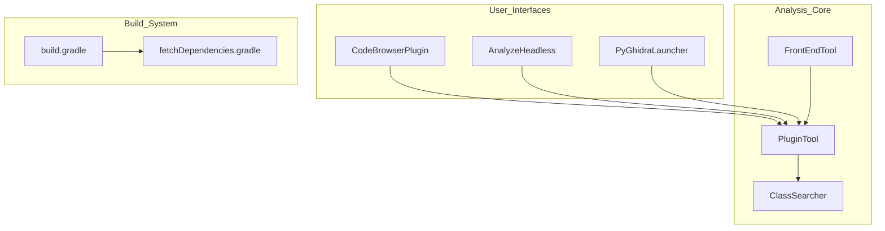

**Key Components by Layer:**

| Layer | Primary Files / Modules | Responsibility |
|-------|----------------|----------------|
| UI Entry Points | `ghidra.GhidraRun`, `ghidra.app.util.headless.AnalyzeHeadless` | Application startup and headless batch execution [README.md:37-38]() |
| Plugin Framework | `FrontEndTool`, `PluginTool` | Lifecycle management for plugins and project window containers |
| Extension Discovery | `ClassSearcher`, `GhidraClassLoader` | Dynamic discovery and loading of extensions and modules [DevGuide.md:7-8]() |
| Build System | `build.gradle`, `gradle/support/fetchDependencies.gradle` | Compilation, native builds, and external dependency retrieval [build.gradle:1-20](), [gradle/support/fetchDependencies.gradle:1-45]() |

**Sources:** [README.md:37-38](), [DevGuide.md:1-11](), [build.gradle:1-20](), [gradle/support/fetchDependencies.gradle:1-45]()

## Core Subsystems

### Decompiler System
The decompiler transforms machine instructions into structured high-level C code via a multi-stage P-code transformation pipeline [README.md:8-9](). Operating primarily as a native C++ engine, it interfaces with the Java framework to construct Static Single Assignment (SSA) forms, perform type inference, and recover control flow structures.

### Processor Architecture Support
Processor definitions are defined using the Sleigh specification language [DevGuide.md:5-6](). The build and runtime environments compile `.sinc` and `.slaspec` definitions into binary `.sla` files used for instruction decoding and P-code generation [DevGuide.md:61-64]().

### Binary Format Support
Executables are parsed via a loader framework that implements format-specific loaders (PE, ELF, Mach-O) to map segments, sections, and symbols into Ghidra's program database model [README.md:6-9]().

### Debugger System
Dynamic analysis is supported through a debugging framework that connects Ghidra to native debuggers (such as GDB, LLDB, and DBG-ENG) using a Protocol Buffer-based Trace RMI protocol to synchronize trace databases [GhidraDocs/WhatsNew.md:5-10]().

### Scripting and Extension System
Ghidra supports automation through `GhidraScript` (Java) and PyGhidra (Python 3.9 through 3.14 bridging via JPype) [README.md:10-11](), [Ghidra/application.properties:10](). Scripts can be executed interactively within the GUI or via headless batch processing [README.md:9-11]().

### Build Infrastructure
The Gradle build system orchestrates multi-language compilation (Java, C++, Sleigh, Python) [DevGuide.md:7-8](). Specialized scripts such as `gradle/support/fetchDependencies.gradle` manage non-Maven Central binary dependencies [gradle/support/fetchDependencies.gradle:16-35]().

**Sources:** [README.md:3-11](), [DevGuide.md:5-8](), [Ghidra/application.properties:1-10](), [gradle/support/fetchDependencies.gradle:16-35]()

## Analysis Pipeline: Environment to Execution

Title: Application Lifecycle and Class Loading
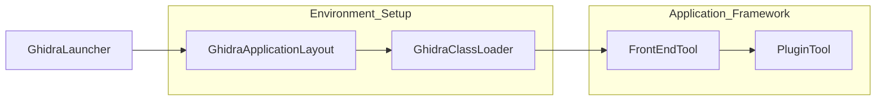

**Pipeline Stages:**

1. **Initialization**: The launcher discovers the installation layout via `GhidraApplicationLayout` and initializes the class loader [GhidraDocs/GettingStarted.md:98-107]().
2. **Tool Startup**: The `FrontEndTool` initializes the project workspace and manages top-level project management windows.
3. **Plugin Management**: `PluginTool` acts as the container orchestrating individual analysis plugins and tool actions.

**Sources:** [GhidraDocs/GettingStarted.md:98-136]()

## Key Data Structures and Properties

### application.properties
Defines core project versioning (version `12.3`), minimum Java requirements (JDK `25`), and supported Python versions (`3.9` to `3.14`) [Ghidra/application.properties:1-10]().

### Launch Configurations
Runtime JVM parameters and property overrides (such as compact object headers and headless execution flags) are specified in configuration files like `Ghidra/Features/Base/.launch/Ghidra.launch` and `support/launch.properties` [Ghidra/Features/Base/.launch/Ghidra.launch:34]().

**Sources:** [Ghidra/application.properties:1-10](), [Ghidra/Features/Base/.launch/Ghidra.launch:1-35]()

## Project Structure

| Path | Description |
|------|-------------|
| `Ghidra/Features/` | Primary feature modules including Base, Decompiler, Debugger, and PyGhidra |
| `Ghidra/Framework/` | Core framework utilities, database layer, and software modeling libraries |
| `GPL/` | GPL-licensed components and native platform build scripts [DevGuide.md:23-24]() |
| `gradle/` | Build system tasks, distribution packaging, and dependency fetch scripts |
| `dependencies/` | External runtime and build dependencies fetched during setup [build.gradle:60-61]() |

**Sources:** [DevGuide.md:17-25](), [build.gradle:55-61]()

## Getting Started

- **Users**: Extract a distribution release zip and run `./ghidraRun` (or `ghidraRun.bat` on Windows). Requires JDK 25 and Python 3.9+ [README.md:28-38](), [GhidraDocs/GettingStarted.md:54-58]().
- **Developers**: Execute `gradle prepdev eclipse buildNatives` after setting up JDK 25, Gradle 9.1.0+, and fetching dependencies via `gradle -I gradle/support/fetchDependencies.gradle` [README.md:49-113](), [DevGuide.md:31-42]().

**Sources:** [README.md:28-125](), [DevGuide.md:31-60](), [GhidraDocs/GettingStarted.md:54-64]()

---

# Page: Decompiler System

# Decompiler System

<details>
<summary>Relevant source files</summary>

The following files were used as context for generating this wiki page:

- [Ghidra/Features/Base/src/main/help/help/topics/CodeBrowserPlugin/Browser_Field_Formatter.htm](Ghidra/Features/Base/src/main/help/help/topics/CodeBrowserPlugin/Browser_Field_Formatter.htm)
- [Ghidra/Features/Base/src/main/java/ghidra/app/plugin/core/symtable/NewSymbolFilter.java](Ghidra/Features/Base/src/main/java/ghidra/app/plugin/core/symtable/NewSymbolFilter.java)
- [Ghidra/Features/Decompiler/build.gradle](Ghidra/Features/Decompiler/build.gradle)
- [Ghidra/Features/Decompiler/certification.manifest](Ghidra/Features/Decompiler/certification.manifest)
- [Ghidra/Features/Decompiler/src/decompile/cpp/Makefile](Ghidra/Features/Decompiler/src/decompile/cpp/Makefile)
- [Ghidra/Features/Decompiler/src/decompile/cpp/address.cc](Ghidra/Features/Decompiler/src/decompile/cpp/address.cc)
- [Ghidra/Features/Decompiler/src/decompile/cpp/address.hh](Ghidra/Features/Decompiler/src/decompile/cpp/address.hh)
- [Ghidra/Features/Decompiler/src/decompile/cpp/architecture.cc](Ghidra/Features/Decompiler/src/decompile/cpp/architecture.cc)
- [Ghidra/Features/Decompiler/src/decompile/cpp/architecture.hh](Ghidra/Features/Decompiler/src/decompile/cpp/architecture.hh)
- [Ghidra/Features/Decompiler/src/decompile/cpp/cast.cc](Ghidra/Features/Decompiler/src/decompile/cpp/cast.cc)
- [Ghidra/Features/Decompiler/src/decompile/cpp/cast.hh](Ghidra/Features/Decompiler/src/decompile/cpp/cast.hh)
- [Ghidra/Features/Decompiler/src/decompile/cpp/coreaction.cc](Ghidra/Features/Decompiler/src/decompile/cpp/coreaction.cc)
- [Ghidra/Features/Decompiler/src/decompile/cpp/coreaction.hh](Ghidra/Features/Decompiler/src/decompile/cpp/coreaction.hh)
- [Ghidra/Features/Decompiler/src/decompile/cpp/cover.cc](Ghidra/Features/Decompiler/src/decompile/cpp/cover.cc)
- [Ghidra/Features/Decompiler/src/decompile/cpp/cover.hh](Ghidra/Features/Decompiler/src/decompile/cpp/cover.hh)
- [Ghidra/Features/Decompiler/src/decompile/cpp/database.cc](Ghidra/Features/Decompiler/src/decompile/cpp/database.cc)
- [Ghidra/Features/Decompiler/src/decompile/cpp/database.hh](Ghidra/Features/Decompiler/src/decompile/cpp/database.hh)
- [Ghidra/Features/Decompiler/src/decompile/cpp/database_ghidra.cc](Ghidra/Features/Decompiler/src/decompile/cpp/database_ghidra.cc)
- [Ghidra/Features/Decompiler/src/decompile/cpp/database_ghidra.hh](Ghidra/Features/Decompiler/src/decompile/cpp/database_ghidra.hh)
- [Ghidra/Features/Decompiler/src/decompile/cpp/double.cc](Ghidra/Features/Decompiler/src/decompile/cpp/double.cc)
- [Ghidra/Features/Decompiler/src/decompile/cpp/double.hh](Ghidra/Features/Decompiler/src/decompile/cpp/double.hh)
- [Ghidra/Features/Decompiler/src/decompile/cpp/float.cc](Ghidra/Features/Decompiler/src/decompile/cpp/float.cc)
- [Ghidra/Features/Decompiler/src/decompile/cpp/float.hh](Ghidra/Features/Decompiler/src/decompile/cpp/float.hh)
- [Ghidra/Features/Decompiler/src/decompile/cpp/fspec.cc](Ghidra/Features/Decompiler/src/decompile/cpp/fspec.cc)
- [Ghidra/Features/Decompiler/src/decompile/cpp/fspec.hh](Ghidra/Features/Decompiler/src/decompile/cpp/fspec.hh)
- [Ghidra/Features/Decompiler/src/decompile/cpp/funcdata.cc](Ghidra/Features/Decompiler/src/decompile/cpp/funcdata.cc)
- [Ghidra/Features/Decompiler/src/decompile/cpp/funcdata.hh](Ghidra/Features/Decompiler/src/decompile/cpp/funcdata.hh)
- [Ghidra/Features/Decompiler/src/decompile/cpp/funcdata_op.cc](Ghidra/Features/Decompiler/src/decompile/cpp/funcdata_op.cc)
- [Ghidra/Features/Decompiler/src/decompile/cpp/funcdata_varnode.cc](Ghidra/Features/Decompiler/src/decompile/cpp/funcdata_varnode.cc)
- [Ghidra/Features/Decompiler/src/decompile/cpp/grammar.cc](Ghidra/Features/Decompiler/src/decompile/cpp/grammar.cc)
- [Ghidra/Features/Decompiler/src/decompile/cpp/grammar.y](Ghidra/Features/Decompiler/src/decompile/cpp/grammar.y)
- [Ghidra/Features/Decompiler/src/decompile/cpp/heritage.cc](Ghidra/Features/Decompiler/src/decompile/cpp/heritage.cc)
- [Ghidra/Features/Decompiler/src/decompile/cpp/heritage.hh](Ghidra/Features/Decompiler/src/decompile/cpp/heritage.hh)
- [Ghidra/Features/Decompiler/src/decompile/cpp/ifacedecomp.cc](Ghidra/Features/Decompiler/src/decompile/cpp/ifacedecomp.cc)
- [Ghidra/Features/Decompiler/src/decompile/cpp/ifacedecomp.hh](Ghidra/Features/Decompiler/src/decompile/cpp/ifacedecomp.hh)
- [Ghidra/Features/Decompiler/src/decompile/cpp/merge.cc](Ghidra/Features/Decompiler/src/decompile/cpp/merge.cc)
- [Ghidra/Features/Decompiler/src/decompile/cpp/merge.hh](Ghidra/Features/Decompiler/src/decompile/cpp/merge.hh)
- [Ghidra/Features/Decompiler/src/decompile/cpp/op.cc](Ghidra/Features/Decompiler/src/decompile/cpp/op.cc)
- [Ghidra/Features/Decompiler/src/decompile/cpp/op.hh](Ghidra/Features/Decompiler/src/decompile/cpp/op.hh)
- [Ghidra/Features/Decompiler/src/decompile/cpp/options.cc](Ghidra/Features/Decompiler/src/decompile/cpp/options.cc)
- [Ghidra/Features/Decompiler/src/decompile/cpp/options.hh](Ghidra/Features/Decompiler/src/decompile/cpp/options.hh)
- [Ghidra/Features/Decompiler/src/decompile/cpp/ruleaction.cc](Ghidra/Features/Decompiler/src/decompile/cpp/ruleaction.cc)
- [Ghidra/Features/Decompiler/src/decompile/cpp/ruleaction.hh](Ghidra/Features/Decompiler/src/decompile/cpp/ruleaction.hh)
- [Ghidra/Features/Decompiler/src/decompile/cpp/space.cc](Ghidra/Features/Decompiler/src/decompile/cpp/space.cc)
- [Ghidra/Features/Decompiler/src/decompile/cpp/space.hh](Ghidra/Features/Decompiler/src/decompile/cpp/space.hh)
- [Ghidra/Features/Decompiler/src/decompile/cpp/subflow.cc](Ghidra/Features/Decompiler/src/decompile/cpp/subflow.cc)
- [Ghidra/Features/Decompiler/src/decompile/cpp/subflow.hh](Ghidra/Features/Decompiler/src/decompile/cpp/subflow.hh)
- [Ghidra/Features/Decompiler/src/decompile/cpp/transform.cc](Ghidra/Features/Decompiler/src/decompile/cpp/transform.cc)
- [Ghidra/Features/Decompiler/src/decompile/cpp/transform.hh](Ghidra/Features/Decompiler/src/decompile/cpp/transform.hh)
- [Ghidra/Features/Decompiler/src/decompile/cpp/translate.cc](Ghidra/Features/Decompiler/src/decompile/cpp/translate.cc)
- [Ghidra/Features/Decompiler/src/decompile/cpp/translate.hh](Ghidra/Features/Decompiler/src/decompile/cpp/translate.hh)
- [Ghidra/Features/Decompiler/src/decompile/cpp/type.cc](Ghidra/Features/Decompiler/src/decompile/cpp/type.cc)
- [Ghidra/Features/Decompiler/src/decompile/cpp/type.hh](Ghidra/Features/Decompiler/src/decompile/cpp/type.hh)
- [Ghidra/Features/Decompiler/src/decompile/cpp/typeop.cc](Ghidra/Features/Decompiler/src/decompile/cpp/typeop.cc)
- [Ghidra/Features/Decompiler/src/decompile/cpp/typeop.hh](Ghidra/Features/Decompiler/src/decompile/cpp/typeop.hh)
- [Ghidra/Features/Decompiler/src/decompile/cpp/variable.cc](Ghidra/Features/Decompiler/src/decompile/cpp/variable.cc)
- [Ghidra/Features/Decompiler/src/decompile/cpp/variable.hh](Ghidra/Features/Decompiler/src/decompile/cpp/variable.hh)
- [Ghidra/Features/Decompiler/src/decompile/cpp/varmap.cc](Ghidra/Features/Decompiler/src/decompile/cpp/varmap.cc)
- [Ghidra/Features/Decompiler/src/decompile/cpp/varmap.hh](Ghidra/Features/Decompiler/src/decompile/cpp/varmap.hh)
- [Ghidra/Features/Decompiler/src/decompile/cpp/varnode.cc](Ghidra/Features/Decompiler/src/decompile/cpp/varnode.cc)
- [Ghidra/Features/Decompiler/src/decompile/cpp/varnode.hh](Ghidra/Features/Decompiler/src/decompile/cpp/varnode.hh)
- [Ghidra/Features/Decompiler/src/decompile/datatests/varcross.xml](Ghidra/Features/Decompiler/src/decompile/datatests/varcross.xml)
- [Ghidra/Features/Decompiler/src/main/doc/decompileplugin.xml](Ghidra/Features/Decompiler/src/main/doc/decompileplugin.xml)
- [Ghidra/Features/Decompiler/src/main/doc/decompileplugin_common.xsl](Ghidra/Features/Decompiler/src/main/doc/decompileplugin_common.xsl)
- [Ghidra/Features/Decompiler/src/main/doc/decompileplugin_pdf.xsl](Ghidra/Features/Decompiler/src/main/doc/decompileplugin_pdf.xsl)
- [Ghidra/Features/Decompiler/src/main/help/help/topics/DecompilePlugin/DecompilerAnnotations.html](Ghidra/Features/Decompiler/src/main/help/help/topics/DecompilePlugin/DecompilerAnnotations.html)
- [Ghidra/Features/Decompiler/src/main/help/help/topics/DecompilePlugin/DecompilerConcepts.html](Ghidra/Features/Decompiler/src/main/help/help/topics/DecompilePlugin/DecompilerConcepts.html)
- [Ghidra/Features/Decompiler/src/main/help/help/topics/DecompilePlugin/DecompilerIntro.html](Ghidra/Features/Decompiler/src/main/help/help/topics/DecompilePlugin/DecompilerIntro.html)
- [Ghidra/Features/Decompiler/src/main/help/help/topics/DecompilePlugin/DecompilerOptions.html](Ghidra/Features/Decompiler/src/main/help/help/topics/DecompilePlugin/DecompilerOptions.html)
- [Ghidra/Features/Decompiler/src/main/help/help/topics/DecompilePlugin/DecompilerWindow.html](Ghidra/Features/Decompiler/src/main/help/help/topics/DecompilePlugin/DecompilerWindow.html)
- [Ghidra/Features/Decompiler/src/main/java/ghidra/app/decompiler/DecompileDebug.java](Ghidra/Features/Decompiler/src/main/java/ghidra/app/decompiler/DecompileDebug.java)
- [Ghidra/Features/Decompiler/src/main/java/ghidra/app/decompiler/DecompileOptions.java](Ghidra/Features/Decompiler/src/main/java/ghidra/app/decompiler/DecompileOptions.java)
- [Ghidra/Features/VersionTracking/src/main/java/ghidra/feature/vt/gui/provider/matchtable/SymbolTypeFilter.java](Ghidra/Features/VersionTracking/src/main/java/ghidra/feature/vt/gui/provider/matchtable/SymbolTypeFilter.java)
- [Ghidra/Framework/SoftwareModeling/src/main/java/ghidra/program/database/function/FunctionAdapter.java](Ghidra/Framework/SoftwareModeling/src/main/java/ghidra/program/database/function/FunctionAdapter.java)
- [Ghidra/Framework/SoftwareModeling/src/main/java/ghidra/program/database/references/RefListFlagsV0.java](Ghidra/Framework/SoftwareModeling/src/main/java/ghidra/program/database/references/RefListFlagsV0.java)
- [Ghidra/Framework/SoftwareModeling/src/main/java/ghidra/program/model/pcode/LocalSymbolMap.java](Ghidra/Framework/SoftwareModeling/src/main/java/ghidra/program/model/pcode/LocalSymbolMap.java)
- [Ghidra/Framework/SoftwareModeling/src/main/java/ghidra/program/model/pcode/PcodeDataTypeManager.java](Ghidra/Framework/SoftwareModeling/src/main/java/ghidra/program/model/pcode/PcodeDataTypeManager.java)
- [Ghidra/Framework/SoftwareModeling/src/main/java/ghidra/program/model/symbol/SourceType.java](Ghidra/Framework/SoftwareModeling/src/main/java/ghidra/program/model/symbol/SourceType.java)

</details>


## Purpose and Scope

The Decompiler System transforms raw p-code operations into high-level C code by performing SSA construction, data-flow analysis, type propagation, and control-flow recovery. This document describes the overall architecture, core data structures, and transformation pipeline. 

As a parent page, this section provides a high-level overview. For specific subsystems and detailed deep-dives, see the following child pages:
- Core decompilation pipeline and data structures: [Core Decompilation Process](#2.1)
- Rule-based transformation framework: [Actions and Rules System](#2.2)
- Type inference, metatypes, and propagation: [Type System and Propagation](#2.3)
- SSA form construction and def-use chains: [SSA Construction and Data Flow](#2.4)
- Varnode optimization and splitting: [Varnode Management and Optimization](#2.5)
- Function signature and local variable recovery: [Function Prototype and Symbol Recovery](#2.6)
- C++ Class hierarchy and RTTI recovery: [C++ Class Recovery from RTTI](#2.7)
- GUI components, IPC, and Java bridge: [Decompiler UI and Java Bridge](#2.8)
- CFG structuring, jump tables, and C source emission: [Control Flow Structuring and Code Emission](#2.9)

The decompiler operates on a single function at a time, represented by the `Funcdata` class, and progressively refines its internal representation through a series of transformation passes.

Sources: [Ghidra/Features/Decompiler/src/decompile/cpp/funcdata.hh:41-98]()

## Architecture Overview

The decompiler uses a multi-pass architecture where each pass applies a set of transformations to improve the intermediate representation. The system maintains three core data structures throughout the analysis: `Varnode`, `PcodeOp`, and `BlockGraph`, all managed by the central `Funcdata` container.

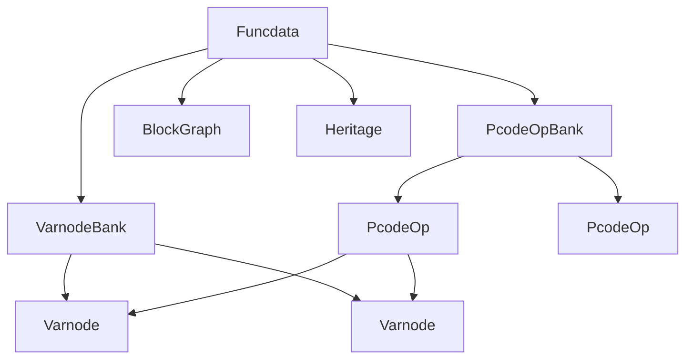

Sources: [Ghidra/Features/Decompiler/src/decompile/cpp/funcdata.hh:41-98]()

| Class | Purpose | Key Responsibilities |
|-------|---------|---------------------|
| `Funcdata` | Function-level container | Coordinates all analysis, manages Varnodes and PcodeOps, orchestrates transformations. |
| `Varnode` | Storage location value | Represents a value in a specific storage location at a specific point in time. |
| `PcodeOp` | Operation | Represents a single p-code operation with inputs and output. |
| `Heritage` | SSA construction | Builds and maintains Static Single Assignment form. |
| `VarnodeBank` | Varnode storage | Allocates and manages all `Varnode` objects via `vbank`. |
| `PcodeOpBank` | PcodeOp storage | Allocates and manages all `PcodeOp` objects via `obank`. |

Sources: [Ghidra/Features/Decompiler/src/decompile/cpp/funcdata.hh:56-137](), [Ghidra/Features/Decompiler/src/decompile/cpp/varnode.hh:162-206]()

## Core Data Structures

### Funcdata: The Function Container

The `Funcdata` class serves as the central coordinator for all decompilation activities. It holds references to all major subsystems and provides the primary API for querying and manipulating the function's intermediate representation. For details on its lifecycle and the broader decompilation pipeline, see [Core Decompilation Process](#2.1).

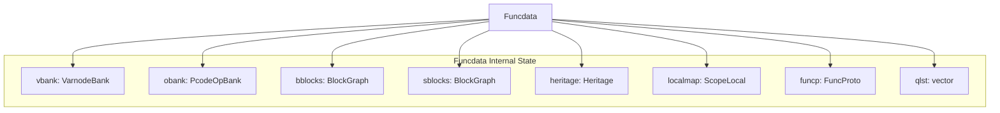

Sources: [Ghidra/Features/Decompiler/src/decompile/cpp/funcdata.hh:74-98]()

### Varnode and PcodeOp Representation

A `Varnode` represents a value stored at a specific address with a specific size. Varnodes act as nodes in the data-flow graph. Each `PcodeOp` represents an elementary instruction (such as addition, copy, or memory load/store) connecting input and output Varnodes. 

For comprehensive details on varnode flags, subvariable flows, and optimization, see [Varnode Management and Optimization](#2.5).

Sources: [Ghidra/Features/Decompiler/src/decompile/cpp/varnode.hh:162-206](), [Ghidra/Features/Decompiler/src/decompile/cpp/op.hh:119-201]()

## Transformation Pipeline and Subsystems

The decompiler applies transformations using an `Action` and `Rule` framework, transitioning the function from raw p-code to structured high-level representations.

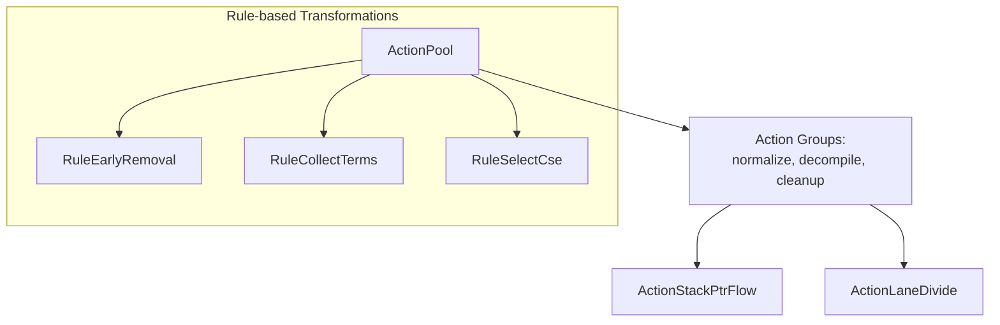

Sources: [Ghidra/Features/Decompiler/src/decompile/cpp/action.hh](), [Ghidra/Features/Decompiler/src/decompile/cpp/coreaction.cc:34-51](), [Ghidra/Features/Decompiler/src/decompile/cpp/ruleaction.cc:25-44]()

### Summary of Subsystem Child Pages

- **Actions and Rules:** Incremental code simplification via pattern matching and rewriting is managed through the `Action` and `Rule` infrastructure. For details, see [Actions and Rules System](#2.2).
- **Type System:** Data types follow a `type_metatype` and `sub_metatype` hierarchy that governs inference and propagation through data-flow edges. For details, see [Type System and Propagation](#2.3).
- **SSA Construction:** The `Heritage` subsystem converts memory/register writes into SSA form, using `LocationMap` and inserting `CPUI_MULTIEQUAL` (phi) functions. For details, see [SSA Construction and Data Flow](#2.4).
- **Function Prototypes & Symbols:** Calling conventions, parameters, return values, and local variable mapping are handled via symbol management. For details, see [Function Prototype and Symbol Recovery](#2.6).
- **C++ Class Recovery:** Recovering class hierarchies, `vftable` structures, and methods from RTTI metadata is handled by specialized recovery classes. For details, see [C++ Class Recovery from RTTI](#2.7).
- **UI and Bridge:** Interactive UI rendering, token highlighting, and IPC communication are handled via Java-C++ bridges. For details, see [Decompiler UI and Java Bridge](#2.8).
- **Control Flow & Emission:** Control-flow graph structuring, jump table recovery, and final C source emission are handled by language print modules. For details, see [Control Flow Structuring and Code Emission](#2.9).

Sources: [Ghidra/Features/Decompiler/src/decompile/cpp/type.hh:80-100](), [Ghidra/Features/Decompiler/src/decompile/cpp/heritage.cc:33-70]()

---

# Page: Core Decompilation Process

# Core Decompilation Process

<details>
<summary>Relevant source files</summary>

The following files were used as context for generating this wiki page:

- [Ghidra/Features/Base/src/main/help/help/topics/CodeBrowserPlugin/Browser_Field_Formatter.htm](Ghidra/Features/Base/src/main/help/help/topics/CodeBrowserPlugin/Browser_Field_Formatter.htm)
- [Ghidra/Features/Base/src/main/java/ghidra/app/plugin/core/symtable/NewSymbolFilter.java](Ghidra/Features/Base/src/main/java/ghidra/app/plugin/core/symtable/NewSymbolFilter.java)
- [Ghidra/Features/Decompiler/build.gradle](Ghidra/Features/Decompiler/build.gradle)
- [Ghidra/Features/Decompiler/certification.manifest](Ghidra/Features/Decompiler/certification.manifest)
- [Ghidra/Features/Decompiler/src/decompile/cpp/Makefile](Ghidra/Features/Decompiler/src/decompile/cpp/Makefile)
- [Ghidra/Features/Decompiler/src/decompile/cpp/address.cc](Ghidra/Features/Decompiler/src/decompile/cpp/address.cc)
- [Ghidra/Features/Decompiler/src/decompile/cpp/address.hh](Ghidra/Features/Decompiler/src/decompile/cpp/address.hh)
- [Ghidra/Features/Decompiler/src/decompile/cpp/architecture.cc](Ghidra/Features/Decompiler/src/decompile/cpp/architecture.cc)
- [Ghidra/Features/Decompiler/src/decompile/cpp/architecture.hh](Ghidra/Features/Decompiler/src/decompile/cpp/architecture.hh)
- [Ghidra/Features/Decompiler/src/decompile/cpp/cast.cc](Ghidra/Features/Decompiler/src/decompile/cpp/cast.cc)
- [Ghidra/Features/Decompiler/src/decompile/cpp/cast.hh](Ghidra/Features/Decompiler/src/decompile/cpp/cast.hh)
- [Ghidra/Features/Decompiler/src/decompile/cpp/coreaction.cc](Ghidra/Features/Decompiler/src/decompile/cpp/coreaction.cc)
- [Ghidra/Features/Decompiler/src/decompile/cpp/coreaction.hh](Ghidra/Features/Decompiler/src/decompile/cpp/coreaction.hh)
- [Ghidra/Features/Decompiler/src/decompile/cpp/cover.cc](Ghidra/Features/Decompiler/src/decompile/cpp/cover.cc)
- [Ghidra/Features/Decompiler/src/decompile/cpp/cover.hh](Ghidra/Features/Decompiler/src/decompile/cpp/cover.hh)
- [Ghidra/Features/Decompiler/src/decompile/cpp/database.cc](Ghidra/Features/Decompiler/src/decompile/cpp/database.cc)
- [Ghidra/Features/Decompiler/src/decompile/cpp/database.hh](Ghidra/Features/Decompiler/src/decompile/cpp/database.hh)
- [Ghidra/Features/Decompiler/src/decompile/cpp/database_ghidra.cc](Ghidra/Features/Decompiler/src/decompile/cpp/database_ghidra.cc)
- [Ghidra/Features/Decompiler/src/decompile/cpp/database_ghidra.hh](Ghidra/Features/Decompiler/src/decompile/cpp/database_ghidra.hh)
- [Ghidra/Features/Decompiler/src/decompile/cpp/double.cc](Ghidra/Features/Decompiler/src/decompile/cpp/double.cc)
- [Ghidra/Features/Decompiler/src/decompile/cpp/double.hh](Ghidra/Features/Decompiler/src/decompile/cpp/double.hh)
- [Ghidra/Features/Decompiler/src/decompile/cpp/float.cc](Ghidra/Features/Decompiler/src/decompile/cpp/float.cc)
- [Ghidra/Features/Decompiler/src/decompile/cpp/float.hh](Ghidra/Features/Decompiler/src/decompile/cpp/float.hh)
- [Ghidra/Features/Decompiler/src/decompile/cpp/fspec.cc](Ghidra/Features/Decompiler/src/decompile/cpp/fspec.cc)
- [Ghidra/Features/Decompiler/src/decompile/cpp/fspec.hh](Ghidra/Features/Decompiler/src/decompile/cpp/fspec.hh)
- [Ghidra/Features/Decompiler/src/decompile/cpp/funcdata.cc](Ghidra/Features/Decompiler/src/decompile/cpp/funcdata.cc)
- [Ghidra/Features/Decompiler/src/decompile/cpp/funcdata.hh](Ghidra/Features/Decompiler/src/decompile/cpp/funcdata.hh)
- [Ghidra/Features/Decompiler/src/decompile/cpp/funcdata_op.cc](Ghidra/Features/Decompiler/src/decompile/cpp/funcdata_op.cc)
- [Ghidra/Features/Decompiler/src/decompile/cpp/funcdata_varnode.cc](Ghidra/Features/Decompiler/src/decompile/cpp/funcdata_varnode.cc)
- [Ghidra/Features/Decompiler/src/decompile/cpp/grammar.cc](Ghidra/Features/Decompiler/src/decompile/cpp/grammar.cc)
- [Ghidra/Features/Decompiler/src/decompile/cpp/grammar.y](Ghidra/Features/Decompiler/src/decompile/cpp/grammar.y)
- [Ghidra/Features/Decompiler/src/decompile/cpp/heritage.cc](Ghidra/Features/Decompiler/src/decompile/cpp/heritage.cc)
- [Ghidra/Features/Decompiler/src/decompile/cpp/heritage.hh](Ghidra/Features/Decompiler/src/decompile/cpp/heritage.hh)
- [Ghidra/Features/Decompiler/src/decompile/cpp/ifacedecomp.cc](Ghidra/Features/Decompiler/src/decompile/cpp/ifacedecomp.cc)
- [Ghidra/Features/Decompiler/src/decompile/cpp/ifacedecomp.hh](Ghidra/Features/Decompiler/src/decompile/cpp/ifacedecomp.hh)
- [Ghidra/Features/Decompiler/src/decompile/cpp/merge.cc](Ghidra/Features/Decompiler/src/decompile/cpp/merge.cc)
- [Ghidra/Features/Decompiler/src/decompile/cpp/merge.hh](Ghidra/Features/Decompiler/src/decompile/cpp/merge.hh)
- [Ghidra/Features/Decompiler/src/decompile/cpp/op.cc](Ghidra/Features/Decompiler/src/decompile/cpp/op.cc)
- [Ghidra/Features/Decompiler/src/decompile/cpp/op.hh](Ghidra/Features/Decompiler/src/decompile/cpp/op.hh)
- [Ghidra/Features/Decompiler/src/decompile/cpp/options.cc](Ghidra/Features/Decompiler/src/decompile/cpp/options.cc)
- [Ghidra/Features/Decompiler/src/decompile/cpp/options.hh](Ghidra/Features/Decompiler/src/decompile/cpp/options.hh)
- [Ghidra/Features/Decompiler/src/decompile/cpp/ruleaction.cc](Ghidra/Features/Decompiler/src/decompile/cpp/ruleaction.cc)
- [Ghidra/Features/Decompiler/src/decompile/cpp/ruleaction.hh](Ghidra/Features/Decompiler/src/decompile/cpp/ruleaction.hh)
- [Ghidra/Features/Decompiler/src/decompile/cpp/space.cc](Ghidra/Features/Decompiler/src/decompile/cpp/space.cc)
- [Ghidra/Features/Decompiler/src/decompile/cpp/space.hh](Ghidra/Features/Decompiler/src/decompile/cpp/space.hh)
- [Ghidra/Features/Decompiler/src/decompile/cpp/subflow.cc](Ghidra/Features/Decompiler/src/decompile/cpp/subflow.cc)
- [Ghidra/Features/Decompiler/src/decompile/cpp/subflow.hh](Ghidra/Features/Decompiler/src/decompile/cpp/subflow.hh)
- [Ghidra/Features/Decompiler/src/decompile/cpp/transform.cc](Ghidra/Features/Decompiler/src/decompile/cpp/transform.cc)
- [Ghidra/Features/Decompiler/src/decompile/cpp/transform.hh](Ghidra/Features/Decompiler/src/decompile/cpp/transform.hh)
- [Ghidra/Features/Decompiler/src/decompile/cpp/translate.cc](Ghidra/Features/Decompiler/src/decompile/cpp/translate.cc)
- [Ghidra/Features/Decompiler/src/decompile/cpp/translate.hh](Ghidra/Features/Decompiler/src/decompile/cpp/translate.hh)
- [Ghidra/Features/Decompiler/src/decompile/cpp/type.cc](Ghidra/Features/Decompiler/src/decompile/cpp/type.cc)
- [Ghidra/Features/Decompiler/src/decompile/cpp/type.hh](Ghidra/Features/Decompiler/src/decompile/cpp/type.hh)
- [Ghidra/Features/Decompiler/src/decompile/cpp/typeop.cc](Ghidra/Features/Decompiler/src/decompile/cpp/typeop.cc)
- [Ghidra/Features/Decompiler/src/decompile/cpp/typeop.hh](Ghidra/Features/Decompiler/src/decompile/cpp/typeop.hh)
- [Ghidra/Features/Decompiler/src/decompile/cpp/variable.cc](Ghidra/Features/Decompiler/src/decompile/cpp/variable.cc)
- [Ghidra/Features/Decompiler/src/decompile/cpp/variable.hh](Ghidra/Features/Decompiler/src/decompile/cpp/variable.hh)
- [Ghidra/Features/Decompiler/src/decompile/cpp/varmap.cc](Ghidra/Features/Decompiler/src/decompile/cpp/varmap.cc)
- [Ghidra/Features/Decompiler/src/decompile/cpp/varmap.hh](Ghidra/Features/Decompiler/src/decompile/cpp/varmap.hh)
- [Ghidra/Features/Decompiler/src/decompile/cpp/varnode.cc](Ghidra/Features/Decompiler/src/decompile/cpp/varnode.cc)
- [Ghidra/Features/Decompiler/src/decompile/cpp/varnode.hh](Ghidra/Features/Decompiler/src/decompile/cpp/varnode.hh)
- [Ghidra/Features/Decompiler/src/decompile/datatests/varcross.xml](Ghidra/Features/Decompiler/src/decompile/datatests/varcross.xml)
- [Ghidra/Features/Decompiler/src/main/doc/decompileplugin.xml](Ghidra/Features/Decompiler/src/main/doc/decompileplugin.xml)
- [Ghidra/Features/Decompiler/src/main/doc/decompileplugin_common.xsl](Ghidra/Features/Decompiler/src/main/doc/decompileplugin_common.xsl)
- [Ghidra/Features/Decompiler/src/main/doc/decompileplugin_pdf.xsl](Ghidra/Features/Decompiler/src/main/doc/decompileplugin_pdf.xsl)
- [Ghidra/Features/Decompiler/src/main/help/help/topics/DecompilePlugin/DecompilerAnnotations.html](Ghidra/Features/Decompiler/src/main/help/help/topics/DecompilePlugin/DecompilerAnnotations.html)
- [Ghidra/Features/Decompiler/src/main/help/help/topics/DecompilePlugin/DecompilerConcepts.html](Ghidra/Features/Decompiler/src/main/help/help/topics/DecompilePlugin/DecompilerConcepts.html)
- [Ghidra/Features/Decompiler/src/main/help/help/topics/DecompilePlugin/DecompilerIntro.html](Ghidra/Features/Decompiler/src/main/help/help/topics/DecompilePlugin/DecompilerIntro.html)
- [Ghidra/Features/Decompiler/src/main/help/help/topics/DecompilePlugin/DecompilerOptions.html](Ghidra/Features/Decompiler/src/main/help/help/topics/DecompilePlugin/DecompilerOptions.html)
- [Ghidra/Features/Decompiler/src/main/help/help/topics/DecompilePlugin/DecompilerWindow.html](Ghidra/Features/Decompiler/src/main/help/help/topics/DecompilePlugin/DecompilerWindow.html)
- [Ghidra/Features/Decompiler/src/main/java/ghidra/app/decompiler/DecompileDebug.java](Ghidra/Features/Decompiler/src/main/java/ghidra/app/decompiler/DecompileDebug.java)
- [Ghidra/Features/Decompiler/src/main/java/ghidra/app/decompiler/DecompileOptions.java](Ghidra/Features/Decompiler/src/main/java/ghidra/app/decompiler/DecompileOptions.java)
- [Ghidra/Features/VersionTracking/src/main/java/ghidra/feature/vt/gui/provider/matchtable/SymbolTypeFilter.java](Ghidra/Features/VersionTracking/src/main/java/ghidra/feature/vt/gui/provider/matchtable/SymbolTypeFilter.java)
- [Ghidra/Framework/SoftwareModeling/src/main/java/ghidra/program/database/function/FunctionAdapter.java](Ghidra/Framework/SoftwareModeling/src/main/java/ghidra/program/database/function/FunctionAdapter.java)
- [Ghidra/Framework/SoftwareModeling/src/main/java/ghidra/program/database/references/RefListFlagsV0.java](Ghidra/Framework/SoftwareModeling/src/main/java/ghidra/program/database/references/RefListFlagsV0.java)
- [Ghidra/Framework/SoftwareModeling/src/main/java/ghidra/program/model/pcode/LocalSymbolMap.java](Ghidra/Framework/SoftwareModeling/src/main/java/ghidra/program/model/pcode/LocalSymbolMap.java)
- [Ghidra/Framework/SoftwareModeling/src/main/java/ghidra/program/model/pcode/PcodeDataTypeManager.java](Ghidra/Framework/SoftwareModeling/src/main/java/ghidra/program/model/pcode/PcodeDataTypeManager.java)
- [Ghidra/Framework/SoftwareModeling/src/main/java/ghidra/program/model/symbol/SourceType.java](Ghidra/Framework/SoftwareModeling/src/main/java/ghidra/program/model/symbol/SourceType.java)

</details>


## Purpose and Scope

This document details the fundamental decompilation pipeline within Ghidra's decompiler subsystem. It covers the lifecycle and internal state management of the `Funcdata` class, the foundational intermediate representation (IR) units (`PcodeOp` and `Varnode`), the action-rule transformation framework that drives iterative code simplification, and the progression from raw low-level P-code instructions to structured high-level code structures.

Sources: [Ghidra/Features/Decompiler/src/decompile/cpp/funcdata.hh:41-56](), [Ghidra/Features/Decompiler/src/decompile/cpp/ruleaction.hh:16-24]()

---

## Funcdata Lifecycle and State Management

The `Funcdata` class [Ghidra/Features/Decompiler/src/decompile/cpp/funcdata.hh:56-608]() serves as the central orchestrator and container during the decompilation of a single function. It manages control-flow graphs, data-flow structures, local symbol mappings, overrides, and the lifecycle of all intermediate objects.

### Core Containers and Data Structures

Function Data Entity Model:
```mermaid
graph TB
    Funcdata["ghidra::Funcdata"]
    
    subgraph "Data Containers"
        VarnodeBank["ghidra::VarnodeBank<br/>vbank"]
        PcodeOpBank["ghidra::PcodeOpBank<br/>obank"]
        BlockGraph_B["ghidra::BlockGraph<br/>bblocks (basic blocks)"]
        BlockGraph_S["ghidra::BlockGraph<br/>sblocks (structured)"]
    end
    
    subgraph "Analysis Managers"
        Heritage["ghidra::Heritage<br/>heritage"]
        Merge["ghidra::Merge<br/>covermerge"]
        FuncProto["ghidra::FuncProto<br/>funcp"]
        ScopeLocal["ghidra::ScopeLocal<br/>localmap"]
    end
    
    subgraph "Call & Flow Info"
        FuncCallSpecs["vector&lt;FuncCallSpecs*&gt;<br/>qlst (call sites)"]
        JumpTable["vector&lt;JumpTable*&gt;<br/>jumpvec"]
        Override["ghidra::Override<br/>localoverride"]
    end
    
    Funcdata --> VarnodeBank
    Funcdata --> PcodeOpBank
    Funcdata --> BlockGraph_B
    Funcdata --> BlockGraph_S
    Funcdata --> Heritage
    Funcdata --> Merge
    Funcdata --> FuncProto
    Funcdata --> ScopeLocal
    Funcdata --> FuncCallSpecs
    Funcdata --> JumpTable
    Funcdata --> Override
```
Sources: [Ghidra/Features/Decompiler/src/decompile/cpp/funcdata.hh:89-101]()

### Processing State Lifecycle

The decompilation pipeline executes across distinct processing states, tracked via bitflags in `Funcdata` [Ghidra/Features/Decompiler/src/decompile/cpp/funcdata.hh:57-73]():

| Flag | Value | Meaning |
| :--- | :--- | :--- |
| `highlevel_on` | `1` | Set when `HighVariable` instances are assigned to `Varnode` objects [Ghidra/Features/Decompiler/src/decompile/cpp/funcdata.hh:58]() |
| `blocks_generated` | `2` | Set once unstructured basic blocks (`bblocks`) are populated [Ghidra/Features/Decompiler/src/decompile/cpp/funcdata.hh:59]() |
| `processing_started` | `8` | Set when analysis and transformation passes begin [Ghidra/Features/Decompiler/src/decompile/cpp/funcdata.hh:61]() |
| `processing_complete` | `0x10` | Set when decompilation passes finish successfully [Ghidra/Features/Decompiler/src/decompile/cpp/funcdata.hh:62]() |
| `typerecovery_start` | `0x40` | Set when data-type inference and propagation passes start [Ghidra/Features/Decompiler/src/decompile/cpp/funcdata.hh:64]() |

Sources: [Ghidra/Features/Decompiler/src/decompile/cpp/funcdata.hh:57-73]()

---

## PcodeOp and Varnode: The Fundamental IR

The decompiler operates on an intermediate representation consisting of `Varnode` (data-flow nodes) and `PcodeOp` (operations).

### Varnode Representation

A `Varnode` represents a typed value residing in a specific address space (e.g., RAM, register, unique temporary space, or constant space).

**Core Properties:**
*   **Address (`Address`)**: Storage location or constant value [Ghidra/Features/Decompiler/src/decompile/cpp/funcdata_varnode.cc:68-183]().
*   **Size (`int4`)**: Extent of the value in bytes [Ghidra/Features/Decompiler/src/decompile/cpp/funcdata_varnode.cc:68-183]().
*   **Data Type (`Datatype*`)**: Inferred or locked C data type [Ghidra/Features/Decompiler/src/decompile/cpp/funcdata_varnode.cc:71]() [Ghidra/Features/Decompiler/src/decompile/cpp/type.cc:128-141]().
*   **Defining Operation (`PcodeOp*`)**: The operation that produces this value (null for inputs and constants) [Ghidra/Features/Decompiler/src/decompile/cpp/funcdata_varnode.cc:112]().

Varnode Relationship Diagram:
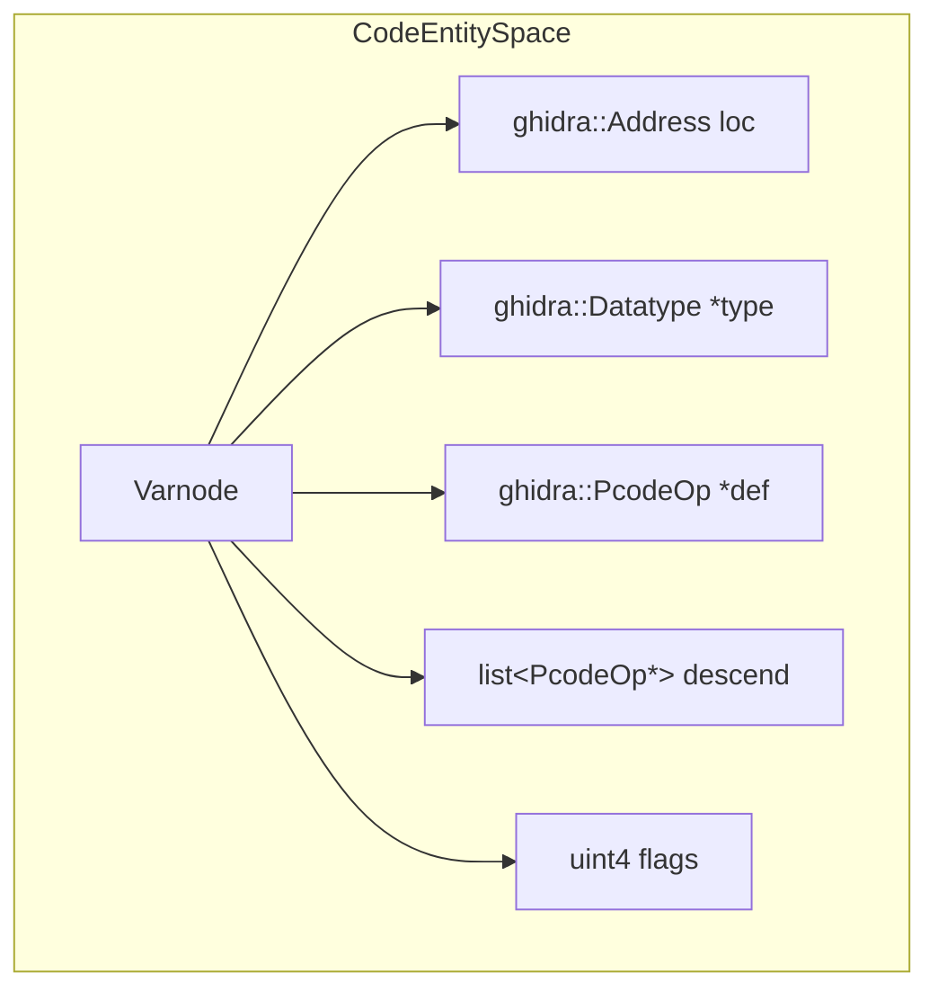
Sources: [Ghidra/Features/Decompiler/src/decompile/cpp/funcdata_varnode.cc:25-42](), [Ghidra/Features/Decompiler/src/decompile/cpp/funcdata.hh:92]()

### PcodeOp Representation

A `PcodeOp` represents an atomic operation within the function data-flow graph.

**Core Properties:**
*   **Opcode (`OpCode`)**: The primitive operation type (e.g., `CPUI_INT_ADD`, `CPUI_LOAD`, `CPUI_BRANCH`) [Ghidra/Features/Decompiler/src/decompile/cpp/ruleaction.cc:28-40]().
*   **Inputs (`vector<Varnode*>`)**: Operands consumed by the operation [Ghidra/Features/Decompiler/src/decompile/cpp/ruleaction.cc:137]().
*   **Output (`Varnode*`)**: Value produced by the operation (if any) [Ghidra/Features/Decompiler/src/decompile/cpp/ruleaction.cc:51]().
*   **Parent Block (`BlockBasic*`)**: Basic block containing the operation [Ghidra/Features/Decompiler/src/decompile/cpp/funcdata.hh:121]().

Sources: [Ghidra/Features/Decompiler/src/decompile/cpp/funcdata.hh:93](), [Ghidra/Features/Decompiler/src/decompile/cpp/ruleaction.cc:25-42]()

---

## The Action/Rule Transformation Framework

Incremental code simplification is driven by the `Action` and `Rule` framework. An `Action` manages an entire analysis pass or group of transformations, while a `Rule` implements targeted, localized pattern-matching rewrites on individual `PcodeOp` nodes [Ghidra/Features/Decompiler/src/decompile/cpp/ruleaction.hh:16-24]().

### Transformation Architecture

Natural Language Space to Code Entity Space mapping for the optimization rules:
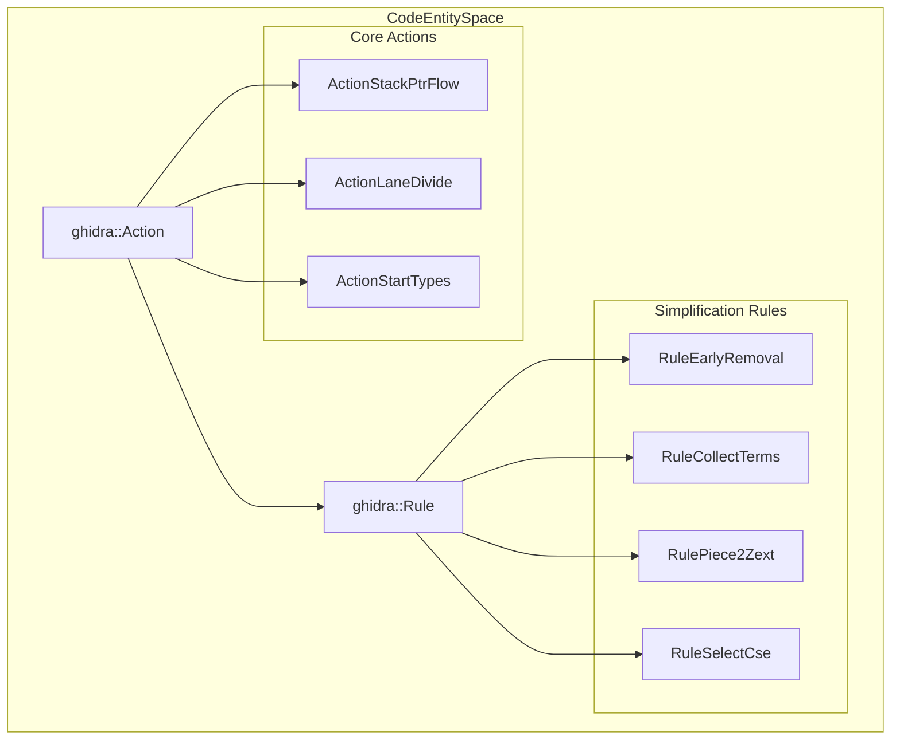
Sources: [Ghidra/Features/Decompiler/src/decompile/cpp/ruleaction.hh:85-142](), [Ghidra/Features/Decompiler/src/decompile/cpp/coreaction.hh:34-123]()

### Representative Rules and Solvers

*   **`StackSolver` (`coreaction.cc`)**: Solves systems of stack-pointer equations across unknown sub-functions to normalize stack-relative accesses [Ghidra/Features/Decompiler/src/decompile/cpp/coreaction.cc:34-51]().
*   **`RuleEarlyRemoval` (`ruleaction.cc`)**: Eliminates unused `PcodeOp` instructions whose output Varnode has no descendants and is not persistent [Ghidra/Features/Decompiler/src/decompile/cpp/ruleaction.cc:23-63]().
*   **`RuleCollectTerms` (`ruleaction.cc`)**: Combines additive terms in expressions, rewriting patterns such as `V * c + V * d` into `V * (c + d)` [Ghidra/Features/Decompiler/src/decompile/cpp/ruleaction.cc:89-166]().
*   **`SubvariableFlow` (`subflow.hh`)**: Analyzes truncated sub-variable usage (e.g., 8-bit or 16-bit operations within a 32-bit register) to split and optimize data flow [Ghidra/Features/Decompiler/src/decompile/cpp/subflow.cc:26-36]().

Sources: [Ghidra/Features/Decompiler/src/decompile/cpp/coreaction.cc:34-51](), [Ghidra/Features/Decompiler/src/decompile/cpp/ruleaction.cc:23-166](), [Ghidra/Features/Decompiler/src/decompile/cpp/subflow.cc:26-53]()

---

## Progression from Low-Level P-code to High-Level Code Structures

The complete decompilation pipeline executes a structured progression from raw semantics to readable C code:

1.  **Translation & Disassembly**: Raw machine instructions are translated into raw P-code via Sleigh architecture definitions.
2.  **Basic Block Construction**: Control flow graph (`BlockGraph`) generation establishes basic blocks (`BlockBasic`) and branching edges [Ghidra/Features/Decompiler/src/decompile/cpp/funcdata.hh:94-95]().
3.  **SSA Form Construction**: The `Heritage` system inserts `CPUI_MULTIEQUAL` (phi-nodes) and tracks variable definitions across static single assignment form [Ghidra/Features/Decompiler/src/decompile/cpp/heritage.cc:33-70]().
4.  **Simplification and Type Propagation**: Actions and rules iteratively simplify expressions, resolve stack pointers, propagate data types (`Datatype`), and resolve composite structures [Ghidra/Features/Decompiler/src/decompile/cpp/type.cc:128-141]().
5.  **Control Flow Structuring & Emission**: Unstructured control flow is structured into high-level loops (`while`, `for`) and conditionals (`if/else`), followed by pretty-printing and source emission [Ghidra/Features/Decompiler/src/decompile/cpp/funcdata.hh:95]().

Sources: [Ghidra/Features/Decompiler/src/decompile/cpp/funcdata.hh:56-130](), [Ghidra/Features/Decompiler/src/decompile/cpp/heritage.cc:33-98](), [Ghidra/Features/Decompiler/src/decompile/cpp/type.cc:128-141]()

---

# Page: Actions and Rules System

# Actions and Rules System

<details>
<summary>Relevant source files</summary>

The following files were used as context for generating this wiki page:

- [Ghidra/Features/Decompiler/certification.manifest](Ghidra/Features/Decompiler/certification.manifest)
- [Ghidra/Features/Decompiler/src/decompile/cpp/cast.cc](Ghidra/Features/Decompiler/src/decompile/cpp/cast.cc)
- [Ghidra/Features/Decompiler/src/decompile/cpp/cast.hh](Ghidra/Features/Decompiler/src/decompile/cpp/cast.hh)
- [Ghidra/Features/Decompiler/src/decompile/cpp/coreaction.cc](Ghidra/Features/Decompiler/src/decompile/cpp/coreaction.cc)
- [Ghidra/Features/Decompiler/src/decompile/cpp/coreaction.hh](Ghidra/Features/Decompiler/src/decompile/cpp/coreaction.hh)
- [Ghidra/Features/Decompiler/src/decompile/cpp/cover.cc](Ghidra/Features/Decompiler/src/decompile/cpp/cover.cc)
- [Ghidra/Features/Decompiler/src/decompile/cpp/cover.hh](Ghidra/Features/Decompiler/src/decompile/cpp/cover.hh)
- [Ghidra/Features/Decompiler/src/decompile/cpp/database.cc](Ghidra/Features/Decompiler/src/decompile/cpp/database.cc)
- [Ghidra/Features/Decompiler/src/decompile/cpp/database.hh](Ghidra/Features/Decompiler/src/decompile/cpp/database.hh)
- [Ghidra/Features/Decompiler/src/decompile/cpp/database_ghidra.cc](Ghidra/Features/Decompiler/src/decompile/cpp/database_ghidra.cc)
- [Ghidra/Features/Decompiler/src/decompile/cpp/database_ghidra.hh](Ghidra/Features/Decompiler/src/decompile/cpp/database_ghidra.hh)
- [Ghidra/Features/Decompiler/src/decompile/cpp/double.cc](Ghidra/Features/Decompiler/src/decompile/cpp/double.cc)
- [Ghidra/Features/Decompiler/src/decompile/cpp/double.hh](Ghidra/Features/Decompiler/src/decompile/cpp/double.hh)
- [Ghidra/Features/Decompiler/src/decompile/cpp/fspec.cc](Ghidra/Features/Decompiler/src/decompile/cpp/fspec.cc)
- [Ghidra/Features/Decompiler/src/decompile/cpp/fspec.hh](Ghidra/Features/Decompiler/src/decompile/cpp/fspec.hh)
- [Ghidra/Features/Decompiler/src/decompile/cpp/funcdata.cc](Ghidra/Features/Decompiler/src/decompile/cpp/funcdata.cc)
- [Ghidra/Features/Decompiler/src/decompile/cpp/funcdata.hh](Ghidra/Features/Decompiler/src/decompile/cpp/funcdata.hh)
- [Ghidra/Features/Decompiler/src/decompile/cpp/funcdata_op.cc](Ghidra/Features/Decompiler/src/decompile/cpp/funcdata_op.cc)
- [Ghidra/Features/Decompiler/src/decompile/cpp/funcdata_varnode.cc](Ghidra/Features/Decompiler/src/decompile/cpp/funcdata_varnode.cc)
- [Ghidra/Features/Decompiler/src/decompile/cpp/grammar.cc](Ghidra/Features/Decompiler/src/decompile/cpp/grammar.cc)
- [Ghidra/Features/Decompiler/src/decompile/cpp/grammar.y](Ghidra/Features/Decompiler/src/decompile/cpp/grammar.y)
- [Ghidra/Features/Decompiler/src/decompile/cpp/heritage.cc](Ghidra/Features/Decompiler/src/decompile/cpp/heritage.cc)
- [Ghidra/Features/Decompiler/src/decompile/cpp/heritage.hh](Ghidra/Features/Decompiler/src/decompile/cpp/heritage.hh)
- [Ghidra/Features/Decompiler/src/decompile/cpp/ifacedecomp.cc](Ghidra/Features/Decompiler/src/decompile/cpp/ifacedecomp.cc)
- [Ghidra/Features/Decompiler/src/decompile/cpp/ifacedecomp.hh](Ghidra/Features/Decompiler/src/decompile/cpp/ifacedecomp.hh)
- [Ghidra/Features/Decompiler/src/decompile/cpp/merge.cc](Ghidra/Features/Decompiler/src/decompile/cpp/merge.cc)
- [Ghidra/Features/Decompiler/src/decompile/cpp/merge.hh](Ghidra/Features/Decompiler/src/decompile/cpp/merge.hh)
- [Ghidra/Features/Decompiler/src/decompile/cpp/op.cc](Ghidra/Features/Decompiler/src/decompile/cpp/op.cc)
- [Ghidra/Features/Decompiler/src/decompile/cpp/op.hh](Ghidra/Features/Decompiler/src/decompile/cpp/op.hh)
- [Ghidra/Features/Decompiler/src/decompile/cpp/ruleaction.cc](Ghidra/Features/Decompiler/src/decompile/cpp/ruleaction.cc)
- [Ghidra/Features/Decompiler/src/decompile/cpp/ruleaction.hh](Ghidra/Features/Decompiler/src/decompile/cpp/ruleaction.hh)
- [Ghidra/Features/Decompiler/src/decompile/cpp/subflow.cc](Ghidra/Features/Decompiler/src/decompile/cpp/subflow.cc)
- [Ghidra/Features/Decompiler/src/decompile/cpp/subflow.hh](Ghidra/Features/Decompiler/src/decompile/cpp/subflow.hh)
- [Ghidra/Features/Decompiler/src/decompile/cpp/transform.cc](Ghidra/Features/Decompiler/src/decompile/cpp/transform.cc)
- [Ghidra/Features/Decompiler/src/decompile/cpp/transform.hh](Ghidra/Features/Decompiler/src/decompile/cpp/transform.hh)
- [Ghidra/Features/Decompiler/src/decompile/cpp/type.cc](Ghidra/Features/Decompiler/src/decompile/cpp/type.cc)
- [Ghidra/Features/Decompiler/src/decompile/cpp/type.hh](Ghidra/Features/Decompiler/src/decompile/cpp/type.hh)
- [Ghidra/Features/Decompiler/src/decompile/cpp/typeop.cc](Ghidra/Features/Decompiler/src/decompile/cpp/typeop.cc)
- [Ghidra/Features/Decompiler/src/decompile/cpp/typeop.hh](Ghidra/Features/Decompiler/src/decompile/cpp/typeop.hh)
- [Ghidra/Features/Decompiler/src/decompile/cpp/variable.cc](Ghidra/Features/Decompiler/src/decompile/cpp/variable.cc)
- [Ghidra/Features/Decompiler/src/decompile/cpp/variable.hh](Ghidra/Features/Decompiler/src/decompile/cpp/variable.hh)
- [Ghidra/Features/Decompiler/src/decompile/cpp/varmap.cc](Ghidra/Features/Decompiler/src/decompile/cpp/varmap.cc)
- [Ghidra/Features/Decompiler/src/decompile/cpp/varmap.hh](Ghidra/Features/Decompiler/src/decompile/cpp/varmap.hh)
- [Ghidra/Features/Decompiler/src/decompile/cpp/varnode.cc](Ghidra/Features/Decompiler/src/decompile/cpp/varnode.cc)
- [Ghidra/Features/Decompiler/src/decompile/cpp/varnode.hh](Ghidra/Features/Decompiler/src/decompile/cpp/varnode.hh)
- [Ghidra/Features/Decompiler/src/decompile/datatests/varcross.xml](Ghidra/Features/Decompiler/src/decompile/datatests/varcross.xml)
- [Ghidra/Features/Decompiler/src/main/java/ghidra/app/decompiler/DecompileDebug.java](Ghidra/Features/Decompiler/src/main/java/ghidra/app/decompiler/DecompileDebug.java)
- [Ghidra/Framework/SoftwareModeling/src/main/java/ghidra/program/model/pcode/LocalSymbolMap.java](Ghidra/Framework/SoftwareModeling/src/main/java/ghidra/program/model/pcode/LocalSymbolMap.java)
- [Ghidra/Framework/SoftwareModeling/src/main/java/ghidra/program/model/pcode/PcodeDataTypeManager.java](Ghidra/Framework/SoftwareModeling/src/main/java/ghidra/program/model/pcode/PcodeDataTypeManager.java)

</details>


The Actions and Rules System is the decompiler's core transformation engine that drives incremental code simplification through pattern matching and rewriting. Actions coordinate high-level analysis phases, while Rules perform specific localized transformations on `PcodeOp` and `Varnode` objects. This system applies transformations repeatedly until convergence, progressively simplifying the intermediate representation into high-level code constructs.

For information about the overall decompilation pipeline, see **Core Decompilation Process (2.1)**. For details on SSA form construction that Actions operate on, see **SSA Construction and Data Flow (2.4)**.

Sources: [Ghidra/Features/Decompiler/src/decompile/cpp/coreaction.hh:34-123](), [Ghidra/Features/Decompiler/src/decompile/cpp/ruleaction.hh:86-143]()

## System Architecture

The Actions and Rules System operates on the function's p-code intermediate representation (`ghidra::Funcdata`), applying transformations through two complementary mechanisms:

**Actions** - High-level analysis phases that coordinate complex transformations across the entire function (`ghidra::Action`). Examples include stack pointer flow analysis, dead code elimination, and control flow structuring.

**Rules** - Localized pattern-matching transformations that operate on individual `ghidra::PcodeOp` instances (`ghidra::Rule`). Rules identify specific data-flow patterns and rewrite them into simpler or more canonical forms. Examples include constant folding, algebraic simplification, and operator normalization.

Both Actions and Rules share a common framework that tracks whether changes were made (via a `count` field) and can be grouped into phases that execute repeatedly until no further transformations occur.

Title: Actions and Rules Framework Architecture
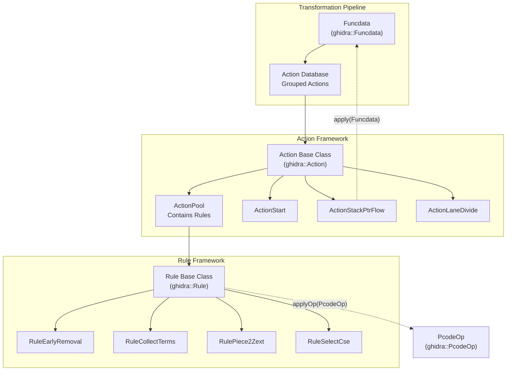

Sources: [Ghidra/Features/Decompiler/src/decompile/cpp/coreaction.hh:34-123](), [Ghidra/Features/Decompiler/src/decompile/cpp/ruleaction.hh:86-143]()

## Action Base Class

The `ghidra::Action` class serves as the foundation for all transformations. Each Action has a unique name, belongs to a named group, and tracks how many times it successfully modified the function.

| Property | Type | Purpose |
|----------|------|---------|
| `name` | string | Unique identifier for the Action |
| `group` | string | Group membership for phased execution |
| `count` | int4 | Number of times Action made changes |
| `flags` | uint4 | Behavioral flags (e.g., `rule_onceperfunc`) |

Key methods:

- **`apply(Funcdata &data)`**: Execute the transformation on the function. Returns 0 normally, non-zero to signal restart or other control flow [Ghidra/Features/Decompiler/src/decompile/cpp/coreaction.hh:41-42]().
- **`reset(Funcdata &data)`**: Reset internal state before a new analysis pass [Ghidra/Features/Decompiler/src/decompile/cpp/coreaction.hh:77-77]().
- **`clone(ActionGroupList &grouplist)`**: Create a copy of the Action for a specific group configuration [Ghidra/Features/Decompiler/src/decompile/cpp/coreaction.hh:37-40]().

The `count` field is critical for the convergence model: when an Action successfully transforms something, it increments `count`, signaling that another round of analysis may be needed.

Sources: [Ghidra/Features/Decompiler/src/decompile/cpp/coreaction.hh:34-51](), [Ghidra/Features/Decompiler/src/decompile/cpp/ruleaction.hh:86-95]()

## Rule Base Class

The `ghidra::Rule` class extends `ghidra::Action` to provide pattern-matching transformations on individual `ghidra::PcodeOp` instances. Rules declare which op-codes they operate on via `getOpList()`, and the transformation engine applies them selectively to matching operations.

**Rule Lifecycle:**

1. Rule registers op-codes of interest via `getOpList()` [Ghidra/Features/Decompiler/src/decompile/cpp/ruleaction.cc:101-105]().
2. Engine iterates through PcodeOps matching those op-codes.
3. For each match, `applyOp(PcodeOp *op, Funcdata &data)` is invoked [Ghidra/Features/Decompiler/src/decompile/cpp/ruleaction.cc:25-44]().
4. Rule examines the data-flow pattern and decides whether to transform.
5. If transformed, returns 1 (incrementing `count`), otherwise returns 0.

**Key Rule Methods:**

- `virtual void getOpList(vector<uint4> &oplist) const`: Populates `oplist` with `CPUI_*` op-codes this Rule handles [Ghidra/Features/Decompiler/src/decompile/cpp/ruleaction.hh:110-110]().
- `virtual int4 applyOp(PcodeOp *op, Funcdata &data)`: Attempts to transform the given op. Returns 1 if successful, 0 otherwise [Ghidra/Features/Decompiler/src/decompile/cpp/ruleaction.cc:25-44]().

Sources: [Ghidra/Features/Decompiler/src/decompile/cpp/ruleaction.hh:86-95](), [Ghidra/Features/Decompiler/src/decompile/cpp/ruleaction.cc:23-44]()

## ActionPool and Rule Execution

The `ghidra::ActionPool` class groups multiple Rules together and applies them to matching PcodeOps. This is the primary mechanism for executing Rules.

Title: ActionPool Rule Application Model
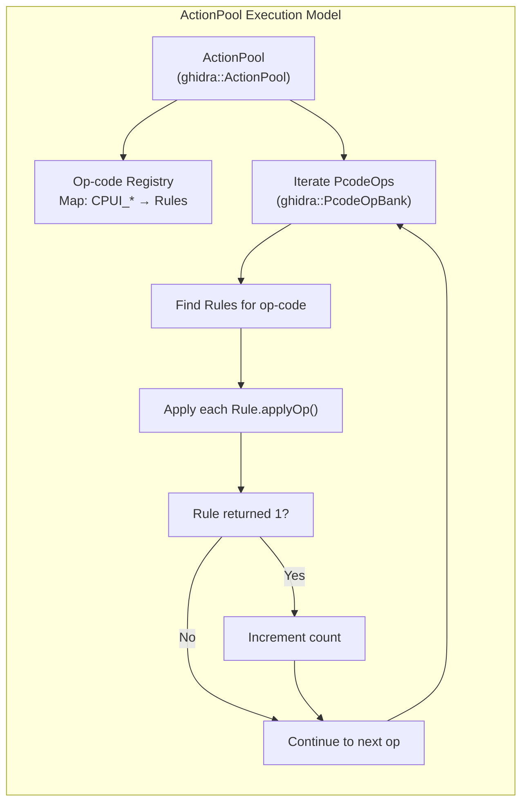

When an `ActionPool` executes:

1. Iterates through all PcodeOps in the function via `ghidra::PcodeOpBank` [Ghidra/Features/Decompiler/src/decompile/cpp/funcdata.hh:93-93]().
2. For each op, looks up Rules registered for that op-code.
3. Applies each matching Rule in sequence.
4. If any Rule returns 1, increments the pool's `count`.
5. Continues until all ops are processed.

This model allows hundreds of Rules to be active simultaneously, each watching for its specific pattern. The pool automatically routes ops to relevant Rules without the Rules needing to scan the entire function [Ghidra/Features/Decompiler/src/decompile/cpp/ruleaction.hh:16-23]().

Sources: [Ghidra/Features/Decompiler/src/decompile/cpp/ruleaction.hh:16-23](), [Ghidra/Features/Decompiler/src/decompile/cpp/ruleaction.cc:25-44]()

## Core Action Examples

### ActionStackPtrFlow

Analyzes stack pointer changes across sub-function calls. When the extra pop amount for a function call is unknown, this Action builds a system of linear equations tracking stack pointer flow and solves for the unknown values.

**Key Components:**

- **`ghidra::StackSolver`**: Builds and solves linear equations for stack pointer values [Ghidra/Features/Decompiler/src/decompile/cpp/coreaction.cc:34-51]().
- **`StackEqn`**: Represents one equation: `var1 - var2 = rhs` [Ghidra/Features/Decompiler/src/decompile/cpp/coreaction.cc:26-31]().
- **`propagate()`**: Propagates solutions through the equation system [Ghidra/Features/Decompiler/src/decompile/cpp/coreaction.cc:68-95]().

The algorithm:
1. Collects all stack pointer Varnodes as variables via `StackSolver::build()` [Ghidra/Features/Decompiler/src/decompile/cpp/coreaction.cc:148-210]().
2. Examines their defining ops (`CPUI_INT_ADD`, `CPUI_COPY`, `CPUI_INDIRECT`, `CPUI_MULTIEQUAL`).
3. Builds equations based on these relationships [Ghidra/Features/Decompiler/src/decompile/cpp/coreaction.cc:176-200]().
4. Solves the system to determine stack pointer changes using `StackSolver::solve()` [Ghidra/Features/Decompiler/src/decompile/cpp/coreaction.cc:113-141]().
5. Updates `ghidra::FuncCallSpecs` with resolved extra pop amounts.

Title: ActionStackPtrFlow Analysis Process
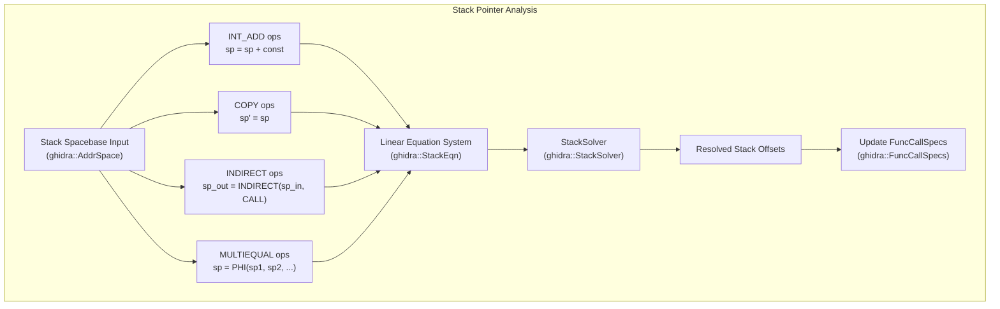

Sources: [Ghidra/Features/Decompiler/src/decompile/cpp/coreaction.cc:24-210](), [Ghidra/Features/Decompiler/src/decompile/cpp/coreaction.hh:88-100]()

### ActionLaneDivide

Finds Varnodes with a vectorized lane scheme and attempts to split the lanes into explicit Varnodes. This is used for processors with SIMD registers.

**Algorithm:**

1. Examines Varnodes matching laned register specifications [Ghidra/Features/Decompiler/src/decompile/cpp/coreaction.hh:114-115]().
2. Identifies potential lane widths based on `CPUI_PIECE`/`CPUI_SUBPIECE` ops.
3. Verifies divisibility across the data-flow graph.
4. Transforms the data-flow by splitting ops into parallel lane operations via `ActionLaneDivide::processVarnode()` [Ghidra/Features/Decompiler/src/decompile/cpp/coreaction.hh:115-115]().

Sources: [Ghidra/Features/Decompiler/src/decompile/cpp/coreaction.hh:107-123](), [Ghidra/Features/Decompiler/src/decompile/cpp/funcdata.hh:78-79]()

## Representative Rules

### RuleEarlyRemoval

Removes `ghidra::PcodeOp` objects whose output is unused and has no side effects. This is a fundamental dead code elimination rule.

**Conditions for removal [Ghidra/Features/Decompiler/src/decompile/cpp/ruleaction.cc:25-44]():**

- Op is not a call (`isCall()`).
- Op is not an indirect source (`isIndirectSource()`).
- Op has an output Varnode.
- Output has no descendants (`hasNoDescend()`).
- Output is not marked as auto-live (`isAutoLive()`).
- Output's address space permits dead code removal via `doesDeadcode()` [Ghidra/Features/Decompiler/src/decompile/cpp/ruleaction.cc:38-38]().

Sources: [Ghidra/Features/Decompiler/src/decompile/cpp/ruleaction.cc:23-44](), [Ghidra/Features/Decompiler/src/decompile/cpp/ruleaction.hh:86-95]()

### RuleCollectTerms

Collects terms in additive expressions to combine like terms: `V * c + V * d => V * (c + d)`.

**Algorithm [Ghidra/Features/Decompiler/src/decompile/cpp/ruleaction.cc:107-176]():**

1. Identifies the root of an `INT_ADD` tree.
2. Uses `TermOrder` to collect and sort all additive terms [Ghidra/Features/Decompiler/src/decompile/cpp/ruleaction.cc:114-116]().
3. Scans for adjacent terms with the same base Varnode using `getMultCoeff()` [Ghidra/Features/Decompiler/src/decompile/cpp/ruleaction.cc:82-97]().
4. If found, combines their multiplicative coefficients.
5. Also combines multiple constant terms into one [Ghidra/Features/Decompiler/src/decompile/cpp/ruleaction.cc:156-173]().

Sources: [Ghidra/Features/Decompiler/src/decompile/cpp/ruleaction.cc:82-176](), [Ghidra/Features/Decompiler/src/decompile/cpp/ruleaction.hh:102-112]()

### RuleSelectCse

Look for common sub-expressions (CSE) built out of a restricted set of ops like `CPUI_SUBPIECE`.

**Detection Strategy [Ghidra/Features/Decompiler/src/decompile/cpp/ruleaction.cc:187-209]():**

1. Iterates through descendants of a Varnode via `beginDescend()` [Ghidra/Features/Decompiler/src/decompile/cpp/ruleaction.cc:198-198]().
2. Compares op-codes and calculates a CSE hash via `getCseHash()` [Ghidra/Features/Decompiler/src/decompile/cpp/ruleaction.cc:201-201]().
3. Invokes `Funcdata::cseEliminateList()` to perform removal of redundant ops [Ghidra/Features/Decompiler/src/decompile/cpp/ruleaction.cc:206-206]().

Sources: [Ghidra/Features/Decompiler/src/decompile/cpp/ruleaction.cc:178-209](), [Ghidra/Features/Decompiler/src/decompile/cpp/ruleaction.hh:113-122]()

## Subvariable Flow Transformation

The `ghidra::SubvariableFlow` class implements a sophisticated analysis for extracting logical sub-variables from larger storage locations.

Title: SubvariableFlow Transformation Process
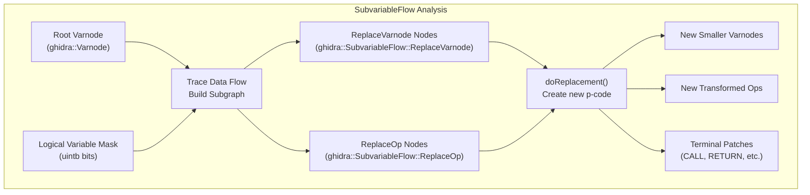

**Algorithm Overview:**

1. **Initialization**: Given a root Varnode and bit mask, identify the logical variable via `setReplacement()` [Ghidra/Features/Decompiler/src/decompile/cpp/subflow.cc:66-151]().
2. **Trace Forward**: Follow data-flow through operations, building a subgraph using `createOp()` [Ghidra/Features/Decompiler/src/decompile/cpp/subflow.cc:159-173]().
3. **Trace Backward**: Follow data-flow to definitions using `createOpDown()` [Ghidra/Features/Decompiler/src/decompile/cpp/subflow.cc:184-197]().
4. **Validation**: Checks if constants are sign-extended correctly if restrictions apply [Ghidra/Features/Decompiler/src/decompile/cpp/subflow.cc:82-89]().
5. **Replacement**: Create new smaller Varnodes and transformed operations via `doReplacement()`.

Sources: [Ghidra/Features/Decompiler/src/decompile/cpp/subflow.cc:16-197](), [Ghidra/Features/Decompiler/src/decompile/cpp/subflow.hh:26-215]()

## Specialized Action Categories

### Pointer and Address Analysis

`ghidra::AddTreeState` analyzes additive expression trees involving pointers to normalize access to structures and arrays.

| Component | Role |
|-----------|------|
| `ptr` | The base pointer Varnode [Ghidra/Features/Decompiler/src/decompile/cpp/ruleaction.hh:47]() |
| `baseType` | The data-type being pointed at [Ghidra/Features/Decompiler/src/decompile/cpp/ruleaction.hh:49]() |
| `multiple` | Terms that are multiples of the base type size [Ghidra/Features/Decompiler/src/decompile/cpp/ruleaction.hh:58]() |
| `offset` | Constant bytes digging into the base type [Ghidra/Features/Decompiler/src/decompile/cpp/ruleaction.hh:56]() |

This transforms low-level pointer arithmetic into high-level `CPUI_PTRADD` and `CPUI_PTRSUB` operations [Ghidra/Features/Decompiler/src/decompile/cpp/ruleaction.hh:41-42]().

Sources: [Ghidra/Features/Decompiler/src/decompile/cpp/ruleaction.hh:32-84]()

## Summary of Key Classes and Their Roles

| Class | Role | Key Method |
|-------|------|------------|
| `ghidra::Action` | Base transformation class | `apply(Funcdata &data)` |
| `ghidra::Rule` | Pattern-matching transformation on ops | `applyOp(PcodeOp *op, Funcdata &data)` |
| `ghidra::StackSolver` | Stack pointer flow analysis | `solve()` |
| `ghidra::SubvariableFlow` | Extract logical sub-variables | `setReplacement()` |
| `ghidra::AddTreeState` | Pointer arithmetic analysis | `apply()` |
| `ghidra::RuleEarlyRemoval` | Dead code elimination | `applyOp()` |
| `ghidra::RuleCollectTerms` | Combine like terms in sums | `applyOp()` |
| `ghidra::RuleSelectCse` | Common subexpression elimination | `applyOp()` |

Sources: [Ghidra/Features/Decompiler/src/decompile/cpp/coreaction.hh:34-168](), [Ghidra/Features/Decompiler/src/decompile/cpp/ruleaction.hh:86-143](), [Ghidra/Features/Decompiler/src/decompile/cpp/subflow.hh:26-215]()

---

# Page: Type System and Propagation

# Type System and Propagation

<details>
<summary>Relevant source files</summary>

The following files were used as context for generating this wiki page:

- [Ghidra/Features/Decompiler/certification.manifest](Ghidra/Features/Decompiler/certification.manifest)
- [Ghidra/Features/Decompiler/src/decompile/cpp/cast.cc](Ghidra/Features/Decompiler/src/decompile/cpp/cast.cc)
- [Ghidra/Features/Decompiler/src/decompile/cpp/cast.hh](Ghidra/Features/Decompiler/src/decompile/cpp/cast.hh)
- [Ghidra/Features/Decompiler/src/decompile/cpp/coreaction.cc](Ghidra/Features/Decompiler/src/decompile/cpp/coreaction.cc)
- [Ghidra/Features/Decompiler/src/decompile/cpp/coreaction.hh](Ghidra/Features/Decompiler/src/decompile/cpp/coreaction.hh)
- [Ghidra/Features/Decompiler/src/decompile/cpp/cover.cc](Ghidra/Features/Decompiler/src/decompile/cpp/cover.cc)
- [Ghidra/Features/Decompiler/src/decompile/cpp/cover.hh](Ghidra/Features/Decompiler/src/decompile/cpp/cover.hh)
- [Ghidra/Features/Decompiler/src/decompile/cpp/database.cc](Ghidra/Features/Decompiler/src/decompile/cpp/database.cc)
- [Ghidra/Features/Decompiler/src/decompile/cpp/database.hh](Ghidra/Features/Decompiler/src/decompile/cpp/database.hh)
- [Ghidra/Features/Decompiler/src/decompile/cpp/database_ghidra.cc](Ghidra/Features/Decompiler/src/decompile/cpp/database_ghidra.cc)
- [Ghidra/Features/Decompiler/src/decompile/cpp/database_ghidra.hh](Ghidra/Features/Decompiler/src/decompile/cpp/database_ghidra.hh)
- [Ghidra/Features/Decompiler/src/decompile/cpp/double.cc](Ghidra/Features/Decompiler/src/decompile/cpp/double.cc)
- [Ghidra/Features/Decompiler/src/decompile/cpp/double.hh](Ghidra/Features/Decompiler/src/decompile/cpp/double.hh)
- [Ghidra/Features/Decompiler/src/decompile/cpp/fspec.cc](Ghidra/Features/Decompiler/src/decompile/cpp/fspec.cc)
- [Ghidra/Features/Decompiler/src/decompile/cpp/fspec.hh](Ghidra/Features/Decompiler/src/decompile/cpp/fspec.hh)
- [Ghidra/Features/Decompiler/src/decompile/cpp/funcdata.cc](Ghidra/Features/Decompiler/src/decompile/cpp/funcdata.cc)
- [Ghidra/Features/Decompiler/src/decompile/cpp/funcdata.hh](Ghidra/Features/Decompiler/src/decompile/cpp/funcdata.hh)
- [Ghidra/Features/Decompiler/src/decompile/cpp/funcdata_op.cc](Ghidra/Features/Decompiler/src/decompile/cpp/funcdata_op.cc)
- [Ghidra/Features/Decompiler/src/decompile/cpp/funcdata_varnode.cc](Ghidra/Features/Decompiler/src/decompile/cpp/funcdata_varnode.cc)
- [Ghidra/Features/Decompiler/src/decompile/cpp/grammar.cc](Ghidra/Features/Decompiler/src/decompile/cpp/grammar.cc)
- [Ghidra/Features/Decompiler/src/decompile/cpp/grammar.y](Ghidra/Features/Decompiler/src/decompile/cpp/grammar.y)
- [Ghidra/Features/Decompiler/src/decompile/cpp/heritage.cc](Ghidra/Features/Decompiler/src/decompile/cpp/heritage.cc)
- [Ghidra/Features/Decompiler/src/decompile/cpp/heritage.hh](Ghidra/Features/Decompiler/src/decompile/cpp/heritage.hh)
- [Ghidra/Features/Decompiler/src/decompile/cpp/ifacedecomp.cc](Ghidra/Features/Decompiler/src/decompile/cpp/ifacedecomp.cc)
- [Ghidra/Features/Decompiler/src/decompile/cpp/ifacedecomp.hh](Ghidra/Features/Decompiler/src/decompile/cpp/ifacedecomp.hh)
- [Ghidra/Features/Decompiler/src/decompile/cpp/merge.cc](Ghidra/Features/Decompiler/src/decompile/cpp/merge.cc)
- [Ghidra/Features/Decompiler/src/decompile/cpp/merge.hh](Ghidra/Features/Decompiler/src/decompile/cpp/merge.hh)
- [Ghidra/Features/Decompiler/src/decompile/cpp/op.cc](Ghidra/Features/Decompiler/src/decompile/cpp/op.cc)
- [Ghidra/Features/Decompiler/src/decompile/cpp/op.hh](Ghidra/Features/Decompiler/src/decompile/cpp/op.hh)
- [Ghidra/Features/Decompiler/src/decompile/cpp/ruleaction.cc](Ghidra/Features/Decompiler/src/decompile/cpp/ruleaction.cc)
- [Ghidra/Features/Decompiler/src/decompile/cpp/ruleaction.hh](Ghidra/Features/Decompiler/src/decompile/cpp/ruleaction.hh)
- [Ghidra/Features/Decompiler/src/decompile/cpp/subflow.cc](Ghidra/Features/Decompiler/src/decompile/cpp/subflow.cc)
- [Ghidra/Features/Decompiler/src/decompile/cpp/subflow.hh](Ghidra/Features/Decompiler/src/decompile/cpp/subflow.hh)
- [Ghidra/Features/Decompiler/src/decompile/cpp/transform.cc](Ghidra/Features/Decompiler/src/decompile/cpp/transform.cc)
- [Ghidra/Features/Decompiler/src/decompile/cpp/transform.hh](Ghidra/Features/Decompiler/src/decompile/cpp/transform.hh)
- [Ghidra/Features/Decompiler/src/decompile/cpp/type.cc](Ghidra/Features/Decompiler/src/decompile/cpp/type.cc)
- [Ghidra/Features/Decompiler/src/decompile/cpp/type.hh](Ghidra/Features/Decompiler/src/decompile/cpp/type.hh)
- [Ghidra/Features/Decompiler/src/decompile/cpp/typeop.cc](Ghidra/Features/Decompiler/src/decompile/cpp/typeop.cc)
- [Ghidra/Features/Decompiler/src/decompile/cpp/typeop.hh](Ghidra/Features/Decompiler/src/decompile/cpp/typeop.hh)
- [Ghidra/Features/Decompiler/src/decompile/cpp/variable.cc](Ghidra/Features/Decompiler/src/decompile/cpp/variable.cc)
- [Ghidra/Features/Decompiler/src/decompile/cpp/variable.hh](Ghidra/Features/Decompiler/src/decompile/cpp/variable.hh)
- [Ghidra/Features/Decompiler/src/decompile/cpp/varmap.cc](Ghidra/Features/Decompiler/src/decompile/cpp/varmap.cc)
- [Ghidra/Features/Decompiler/src/decompile/cpp/varmap.hh](Ghidra/Features/Decompiler/src/decompile/cpp/varmap.hh)
- [Ghidra/Features/Decompiler/src/decompile/cpp/varnode.cc](Ghidra/Features/Decompiler/src/decompile/cpp/varnode.cc)
- [Ghidra/Features/Decompiler/src/decompile/cpp/varnode.hh](Ghidra/Features/Decompiler/src/decompile/cpp/varnode.hh)
- [Ghidra/Features/Decompiler/src/decompile/datatests/varcross.xml](Ghidra/Features/Decompiler/src/decompile/datatests/varcross.xml)
- [Ghidra/Features/Decompiler/src/main/java/ghidra/app/decompiler/DecompileDebug.java](Ghidra/Features/Decompiler/src/main/java/ghidra/app/decompiler/DecompileDebug.java)
- [Ghidra/Framework/SoftwareModeling/src/main/java/ghidra/program/model/pcode/LocalSymbolMap.java](Ghidra/Framework/SoftwareModeling/src/main/java/ghidra/program/model/pcode/LocalSymbolMap.java)
- [Ghidra/Framework/SoftwareModeling/src/main/java/ghidra/program/model/pcode/PcodeDataTypeManager.java](Ghidra/Framework/SoftwareModeling/src/main/java/ghidra/program/model/pcode/PcodeDataTypeManager.java)

</details>


This document describes the decompiler's type recovery system, including the `Datatype` class hierarchy, type inference mechanisms, and how data-types are propagated through `Varnode` objects during analysis. For information about the overall decompilation process and Actions framework, see [Core Decompilation Process](2.1). For details on SSA construction which enables type propagation, see [SSA Construction and Data Flow](2.4).

## Overview

The decompiler's type system serves two primary functions:
1. **Representation**: The `Datatype` class hierarchy models C-like data-types including primitives, pointers, arrays, structures, and unions [Ghidra/Features/Decompiler/src/decompile/cpp/type.hh:80-100]().
2. **Inference**: Type information is propagated through the data-flow graph to recover high-level variable types from low-level operations [Ghidra/Features/Decompiler/src/decompile/cpp/typeop.cc:20-50]().

Type propagation operates on `Varnode` objects (which represent storage locations and values) and uses the SSA form of the function to trace how types flow through operations. Each `PcodeOp` has an associated `TypeOp` that defines type propagation rules for that operation [Ghidra/Features/Decompiler/src/decompile/cpp/typeop.hh:20-100]().

Sources: [Ghidra/Features/Decompiler/src/decompile/cpp/type.hh:1-100](), [Ghidra/Features/Decompiler/src/decompile/cpp/varnode.hh:1-100]()

## Datatype Class Hierarchy

Title: "Datatype Inheritance and Code Entity Mapping"
```mermaid
graph TD
    Datatype["Datatype (type.hh)"] --> TypeBase["TypeBase (type.hh)"]
    Datatype --> TypePointer["TypePointer (type.hh)"]
    Datatype --> TypeArray["TypeArray (type.hh)"]
    Datatype --> TypeStruct["TypeStruct (type.hh)"]
    Datatype --> TypeUnion["TypeUnion (type.hh)"]
    Datatype --> TypeCode["TypeCode (type.hh)"]
    Datatype --> TypeSpacebase["TypeSpacebase (type.hh)"]
    Datatype --> TypeEnum["TypeEnum (type.hh)"]
    
    TypeBase --> TypeVoid["TypeVoid (type.hh)"]
    TypeBase --> TypeInt["TypeInt (type.hh)"]
    TypeBase --> TypeUint["TypeUint (type.hh)"]
    TypeBase --> TypeBool["TypeBool (type.hh)"]
    TypeBase --> TypeFloat["TypeFloat (type.hh)"]
    TypeBase --> TypeUnknown["TypeUnknown (type.hh)"]
    
    TypePointer --> TypePointerRel["TypePointerRel (type.hh)"]
    TypeStruct --> TypePartialStruct["TypePartialStruct (type.hh)"]
    TypeUnion --> TypePartialUnion["TypePartialUnion (type.hh)"]
    TypeEnum --> TypeEnumInt["TypeEnumInt (type.hh)"]
    TypeEnum --> TypeEnumUint["TypeEnumUint (type.hh)"]
```

The `Datatype` base class provides common functionality for all types:
- **Size and alignment**: `size` field and `alignment` required for the type [Ghidra/Features/Decompiler/src/decompile/cpp/type.cc:128-141]().
- **Type identity**: 64-bit `id` field for hashing and identity [Ghidra/Features/Decompiler/src/decompile/cpp/type.cc:137]().
- **Meta-type**: `type_metatype metatype` enum (`TYPE_INT`, `TYPE_PTR`, etc.) [Ghidra/Features/Decompiler/src/decompile/cpp/type.hh:80-100]().
- **Sub-metatype**: `sub_metatype submeta` for propagation ordering [Ghidra/Features/Decompiler/src/decompile/cpp/type.cc:135]().
- **Flags**: Boolean properties like `typelock`, `coretype`, and `incomplete` [Ghidra/Features/Decompiler/src/decompile/cpp/type.cc:136]().

Each concrete type extends the base with specialized fields:
- `TypePointer`: Holds `ptrto` (pointed-to type) and optional `spaceid` for address space [Ghidra/Features/Decompiler/src/decompile/cpp/type.hh:90]().
- `TypeArray`: Contains `arrayof` (element type) and `arraysize` [Ghidra/Features/Decompiler/src/decompile/cpp/type.hh:92]().
- `TypeStruct` / `TypeUnion`: Maintain component datatypes and offsets [Ghidra/Features/Decompiler/src/decompile/cpp/type.hh:95-96]().
- `TypeEnum`: Maps named constants to integer values [Ghidra/Features/Decompiler/src/decompile/cpp/type.hh:93-94]().

Sources: [Ghidra/Features/Decompiler/src/decompile/cpp/type.hh:80-125](), [Ghidra/Features/Decompiler/src/decompile/cpp/type.cc:23-27](), [Ghidra/Features/Decompiler/src/decompile/cpp/type.cc:128-141]()

## Type Metatypes and Propagation Order

Title: "Metatype to Sub-Metatype Mapping"
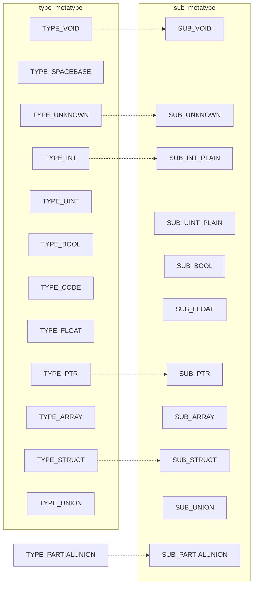

The `type_metatype` enum categorizes types at a high level (int, pointer, struct, etc.) [Ghidra/Features/Decompiler/src/decompile/cpp/type.hh:80-100](), while `sub_metatype` defines a propagation ordering used during type inference [Ghidra/Features/Decompiler/src/decompile/cpp/type.hh:104-125](). The array `Datatype::base2sub[]` maps each metatype to its corresponding sub-metatype [Ghidra/Features/Decompiler/src/decompile/cpp/type.cc:23-27]().

**Propagation Priority**: Higher sub-metatype values represent more specific or restrictive types. During propagation, the decompiler attempts to find the "consensus" type that satisfies all constraints, often favoring the more specific type in the hierarchy [Ghidra/Features/Decompiler/src/decompile/cpp/type.cc:23-27]().

Sources: [Ghidra/Features/Decompiler/src/decompile/cpp/type.cc:23-27](), [Ghidra/Features/Decompiler/src/decompile/cpp/type.hh:80-125]()

## Varnode Type Association

Title: "Varnode Type Resolution Code Entities"
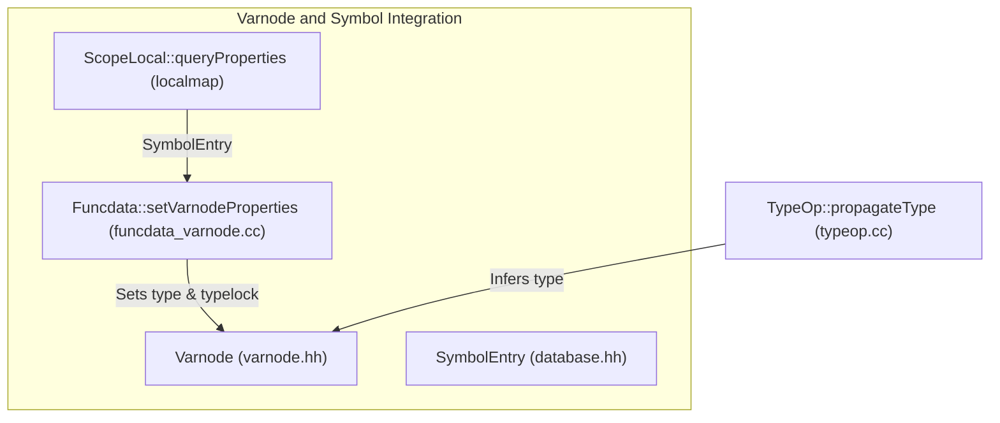

Each `Varnode` has a `Datatype *type` field that holds its current data-type [Ghidra/Features/Decompiler/src/decompile/cpp/varnode.hh:70](). Types are associated via:

1. **Symbol Table**: `Funcdata::setVarnodeProperties()` queries `ScopeLocal` for matching symbols at the Varnode's address and size [Ghidra/Features/Decompiler/src/decompile/cpp/funcdata_varnode.cc:25-36]().
2. **Inference**: `TypeOp::propagateType()` infers types based on the P-code operations consuming or producing the Varnode [Ghidra/Features/Decompiler/src/decompile/cpp/typeop.cc:2500-2700]().
3. **Creation**: When new Varnodes are created (e.g., `newConstant`, `newUnique`), they are assigned a base type based on their size [Ghidra/Features/Decompiler/src/decompile/cpp/funcdata_varnode.cc:68-73]().

The `typelock` flag is used to prevent the inference engine from overriding types that have been explicitly set by the user or the symbol table [Ghidra/Features/Decompiler/src/decompile/cpp/funcdata_varnode.cc:35-36]().

Sources: [Ghidra/Features/Decompiler/src/decompile/cpp/funcdata_varnode.cc:25-120](), [Ghidra/Features/Decompiler/src/decompile/cpp/funcdata.hh:104-109]()

## Type Propagation Pipeline

Type propagation occurs as part of the `Action` execution loop. It relies on the SSA form and fixed-point iteration to resolve types across the function.

1. **Initialization**: `ActionStartTypes` (within the core actions) marks the start of type recovery [Ghidra/Features/Decompiler/src/decompile/cpp/funcdata.hh:63-64]().
2. **Inference Loop**: `ActionInferTypes` repeatedly calls `TypeOp::propagateType()` for all ops in the function [Ghidra/Features/Decompiler/src/decompile/cpp/typeop.cc:2500-2700]().
3. **Forward Propagation**: Input types are used to determine the output type of an operation [Ghidra/Features/Decompiler/src/decompile/cpp/typeop.cc:2500-2600]().
4. **Backward Propagation**: Constraints on the output of an operation are pushed back to the inputs [Ghidra/Features/Decompiler/src/decompile/cpp/typeop.cc:2600-2700]().
5. **Completion**: The process stops when no more type changes occur or the pass limit is reached (`typerecovery_exceeded`) [Ghidra/Features/Decompiler/src/decompile/cpp/funcdata.hh:72]().

Sources: [Ghidra/Features/Decompiler/src/decompile/cpp/funcdata.hh:56-75](), [Ghidra/Features/Decompiler/src/decompile/cpp/typeop.cc:2500-2700]()

## TypeOp Classes and Propagation Rules

Each P-code opcode has a corresponding `TypeOp` instance that implements specific propagation logic [Ghidra/Features/Decompiler/src/decompile/cpp/typeop.hh:20-100]():

| TypeOp Class | Opcode | Propagation Behavior |
|--------------|--------|----------------------|
| `TypeOpCopy` | `CPUI_COPY` | Propagates type directly from input to output and vice versa [Ghidra/Features/Decompiler/src/decompile/cpp/typeop.cc:350-380](). |
| `TypeOpIntAdd`| `CPUI_INT_ADD` | Handles pointer arithmetic; if one input is a pointer, the output is a pointer [Ghidra/Features/Decompiler/src/decompile/cpp/typeop.cc:700-750](). |
| `TypeOpLoad` | `CPUI_LOAD` | Output type is the type pointed to by the input pointer [Ghidra/Features/Decompiler/src/decompile/cpp/typeop.cc:450-500](). |
| `TypeOpPtrAdd`| `CPUI_PTRADD` | Specifically for array indexing; propagates pointer type [Ghidra/Features/Decompiler/src/decompile/cpp/typeop.cc:2100-2150](). |
| `TypeOpPtrSub`| `CPUI_PTRSUB` | Specifically for structure field access; calculates field type based on offset [Ghidra/Features/Decompiler/src/decompile/cpp/typeop.cc:2200-2250](). |

Sources: [Ghidra/Features/Decompiler/src/decompile/cpp/typeop.cc:20-2700](), [Ghidra/Features/Decompiler/src/decompile/cpp/typeop.hh:20-100]()

## Type Merging and Variable Recovery

During analysis, the decompiler must merge `Varnode` objects that represent the same high-level variable. This is handled by the `Merge` class [Ghidra/Features/Decompiler/src/decompile/cpp/merge.cc:1-100]().

- **HighVariable**: A collection of merged `Varnode` objects that share a single data-type and name [Ghidra/Features/Decompiler/src/decompile/cpp/funcdata_varnode.cc:48-61]().
- **Cover**: Tracking the "liveness" of a Varnode to ensure merges don't create overlaps [Ghidra/Features/Decompiler/src/decompile/cpp/funcdata_varnode.cc:38-42]().
- **SubvariableFlow**: A specialized transformation that identifies when a large register is being used as multiple smaller logical variables (e.g., splitting a 64-bit register into 32-bit components) [Ghidra/Features/Decompiler/src/decompile/cpp/subflow.cc:66-151]().

Sources: [Ghidra/Features/Decompiler/src/decompile/cpp/funcdata_varnode.cc:38-61](), [Ghidra/Features/Decompiler/src/decompile/cpp/subflow.cc:66-151](), [Ghidra/Features/Decompiler/src/decompile/cpp/merge.hh:1-50]()

## Union and Field Resolution

The decompiler handles `TYPE_UNION` by tracking which field is accessed at specific points in the data-flow [Ghidra/Features/Decompiler/src/decompile/cpp/funcdata.hh:101-102]().

- **unionMap**: Maps a `ResolveEdge` (a specific data-flow connection) to a `ResolvedUnion` field [Ghidra/Features/Decompiler/src/decompile/cpp/funcdata.hh:101-102]().
- **ActionResolveUnion**: An action that analyzes the data-flow to resolve which union member is most appropriate for a given operation [Ghidra/Features/Decompiler/src/decompile/cpp/funcdata.hh:27]().

Sources: [Ghidra/Features/Decompiler/src/decompile/cpp/funcdata.hh:27-102]()

## Data-Flow and Range Hints

The decompiler uses `RangeHint` to reconcile overlapping memory accesses and suggest structure/array boundaries.

Title: "RangeHint Reconciliation and Type Flow"
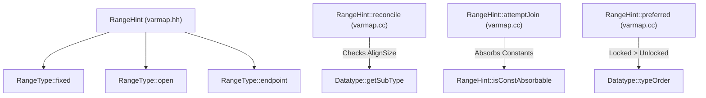

`RangeHint` objects are used during variable recovery to manage how different accesses to the same address range interact [Ghidra/Features/Decompiler/src/decompile/cpp/varmap.hh:1-50]().
- **Reconciliation**: `RangeHint::reconcile` determines if two intersecting hints can coexist based on alignment and sub-type relationships [Ghidra/Features/Decompiler/src/decompile/cpp/varmap.cc:62-103]().
- **Preference**: Locked types (user-defined) always take priority over inferred types [Ghidra/Features/Decompiler/src/decompile/cpp/varmap.cc:134-139]().
- **Constant Absorption**: Primitive types like `TYPE_INT` can "absorb" constant copies even if sizes differ slightly, provided they represent the same logical value [Ghidra/Features/Decompiler/src/decompile/cpp/varmap.cc:30-53]().

Sources: [Ghidra/Features/Decompiler/src/decompile/cpp/varmap.cc:30-200](), [Ghidra/Features/Decompiler/src/decompile/cpp/varmap.hh:1-100]()

---

# Page: SSA Construction and Data Flow

# SSA Construction and Data Flow

<details>
<summary>Relevant source files</summary>

The following files were used as context for generating this wiki page:

- [Ghidra/Features/Decompiler/certification.manifest](Ghidra/Features/Decompiler/certification.manifest)
- [Ghidra/Features/Decompiler/src/decompile/cpp/cast.cc](Ghidra/Features/Decompiler/src/decompile/cpp/cast.cc)
- [Ghidra/Features/Decompiler/src/decompile/cpp/cast.hh](Ghidra/Features/Decompiler/src/decompile/cpp/cast.hh)
- [Ghidra/Features/Decompiler/src/decompile/cpp/coreaction.cc](Ghidra/Features/Decompiler/src/decompile/cpp/coreaction.cc)
- [Ghidra/Features/Decompiler/src/decompile/cpp/coreaction.hh](Ghidra/Features/Decompiler/src/decompile/cpp/coreaction.hh)
- [Ghidra/Features/Decompiler/src/decompile/cpp/cover.cc](Ghidra/Features/Decompiler/src/decompile/cpp/cover.cc)
- [Ghidra/Features/Decompiler/src/decompile/cpp/cover.hh](Ghidra/Features/Decompiler/src/decompile/cpp/cover.hh)
- [Ghidra/Features/Decompiler/src/decompile/cpp/database.cc](Ghidra/Features/Decompiler/src/decompile/cpp/database.cc)
- [Ghidra/Features/Decompiler/src/decompile/cpp/database.hh](Ghidra/Features/Decompiler/src/decompile/cpp/database.hh)
- [Ghidra/Features/Decompiler/src/decompile/cpp/database_ghidra.cc](Ghidra/Features/Decompiler/src/decompile/cpp/database_ghidra.cc)
- [Ghidra/Features/Decompiler/src/decompile/cpp/database_ghidra.hh](Ghidra/Features/Decompiler/src/decompile/cpp/database_ghidra.hh)
- [Ghidra/Features/Decompiler/src/decompile/cpp/double.cc](Ghidra/Features/Decompiler/src/decompile/cpp/double.cc)
- [Ghidra/Features/Decompiler/src/decompile/cpp/double.hh](Ghidra/Features/Decompiler/src/decompile/cpp/double.hh)
- [Ghidra/Features/Decompiler/src/decompile/cpp/fspec.cc](Ghidra/Features/Decompiler/src/decompile/cpp/fspec.cc)
- [Ghidra/Features/Decompiler/src/decompile/cpp/fspec.hh](Ghidra/Features/Decompiler/src/decompile/cpp/fspec.hh)
- [Ghidra/Features/Decompiler/src/decompile/cpp/funcdata.cc](Ghidra/Features/Decompiler/src/decompile/cpp/funcdata.cc)
- [Ghidra/Features/Decompiler/src/decompile/cpp/funcdata.hh](Ghidra/Features/Decompiler/src/decompile/cpp/funcdata.hh)
- [Ghidra/Features/Decompiler/src/decompile/cpp/funcdata_op.cc](Ghidra/Features/Decompiler/src/decompile/cpp/funcdata_op.cc)
- [Ghidra/Features/Decompiler/src/decompile/cpp/funcdata_varnode.cc](Ghidra/Features/Decompiler/src/decompile/cpp/funcdata_varnode.cc)
- [Ghidra/Features/Decompiler/src/decompile/cpp/grammar.cc](Ghidra/Features/Decompiler/src/decompile/cpp/grammar.cc)
- [Ghidra/Features/Decompiler/src/decompile/cpp/grammar.y](Ghidra/Features/Decompiler/src/decompile/cpp/grammar.y)
- [Ghidra/Features/Decompiler/src/decompile/cpp/heritage.cc](Ghidra/Features/Decompiler/src/decompile/cpp/heritage.cc)
- [Ghidra/Features/Decompiler/src/decompile/cpp/heritage.hh](Ghidra/Features/Decompiler/src/decompile/cpp/heritage.hh)
- [Ghidra/Features/Decompiler/src/decompile/cpp/ifacedecomp.cc](Ghidra/Features/Decompiler/src/decompile/cpp/ifacedecomp.cc)
- [Ghidra/Features/Decompiler/src/decompile/cpp/ifacedecomp.hh](Ghidra/Features/Decompiler/src/decompile/cpp/ifacedecomp.hh)
- [Ghidra/Features/Decompiler/src/decompile/cpp/merge.cc](Ghidra/Features/Decompiler/src/decompile/cpp/merge.cc)
- [Ghidra/Features/Decompiler/src/decompile/cpp/merge.hh](Ghidra/Features/Decompiler/src/decompile/cpp/merge.hh)
- [Ghidra/Features/Decompiler/src/decompile/cpp/op.cc](Ghidra/Features/Decompiler/src/decompile/cpp/op.cc)
- [Ghidra/Features/Decompiler/src/decompile/cpp/op.hh](Ghidra/Features/Decompiler/src/decompile/cpp/op.hh)
- [Ghidra/Features/Decompiler/src/decompile/cpp/ruleaction.cc](Ghidra/Features/Decompiler/src/decompile/cpp/ruleaction.cc)
- [Ghidra/Features/Decompiler/src/decompile/cpp/ruleaction.hh](Ghidra/Features/Decompiler/src/decompile/cpp/ruleaction.hh)
- [Ghidra/Features/Decompiler/src/decompile/cpp/subflow.cc](Ghidra/Features/Decompiler/src/decompile/cpp/subflow.cc)
- [Ghidra/Features/Decompiler/src/decompile/cpp/subflow.hh](Ghidra/Features/Decompiler/src/decompile/cpp/subflow.hh)
- [Ghidra/Features/Decompiler/src/decompile/cpp/transform.cc](Ghidra/Features/Decompiler/src/decompile/cpp/transform.cc)
- [Ghidra/Features/Decompiler/src/decompile/cpp/transform.hh](Ghidra/Features/Decompiler/src/decompile/cpp/transform.hh)
- [Ghidra/Features/Decompiler/src/decompile/cpp/type.cc](Ghidra/Features/Decompiler/src/decompile/cpp/type.cc)
- [Ghidra/Features/Decompiler/src/decompile/cpp/type.hh](Ghidra/Features/Decompiler/src/decompile/cpp/type.hh)
- [Ghidra/Features/Decompiler/src/decompile/cpp/typeop.cc](Ghidra/Features/Decompiler/src/decompile/cpp/typeop.cc)
- [Ghidra/Features/Decompiler/src/decompile/cpp/typeop.hh](Ghidra/Features/Decompiler/src/decompile/cpp/typeop.hh)
- [Ghidra/Features/Decompiler/src/decompile/cpp/variable.cc](Ghidra/Features/Decompiler/src/decompile/cpp/variable.cc)
- [Ghidra/Features/Decompiler/src/decompile/cpp/variable.hh](Ghidra/Features/Decompiler/src/decompile/cpp/variable.hh)
- [Ghidra/Features/Decompiler/src/decompile/cpp/varmap.cc](Ghidra/Features/Decompiler/src/decompile/cpp/varmap.cc)
- [Ghidra/Features/Decompiler/src/decompile/cpp/varmap.hh](Ghidra/Features/Decompiler/src/decompile/cpp/varmap.hh)
- [Ghidra/Features/Decompiler/src/decompile/cpp/varnode.cc](Ghidra/Features/Decompiler/src/decompile/cpp/varnode.cc)
- [Ghidra/Features/Decompiler/src/decompile/cpp/varnode.hh](Ghidra/Features/Decompiler/src/decompile/cpp/varnode.hh)
- [Ghidra/Features/Decompiler/src/decompile/datatests/varcross.xml](Ghidra/Features/Decompiler/src/decompile/datatests/varcross.xml)
- [Ghidra/Features/Decompiler/src/main/java/ghidra/app/decompiler/DecompileDebug.java](Ghidra/Features/Decompiler/src/main/java/ghidra/app/decompiler/DecompileDebug.java)
- [Ghidra/Framework/SoftwareModeling/src/main/java/ghidra/program/model/pcode/LocalSymbolMap.java](Ghidra/Framework/SoftwareModeling/src/main/java/ghidra/program/model/pcode/LocalSymbolMap.java)
- [Ghidra/Framework/SoftwareModeling/src/main/java/ghidra/program/model/pcode/PcodeDataTypeManager.java](Ghidra/Framework/SoftwareModeling/src/main/java/ghidra/program/model/pcode/PcodeDataTypeManager.java)

</details>


## Purpose and Scope

This document describes Ghidra's Static Single Assignment (SSA) form construction system and data-flow management within the decompiler. SSA form is a fundamental intermediate representation where each variable is assigned exactly once, enabling precise data-flow analysis and optimization. The **Heritage** system manages the transformation of raw P-code into SSA form by inserting phi functions (`CPUI_MULTIEQUAL` operations) and renaming variables. This document covers:

- The `Heritage` class and its role in SSA construction [Ghidra/Features/Decompiler/src/decompile/cpp/heritage.hh:216-224]()
- `LocationMap` for tracking heritaged address ranges [Ghidra/Features/Decompiler/src/decompile/cpp/heritage.cc:33-70]()
- Phi function placement at dominance frontiers [Ghidra/Features/Decompiler/src/decompile/cpp/heritage.cc:699-804]()
- The renaming algorithm using dominance tree traversal [Ghidra/Features/Decompiler/src/decompile/cpp/heritage.cc:806-977]()
- Def-use chain management and `LoadGuard` mechanisms [Ghidra/Features/Decompiler/src/decompile/cpp/heritage.cc:400-630]()
- Data-flow analysis for stack pointer recovery via `StackSolver` [Ghidra/Features/Decompiler/src/decompile/cpp/coreaction.cc:34-51]()

Sources: [Ghidra/Features/Decompiler/src/decompile/cpp/heritage.hh:216-224](), [Ghidra/Features/Decompiler/src/decompile/cpp/heritage.cc:33-70](), [Ghidra/Features/Decompiler/src/decompile/cpp/coreaction.cc:34-51]()

---

## Core Architecture

The SSA construction system is primarily implemented in the `Heritage` class (`heritage.hh`), which orchestrates the transformation of P-code into SSA form. The system operates on address spaces independently, tracking which memory ranges have been processed and building the necessary data structures for data-flow analysis.

### Heritage System Overview

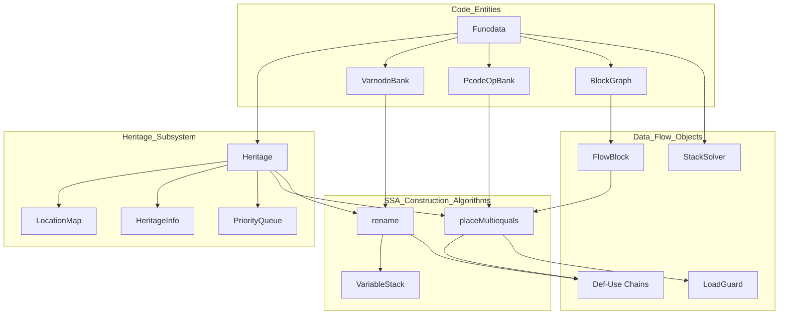

**Sources:** [Ghidra/Features/Decompiler/src/decompile/cpp/heritage.hh:216-224](), [Ghidra/Features/Decompiler/src/decompile/cpp/heritage.cc:216-224](), [Ghidra/Features/Decompiler/src/decompile/cpp/coreaction.cc:34-51]()

### Key Data Structures

| Structure | Purpose | Key Methods / Files |
|-----------|---------|---------------------|
| `Heritage` | Main SSA construction manager | `heritage()`, `placeMultiequals()`, `rename()` [Ghidra/Features/Decompiler/src/decompile/cpp/heritage.hh:216-224]() |
| `LocationMap` | Tracks heritaged address ranges with pass numbers | `add()`, `find()`, `findPass()` [Ghidra/Features/Decompiler/src/decompile/cpp/heritage.cc:33-98]() |
| `HeritageInfo` | Per-address-space heritage state | `reset()`, delay management [Ghidra/Features/Decompiler/src/decompile/cpp/heritage.hh:122-135]() |
| `PriorityQueue` | Prioritizes blocks by dominator depth | `insert()`, `extract()` [Ghidra/Features/Decompiler/src/decompile/cpp/heritage.cc:141-175]() |
| `VariableStack` | Maps addresses to Varnode stacks for renaming | Organized by `Address` [Ghidra/Features/Decompiler/src/decompile/cpp/heritage.hh:29]() |
| `StackSolver` | Solves for stack-pointer changes across calls | `build()`, `solve()`, `propagate()` [Ghidra/Features/Decompiler/src/decompile/cpp/coreaction.cc:34-51]() |

Sources: [Ghidra/Features/Decompiler/src/decompile/cpp/heritage.hh:32-146](), [Ghidra/Features/Decompiler/src/decompile/cpp/heritage.cc:178-224](), [Ghidra/Features/Decompiler/src/decompile/cpp/coreaction.cc:34-51]()

---

## LocationMap: Tracking Heritage Progress

The `LocationMap` maintains a disjoint cover of address ranges that have been heritaged, recording the pass number when each range was processed. This enables incremental SSA construction and prevents redundant processing.

### LocationMap Code-Entity Mapping

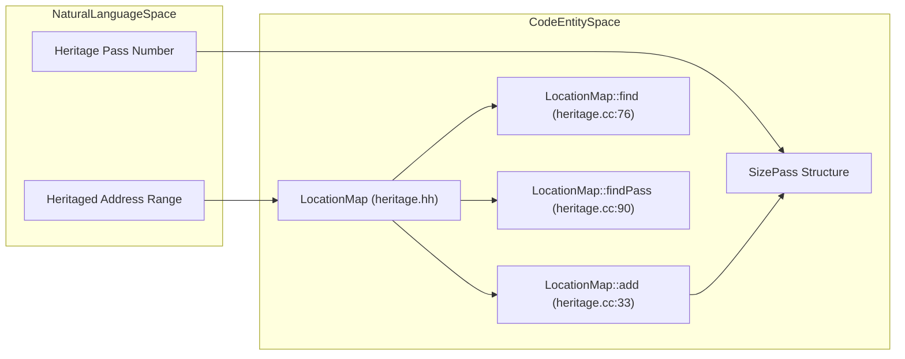

### Intersection Handling

When a new range is added via `LocationMap::add()`, `LocationMap` handles three intersection scenarios [Ghidra/Features/Decompiler/src/decompile/cpp/heritage.cc:33-70]():

1.  **No intersection** (code 0): Range from same pass.
2.  **Partial intersection** (code 1): Overlaps with older range.
3.  **Complete containment** (code 2): Fully contained in older range.

The method merges overlapping entries and assigns the minimum pass number from all intersecting ranges, ensuring that re-heritage operations are properly tracked [Ghidra/Features/Decompiler/src/decompile/cpp/heritage.cc:44-65]().

Sources: [Ghidra/Features/Decompiler/src/decompile/cpp/heritage.hh:32-86](), [Ghidra/Features/Decompiler/src/decompile/cpp/heritage.cc:22-99]()

---

## SSA Construction Process

SSA construction follows a two-phase algorithm: phi placement and renaming. The `Heritage` class coordinates these phases, processing address spaces independently based on their heritage requirements.

### Phi Function Placement

Phi functions (`CPUI_MULTIEQUAL` ops) are placed at dominance frontiers. The process identifies blocks where multiple control-flow paths carrying different values for the same address converge.

#### Phi Placement Algorithm

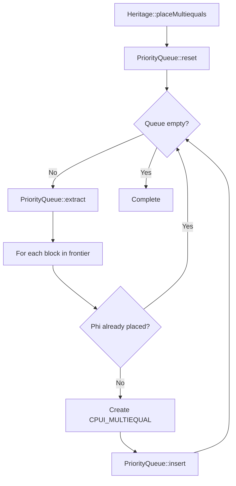

The algorithm uses a `PriorityQueue` that processes blocks in order of dominator tree depth, ensuring that phi functions are placed before processing blocks they dominate [Ghidra/Features/Decompiler/src/decompile/cpp/heritage.cc:153-175]().

**Key Implementation Points:**
- **`PriorityQueue::insert`**: Adds a block at a specific priority depth [Ghidra/Features/Decompiler/src/decompile/cpp/heritage.cc:153-159]().
- **`PriorityQueue::extract`**: Retrieves the highest priority block (shallowest depth) [Ghidra/Features/Decompiler/src/decompile/cpp/heritage.cc:165-175]().
- **Phi insertion**: Phi ops are inserted at the beginning of basic blocks [Ghidra/Features/Decompiler/src/decompile/cpp/heritage.cc:753-761]().

Sources: [Ghidra/Features/Decompiler/src/decompile/cpp/heritage.cc:141-175](), [Ghidra/Features/Decompiler/src/decompile/cpp/heritage.hh:95-110]()

### Variable Renaming

The renaming phase assigns unique `Varnode` instances to each SSA definition using a depth-first traversal of the dominator tree. The algorithm maintains a stack for each address, pushing new definitions and popping when backtracking [Ghidra/Features/Decompiler/src/decompile/cpp/heritage.cc:806-977]().

Sources: [Ghidra/Features/Decompiler/src/decompile/cpp/heritage.hh:29](), [Ghidra/Features/Decompiler/src/decompile/cpp/heritage.cc:806-977]()

---

## Stack Data Flow Analysis

Recovering the stack pointer across function calls is critical for correct SSA heritage of stack-based variables. The `StackSolver` class models stack pointer changes as a system of linear equations [Ghidra/Features/Decompiler/src/decompile/cpp/coreaction.cc:34-51]().

### StackSolver Mechanism
1.  **Build**: Collects all references to the stack pointer `Varnode` and examines their defining `PcodeOp` (e.g., `CPUI_INT_ADD`, `CPUI_COPY`, `CPUI_INDIRECT`) [Ghidra/Features/Decompiler/src/decompile/cpp/coreaction.cc:148-200]().
2.  **Solve**: Uses a propagation algorithm to resolve stack offsets, starting from the function entry where the stack pointer is known (offset 0) [Ghidra/Features/Decompiler/src/decompile/cpp/coreaction.cc:113-141]().
3.  **Propagate**: Given a solution for one `Varnode`, it iteratively solves for connected variables using the collected `StackEqn` [Ghidra/Features/Decompiler/src/decompile/cpp/coreaction.cc:68-95]().

Sources: [Ghidra/Features/Decompiler/src/decompile/cpp/coreaction.cc:25-200]()

---

## LoadGuard and Def-Use Chains

Heritage maintains a list of `CPUI_LOAD` operations that reference the stack dynamically. These can potentially alias stack Varnodes, so Ghidra maintains information about the range of stack addresses that can be referenced [Ghidra/Features/Decompiler/src/decompile/cpp/heritage.cc:400-630]().

| Class | Purpose | Source Reference |
|-------|---------|------------------|
| `LoadGuard` | Tracks dynamic LOAD ops that need protection from optimization | [Ghidra/Features/Decompiler/src/decompile/cpp/heritage.hh:142-160]() |
| `AliasChecker` | Analyzes pointers to detect potential stack aliasing | [Ghidra/Features/Decompiler/src/decompile/cpp/varmap.hh:137-148]() |
| `AddBase` | Helper for tracking base pointers and indices | [Ghidra/Features/Decompiler/src/decompile/cpp/varmap.hh:140-144]() |

Sources: [Ghidra/Features/Decompiler/src/decompile/cpp/heritage.hh:142-160](), [Ghidra/Features/Decompiler/src/decompile/cpp/varmap.hh:137-148]()

---

## Prototype and Parameter Data Flow

SSA construction is heavily influenced by function prototypes. The `ParamEntry` and `ParamListStandard` classes define how parameters are mapped to storage locations, which in turn determines the initial SSA definitions for function inputs [Ghidra/Features/Decompiler/src/decompile/cpp/fspec.cc:60-153]().

### Parameter Storage Assignment

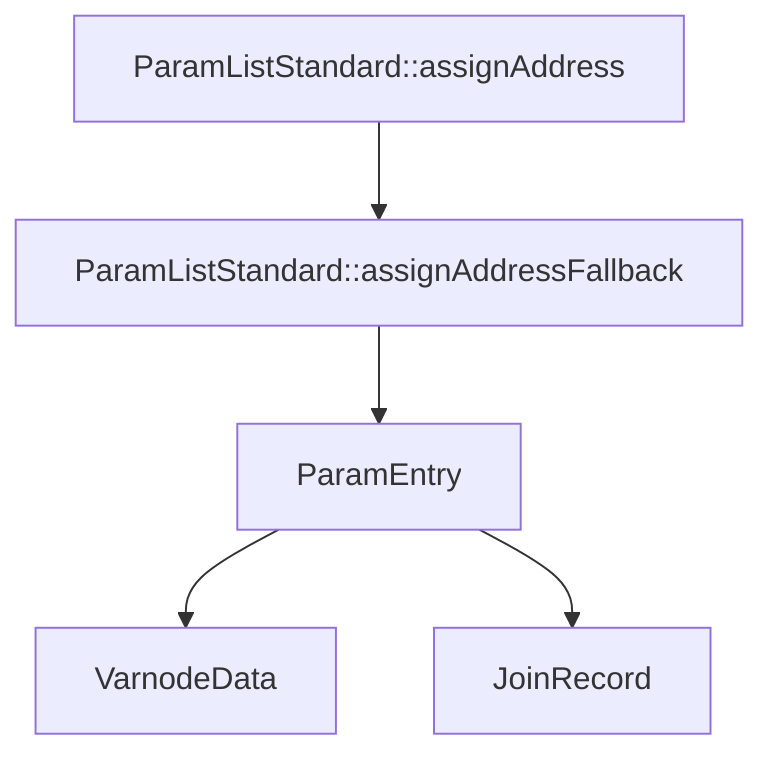

**Key Behaviors:**
- **Overlap Resolution**: `ParamEntry::resolveOverlap` checks if a parameter range intersects with previous entries [Ghidra/Features/Decompiler/src/decompile/cpp/fspec.cc:122-153]().
- **Join Records**: For parameters split across registers, `ParamEntry::resolveJoin` caches `JoinRecord` information [Ghidra/Features/Decompiler/src/decompile/cpp/fspec.cc:94-116]().
- **Storage Classes**: Parameters are filtered by storage class [Ghidra/Features/Decompiler/src/decompile/cpp/fspec.hh:81-84]().

Sources: [Ghidra/Features/Decompiler/src/decompile/cpp/fspec.cc:60-153](), [Ghidra/Features/Decompiler/src/decompile/cpp/fspec.hh:81-126]()

---

## Address Space Heritage State

`HeritageInfo` tracks the progress of SSA construction for specific address spaces, managing delays for dead code removal and heritage passes [Ghidra/Features/Decompiler/src/decompile/cpp/heritage.cc:178-214]().

| Field | Description | Source Reference |
|-------|-------------|------------------|
| `delay` | How many passes to delay heritage of this space | [Ghidra/Features/Decompiler/src/decompile/cpp/heritage.hh:125]() |
| `deadcodedelay` | How many passes to delay deadcode removal | [Ghidra/Features/Decompiler/src/decompile/cpp/heritage.hh:126]() |
| `hasCallPlaceholders` | True for stack space if placeholders not yet removed | [Ghidra/Features/Decompiler/src/decompile/cpp/heritage.hh:130]() |

Sources: [Ghidra/Features/Decompiler/src/decompile/cpp/heritage.hh:122-135](), [Ghidra/Features/Decompiler/src/decompile/cpp/heritage.cc:178-214]()

---

# Page: Varnode Management and Optimization

# Varnode Management and Optimization

<details>
<summary>Relevant source files</summary>

The following files were used as context for generating this wiki page:

- [Ghidra/Features/Decompiler/certification.manifest](Ghidra/Features/Decompiler/certification.manifest)
- [Ghidra/Features/Decompiler/src/decompile/cpp/cast.cc](Ghidra/Features/Decompiler/src/decompile/cpp/cast.cc)
- [Ghidra/Features/Decompiler/src/decompile/cpp/cast.hh](Ghidra/Features/Decompiler/src/decompile/cpp/cast.hh)
- [Ghidra/Features/Decompiler/src/decompile/cpp/coreaction.cc](Ghidra/Features/Decompiler/src/decompile/cpp/coreaction.cc)
- [Ghidra/Features/Decompiler/src/decompile/cpp/coreaction.hh](Ghidra/Features/Decompiler/src/decompile/cpp/coreaction.hh)
- [Ghidra/Features/Decompiler/src/decompile/cpp/cover.cc](Ghidra/Features/Decompiler/src/decompile/cpp/cover.cc)
- [Ghidra/Features/Decompiler/src/decompile/cpp/cover.hh](Ghidra/Features/Decompiler/src/decompile/cpp/cover.hh)
- [Ghidra/Features/Decompiler/src/decompile/cpp/database.cc](Ghidra/Features/Decompiler/src/decompile/cpp/database.cc)
- [Ghidra/Features/Decompiler/src/decompile/cpp/database.hh](Ghidra/Features/Decompiler/src/decompile/cpp/database.hh)
- [Ghidra/Features/Decompiler/src/decompile/cpp/database_ghidra.cc](Ghidra/Features/Decompiler/src/decompile/cpp/database_ghidra.cc)
- [Ghidra/Features/Decompiler/src/decompile/cpp/database_ghidra.hh](Ghidra/Features/Decompiler/src/decompile/cpp/database_ghidra.hh)
- [Ghidra/Features/Decompiler/src/decompile/cpp/double.cc](Ghidra/Features/Decompiler/src/decompile/cpp/double.cc)
- [Ghidra/Features/Decompiler/src/decompile/cpp/double.hh](Ghidra/Features/Decompiler/src/decompile/cpp/double.hh)
- [Ghidra/Features/Decompiler/src/decompile/cpp/fspec.cc](Ghidra/Features/Decompiler/src/decompile/cpp/fspec.cc)
- [Ghidra/Features/Decompiler/src/decompile/cpp/fspec.hh](Ghidra/Features/Decompiler/src/decompile/cpp/fspec.hh)
- [Ghidra/Features/Decompiler/src/decompile/cpp/funcdata.cc](Ghidra/Features/Decompiler/src/decompile/cpp/funcdata.cc)
- [Ghidra/Features/Decompiler/src/decompile/cpp/funcdata.hh](Ghidra/Features/Decompiler/src/decompile/cpp/funcdata.hh)
- [Ghidra/Features/Decompiler/src/decompile/cpp/funcdata_op.cc](Ghidra/Features/Decompiler/src/decompile/cpp/funcdata_op.cc)
- [Ghidra/Features/Decompiler/src/decompile/cpp/funcdata_varnode.cc](Ghidra/Features/Decompiler/src/decompile/cpp/funcdata_varnode.cc)
- [Ghidra/Features/Decompiler/src/decompile/cpp/grammar.cc](Ghidra/Features/Decompiler/src/decompile/cpp/grammar.cc)
- [Ghidra/Features/Decompiler/src/decompile/cpp/grammar.y](Ghidra/Features/Decompiler/src/decompile/cpp/grammar.y)
- [Ghidra/Features/Decompiler/src/decompile/cpp/heritage.cc](Ghidra/Features/Decompiler/src/decompile/cpp/heritage.cc)
- [Ghidra/Features/Decompiler/src/decompile/cpp/heritage.hh](Ghidra/Features/Decompiler/src/decompile/cpp/heritage.hh)
- [Ghidra/Features/Decompiler/src/decompile/cpp/ifacedecomp.cc](Ghidra/Features/Decompiler/src/decompile/cpp/ifacedecomp.cc)
- [Ghidra/Features/Decompiler/src/decompile/cpp/ifacedecomp.hh](Ghidra/Features/Decompiler/src/decompile/cpp/ifacedecomp.hh)
- [Ghidra/Features/Decompiler/src/decompile/cpp/merge.cc](Ghidra/Features/Decompiler/src/decompile/cpp/merge.cc)
- [Ghidra/Features/Decompiler/src/decompile/cpp/merge.hh](Ghidra/Features/Decompiler/src/decompile/cpp/merge.hh)
- [Ghidra/Features/Decompiler/src/decompile/cpp/op.cc](Ghidra/Features/Decompiler/src/decompile/cpp/op.cc)
- [Ghidra/Features/Decompiler/src/decompile/cpp/op.hh](Ghidra/Features/Decompiler/src/decompile/cpp/op.hh)
- [Ghidra/Features/Decompiler/src/decompile/cpp/ruleaction.cc](Ghidra/Features/Decompiler/src/decompile/cpp/ruleaction.cc)
- [Ghidra/Features/Decompiler/src/decompile/cpp/ruleaction.hh](Ghidra/Features/Decompiler/src/decompile/cpp/ruleaction.hh)
- [Ghidra/Features/Decompiler/src/decompile/cpp/subflow.cc](Ghidra/Features/Decompiler/src/decompile/cpp/subflow.cc)
- [Ghidra/Features/Decompiler/src/decompile/cpp/subflow.hh](Ghidra/Features/Decompiler/src/decompile/cpp/subflow.hh)
- [Ghidra/Features/Decompiler/src/decompile/cpp/transform.cc](Ghidra/Features/Decompiler/src/decompile/cpp/transform.cc)
- [Ghidra/Features/Decompiler/src/decompile/cpp/transform.hh](Ghidra/Features/Decompiler/src/decompile/cpp/transform.hh)
- [Ghidra/Features/Decompiler/src/decompile/cpp/type.cc](Ghidra/Features/Decompiler/src/decompile/cpp/type.cc)
- [Ghidra/Features/Decompiler/src/decompile/cpp/type.hh](Ghidra/Features/Decompiler/src/decompile/cpp/type.hh)
- [Ghidra/Features/Decompiler/src/decompile/cpp/typeop.cc](Ghidra/Features/Decompiler/src/decompile/cpp/typeop.cc)
- [Ghidra/Features/Decompiler/src/decompile/cpp/typeop.hh](Ghidra/Features/Decompiler/src/decompile/cpp/typeop.hh)
- [Ghidra/Features/Decompiler/src/decompile/cpp/variable.cc](Ghidra/Features/Decompiler/src/decompile/cpp/variable.cc)
- [Ghidra/Features/Decompiler/src/decompile/cpp/variable.hh](Ghidra/Features/Decompiler/src/decompile/cpp/variable.hh)
- [Ghidra/Features/Decompiler/src/decompile/cpp/varmap.cc](Ghidra/Features/Decompiler/src/decompile/cpp/varmap.cc)
- [Ghidra/Features/Decompiler/src/decompile/cpp/varmap.hh](Ghidra/Features/Decompiler/src/decompile/cpp/varmap.hh)
- [Ghidra/Features/Decompiler/src/decompile/cpp/varnode.cc](Ghidra/Features/Decompiler/src/decompile/cpp/varnode.cc)
- [Ghidra/Features/Decompiler/src/decompile/cpp/varnode.hh](Ghidra/Features/Decompiler/src/decompile/cpp/varnode.hh)
- [Ghidra/Features/Decompiler/src/decompile/datatests/varcross.xml](Ghidra/Features/Decompiler/src/decompile/datatests/varcross.xml)
- [Ghidra/Features/Decompiler/src/main/java/ghidra/app/decompiler/DecompileDebug.java](Ghidra/Features/Decompiler/src/main/java/ghidra/app/decompiler/DecompileDebug.java)
- [Ghidra/Framework/SoftwareModeling/src/main/java/ghidra/program/model/pcode/LocalSymbolMap.java](Ghidra/Framework/SoftwareModeling/src/main/java/ghidra/program/model/pcode/LocalSymbolMap.java)
- [Ghidra/Framework/SoftwareModeling/src/main/java/ghidra/program/model/pcode/PcodeDataTypeManager.java](Ghidra/Framework/SoftwareModeling/src/main/java/ghidra/program/model/pcode/PcodeDataTypeManager.java)

</details>


## Purpose and Scope

This document describes the representation, management, and optimization of Varnodes within Ghidra's decompiler. A Varnode is the fundamental data-flow element in the decompiler's intermediate representation, representing a value at a specific storage location (register, memory, constant, or temporary) during program execution.

This page covers:
- The Varnode data structure and its properties (address, size, flags)
- Creation and lifecycle management through `VarnodeBank`
- Optimization techniques for splitting large Varnodes (`SubvariableFlow`)
- SIMD register handling via lane division (`ActionLaneDivide`)
- Stack pointer flow analysis for determining calling conventions
- Common optimization patterns and transformations

For information about SSA form construction and data-flow analysis using Varnodes, see [SSA Construction and Data Flow](2.4). For type information propagation through Varnodes, see [Type System and Propagation](2.3).

---

## Varnode Representation

### Core Structure

A Varnode represents a value with four essential components:

| Component | Description |
|-----------|-------------|
| `loc` (Address) | Storage location in an address space |
| `size` | Size in bytes |
| `def` (PcodeOp*) | Defining operation (NULL for free/input Varnodes) |
| `descend` | List of operations that read this value |

```mermaid
graph TB
    subgraph "Varnode_Structure [Varnode]"
        VN["Varnode"]
        Addr["Address (loc)<br/>Space + Offset"]
        Size["size (int4)"]
        Def["def (PcodeOp*)<br/>Defining Operation"]
        Desc["descend (list&lt;PcodeOp*&gt;)<br/>Uses/Reads"]
        Flags["flags (uint4)<br/>Properties"]
        Type["type (Datatype*)<br/>Data Type"]
        
        VN --> Addr
        VN --> Size
        VN --> Def
        VN --> Desc
        VN --> Flags
        VN --> Type
    end
    
    subgraph "Address_Spaces [AddrSpace]"
        Const["constant space"]
        Unique["unique space<br/>(temporaries)"]
        Register["register space"]
        RAM["RAM spaces"]
    end
    
    Addr -.-> Const
    Addr -.-> Unique
    Addr -.-> Register
    Addr -.-> RAM
```

Sources: [Ghidra/Features/Decompiler/src/decompile/cpp/varnode.hh:1-432](), [Ghidra/Features/Decompiler/src/decompile/cpp/varnode.cc:1-1500]()

### Varnode Flags

The `flags` field encodes boolean properties that control optimization and code generation:

| Flag | Value | Purpose |
|------|-------|---------|
| `mark` | 0x1 | Temporary marker for algorithms |
| `constant` | 0x2 | Storage in constant address space |
| `annotation` | 0x4 | Special annotation Varnode (e.g., CPUI_INDIRECT effect marker) |
| `input` | 0x8 | Unaffected input to the function |
| `written` | 0x10 | Has a defining PcodeOp (`def != NULL`) |
| `insert` | 0x20 | Artificially created during analysis |
| `implied` | 0x40 | Logically exists but not explicitly in code |
| `explict` | 0x80 | Explicitly present in binary (vs. inferred) |
| `typelock` | 0x100 | Data-type is locked/fixed |
| `namelock` | 0x200 | Variable name is locked |
| `nolocalalias` | 0x400 | Not aliased by other local variables |
| `volatil` | 0x800 | Volatile storage (e.g., memory-mapped I/O) |
| `mapped` | 0x1000 | Has associated SymbolEntry |
| `addrtied` | 0x2000 | High-level variable tied to specific address |
| `addrforce` | 0x4000 | Address forced/overridden by user |
| `auto_live` | 0x8000 | Automatically considered live |
| `incidental_copy` | 0x20000 | Not a true data-flow copy |

Sources: [Ghidra/Features/Decompiler/src/decompile/cpp/varnode.hh:50-100]()

### Non-Zero Mask (NZMask) and Consume Tracking

The decompiler tracks bit-level information to enable precise optimizations:

- **NZMask (`nzm`)**: Bitmask indicating which bits might be non-zero
- **Consume**: Bitmask indicating which bits are actually used by descendants

These enable optimizations like:
- Eliminating unnecessary AND operations when NZMask shows bits are already zero
- Identifying unused portions of large variables for splitting

```mermaid
graph LR
    subgraph "Bit-Level Tracking"
        V1["Varnode A<br/>size=4, nzm=0x00FF"]
        AND["INT_AND<br/>mask=0x00FF"]
        V2["Varnode B<br/>size=4"]
        
        V1 -->|"nzm=0x00FF"| AND
        AND -->|"Result nzm=0x00FF<br/>(redundant mask)"| V2
    end
    
    subgraph "Optimization [RuleAndMask]"
        OPT["RuleAndMask"]
        OPT -->|"Convert to COPY"| COPY["CPUI_COPY"]
    end
    
    V2 -.->|"Detected by"| OPT
```

Sources: [Ghidra/Features/Decompiler/src/decompile/cpp/varnode.hh:200-250](), [Ghidra/Features/Decompiler/src/decompile/cpp/ruleaction.cc:302-342]()

---

## Varnode Creation and Management

### VarnodeBank

The `VarnodeBank` class manages the lifetime of all Varnodes in a function. It maintains two primary indexes:

1. **Location-based index** (`VarnodeLocSet`): Orders Varnodes by address space, offset, size, and definition point
2. **Definition-based index** (`VarnodeDefSet`): Orders Varnodes by their defining operation

```mermaid
graph TB
    subgraph "Varnode_Bank_Manager [VarnodeBank]"
        Bank["VarnodeBank"]
        LocSet["VarnodeLocSet<br/>(by location)"]
        DefSet["VarnodeDefSet<br/>(by definition)"]
        CreateIndex["create_index<br/>(unique counter)"]
        
        Bank --> LocSet
        Bank --> DefSet
        Bank --> CreateIndex
    end
    
    subgraph "Creation_API [Funcdata]"
        Create["create(size, addr, type)"]
        CreateUnique["createUnique(size, type)"]
        CreateDef["createDef(size, addr, type, op)"]
        CreateDefUnique["createDefUnique(size, type, op)"]
        
        Create -->|"Free Varnode"| LocSet
        CreateDef -->|"Output Varnode"| LocSet
        CreateUnique -->|"Temporary"| DefSet
    end
    
    Bank -.-> Create
    Bank -.-> CreateUnique
    Bank -.-> CreateDef
    Bank -.-> CreateDefUnique
```

Sources: [Ghidra/Features/Decompiler/src/decompile/cpp/varnode.hh:432](), [Ghidra/Features/Decompiler/src/decompile/cpp/funcdata_varnode.cc:1-300]()

### Funcdata Creation Methods

The `Funcdata` class provides high-level Varnode creation methods that automatically handle property assignment:

| Method | Purpose | Address Space |
|--------|---------|---------------|
| `newConstant(size, value)` | Create constant Varnode | `constant` [Ghidra/Features/Decompiler/src/decompile/cpp/funcdata_varnode.cc:68-78]() |
| `newUnique(size, type)` | Create temporary register | `unique` [Ghidra/Features/Decompiler/src/decompile/cpp/funcdata_varnode.cc:85-97]() |
| `newVarnodeOut(size, addr, op)` | Create defined output | Any [Ghidra/Features/Decompiler/src/decompile/cpp/funcdata_varnode.cc:106-131]() |
| `newUniqueOut(size, op)` | Create temporary output | `unique` [Ghidra/Features/Decompiler/src/decompile/cpp/funcdata_varnode.cc:138-149]() |
| `newVarnode(size, addr, type)` | Create free Varnode | Any [Ghidra/Features/Decompiler/src/decompile/cpp/funcdata_varnode.cc:157-183]() |

Each method:
1. Allocates the Varnode through `VarnodeBank` [Ghidra/Features/Decompiler/src/decompile/cpp/funcdata_varnode.cc:73]()
2. Assigns a `HighVariable` if SSA is enabled [Ghidra/Features/Decompiler/src/decompile/cpp/funcdata_varnode.cc:48-61]()
3. Queries symbol properties via `localmap->queryProperties()` [Ghidra/Features/Decompiler/src/decompile/cpp/funcdata_varnode.cc:31-36]()
4. Checks for laned register handling if size ≥ `minLanedSize` [Ghidra/Features/Decompiler/src/decompile/cpp/funcdata_varnode.cc:92-93]()

Sources: [Ghidra/Features/Decompiler/src/decompile/cpp/funcdata_varnode.cc:20-200]()

---

## SubvariableFlow Optimization

### Purpose

`SubvariableFlow` identifies situations where a large Varnode carries a smaller logical value and creates a separate data-flow subgraph for that logical value. This eliminates unnecessary bit manipulations and improves code clarity.

**Example scenario:**
```
Original:    x = large_value & 0xFF       (8-byte value, only using low byte)
             y = x + 1
             z = x * 2
Optimized:   x_small = (byte)large_value  (1-byte value)
             y = x_small + 1
             z = x_small * 2
```

### Algorithm Overview

```mermaid
graph TB
    Start["Start with root Varnode"]
    Trace["Trace data-flow<br/>(forward & backward)"]
    Build["Build logical subgraph<br/>(ReplaceVarnode nodes)"]
    Check["Check if transformation<br/>reduces operations"]
    Replace["Replace operations<br/>with smaller ops"]
    Terminal["Handle terminals<br/>(calls, returns, etc.)"]
    
    Start --> Trace
    Trace --> Build
    Build --> Check
    Check -->|"pullcount > 0"| Replace
    Check -->|"No benefit"| Abort["Abort"]
    Replace --> Terminal
    Terminal --> Done["Done"]
    
    subgraph "Tracing_Logic [SubvariableFlow]"
        Forward["traceForward()<br/>INT_ADD, INT_MULT, etc."]
        Backward["traceBackward()<br/>SUBPIECE, INT_ZEXT, etc."]
    end
    
    Trace --> Forward
    Trace --> Backward
```

Sources: [Ghidra/Features/Decompiler/src/decompile/cpp/subflow.hh:25-150](), [Ghidra/Features/Decompiler/src/decompile/cpp/subflow.cc:1-500]()

### ReplaceVarnode and ReplaceOp

The algorithm constructs a shadow graph during tracing:

- **ReplaceVarnode**: Represents a Varnode within the logical subgraph [Ghidra/Features/Decompiler/src/decompile/cpp/subflow.cc:66-151]()
  - `vn`: Original Varnode
  - `replacement`: New smaller Varnode (created during replacement)
  - `mask`: Bitmask indicating which bits carry the logical value
  - `def`: `ReplaceOp` that defines this logical value

- **ReplaceOp**: Represents a PcodeOp within the logical subgraph [Ghidra/Features/Decompiler/src/decompile/cpp/subflow.cc:159-173]()
  - `op`: Original PcodeOp
  - `opc`: Opcode in subgraph (may differ from original)
  - `output`: `ReplaceVarnode` output
  - `input`: Vector of `ReplaceVarnode` inputs

Sources: [Ghidra/Features/Decompiler/src/decompile/cpp/subflow.hh:35-120](), [Ghidra/Features/Decompiler/src/decompile/cpp/subflow.cc:55-200]()

---

## Lane Division (ActionLaneDivide)

### Purpose

`ActionLaneDivide` handles SIMD (vector) registers that are treated as multiple independent "lanes" of smaller values. It splits wide Varnodes into separate lanes when the lanes are independently manipulated.

Sources: [Ghidra/Features/Decompiler/src/decompile/cpp/coreaction.hh:113-123]()

### Lane Size Detection

The architecture specifies which registers can be laned via `LanedRegister` objects. `ActionLaneDivide` iterates through possible lane sizes and modes to find a viable split.

```mermaid
graph TB
    Start["Varnode in laned storage"]
    Collect["collectLaneSizes()<br/>Examine PIECE/SUBPIECE ops"]
    Mode0["Mode 0: Local ops only"]
    Mode1["Mode 1: Allow downcasts"]
    Mode2["Mode 2: Default lane size"]
    Process["processVarnode()<br/>Try each lane size"]
    
    Start --> Collect
    Collect --> Mode0
    Mode0 -->|"No success"| Mode1
    Mode1 -->|"No success"| Mode2
    Mode0 --> Process
    Mode1 --> Process
    Mode2 --> Process
```

Sources: [Ghidra/Features/Decompiler/src/decompile/cpp/coreaction.cc:501-623]()

---

## Stack Pointer Flow Analysis

### Purpose

`ActionStackPtrFlow` analyzes how the stack pointer changes across the function, particularly through sub-function calls where the "extra pop" amount may be unknown. This is critical for architectures like x86 with caller-cleanup calling conventions.

Sources: [Ghidra/Features/Decompiler/src/decompile/cpp/coreaction.hh:89-105]()

### StackSolver System

The `StackSolver` builds a system of linear equations representing stack pointer relationships.

```mermaid
graph TB
    subgraph "Solver_Internals [StackSolver]"
        VnList["vnlist<br/>(Varnode variables)"]
        Eqs["eqs<br/>(Known equations)"]
        Guess["guess<br/>(Unknown sub-call effects)"]
        Soln["soln<br/>(Computed solutions)"]
    end
    
    subgraph "Equation_Building [StackSolver::build]"
        Input["SP input (var 0)"]
        Add["INT_ADD: var_i = var_j + const"]
        Indirect["INDIRECT: var_i = var_j + extrapop"]
        
        Input --> Add
        Add --> Eqs
        Indirect --> Guess
    end
    
    Build["build()"] --> VnList
    Solve["solve()"] --> Soln
    
    VnList --> Solve
    Eqs --> Solve
    Guess --> Solve
```

Sources: [Ghidra/Features/Decompiler/src/decompile/cpp/coreaction.cc:24-252]()

---

## Common Optimization Rules

### Dead Code Removal (RuleEarlyRemoval)

Removes `PcodeOp` objects whose outputs are unused and have no side effects.

**Conditions for removal:**
1. Op is not a call or indirect source [Ghidra/Features/Decompiler/src/decompile/cpp/ruleaction.cc:30-31]()
2. Output has no descendants (`hasNoDescend()`) [Ghidra/Features/Decompiler/src/decompile/cpp/ruleaction.cc:35]()
3. Output is not auto-live [Ghidra/Features/Decompiler/src/decompile/cpp/ruleaction.cc:36]()
4. Address space permits dead-code removal [Ghidra/Features/Decompiler/src/decompile/cpp/ruleaction.cc:38-40]()

Sources: [Ghidra/Features/Decompiler/src/decompile/cpp/ruleaction.cc:23-44]()

### Common Subexpression Elimination (RuleSelectCse)

Identifies and eliminates duplicate computations, specifically targeting `CPUI_SUBPIECE` and `CPUI_INT_SRIGHT` for division optimizations.

Sources: [Ghidra/Features/Decompiler/src/decompile/cpp/ruleaction.cc:180-209]()

### Term Collection (RuleCollectTerms)

Collects terms in an additive expression: `V * c + V * d => V * (c + d)`. This rule uses `TermOrder` to sort and combine constant coefficients.

Sources: [Ghidra/Features/Decompiler/src/decompile/cpp/ruleaction.cc:99-176]()

---

## Register and Stack Variable Handling

### Symbol Mapping and Properties

Varnodes are mapped to symbols through `ScopeLocal`. When a Varnode is created, `setVarnodeProperties` is called to fetch properties from the symbol table.

**Key properties handled:**
- **typelock**: Fixed data type from user or debug info [Ghidra/Features/Decompiler/src/decompile/cpp/funcdata_varnode.cc:35]()
- **namelock**: Fixed variable name [Ghidra/Features/Decompiler/src/decompile/cpp/varnode.hh:61]()
- **volatil**: Prevents optimizations that would eliminate reads/writes [Ghidra/Features/Decompiler/src/decompile/cpp/varnode.hh:63]()

Sources: [Ghidra/Features/Decompiler/src/decompile/cpp/funcdata_varnode.cc:25-42](), [Ghidra/Features/Decompiler/src/decompile/cpp/varnode.hh:50-100]()

### Varnode Lifecycle

1. **Creation**: Via `Funcdata` methods (e.g., `newVarnodeOut`) [Ghidra/Features/Decompiler/src/decompile/cpp/funcdata_varnode.cc:106]()
2. **SSA Phase**: Varnodes are assigned `HighVariable` containers [Ghidra/Features/Decompiler/src/decompile/cpp/funcdata_varnode.cc:48-61]()
3. **Destruction**: Via `destroyVarnode`, which removes the Varnode from `VarnodeBank` indexes [Ghidra/Features/Decompiler/src/decompile/cpp/funcdata.hh:112]()

Sources: [Ghidra/Features/Decompiler/src/decompile/cpp/funcdata_varnode.cc:20-200](), [Ghidra/Features/Decompiler/src/decompile/cpp/funcdata.hh:56-130]()

---

# Page: Function Prototype and Symbol Recovery

# Function Prototype and Symbol Recovery

<details>
<summary>Relevant source files</summary>

The following files were used as context for generating this wiki page:

- [Ghidra/Features/Decompiler/certification.manifest](Ghidra/Features/Decompiler/certification.manifest)
- [Ghidra/Features/Decompiler/src/decompile/cpp/Doxyfile](Ghidra/Features/Decompiler/src/decompile/cpp/Doxyfile)
- [Ghidra/Features/Decompiler/src/decompile/cpp/cast.cc](Ghidra/Features/Decompiler/src/decompile/cpp/cast.cc)
- [Ghidra/Features/Decompiler/src/decompile/cpp/cast.hh](Ghidra/Features/Decompiler/src/decompile/cpp/cast.hh)
- [Ghidra/Features/Decompiler/src/decompile/cpp/coreaction.cc](Ghidra/Features/Decompiler/src/decompile/cpp/coreaction.cc)
- [Ghidra/Features/Decompiler/src/decompile/cpp/coreaction.hh](Ghidra/Features/Decompiler/src/decompile/cpp/coreaction.hh)
- [Ghidra/Features/Decompiler/src/decompile/cpp/cover.cc](Ghidra/Features/Decompiler/src/decompile/cpp/cover.cc)
- [Ghidra/Features/Decompiler/src/decompile/cpp/cover.hh](Ghidra/Features/Decompiler/src/decompile/cpp/cover.hh)
- [Ghidra/Features/Decompiler/src/decompile/cpp/database.cc](Ghidra/Features/Decompiler/src/decompile/cpp/database.cc)
- [Ghidra/Features/Decompiler/src/decompile/cpp/database.hh](Ghidra/Features/Decompiler/src/decompile/cpp/database.hh)
- [Ghidra/Features/Decompiler/src/decompile/cpp/database_ghidra.cc](Ghidra/Features/Decompiler/src/decompile/cpp/database_ghidra.cc)
- [Ghidra/Features/Decompiler/src/decompile/cpp/database_ghidra.hh](Ghidra/Features/Decompiler/src/decompile/cpp/database_ghidra.hh)
- [Ghidra/Features/Decompiler/src/decompile/cpp/double.cc](Ghidra/Features/Decompiler/src/decompile/cpp/double.cc)
- [Ghidra/Features/Decompiler/src/decompile/cpp/double.hh](Ghidra/Features/Decompiler/src/decompile/cpp/double.hh)
- [Ghidra/Features/Decompiler/src/decompile/cpp/fspec.cc](Ghidra/Features/Decompiler/src/decompile/cpp/fspec.cc)
- [Ghidra/Features/Decompiler/src/decompile/cpp/fspec.hh](Ghidra/Features/Decompiler/src/decompile/cpp/fspec.hh)
- [Ghidra/Features/Decompiler/src/decompile/cpp/funcdata.cc](Ghidra/Features/Decompiler/src/decompile/cpp/funcdata.cc)
- [Ghidra/Features/Decompiler/src/decompile/cpp/funcdata.hh](Ghidra/Features/Decompiler/src/decompile/cpp/funcdata.hh)
- [Ghidra/Features/Decompiler/src/decompile/cpp/funcdata_op.cc](Ghidra/Features/Decompiler/src/decompile/cpp/funcdata_op.cc)
- [Ghidra/Features/Decompiler/src/decompile/cpp/funcdata_varnode.cc](Ghidra/Features/Decompiler/src/decompile/cpp/funcdata_varnode.cc)
- [Ghidra/Features/Decompiler/src/decompile/cpp/grammar.cc](Ghidra/Features/Decompiler/src/decompile/cpp/grammar.cc)
- [Ghidra/Features/Decompiler/src/decompile/cpp/grammar.y](Ghidra/Features/Decompiler/src/decompile/cpp/grammar.y)
- [Ghidra/Features/Decompiler/src/decompile/cpp/heritage.cc](Ghidra/Features/Decompiler/src/decompile/cpp/heritage.cc)
- [Ghidra/Features/Decompiler/src/decompile/cpp/heritage.hh](Ghidra/Features/Decompiler/src/decompile/cpp/heritage.hh)
- [Ghidra/Features/Decompiler/src/decompile/cpp/ifacedecomp.cc](Ghidra/Features/Decompiler/src/decompile/cpp/ifacedecomp.cc)
- [Ghidra/Features/Decompiler/src/decompile/cpp/ifacedecomp.hh](Ghidra/Features/Decompiler/src/decompile/cpp/ifacedecomp.hh)
- [Ghidra/Features/Decompiler/src/decompile/cpp/marshal.cc](Ghidra/Features/Decompiler/src/decompile/cpp/marshal.cc)
- [Ghidra/Features/Decompiler/src/decompile/cpp/marshal.hh](Ghidra/Features/Decompiler/src/decompile/cpp/marshal.hh)
- [Ghidra/Features/Decompiler/src/decompile/cpp/merge.cc](Ghidra/Features/Decompiler/src/decompile/cpp/merge.cc)
- [Ghidra/Features/Decompiler/src/decompile/cpp/merge.hh](Ghidra/Features/Decompiler/src/decompile/cpp/merge.hh)
- [Ghidra/Features/Decompiler/src/decompile/cpp/modelrules.cc](Ghidra/Features/Decompiler/src/decompile/cpp/modelrules.cc)
- [Ghidra/Features/Decompiler/src/decompile/cpp/modelrules.hh](Ghidra/Features/Decompiler/src/decompile/cpp/modelrules.hh)
- [Ghidra/Features/Decompiler/src/decompile/cpp/op.cc](Ghidra/Features/Decompiler/src/decompile/cpp/op.cc)
- [Ghidra/Features/Decompiler/src/decompile/cpp/op.hh](Ghidra/Features/Decompiler/src/decompile/cpp/op.hh)
- [Ghidra/Features/Decompiler/src/decompile/cpp/prefersplit.cc](Ghidra/Features/Decompiler/src/decompile/cpp/prefersplit.cc)
- [Ghidra/Features/Decompiler/src/decompile/cpp/prefersplit.hh](Ghidra/Features/Decompiler/src/decompile/cpp/prefersplit.hh)
- [Ghidra/Features/Decompiler/src/decompile/cpp/ruleaction.cc](Ghidra/Features/Decompiler/src/decompile/cpp/ruleaction.cc)
- [Ghidra/Features/Decompiler/src/decompile/cpp/ruleaction.hh](Ghidra/Features/Decompiler/src/decompile/cpp/ruleaction.hh)
- [Ghidra/Features/Decompiler/src/decompile/cpp/subflow.cc](Ghidra/Features/Decompiler/src/decompile/cpp/subflow.cc)
- [Ghidra/Features/Decompiler/src/decompile/cpp/subflow.hh](Ghidra/Features/Decompiler/src/decompile/cpp/subflow.hh)
- [Ghidra/Features/Decompiler/src/decompile/cpp/transform.cc](Ghidra/Features/Decompiler/src/decompile/cpp/transform.cc)
- [Ghidra/Features/Decompiler/src/decompile/cpp/transform.hh](Ghidra/Features/Decompiler/src/decompile/cpp/transform.hh)
- [Ghidra/Features/Decompiler/src/decompile/cpp/type.cc](Ghidra/Features/Decompiler/src/decompile/cpp/type.cc)
- [Ghidra/Features/Decompiler/src/decompile/cpp/type.hh](Ghidra/Features/Decompiler/src/decompile/cpp/type.hh)
- [Ghidra/Features/Decompiler/src/decompile/cpp/typeop.cc](Ghidra/Features/Decompiler/src/decompile/cpp/typeop.cc)
- [Ghidra/Features/Decompiler/src/decompile/cpp/typeop.hh](Ghidra/Features/Decompiler/src/decompile/cpp/typeop.hh)
- [Ghidra/Features/Decompiler/src/decompile/cpp/variable.cc](Ghidra/Features/Decompiler/src/decompile/cpp/variable.cc)
- [Ghidra/Features/Decompiler/src/decompile/cpp/variable.hh](Ghidra/Features/Decompiler/src/decompile/cpp/variable.hh)
- [Ghidra/Features/Decompiler/src/decompile/cpp/varmap.cc](Ghidra/Features/Decompiler/src/decompile/cpp/varmap.cc)
- [Ghidra/Features/Decompiler/src/decompile/cpp/varmap.hh](Ghidra/Features/Decompiler/src/decompile/cpp/varmap.hh)
- [Ghidra/Features/Decompiler/src/decompile/cpp/varnode.cc](Ghidra/Features/Decompiler/src/decompile/cpp/varnode.cc)
- [Ghidra/Features/Decompiler/src/decompile/cpp/varnode.hh](Ghidra/Features/Decompiler/src/decompile/cpp/varnode.hh)
- [Ghidra/Features/Decompiler/src/decompile/cpp/xml.cc](Ghidra/Features/Decompiler/src/decompile/cpp/xml.cc)
- [Ghidra/Features/Decompiler/src/decompile/cpp/xml.hh](Ghidra/Features/Decompiler/src/decompile/cpp/xml.hh)
- [Ghidra/Features/Decompiler/src/decompile/cpp/xml.y](Ghidra/Features/Decompiler/src/decompile/cpp/xml.y)
- [Ghidra/Features/Decompiler/src/decompile/datatests/varcross.xml](Ghidra/Features/Decompiler/src/decompile/datatests/varcross.xml)
- [Ghidra/Features/Decompiler/src/main/java/ghidra/app/decompiler/DecompileDebug.java](Ghidra/Features/Decompiler/src/main/java/ghidra/app/decompiler/DecompileDebug.java)
- [Ghidra/Features/Decompiler/src/main/java/ghidra/app/plugin/core/decompile/actions/CloneDecompilerAction.java](Ghidra/Features/Decompiler/src/main/java/ghidra/app/plugin/core/decompile/actions/CloneDecompilerAction.java)
- [Ghidra/Features/Decompiler/src/main/java/ghidra/app/plugin/core/decompile/actions/CommitLocalsAction.java](Ghidra/Features/Decompiler/src/main/java/ghidra/app/plugin/core/decompile/actions/CommitLocalsAction.java)
- [Ghidra/Features/Decompiler/src/main/java/ghidra/app/plugin/core/decompile/actions/CommitParamsAction.java](Ghidra/Features/Decompiler/src/main/java/ghidra/app/plugin/core/decompile/actions/CommitParamsAction.java)
- [Ghidra/Features/Decompiler/src/main/java/ghidra/app/plugin/core/decompile/actions/ConvertBinaryAction.java](Ghidra/Features/Decompiler/src/main/java/ghidra/app/plugin/core/decompile/actions/ConvertBinaryAction.java)
- [Ghidra/Features/Decompiler/src/main/java/ghidra/app/plugin/core/decompile/actions/ConvertCharAction.java](Ghidra/Features/Decompiler/src/main/java/ghidra/app/plugin/core/decompile/actions/ConvertCharAction.java)
- [Ghidra/Features/Decompiler/src/main/java/ghidra/app/plugin/core/decompile/actions/ConvertConstantAction.java](Ghidra/Features/Decompiler/src/main/java/ghidra/app/plugin/core/decompile/actions/ConvertConstantAction.java)
- [Ghidra/Features/Decompiler/src/main/java/ghidra/app/plugin/core/decompile/actions/ConvertConstantEquateTask.java](Ghidra/Features/Decompiler/src/main/java/ghidra/app/plugin/core/decompile/actions/ConvertConstantEquateTask.java)
- [Ghidra/Features/Decompiler/src/main/java/ghidra/app/plugin/core/decompile/actions/ConvertDecAction.java](Ghidra/Features/Decompiler/src/main/java/ghidra/app/plugin/core/decompile/actions/ConvertDecAction.java)
- [Ghidra/Features/Decompiler/src/main/java/ghidra/app/plugin/core/decompile/actions/ConvertDoubleAction.java](Ghidra/Features/Decompiler/src/main/java/ghidra/app/plugin/core/decompile/actions/ConvertDoubleAction.java)
- [Ghidra/Features/Decompiler/src/main/java/ghidra/app/plugin/core/decompile/actions/ConvertFloatAction.java](Ghidra/Features/Decompiler/src/main/java/ghidra/app/plugin/core/decompile/actions/ConvertFloatAction.java)
- [Ghidra/Features/Decompiler/src/main/java/ghidra/app/plugin/core/decompile/actions/ConvertHexAction.java](Ghidra/Features/Decompiler/src/main/java/ghidra/app/plugin/core/decompile/actions/ConvertHexAction.java)
- [Ghidra/Features/Decompiler/src/main/java/ghidra/app/plugin/core/decompile/actions/ConvertOctAction.java](Ghidra/Features/Decompiler/src/main/java/ghidra/app/plugin/core/decompile/actions/ConvertOctAction.java)
- [Ghidra/Features/Decompiler/src/main/java/ghidra/app/plugin/core/decompile/actions/CreatePointerRelative.java](Ghidra/Features/Decompiler/src/main/java/ghidra/app/plugin/core/decompile/actions/CreatePointerRelative.java)
- [Ghidra/Features/Decompiler/src/main/java/ghidra/app/plugin/core/decompile/actions/DebugDecompilerAction.java](Ghidra/Features/Decompiler/src/main/java/ghidra/app/plugin/core/decompile/actions/DebugDecompilerAction.java)
- [Ghidra/Features/Decompiler/src/main/java/ghidra/app/plugin/core/decompile/actions/ExportToCAction.java](Ghidra/Features/Decompiler/src/main/java/ghidra/app/plugin/core/decompile/actions/ExportToCAction.java)
- [Ghidra/Features/Decompiler/src/main/java/ghidra/app/plugin/core/decompile/actions/IsolateVariableTask.java](Ghidra/Features/Decompiler/src/main/java/ghidra/app/plugin/core/decompile/actions/IsolateVariableTask.java)
- [Ghidra/Features/Decompiler/src/main/java/ghidra/app/plugin/core/decompile/actions/RemoveEquateAction.java](Ghidra/Features/Decompiler/src/main/java/ghidra/app/plugin/core/decompile/actions/RemoveEquateAction.java)
- [Ghidra/Features/Decompiler/src/main/java/ghidra/app/plugin/core/decompile/actions/RenameVariableTask.java](Ghidra/Features/Decompiler/src/main/java/ghidra/app/plugin/core/decompile/actions/RenameVariableTask.java)
- [Ghidra/Features/Decompiler/src/main/java/ghidra/app/plugin/core/decompile/actions/RetypeGlobalAction.java](Ghidra/Features/Decompiler/src/main/java/ghidra/app/plugin/core/decompile/actions/RetypeGlobalAction.java)
- [Ghidra/Features/Decompiler/src/main/java/ghidra/app/plugin/core/decompile/actions/RetypeLocalAction.java](Ghidra/Features/Decompiler/src/main/java/ghidra/app/plugin/core/decompile/actions/RetypeLocalAction.java)
- [Ghidra/Features/Decompiler/src/main/java/ghidra/app/plugin/core/decompile/actions/RetypeReturnAction.java](Ghidra/Features/Decompiler/src/main/java/ghidra/app/plugin/core/decompile/actions/RetypeReturnAction.java)
- [Ghidra/Features/Decompiler/src/main/java/ghidra/app/plugin/core/decompile/actions/SetEquateAction.java](Ghidra/Features/Decompiler/src/main/java/ghidra/app/plugin/core/decompile/actions/SetEquateAction.java)
- [Ghidra/Features/DecompilerDependent/src/main/java/ghidra/app/plugin/core/decompiler/taint/actions/TaintAbstractDecompilerAction.java](Ghidra/Features/DecompilerDependent/src/main/java/ghidra/app/plugin/core/decompiler/taint/actions/TaintAbstractDecompilerAction.java)
- [Ghidra/Framework/SoftwareModeling/data/languages/compiler_spec.rxg](Ghidra/Framework/SoftwareModeling/data/languages/compiler_spec.rxg)
- [Ghidra/Framework/SoftwareModeling/src/main/java/ghidra/program/model/lang/ParamEntry.java](Ghidra/Framework/SoftwareModeling/src/main/java/ghidra/program/model/lang/ParamEntry.java)
- [Ghidra/Framework/SoftwareModeling/src/main/java/ghidra/program/model/lang/ParamListStandard.java](Ghidra/Framework/SoftwareModeling/src/main/java/ghidra/program/model/lang/ParamListStandard.java)
- [Ghidra/Framework/SoftwareModeling/src/main/java/ghidra/program/model/lang/ParamListStandardOut.java](Ghidra/Framework/SoftwareModeling/src/main/java/ghidra/program/model/lang/ParamListStandardOut.java)
- [Ghidra/Framework/SoftwareModeling/src/main/java/ghidra/program/model/lang/protorules/AssignAction.java](Ghidra/Framework/SoftwareModeling/src/main/java/ghidra/program/model/lang/protorules/AssignAction.java)
- [Ghidra/Framework/SoftwareModeling/src/main/java/ghidra/program/model/lang/protorules/DatatypeFilter.java](Ghidra/Framework/SoftwareModeling/src/main/java/ghidra/program/model/lang/protorules/DatatypeFilter.java)
- [Ghidra/Framework/SoftwareModeling/src/main/java/ghidra/program/model/lang/protorules/HomogeneousAggregate.java](Ghidra/Framework/SoftwareModeling/src/main/java/ghidra/program/model/lang/protorules/HomogeneousAggregate.java)
- [Ghidra/Framework/SoftwareModeling/src/main/java/ghidra/program/model/lang/protorules/MultiMemberAssign.java](Ghidra/Framework/SoftwareModeling/src/main/java/ghidra/program/model/lang/protorules/MultiMemberAssign.java)
- [Ghidra/Framework/SoftwareModeling/src/main/java/ghidra/program/model/lang/protorules/MultiSlotAssign.java](Ghidra/Framework/SoftwareModeling/src/main/java/ghidra/program/model/lang/protorules/MultiSlotAssign.java)
- [Ghidra/Framework/SoftwareModeling/src/main/java/ghidra/program/model/lang/protorules/MultiSlotDualAssign.java](Ghidra/Framework/SoftwareModeling/src/main/java/ghidra/program/model/lang/protorules/MultiSlotDualAssign.java)
- [Ghidra/Framework/SoftwareModeling/src/main/java/ghidra/program/model/pcode/AttributeId.java](Ghidra/Framework/SoftwareModeling/src/main/java/ghidra/program/model/pcode/AttributeId.java)
- [Ghidra/Framework/SoftwareModeling/src/main/java/ghidra/program/model/pcode/DynamicEntry.java](Ghidra/Framework/SoftwareModeling/src/main/java/ghidra/program/model/pcode/DynamicEntry.java)
- [Ghidra/Framework/SoftwareModeling/src/main/java/ghidra/program/model/pcode/ElementId.java](Ghidra/Framework/SoftwareModeling/src/main/java/ghidra/program/model/pcode/ElementId.java)
- [Ghidra/Framework/SoftwareModeling/src/main/java/ghidra/program/model/pcode/EquateSymbol.java](Ghidra/Framework/SoftwareModeling/src/main/java/ghidra/program/model/pcode/EquateSymbol.java)
- [Ghidra/Framework/SoftwareModeling/src/main/java/ghidra/program/model/pcode/GlobalSymbolMap.java](Ghidra/Framework/SoftwareModeling/src/main/java/ghidra/program/model/pcode/GlobalSymbolMap.java)
- [Ghidra/Framework/SoftwareModeling/src/main/java/ghidra/program/model/pcode/HighCodeSymbol.java](Ghidra/Framework/SoftwareModeling/src/main/java/ghidra/program/model/pcode/HighCodeSymbol.java)
- [Ghidra/Framework/SoftwareModeling/src/main/java/ghidra/program/model/pcode/HighConstant.java](Ghidra/Framework/SoftwareModeling/src/main/java/ghidra/program/model/pcode/HighConstant.java)
- [Ghidra/Framework/SoftwareModeling/src/main/java/ghidra/program/model/pcode/HighFunctionDBUtil.java](Ghidra/Framework/SoftwareModeling/src/main/java/ghidra/program/model/pcode/HighFunctionDBUtil.java)
- [Ghidra/Framework/SoftwareModeling/src/main/java/ghidra/program/model/pcode/HighGlobal.java](Ghidra/Framework/SoftwareModeling/src/main/java/ghidra/program/model/pcode/HighGlobal.java)
- [Ghidra/Framework/SoftwareModeling/src/main/java/ghidra/program/model/pcode/HighLocal.java](Ghidra/Framework/SoftwareModeling/src/main/java/ghidra/program/model/pcode/HighLocal.java)
- [Ghidra/Framework/SoftwareModeling/src/main/java/ghidra/program/model/pcode/HighOther.java](Ghidra/Framework/SoftwareModeling/src/main/java/ghidra/program/model/pcode/HighOther.java)
- [Ghidra/Framework/SoftwareModeling/src/main/java/ghidra/program/model/pcode/HighParam.java](Ghidra/Framework/SoftwareModeling/src/main/java/ghidra/program/model/pcode/HighParam.java)
- [Ghidra/Framework/SoftwareModeling/src/main/java/ghidra/program/model/pcode/HighVariable.java](Ghidra/Framework/SoftwareModeling/src/main/java/ghidra/program/model/pcode/HighVariable.java)
- [Ghidra/Framework/SoftwareModeling/src/main/java/ghidra/program/model/pcode/JumpTable.java](Ghidra/Framework/SoftwareModeling/src/main/java/ghidra/program/model/pcode/JumpTable.java)
- [Ghidra/Framework/SoftwareModeling/src/main/java/ghidra/program/model/pcode/LocalSymbolMap.java](Ghidra/Framework/SoftwareModeling/src/main/java/ghidra/program/model/pcode/LocalSymbolMap.java)
- [Ghidra/Framework/SoftwareModeling/src/main/java/ghidra/program/model/pcode/MappedDataEntry.java](Ghidra/Framework/SoftwareModeling/src/main/java/ghidra/program/model/pcode/MappedDataEntry.java)
- [Ghidra/Framework/SoftwareModeling/src/main/java/ghidra/program/model/pcode/MappedEntry.java](Ghidra/Framework/SoftwareModeling/src/main/java/ghidra/program/model/pcode/MappedEntry.java)
- [Ghidra/Framework/SoftwareModeling/src/main/java/ghidra/program/model/pcode/PcodeDataTypeManager.java](Ghidra/Framework/SoftwareModeling/src/main/java/ghidra/program/model/pcode/PcodeDataTypeManager.java)
- [Ghidra/Framework/SoftwareModeling/src/main/java/ghidra/program/model/pcode/SymbolEntry.java](Ghidra/Framework/SoftwareModeling/src/main/java/ghidra/program/model/pcode/SymbolEntry.java)

</details>


## Purpose and Scope

This document describes how the Ghidra decompiler recovers function signatures, parameters, return values, and local variables during analysis. This process determines which Varnodes represent function parameters and local stack variables, assigns data-types to them, and reconstructs the function's prototype through calling convention analysis and `varmap` management.

The recovery process bridges the gap between raw P-code operations and high-level C-style function definitions. It relies on the `HighFunction` model, which encapsulates the decompiler's view of a function's symbols and parameters.

---

## Function Prototype Model

The decompiler maintains function signature information through several coordinated data structures centered around the `PrototypeModel` (C++) and `FunctionPrototype` (Java) classes.

### Core Components

```mermaid
graph TB
    HighFunction["HighFunction<br/>(ghidra.program.model.pcode)"]
    FunctionPrototype["FunctionPrototype<br/>(ghidra.program.model.pcode)"]
    PrototypeModel["PrototypeModel<br/>(ghidra.program.model.lang)"]
    LocalSymbolMap["LocalSymbolMap<br/>(ghidra.program.model.pcode)"]
    ParamEntry["ParamEntry<br/>(ghidra.program.model.lang)"]
    
    HighFunction -->|"getFunctionPrototype()"| FunctionPrototype
    HighFunction -->|"getLocalSymbolMap()"| LocalSymbolMap
    FunctionPrototype -->|"getDescriptor()"| PrototypeModel
    PrototypeModel -->|"contains"| ParamList["ParamList<br/>(Input/Output)"]
    ParamList -->|"defines"| ParamEntry
    
    LocalSymbolMap -->|"contains"| HighSymbol["HighSymbol<br/>(Parameters/Locals)"]
```

**Sources:** [Ghidra/Framework/SoftwareModeling/src/main/java/ghidra/program/model/pcode/HighFunctionDBUtil.java:52-54](), [Ghidra/Features/Decompiler/src/decompile/cpp/fspec.hh:17-27](), [Ghidra/Framework/SoftwareModeling/src/main/java/ghidra/program/model/lang/ParamListStandard.java:40-52]()

### PrototypeModel and ParamEntry

The `PrototypeModel` defines the architecture-specific calling convention. It is typically loaded from a `.cspec` file using the `compiler_spec.rxg` grammar [Ghidra/Framework/SoftwareModeling/data/languages/compiler_spec.rxg:1-13]().

- **ParamEntry:** Represents a contiguous range of memory (register or stack) that can be used to pass parameters. It supports both "exclusion" (single parameter per range) and "non-exclusion" (resource pool for multiple parameters) [Ghidra/Features/Decompiler/src/decompile/cpp/fspec.hh:68-84]().
- **Storage Classes:** Entries are categorized by storage attributes and types [Ghidra/Features/Decompiler/src/decompile/cpp/fspec.hh:81-84]().
- **Overlaps and Joins:** The decompiler handles complex storage like `join` addresses (values split across registers) via `resolveJoin` and `resolveOverlap` [Ghidra/Features/Decompiler/src/decompile/cpp/fspec.cc:94-154]().

**Sources:** [Ghidra/Features/Decompiler/src/decompile/cpp/fspec.hh:84-116](), [Ghidra/Features/Decompiler/src/decompile/cpp/fspec.cc:60-154](), [Ghidra/Framework/SoftwareModeling/data/languages/compiler_spec.rxg:185-202]()

---

## Parameter Recovery Process

### Storage Assignment and Trials

The decompiler uses `ParamListStandard` to assign storage for parameters based on their data-types and the rules defined in the calling convention.

```mermaid
graph TD
    Start["ParamListStandard::assignAddress"]
    RuleCheck{"Apply ModelRules?"}
    Fallback["assignAddressFallback"]
    Success["AssignAction::SUCCESS"]
    
    Start --> RuleCheck
    RuleCheck -- "Yes" --> Rule["ModelRule::assignAddress"]
    Rule -- "Match" --> Success
    Rule -- "Fail" --> Fallback
    RuleCheck -- "No" --> Fallback
    
    Fallback --> Search["Iterate ParamEntry list"]
    Search --> Match{"Storage Class<br/>Matches?"}
    Match -- "Yes" --> Slot["ParamEntry::getAddrBySlot"]
    Slot --> Success
```

**Sources:** [Ghidra/Framework/SoftwareModeling/src/main/java/ghidra/program/model/lang/ParamListStandard.java:87-152]()

1. **Model Rules:** Specialized rules are checked first to handle complex types like structures passed across multiple registers.
2. **Fallback Assignment:** If no specific rule matches, the system iterates through `ParamEntry` objects, checking for available slots in the appropriate storage class [Ghidra/Framework/SoftwareModeling/src/main/java/ghidra/program/model/lang/ParamListStandard.java:90-117]().

---

## Local Variable and Stack Recovery

### Stack Analysis and Solving
The decompiler must track stack pointer modifications to correctly resolve stack-relative offsets. The `StackSolver` class solves for stack-pointer changes across sub-functions by building a system of linear equations based on `CPUI_INT_ADD` and `CPUI_COPY` operations on the stack pointer [Ghidra/Features/Decompiler/src/decompile/cpp/coreaction.cc:34-51]().

- **StackSolver::build:** Collects references to the stack-pointer as variables and examines their defining PcodeOps to determine equations [Ghidra/Features/Decompiler/src/decompile/cpp/coreaction.cc:148-199]().
- **StackSolver::solve:** Uses a propagation algorithm to resolve stack offsets for variables where the system is underdetermined [Ghidra/Features/Decompiler/src/decompile/cpp/coreaction.cc:113-141]().

**Sources:** [Ghidra/Features/Decompiler/src/decompile/cpp/coreaction.cc:34-199]()

### RangeHint and Varmap Management

For stack variables, the decompiler uses `RangeHint` to track putative data-types mapped to specific byte ranges. This is the core of `varmap` management.

- **Reconciliation:** The `RangeHint::reconcile` method determines if two intersecting data-type hints can coexist (e.g., a small structure field inside a larger array) [Ghidra/Features/Decompiler/src/decompile/cpp/varmap.cc:62-101]().
- **Absorption:** The decompiler can merge adjacent hints into arrays using `attemptJoin` and `absorb` if the element sizes and types are compatible [Ghidra/Features/Decompiler/src/decompile/cpp/varmap.cc:170-199]().
- **Preference:** Locked data-types (user-defined) are preferred over recovered ones, and fixed-size types are preferred over open (variable-sized) types [Ghidra/Features/Decompiler/src/decompile/cpp/varmap.cc:126-157]().

**Sources:** [Ghidra/Features/Decompiler/src/decompile/cpp/varmap.cc:30-157]()

### HighFunctionDBUtil

The `HighFunctionDBUtil` class provides the bridge for committing recovered information back to the Ghidra Program Database (`ProgramDB`).

| Feature | Description |
| :--- | :--- |
| **commitParamsToDatabase** | Updates the function signature, return type, and parameter list in the DB based on the `HighFunction` state [Ghidra/Framework/SoftwareModeling/src/main/java/ghidra/program/model/pcode/HighFunctionDBUtil.java:104-150](). |
| **Return Commitment** | Supports options like `COMMIT_NO_VOID` to avoid overwriting a known return type with `void` if the decompiler is uncertain [Ghidra/Framework/SoftwareModeling/src/main/java/ghidra/program/model/pcode/HighFunctionDBUtil.java:75-91](). |
| **Custom Storage** | If the recovered storage does not match the default calling convention, the utility forces the function into `CUSTOM_STORAGE` mode [Ghidra/Framework/SoftwareModeling/src/main/java/ghidra/program/model/pcode/HighFunctionDBUtil.java:140-146](). |

**Sources:** [Ghidra/Framework/SoftwareModeling/src/main/java/ghidra/program/model/pcode/HighFunctionDBUtil.java:75-178]()

---

## Heritage and SSA Form

The `Heritage` system builds the SSA form which is essential for identifying unique variable instances. Symbol recovery relies on the data-flow provided by SSA.

- **LocationMap:** Tracks which address ranges have been heritaged (converted to SSA) and in which pass [Ghidra/Features/Decompiler/src/decompile/cpp/heritage.cc:33-70]().
- **PriorityQueue:** A work-list for basic blocks used during `CPUI_MULTIEQUAL` (phi-node) placement [Ghidra/Features/Decompiler/src/decompile/cpp/heritage.cc:141-175]().
- **VariableStack:** Maps disjoint address ranges to their respective Varnode stacks during the renaming algorithm.

**Sources:** [Ghidra/Features/Decompiler/src/decompile/cpp/heritage.cc:33-175]()

---

## Summary of Data Flow

```mermaid
sequenceDiagram
    participant DB as ProgramDB (Function)
    participant Java as HighFunction / LocalSymbolMap
    participant XML as XML/Packed Marshalling
    participant CPP as Decompiler C++ Core
    
    DB->>Java: getParameters()
    Java->>XML: Encoder::openElement(ELEM_PROTOTYPE)
    XML->>CPP: XmlDecode::ingestStream()
    Note over CPP: Analysis: ParamEntry Trials,<br/>RangeHint Reconciliation, SSA Renaming
    CPP->>XML: XmlEncode::openElement(ELEM_LOCALDB)
    XML->>Java: readXML() / Update HighVariable
    Java->>DB: HighFunctionDBUtil::commitParamsToDatabase()
```

**Sources:** [Ghidra/Framework/SoftwareModeling/src/main/java/ghidra/program/model/pcode/HighFunctionDBUtil.java:104-110](), [Ghidra/Features/Decompiler/src/decompile/cpp/varmap.cc:24-25](), [Ghidra/Framework/SoftwareModeling/src/main/java/ghidra/program/model/lang/ParamListStandard.java:30-34]()

---

# Page: C++ Class Recovery from RTTI

# C++ Class Recovery from RTTI

<details>
<summary>Relevant source files</summary>

The following files were used as context for generating this wiki page:

- [Ghidra/Features/Base/ghidra_scripts/GraphClassesScript.java](Ghidra/Features/Base/ghidra_scripts/GraphClassesScript.java)
- [Ghidra/Features/Decompiler/ghidra_scripts/ApplyClassFunctionDefinitionUpdatesScript.java](Ghidra/Features/Decompiler/ghidra_scripts/ApplyClassFunctionDefinitionUpdatesScript.java)
- [Ghidra/Features/Decompiler/ghidra_scripts/ApplyClassFunctionSignatureUpdatesScript.java](Ghidra/Features/Decompiler/ghidra_scripts/ApplyClassFunctionSignatureUpdatesScript.java)
- [Ghidra/Features/Decompiler/ghidra_scripts/RecoverClassesFromRTTIScript.java](Ghidra/Features/Decompiler/ghidra_scripts/RecoverClassesFromRTTIScript.java)
- [Ghidra/Features/Decompiler/ghidra_scripts/classrecovery/BaseTypeinfo.java](Ghidra/Features/Decompiler/ghidra_scripts/classrecovery/BaseTypeinfo.java)
- [Ghidra/Features/Decompiler/ghidra_scripts/classrecovery/DecompilerScriptUtils.java](Ghidra/Features/Decompiler/ghidra_scripts/classrecovery/DecompilerScriptUtils.java)
- [Ghidra/Features/Decompiler/ghidra_scripts/classrecovery/EditStructureUtils.java](Ghidra/Features/Decompiler/ghidra_scripts/classrecovery/EditStructureUtils.java)
- [Ghidra/Features/Decompiler/ghidra_scripts/classrecovery/ExtendedFlatProgramAPI.java](Ghidra/Features/Decompiler/ghidra_scripts/classrecovery/ExtendedFlatProgramAPI.java)
- [Ghidra/Features/Decompiler/ghidra_scripts/classrecovery/GccTypeinfo.java](Ghidra/Features/Decompiler/ghidra_scripts/classrecovery/GccTypeinfo.java)
- [Ghidra/Features/Decompiler/ghidra_scripts/classrecovery/GccTypeinfoRef.java](Ghidra/Features/Decompiler/ghidra_scripts/classrecovery/GccTypeinfoRef.java)
- [Ghidra/Features/Decompiler/ghidra_scripts/classrecovery/RTTIClassRecoverer.java](Ghidra/Features/Decompiler/ghidra_scripts/classrecovery/RTTIClassRecoverer.java)
- [Ghidra/Features/Decompiler/ghidra_scripts/classrecovery/RTTIGccClassRecoverer.java](Ghidra/Features/Decompiler/ghidra_scripts/classrecovery/RTTIGccClassRecoverer.java)
- [Ghidra/Features/Decompiler/ghidra_scripts/classrecovery/RTTIWindowsClassRecoverer.java](Ghidra/Features/Decompiler/ghidra_scripts/classrecovery/RTTIWindowsClassRecoverer.java)
- [Ghidra/Features/Decompiler/ghidra_scripts/classrecovery/RecoveredClass.java](Ghidra/Features/Decompiler/ghidra_scripts/classrecovery/RecoveredClass.java)
- [Ghidra/Features/Decompiler/ghidra_scripts/classrecovery/RecoveredClassHelper.java](Ghidra/Features/Decompiler/ghidra_scripts/classrecovery/RecoveredClassHelper.java)
- [Ghidra/Features/Decompiler/ghidra_scripts/classrecovery/SpecialVtable.java](Ghidra/Features/Decompiler/ghidra_scripts/classrecovery/SpecialVtable.java)
- [Ghidra/Features/Decompiler/ghidra_scripts/classrecovery/Typeinfo.java](Ghidra/Features/Decompiler/ghidra_scripts/classrecovery/Typeinfo.java)
- [Ghidra/Features/Decompiler/ghidra_scripts/classrecovery/Vftable.java](Ghidra/Features/Decompiler/ghidra_scripts/classrecovery/Vftable.java)
- [Ghidra/Features/Decompiler/ghidra_scripts/classrecovery/Vtable.java](Ghidra/Features/Decompiler/ghidra_scripts/classrecovery/Vtable.java)

</details>


## Purpose and Scope

This document describes Ghidra's system for automatically recovering C++ class structures from Run-Time Type Information (RTTI) embedded in compiled binaries. The system analyzes RTTI metadata to reconstruct class hierarchies, virtual function tables, inheritance relationships, constructor/destructor functions, and member data layouts for both MSVC/Clang (Windows PE) and GCC (ELF) compiled programs.

For information about the broader decompiler system that utilizes recovered class information, see [2.1](). For details on type system integration, see [2.3]().

---

## RTTI Overview

RTTI is compiler-generated metadata embedded in binaries to support runtime type identification and dynamic casting in C++. Different compilers use distinct RTTI formats:

- **MSVC/Clang (Windows)**: Uses structures like `RTTICompleteObjectLocator`, `RTTIClassHierarchyDescriptor`, and `RTTIBaseClassDescriptor` that reference type descriptors and base class arrays [Ghidra/Features/Decompiler/ghidra_scripts/classrecovery/RTTIWindowsClassRecoverer.java:44-54]().
- **GCC/Clang (Linux/ELF)**: Uses `std::typeinfo` objects with variants representing no inheritance (`__class_type_info`), single inheritance (`__si_class_type_info`), and multiple/virtual inheritance (`__vmi_class_type_info`) [Ghidra/Features/Decompiler/ghidra_scripts/classrecovery/RTTIGccClassRecoverer.java:47-57]().

Both formats link RTTI structures to virtual function tables (vftables/vtables), providing entry points for class discovery.

Sources: [Ghidra/Features/Decompiler/ghidra_scripts/RecoverClassesFromRTTIScript.java:17-51](), [Ghidra/Features/Decompiler/ghidra_scripts/classrecovery/RTTIWindowsClassRecoverer.java:39-83](), [Ghidra/Features/Decompiler/ghidra_scripts/classrecovery/RTTIGccClassRecoverer.java:46-123]()

---

## System Architecture

The following diagram maps the natural language concepts of class recovery to the specific Java classes and hierarchies implemented in the Ghidra codebase.

### Class Recovery Entity Map
```mermaid
graph TD
    subgraph "Logic & Control Space"
        Script["RecoverClassesFromRTTIScript"]
        BaseRec["RTTIClassRecoverer"]
        WinRec["RTTIWindowsClassRecoverer"]
        GccRec["RTTIGccClassRecoverer"]
        Helper["RecoveredClassHelper"]
    end

    subgraph "Data Model Space"
        RC["RecoveredClass"]
        VT["Vtable"]
        TI["GccTypeinfo"]
        BTI["BaseTypeinfo"]
    end

    subgraph "Ghidra Program Space"
        Prog["ProgramDB"]
        DTM["DataTypeManager"]
        Decomp["DecompInterface"]
    end

    Script -->|instantiates| WinRec
    Script -->|instantiates| GccRec
    WinRec --|> BaseRec
    GccRec --|> BaseRec
    BaseRec --|> Helper
    
    Helper -->|populates| RC
    RC -->|contains| VT
    VT -->|links to| TI
    TI -->|contains| BTI
    
    Helper -->|queries| Decomp
    Helper -->|modifies| DTM
    Helper -->|analyzes| Prog
```
Sources: [Ghidra/Features/Decompiler/ghidra_scripts/RecoverClassesFromRTTIScript.java:92-160](), [Ghidra/Features/Decompiler/ghidra_scripts/classrecovery/RTTIClassRecoverer.java:34-54](), [Ghidra/Features/Decompiler/ghidra_scripts/classrecovery/RecoveredClassHelper.java:50-181](), [Ghidra/Features/Decompiler/ghidra_scripts/classrecovery/RecoveredClass.java:32-106]()

**Architecture Overview**

The system uses a polymorphic design where `RTTIClassRecoverer` defines the recovery interface, with platform-specific implementations handling Windows and GCC RTTI formats. Both implementations delegate to `RecoveredClassHelper` for common operations like function analysis, structure creation, and vftable processing. `RecoveredClassHelper` maintains internal maps such as `vftableToClassMap` and `functionToVftableRefsMap` to track recovered relationships [Ghidra/Features/Decompiler/ghidra_scripts/classrecovery/RecoveredClassHelper.java:78-85]().

Sources: [Ghidra/Features/Decompiler/ghidra_scripts/RecoverClassesFromRTTIScript.java:160-253](), [Ghidra/Features/Decompiler/ghidra_scripts/classrecovery/RTTIClassRecoverer.java:34-54](), [Ghidra/Features/Decompiler/ghidra_scripts/classrecovery/RecoveredClassHelper.java:50-181]()

---

## Recovery Process Flow

```mermaid
flowchart TD
    Start["Start: Run RecoverClassesFromRTTIScript"] --> Validate["validate()<br/>Check program type, RTTI presence"]
    
    Validate --> FixUp["fixUpProgram()<br/>Apply missing RTTI structures<br/>Create missing functions"]
    
    FixUp --> Create["createRecoveredClasses()<br/>Platform-specific recovery"]
    
    Create --> WinPath["Windows Path"]
    Create --> GccPath["GCC Path"]
    
    WinPath --> W1["recoverClassesFromClassHierarchyDescriptors()<br/>Parse RTTI structures"]
    W1 --> W2["determineVftableOffsetsfromRTTI()<br/>Extract vftable metadata"]
    
    GccPath --> G1["createSpecialTypeinfos()<br/>Find __class_type_info variants"]
    G1 --> G2["findSpecialVtables()<br/>Locate typeinfo vtables"]
    G2 --> G3["createTypeinfoStructs()<br/>Parse typeinfo structures"]
    G3 --> G4["processVtables()<br/>Extract virtual functions"]
    G4 --> G5["createClassesFromTypeinfos()<br/>Build RecoveredClass objects"]
    
    W2 --> Common["Common Processing"]
    G5 --> Common
    
    Common --> C1["assignClassInheritanceAndHierarchies()<br/>Build parent-child relationships"]
    C1 --> C2["processConstructorAndDestructors()<br/>Identify class member functions"]
    C2 --> C3["createVftableOrderMap()<br/>Order vftables by construction"]
    C3 --> C4["figureOutClassDataMembers()<br/>Analyze member data layout"]
    C4 --> C5["createAndApplyClassStructures()<br/>Generate and apply data types"]
    
    C5 --> End["End: Classes Recovered"]
```

**Recovery Workflow**

The process begins by validating the program contains RTTI and is a supported format via `isValidProgramType()` and `containsRTTI()` [Ghidra/Features/Decompiler/ghidra_scripts/classrecovery/RTTIClassRecoverer.java:67-73](). It then applies any missing RTTI structures (for older binaries) and creates undefined functions that reference vftables. Platform-specific parsers extract class information from RTTI structures, creating `RecoveredClass` objects. Common post-processing stages in `RecoveredClassHelper` analyze inheritance, identify constructors/destructors, determine vftable ordering, infer member data from decompiler analysis, and generate final class data type structures.

Sources: [Ghidra/Features/Decompiler/ghidra_scripts/RecoverClassesFromRTTIScript.java:167-346](), [Ghidra/Features/Decompiler/ghidra_scripts/classrecovery/RTTIWindowsClassRecoverer.java:120-194](), [Ghidra/Features/Decompiler/ghidra_scripts/classrecovery/RTTIGccClassRecoverer.java:153-234]()

---

## Windows RTTI Structure Analysis

The Windows implementation in `RTTIWindowsClassRecoverer` identifies and parses MSVC-specific RTTI structures to build the class model.

### Windows RTTI Data Model
```mermaid
graph TB
    subgraph "RTTI Structure Linkage"
        COL["RTTICompleteObjectLocator"]
        CHD["RTTIClassHierarchyDescriptor"]
        BCA["RTTI_Base_Class_Array"]
        BCD["RTTIBaseClassDescriptor"]
        TD["TypeDescriptor"]
    end
    
    COL -->|pClassDescriptor| CHD
    COL -->|pTypeDescriptor| TD
    CHD -->|pBaseClassArray| BCA
    BCA -->|contains| BCD
    BCD -->|pTypeDescriptor| TD
    
    subgraph "Analysis Logic"
        Rec1["recoverClassesFromClassHierarchyDescriptors()"]
        Rec2["determineVftableOffsetsfromRTTI()"]
        Rec3["determineParentClassInfoFromBaseClassArray()"]
    end
    
    Rec1 -.-> COL
    Rec2 -.-> BCD
    Rec3 -.-> BCA
```

**Key Constants and Metadata** ([Ghidra/Features/Decompiler/ghidra_scripts/classrecovery/RTTIWindowsClassRecoverer.java:44-70]()):
- `RTTI_BASE_COMPLETE_OBJECT_LOADER_LABEL`: "RTTI_Complete_Object_Locator"
- `RTTI_CLASS_HIERARCHY_DESCRIPTOR_LABEL`: "RTTI_Class_Hierarchy_Descriptor"
- `RTTI_BASE_CLASS_ARRAY_LABEL`: "RTTI_Base_Class_Array"
- `RTTI_BASE_CLASS_DESCRIPTOR_LABEL`: "RTTI_Base_Class_Descriptor"

**Inheritance Flags** ([Ghidra/Features/Decompiler/ghidra_scripts/classrecovery/RTTIWindowsClassRecoverer.java:61-63]()):
- `CHD_MULTINH` (0x1): Multiple inheritance.
- `CHD_VIRTINH` (0x2): Virtual inheritance.
- `CHD_AMBIGUOUS` (0x4): Multiple inheritance with repeated base classes.

**Class Recovery** ([Ghidra/Features/Decompiler/ghidra_scripts/classrecovery/RTTIWindowsClassRecoverer.java:120-194]()):
- `recoverClassesFromClassHierarchyDescriptors(vftableSymbols)`: Primary loop for class discovery.
- `determineVftableOffsetsfromRTTI(recoveredClasses)`: Extracts subobject offsets.
- `determineParentClassInfoFromBaseClassArray(recoveredClasses)`: Reconstructs the inheritance tree using the base class array [Ghidra/Features/Decompiler/ghidra_scripts/classrecovery/RTTIWindowsClassRecoverer.java:163]().

Sources: [Ghidra/Features/Decompiler/ghidra_scripts/classrecovery/RTTIWindowsClassRecoverer.java:44-70](), [Ghidra/Features/Decompiler/ghidra_scripts/classrecovery/RTTIWindowsClassRecoverer.java:120-194]()

---

## GCC RTTI Structure Analysis

The GCC implementation in `RTTIGccClassRecoverer` focuses on the `vtable` layout and the `__cxxabiv1` typeinfo hierarchy.

**Namespace and Mangling Constants** ([Ghidra/Features/Decompiler/ghidra_scripts/classrecovery/RTTIGccClassRecoverer.java:48-61]()):
- `MANGLED_CLASS_TYPEINFO_NAMESPACE`: `N10__cxxabiv117__class_type_infoE`
- `MANGLED_SI_CLASS_TYPEINFO_NAMESPACE`: `N10__cxxabiv120__si_class_type_infoE`
- `MANGLED_VMI_CLASS_TYPEINFO_NAMESPACE`: `N10__cxxabiv121__vmi_class_type_infoE`
- `MANGLED_VTABLE_PREFIX`: `ZTV`

**Discovery Process** ([Ghidra/Features/Decompiler/ghidra_scripts/classrecovery/RTTIGccClassRecoverer.java:153-234]()):
1. `createSpecialTypeinfos()`: Locates the three special typeinfo objects in the `__cxxabiv1` namespace [Ghidra/Features/Decompiler/ghidra_scripts/classrecovery/RTTIGccClassRecoverer.java:47-50]().
2. `findSpecialVtables(specialTypeinfos)`: Finds vtables for special typeinfo classes.
3. `createTypeinfoStructs()`: Creates `ClassTypeInfoStructure`, `SiClassTypeInfoStructure`, or `VmiClassTypeInfoStructure` [Ghidra/Features/Decompiler/ghidra_scripts/classrecovery/RTTIGccClassRecoverer.java:62-65]().
4. `processVtables(typeinfos)`: Extracts virtual functions from the `vtable` data.

**Typeinfo Classification** ([Ghidra/Features/Decompiler/ghidra_scripts/classrecovery/RTTIGccClassRecoverer.java:73-82]()):
The recoverer maintains maps for `typeinfoToVtableMap` and `typeinfoToStructuretypeMap` to classify classes based on their inheritance complexity.

Sources: [Ghidra/Features/Decompiler/ghidra_scripts/classrecovery/RTTIGccClassRecoverer.java:46-84](), [Ghidra/Features/Decompiler/ghidra_scripts/classrecovery/RTTIGccClassRecoverer.java:153-234]()

---

## Constructor and Destructor Identification

The system identifies constructors and destructors by analyzing vftable reference patterns and using decompiler data flow analysis.

**Classification Logic**:
- **Reference Analysis**: The system maps functions to their vftable references using `functionToVftableRefsMap` [Ghidra/Features/Decompiler/ghidra_scripts/classrecovery/RecoveredClassHelper.java:84-85]().
- **Deleting destructors**: Identified by patterns and labeled as `DELETING_DESTRUCTOR_LABEL` [Ghidra/Features/Decompiler/ghidra_scripts/classrecovery/RecoveredClassHelper.java:65]().
- **Inline Detection**: Bookmarks are created for `INLINED CONSTRUCTOR` and `INLINED DESTRUCTOR` [Ghidra/Features/Decompiler/ghidra_scripts/classrecovery/RecoveredClassHelper.java:69-70]().
- **Thunk Management**: `functionCallMapFollowThunks` is used to trace calls through function thunks to find the underlying constructor/destructor logic [Ghidra/Features/Decompiler/ghidra_scripts/classrecovery/RecoveredClassHelper.java:144-147]().

Sources: [Ghidra/Features/Decompiler/ghidra_scripts/classrecovery/RecoveredClassHelper.java:83-107](), [Ghidra/Features/Decompiler/ghidra_scripts/classrecovery/RTTIWindowsClassRecoverer.java:67-69]()

---

## Class Structure Generation

The system uses decompiler analysis to infer class member data layouts through `RecoveredClassHelper.figureOutClassDataMembers()`.

**Member Data Inference** ([Ghidra/Features/Decompiler/ghidra_scripts/classrecovery/RTTIClassRecoverer.java:209-215]()):
1. **Decompiler Analysis**:
   - `DecompilerScriptUtils` is used to setup the `DecompInterface` and retrieve `HighFunction` objects [Ghidra/Features/Decompiler/ghidra_scripts/classrecovery/DecompilerScriptUtils.java:34-48]().
   - `FillOutStructureHelper` logic (via `OffsetPcodeOpPair`) finds STORE operations on `this` parameter offsets, which are tracked in `functionToStorePcodeOps` [Ghidra/Features/Decompiler/ghidra_scripts/classrecovery/RecoveredClassHelper.java:26, 98-99]().
2. **Structure Assembly**:
   - Class data types are organized in the `ClassDataTypes` folder [Ghidra/Features/Decompiler/ghidra_scripts/classrecovery/RecoveredClassHelper.java:52-53]().
   - Data members are populated into the `computedClassStructure` of the `RecoveredClass` [Ghidra/Features/Decompiler/ghidra_scripts/classrecovery/RecoveredClass.java:90]().
   - Structures are named with a `_data` suffix and vftables with a `_vftable` suffix [Ghidra/Features/Decompiler/ghidra_scripts/classrecovery/RecoveredClassHelper.java:54-57]().

Sources: [Ghidra/Features/Decompiler/ghidra_scripts/classrecovery/RTTIClassRecoverer.java:209-215](), [Ghidra/Features/Decompiler/ghidra_scripts/classrecovery/RecoveredClassHelper.java:52-59](), [Ghidra/Features/Decompiler/ghidra_scripts/classrecovery/DecompilerScriptUtils.java:34-48]()

---

## Integration with Debug Information

The RTTI recovery system integrates with existing debug information (PDB for Windows, DWARF for Linux) when available.

- **PDB Integration** ([Ghidra/Features/Decompiler/ghidra_scripts/classrecovery/RTTIWindowsClassRecoverer.java:143-152]()): Retrieves existing class structures via `retrieveExistingClassStructures()` and uses PDB names to assign constructors/destructors.
- **DWARF Integration** ([Ghidra/Features/Decompiler/ghidra_scripts/classrecovery/RTTIGccClassRecoverer.java:100-115]()): Checks for DWARF-generated class structures and uses the `isDwarfLoaded` flag to toggle recovery depth.
- **Namespace Promotion**: Existing namespaces are promoted to Class namespaces using `promoteToClassNamespace()` to facilitate object-oriented organization [Ghidra/Features/Decompiler/ghidra_scripts/classrecovery/RTTIClassRecoverer.java:108-118]().

Sources: [Ghidra/Features/Decompiler/ghidra_scripts/classrecovery/RTTIWindowsClassRecoverer.java:143-152](), [Ghidra/Features/Decompiler/ghidra_scripts/classrecovery/RTTIGccClassRecoverer.java:100-115](), [Ghidra/Features/Decompiler/ghidra_scripts/classrecovery/RTTIClassRecoverer.java:42-53]()

---

## Script Entry Points

| Script | Purpose |
| :--- | :--- |
| `RecoverClassesFromRTTIScript.java` | Main entry point for complete class recovery, handling validation, fixups, and common post-processing [Ghidra/Features/Decompiler/ghidra_scripts/RecoverClassesFromRTTIScript.java:92-194](). |
| `ApplyClassFunctionSignatureUpdatesScript.java` | Updates signatures when a user edits a virtual function in the listing by mapping the change back to the DTM [Ghidra/Features/Decompiler/ghidra_scripts/ApplyClassFunctionSignatureUpdatesScript.java:40-117](). |
| `ApplyClassFunctionDefinitionUpdatesScript.java` | Updates listing signatures when a user edits a definition in the DTM [Ghidra/Features/Decompiler/ghidra_scripts/ApplyClassFunctionDefinitionUpdatesScript.java:40-119](). |

Sources: [Ghidra/Features/Decompiler/ghidra_scripts/RecoverClassesFromRTTIScript.java:92-194](), [Ghidra/Features/Decompiler/ghidra_scripts/ApplyClassFunctionDefinitionUpdatesScript.java:40-119]()

---

# Page: Decompiler UI and Java Bridge

# Decompiler UI and Java Bridge

<details>
<summary>Relevant source files</summary>

The following files were used as context for generating this wiki page:

- [Ghidra/Features/Base/ghidra_scripts/DemangleSymbolScript.java](Ghidra/Features/Base/ghidra_scripts/DemangleSymbolScript.java)
- [Ghidra/Features/Base/src/main/java/ghidra/app/cmd/label/DemanglerCmd.java](Ghidra/Features/Base/src/main/java/ghidra/app/cmd/label/DemanglerCmd.java)
- [Ghidra/Features/Base/src/main/java/ghidra/app/plugin/core/analysis/OperandReferenceAnalyzer.java](Ghidra/Features/Base/src/main/java/ghidra/app/plugin/core/analysis/OperandReferenceAnalyzer.java)
- [Ghidra/Features/Base/src/main/java/ghidra/app/plugin/core/gotoquery/GoToHelper.java](Ghidra/Features/Base/src/main/java/ghidra/app/plugin/core/gotoquery/GoToHelper.java)
- [Ghidra/Features/Base/src/main/java/ghidra/app/plugin/core/navigation/FindAppliedDataTypesService.java](Ghidra/Features/Base/src/main/java/ghidra/app/plugin/core/navigation/FindAppliedDataTypesService.java)
- [Ghidra/Features/Base/src/main/java/ghidra/app/plugin/core/navigation/locationreferences/GenericCompositeDataTypeLocationDescriptor.java](Ghidra/Features/Base/src/main/java/ghidra/app/plugin/core/navigation/locationreferences/GenericCompositeDataTypeLocationDescriptor.java)
- [Ghidra/Features/Base/src/main/java/ghidra/app/plugin/core/navigation/locationreferences/GenericCompositeDataTypeProgramLocation.java](Ghidra/Features/Base/src/main/java/ghidra/app/plugin/core/navigation/locationreferences/GenericCompositeDataTypeProgramLocation.java)
- [Ghidra/Features/Base/src/main/java/ghidra/app/script/ScriptMessage.java](Ghidra/Features/Base/src/main/java/ghidra/app/script/ScriptMessage.java)
- [Ghidra/Features/DataGraph/src/main/help/help/topics/DataGraphPlugin/Data_Graph.html](Ghidra/Features/DataGraph/src/main/help/help/topics/DataGraphPlugin/Data_Graph.html)
- [Ghidra/Features/DataGraph/src/main/java/datagraph/DataGraphPlugin.java](Ghidra/Features/DataGraph/src/main/java/datagraph/DataGraphPlugin.java)
- [Ghidra/Features/DataGraph/src/main/java/datagraph/DataGraphProvider.java](Ghidra/Features/DataGraph/src/main/java/datagraph/DataGraphProvider.java)
- [Ghidra/Features/DataGraph/src/main/java/datagraph/DegSharedConfig.java](Ghidra/Features/DataGraph/src/main/java/datagraph/DegSharedConfig.java)
- [Ghidra/Features/DataGraph/src/main/java/datagraph/data/graph/DegController.java](Ghidra/Features/DataGraph/src/main/java/datagraph/data/graph/DegController.java)
- [Ghidra/Features/DataGraph/src/main/java/datagraph/data/graph/panel/DataVertexPanel.java](Ghidra/Features/DataGraph/src/main/java/datagraph/data/graph/panel/DataVertexPanel.java)
- [Ghidra/Features/Decompiler/src/decompile/cpp/ghidra_arch.cc](Ghidra/Features/Decompiler/src/decompile/cpp/ghidra_arch.cc)
- [Ghidra/Features/Decompiler/src/decompile/cpp/ghidra_arch.hh](Ghidra/Features/Decompiler/src/decompile/cpp/ghidra_arch.hh)
- [Ghidra/Features/Decompiler/src/decompile/cpp/prettyprint.cc](Ghidra/Features/Decompiler/src/decompile/cpp/prettyprint.cc)
- [Ghidra/Features/Decompiler/src/decompile/cpp/prettyprint.hh](Ghidra/Features/Decompiler/src/decompile/cpp/prettyprint.hh)
- [Ghidra/Features/Decompiler/src/decompile/cpp/printc.cc](Ghidra/Features/Decompiler/src/decompile/cpp/printc.cc)
- [Ghidra/Features/Decompiler/src/decompile/cpp/printc.hh](Ghidra/Features/Decompiler/src/decompile/cpp/printc.hh)
- [Ghidra/Features/Decompiler/src/decompile/cpp/printjava.cc](Ghidra/Features/Decompiler/src/decompile/cpp/printjava.cc)
- [Ghidra/Features/Decompiler/src/decompile/cpp/printjava.hh](Ghidra/Features/Decompiler/src/decompile/cpp/printjava.hh)
- [Ghidra/Features/Decompiler/src/decompile/cpp/printlanguage.cc](Ghidra/Features/Decompiler/src/decompile/cpp/printlanguage.cc)
- [Ghidra/Features/Decompiler/src/decompile/cpp/printlanguage.hh](Ghidra/Features/Decompiler/src/decompile/cpp/printlanguage.hh)
- [Ghidra/Features/Decompiler/src/decompile/cpp/sleigh_arch.cc](Ghidra/Features/Decompiler/src/decompile/cpp/sleigh_arch.cc)
- [Ghidra/Features/Decompiler/src/decompile/cpp/sleigh_arch.hh](Ghidra/Features/Decompiler/src/decompile/cpp/sleigh_arch.hh)
- [Ghidra/Features/Decompiler/src/decompile/cpp/string_ghidra.cc](Ghidra/Features/Decompiler/src/decompile/cpp/string_ghidra.cc)
- [Ghidra/Features/Decompiler/src/decompile/cpp/string_ghidra.hh](Ghidra/Features/Decompiler/src/decompile/cpp/string_ghidra.hh)
- [Ghidra/Features/Decompiler/src/decompile/cpp/stringmanage.cc](Ghidra/Features/Decompiler/src/decompile/cpp/stringmanage.cc)
- [Ghidra/Features/Decompiler/src/decompile/cpp/stringmanage.hh](Ghidra/Features/Decompiler/src/decompile/cpp/stringmanage.hh)
- [Ghidra/Features/Decompiler/src/main/java/ghidra/app/cmd/function/DecompilerParallelConventionAnalysisCmd.java](Ghidra/Features/Decompiler/src/main/java/ghidra/app/cmd/function/DecompilerParallelConventionAnalysisCmd.java)
- [Ghidra/Features/Decompiler/src/main/java/ghidra/app/decompiler/CTokenHighlightMatcher.java](Ghidra/Features/Decompiler/src/main/java/ghidra/app/decompiler/CTokenHighlightMatcher.java)
- [Ghidra/Features/Decompiler/src/main/java/ghidra/app/decompiler/DecompileCallback.java](Ghidra/Features/Decompiler/src/main/java/ghidra/app/decompiler/DecompileCallback.java)
- [Ghidra/Features/Decompiler/src/main/java/ghidra/app/decompiler/DecompileProcess.java](Ghidra/Features/Decompiler/src/main/java/ghidra/app/decompiler/DecompileProcess.java)
- [Ghidra/Features/Decompiler/src/main/java/ghidra/app/decompiler/DecompileProcessFactory.java](Ghidra/Features/Decompiler/src/main/java/ghidra/app/decompiler/DecompileProcessFactory.java)
- [Ghidra/Features/Decompiler/src/main/java/ghidra/app/decompiler/DecompilerHighlightService.java](Ghidra/Features/Decompiler/src/main/java/ghidra/app/decompiler/DecompilerHighlightService.java)
- [Ghidra/Features/Decompiler/src/main/java/ghidra/app/decompiler/DecompilerHighlighter.java](Ghidra/Features/Decompiler/src/main/java/ghidra/app/decompiler/DecompilerHighlighter.java)
- [Ghidra/Features/Decompiler/src/main/java/ghidra/app/decompiler/DecompilerMarginService.java](Ghidra/Features/Decompiler/src/main/java/ghidra/app/decompiler/DecompilerMarginService.java)
- [Ghidra/Features/Decompiler/src/main/java/ghidra/app/decompiler/component/ClangDecompilerHighlighter.java](Ghidra/Features/Decompiler/src/main/java/ghidra/app/decompiler/component/ClangDecompilerHighlighter.java)
- [Ghidra/Features/Decompiler/src/main/java/ghidra/app/decompiler/component/ClangFieldElement.java](Ghidra/Features/Decompiler/src/main/java/ghidra/app/decompiler/component/ClangFieldElement.java)
- [Ghidra/Features/Decompiler/src/main/java/ghidra/app/decompiler/component/ClangHighlightController.java](Ghidra/Features/Decompiler/src/main/java/ghidra/app/decompiler/component/ClangHighlightController.java)
- [Ghidra/Features/Decompiler/src/main/java/ghidra/app/decompiler/component/ColorProvider.java](Ghidra/Features/Decompiler/src/main/java/ghidra/app/decompiler/component/ColorProvider.java)
- [Ghidra/Features/Decompiler/src/main/java/ghidra/app/decompiler/component/DecompilerCallbackHandler.java](Ghidra/Features/Decompiler/src/main/java/ghidra/app/decompiler/component/DecompilerCallbackHandler.java)
- [Ghidra/Features/Decompiler/src/main/java/ghidra/app/decompiler/component/DecompilerController.java](Ghidra/Features/Decompiler/src/main/java/ghidra/app/decompiler/component/DecompilerController.java)
- [Ghidra/Features/Decompiler/src/main/java/ghidra/app/decompiler/component/DecompilerPanel.java](Ghidra/Features/Decompiler/src/main/java/ghidra/app/decompiler/component/DecompilerPanel.java)
- [Ghidra/Features/Decompiler/src/main/java/ghidra/app/decompiler/component/HighlightToken.java](Ghidra/Features/Decompiler/src/main/java/ghidra/app/decompiler/component/HighlightToken.java)
- [Ghidra/Features/Decompiler/src/main/java/ghidra/app/decompiler/component/LocationClangHighlightController.java](Ghidra/Features/Decompiler/src/main/java/ghidra/app/decompiler/component/LocationClangHighlightController.java)
- [Ghidra/Features/Decompiler/src/main/java/ghidra/app/decompiler/component/NameTokenMatcher.java](Ghidra/Features/Decompiler/src/main/java/ghidra/app/decompiler/component/NameTokenMatcher.java)
- [Ghidra/Features/Decompiler/src/main/java/ghidra/app/decompiler/component/NullClangHighlightController.java](Ghidra/Features/Decompiler/src/main/java/ghidra/app/decompiler/component/NullClangHighlightController.java)
- [Ghidra/Features/Decompiler/src/main/java/ghidra/app/decompiler/component/TokenHighlightColors.java](Ghidra/Features/Decompiler/src/main/java/ghidra/app/decompiler/component/TokenHighlightColors.java)
- [Ghidra/Features/Decompiler/src/main/java/ghidra/app/decompiler/component/TokenHighlights.java](Ghidra/Features/Decompiler/src/main/java/ghidra/app/decompiler/component/TokenHighlights.java)
- [Ghidra/Features/Decompiler/src/main/java/ghidra/app/decompiler/component/TokenKey.java](Ghidra/Features/Decompiler/src/main/java/ghidra/app/decompiler/component/TokenKey.java)
- [Ghidra/Features/Decompiler/src/main/java/ghidra/app/decompiler/component/UserHighlights.java](Ghidra/Features/Decompiler/src/main/java/ghidra/app/decompiler/component/UserHighlights.java)
- [Ghidra/Features/Decompiler/src/main/java/ghidra/app/decompiler/component/margin/DecompilerMarginProvider.java](Ghidra/Features/Decompiler/src/main/java/ghidra/app/decompiler/component/margin/DecompilerMarginProvider.java)
- [Ghidra/Features/Decompiler/src/main/java/ghidra/app/decompiler/component/margin/LineNumberDecompilerMarginProvider.java](Ghidra/Features/Decompiler/src/main/java/ghidra/app/decompiler/component/margin/LineNumberDecompilerMarginProvider.java)
- [Ghidra/Features/Decompiler/src/main/java/ghidra/app/decompiler/component/margin/VerticalLayoutPixelIndexMap.java](Ghidra/Features/Decompiler/src/main/java/ghidra/app/decompiler/component/margin/VerticalLayoutPixelIndexMap.java)
- [Ghidra/Features/Decompiler/src/main/java/ghidra/app/plugin/core/decompile/DecompilePlugin.java](Ghidra/Features/Decompiler/src/main/java/ghidra/app/plugin/core/decompile/DecompilePlugin.java)
- [Ghidra/Features/Decompiler/src/main/java/ghidra/app/plugin/core/decompile/DecompilerClipboardProvider.java](Ghidra/Features/Decompiler/src/main/java/ghidra/app/plugin/core/decompile/DecompilerClipboardProvider.java)
- [Ghidra/Features/Decompiler/src/main/java/ghidra/app/plugin/core/decompile/DecompilerProvider.java](Ghidra/Features/Decompiler/src/main/java/ghidra/app/plugin/core/decompile/DecompilerProvider.java)
- [Ghidra/Features/Decompiler/src/main/java/ghidra/app/plugin/core/decompile/DisplayTypeCastsAction.java](Ghidra/Features/Decompiler/src/main/java/ghidra/app/plugin/core/decompile/DisplayTypeCastsAction.java)
- [Ghidra/Features/Decompiler/src/main/java/ghidra/app/plugin/core/decompile/actions/SliceHighlightColorProvider.java](Ghidra/Features/Decompiler/src/main/java/ghidra/app/plugin/core/decompile/actions/SliceHighlightColorProvider.java)
- [Ghidra/Features/Decompiler/src/test.slow/java/ghidra/app/decompiler/component/DecompilerClangTest.java](Ghidra/Features/Decompiler/src/test.slow/java/ghidra/app/decompiler/component/DecompilerClangTest.java)
- [Ghidra/Features/Decompiler/src/test.slow/java/ghidra/app/plugin/core/decompile/AbstractDecompilerFindReferencesActionTest.java](Ghidra/Features/Decompiler/src/test.slow/java/ghidra/app/plugin/core/decompile/AbstractDecompilerFindReferencesActionTest.java)
- [Ghidra/Features/Decompiler/src/test.slow/java/ghidra/app/plugin/core/decompile/DecompilerNavigationTest.java](Ghidra/Features/Decompiler/src/test.slow/java/ghidra/app/plugin/core/decompile/DecompilerNavigationTest.java)
- [Ghidra/Features/GnuDemangler/src/main/java/ghidra/app/util/demangler/gnu/GnuDemanglerNativeProcess.java](Ghidra/Features/GnuDemangler/src/main/java/ghidra/app/util/demangler/gnu/GnuDemanglerNativeProcess.java)
- [Ghidra/Framework/Docking/src/main/java/docking/options/editor/ColorPropertyEditor.java](Ghidra/Framework/Docking/src/main/java/docking/options/editor/ColorPropertyEditor.java)
- [Ghidra/Framework/Docking/src/main/java/docking/options/editor/GhidraColorChooser.java](Ghidra/Framework/Docking/src/main/java/docking/options/editor/GhidraColorChooser.java)
- [Ghidra/Framework/Docking/src/main/java/docking/theme/gui/ColorValueEditor.java](Ghidra/Framework/Docking/src/main/java/docking/theme/gui/ColorValueEditor.java)
- [Ghidra/Framework/Docking/src/main/java/docking/theme/gui/ThemeValueEditor.java](Ghidra/Framework/Docking/src/main/java/docking/theme/gui/ThemeValueEditor.java)
- [Ghidra/Framework/Docking/src/main/java/docking/widgets/fieldpanel/support/FieldRange.java](Ghidra/Framework/Docking/src/main/java/docking/widgets/fieldpanel/support/FieldRange.java)
- [Ghidra/Framework/Generic/certification.manifest](Ghidra/Framework/Generic/certification.manifest)
- [Ghidra/Framework/Generic/src/main/java/ghidra/framework/LoggingInitialization.java](Ghidra/Framework/Generic/src/main/java/ghidra/framework/LoggingInitialization.java)
- [Ghidra/Framework/Generic/src/main/java/ghidra/framework/OSFileNotFoundException.java](Ghidra/Framework/Generic/src/main/java/ghidra/framework/OSFileNotFoundException.java)
- [Ghidra/Framework/Generic/src/main/java/ghidra/util/datastruct/AlphaNumericComparator.java](Ghidra/Framework/Generic/src/main/java/ghidra/util/datastruct/AlphaNumericComparator.java)
- [Ghidra/Framework/Generic/src/main/resources/generic.log4j.xml](Ghidra/Framework/Generic/src/main/resources/generic.log4j.xml)
- [Ghidra/Framework/Generic/src/main/resources/generic.log4jdev.xml](Ghidra/Framework/Generic/src/main/resources/generic.log4jdev.xml)
- [Ghidra/Framework/Generic/src/main/resources/generic.log4jtest.xml](Ghidra/Framework/Generic/src/main/resources/generic.log4jtest.xml)
- [Ghidra/Framework/Generic/src/main/resources/log4j-appender-rolling-file-default.xml](Ghidra/Framework/Generic/src/main/resources/log4j-appender-rolling-file-default.xml)
- [Ghidra/Framework/Generic/src/main/resources/log4j-appender-rolling-file-scripts-default.xml](Ghidra/Framework/Generic/src/main/resources/log4j-appender-rolling-file-scripts-default.xml)
- [Ghidra/Framework/Generic/src/main/resources/log4j-appender-rolling-file-scripts.xml](Ghidra/Framework/Generic/src/main/resources/log4j-appender-rolling-file-scripts.xml)
- [Ghidra/Framework/Generic/src/main/resources/log4j-appender-rolling-file.xml](Ghidra/Framework/Generic/src/main/resources/log4j-appender-rolling-file.xml)
- [Ghidra/Framework/Generic/src/test/java/ghidra/util/datastruct/AlphaNumericComparatorTest.java](Ghidra/Framework/Generic/src/test/java/ghidra/util/datastruct/AlphaNumericComparatorTest.java)
- [Ghidra/Framework/Project/src/main/java/ghidra/framework/main/ProjectDataPanel.java](Ghidra/Framework/Project/src/main/java/ghidra/framework/main/ProjectDataPanel.java)
- [Ghidra/Framework/Project/src/main/java/ghidra/framework/main/datatable/ProjectDataTableModel.java](Ghidra/Framework/Project/src/main/java/ghidra/framework/main/datatable/ProjectDataTableModel.java)
- [Ghidra/Framework/Project/src/main/java/ghidra/framework/main/datatable/ProjectDataTablePanel.java](Ghidra/Framework/Project/src/main/java/ghidra/framework/main/datatable/ProjectDataTablePanel.java)
- [Ghidra/Framework/Project/src/main/java/ghidra/framework/main/datatree/DataTree.java](Ghidra/Framework/Project/src/main/java/ghidra/framework/main/datatree/DataTree.java)
- [Ghidra/Framework/Project/src/main/java/ghidra/framework/main/datatree/DataTreeNode.java](Ghidra/Framework/Project/src/main/java/ghidra/framework/main/datatree/DataTreeNode.java)
- [Ghidra/Framework/Project/src/main/java/ghidra/framework/main/datatree/DomainFileNode.java](Ghidra/Framework/Project/src/main/java/ghidra/framework/main/datatree/DomainFileNode.java)
- [Ghidra/Framework/Project/src/main/java/ghidra/framework/main/datatree/DomainFolderNode.java](Ghidra/Framework/Project/src/main/java/ghidra/framework/main/datatree/DomainFolderNode.java)
- [Ghidra/Framework/Project/src/main/java/ghidra/framework/main/datatree/ProjectDataTreePanel.java](Ghidra/Framework/Project/src/main/java/ghidra/framework/main/datatree/ProjectDataTreePanel.java)
- [Ghidra/Framework/SoftwareModeling/src/main/java/ghidra/program/model/pcode/FunctionPrototype.java](Ghidra/Framework/SoftwareModeling/src/main/java/ghidra/program/model/pcode/FunctionPrototype.java)
- [Ghidra/Framework/SoftwareModeling/src/main/java/ghidra/program/model/pcode/HighFunction.java](Ghidra/Framework/SoftwareModeling/src/main/java/ghidra/program/model/pcode/HighFunction.java)
- [Ghidra/Framework/SoftwareModeling/src/main/java/ghidra/program/model/pcode/HighFunctionShellSymbol.java](Ghidra/Framework/SoftwareModeling/src/main/java/ghidra/program/model/pcode/HighFunctionShellSymbol.java)
- [Ghidra/Framework/SoftwareModeling/src/main/java/ghidra/program/model/pcode/HighFunctionSymbol.java](Ghidra/Framework/SoftwareModeling/src/main/java/ghidra/program/model/pcode/HighFunctionSymbol.java)
- [Ghidra/Framework/SoftwareModeling/src/main/java/ghidra/program/model/pcode/HighSymbol.java](Ghidra/Framework/SoftwareModeling/src/main/java/ghidra/program/model/pcode/HighSymbol.java)
- [Ghidra/Framework/Utility/src/main/java/generic/concurrent/GThreadPool.java](Ghidra/Framework/Utility/src/main/java/generic/concurrent/GThreadPool.java)
- [Ghidra/Framework/Utility/src/main/java/generic/concurrent/NamedDaemonThreadFactory.java](Ghidra/Framework/Utility/src/main/java/generic/concurrent/NamedDaemonThreadFactory.java)

</details>


## Purpose and Scope
This page explains the user interface components of Ghidra's decompiler subsystem (`DecompilerPanel`, `DecompilerProvider`), the Java-to-C++ Inter-Process Communication (IPC) bridge (`DecompileProcess`, `DecompileCallback`), token highlighting controllers (`ClangHighlightController`), and interactive decompiler modification actions (such as renaming, retyping, and prototype overrides).

---

## Decompiler UI Architecture

The Decompiler UI is organized around a provider-controller-panel pattern that integrates directly with Ghidra's Docking window framework.

### DecompilerProvider and DecompilerPanel
The `DecompilerProvider` manages the lifecycle of the decompiler window, tool options, and navigation events within the tool [Ghidra/Features/Decompiler/src/main/java/ghidra/app/plugin/core/decompile/DecompilerProvider.java:136-182](). It acts as a bridge adapter (`NavigatableComponentProviderAdapter`) and implements `DecompilerCallbackHandler` to receive updates from the underlying decompiler tasks [Ghidra/Features/Decompiler/src/main/java/ghidra/app/plugin/core/decompile/DecompilerProvider.java:62-64]().

The `DecompilerPanel` is the specialized `JPanel` responsible for rendering decompiled code [Ghidra/Features/Decompiler/src/main/java/ghidra/app/decompiler/component/DecompilerPanel.java:58-62](). It embeds a `DecompilerFieldPanel` backed by a `ClangLayoutController` to layout and draw lines of high-level C tokens [Ghidra/Features/Decompiler/src/main/java/ghidra/app/decompiler/component/DecompilerPanel.java:114-134]().

### ClangHighlightController
Token highlighting and synchronization across views are coordinated by `ClangHighlightController` and its subclass `LocationClangHighlightController` [Ghidra/Features/Decompiler/src/main/java/ghidra/app/plugin/core/decompile/DecompilerProvider.java:150-152](). When a user clicks a variable or token, the controller identifies all matching instances within the syntax tree and applies visual highlights across the field panel [Ghidra/Features/Decompiler/src/main/java/ghidra/app/decompiler/component/DecompilerPanel.java:83-92]().

**Diagram: Decompiler UI Code Entity Architecture**
```mermaid
graph TD
    subgraph CodeEntitySpace["Code Entity Space"]
        DecompilerProvider["DecompilerProvider.java"] --> DecompilerController["DecompilerController.java"]
        DecompilerController --> DecompilerPanel["DecompilerPanel.java"]
        DecompilerPanel --> DecompilerFieldPanel["DecompilerFieldPanel"]
        DecompilerPanel --> ClangLayoutController["ClangLayoutController"]
        DecompilerProvider --> LocationClangHighlightController["LocationClangHighlightController.java"]
        LocationClangHighlightController -.-> ClangHighlightController["ClangHighlightController.java"]
    end
```
Sources: [Ghidra/Features/Decompiler/src/main/java/ghidra/app/plugin/core/decompile/DecompilerProvider.java:136-182](), [Ghidra/Features/Decompiler/src/main/java/ghidra/app/decompiler/component/DecompilerPanel.java:61-168]()

---

## Java-to-C++ Bridge (IPC Mechanism)

Because the decompiler core is written in C++ for performance and algorithmic complexity reasons, Java communicates with it through a dedicated IPC mechanism.

### DecompileProcess
The `DecompileProcess` class manages the native decompiler binary execution [Ghidra/Features/Decompiler/src/main/java/ghidra/app/decompiler/DecompileProcess.java:38-47](). It launches the executable, maintains standard input/output streams (`nativeIn`, `nativeOut`), and frames binary commands using explicit delimiter sequences such as `command_start` (`0, 0, 1, 2`) and `command_end` (`0, 0, 1, 3`) [Ghidra/Features/Decompiler/src/main/java/ghidra/app/decompiler/DecompileProcess.java:54-76]().

### DecompileCallback
When the native process requires database facts (such as memory bytes, symbol names, or instruction p-code) during decompilation, it sends queries back over the IPC stream [Ghidra/Features/Decompiler/src/main/java/ghidra/app/decompiler/DecompileCallback.java:46-50](). `DecompileCallback` intercepts these requests on the Java side, interacting directly with the `Program` and `Listing` databases [Ghidra/Features/Decompiler/src/main/java/ghidra/app/decompiler/DecompileCallback.java:89-126]().

Key callback routines include:
* `getBytes(Address, int)`: Retrieves raw memory bytes from the program database [Ghidra/Features/Decompiler/src/main/java/ghidra/app/decompiler/DecompileCallback.java:152-183]().
* `getComments(Address, int, Encoder)`: Collects function and instruction comments [Ghidra/Features/Decompiler/src/main/java/ghidra/app/decompiler/DecompileCallback.java:194-205]().

**Diagram: IPC Data Flow between Java and Native Decompiler**
```mermaid
sequenceDiagram
    participant DecompileProcess as "DecompileProcess.java"
    participant DecompileCallback as "DecompileCallback.java"
    participant NativeProcess as "ghidra_decompile (C++)"
    participant ProgramDB as "ProgramDB"

    DecompileProcess->>NativeProcess: "Send decompile command & address"
    Note over NativeProcess: "Native Analysis Pipeline"
    NativeProcess->>DecompileProcess: "Query: Request memory bytes"
    DecompileProcess->>DecompileCallback: "Dispatch query"
    DecompileCallback->>ProgramDB: "getMemory().getBytes()"
    ProgramDB-->>DecompileCallback: "byte[] data"
    DecompileCallback-->>DecompileProcess: "Response packet"
    DecompileProcess->>NativeProcess: "Transmit byte payload"
    NativeProcess-->>DecompileProcess: "Final Clang AST XML Output"
```
Sources: [Ghidra/Features/Decompiler/src/main/java/ghidra/app/decompiler/DecompileProcess.java:49-108](), [Ghidra/Features/Decompiler/src/main/java/ghidra/app/decompiler/DecompileCallback.java:89-205]()

---

## Interactive Decompiler Actions

Users can modify program semantics directly from the decompiler window through context actions.

| Action Category | Implementation Classes | Description |
| :--- | :--- | :--- |
| **Rename** | `RenameFunctionAction`, `RenameGlobalAction`, `RenameLabelAction` | Modifies symbol names across the program database [Ghidra/Features/Decompiler/src/main/java/ghidra/app/plugin/core/decompile/actions/RenameFunctionAction.java:28]() |
| **Retype** | `RetypeFieldAction`, `RetypeVariableAction` | Changes data types of local variables, parameters, or structure fields [Ghidra/Features/Decompiler/src/main/java/ghidra/app/plugin/core/decompile/actions/RetypeFieldAction.java:31]() |
| **Prototype Override** | `OverridePrototypeAction` | Forces a specific function signature or calling convention at a call site [Ghidra/Features/Decompiler/src/main/java/ghidra/app/plugin/core/decompile/actions/OverridePrototypeAction.java:37]() |

### Prototype and Flow Overrides
Function prototype and control flow overrides are stored persistently in the program database inside an `override` namespace (`OVERRIDE_NAMESPACE_NAME = "override"`) [Ghidra/Framework/SoftwareModeling/src/main/java/ghidra/program/model/pcode/HighFunction.java:42-44](). During `grabOverrides()`, the `HighFunction` scans this namespace for prefixed symbols (`prt` for signature overrides, `jmp` for jump table flow overrides) and passes them to the analysis engine [Ghidra/Framework/SoftwareModeling/src/main/java/ghidra/program/model/pcode/HighFunction.java:168-209]().

Sources: [Ghidra/Framework/SoftwareModeling/src/main/java/ghidra/program/model/pcode/HighFunction.java:41-74](), [Ghidra/Framework/SoftwareModeling/src/main/java/ghidra/program/model/pcode/HighFunction.java:168-209]()

---

## High-Level Symbol Mapping

The integration layer between low-level p-code analysis and high-level C presentation relies on symbol mapping models.

### HighFunction and LocalSymbolMap
The `HighFunction` class represents the decompiler's high-level view of a function, extending `PcodeSyntaxTree` [Ghidra/Framework/SoftwareModeling/src/main/java/ghidra/program/model/pcode/HighFunction.java:41-41](). It owns a `LocalSymbolMap` which maps storage varnodes and scopes to high-level `HighSymbol` instances [Ghidra/Framework/SoftwareModeling/src/main/java/ghidra/program/model/pcode/HighFunction.java:49-69](). The `FunctionPrototype` class manages function inputs, return types, storage locations, and calling convention flags [Ghidra/Framework/SoftwareModeling/src/main/java/ghidra/program/model/pcode/FunctionPrototype.java:35-54]().

**Diagram: High-Level Symbol Mapping Code Entities**
```mermaid
graph TD
    subgraph CodeEntitySpace["Code Entity Space"]
        HighFunction["HighFunction.java"] --> LocalSymbolMap["LocalSymbolMap"]
        HighFunction --> FunctionPrototype["FunctionPrototype.java"]
        LocalSymbolMap --> HighSymbol["HighSymbol.java"]
        FunctionPrototype --> VariableStorage["VariableStorage"]
        FunctionPrototype --> DataType["DataType"]
    end
```
Sources: [Ghidra/Framework/SoftwareModeling/src/main/java/ghidra/program/model/pcode/HighFunction.java:41-136](), [Ghidra/Framework/SoftwareModeling/src/main/java/ghidra/program/model/pcode/FunctionPrototype.java:35-54]()

---

# Page: Control Flow Structuring and Code Emission

# Control Flow Structuring and Code Emission

<details>
<summary>Relevant source files</summary>

The following files were used as context for generating this wiki page:

- [Ghidra/Features/Base/ghidra_scripts/DemangleSymbolScript.java](Ghidra/Features/Base/ghidra_scripts/DemangleSymbolScript.java)
- [Ghidra/Features/Base/src/main/java/ghidra/app/cmd/label/DemanglerCmd.java](Ghidra/Features/Base/src/main/java/ghidra/app/cmd/label/DemanglerCmd.java)
- [Ghidra/Features/Base/src/main/java/ghidra/app/plugin/core/analysis/OperandReferenceAnalyzer.java](Ghidra/Features/Base/src/main/java/ghidra/app/plugin/core/analysis/OperandReferenceAnalyzer.java)
- [Ghidra/Features/Decompiler/src/decompile/cpp/block.cc](Ghidra/Features/Decompiler/src/decompile/cpp/block.cc)
- [Ghidra/Features/Decompiler/src/decompile/cpp/block.hh](Ghidra/Features/Decompiler/src/decompile/cpp/block.hh)
- [Ghidra/Features/Decompiler/src/decompile/cpp/blockaction.cc](Ghidra/Features/Decompiler/src/decompile/cpp/blockaction.cc)
- [Ghidra/Features/Decompiler/src/decompile/cpp/blockaction.hh](Ghidra/Features/Decompiler/src/decompile/cpp/blockaction.hh)
- [Ghidra/Features/Decompiler/src/decompile/cpp/flow.cc](Ghidra/Features/Decompiler/src/decompile/cpp/flow.cc)
- [Ghidra/Features/Decompiler/src/decompile/cpp/flow.hh](Ghidra/Features/Decompiler/src/decompile/cpp/flow.hh)
- [Ghidra/Features/Decompiler/src/decompile/cpp/funcdata_block.cc](Ghidra/Features/Decompiler/src/decompile/cpp/funcdata_block.cc)
- [Ghidra/Features/Decompiler/src/decompile/cpp/ghidra_arch.cc](Ghidra/Features/Decompiler/src/decompile/cpp/ghidra_arch.cc)
- [Ghidra/Features/Decompiler/src/decompile/cpp/ghidra_arch.hh](Ghidra/Features/Decompiler/src/decompile/cpp/ghidra_arch.hh)
- [Ghidra/Features/Decompiler/src/decompile/cpp/jumptable.cc](Ghidra/Features/Decompiler/src/decompile/cpp/jumptable.cc)
- [Ghidra/Features/Decompiler/src/decompile/cpp/jumptable.hh](Ghidra/Features/Decompiler/src/decompile/cpp/jumptable.hh)
- [Ghidra/Features/Decompiler/src/decompile/cpp/prettyprint.cc](Ghidra/Features/Decompiler/src/decompile/cpp/prettyprint.cc)
- [Ghidra/Features/Decompiler/src/decompile/cpp/prettyprint.hh](Ghidra/Features/Decompiler/src/decompile/cpp/prettyprint.hh)
- [Ghidra/Features/Decompiler/src/decompile/cpp/printc.cc](Ghidra/Features/Decompiler/src/decompile/cpp/printc.cc)
- [Ghidra/Features/Decompiler/src/decompile/cpp/printc.hh](Ghidra/Features/Decompiler/src/decompile/cpp/printc.hh)
- [Ghidra/Features/Decompiler/src/decompile/cpp/printjava.cc](Ghidra/Features/Decompiler/src/decompile/cpp/printjava.cc)
- [Ghidra/Features/Decompiler/src/decompile/cpp/printjava.hh](Ghidra/Features/Decompiler/src/decompile/cpp/printjava.hh)
- [Ghidra/Features/Decompiler/src/decompile/cpp/printlanguage.cc](Ghidra/Features/Decompiler/src/decompile/cpp/printlanguage.cc)
- [Ghidra/Features/Decompiler/src/decompile/cpp/printlanguage.hh](Ghidra/Features/Decompiler/src/decompile/cpp/printlanguage.hh)
- [Ghidra/Features/Decompiler/src/decompile/cpp/rangeutil.cc](Ghidra/Features/Decompiler/src/decompile/cpp/rangeutil.cc)
- [Ghidra/Features/Decompiler/src/decompile/cpp/rangeutil.hh](Ghidra/Features/Decompiler/src/decompile/cpp/rangeutil.hh)
- [Ghidra/Features/Decompiler/src/decompile/cpp/sleigh_arch.cc](Ghidra/Features/Decompiler/src/decompile/cpp/sleigh_arch.cc)
- [Ghidra/Features/Decompiler/src/decompile/cpp/sleigh_arch.hh](Ghidra/Features/Decompiler/src/decompile/cpp/sleigh_arch.hh)
- [Ghidra/Features/Decompiler/src/decompile/cpp/string_ghidra.cc](Ghidra/Features/Decompiler/src/decompile/cpp/string_ghidra.cc)
- [Ghidra/Features/Decompiler/src/decompile/cpp/string_ghidra.hh](Ghidra/Features/Decompiler/src/decompile/cpp/string_ghidra.hh)
- [Ghidra/Features/Decompiler/src/decompile/cpp/stringmanage.cc](Ghidra/Features/Decompiler/src/decompile/cpp/stringmanage.cc)
- [Ghidra/Features/Decompiler/src/decompile/cpp/stringmanage.hh](Ghidra/Features/Decompiler/src/decompile/cpp/stringmanage.hh)
- [Ghidra/Features/Decompiler/src/decompile/datatests/bitfields.xml](Ghidra/Features/Decompiler/src/decompile/datatests/bitfields.xml)
- [Ghidra/Features/Decompiler/src/decompile/datatests/bitfields2.xml](Ghidra/Features/Decompiler/src/decompile/datatests/bitfields2.xml)
- [Ghidra/Features/Decompiler/src/decompile/datatests/ifnoexit.xml](Ghidra/Features/Decompiler/src/decompile/datatests/ifnoexit.xml)
- [Ghidra/Features/Decompiler/src/decompile/datatests/orcompare.xml](Ghidra/Features/Decompiler/src/decompile/datatests/orcompare.xml)
- [Ghidra/Features/Decompiler/src/decompile/datatests/sbyte.xml](Ghidra/Features/Decompiler/src/decompile/datatests/sbyte.xml)
- [Ghidra/Features/Decompiler/src/main/java/ghidra/app/cmd/function/DecompilerParallelConventionAnalysisCmd.java](Ghidra/Features/Decompiler/src/main/java/ghidra/app/cmd/function/DecompilerParallelConventionAnalysisCmd.java)
- [Ghidra/Features/Decompiler/src/main/java/ghidra/app/decompiler/DecompileCallback.java](Ghidra/Features/Decompiler/src/main/java/ghidra/app/decompiler/DecompileCallback.java)
- [Ghidra/Features/Decompiler/src/main/java/ghidra/app/decompiler/DecompileProcess.java](Ghidra/Features/Decompiler/src/main/java/ghidra/app/decompiler/DecompileProcess.java)
- [Ghidra/Features/Decompiler/src/main/java/ghidra/app/decompiler/DecompileProcessFactory.java](Ghidra/Features/Decompiler/src/main/java/ghidra/app/decompiler/DecompileProcessFactory.java)
- [Ghidra/Features/GnuDemangler/src/main/java/ghidra/app/util/demangler/gnu/GnuDemanglerNativeProcess.java](Ghidra/Features/GnuDemangler/src/main/java/ghidra/app/util/demangler/gnu/GnuDemanglerNativeProcess.java)
- [Ghidra/Framework/Generic/src/main/java/ghidra/framework/OSFileNotFoundException.java](Ghidra/Framework/Generic/src/main/java/ghidra/framework/OSFileNotFoundException.java)
- [Ghidra/Framework/SoftwareModeling/src/main/java/ghidra/program/model/pcode/FunctionPrototype.java](Ghidra/Framework/SoftwareModeling/src/main/java/ghidra/program/model/pcode/FunctionPrototype.java)
- [Ghidra/Framework/SoftwareModeling/src/main/java/ghidra/program/model/pcode/HighFunction.java](Ghidra/Framework/SoftwareModeling/src/main/java/ghidra/program/model/pcode/HighFunction.java)
- [Ghidra/Framework/SoftwareModeling/src/main/java/ghidra/program/model/pcode/HighFunctionShellSymbol.java](Ghidra/Framework/SoftwareModeling/src/main/java/ghidra/program/model/pcode/HighFunctionShellSymbol.java)
- [Ghidra/Framework/SoftwareModeling/src/main/java/ghidra/program/model/pcode/HighFunctionSymbol.java](Ghidra/Framework/SoftwareModeling/src/main/java/ghidra/program/model/pcode/HighFunctionSymbol.java)
- [Ghidra/Framework/SoftwareModeling/src/main/java/ghidra/program/model/pcode/HighSymbol.java](Ghidra/Framework/SoftwareModeling/src/main/java/ghidra/program/model/pcode/HighSymbol.java)
- [Ghidra/Framework/Utility/src/main/java/generic/concurrent/GThreadPool.java](Ghidra/Framework/Utility/src/main/java/generic/concurrent/GThreadPool.java)
- [Ghidra/Framework/Utility/src/main/java/generic/concurrent/NamedDaemonThreadFactory.java](Ghidra/Framework/Utility/src/main/java/generic/concurrent/NamedDaemonThreadFactory.java)

</details>


This page details Ghidra's decompiler subsystems responsible for recovering high-level control-flow structures from low-level basic block graphs, analyzing indirect branches and jump tables, performing value-range analysis, and emitting final high-level C source code.

---

## Control-Flow Graph and Basic Block Architecture

Ghidra models function control flow hierarchically. At the lowest level, basic blocks are represented by `BlockBasic` classes contained within a `BlockGraph`. Higher-level control flow structures (such as `if-then-else` conditionals, `while` loops, `do-while` loops, and `switch` statements) are represented as composite `FlowBlock` subclasses (`BlockCondition`, `BlockCombo`, `BlockLoop`, `BlockSwitch`, etc.) that form a tree structure.

Edges between blocks are managed via `BlockEdge` objects which link incoming and outgoing edges, maintaining reciprocal indices for consistency checks [Ghidra/Features/Decompiler/src/decompile/cpp/block.cc:33-59](). Dominance frontiers and immediate dominators (`immed_dom`) are computed using algorithms such as the Cooper-Harvey-Kennedy dominance algorithm noted in code comments [Ghidra/Features/Decompiler/src/decompile/cpp/block.cc:1-16]().

```mermaid
graph TD
    subgraph "Code Entity Space: CFG Components"
    BG[BlockGraph] --> BB[BlockBasic]
    BG --> FB[FlowBlock Hierarchy]
    FB --> BC[BlockCondition]
    FB --> BL[BlockLoop]
    FB --> BS[BlockSwitch]
    BB --> BE[BlockEdge]
    end
```

Sources: `Ghidra/Features/Decompiler/src/decompile/cpp/block.cc`, `Ghidra/Features/Decompiler/src/decompile/cpp/block.hh`

---

## Control-Flow Structuring Actions

Unstructured control flow graphs containing arbitrary jumps (`goto`) are transformed into structured constructs through a series of action passes defined in `blockaction.cc`. These actions attempt to pattern-match graph topologies and collapse them into structured nodes.

1. **Loop Detection**: Identifies back-edges and constructs `BlockLoop` containers for `while`, `do-while`, and `for` loops.
2. **Condition Structuring**: Detects diamond and half-diamond graph patterns to form `BlockCondition` structures (`if` / `else`).
3. **Switch Structuring**: Groups multi-way conditional branches into `BlockSwitch` nodes.
4. **Goto Minimization**: Inserts explicit `goto`, `break`, and `continue` statements when graph topology cannot be cleanly structured without edge replication or statement reordering.

Sources: `Ghidra/Features/Decompiler/src/decompile/cpp/blockaction.cc`, `Ghidra/Features/Decompiler/src/decompile/cpp/blockaction.hh`

---

## Jump Table Recovery and Indirect Branch Analysis

Indirect branches (`CPUI_BRANCHIND`), commonly generated by switch statements, are resolved by `jumptable.cc`. The decompiler analyzes data-flow backwards from the indirect branch to find the switch variable and table-loading instructions.

Key components include:
* **`LoadTable`**: Encapsulates memory load descriptions, including the table starting address, entry size, and number of entries [Ghidra/Features/Decompiler/src/decompile/cpp/jumptable.cc:36-63](). It provides collapse methods to merge contiguous load patterns [Ghidra/Features/Decompiler/src/decompile/cpp/jumptable.cc:60-111]().
* **`PathMeld`**: A container tracking intersecting data-flow paths from putative switch variables to the `BRANCHIND` instruction across splits and joins [Ghidra/Features/Decompiler/src/decompile/cpp/jumptable.cc:65-103]().
* **`EmulateFunction`**: A lightweight, specialized emulator that executes P-code along paths within `PathMeld` to compute exact target addresses and resolve dynamic table loads from the load image [Ghidra/Features/Decompiler/src/decompile/cpp/jumptable.cc:110-128]().

```mermaid
graph TD
    subgraph "Code Entity Space: Jump Table Recovery"
    BI[CPUI_BRANCHIND] --> PM[PathMeld]
    PM --> EF[EmulateFunction]
    EF --> LT[LoadTable]
    LT --> JT[JumpTable]
    end
```

Sources: `Ghidra/Features/Decompiler/src/decompile/cpp/jumptable.cc`, `Ghidra/Features/Decompiler/src/decompile/cpp/jumptable.hh`

---

## Value-Range Analysis

Value-range analysis (`rangeutil.cc`) tracks the possible integer values that a `Varnode` may hold during execution. The core data structure is `CircleRange`, which represents circular integer intervals modulo $2^n$ with an optional step (stride) [Ghidra/Features/Decompiler/src/decompile/cpp/rangeutil.hh:25-50]().

* **`CircleRange`**: Supports interval arithmetic, set union/intersection, complementation, and pulling back ranges through unary and binary P-code operations [Ghidra/Features/Decompiler/src/decompile/cpp/rangeutil.hh:83-97]().
* **`ValueSet`**: Overlays data-flow graphs to associate range equations with specific `Varnode` instances, enabling constraint propagation and dead-branch elimination [Ghidra/Features/Decompiler/src/decompile/cpp/rangeutil.hh:106-123]().

Sources: `Ghidra/Features/Decompiler/src/decompile/cpp/rangeutil.cc`, `Ghidra/Features/Decompiler/src/decompile/cpp/rangeutil.hh`

---

## C Source Emission and Pretty-Printing

Once control flow is structured and data types are propagated, the decompiler emits high-level source code through language-specific emitters inheriting from `PrintLanguage`. C source emission is handled by `PrintC` in `printc.cc` [Ghidra/Features/Decompiler/src/decompile/cpp/printc.cc:16-119]().

```mermaid
graph TD
    subgraph "Code Entity Space: Code Emission"
    FD[Funcdata] --> PL[PrintLanguage]
    PL --> PC[PrintC]
    PC --> OT[OpToken definitions]
    PC --> PP[PrettyPrinter prettyprint.cc]
    PP --> Out[Formatted C Source]
    end
```

* **`PrintC`**: Defines operator tokens (`OpToken`) with precedence, associativity, and syntax rules for expressions, typecasts, assignments, control flow statements, and declarations [Ghidra/Features/Decompiler/src/decompile/cpp/printc.cc:23-77](). It registers itself via `PrintCCapability` [Ghidra/Features/Decompiler/src/decompile/cpp/printc.cc:105-119]().
* **Pretty-Printer (`prettyprint.cc`)**: Manages token streams, indentation depth, line wrapping, and syntactic whitespace formatting to ensure readable output.

Sources: `Ghidra/Features/Decompiler/src/decompile/cpp/printc.cc`, `Ghidra/Features/Decompiler/src/decompile/cpp/printc.hh`, `Ghidra/Features/Decompiler/src/decompile/cpp/prettyprint.cc`

---

# Page: Processor Architecture Support

# Processor Architecture Support

<details>
<summary>Relevant source files</summary>

The following files were used as context for generating this wiki page:

- [Ghidra/Features/Base/src/main/help/help/topics/CodeBrowserPlugin/ListingBackground.html](Ghidra/Features/Base/src/main/help/help/topics/CodeBrowserPlugin/ListingBackground.html)
- [Ghidra/Features/Base/src/main/help/help/topics/ComputeChecksumsPlugin/Generate_Checksum_Help.html](Ghidra/Features/Base/src/main/help/help/topics/ComputeChecksumsPlugin/Generate_Checksum_Help.html)
- [Ghidra/Features/Base/src/main/help/help/topics/ShowInstructionInfoPlugin/ShowInstructionInfo.htm](Ghidra/Features/Base/src/main/help/help/topics/ShowInstructionInfoPlugin/ShowInstructionInfo.htm)
- [Ghidra/Features/Base/src/main/help/help/topics/ShowInstructionInfoPlugin/images/ShowInstructionInfo.png](Ghidra/Features/Base/src/main/help/help/topics/ShowInstructionInfoPlugin/images/ShowInstructionInfo.png)
- [Ghidra/Features/Base/src/main/java/ghidra/app/plugin/core/processors/InstructionInfoProvider.java](Ghidra/Features/Base/src/main/java/ghidra/app/plugin/core/processors/InstructionInfoProvider.java)
- [Ghidra/Features/Base/src/main/java/ghidra/app/plugin/core/processors/ShowInstructionInfoPlugin.java](Ghidra/Features/Base/src/main/java/ghidra/app/plugin/core/processors/ShowInstructionInfoPlugin.java)
- [Ghidra/Features/Base/src/main/java/ghidra/util/BrowserLoader.java](Ghidra/Features/Base/src/main/java/ghidra/util/BrowserLoader.java)
- [Ghidra/Features/Base/src/main/java/ghidra/util/ManualViewerCommandEditor.java](Ghidra/Features/Base/src/main/java/ghidra/util/ManualViewerCommandEditor.java)
- [Ghidra/Features/Base/src/main/java/ghidra/util/ManualViewerCommandWrappedOption.java](Ghidra/Features/Base/src/main/java/ghidra/util/ManualViewerCommandWrappedOption.java)
- [Ghidra/Features/Base/src/test.slow/java/ghidra/app/plugin/core/processors/ShowInstructionInfoPluginTest.java](Ghidra/Features/Base/src/test.slow/java/ghidra/app/plugin/core/processors/ShowInstructionInfoPluginTest.java)
- [Ghidra/Framework/Docking/src/main/help/help/topics/Trees/GhidraTreeFilter.html](Ghidra/Framework/Docking/src/main/help/help/topics/Trees/GhidraTreeFilter.html)
- [Ghidra/Framework/Docking/src/main/java/docking/menu/DockingToolBarUtils.java](Ghidra/Framework/Docking/src/main/java/docking/menu/DockingToolBarUtils.java)
- [Ghidra/Framework/SoftwareModeling/data/languages/processor_spec.rxg](Ghidra/Framework/SoftwareModeling/data/languages/processor_spec.rxg)
- [Ghidra/Framework/SoftwareModeling/src/main/java/ghidra/app/plugin/processors/sleigh/SleighLanguage.java](Ghidra/Framework/SoftwareModeling/src/main/java/ghidra/app/plugin/processors/sleigh/SleighLanguage.java)
- [Ghidra/Framework/SoftwareModeling/src/main/java/ghidra/program/model/lang/AddressLabelInfo.java](Ghidra/Framework/SoftwareModeling/src/main/java/ghidra/program/model/lang/AddressLabelInfo.java)
- [Ghidra/Framework/SoftwareModeling/src/main/java/ghidra/program/model/lang/Language.java](Ghidra/Framework/SoftwareModeling/src/main/java/ghidra/program/model/lang/Language.java)
- [Ghidra/Framework/SoftwareModeling/src/main/java/ghidra/program/util/OldLanguage.java](Ghidra/Framework/SoftwareModeling/src/main/java/ghidra/program/util/OldLanguage.java)
- [Ghidra/Processors/JVM/data/languages/JVM.ldefs](Ghidra/Processors/JVM/data/languages/JVM.ldefs)
- [Ghidra/Processors/JVM/data/languages/JVM.slaspec](Ghidra/Processors/JVM/data/languages/JVM.slaspec)
- [Ghidra/Processors/JVM/src/main/java/ghidra/javaclass/analyzers/JvmSwitchAnalyzer.java](Ghidra/Processors/JVM/src/main/java/ghidra/javaclass/analyzers/JvmSwitchAnalyzer.java)
- [Ghidra/Test/IntegrationTest/src/screen/java/help/screenshot/ShowInstructionInfoPluginScreenShots.java](Ghidra/Test/IntegrationTest/src/screen/java/help/screenshot/ShowInstructionInfoPluginScreenShots.java)

</details>


## Purpose and Scope

This document introduces Ghidra's multi-architecture processor support system, which enables reverse engineering of binaries compiled for diverse instruction set architectures (ISAs). Ghidra achieves architecture portability through the **Sleigh** specification language and a modular system of configuration files that define instruction semantics, register sets, memory organization, and calling conventions.

This page provides an architectural overview of the processor support system. For detailed information about specific components:
- **Sleigh Specification Language**: see [Sleigh Specification Language](#3.1)
- **x86/x64 Architecture Support**: see [x86/x64 Architecture Support](#3.2)
- **ARM/AArch64 Architecture Support**: see [ARM/AArch64 Architecture Support](#3.3)
- **Language Definition and Compiler Specs**: see [Language Definition and Compiler Specs](#3.4)
- **Additional Processor Families**: see [Additional Processor Families](#3.5)
- **Disassembly and Instruction Decoding**: see [Disassembly and Instruction Decoding](#3.6)

## Processor Support Architecture

The processor support system bridges the gap between raw binary bytes and high-level P-code operations used by the decompiler. It is centered around the `SleighLanguage` class, which manages the lifecycle of a processor definition from compiled `.sla` files to runtime instruction prototypes [Ghidra/Framework/SoftwareModeling/src/main/java/ghidra/app/plugin/processors/sleigh/SleighLanguage.java:58-114]().

Title: Processor Support Code Entity Map
```mermaid
graph TB
    subgraph "Language Definition (Java Space)"
        LDEFS[".ldefs XML"]
        SleighLang["SleighLanguage.java"]
        SleighDesc["SleighLanguageDescription.java"]
        LangProv["SleighLanguageProvider.java"]
    end
    
    subgraph "Sleigh Compilation (C++/Java Bridge)"
        SLAspec[".slaspec / .sinc"]
        SleighCompile["SleighCompile.java / slgh_compile.cc"]
        PcodeCompile["PcodeCompile.java / pcodecompile.cc"]
        SLAfile[".sla (Packed XML/Binary)"]
    end
    
    subgraph "Runtime Instruction Modeling"
        InstProto["SleighInstructionPrototype.java"]
        ParserCtx["SleighParserContext.java"]
        ConstructState["ConstructState.java"]
        DecisionNode["DecisionNode.java"]
    end
    
    LDEFS --> LangProv
    LangProv --> SleighDesc
    SleighDesc --> SleighLang
    
    SLAspec --> SleighCompile
    SleighCompile --> SLAfile
    SLAfile --> SleighLang
    
    SleighLang --> DecisionNode
    SleighLang --> InstProto
    InstProto --> ParserCtx
    ParserCtx --> ConstructState
```

Sources:
- [Ghidra/Framework/SoftwareModeling/src/main/java/ghidra/app/plugin/processors/sleigh/SleighLanguage.java:58-114]()
- [Ghidra/Framework/SoftwareModeling/src/main/java/ghidra/app/plugin/processors/sleigh/SleighLanguage.java:180-182]()

## Sleigh Language System

Ghidra uses **Sleigh**, a domain-specific language for specifying instruction set architectures. Sleigh provides a unified framework for defining instruction encodings, operand patterns, and semantic transformations into P-code operations. 

### Sleigh Compilation Pipeline
The compilation process transforms human-readable specifications into a highly optimized binary format (`.sla`) used by Ghidra's internal engines. The `SleighLanguage` class handles the runtime initialization of these files, including automatic recompilation if the `.slaspec` is newer than the `.sla` [Ghidra/Framework/SoftwareModeling/src/main/java/ghidra/app/plugin/processors/sleigh/SleighLanguage.java:158-165]().

Title: Sleigh Compilation and Symbol Management
```mermaid
graph LR
    subgraph "Source Space"
        Sinc[".sinc Includes"]
        Slaspec[".slaspec Main"]
    end

    subgraph "Compiler (Code Entities)"
        SleighCompile["SleighCompile.java"]
        SlaFormat["SlaFormat.java"]
        SymTab["SymbolTable.java"]
        DecNode["DecisionNode.java"]
    end

    subgraph "Output"
        SLA[".sla File"]
    end

    Slaspec --> SleighCompile
    Sinc --> SleighCompile
    SleighCompile --> SlaFormat
    SlaFormat --> SLA
    SLA --> SymTab
    SymTab --> DecNode
```

- **SleighCompile**: The core compiler logic that processes the Sleigh grammar and builds the internal representation [Ghidra/Framework/SoftwareModeling/src/main/java/ghidra/pcodeCPort/slgh_compile/SleighCompile.java:96-205]().
- **SymbolTable**: Manages scopes and symbol resolution during compilation and decoding, supporting various symbol types [Ghidra/Features/Decompiler/src/decompile/cpp/slghsymbol.cc:47-58]().

For details, see [Sleigh Specification Language](#3.1).

Sources:
- [Ghidra/Framework/SoftwareModeling/src/main/java/ghidra/app/plugin/processors/sleigh/SleighLanguage.java:123-185]()
- [Ghidra/Framework/SoftwareModeling/src/main/java/ghidra/pcodeCPort/slgh_compile/SleighCompile.java:96-205]()
- [Ghidra/Features/Decompiler/src/decompile/cpp/slgh_compile.cc:34-82]()

## Architecture Implementations

Ghidra supports a vast array of architectures through modular Sleigh definitions and dedicated support packages.

### x86/x64 Architecture
The x86 implementation handles complex instruction encodings, register contexts (`longMode`, `opsize`, `addrsize`), prefix handling (e.g., `LOCK`), and extensions such as AVX, AVX2, AVX512, and FMA. Context management uses `ContextCache` and `ContextSetting` to track processor states [Ghidra/Framework/SoftwareModeling/src/main/java/ghidra/app/plugin/processors/sleigh/SleighLanguage.java:91-102]().

For details, see [x86/x64 Architecture Support](#3.2).

### ARM/AArch64 Architecture
ARM support covers mode switching between ARM and Thumb execution states (`TMode`, `ISA_MODE`), conditional execution via IT blocks, NEON/Advanced SIMD extensions, and AArch64 features like Pointer Authentication (PAC) and Memory Tagging Extensions (AMX).

For details, see [ARM/AArch64 Architecture Support](#3.3).

Sources:
- [Ghidra/Framework/SoftwareModeling/src/main/java/ghidra/app/plugin/processors/sleigh/SleighLanguage.java:91-102]()

## Language Definition and Compiler Specs

The language definition system provides configuration files that allow Ghidra to automatically identify and load the correct processor model and calling conventions for a binary.

| File Type | Extension | Purpose |
|-----------|-----------|---------|
| Language Definition | `.ldefs` | Registers processor variants, endianness, and maps them to `.sla` files. |
| Processor Spec | `.pspec` | Defines default register values, memory spaces, and symbols [Ghidra/Framework/SoftwareModeling/data/languages/processor_spec.rxg:9-20](). |
| Compiler Spec | `.cspec` | Defines calling conventions, parameter passing, and return locations. |

- **Processor Spec (`.pspec`)**: Configures the `programcounter`, `data_space`, and `default_symbols` [Ghidra/Framework/SoftwareModeling/data/languages/processor_spec.rxg:28-41]().
- **Register Data**: Allows renaming or aliasing registers and defining `vector_lane_sizes` [Ghidra/Framework/SoftwareModeling/data/languages/processor_spec.rxg:99-128]().

For details, see [Language Definition and Compiler Specs](#3.4).

Sources:
- [Ghidra/Framework/SoftwareModeling/data/languages/processor_spec.rxg:1-197]()
- [Ghidra/Framework/SoftwareModeling/src/main/java/ghidra/app/plugin/processors/sleigh/SleighLanguage.java:128-140]()

## Additional Processor Families

Beyond x86 and ARM, Ghidra supports numerous other processor architectures, including MIPS (mips16, microMIPS), PowerPC (VLE extensions), SPARC V9, Motorola 68000, SuperH, TriCore, Hexagon, and embedded processors (8051, Z80, PIC, MSP430). These utilize Sleigh definitions coupled with architecture-specific ELF relocation handlers.

For details, see [Additional Processor Families](#3.5).

Sources:
- [Ghidra/Framework/SoftwareModeling/src/main/java/ghidra/app/plugin/processors/sleigh/SleighLanguage.java:71-76]()

## Disassembly and Instruction Decoding

The runtime disassembly pipeline turns raw memory bytes into structured instruction representations. It utilizes `Disassembler` and `DisassemblerQueue` alongside `SleighInstructionPrototype` decoding, register context propagation via `ProgramRegisterContextDB`, and the assembler package (`ghidra.app.plugin.assembler`) for patch and wildcard assembly operations.

For details, see [Disassembly and Instruction Decoding](#3.6).

Sources:
- [Ghidra/Framework/SoftwareModeling/src/main/java/ghidra/app/plugin/processors/sleigh/SleighLanguage.java:95-105]()

---

# Page: Sleigh Specification Language

# Sleigh Specification Language

<details>
<summary>Relevant source files</summary>

The following files were used as context for generating this wiki page:

- [Ghidra/Features/Base/src/main/help/help/topics/CodeBrowserPlugin/ListingBackground.html](Ghidra/Features/Base/src/main/help/help/topics/CodeBrowserPlugin/ListingBackground.html)
- [Ghidra/Features/Base/src/main/help/help/topics/ComputeChecksumsPlugin/Generate_Checksum_Help.html](Ghidra/Features/Base/src/main/help/help/topics/ComputeChecksumsPlugin/Generate_Checksum_Help.html)
- [Ghidra/Features/Base/src/main/help/help/topics/ShowInstructionInfoPlugin/ShowInstructionInfo.htm](Ghidra/Features/Base/src/main/help/help/topics/ShowInstructionInfoPlugin/ShowInstructionInfo.htm)
- [Ghidra/Features/Base/src/main/help/help/topics/ShowInstructionInfoPlugin/images/ShowInstructionInfo.png](Ghidra/Features/Base/src/main/help/help/topics/ShowInstructionInfoPlugin/images/ShowInstructionInfo.png)
- [Ghidra/Features/Base/src/main/java/ghidra/app/plugin/core/processors/InstructionInfoProvider.java](Ghidra/Features/Base/src/main/java/ghidra/app/plugin/core/processors/InstructionInfoProvider.java)
- [Ghidra/Features/Base/src/main/java/ghidra/app/plugin/core/processors/ShowInstructionInfoPlugin.java](Ghidra/Features/Base/src/main/java/ghidra/app/plugin/core/processors/ShowInstructionInfoPlugin.java)
- [Ghidra/Features/Base/src/main/java/ghidra/util/BrowserLoader.java](Ghidra/Features/Base/src/main/java/ghidra/util/BrowserLoader.java)
- [Ghidra/Features/Base/src/main/java/ghidra/util/ManualViewerCommandEditor.java](Ghidra/Features/Base/src/main/java/ghidra/util/ManualViewerCommandEditor.java)
- [Ghidra/Features/Base/src/main/java/ghidra/util/ManualViewerCommandWrappedOption.java](Ghidra/Features/Base/src/main/java/ghidra/util/ManualViewerCommandWrappedOption.java)
- [Ghidra/Features/Base/src/test.slow/java/ghidra/app/plugin/core/processors/ShowInstructionInfoPluginTest.java](Ghidra/Features/Base/src/test.slow/java/ghidra/app/plugin/core/processors/ShowInstructionInfoPluginTest.java)
- [Ghidra/Features/Decompiler/src/decompile/cpp/ghidra_translate.hh](Ghidra/Features/Decompiler/src/decompile/cpp/ghidra_translate.hh)
- [Ghidra/Features/Decompiler/src/decompile/cpp/pcodecompile.cc](Ghidra/Features/Decompiler/src/decompile/cpp/pcodecompile.cc)
- [Ghidra/Features/Decompiler/src/decompile/cpp/pcodecompile.hh](Ghidra/Features/Decompiler/src/decompile/cpp/pcodecompile.hh)
- [Ghidra/Features/Decompiler/src/decompile/cpp/pcodeparse.cc](Ghidra/Features/Decompiler/src/decompile/cpp/pcodeparse.cc)
- [Ghidra/Features/Decompiler/src/decompile/cpp/pcodeparse.y](Ghidra/Features/Decompiler/src/decompile/cpp/pcodeparse.y)
- [Ghidra/Features/Decompiler/src/decompile/cpp/rulecompile.hh](Ghidra/Features/Decompiler/src/decompile/cpp/rulecompile.hh)
- [Ghidra/Features/Decompiler/src/decompile/cpp/semantics.cc](Ghidra/Features/Decompiler/src/decompile/cpp/semantics.cc)
- [Ghidra/Features/Decompiler/src/decompile/cpp/semantics.hh](Ghidra/Features/Decompiler/src/decompile/cpp/semantics.hh)
- [Ghidra/Features/Decompiler/src/decompile/cpp/sleighbase.cc](Ghidra/Features/Decompiler/src/decompile/cpp/sleighbase.cc)
- [Ghidra/Features/Decompiler/src/decompile/cpp/sleighbase.hh](Ghidra/Features/Decompiler/src/decompile/cpp/sleighbase.hh)
- [Ghidra/Features/Decompiler/src/decompile/cpp/slgh_compile.cc](Ghidra/Features/Decompiler/src/decompile/cpp/slgh_compile.cc)
- [Ghidra/Features/Decompiler/src/decompile/cpp/slgh_compile.hh](Ghidra/Features/Decompiler/src/decompile/cpp/slgh_compile.hh)
- [Ghidra/Features/Decompiler/src/decompile/cpp/slghparse.cc](Ghidra/Features/Decompiler/src/decompile/cpp/slghparse.cc)
- [Ghidra/Features/Decompiler/src/decompile/cpp/slghparse.hh](Ghidra/Features/Decompiler/src/decompile/cpp/slghparse.hh)
- [Ghidra/Features/Decompiler/src/decompile/cpp/slghparse.y](Ghidra/Features/Decompiler/src/decompile/cpp/slghparse.y)
- [Ghidra/Features/Decompiler/src/decompile/cpp/slghpatexpress.cc](Ghidra/Features/Decompiler/src/decompile/cpp/slghpatexpress.cc)
- [Ghidra/Features/Decompiler/src/decompile/cpp/slghscan.cc](Ghidra/Features/Decompiler/src/decompile/cpp/slghscan.cc)
- [Ghidra/Features/Decompiler/src/decompile/cpp/slghscan.l](Ghidra/Features/Decompiler/src/decompile/cpp/slghscan.l)
- [Ghidra/Features/Decompiler/src/decompile/cpp/slghsymbol.cc](Ghidra/Features/Decompiler/src/decompile/cpp/slghsymbol.cc)
- [Ghidra/Features/Decompiler/src/decompile/cpp/slghsymbol.hh](Ghidra/Features/Decompiler/src/decompile/cpp/slghsymbol.hh)
- [Ghidra/Framework/Docking/src/main/help/help/topics/Trees/GhidraTreeFilter.html](Ghidra/Framework/Docking/src/main/help/help/topics/Trees/GhidraTreeFilter.html)
- [Ghidra/Framework/Docking/src/main/java/docking/menu/DockingToolBarUtils.java](Ghidra/Framework/Docking/src/main/java/docking/menu/DockingToolBarUtils.java)
- [Ghidra/Framework/Emulation/src/test/java/ghidra/pcode/exec/SleighProgramCompilerTest.java](Ghidra/Framework/Emulation/src/test/java/ghidra/pcode/exec/SleighProgramCompilerTest.java)
- [Ghidra/Framework/SoftwareModeling/data/languages/processor_spec.rxg](Ghidra/Framework/SoftwareModeling/data/languages/processor_spec.rxg)
- [Ghidra/Framework/SoftwareModeling/src/main/antlr/ghidra/sleigh/grammar/SleighCompiler.g](Ghidra/Framework/SoftwareModeling/src/main/antlr/ghidra/sleigh/grammar/SleighCompiler.g)
- [Ghidra/Framework/SoftwareModeling/src/main/java/ghidra/app/plugin/processors/sleigh/SleighLanguage.java](Ghidra/Framework/SoftwareModeling/src/main/java/ghidra/app/plugin/processors/sleigh/SleighLanguage.java)
- [Ghidra/Framework/SoftwareModeling/src/main/java/ghidra/pcode/utils/MessageFormattingUtils.java](Ghidra/Framework/SoftwareModeling/src/main/java/ghidra/pcode/utils/MessageFormattingUtils.java)
- [Ghidra/Framework/SoftwareModeling/src/main/java/ghidra/pcodeCPort/sleighbase/SleighBase.java](Ghidra/Framework/SoftwareModeling/src/main/java/ghidra/pcodeCPort/sleighbase/SleighBase.java)
- [Ghidra/Framework/SoftwareModeling/src/main/java/ghidra/pcodeCPort/slgh_compile/ConsistencyChecker.java](Ghidra/Framework/SoftwareModeling/src/main/java/ghidra/pcodeCPort/slgh_compile/ConsistencyChecker.java)
- [Ghidra/Framework/SoftwareModeling/src/main/java/ghidra/pcodeCPort/slgh_compile/SleighCompile.java](Ghidra/Framework/SoftwareModeling/src/main/java/ghidra/pcodeCPort/slgh_compile/SleighCompile.java)
- [Ghidra/Framework/SoftwareModeling/src/main/java/ghidra/pcodeCPort/slgh_compile/SleighCompileLauncher.java](Ghidra/Framework/SoftwareModeling/src/main/java/ghidra/pcodeCPort/slgh_compile/SleighCompileLauncher.java)
- [Ghidra/Framework/SoftwareModeling/src/main/java/ghidra/pcodeCPort/slghpatexpress/TokenPattern.java](Ghidra/Framework/SoftwareModeling/src/main/java/ghidra/pcodeCPort/slghpatexpress/TokenPattern.java)
- [Ghidra/Framework/SoftwareModeling/src/main/java/ghidra/pcodeCPort/slghsymbol/FlowDestSymbol.java](Ghidra/Framework/SoftwareModeling/src/main/java/ghidra/pcodeCPort/slghsymbol/FlowDestSymbol.java)
- [Ghidra/Framework/SoftwareModeling/src/main/java/ghidra/pcodeCPort/slghsymbol/FlowRefSymbol.java](Ghidra/Framework/SoftwareModeling/src/main/java/ghidra/pcodeCPort/slghsymbol/FlowRefSymbol.java)
- [Ghidra/Framework/SoftwareModeling/src/main/java/ghidra/pcodeCPort/slghsymbol/SymbolTable.java](Ghidra/Framework/SoftwareModeling/src/main/java/ghidra/pcodeCPort/slghsymbol/SymbolTable.java)
- [Ghidra/Framework/SoftwareModeling/src/main/java/ghidra/pcodeCPort/slghsymbol/symbol_type.java](Ghidra/Framework/SoftwareModeling/src/main/java/ghidra/pcodeCPort/slghsymbol/symbol_type.java)
- [Ghidra/Framework/SoftwareModeling/src/main/java/ghidra/pcodeCPort/translate/Translate.java](Ghidra/Framework/SoftwareModeling/src/main/java/ghidra/pcodeCPort/translate/Translate.java)
- [Ghidra/Framework/SoftwareModeling/src/main/java/ghidra/program/model/lang/AddressLabelInfo.java](Ghidra/Framework/SoftwareModeling/src/main/java/ghidra/program/model/lang/AddressLabelInfo.java)
- [Ghidra/Framework/SoftwareModeling/src/main/java/ghidra/program/model/lang/Language.java](Ghidra/Framework/SoftwareModeling/src/main/java/ghidra/program/model/lang/Language.java)
- [Ghidra/Framework/SoftwareModeling/src/main/java/ghidra/program/util/OldLanguage.java](Ghidra/Framework/SoftwareModeling/src/main/java/ghidra/program/util/OldLanguage.java)
- [Ghidra/Framework/SoftwareModeling/src/main/java/ghidra/sleigh/grammar/RadixBigInteger.java](Ghidra/Framework/SoftwareModeling/src/main/java/ghidra/sleigh/grammar/RadixBigInteger.java)
- [Ghidra/Processors/JVM/data/languages/JVM.ldefs](Ghidra/Processors/JVM/data/languages/JVM.ldefs)
- [Ghidra/Processors/JVM/data/languages/JVM.slaspec](Ghidra/Processors/JVM/data/languages/JVM.slaspec)
- [Ghidra/Processors/JVM/src/main/java/ghidra/javaclass/analyzers/JvmSwitchAnalyzer.java](Ghidra/Processors/JVM/src/main/java/ghidra/javaclass/analyzers/JvmSwitchAnalyzer.java)
- [Ghidra/Test/IntegrationTest/src/screen/java/help/screenshot/ShowInstructionInfoPluginScreenShots.java](Ghidra/Test/IntegrationTest/src/screen/java/help/screenshot/ShowInstructionInfoPluginScreenShots.java)
- [Ghidra/Test/IntegrationTest/src/test.slow/java/ghidra/pcodeCPort/slgh_compile/regression/PushbackEntireLine.java](Ghidra/Test/IntegrationTest/src/test.slow/java/ghidra/pcodeCPort/slgh_compile/regression/PushbackEntireLine.java)
- [Ghidra/Test/IntegrationTest/src/test.slow/java/ghidra/pcodeCPort/slgh_compile/regression/SleighCompileRegressionTest.java](Ghidra/Test/IntegrationTest/src/test.slow/java/ghidra/pcodeCPort/slgh_compile/regression/SleighCompileRegressionTest.java)

</details>


## Purpose and Scope

This document describes the Sleigh specification language used in Ghidra to define processor instruction set architectures (ISAs). Sleigh specifications encode instruction patterns, operand structures, and the semantic behavior of instructions as P-code operations. These specifications are compiled from `.slaspec` and modular `.sinc` source files into runtime-usable `.sla` binaries that drive disassembly, decompilation, and emulation.

---

## Overview

Sleigh is a domain-specific language for formally describing processor instruction sets. It serves as the foundation for Ghidra's processor-agnostic architecture support. The language is implemented via a compiler that translates human-readable specifications into a packed binary format (`.sla`) optimized for high-speed pattern matching and P-code generation. Modular specifications utilize `.sinc` files included via preprocessor directives [Ghidra/Features/Decompiler/src/decompile/cpp/slghscan.l:247-248]().

**Key Components:**
- **Symbol Table:** Manages scopes and identifiers for registers, address spaces, tokens, and subtables [Ghidra/Features/Decompiler/src/decompile/cpp/slghsymbol.cc:47-70]().
- **Decision Tree:** A hierarchical structure of `DecisionNode` objects used at runtime to resolve instruction bit patterns to specific constructors [Ghidra/Framework/SoftwareModeling/src/main/java/ghidra/app/plugin/processors/sleigh/SleighLanguage.java:96-96]().
- **P-code Templates:** Encoded semantic actions represented as `ConstructTpl` which are instantiated during translation [Ghidra/Features/Decompiler/src/decompile/cpp/slgh_compile.hh:37-41]().

### Sleigh Compilation Data Flow

The compilation process involves lexing, parsing, consistency checking, and serialization. The process is managed by `SleighCompile`, which coordinates the semantic P-code compiler and the pattern matching engine.

**Sleigh Compiler Architecture**

```mermaid
graph TD
    subgraph "Source Space"
        SlaSpec[".slaspec / .sinc files"]
    end

    subgraph "Compilation Engine (SleighCompile)"
        Lexer["ghidra.sleigh.grammar.SleighLexer"]
        Parser["ghidra.sleigh.grammar.SleighCompiler"]
        Checker["ghidra.pcodeCPort.slgh_compile.ConsistencyChecker"]
        Encoder["ghidra.program.model.pcode.PackedEncode"]
    end

    subgraph "Output Space"
        SlaFile[".sla binary"]
    end

    SlaSpec --> Lexer
    Lexer --> Parser
    Parser --> Checker
    Checker --> Encoder
    Encoder --> SlaFile

    style Checker fill:#ffffff,stroke:#333,stroke-width:2px
```
Sources: [Ghidra/Framework/SoftwareModeling/src/main/antlr/ghidra/sleigh/grammar/SleighCompiler.g:40-52](), [Ghidra/Features/Decompiler/src/decompile/cpp/slgh_compile.cc:25-30](), [Ghidra/Framework/SoftwareModeling/src/main/java/ghidra/pcodeCPort/slgh_compile/SleighCompile.java:52-195]()

---

## Language Elements and Syntax

### Token and Field Definitions
Tokens define the bit-level structure of instruction bytes. Fields are named bit-ranges within a token used for pattern matching and operand extraction. `.sinc` files allow breaking large specifications into manageable components.

```sleigh
define token instr (16)
  op    = (12,15)
  mode  = (3,5)
  regdn = (0,2)
;
```
In the compiler, `FieldQuality` objects store these bit-range properties (low bit, high bit, sign extension, and flow properties) during parsing [Ghidra/Features/Decompiler/src/decompile/cpp/slgh_compile.hh:97-105](), [Ghidra/Framework/SoftwareModeling/src/main/antlr/ghidra/sleigh/grammar/SleighCompiler.g:125-130]().

### Attach Variables and Values
Attach statements bind numeric field values to registers or specific constants.
- `attach variables [ reg1 reg2 ] [ r0 r1 r2 r3 ... ]` maps field values to register symbols [Ghidra/Framework/SoftwareModeling/src/main/antlr/ghidra/sleigh/grammar/SleighCompiler.g:73-73]().
- `attach values [ imm ] [ 1 2 4 8 ]` maps field values to specific integers [Ghidra/Framework/SoftwareModeling/src/main/antlr/ghidra/sleigh/grammar/SleighCompiler.g:71-71]().

### Context Variables
Context variables allow the decoder to track state across instruction boundaries (e.g., ARM/Thumb mode switching).
```sleigh
define context contextreg
  TMode=(0,0)
  lowMode=(1,1) noflow
;
```
The `noflow` attribute indicates the bit should not automatically propagate to the next instruction address [Ghidra/Features/Decompiler/src/decompile/cpp/slgh_compile.hh:102-102](). Context fields are managed via `ContextField` and `PatternValue` expressions [Ghidra/Framework/SoftwareModeling/src/main/java/ghidra/app/plugin/processors/sleigh/SleighLanguage.java:34-35]().

Sources: [Ghidra/Features/Decompiler/src/decompile/cpp/slgh_compile.hh:97-105](), [Ghidra/Framework/SoftwareModeling/src/main/antlr/ghidra/sleigh/grammar/SleighCompiler.g:71-130](), [Ghidra/Framework/SoftwareModeling/src/main/java/ghidra/app/plugin/processors/sleigh/SleighLanguage.java:34-35]()

---

## Constructors and Pattern Matching

Constructors are the primary building blocks of a Sleigh specification. They associate a bit pattern with a mnemonic, operands, and P-code semantics.

### Syntax
`:mnemonic operands is pattern { semantics }`

### Decision Tree Resolution
At runtime, the `SleighLanguage` uses a `DecisionNode` tree to resolve bytes. Each node tests specific bits to narrow down the possible `Constructor` matches. The root of this tree is stored in the `root` field of `SleighLanguage` [Ghidra/Framework/SoftwareModeling/src/main/java/ghidra/app/plugin/processors/sleigh/SleighLanguage.java:96-97]().

**Pattern Matching Decision Flow**

```mermaid
graph TD
    Root["ghidra.app.plugin.processors.sleigh.SleighLanguage.root"]
    BitTest1{"TestBits12_15"}
    Val01["Value0x01"]
    Val02["Value0x02"]
    ConstADD["ConstructorADD"]
    ConstSUB["ConstructorSUB"]

    Root --> BitTest1
    BitTest1 --> Val01 --> ConstADD
    BitTest1 --> Val02 --> ConstSUB

    style Root fill:#ffffff,stroke:#333,stroke-width:2px
```
Sources: [Ghidra/Framework/SoftwareModeling/src/main/java/ghidra/app/plugin/processors/sleigh/SleighLanguage.java:95-97](), [Ghidra/Features/Decompiler/src/decompile/cpp/slgh_compile.cc:25-30]()

---

## P-code Semantics and Consistency

The semantic section (enclosed in `{}`) defines the instruction's effect using P-code operations.

### Semantic Validation
The `ConsistencyChecker` class ensures that P-code operations within a constructor are valid. It performs:
1. **Size Checking:** Validates that inputs and outputs of operations (like `CPUI_INT_ADD` or `CPUI_COPY`) have matching sizes [Ghidra/Framework/SoftwareModeling/src/main/java/ghidra/pcodeCPort/slgh_compile/ConsistencyChecker.java:70-146]().
2. **Temporary Management:** Tracks the use of "unique" space (temporaries) to ensure they are written before being read [Ghidra/Framework/SoftwareModeling/src/main/java/ghidra/pcodeCPort/slgh_compile/ConsistencyChecker.java:32-40]().
3. **Truncation/Extension Checks:** Identifies unnecessary or illegal bit manipulations [Ghidra/Framework/SoftwareModeling/src/main/java/ghidra/pcodeCPort/slgh_compile/ConsistencyChecker.java:220-225]().

### P-code Compilation Logic
The `PcodeCompile` class translates the semantic strings into `OpTpl` (Operation Template) and `VarnodeTpl` (Varnode Template) objects [Ghidra/Framework/SoftwareModeling/src/main/java/ghidra/pcodeCPort/slgh_compile/SleighCompile.java:96-195]().

Sources: [Ghidra/Framework/SoftwareModeling/src/main/java/ghidra/pcodeCPort/slgh_compile/ConsistencyChecker.java:32-45](), [Ghidra/Features/Decompiler/src/decompile/cpp/slgh_compile.cc:141-180]()

---

## The Compilation Process: .slaspec to .sla

Ghidra uses the `SleighCompile` class (available in both Java and C++ implementations) to transform specifications.

### Steps in Compilation:
1. **Parsing:** The `SleighCompiler.g` (ANTLR) or `slghparse.y` (Bison) grammar processes the input files [Ghidra/Framework/SoftwareModeling/src/main/antlr/ghidra/sleigh/grammar/SleighCompiler.g:1-10]().
2. **With Blocks:** The compiler handles `with` blocks by prepending patterns and context changes to all nested constructors using `collectAndPrependPattern` and `collectAndPrependContext` [Ghidra/Framework/SoftwareModeling/src/main/java/ghidra/pcodeCPort/slgh_compile/SleighCompile.java:218-236](), [Ghidra/Features/Decompiler/src/decompile/cpp/slgh_compile.cc:152-162]().
3. **Subtable Construction:** Constructors are organized into subtables (the default being the "root" table) [Ghidra/Features/Decompiler/src/decompile/cpp/slgh_compile.hh:112-123]().
4. **Serialization:** The internal structures (`SymbolTable`, `DecisionNodes`, Templates) are serialized into the `.sla` format using `PackedEncode` [Ghidra/Framework/SoftwareModeling/src/main/java/ghidra/pcodeCPort/slgh_compile/SleighCompile.java:41-43]().

### Runtime Loading
The `SleighLanguage` class loads the compiled `.sla` file. If the `.slaspec` or `.sinc` files are newer than the `.sla`, Ghidra triggers an automatic recompilation via `langFile.compileSlaFile(monitor)` [Ghidra/Framework/SoftwareModeling/src/main/java/ghidra/app/plugin/processors/sleigh/SleighLanguage.java:161-163]().

| File Extension | Role |
| :--- | :--- |
| `.slaspec` | Main processor specification file. |
| `.sinc` | Included modular Sleigh definition files. |
| `.sla` | Compiled binary format used by Ghidra at runtime. |

Sources: [Ghidra/Framework/SoftwareModeling/src/main/java/ghidra/app/plugin/processors/sleigh/SleighLanguage.java:161-163](), [Ghidra/Framework/SoftwareModeling/src/main/java/ghidra/pcodeCPort/slgh_compile/SleighCompile.java:41-58](), [Ghidra/Features/Decompiler/src/decompile/cpp/slgh_compile.cc:152-162]()

---

## Instruction Information and UI Integration

Ghidra provides UI components to inspect the results of Sleigh disassembly and P-code generation.

### ShowInstructionInfoPlugin
The `ShowInstructionInfoPlugin` provides a status panel and a dedicated provider to show raw instruction data, including the raw disassembled mnemonic and operands [Ghidra/Features/Base/src/main/java/ghidra/app/plugin/core/processors/ShowInstructionInfoPlugin.java:66-86]().

### Instruction Info Provider
The `InstructionInfoProvider` (invoked by the plugin) displays the disassembly and semantic P-code for the current address [Ghidra/Features/Base/src/main/java/ghidra/app/plugin/core/processors/ShowInstructionInfoPlugin.java:148-163](). It can also open the processor manual if a `ManualEntry` is found in the language metadata [Ghidra/Features/Base/src/main/java/ghidra/app/plugin/core/processors/ShowInstructionInfoPlugin.java:175-190]().

**Natural Language to Code Entity Mapping: Instruction Analysis**

```mermaid
graph LR
    subgraph "NaturalLanguageSpace"
        ISA["InstructionSetArchitecture"]
        Mnemonic["InstructionMnemonic"]
        Manual["ProcessorManual"]
    end

    subgraph "CodeEntitySpace"
        SLang["ghidra.app.plugin.processors.sleigh.SleighLanguage"]
        SProto["ghidra.app.plugin.processors.sleigh.SleighInstructionPrototype"]
        ManualE["ghidra.app.plugin.processors.sleigh.ManualEntry"]
        InfoPlugin["ghidra.app.plugin.core.processors.ShowInstructionInfoPlugin"]
    end

    ISA -- "Defined by" --> SLang
    Mnemonic -- "Resolved via" --> SProto
    Manual -- "Accessed through" --> ManualE
    ManualE -- "Displayed in" --> InfoPlugin

    style SLang fill:#ffffff,stroke:#333,stroke-width:2px
```
Sources: [Ghidra/Features/Base/src/main/java/ghidra/app/plugin/core/processors/ShowInstructionInfoPlugin.java:66-190](), [Ghidra/Framework/SoftwareModeling/src/main/java/ghidra/app/plugin/processors/sleigh/SleighLanguage.java:95-104]()

**Natural Language to Code Entity Mapping: Semantic Compilation**

```mermaid
graph LR
    subgraph "NaturalLanguageSpace"
        TokenDef["TokenDefinition"]
        SemanticRule["PcodeSemanticRule"]
        BinarySLA["CompiledSLAFile"]
    end

    subgraph "CodeEntitySpace"
        FieldQual["ghidra.pcodeCPort.slgh_compile.FieldQuality"]
        Consistency["ghidra.pcodeCPort.slgh_compile.ConsistencyChecker"]
        LangFile["ghidra.app.plugin.processors.sleigh.SleighLanguageFile"]
    end

    TokenDef -- "Parsed into" --> FieldQual
    SemanticRule -- "Validated by" --> Consistency
    BinarySLA -- "Compiled by" --> LangFile

    style FieldQual fill:#ffffff,stroke:#333,stroke-width:2px
```
Sources: [Ghidra/Features/Decompiler/src/decompile/cpp/slgh_compile.hh:97-105](), [Ghidra/Framework/SoftwareModeling/src/main/java/ghidra/pcodeCPort/slgh_compile/ConsistencyChecker.java:70-146](), [Ghidra/Framework/SoftwareModeling/src/main/java/ghidra/app/plugin/processors/sleigh/SleighLanguage.java:145-165]()

---

# Page: x86/x64 Architecture Support

# x86/x64 Architecture Support

<details>
<summary>Relevant source files</summary>

The following files were used as context for generating this wiki page:

- [Ghidra/Features/Base/data/x64_linux_syscall_numbers](Ghidra/Features/Base/data/x64_linux_syscall_numbers)
- [Ghidra/Features/Base/data/x86_linux_syscall_numbers](Ghidra/Features/Base/data/x86_linux_syscall_numbers)
- [Ghidra/Features/Base/src/main/java/ghidra/app/util/datatype/microsoft/ThreadEnvironmentBlock.java](Ghidra/Features/Base/src/main/java/ghidra/app/util/datatype/microsoft/ThreadEnvironmentBlock.java)
- [Ghidra/Features/Decompiler/ghidra_scripts/GraphASTAndFlowScript.java](Ghidra/Features/Decompiler/ghidra_scripts/GraphASTAndFlowScript.java)
- [Ghidra/Features/Decompiler/ghidra_scripts/GraphASTScript.java](Ghidra/Features/Decompiler/ghidra_scripts/GraphASTScript.java)
- [Ghidra/Features/Decompiler/ghidra_scripts/GraphSelectedASTScript.java](Ghidra/Features/Decompiler/ghidra_scripts/GraphSelectedASTScript.java)
- [Ghidra/Features/Decompiler/src/main/java/ghidra/app/plugin/core/decompile/actions/PCodeCfgAction.java](Ghidra/Features/Decompiler/src/main/java/ghidra/app/plugin/core/decompile/actions/PCodeCfgAction.java)
- [Ghidra/Features/Decompiler/src/main/java/ghidra/app/plugin/core/decompile/actions/PCodeCfgDisplayListener.java](Ghidra/Features/Decompiler/src/main/java/ghidra/app/plugin/core/decompile/actions/PCodeCfgDisplayListener.java)
- [Ghidra/Features/Decompiler/src/main/java/ghidra/app/plugin/core/decompile/actions/PCodeCfgGraphType.java](Ghidra/Features/Decompiler/src/main/java/ghidra/app/plugin/core/decompile/actions/PCodeCfgGraphType.java)
- [Ghidra/Features/MicrosoftCodeAnalyzer/src/main/java/ghidra/app/plugin/prototype/MicrosoftCodeAnalyzerPlugin/TEBAnalyzer.java](Ghidra/Features/MicrosoftCodeAnalyzer/src/main/java/ghidra/app/plugin/prototype/MicrosoftCodeAnalyzerPlugin/TEBAnalyzer.java)
- [Ghidra/Processors/x86/certification.manifest](Ghidra/Processors/x86/certification.manifest)
- [Ghidra/Processors/x86/data/languages/avx.sinc](Ghidra/Processors/x86/data/languages/avx.sinc)
- [Ghidra/Processors/x86/data/languages/avx2.sinc](Ghidra/Processors/x86/data/languages/avx2.sinc)
- [Ghidra/Processors/x86/data/languages/avx2_manual.sinc](Ghidra/Processors/x86/data/languages/avx2_manual.sinc)
- [Ghidra/Processors/x86/data/languages/avx512.sinc](Ghidra/Processors/x86/data/languages/avx512.sinc)
- [Ghidra/Processors/x86/data/languages/avx512_manual.sinc](Ghidra/Processors/x86/data/languages/avx512_manual.sinc)
- [Ghidra/Processors/x86/data/languages/avx_manual.sinc](Ghidra/Processors/x86/data/languages/avx_manual.sinc)
- [Ghidra/Processors/x86/data/languages/cet.sinc](Ghidra/Processors/x86/data/languages/cet.sinc)
- [Ghidra/Processors/x86/data/languages/cmpccxadd.sinc](Ghidra/Processors/x86/data/languages/cmpccxadd.sinc)
- [Ghidra/Processors/x86/data/languages/fma.sinc](Ghidra/Processors/x86/data/languages/fma.sinc)
- [Ghidra/Processors/x86/data/languages/gfni.sinc](Ghidra/Processors/x86/data/languages/gfni.sinc)
- [Ghidra/Processors/x86/data/languages/ia.sinc](Ghidra/Processors/x86/data/languages/ia.sinc)
- [Ghidra/Processors/x86/data/languages/lockable.sinc](Ghidra/Processors/x86/data/languages/lockable.sinc)
- [Ghidra/Processors/x86/data/languages/macros.sinc](Ghidra/Processors/x86/data/languages/macros.sinc)
- [Ghidra/Processors/x86/data/languages/pclmulqdq.sinc](Ghidra/Processors/x86/data/languages/pclmulqdq.sinc)
- [Ghidra/Processors/x86/data/languages/rao.sinc](Ghidra/Processors/x86/data/languages/rao.sinc)
- [Ghidra/Processors/x86/data/languages/rdrand.sinc](Ghidra/Processors/x86/data/languages/rdrand.sinc)
- [Ghidra/Processors/x86/data/languages/sgx.sinc](Ghidra/Processors/x86/data/languages/sgx.sinc)
- [Ghidra/Processors/x86/data/languages/x86-64-gcc.cspec](Ghidra/Processors/x86/data/languages/x86-64-gcc.cspec)
- [Ghidra/Processors/x86/data/languages/x86-64-win.cspec](Ghidra/Processors/x86/data/languages/x86-64-win.cspec)
- [Ghidra/Processors/x86/data/languages/x86-64.slaspec](Ghidra/Processors/x86/data/languages/x86-64.slaspec)
- [Ghidra/Processors/x86/data/languages/x86.ldefs](Ghidra/Processors/x86/data/languages/x86.ldefs)
- [Ghidra/Processors/x86/data/languages/x86.slaspec](Ghidra/Processors/x86/data/languages/x86.slaspec)
- [Ghidra/Processors/x86/data/languages/x86gcc.cspec](Ghidra/Processors/x86/data/languages/x86gcc.cspec)
- [Ghidra/Processors/x86/data/languages/x86win.cspec](Ghidra/Processors/x86/data/languages/x86win.cspec)
- [Ghidra/Processors/x86/data/patterns/x86-64gcc_patterns.xml](Ghidra/Processors/x86/data/patterns/x86-64gcc_patterns.xml)
- [Ghidra/Processors/x86/data/patterns/x86-64win_patterns.xml](Ghidra/Processors/x86/data/patterns/x86-64win_patterns.xml)
- [Ghidra/Processors/x86/data/patterns/x86gcc_patterns.xml](Ghidra/Processors/x86/data/patterns/x86gcc_patterns.xml)
- [Ghidra/Processors/x86/data/patterns/x86win_patterns.xml](Ghidra/Processors/x86/data/patterns/x86win_patterns.xml)
- [GhidraDocs/GhidraClass/Advanced/improvingDisassemblyAndDecompilation.pdf](GhidraDocs/GhidraClass/Advanced/improvingDisassemblyAndDecompilation.pdf)
- [GhidraDocs/GhidraClass/ExerciseFiles/Advanced/write](GhidraDocs/GhidraClass/ExerciseFiles/Advanced/write)

</details>


## Purpose and Scope

This document details Ghidra's implementation of x86 and x64 processor architecture support through the Sleigh specification language and associated configuration files. It covers register definitions, context management (`longMode`, `opsize`, `addrsize`), instruction encoding schemes (including VEX/EVEX prefixes), language variants, LOCK prefix handling, and instruction set extensions (AVX, AVX2, AVX512, FMA, etc.). This forms the foundation for disassembly and decompilation of x86/x64 binaries.

For information about the Sleigh specification language syntax and compilation process, see [Sleigh Specification Language](3.1). For compiler-specific calling conventions and ABI details, see [Language Definition and Compiler Specs](3.4).

---

## Architecture Component Structure

The x86/x64 architecture support is organized as a modular system with a base specification (`ia.sinc`) and multiple extension files included conditionally.

```mermaid
graph TB
    subgraph "Base Specification"
        ia["ia.sinc"]
        lockable["lockable.sinc"]
    end
    
    subgraph "Compilation Units"
        x86spec["x86.slaspec"]
        x64spec["x86-64.slaspec"]
    end
    
    subgraph "Extension Specifications"
        avx["avx.sinc"]
        avx2["avx2.sinc"]
        avx512["avx512.sinc"]
        fma["fma.sinc"]
        bmi1["bmi1.sinc"]
        bmi2["bmi2.sinc"]
        other["adx.sinc/cet.sinc"]
    end
    
    subgraph "Language Definitions"
        ldefs["x86.ldefs"]
    end
    
    subgraph "Compiled Output"
        sla32["x86.sla"]
        sla64["x86-64.sla"]
    end
    
    ia --> x86spec
    ia --> x64spec
    lockable --> x86spec
    lockable --> x64spec
    
    avx --> x86spec
    avx2 --> x86spec
    avx512 --> x86spec
    bmi1 --> x86spec
    bmi2 --> x86spec
    other --> x86spec
    
    fma --> x64spec
    avx --> x64spec
    avx2 --> x64spec
    avx512 --> x64spec
    other --> x64spec
    
    x86spec --> sla32
    x64spec --> sla64
    
    ldefs -.-> sla32
    ldefs -.-> sla64
```

**Diagram: x86/x64 Specification File Structure and Code Mapping**

The base specification `ia.sinc` is included by both 32-bit and 64-bit compilation units (`x86.slaspec` and `x86-64.slaspec`). Extensions are conditionally included within a `with : lockprefx=0` block in the main `.slaspec` files to ensure they do not conflict with instructions that allow the LOCK prefix.

Sources: [Ghidra/Processors/x86/data/languages/x86.slaspec:1-23](), [Ghidra/Processors/x86/data/languages/x86-64.slaspec:1-7](), [Ghidra/Processors/x86/certification.manifest:4-21]()

---

## Register Model and Context Management

The x86/x64 register model uses overlapping register definitions at different sizes to represent the architectural register file, alongside context bits (`longMode`, `opsize`, `addrsize`) that dictate decoding rules.

### General Purpose Registers and Context Flow

```mermaid
graph LR
    subgraph "Context Evaluation"
        lm["longMode"]
        op["opsize"]
        ad["addrsize"]
    end
    
    subgraph "Register File IA64"
        RAX["RAX offset=0 size=8"]
        R8["R8 offset=0x80 size=8"]
    end
    
    subgraph "Register File 32/16"
        EAX["EAX offset=0 size=4"]
        AX["AX offset=0 size=2"]
        AL["AL offset=0 size=1"]
    end
    
    lm --> RAX
    op --> EAX
    ad --> AX
    RAX --> EAX
    EAX --> AX
    AX --> AL
```

**Diagram: Register Model and Context Integration (`ia.sinc`)**

The register model defines overlapping storage at different offsets to match the physical CPU architecture:

| Register Set | Offset | Size | Count | Availability |
|--------------|--------|------|-------|--------------|
| `RAX`-`RDI` | 0x0 | 8 bytes | 8 | 64-bit mode only (`IA64`) |
| `R8`-`R15` | 0x80 | 8 bytes | 8 | 64-bit mode only (`IA64`) |
| `EAX`-`EDI` | 0x0 | 4 bytes | 8 | All modes |
| `R8D`-`R15D` | 0x80 | 4 bytes | 8 | 64-bit mode with REX |
| `AX`-`DI` | 0x0 | 2 bytes | 8 | All modes |
| `AL`, `AH`, `CL`, `CH`, `DL`, `DH`, `BL`, `BH` | 0x0 | 1 byte | 8 | All modes |
| `SPL`, `BPL`, `SIL`, `DIL` | 0x0 | 1 byte | 4 | 64-bit with REX only |
| `R8B`-`R15B` | 0x80 | 1 byte | 8 | 64-bit mode with REX |

Sources: [Ghidra/Processors/x86/data/languages/ia.sinc:16-32]()

### Context Register Bit Layout

Context bits determine addressing modes, operand sizes, and instruction interpretation dynamically during decoding:
- `longMode` (bit 0): Controls whether 64-bit decoding is active (`IA64`).
- `opsize` (bits 6-7): Specifies operand size (0=16-bit, 1=32-bit, 2=64-bit).
- `addrsize` (bits 4-5): Specifies address size.
- `vexMode` / `vexL` / `vexVVVV`: Controls VEX/EVEX prefix interpretation and vector lengths (128-bit, 256-bit, 512-bit).

Sources: [Ghidra/Processors/x86/data/languages/ia.sinc:3-9](), [Ghidra/Processors/x86/data/languages/avx.sinc:6-15]()

---

## SIMD and Floating Point Registers

The SIMD registers follow a hierarchical structure where larger vectors encapsulate smaller component registers.

```mermaid
graph TB
    subgraph "ZMM Registers"
        ZMM["ZMM0-31 (64 bytes)"]
    end
    
    subgraph "Vector Views"
        YMM["YMM0-31 (32 bytes)"]
        XMM["XMM0-31 (16 bytes)"]
    end
    
    subgraph "Legacy / x87"
        ST["ST0-7 (10 bytes)"]
        MM["MM0-7 (8 bytes)"]
    end
    
    ZMM --> YMM
    YMM --> XMM
    ZMM -.-> ST
    ST -.-> MM
```

**Diagram: SIMD and x87 Register Hierarchy**

- **MM0-7**: MMX registers overlap with x87 `ST` registers at offset `0x1100`. The upper 16-bits of `ST` registers (`ST0h`..`ST7h`) are unused in MMX mode.
- **ST0-7**: x87 FPU stack, 80-bit (10 byte) extended precision.
- **XMM/YMM/ZMM**: AVX-512 extensions expand the vector width to 512 bits. Ghidra models these as sub-ranges of the `ZMM` registers.

Sources: [Ghidra/Processors/x86/data/languages/ia.sinc:93-137](), [Ghidra/Processors/x86/data/languages/ia.sinc:151-160]()

---

## Language Variants and Compiler Specifications

The `x86.ldefs` file defines multiple language variants for different execution modes (Real Mode, Protected Mode, System Management Mode, 64-bit default, and compatibility mode), mapping each to its respective `.pspec` and compiler specifications (`.cspec`).

```mermaid
graph TB
    subgraph "Language Definitions"
        ldefs["x86.ldefs"]
    end
    
    subgraph "Variants"
        v32["x86:LE:32:default"]
        v64["x86:LE:64:default"]
    end
    
    subgraph "Compiler Specs"
        win_cspec["x86-64-win.cspec"]
        gcc_cspec["x86-64-gcc.cspec"]
        golang_cspec["x86-64-golang.cspec"]
    end
    
    ldefs --> v32
    ldefs --> v64
    v64 --> win_cspec
    v64 --> gcc_cspec
    v64 --> golang_cspec
```

**Diagram: Language Definitions and Compiler Specs Bridge (`x86.ldefs`)**

### Data Organization (Windows x64)
The `x86-64-win.cspec` defines machine alignment, pointer sizes, and bitfield packing rules (using Microsoft conventions).

| Type | Size | Alignment |
|------|------|-----------|
| Pointer | 8 | 8 |
| Integer | 4 | 4 |
| Long | 4 | 4 |
| Long Long | 8 | 8 |
| Float | 4 | 4 |
| Double | 8 | 8 |

Sources: [Ghidra/Processors/x86/data/languages/x86.ldefs:1-120](), [Ghidra/Processors/x86/data/languages/x86-64-win.cspec:11-34]()

---

## Instruction Set Extensions (AVX, AVX2, AVX512, FMA)

### AVX and AVX2
AVX introduces VEX-prefixed SIMD instructions operating on 128-bit (`XMM`) and 256-bit (`YMM`) registers. Ghidra uses `zext` to model the architectural requirement that VEX instructions zero the upper bits of the destination `YMM` or `ZMM` register.

Example from `avx.sinc`:
```
:VADDPD XmmReg1, vexVVVV_XmmReg, XmmReg2_m128 is $(VEX_NDS) & $(VEX_L128) & $(VEX_PRE_66) & $(VEX_0F) & $(VEX_WIG) & vexVVVV_XmmReg; byte=0x58; (XmmReg1 & ZmmReg1) ... & XmmReg2_m128
{
	local m:16 = XmmReg2_m128;
	XmmReg1[0,64]  = vexVVVV_XmmReg[0,64]  f+ m[0,64];
    XmmReg1[64,64] = vexVVVV_XmmReg[64,64] f+ m[64,64];
	ZmmReg1 = zext(XmmReg1);
}
```

Sources: [Ghidra/Processors/x86/data/languages/avx.sinc:6-12]()

### AVX-512
AVX-512 introduces 512-bit `ZMM` registers and opmask registers (`K0-K7`) for predicated execution via the EVEX prefix. Instructions utilize `pcodeop` declarations to handle complex vector operations and masking semantics.

Example from `avx512.sinc`:
```
:VADDPD ZmmReg1^ZmmOpMask64, evexV5_ZmmReg, ZmmReg2_m512_m64bcst  is $(EVEX_NONE) & $(EVEX_L512) & $(VEX_PRE_66) & $(VEX_0F) & $(VEX_W1) & evexV5_ZmmReg; byte=0x58; (ZmmReg1 & ZmmOpMask64) ... & ZmmReg2_m512_m64bcst
[ evexD8Type = 0; evexTType = 0; ]
{
	ZmmResult = vaddpd_avx512f( evexV5_ZmmReg, ZmmReg2_m512_m64bcst );
	ZmmMask = ZmmReg1;
	build ZmmOpMask64;
	ZmmReg1 = ZmmResult;
}
```

Sources: [Ghidra/Processors/x86/data/languages/avx512.sinc:29-38]()

---

## LOCK Prefix Handling

The LOCK prefix (`0xF0`) ensures atomic read-modify-write execution on memory operands. Ghidra models lockable instructions explicitly in `lockable.sinc` to separate them from non-lockable counterparts in `ia.sinc`.

Example of a lockable `ADC` instruction:
```
:ADC^lockx m32,imm32	is vexMode=0 & lockx & unlock & opsize=1 & byte=0x81; m32 & reg_opcode=2 ...; imm32 
{    
    build lockx;
    build m32;
    addCarryFlags(m32, imm32:4);
    resultflags(m32);
    build unlock; 
}
```
The `build lockx` and `build unlock` statements delimit the transaction boundary in P-code. Attempting to use the LOCK prefix with non-permitted instructions generates an undefined opcode exception according to Intel architecture rules.

Sources: [Ghidra/Processors/x86/data/languages/lockable.sinc:1-32]()

---

## Summary

Ghidra's x86/x64 architecture support provides comprehensive coverage of:
1. **Base Registers and Context**: Overlapping register files and context state tracking (`longMode`, `opsize`, `addrsize`).
2. **Modular Sleigh Specifications**: Clean separation of base definitions (`ia.sinc`), atomic instructions (`lockable.sinc`), and extensions (`avx.sinc`, `avx2.sinc`, `avx512.sinc`, `fma.sinc`).
3. **Compiler and ABI Specs**: Tailored calling conventions and data organization rules for Windows, Linux (GCC), and Golang.

Sources: [Ghidra/Processors/x86/data/languages/ia.sinc:1-150](), [Ghidra/Processors/x86/data/languages/x86.slaspec:1-23](), [Ghidra/Processors/x86/data/languages/x86.ldefs:1-120]()

---

# Page: ARM/AArch64 Architecture Support

# ARM/AArch64 Architecture Support

<details>
<summary>Relevant source files</summary>

The following files were used as context for generating this wiki page:

- [Ghidra/Features/Base/src/main/java/ghidra/app/util/bin/format/macho/dyld/DyldArchitecture.java](Ghidra/Features/Base/src/main/java/ghidra/app/util/bin/format/macho/dyld/DyldArchitecture.java)
- [Ghidra/Features/Base/src/main/java/ghidra/app/util/opinion/QueryOpinionService.java](Ghidra/Features/Base/src/main/java/ghidra/app/util/opinion/QueryOpinionService.java)
- [Ghidra/Features/Base/src/main/java/ghidra/program/util/ContextEvaluator.java](Ghidra/Features/Base/src/main/java/ghidra/program/util/ContextEvaluator.java)
- [Ghidra/Features/Base/src/main/java/ghidra/program/util/ContextEvaluatorAdapter.java](Ghidra/Features/Base/src/main/java/ghidra/program/util/ContextEvaluatorAdapter.java)
- [Ghidra/Features/Base/src/test.slow/java/ghidra/app/util/PseudoDisassemblerTest.java](Ghidra/Features/Base/src/test.slow/java/ghidra/app/util/PseudoDisassemblerTest.java)
- [Ghidra/Features/Base/src/test/java/ghidra/app/util/opinion/QueryOpinionServiceTest.java](Ghidra/Features/Base/src/test/java/ghidra/app/util/opinion/QueryOpinionServiceTest.java)
- [Ghidra/Features/FileFormats/src/main/java/ghidra/file/formats/ubi/UniversalBinaryFileSystem.java](Ghidra/Features/FileFormats/src/main/java/ghidra/file/formats/ubi/UniversalBinaryFileSystem.java)
- [Ghidra/Framework/Docking/src/main/java/docking/widgets/imagepanel/ImagePanel.java](Ghidra/Framework/Docking/src/main/java/docking/widgets/imagepanel/ImagePanel.java)
- [Ghidra/Framework/Docking/src/test.slow/java/docking/widgets/imagepanel/ImagePanelTest.java](Ghidra/Framework/Docking/src/test.slow/java/docking/widgets/imagepanel/ImagePanelTest.java)
- [Ghidra/Framework/Help/src/test/java/help/validator/model/AnchorDefinitionTest.java](Ghidra/Framework/Help/src/test/java/help/validator/model/AnchorDefinitionTest.java)
- [Ghidra/Framework/Help/src/test/java/help/validator/model/GhidraTOCFileTestDouble.java](Ghidra/Framework/Help/src/test/java/help/validator/model/GhidraTOCFileTestDouble.java)
- [Ghidra/Framework/SoftwareModeling/src/main/java/ghidra/app/plugin/assembler/sleigh/expr/EndInstructionValueSolver.java](Ghidra/Framework/SoftwareModeling/src/main/java/ghidra/app/plugin/assembler/sleigh/expr/EndInstructionValueSolver.java)
- [Ghidra/Framework/SoftwareModeling/src/main/java/ghidra/app/plugin/assembler/sleigh/expr/Next2InstructionValueSolver.java](Ghidra/Framework/SoftwareModeling/src/main/java/ghidra/app/plugin/assembler/sleigh/expr/Next2InstructionValueSolver.java)
- [Ghidra/Framework/SoftwareModeling/src/test/java/ghidra/app/plugin/assembler/sleigh/ARMAssemblyTest.java](Ghidra/Framework/SoftwareModeling/src/test/java/ghidra/app/plugin/assembler/sleigh/ARMAssemblyTest.java)
- [Ghidra/Processors/AARCH64/certification.manifest](Ghidra/Processors/AARCH64/certification.manifest)
- [Ghidra/Processors/AARCH64/data/languages/AARCH64.cspec](Ghidra/Processors/AARCH64/data/languages/AARCH64.cspec)
- [Ghidra/Processors/AARCH64/data/languages/AARCH64.ldefs](Ghidra/Processors/AARCH64/data/languages/AARCH64.ldefs)
- [Ghidra/Processors/AARCH64/data/languages/AARCH64.opinion](Ghidra/Processors/AARCH64/data/languages/AARCH64.opinion)
- [Ghidra/Processors/AARCH64/data/languages/AARCH64.pspec](Ghidra/Processors/AARCH64/data/languages/AARCH64.pspec)
- [Ghidra/Processors/AARCH64/data/languages/AARCH64_AMXext.sinc](Ghidra/Processors/AARCH64/data/languages/AARCH64_AMXext.sinc)
- [Ghidra/Processors/AARCH64/data/languages/AARCH64_AppleSilicon.slaspec](Ghidra/Processors/AARCH64/data/languages/AARCH64_AppleSilicon.slaspec)
- [Ghidra/Processors/AARCH64/data/languages/AARCH64_apple.cspec](Ghidra/Processors/AARCH64/data/languages/AARCH64_apple.cspec)
- [Ghidra/Processors/AARCH64/data/languages/AARCH64_base_PACoptions.sinc](Ghidra/Processors/AARCH64/data/languages/AARCH64_base_PACoptions.sinc)
- [Ghidra/Processors/AARCH64/data/languages/AARCH64_ilp32.cspec](Ghidra/Processors/AARCH64/data/languages/AARCH64_ilp32.cspec)
- [Ghidra/Processors/AARCH64/data/languages/AARCH64_win.cspec](Ghidra/Processors/AARCH64/data/languages/AARCH64_win.cspec)
- [Ghidra/Processors/AARCH64/data/languages/AARCH64base.sinc](Ghidra/Processors/AARCH64/data/languages/AARCH64base.sinc)
- [Ghidra/Processors/AARCH64/data/languages/AARCH64instructions.sinc](Ghidra/Processors/AARCH64/data/languages/AARCH64instructions.sinc)
- [Ghidra/Processors/AARCH64/data/languages/AARCH64ldst.sinc](Ghidra/Processors/AARCH64/data/languages/AARCH64ldst.sinc)
- [Ghidra/Processors/AARCH64/data/languages/AARCH64neon.sinc](Ghidra/Processors/AARCH64/data/languages/AARCH64neon.sinc)
- [Ghidra/Processors/AARCH64/data/languages/AppleSilicon.ldefs](Ghidra/Processors/AARCH64/data/languages/AppleSilicon.ldefs)
- [Ghidra/Processors/AARCH64/data/manuals/AARCH64.idx](Ghidra/Processors/AARCH64/data/manuals/AARCH64.idx)
- [Ghidra/Processors/AARCH64/data/patterns/AARCH64_win_patterns.xml](Ghidra/Processors/AARCH64/data/patterns/AARCH64_win_patterns.xml)
- [Ghidra/Processors/AARCH64/data/patterns/prepatternconstraints.xml](Ghidra/Processors/AARCH64/data/patterns/prepatternconstraints.xml)
- [Ghidra/Processors/ARM/certification.manifest](Ghidra/Processors/ARM/certification.manifest)
- [Ghidra/Processors/ARM/data/languages/ARM.cspec](Ghidra/Processors/ARM/data/languages/ARM.cspec)
- [Ghidra/Processors/ARM/data/languages/ARM.ldefs](Ghidra/Processors/ARM/data/languages/ARM.ldefs)
- [Ghidra/Processors/ARM/data/languages/ARM.opinion](Ghidra/Processors/ARM/data/languages/ARM.opinion)
- [Ghidra/Processors/ARM/data/languages/ARM.sinc](Ghidra/Processors/ARM/data/languages/ARM.sinc)
- [Ghidra/Processors/ARM/data/languages/ARM8m_be.slaspec](Ghidra/Processors/ARM/data/languages/ARM8m_be.slaspec)
- [Ghidra/Processors/ARM/data/languages/ARM8m_le.slaspec](Ghidra/Processors/ARM/data/languages/ARM8m_le.slaspec)
- [Ghidra/Processors/ARM/data/languages/ARMTHUMBinstructions.sinc](Ghidra/Processors/ARM/data/languages/ARMTHUMBinstructions.sinc)
- [Ghidra/Processors/ARM/data/languages/ARM_CDE.sinc](Ghidra/Processors/ARM/data/languages/ARM_CDE.sinc)
- [Ghidra/Processors/ARM/data/languages/ARM_apcs.cspec](Ghidra/Processors/ARM/data/languages/ARM_apcs.cspec)
- [Ghidra/Processors/ARM/data/languages/ARM_v45.cspec](Ghidra/Processors/ARM/data/languages/ARM_v45.cspec)
- [Ghidra/Processors/ARM/data/languages/ARM_win.cspec](Ghidra/Processors/ARM/data/languages/ARM_win.cspec)
- [Ghidra/Processors/ARM/data/languages/ARMinstructions.sinc](Ghidra/Processors/ARM/data/languages/ARMinstructions.sinc)
- [Ghidra/Processors/ARM/data/languages/ARMneon.sinc](Ghidra/Processors/ARM/data/languages/ARMneon.sinc)
- [Ghidra/Processors/ARM/data/languages/ARMv8.sinc](Ghidra/Processors/ARM/data/languages/ARMv8.sinc)
- [Ghidra/Processors/ARM/data/patterns/ARM_BE_patterns.xml](Ghidra/Processors/ARM/data/patterns/ARM_BE_patterns.xml)
- [Ghidra/Processors/ARM/data/patterns/ARM_LE_patterns.xml](Ghidra/Processors/ARM/data/patterns/ARM_LE_patterns.xml)
- [Ghidra/Processors/ARM/src/main/java/ghidra/program/emulation/ARMEmulateInstructionStateModifier.java](Ghidra/Processors/ARM/src/main/java/ghidra/program/emulation/ARMEmulateInstructionStateModifier.java)
- [Ghidra/Processors/ARM/src/test.processors/java/ghidra/test/processors/ARM_v8m_O0_EmulatorTest.java](Ghidra/Processors/ARM/src/test.processors/java/ghidra/test/processors/ARM_v8m_O0_EmulatorTest.java)
- [Ghidra/Processors/ARM/src/test.processors/java/ghidra/test/processors/ARM_v8m_O3_EmulatorTest.java](Ghidra/Processors/ARM/src/test.processors/java/ghidra/test/processors/ARM_v8m_O3_EmulatorTest.java)
- [Ghidra/Processors/ARM/src/test.processors/java/ghidra/test/processors/ARMv5_O0_EmulatorTest.java](Ghidra/Processors/ARM/src/test.processors/java/ghidra/test/processors/ARMv5_O0_EmulatorTest.java)
- [Ghidra/Processors/ARM/src/test.processors/java/ghidra/test/processors/ARMv5_O3_EmulatorTest.java](Ghidra/Processors/ARM/src/test.processors/java/ghidra/test/processors/ARMv5_O3_EmulatorTest.java)
- [Ghidra/Processors/MIPS/data/languages/MIPS.opinion](Ghidra/Processors/MIPS/data/languages/MIPS.opinion)
- [Ghidra/Processors/Xtensa/data/languages/xtensa.ldefs](Ghidra/Processors/Xtensa/data/languages/xtensa.ldefs)
- [Ghidra/Processors/x86/data/languages/x86.opinion](Ghidra/Processors/x86/data/languages/x86.opinion)
- [Ghidra/Processors/x86/data/manuals/x86.idx](Ghidra/Processors/x86/data/manuals/x86.idx)

</details>


## Purpose and Scope

This document details Ghidra's architectural support for ARM and AArch64 processor definitions, focusing on instruction set variants, mode switching mechanisms (`TMode`, `ISA_MODE`), conditional execution via IT blocks, NEON/Advanced SIMD vector extensions, and 64-bit AArch64 features such as zero-extension rules, Pointer Authentication (PAC), and Advanced Matrix Extensions (AMX).

For general information about Sleigh specifications and how processor definitions work in Ghidra, see [Sleigh Specification Language](#3.1). For details on calling conventions and compiler specifications, see [Language Definition and Compiler Specs](#3.4).

---

## ARM Architecture Variants and Language Definitions

Ghidra maps ARM and AArch64 variants through definitions in `ARM.ldefs` and `AARCH64.ldefs`. Each entry associates an architecture version, endianness, processor specification (`.pspec`), and compiler specs (`.cspec`).

### Supported ARM Variants

| Variant | Description | Endianness | Features |
|---------|-------------|------------|----------|
| `ARM:LE:32:v8` | Generic ARM/Thumb v8 | Little | Full ARMv8 instruction set, NEON, VFPv3 |
| `ARM:LE:32:v8T` | ARM/Thumb v8 (Thumb default) | Little | ARMv8 with Thumb as default mode |
| `ARM:LEBE:32:v8LEInstruction` | ARMv8 hybrid endian | LE instructions, BE data | Hybrid endianness mode |
| `ARM:BE:32:v8` | ARMv8 big-endian | Big | Big-endian instructions and data |
| `ARM:LE:32:v7` | Generic ARM/Thumb v7 | Little | ARMv7-A/R instruction set |

### AArch64 Variants

| Variant | Description | Endianness | Data Model |
|---------|-------------|------------|------------|
| `AARCH64:LE:64:v8A` | AArch64 v8.5-A | Little | LP64 |
| `AARCH64:BE:64:v8A` | AArch64 big-endian | LE instructions, BE data | LP64 |
| `AARCH64:LE:32:ilp32` | AArch64 ILP32 | Little | ILP32 (32-bit pointers) |

Sources: [Ghidra/Processors/ARM/data/languages/ARM.ldefs:4-130](), [Ghidra/Processors/AARCH64/data/languages/AARCH64.ldefs:3-77]()

---

## ARM Register Architecture & Context Management

The ARM 32-bit architecture defines 16 core general-purpose registers alongside processor status and context flags managed via Sleigh context registers.

```mermaid
graph TD
    subgraph "NaturalLanguageSpace: ARM 32-bit Core Registers"
        GPR["r0-r12 General Purpose Registers"]
        SP["r13 (sp) Stack Pointer"]
        LR["r14 (lr) Link Register"]
        PC["r15 (pc) Program Counter"]
    end

    subgraph "CodeEntitySpace: Sleigh Definitions in ARM.sinc"
        RegDef["define register offset=0x0020 size=4 [ r0...r15 ] [ARM.sinc:10-10]()"]
        ContextReg["define context contextreg [ARM.sinc:88-88]()"]
        TModeField["TMode = (0,0) [ARM.sinc:90-90]()"]
        ItModeField["itmode = (5,5) [ARM.sinc:106-106]()"]
    end

    GPR --> RegDef
    SP --> RegDef
    LR --> RegDef
    PC --> RegDef
    TModeField --> ContextReg
    ItModeField --> ContextReg
```
*Figure 1: Bridging ARM Register Concepts to `ARM.sinc` Code Entities.*

Sources: [Ghidra/Processors/ARM/data/languages/ARM.sinc:10-123]()

---

## ARM/Thumb Mode Switching and IT Blocks

Instruction decoding between ARM (32-bit fixed width) and Thumb (16/32-bit variable width) relies on the `TMode` context bit.

```mermaid
graph TB
    subgraph "NaturalLanguageSpace: Mode Switch & IT Execution"
        BranchEx["Branch and Exchange (BX/BLX)<br/>Updates Thumb Mode from Rm[0]"]
        ITBlock["If-Then (IT) Instruction<br/>Sets conditional execution mask"]
    end

    subgraph "CodeEntitySpace: Context Tracking in ARM.sinc"
        TModeBit["TMode (0,0) [ARM.sinc:90-90]()"]
        ConditBit["condit (5,13) [ARM.sinc:100-100]()"]
        ItModeBit["itmode (5,5) [ARM.sinc:106-106]()"]
        ThumbInst["ARMTHUMBinstructions.sinc<br/>Instruction Decoders [ARMTHUMBinstructions.sinc:35-50]()"]
    end

    BranchEx --> TModeBit
    ITBlock --> ItModeBit
    ITBlock --> ConditBit
    TModeBit --> ThumbInst
    ItModeBit --> ThumbInst
```
*Figure 2: Mode Switching and IT Block Context Flow via Sleigh Entities.*

### Disassembly Flow & Context Propagation
1. The disassembler evaluates `TMode` from `contextreg` [Ghidra/Processors/ARM/data/languages/ARM.sinc:87-94]().
2. When `TMode=0`, instructions are decoded using `ARMinstructions.sinc`.
3. When `TMode=1`, instructions are decoded using `ARMTHUMBinstructions.sinc`.
4. IT blocks modify `itmode` and `condit` transient context variables [Ghidra/Processors/ARM/data/languages/ARM.sinc:98-106]() to condition subsequent instructions in the block.

Sources: [Ghidra/Processors/ARM/data/languages/ARM.sinc:87-123](), [Ghidra/Processors/ARM/data/languages/ARMTHUMBinstructions.sinc:35-53]()

---

## NEON and Advanced SIMD Extensions (ARM & AArch64)

Both ARM32 and AArch64 integrate NEON vector and floating-point registers.

### Register Hierarchies
- **Quad-word (`q0-q15`)**: 128-bit vector registers [Ghidra/Processors/ARM/data/languages/ARM.sinc:70]().
- **Double-word (`d0-d31`)**: 64-bit vector registers [Ghidra/Processors/ARM/data/languages/ARM.sinc:58-59]().
- **Single-word (`s0-s31`)**: 32-bit floating-point registers [Ghidra/Processors/ARM/data/languages/ARM.sinc:36-37]().

### Endianness & Subpiece Handling
As noted in `ARMneon.sinc`, LEBE hybrid configurations require explicit temporary assignments when taking subpieces or truncating registers to prevent endianness mismatches:
```sinc
# WARNING NOTE: Be very careful taking a subpiece or truncating a register with :# or (#)
# The LEBE hybrid language causes endian issues if you do not assign the register to a temp
# variable and then take a subpiece or truncate.
```
Sources: [Ghidra/Processors/ARM/data/languages/ARMneon.sinc:3-10](), [Ghidra/Processors/ARM/data/languages/ARM.sinc:33-75]()

---

## AArch64 Specific Architectural Features

### Zero-Extension Semantics
In AArch64, writing to a 32-bit general-purpose register (`Rd_GPR32` or `wsp`) requires clearing the upper 32 bits of the underlying 64-bit register (`Rd_GPR64`) to prevent decompiler confusion:
```sinc
# When the destination is a 32-bit register, the upper 32 bits of the register must be set to 0.
# Accepted pattern:
# local tmps:SIZE = destination_register;
# big_register = zext(tmps);
# destination_register = big_register;
```
Sources: [Ghidra/Processors/AARCH64/data/languages/AARCH64instructions.sinc:13-34]()

### NEON Lane Operations
AArch64 NEON vector instructions utilize specialized P-code operations such as `MP_INT_ABS` across lane sizes [Ghidra/Processors/AARCH64/data/languages/AARCH64neon.sinc:41-50]().

### PAC and AMX Support
Pointer Authentication (`pacia`, `autia`) and Advanced Matrix Extensions (AMX) instructions are integrated into instruction decoders and documented in `AARCH64.idx` [Ghidra/Processors/AARCH64/data/manuals/AARCH64.idx:1-400]().

Sources: [Ghidra/Processors/AARCH64/data/languages/AARCH64instructions.sinc:1-40](), [Ghidra/Processors/AARCH64/data/languages/AARCH64neon.sinc:22-164](), [Ghidra/Processors/AARCH64/data/languages/AARCH64base.sinc:6-62]()

---

## Calling Conventions and Compiler Specifications

Compiler specifications (`.cspec`) define data organizations, alignment rules, and register parameter passing. For instance, the Windows AArch64 ABI (`AARCH64_win.cspec`) specifies:
- **Data Model:** LLP64 (pointers and `long long` are 8 bytes; `long` and `int` are 4 bytes) [Ghidra/Processors/AARCH64/data/languages/AARCH64_win.cspec:7-20]().
- **Parameter Registers:** Integer arguments use `x0-x7`; floating-point/SIMD arguments use `q0-q7` [Ghidra/Processors/AARCH64/data/languages/AARCH64_win.cspec:81-127]().
- **Hidden Return:** Structures exceeding register return limits use `x8` as a hidden pointer [Ghidra/Processors/AArch64/data/languages/AARCH64_win.cspec:77-79]().

Sources: [Ghidra/Processors/AARCH64/data/languages/AARCH64_win.cspec:7-212]()

---

## Testing and Validation Infrastructure

Ghidra validates ARM and Thumb instruction assembly and Sleigh semantics via automated test frameworks such as `ARMAssemblyTest.java`.

```java
@Test
public void testAssemble_add_r11_sp_0x4() {
    assertOneCompatRestExact("add r11,sp,#0x4", "04:b0:8d:e2");
}

@Test
public void testAssemble_T_iteq() {
    assertOneCompatRestExact("itett eq", "09:BF", THUMB, 0x00400000, "itett eq");
}
```

Sources: [Ghidra/Framework/SoftwareModeling/src/test/java/ghidra/app/plugin/assembler/sleigh/ARMAssemblyTest.java:22-144]()

---

# Page: Language Definition and Compiler Specs

# Language Definition and Compiler Specs

<details>
<summary>Relevant source files</summary>

The following files were used as context for generating this wiki page:

- [Ghidra/Features/Base/data/x64_linux_syscall_numbers](Ghidra/Features/Base/data/x64_linux_syscall_numbers)
- [Ghidra/Features/Base/data/x86_linux_syscall_numbers](Ghidra/Features/Base/data/x86_linux_syscall_numbers)
- [Ghidra/Features/Base/src/main/help/help/topics/CodeBrowserPlugin/ListingBackground.html](Ghidra/Features/Base/src/main/help/help/topics/CodeBrowserPlugin/ListingBackground.html)
- [Ghidra/Features/Base/src/main/help/help/topics/ComputeChecksumsPlugin/Generate_Checksum_Help.html](Ghidra/Features/Base/src/main/help/help/topics/ComputeChecksumsPlugin/Generate_Checksum_Help.html)
- [Ghidra/Features/Base/src/main/help/help/topics/ShowInstructionInfoPlugin/ShowInstructionInfo.htm](Ghidra/Features/Base/src/main/help/help/topics/ShowInstructionInfoPlugin/ShowInstructionInfo.htm)
- [Ghidra/Features/Base/src/main/help/help/topics/ShowInstructionInfoPlugin/images/ShowInstructionInfo.png](Ghidra/Features/Base/src/main/help/help/topics/ShowInstructionInfoPlugin/images/ShowInstructionInfo.png)
- [Ghidra/Features/Base/src/main/java/ghidra/app/plugin/core/processors/InstructionInfoProvider.java](Ghidra/Features/Base/src/main/java/ghidra/app/plugin/core/processors/InstructionInfoProvider.java)
- [Ghidra/Features/Base/src/main/java/ghidra/app/plugin/core/processors/ShowInstructionInfoPlugin.java](Ghidra/Features/Base/src/main/java/ghidra/app/plugin/core/processors/ShowInstructionInfoPlugin.java)
- [Ghidra/Features/Base/src/main/java/ghidra/app/util/datatype/microsoft/ThreadEnvironmentBlock.java](Ghidra/Features/Base/src/main/java/ghidra/app/util/datatype/microsoft/ThreadEnvironmentBlock.java)
- [Ghidra/Features/Base/src/main/java/ghidra/util/BrowserLoader.java](Ghidra/Features/Base/src/main/java/ghidra/util/BrowserLoader.java)
- [Ghidra/Features/Base/src/main/java/ghidra/util/ManualViewerCommandEditor.java](Ghidra/Features/Base/src/main/java/ghidra/util/ManualViewerCommandEditor.java)
- [Ghidra/Features/Base/src/main/java/ghidra/util/ManualViewerCommandWrappedOption.java](Ghidra/Features/Base/src/main/java/ghidra/util/ManualViewerCommandWrappedOption.java)
- [Ghidra/Features/Base/src/test.slow/java/ghidra/app/plugin/core/processors/ShowInstructionInfoPluginTest.java](Ghidra/Features/Base/src/test.slow/java/ghidra/app/plugin/core/processors/ShowInstructionInfoPluginTest.java)
- [Ghidra/Features/Decompiler/ghidra_scripts/GraphASTAndFlowScript.java](Ghidra/Features/Decompiler/ghidra_scripts/GraphASTAndFlowScript.java)
- [Ghidra/Features/Decompiler/ghidra_scripts/GraphASTScript.java](Ghidra/Features/Decompiler/ghidra_scripts/GraphASTScript.java)
- [Ghidra/Features/Decompiler/ghidra_scripts/GraphSelectedASTScript.java](Ghidra/Features/Decompiler/ghidra_scripts/GraphSelectedASTScript.java)
- [Ghidra/Features/Decompiler/src/decompile/cpp/Doxyfile](Ghidra/Features/Decompiler/src/decompile/cpp/Doxyfile)
- [Ghidra/Features/Decompiler/src/decompile/cpp/marshal.cc](Ghidra/Features/Decompiler/src/decompile/cpp/marshal.cc)
- [Ghidra/Features/Decompiler/src/decompile/cpp/marshal.hh](Ghidra/Features/Decompiler/src/decompile/cpp/marshal.hh)
- [Ghidra/Features/Decompiler/src/decompile/cpp/modelrules.cc](Ghidra/Features/Decompiler/src/decompile/cpp/modelrules.cc)
- [Ghidra/Features/Decompiler/src/decompile/cpp/modelrules.hh](Ghidra/Features/Decompiler/src/decompile/cpp/modelrules.hh)
- [Ghidra/Features/Decompiler/src/decompile/cpp/prefersplit.cc](Ghidra/Features/Decompiler/src/decompile/cpp/prefersplit.cc)
- [Ghidra/Features/Decompiler/src/decompile/cpp/prefersplit.hh](Ghidra/Features/Decompiler/src/decompile/cpp/prefersplit.hh)
- [Ghidra/Features/Decompiler/src/decompile/cpp/xml.cc](Ghidra/Features/Decompiler/src/decompile/cpp/xml.cc)
- [Ghidra/Features/Decompiler/src/decompile/cpp/xml.hh](Ghidra/Features/Decompiler/src/decompile/cpp/xml.hh)
- [Ghidra/Features/Decompiler/src/decompile/cpp/xml.y](Ghidra/Features/Decompiler/src/decompile/cpp/xml.y)
- [Ghidra/Features/Decompiler/src/main/java/ghidra/app/plugin/core/decompile/actions/PCodeCfgAction.java](Ghidra/Features/Decompiler/src/main/java/ghidra/app/plugin/core/decompile/actions/PCodeCfgAction.java)
- [Ghidra/Features/Decompiler/src/main/java/ghidra/app/plugin/core/decompile/actions/PCodeCfgDisplayListener.java](Ghidra/Features/Decompiler/src/main/java/ghidra/app/plugin/core/decompile/actions/PCodeCfgDisplayListener.java)
- [Ghidra/Features/Decompiler/src/main/java/ghidra/app/plugin/core/decompile/actions/PCodeCfgGraphType.java](Ghidra/Features/Decompiler/src/main/java/ghidra/app/plugin/core/decompile/actions/PCodeCfgGraphType.java)
- [Ghidra/Features/MicrosoftCodeAnalyzer/src/main/java/ghidra/app/plugin/prototype/MicrosoftCodeAnalyzerPlugin/TEBAnalyzer.java](Ghidra/Features/MicrosoftCodeAnalyzer/src/main/java/ghidra/app/plugin/prototype/MicrosoftCodeAnalyzerPlugin/TEBAnalyzer.java)
- [Ghidra/Framework/Docking/src/main/help/help/topics/Trees/GhidraTreeFilter.html](Ghidra/Framework/Docking/src/main/help/help/topics/Trees/GhidraTreeFilter.html)
- [Ghidra/Framework/Docking/src/main/java/docking/menu/DockingToolBarUtils.java](Ghidra/Framework/Docking/src/main/java/docking/menu/DockingToolBarUtils.java)
- [Ghidra/Framework/SoftwareModeling/data/languages/compiler_spec.rxg](Ghidra/Framework/SoftwareModeling/data/languages/compiler_spec.rxg)
- [Ghidra/Framework/SoftwareModeling/data/languages/processor_spec.rxg](Ghidra/Framework/SoftwareModeling/data/languages/processor_spec.rxg)
- [Ghidra/Framework/SoftwareModeling/src/main/java/ghidra/app/plugin/processors/sleigh/SleighLanguage.java](Ghidra/Framework/SoftwareModeling/src/main/java/ghidra/app/plugin/processors/sleigh/SleighLanguage.java)
- [Ghidra/Framework/SoftwareModeling/src/main/java/ghidra/program/model/lang/AddressLabelInfo.java](Ghidra/Framework/SoftwareModeling/src/main/java/ghidra/program/model/lang/AddressLabelInfo.java)
- [Ghidra/Framework/SoftwareModeling/src/main/java/ghidra/program/model/lang/Language.java](Ghidra/Framework/SoftwareModeling/src/main/java/ghidra/program/model/lang/Language.java)
- [Ghidra/Framework/SoftwareModeling/src/main/java/ghidra/program/model/lang/ParamEntry.java](Ghidra/Framework/SoftwareModeling/src/main/java/ghidra/program/model/lang/ParamEntry.java)
- [Ghidra/Framework/SoftwareModeling/src/main/java/ghidra/program/model/lang/ParamListStandard.java](Ghidra/Framework/SoftwareModeling/src/main/java/ghidra/program/model/lang/ParamListStandard.java)
- [Ghidra/Framework/SoftwareModeling/src/main/java/ghidra/program/model/lang/ParamListStandardOut.java](Ghidra/Framework/SoftwareModeling/src/main/java/ghidra/program/model/lang/ParamListStandardOut.java)
- [Ghidra/Framework/SoftwareModeling/src/main/java/ghidra/program/model/lang/protorules/AssignAction.java](Ghidra/Framework/SoftwareModeling/src/main/java/ghidra/program/model/lang/protorules/AssignAction.java)
- [Ghidra/Framework/SoftwareModeling/src/main/java/ghidra/program/model/lang/protorules/DatatypeFilter.java](Ghidra/Framework/SoftwareModeling/src/main/java/ghidra/program/model/lang/protorules/DatatypeFilter.java)
- [Ghidra/Framework/SoftwareModeling/src/main/java/ghidra/program/model/lang/protorules/HomogeneousAggregate.java](Ghidra/Framework/SoftwareModeling/src/main/java/ghidra/program/model/lang/protorules/HomogeneousAggregate.java)
- [Ghidra/Framework/SoftwareModeling/src/main/java/ghidra/program/model/lang/protorules/MultiMemberAssign.java](Ghidra/Framework/SoftwareModeling/src/main/java/ghidra/program/model/lang/protorules/MultiMemberAssign.java)
- [Ghidra/Framework/SoftwareModeling/src/main/java/ghidra/program/model/lang/protorules/MultiSlotAssign.java](Ghidra/Framework/SoftwareModeling/src/main/java/ghidra/program/model/lang/protorules/MultiSlotAssign.java)
- [Ghidra/Framework/SoftwareModeling/src/main/java/ghidra/program/model/lang/protorules/MultiSlotDualAssign.java](Ghidra/Framework/SoftwareModeling/src/main/java/ghidra/program/model/lang/protorules/MultiSlotDualAssign.java)
- [Ghidra/Framework/SoftwareModeling/src/main/java/ghidra/program/model/pcode/AttributeId.java](Ghidra/Framework/SoftwareModeling/src/main/java/ghidra/program/model/pcode/AttributeId.java)
- [Ghidra/Framework/SoftwareModeling/src/main/java/ghidra/program/model/pcode/ElementId.java](Ghidra/Framework/SoftwareModeling/src/main/java/ghidra/program/model/pcode/ElementId.java)
- [Ghidra/Framework/SoftwareModeling/src/main/java/ghidra/program/util/OldLanguage.java](Ghidra/Framework/SoftwareModeling/src/main/java/ghidra/program/util/OldLanguage.java)
- [Ghidra/Processors/JVM/data/languages/JVM.ldefs](Ghidra/Processors/JVM/data/languages/JVM.ldefs)
- [Ghidra/Processors/JVM/data/languages/JVM.slaspec](Ghidra/Processors/JVM/data/languages/JVM.slaspec)
- [Ghidra/Processors/JVM/src/main/java/ghidra/javaclass/analyzers/JvmSwitchAnalyzer.java](Ghidra/Processors/JVM/src/main/java/ghidra/javaclass/analyzers/JvmSwitchAnalyzer.java)
- [Ghidra/Processors/x86/data/languages/x86-64-gcc.cspec](Ghidra/Processors/x86/data/languages/x86-64-gcc.cspec)
- [Ghidra/Processors/x86/data/languages/x86-64-win.cspec](Ghidra/Processors/x86/data/languages/x86-64-win.cspec)
- [Ghidra/Processors/x86/data/languages/x86gcc.cspec](Ghidra/Processors/x86/data/languages/x86gcc.cspec)
- [Ghidra/Processors/x86/data/languages/x86win.cspec](Ghidra/Processors/x86/data/languages/x86win.cspec)
- [Ghidra/Processors/x86/data/patterns/x86-64gcc_patterns.xml](Ghidra/Processors/x86/data/patterns/x86-64gcc_patterns.xml)
- [Ghidra/Processors/x86/data/patterns/x86-64win_patterns.xml](Ghidra/Processors/x86/data/patterns/x86-64win_patterns.xml)
- [Ghidra/Processors/x86/data/patterns/x86gcc_patterns.xml](Ghidra/Processors/x86/data/patterns/x86gcc_patterns.xml)
- [Ghidra/Processors/x86/data/patterns/x86win_patterns.xml](Ghidra/Processors/x86/data/patterns/x86win_patterns.xml)
- [Ghidra/Test/IntegrationTest/src/screen/java/help/screenshot/ShowInstructionInfoPluginScreenShots.java](Ghidra/Test/IntegrationTest/src/screen/java/help/screenshot/ShowInstructionInfoPluginScreenShots.java)
- [GhidraDocs/GhidraClass/Advanced/improvingDisassemblyAndDecompilation.pdf](GhidraDocs/GhidraClass/Advanced/improvingDisassemblyAndDecompilation.pdf)
- [GhidraDocs/GhidraClass/ExerciseFiles/Advanced/write](GhidraDocs/GhidraClass/ExerciseFiles/Advanced/write)

</details>


## Purpose and Scope

The Language Definition System is Ghidra's modular framework for defining processor architectures, instruction set semantics, and compiler-specific conventions. This system allows Ghidra to support dozens of processor families through declarative specification files rather than hardcoded analysis logic.

This page covers the `.ldefs` (language definition), `.slaspec`/`.sinc` (Sleigh specifications), `.pspec` (processor specifications), and `.cspec` (compiler specifications) files, as well as the opinion service for automatic selection.

Sources:
- [Ghidra/Processors/x86/data/languages/x86.ldefs:1-120]()
- [Ghidra/Framework/SoftwareModeling/src/main/java/ghidra/app/plugin/processors/sleigh/SleighLanguage.java:1-100]()

## System Architecture

The Language Definition System consists of four specification layers that collectively define a processor architecture. The decompiler's C++ core and Java modeling layers interact with these through classes such as `SleighLanguage`, `Architecture`, and `BasicCompilerSpec`.

Title: Language Specification Hierarchy
```mermaid
graph TB
    subgraph "Master Index"
        LDEFS["LanguageDefinitionFile<br/>.ldefs<br/>x86.ldefs"]
    end
    
    subgraph "Instruction Semantics"
        SLASPEC["SleighMainSpec<br/>.slaspec<br/>x86.slaspec"]
        SINC["SleighIncludeFiles<br/>.sinc<br/>ia.sinc"]
        SLASPEC --> SINC
    end
    
    subgraph "Memory & Context"
        PSPEC["ProcessorSpec<br/>.pspec<br/>x86.pspec"]
    end
    
    subgraph "ABI & Conventions"
        CSPEC["CompilerSpec<br/>.cspec<br/>x86win.cspec"]
    end
    
    subgraph "Runtime Artifacts"
        SLA["CompiledSpecification<br/>.sla<br/>SleighLanguage.decode()"]
    end
    
    LDEFS --> SLASPEC
    LDEFS --> PSPEC
    LDEFS --> CSPEC
    SLASPEC --> SLA
```

Sources:
- [Ghidra/Processors/x86/data/languages/x86.ldefs:1-120]()
- [Ghidra/Processors/x86/data/languages/x86.slaspec:1-10]()
- [Ghidra/Processors/x86/data/languages/ia.sinc:1-50]()
- [Ghidra/Framework/SoftwareModeling/src/main/java/ghidra/app/plugin/processors/sleigh/SleighLanguage.java:100-140]()

## Language Definition Files (.ldefs)

The `.ldefs` file serves as the master registry for all processor variants supported by a language module. Each `<language>` element maps a unique language ID to its specification files.

### Language ID Format
Language IDs follow the pattern: `processor:endian:size:variant`

Examples from `x86.ldefs`:
- `x86:LE:32:default` - Intel/AMD 32-bit x86 [Ghidra/Processors/x86/data/languages/x86.ldefs:4-12]()
- `x86:LE:16:Real Mode` - Intel/AMD 16-bit x86 Real Mode [Ghidra/Processors/x86/data/languages/x86.ldefs:49-57]()
- `x86:LE:64:default` - Intel/AMD 64-bit x86 [Ghidra/Processors/x86/data/languages/x86.ldefs:84-92]()

### Structure of a Language Entry
A language entry defines core properties and associates compiler specifications. It also includes external names for interoperability with other tools like GNU, IDA-PRO, or QEMU [Ghidra/Processors/x86/data/languages/x86.ldefs:20-34]().

Title: Language Entry Components
```mermaid
graph LR
    LanguageElement["LanguageElement<br/>&lt;language&gt;"]
    
    LanguageElement --> Attrs["CoreAttributes<br/>processor, endian, size, variant<br/>slafile, processorspec"]
    LanguageElement --> Compilers["CompilerElements<br/>&lt;compiler&gt;"]
    LanguageElement --> ExtNames["ExternalNames<br/>&lt;external_name&gt;"]
    
    Compilers --> CompilerSpec["CompilerSpecDescription<br/>x86win.cspec, x86gcc.cspec"]
```

Sources:
- [Ghidra/Processors/x86/data/languages/x86.ldefs:1-120]()
- [Ghidra/Processors/ARM/data/languages/ARM.ldefs:1-166]()

## Processor Specifications (.pspec)

The `.pspec` file defines processor-specific configurations that are not strictly part of the instruction semantics but are required for correct analysis. In the C++ decompiler core, these are marshaled into the `Architecture` class via `ElementId` and `AttributeId` constants [Ghidra/Features/Decompiler/src/decompile/cpp/architecture.cc:38-80]().

Key configurations include:
*   **Default Context**: Register values like `longMode` or `TMode`.
*   **Memory Properties**: Volatile ranges and address shift amounts [Ghidra/Features/Decompiler/src/decompile/cpp/architecture.hh:79-82]().
*   **Symbols**: Entry points and predefined register aliases.

Sources:
- [Ghidra/Features/Decompiler/src/decompile/cpp/architecture.cc:38-80]()
- [Ghidra/Features/Decompiler/src/decompile/cpp/architecture.hh:66-108]()

## Compiler Specifications (.cspec)

Compiler specifications define the Application Binary Interface (ABI). This is critical for the Decompiler to recover function signatures and parameters. The `DecompileOptions` class manages how these specs are interpreted during analysis.

### Calling Convention Modeling
The `.cspec` file defines `prototype` models [Ghidra/Processors/x86/data/languages/x86-64-win.cspec:44-134](). These models specify:
*   **Input/Output**: Parameter storage in registers or stack via `ParamListStandard` and `ParamEntry` [Ghidra/Framework/SoftwareModeling/src/main/java/ghidra/program/model/lang/ParamListStandard.java:40-118]() [Ghidra/Framework/SoftwareModeling/src/main/java/ghidra/program/model/lang/ParamEntry.java:47-90]().
*   **KilledByCall**: Registers volatile across calls [Ghidra/Processors/x86/data/languages/x86-64-win.cspec:125-128]().
*   **StackPointer**: The register used as the stack base [Ghidra/Processors/x86/data/languages/x86-64-win.cspec:40-40]().

Title: Calling Convention Parameter Mapping (Natural Language to Code Entity Space)
```mermaid
graph TD
    subgraph "Natural Language Space"
        FuncParams["Function Parameters & Return Values"]
        Registers["Machine Registers (e.g., RAX, RCX, XMM0)"]
        StackOffsets["Stack Offsets & Frame Variables"]
    end

    subgraph "Code Entity Space"
        CS["CompilerSpec (.cspec)"]
        PM["ProtoModel"]
        PLS["ParamListStandard"]
        PE["ParamEntry"]
        
        CS --> PM
        PM --> PLS
        PLS --> PE
        PE --> Registers
        PE --> StackOffsets
        FuncParams --> PE
    end
```

Sources:
- [Ghidra/Processors/x86/data/languages/x86-64-win.cspec:35-134]()
- [Ghidra/Framework/SoftwareModeling/src/main/java/ghidra/program/model/lang/ParamListStandard.java:40-157]()
- [Ghidra/Framework/SoftwareModeling/src/main/java/ghidra/program/model/lang/ParamEntry.java:47-122]()

## Instruction Semantics (Sleigh)

Sleigh files (`.slaspec` and `.sinc`) define the machine code patterns and their corresponding P-code operations. 

*   **Tokens**: Define bit-fields.
*   **Variables**: Attach register names to fields.
*   **Macros**: Encapsulate P-code semantics.
*   **Constructors**: Map bit patterns to P-code [Ghidra/Framework/SoftwareModeling/src/main/java/ghidra/app/plugin/processors/sleigh/SleighLanguage.java:60-110]().

Title: Instruction Decoding Pipeline (Natural Language to Code Entity Space)
```mermaid
graph LR
    subgraph "Natural Language Space"
        MachineCode["Raw Machine Bytes"]
        Mnemonic["Assembly Mnemonic"]
        Semantics["Instruction Semantics"]
    end

    subgraph "Code Entity Space"
        SleighLang["SleighLanguage"]
        ProtoMap["SleighInstructionPrototype"]
        TokenField["Token & Varnode"]
        
        MachineCode --> SleighLang
        SleighLang --> ProtoMap
        ProtoMap --> TokenField
        TokenField --> Mnemonic
        TokenField --> Semantics
    end
```

Sources:
- [Ghidra/Framework/SoftwareModeling/src/main/java/ghidra/app/plugin/processors/sleigh/SleighLanguage.java:58-105]()
- [Ghidra/Processors/ARM/data/languages/ARMTHUMBinstructions.sinc:11-206]()
- [Ghidra/Processors/x86/data/languages/avx.sinc:6-58]()

## Opinion Service and Automatic Selection

The Opinion Service maps file format metadata (like ELF machine types or PE machine IDs) to Language IDs. This allows Ghidra to automatically select the correct processor and compiler spec during the loading process.

The `ArchitectureCapability` class in the C++ core provides the mechanism to find a matching architecture based on a file or XML document [Ghidra/Features/Decompiler/src/decompile/cpp/architecture.cc:89-115]().

Title: Opinion Service Data Flow
```mermaid
sequenceDiagram
    participant Loader as ProgramLoader
    participant OS as QueryOpinionService
    participant LangDB as LanguageService
    participant AC as ArchitectureCapability
    
    Loader->>OS: query(FormatMetadata, Endian)
    OS-->>Loader: List<LoadSpec>
    Loader->>LangDB: getLanguage(LanguageID)
    LangDB->>AC: findCapability(filename)
    AC-->>LangDB: Architecture Instance
```

Sources:
- [Ghidra/Features/Decompiler/src/decompile/cpp/architecture.cc:89-130]()
- [Ghidra/Processors/x86/data/languages/x86.ldefs:14-19]()
- [Ghidra/Processors/ARM/data/languages/ARM.ldefs:14-16]()

---

# Page: Additional Processor Families

# Additional Processor Families

<details>
<summary>Relevant source files</summary>

The following files were used as context for generating this wiki page:

- [GPL/DMG/src/dmg/java/mobiledevices/dmg/ghidra/GBinaryReader.java](GPL/DMG/src/dmg/java/mobiledevices/dmg/ghidra/GBinaryReader.java)
- [Ghidra/Features/Base/src/main/help/help/topics/DisassemblerPlugin/Disassembly.htm](Ghidra/Features/Base/src/main/help/help/topics/DisassemblerPlugin/Disassembly.htm)
- [Ghidra/Features/Base/src/main/java/ghidra/app/plugin/core/disassembler/ContextAction.java](Ghidra/Features/Base/src/main/java/ghidra/app/plugin/core/disassembler/ContextAction.java)
- [Ghidra/Features/Base/src/main/java/ghidra/app/plugin/core/disassembler/DisassembleAction.java](Ghidra/Features/Base/src/main/java/ghidra/app/plugin/core/disassembler/DisassembleAction.java)
- [Ghidra/Features/Base/src/main/java/ghidra/app/plugin/core/disassembler/RestrictedDisassembleAction.java](Ghidra/Features/Base/src/main/java/ghidra/app/plugin/core/disassembler/RestrictedDisassembleAction.java)
- [Ghidra/Features/Base/src/main/java/ghidra/app/plugin/core/disassembler/StaticDisassembleAction.java](Ghidra/Features/Base/src/main/java/ghidra/app/plugin/core/disassembler/StaticDisassembleAction.java)
- [Ghidra/Features/Base/src/main/java/ghidra/app/util/bin/format/elf/ElfConstants.java](Ghidra/Features/Base/src/main/java/ghidra/app/util/bin/format/elf/ElfConstants.java)
- [Ghidra/Features/Base/src/main/java/ghidra/app/util/bin/format/elf/relocation/ElfRelocationHandler.java](Ghidra/Features/Base/src/main/java/ghidra/app/util/bin/format/elf/relocation/ElfRelocationHandler.java)
- [Ghidra/Framework/Emulation/src/main/java/ghidra/pcode/emulate/EmulateInstructionStateModifier.java](Ghidra/Framework/Emulation/src/main/java/ghidra/pcode/emulate/EmulateInstructionStateModifier.java)
- [Ghidra/Framework/Emulation/src/main/java/ghidra/pcode/emulate/callother/OpBehaviorOther.java](Ghidra/Framework/Emulation/src/main/java/ghidra/pcode/emulate/callother/OpBehaviorOther.java)
- [Ghidra/Framework/SoftwareModeling/src/test/java/ghidra/app/plugin/assembler/sleigh/PowerPCVLEAssemblyTest.java](Ghidra/Framework/SoftwareModeling/src/test/java/ghidra/app/plugin/assembler/sleigh/PowerPCVLEAssemblyTest.java)
- [Ghidra/Framework/SoftwareModeling/src/test/java/ghidra/app/plugin/assembler/sleigh/SparcAssemblyTest.java](Ghidra/Framework/SoftwareModeling/src/test/java/ghidra/app/plugin/assembler/sleigh/SparcAssemblyTest.java)
- [Ghidra/Processors/68000/certification.manifest](Ghidra/Processors/68000/certification.manifest)
- [Ghidra/Processors/68000/data/languages/68000.cspec](Ghidra/Processors/68000/data/languages/68000.cspec)
- [Ghidra/Processors/68000/data/languages/68000.ldefs](Ghidra/Processors/68000/data/languages/68000.ldefs)
- [Ghidra/Processors/68000/data/languages/68000.pspec](Ghidra/Processors/68000/data/languages/68000.pspec)
- [Ghidra/Processors/68000/data/languages/68000.sinc](Ghidra/Processors/68000/data/languages/68000.sinc)
- [Ghidra/Processors/68000/data/languages/68000_register.cspec](Ghidra/Processors/68000/data/languages/68000_register.cspec)
- [Ghidra/Processors/68000/data/languages/68030.slaspec](Ghidra/Processors/68000/data/languages/68030.slaspec)
- [Ghidra/Processors/68000/data/languages/68040.slaspec](Ghidra/Processors/68000/data/languages/68040.slaspec)
- [Ghidra/Processors/68000/data/languages/CPU32.slaspec](Ghidra/Processors/68000/data/languages/CPU32.slaspec)
- [Ghidra/Processors/68000/data/languages/coldfire.slaspec](Ghidra/Processors/68000/data/languages/coldfire.slaspec)
- [Ghidra/Processors/68000/data/patterns/68000_patterns.xml](Ghidra/Processors/68000/data/patterns/68000_patterns.xml)
- [Ghidra/Processors/68000/data/patterns/patternconstraints.xml](Ghidra/Processors/68000/data/patterns/patternconstraints.xml)
- [Ghidra/Processors/68000/src/main/java/ghidra/program/emulation/m68kEmulateInstructionStateModifier.java](Ghidra/Processors/68000/src/main/java/ghidra/program/emulation/m68kEmulateInstructionStateModifier.java)
- [Ghidra/Processors/68000/src/test.processors/java/ghidra/test/processors/CPU32_O0_EmulatorTest.java](Ghidra/Processors/68000/src/test.processors/java/ghidra/test/processors/CPU32_O0_EmulatorTest.java)
- [Ghidra/Processors/68000/src/test.processors/java/ghidra/test/processors/CPU32_O3_EmulatorTest.java](Ghidra/Processors/68000/src/test.processors/java/ghidra/test/processors/CPU32_O3_EmulatorTest.java)
- [Ghidra/Processors/8048/data/languages/8048.slaspec](Ghidra/Processors/8048/data/languages/8048.slaspec)
- [Ghidra/Processors/8051/certification.manifest](Ghidra/Processors/8051/certification.manifest)
- [Ghidra/Processors/8051/data/languages/80251.pspec](Ghidra/Processors/8051/data/languages/80251.pspec)
- [Ghidra/Processors/8051/data/languages/80251.sinc](Ghidra/Processors/8051/data/languages/80251.sinc)
- [Ghidra/Processors/8051/data/languages/8051.ldefs](Ghidra/Processors/8051/data/languages/8051.ldefs)
- [Ghidra/Processors/8051/data/languages/8051.pspec](Ghidra/Processors/8051/data/languages/8051.pspec)
- [Ghidra/Processors/8051/data/languages/8051_main.sinc](Ghidra/Processors/8051/data/languages/8051_main.sinc)
- [Ghidra/Processors/8051/data/languages/cip-51.pspec](Ghidra/Processors/8051/data/languages/cip-51.pspec)
- [Ghidra/Processors/8051/data/languages/cip-51.slaspec](Ghidra/Processors/8051/data/languages/cip-51.slaspec)
- [Ghidra/Processors/8051/data/languages/keil-cx51.cspec](Ghidra/Processors/8051/data/languages/keil-cx51.cspec)
- [Ghidra/Processors/8051/data/languages/mx51.pspec](Ghidra/Processors/8051/data/languages/mx51.pspec)
- [Ghidra/Processors/8051/data/languages/mx51.sinc](Ghidra/Processors/8051/data/languages/mx51.sinc)
- [Ghidra/Processors/8085/data/languages/8085.slaspec](Ghidra/Processors/8085/data/languages/8085.slaspec)
- [Ghidra/Processors/AARCH64/src/main/java/ghidra/app/util/bin/format/elf/relocation/AARCH64_ElfRelocationHandler.java](Ghidra/Processors/AARCH64/src/main/java/ghidra/app/util/bin/format/elf/relocation/AARCH64_ElfRelocationHandler.java)
- [Ghidra/Processors/AARCH64/src/main/java/ghidra/program/emulation/AARCH64EmulateInstructionStateModifier.java](Ghidra/Processors/AARCH64/src/main/java/ghidra/program/emulation/AARCH64EmulateInstructionStateModifier.java)
- [Ghidra/Processors/ARM/src/main/java/ghidra/app/util/bin/format/elf/relocation/ARM_ElfRelocationHandler.java](Ghidra/Processors/ARM/src/main/java/ghidra/app/util/bin/format/elf/relocation/ARM_ElfRelocationHandler.java)
- [Ghidra/Processors/ARM/src/main/java/ghidra/app/util/bin/format/elf/relocation/ElfArmRelocationFixupHandler.java](Ghidra/Processors/ARM/src/main/java/ghidra/app/util/bin/format/elf/relocation/ElfArmRelocationFixupHandler.java)
- [Ghidra/Processors/Atmel/data/languages/avr32a_bit_operations.sinc](Ghidra/Processors/Atmel/data/languages/avr32a_bit_operations.sinc)
- [Ghidra/Processors/Hexagon/Module.manifest](Ghidra/Processors/Hexagon/Module.manifest)
- [Ghidra/Processors/Hexagon/build.gradle](Ghidra/Processors/Hexagon/build.gradle)
- [Ghidra/Processors/Hexagon/certification.manifest](Ghidra/Processors/Hexagon/certification.manifest)
- [Ghidra/Processors/Hexagon/data/languages/Hexagon.opinion](Ghidra/Processors/Hexagon/data/languages/Hexagon.opinion)
- [Ghidra/Processors/Hexagon/data/languages/hexagon.cspec](Ghidra/Processors/Hexagon/data/languages/hexagon.cspec)
- [Ghidra/Processors/Hexagon/data/languages/hexagon.dwarf](Ghidra/Processors/Hexagon/data/languages/hexagon.dwarf)
- [Ghidra/Processors/Hexagon/data/languages/hexagon.ldefs](Ghidra/Processors/Hexagon/data/languages/hexagon.ldefs)
- [Ghidra/Processors/Hexagon/data/languages/hexagon.pspec](Ghidra/Processors/Hexagon/data/languages/hexagon.pspec)
- [Ghidra/Processors/Hexagon/data/languages/hexagon.sinc](Ghidra/Processors/Hexagon/data/languages/hexagon.sinc)
- [Ghidra/Processors/Hexagon/data/languages/hexagon.slaspec](Ghidra/Processors/Hexagon/data/languages/hexagon.slaspec)
- [Ghidra/Processors/Hexagon/data/languages/hexagon_float.sinc](Ghidra/Processors/Hexagon/data/languages/hexagon_float.sinc)
- [Ghidra/Processors/Hexagon/data/languages/hexagon_hvx.sinc](Ghidra/Processors/Hexagon/data/languages/hexagon_hvx.sinc)
- [Ghidra/Processors/Hexagon/data/languages/hexagon_hvx2.sinc](Ghidra/Processors/Hexagon/data/languages/hexagon_hvx2.sinc)
- [Ghidra/Processors/Hexagon/data/languages/hexagon_left.sinc](Ghidra/Processors/Hexagon/data/languages/hexagon_left.sinc)
- [Ghidra/Processors/Hexagon/data/languages/hexagon_right.sinc](Ghidra/Processors/Hexagon/data/languages/hexagon_right.sinc)
- [Ghidra/Processors/Hexagon/src/main/java/ghidra/app/util/bin/format/elf/relocation/Hexagon_ElfRelocationHandler.java](Ghidra/Processors/Hexagon/src/main/java/ghidra/app/util/bin/format/elf/relocation/Hexagon_ElfRelocationHandler.java)
- [Ghidra/Processors/Hexagon/src/test.processors/java/ghidra/test/processors/cspec/Hexagon_CSpecTest.java](Ghidra/Processors/Hexagon/src/test.processors/java/ghidra/test/processors/cspec/Hexagon_CSpecTest.java)
- [Ghidra/Processors/MC6800/data/languages/6805.slaspec](Ghidra/Processors/MC6800/data/languages/6805.slaspec)
- [Ghidra/Processors/MCS96/Module.manifest](Ghidra/Processors/MCS96/Module.manifest)
- [Ghidra/Processors/MCS96/data/languages/MCS96.cspec](Ghidra/Processors/MCS96/data/languages/MCS96.cspec)
- [Ghidra/Processors/MCS96/data/languages/MCS96.pspec](Ghidra/Processors/MCS96/data/languages/MCS96.pspec)
- [Ghidra/Processors/MCS96/data/languages/MCS96.sinc](Ghidra/Processors/MCS96/data/languages/MCS96.sinc)
- [Ghidra/Processors/MCS96/data/languages/MCS96.slaspec](Ghidra/Processors/MCS96/data/languages/MCS96.slaspec)
- [Ghidra/Processors/MCS96/data/manuals/MCS96.idx](Ghidra/Processors/MCS96/data/manuals/MCS96.idx)
- [Ghidra/Processors/MIPS/certification.manifest](Ghidra/Processors/MIPS/certification.manifest)
- [Ghidra/Processors/MIPS/data/languages/mips.ldefs](Ghidra/Processors/MIPS/data/languages/mips.ldefs)
- [Ghidra/Processors/MIPS/data/languages/mips.sinc](Ghidra/Processors/MIPS/data/languages/mips.sinc)
- [Ghidra/Processors/MIPS/data/languages/mips16.sinc](Ghidra/Processors/MIPS/data/languages/mips16.sinc)
- [Ghidra/Processors/MIPS/data/languages/mips32Instructions.sinc](Ghidra/Processors/MIPS/data/languages/mips32Instructions.sinc)
- [Ghidra/Processors/MIPS/data/languages/mips32R6be.slaspec](Ghidra/Processors/MIPS/data/languages/mips32R6be.slaspec)
- [Ghidra/Processors/MIPS/data/languages/mips32R6le.slaspec](Ghidra/Processors/MIPS/data/languages/mips32R6le.slaspec)
- [Ghidra/Processors/MIPS/data/languages/mips32_16e.pspec](Ghidra/Processors/MIPS/data/languages/mips32_16e.pspec)
- [Ghidra/Processors/MIPS/data/languages/mips32be.slaspec](Ghidra/Processors/MIPS/data/languages/mips32be.slaspec)
- [Ghidra/Processors/MIPS/data/languages/mips32le.slaspec](Ghidra/Processors/MIPS/data/languages/mips32le.slaspec)
- [Ghidra/Processors/MIPS/data/languages/mips64_16e.pspec](Ghidra/Processors/MIPS/data/languages/mips64_16e.pspec)
- [Ghidra/Processors/MIPS/data/languages/mips64be.slaspec](Ghidra/Processors/MIPS/data/languages/mips64be.slaspec)
- [Ghidra/Processors/MIPS/data/languages/mips64le.slaspec](Ghidra/Processors/MIPS/data/languages/mips64le.slaspec)
- [Ghidra/Processors/MIPS/data/languages/mips_dsp.sinc](Ghidra/Processors/MIPS/data/languages/mips_dsp.sinc)
- [Ghidra/Processors/MIPS/data/languages/mipsmicro.sinc](Ghidra/Processors/MIPS/data/languages/mipsmicro.sinc)
- [Ghidra/Processors/MIPS/src/main/java/ghidra/app/util/bin/format/elf/relocation/MIPS_ElfRelocationHandler.java](Ghidra/Processors/MIPS/src/main/java/ghidra/app/util/bin/format/elf/relocation/MIPS_ElfRelocationHandler.java)
- [Ghidra/Processors/MIPS/src/main/java/ghidra/program/emulation/MIPSEmulateInstructionStateModifier.java](Ghidra/Processors/MIPS/src/main/java/ghidra/program/emulation/MIPSEmulateInstructionStateModifier.java)
- [Ghidra/Processors/PIC/certification.manifest](Ghidra/Processors/PIC/certification.manifest)
- [Ghidra/Processors/PIC/data/languages/PIC24.ldefs](Ghidra/Processors/PIC/data/languages/PIC24.ldefs)
- [Ghidra/Processors/PIC/data/languages/PIC24.sinc](Ghidra/Processors/PIC/data/languages/PIC24.sinc)
- [Ghidra/Processors/PIC/data/languages/dsPIC33C.slaspec](Ghidra/Processors/PIC/data/languages/dsPIC33C.slaspec)
- [Ghidra/Processors/PIC/data/languages/pic18.slaspec](Ghidra/Processors/PIC/data/languages/pic18.slaspec)
- [Ghidra/Processors/PIC/data/manuals/PIC24.idx](Ghidra/Processors/PIC/data/manuals/PIC24.idx)
- [Ghidra/Processors/PowerPC/build.gradle](Ghidra/Processors/PowerPC/build.gradle)
- [Ghidra/Processors/PowerPC/data/languages/4xx.sinc](Ghidra/Processors/PowerPC/data/languages/4xx.sinc)
- [Ghidra/Processors/PowerPC/data/languages/SPE_APU.sinc](Ghidra/Processors/PowerPC/data/languages/SPE_APU.sinc)
- [Ghidra/Processors/PowerPC/data/languages/SPE_EFV.sinc](Ghidra/Processors/PowerPC/data/languages/SPE_EFV.sinc)
- [Ghidra/Processors/PowerPC/data/languages/altivec.sinc](Ghidra/Processors/PowerPC/data/languages/altivec.sinc)
- [Ghidra/Processors/PowerPC/data/languages/evx.sinc](Ghidra/Processors/PowerPC/data/languages/evx.sinc)
- [Ghidra/Processors/PowerPC/data/languages/mulhwInstructions.sinc](Ghidra/Processors/PowerPC/data/languages/mulhwInstructions.sinc)
- [Ghidra/Processors/PowerPC/data/languages/ppc_32.pspec](Ghidra/Processors/PowerPC/data/languages/ppc_32.pspec)
- [Ghidra/Processors/PowerPC/data/languages/ppc_32_e500_be.slaspec](Ghidra/Processors/PowerPC/data/languages/ppc_32_e500_be.slaspec)
- [Ghidra/Processors/PowerPC/data/languages/ppc_32_e500_le.slaspec](Ghidra/Processors/PowerPC/data/languages/ppc_32_e500_le.slaspec)
- [Ghidra/Processors/PowerPC/data/languages/ppc_32_e500mc_be.slaspec](Ghidra/Processors/PowerPC/data/languages/ppc_32_e500mc_be.slaspec)
- [Ghidra/Processors/PowerPC/data/languages/ppc_32_e500mc_le.slaspec](Ghidra/Processors/PowerPC/data/languages/ppc_32_e500mc_le.slaspec)
- [Ghidra/Processors/PowerPC/data/languages/ppc_32_mpc8270.pspec](Ghidra/Processors/PowerPC/data/languages/ppc_32_mpc8270.pspec)
- [Ghidra/Processors/PowerPC/data/languages/ppc_64.pspec](Ghidra/Processors/PowerPC/data/languages/ppc_64.pspec)
- [Ghidra/Processors/PowerPC/data/languages/ppc_a2.sinc](Ghidra/Processors/PowerPC/data/languages/ppc_a2.sinc)
- [Ghidra/Processors/PowerPC/data/languages/ppc_common.sinc](Ghidra/Processors/PowerPC/data/languages/ppc_common.sinc)
- [Ghidra/Processors/PowerPC/data/languages/ppc_embedded.sinc](Ghidra/Processors/PowerPC/data/languages/ppc_embedded.sinc)
- [Ghidra/Processors/PowerPC/data/languages/ppc_instructions.sinc](Ghidra/Processors/PowerPC/data/languages/ppc_instructions.sinc)
- [Ghidra/Processors/PowerPC/data/languages/ppc_isa.sinc](Ghidra/Processors/PowerPC/data/languages/ppc_isa.sinc)
- [Ghidra/Processors/PowerPC/data/languages/ppc_vle.sinc](Ghidra/Processors/PowerPC/data/languages/ppc_vle.sinc)
- [Ghidra/Processors/PowerPC/data/languages/quicciii.sinc](Ghidra/Processors/PowerPC/data/languages/quicciii.sinc)
- [Ghidra/Processors/PowerPC/src/main/java/ghidra/app/util/bin/format/elf/extend/PowerPC_ElfExtension.java](Ghidra/Processors/PowerPC/src/main/java/ghidra/app/util/bin/format/elf/extend/PowerPC_ElfExtension.java)
- [Ghidra/Processors/PowerPC/src/main/java/ghidra/app/util/bin/format/elf/relocation/PowerPC64_ElfRelocationHandler.java](Ghidra/Processors/PowerPC/src/main/java/ghidra/app/util/bin/format/elf/relocation/PowerPC64_ElfRelocationHandler.java)
- [Ghidra/Processors/PowerPC/src/main/java/ghidra/app/util/bin/format/elf/relocation/PowerPC_ElfRelocationHandler.java](Ghidra/Processors/PowerPC/src/main/java/ghidra/app/util/bin/format/elf/relocation/PowerPC_ElfRelocationHandler.java)
- [Ghidra/Processors/PowerPC/src/main/java/ghidra/program/emulation/PPCEmulateInstructionStateModifier.java](Ghidra/Processors/PowerPC/src/main/java/ghidra/program/emulation/PPCEmulateInstructionStateModifier.java)
- [Ghidra/Processors/PowerPC/src/test/java/ghidra/program/emulation/PpcPcodeUseropLibraryTest.java](Ghidra/Processors/PowerPC/src/test/java/ghidra/program/emulation/PpcPcodeUseropLibraryTest.java)
- [Ghidra/Processors/RISCV/src/main/java/ghidra/app/util/bin/format/elf/relocation/RISCV_ElfRelocationHandler.java](Ghidra/Processors/RISCV/src/main/java/ghidra/app/util/bin/format/elf/relocation/RISCV_ElfRelocationHandler.java)
- [Ghidra/Processors/Sparc/certification.manifest](Ghidra/Processors/Sparc/certification.manifest)
- [Ghidra/Processors/Sparc/data/languages/SparcV9.ldefs](Ghidra/Processors/Sparc/data/languages/SparcV9.ldefs)
- [Ghidra/Processors/Sparc/data/languages/SparcV9.sinc](Ghidra/Processors/Sparc/data/languages/SparcV9.sinc)
- [Ghidra/Processors/Sparc/data/languages/SparcV9_32.cspec](Ghidra/Processors/Sparc/data/languages/SparcV9_32.cspec)
- [Ghidra/Processors/Sparc/data/languages/SparcV9_64.cspec](Ghidra/Processors/Sparc/data/languages/SparcV9_64.cspec)
- [Ghidra/Processors/Sparc/data/patterns/SPARC_patterns.xml](Ghidra/Processors/Sparc/data/patterns/SPARC_patterns.xml)
- [Ghidra/Processors/Sparc/src/main/java/ghidra/app/plugin/core/analysis/SparcEarlyAddressAnalyzer.java](Ghidra/Processors/Sparc/src/main/java/ghidra/app/plugin/core/analysis/SparcEarlyAddressAnalyzer.java)
- [Ghidra/Processors/Sparc/src/main/java/ghidra/app/util/bin/format/elf/relocation/SPARC64_ElfRelocationHandler.java](Ghidra/Processors/Sparc/src/main/java/ghidra/app/util/bin/format/elf/relocation/SPARC64_ElfRelocationHandler.java)
- [Ghidra/Processors/Sparc/src/main/java/ghidra/app/util/bin/format/elf/relocation/SPARC_ElfRelocationHandler.java](Ghidra/Processors/Sparc/src/main/java/ghidra/app/util/bin/format/elf/relocation/SPARC_ElfRelocationHandler.java)
- [Ghidra/Processors/SuperH/Module.manifest](Ghidra/Processors/SuperH/Module.manifest)
- [Ghidra/Processors/SuperH/build.gradle](Ghidra/Processors/SuperH/build.gradle)
- [Ghidra/Processors/SuperH/certification.manifest](Ghidra/Processors/SuperH/certification.manifest)
- [Ghidra/Processors/SuperH/data/languages/sh-1.slaspec](Ghidra/Processors/SuperH/data/languages/sh-1.slaspec)
- [Ghidra/Processors/SuperH/data/languages/sh-2.slaspec](Ghidra/Processors/SuperH/data/languages/sh-2.slaspec)
- [Ghidra/Processors/SuperH/data/languages/sh-2a.slaspec](Ghidra/Processors/SuperH/data/languages/sh-2a.slaspec)
- [Ghidra/Processors/SuperH/data/languages/superh.cspec](Ghidra/Processors/SuperH/data/languages/superh.cspec)
- [Ghidra/Processors/SuperH/data/languages/superh.ldefs](Ghidra/Processors/SuperH/data/languages/superh.ldefs)
- [Ghidra/Processors/SuperH/data/languages/superh.pspec](Ghidra/Processors/SuperH/data/languages/superh.pspec)
- [Ghidra/Processors/SuperH/data/languages/superh.sinc](Ghidra/Processors/SuperH/data/languages/superh.sinc)
- [Ghidra/Processors/SuperH/data/languages/superh2a.cspec](Ghidra/Processors/SuperH/data/languages/superh2a.cspec)
- [Ghidra/Processors/SuperH/data/manuals/superh.idx](Ghidra/Processors/SuperH/data/manuals/superh.idx)
- [Ghidra/Processors/SuperH4/src/main/java/ghidra/app/util/bin/format/elf/relocation/ElfSH4RelocationFixupHandler.java](Ghidra/Processors/SuperH4/src/main/java/ghidra/app/util/bin/format/elf/relocation/ElfSH4RelocationFixupHandler.java)
- [Ghidra/Processors/SuperH4/src/main/java/ghidra/app/util/bin/format/elf/relocation/SH_ElfRelocationHandler.java](Ghidra/Processors/SuperH4/src/main/java/ghidra/app/util/bin/format/elf/relocation/SH_ElfRelocationHandler.java)
- [Ghidra/Processors/TI_MSP430/build.gradle](Ghidra/Processors/TI_MSP430/build.gradle)
- [Ghidra/Processors/TI_MSP430/data/languages/TI430Common.sinc](Ghidra/Processors/TI_MSP430/data/languages/TI430Common.sinc)
- [Ghidra/Processors/TI_MSP430/data/languages/TI430X.sinc](Ghidra/Processors/TI_MSP430/data/languages/TI430X.sinc)
- [Ghidra/Processors/TI_MSP430/data/languages/TI_MSP430.ldefs](Ghidra/Processors/TI_MSP430/data/languages/TI_MSP430.ldefs)
- [Ghidra/Processors/TI_MSP430/data/languages/ti_msp430.opinion](Ghidra/Processors/TI_MSP430/data/languages/ti_msp430.opinion)
- [Ghidra/Processors/TI_MSP430/src/main/java/ghidra/app/util/bin/format/elf/relocation/MSP430X_ElfRelocationHandler.java](Ghidra/Processors/TI_MSP430/src/main/java/ghidra/app/util/bin/format/elf/relocation/MSP430X_ElfRelocationHandler.java)
- [Ghidra/Processors/TI_MSP430/src/main/java/ghidra/app/util/bin/format/elf/relocation/MSP430_ElfRelocationHandler.java](Ghidra/Processors/TI_MSP430/src/main/java/ghidra/app/util/bin/format/elf/relocation/MSP430_ElfRelocationHandler.java)
- [Ghidra/Processors/TI_MSP430/src/test.processors/java/ghidra/test/processors/MSP430X_O0_EmulatorTest.java](Ghidra/Processors/TI_MSP430/src/test.processors/java/ghidra/test/processors/MSP430X_O0_EmulatorTest.java)
- [Ghidra/Processors/Xtensa/src/main/java/ghidra/program/emulation/XtensaEmulateInstructionStateModifier.java](Ghidra/Processors/Xtensa/src/main/java/ghidra/program/emulation/XtensaEmulateInstructionStateModifier.java)
- [Ghidra/Processors/Z80/data/languages/z80.slaspec](Ghidra/Processors/Z80/data/languages/z80.slaspec)
- [Ghidra/Processors/tricore/Module.manifest](Ghidra/Processors/tricore/Module.manifest)
- [Ghidra/Processors/tricore/build.gradle](Ghidra/Processors/tricore/build.gradle)
- [Ghidra/Processors/tricore/certification.manifest](Ghidra/Processors/tricore/certification.manifest)
- [Ghidra/Processors/tricore/data/languages/tc172x.pspec](Ghidra/Processors/tricore/data/languages/tc172x.pspec)
- [Ghidra/Processors/tricore/data/languages/tc176x.pspec](Ghidra/Processors/tricore/data/languages/tc176x.pspec)
- [Ghidra/Processors/tricore/data/languages/tc29x.pspec](Ghidra/Processors/tricore/data/languages/tc29x.pspec)
- [Ghidra/Processors/tricore/data/languages/tricore.cspec](Ghidra/Processors/tricore/data/languages/tricore.cspec)
- [Ghidra/Processors/tricore/data/languages/tricore.dwarf](Ghidra/Processors/tricore/data/languages/tricore.dwarf)
- [Ghidra/Processors/tricore/data/languages/tricore.ldefs](Ghidra/Processors/tricore/data/languages/tricore.ldefs)
- [Ghidra/Processors/tricore/data/languages/tricore.opinion](Ghidra/Processors/tricore/data/languages/tricore.opinion)
- [Ghidra/Processors/tricore/data/languages/tricore.pcp.sinc](Ghidra/Processors/tricore/data/languages/tricore.pcp.sinc)
- [Ghidra/Processors/tricore/data/languages/tricore.pspec](Ghidra/Processors/tricore/data/languages/tricore.pspec)
- [Ghidra/Processors/tricore/data/languages/tricore.sinc](Ghidra/Processors/tricore/data/languages/tricore.sinc)
- [Ghidra/Processors/tricore/data/patterns/patternconstraints.xml](Ghidra/Processors/tricore/data/patterns/patternconstraints.xml)
- [Ghidra/Processors/tricore/data/patterns/tricore_patterns.xml](Ghidra/Processors/tricore/data/patterns/tricore_patterns.xml)
- [Ghidra/Processors/tricore/src/main/java/ghidra/app/util/bin/format/elf/relocation/Tricore_ElfRelocationHandler.java](Ghidra/Processors/tricore/src/main/java/ghidra/app/util/bin/format/elf/relocation/Tricore_ElfRelocationHandler.java)
- [Ghidra/Processors/tricore/src/main/java/ghidra/app/util/bin/format/elf/relocation/Tricore_ElfRelocationType.java](Ghidra/Processors/tricore/src/main/java/ghidra/app/util/bin/format/elf/relocation/Tricore_ElfRelocationType.java)
- [Ghidra/Processors/tricore/src/main/java/ghidra/program/emulation/TRICOREEmulateInstructionStateModifier.java](Ghidra/Processors/tricore/src/main/java/ghidra/program/emulation/TRICOREEmulateInstructionStateModifier.java)
- [Ghidra/Processors/tricore/src/test/java/ghidra/program/emulation/TricorePcodeUseropLibraryTest.java](Ghidra/Processors/tricore/src/test/java/ghidra/program/emulation/TricorePcodeUseropLibraryTest.java)
- [Ghidra/Processors/x86/src/main/java/ghidra/app/util/bin/format/elf/relocation/Elfx86_32bitRelocationFixupHandler.java](Ghidra/Processors/x86/src/main/java/ghidra/app/util/bin/format/elf/relocation/Elfx86_32bitRelocationFixupHandler.java)
- [Ghidra/Processors/x86/src/main/java/ghidra/app/util/bin/format/elf/relocation/Elfx86_64bitRelocationFixupHandler.java](Ghidra/Processors/x86/src/main/java/ghidra/app/util/bin/format/elf/relocation/Elfx86_64bitRelocationFixupHandler.java)
- [Ghidra/Processors/x86/src/main/java/ghidra/app/util/bin/format/elf/relocation/X86_32_ElfRelocationHandler.java](Ghidra/Processors/x86/src/main/java/ghidra/app/util/bin/format/elf/relocation/X86_32_ElfRelocationHandler.java)
- [Ghidra/Processors/x86/src/main/java/ghidra/app/util/bin/format/elf/relocation/X86_64_ElfRelocationHandler.java](Ghidra/Processors/x86/src/main/java/ghidra/app/util/bin/format/elf/relocation/X86_64_ElfRelocationHandler.java)

</details>


Ghidra provides extensive support for a diverse array of processor architectures beyond x86 and ARM. This support is implemented through the **Sleigh** specification language for instruction semantics and specialized **ELF Relocation Handlers** for binary loading. Each processor family is defined by a combination of `.slaspec` (or `.sinc` includes), `.ldefs` (language definitions), `.pspec` (processor specifications), and `.cspec` (compiler specifications).

## Processor Architecture Implementation Map

The following diagram bridges the natural language names of supported processor families to their primary Sleigh implementation files and relocation handlers.

### Architecture to Code Entity Mapping
```mermaid
graph TD
    subgraph "Processor Families"
        MIPS["MIPS (mips16/microMIPS)"]
        PPC["PowerPC (VLE)"]
        M68K["Motorola 68000"]
        SH["SuperH"]
        SPARC["SPARC V9"]
        TRICORE["TriCore"]
        HEX["Hexagon"]
        EMBEDDED["Embedded (8051/Z80/PIC)"]
    end

    subgraph "Sleigh Definitions (.sinc/.slaspec)"
        MIPS_S["mips16.sinc"]
        PPC_S["ppc_vle.sinc"]
        M68K_S["68000.sinc"]
        SH_S["superh.sinc"]
        SPARC_S["SparcV9.sinc"]
        TRICORE_S["tricore.sinc"]
        HEX_S["hexagon.sinc"]
        PIC_S["PIC24.sinc"]
    end

    subgraph "Relocation Handlers (Java)"
        MIPS_R["MIPS_ElfRelocationHandler"]
        PPC_R["PowerPC_ElfRelocationHandler"]
        SH_R["SH_ElfRelocationHandler"]
        TRI_R["Tricore_ElfRelocationHandler"]
    end

    MIPS --> MIPS_S
    MIPS --> MIPS_R
    PPC --> PPC_S
    PPC --> PPC_R
    M68K --> M68K_S
    SH --> SH_S
    SH --> SH_R
    SPARC --> SPARC_S
    TRICORE --> TRICORE_S
    TRICORE --> TRI_R
    HEX --> HEX_S
    EMBEDDED --> PIC_S
```
Sources: [Ghidra/Processors/MIPS/data/languages/mips16.sinc:13-73](), [Ghidra/Processors/PowerPC/data/languages/ppc_vle.sinc:1-158](), [Ghidra/Processors/68000/data/languages/68000.sinc:1-130](), [Ghidra/Processors/Sparc/data/languages/SparcV9.sinc:1-206](), [Ghidra/Processors/tricore/data/languages/tricore.sinc:1-222](), [Ghidra/Processors/Hexagon/data/languages/hexagon.sinc:1-250](), [Ghidra/Processors/MIPS/src/main/java/ghidra/app/util/bin/format/elf/relocation/MIPS_ElfRelocationHandler.java:31-63]().

---

## MIPS Architecture Variants

Ghidra supports standard MIPS32/64 along with compressed instruction sets like **mips16** and **microMIPS**.

### mips16 and microMIPS
The `mips16.sinc` file defines 16-bit tokens such as `m16_op`, `m16_rx`, and `m16_ry` [Ghidra/Processors/MIPS/data/languages/mips16.sinc:13-29](). It uses `attach variables` to map these bitfields to registers like `s0`, `v0`, and `a0` [Ghidra/Processors/MIPS/data/languages/mips16.sinc:75-76](). Instruction semantics for standard MIPS32, such as `add` and `beq`, are defined in `mips32Instructions.sinc`, utilizing `delayslot` markers for branching [Ghidra/Processors/MIPS/data/languages/mips32Instructions.sinc:17-61](). The architecture supports complex instruction decoding based on `ISA_MODE` [Ghidra/Processors/MIPS/data/languages/mips32Instructions.sinc:10-14]().

### MIPS ELF Relocation Handling
The `MIPS_ElfRelocationHandler` manages complex relocation types including `R_MIPS_GOT_PAGE` and `R_MIPS_GOT_OFST` [Ghidra/Processors/MIPS/src/main/java/ghidra/app/util/bin/format/elf/relocation/MIPS_ElfRelocationHandler.java:146-160](). It specifically handles the Global Pointer (`GP`) relative addressing by calculating offsets via `getGpOffset` [Ghidra/Processors/MIPS/src/main/java/ghidra/app/util/bin/format/elf/relocation/MIPS_ElfRelocationHandler.java:177-185](). It also handles MicroMIPS specific relocations like `R_MICROMIPS_GOT_PAGE` [Ghidra/Processors/MIPS/src/main/java/ghidra/app/util/bin/format/elf/relocation/MIPS_ElfRelocationHandler.java:107-110]().

Sources: [Ghidra/Processors/MIPS/data/languages/mips16.sinc:13-83](), [Ghidra/Processors/MIPS/data/languages/mips32Instructions.sinc:1-204](), [Ghidra/Processors/MIPS/src/main/java/ghidra/app/util/bin/format/elf/relocation/MIPS_ElfRelocationHandler.java:31-193]().

---

## PowerPC and VLE Extensions

PowerPC support includes the **Variable Length Encoding (VLE)**, commonly found in automotive microcontrollers, alongside standard ISA definitions.

### VLE Instruction Semantics
VLE instructions are defined in `ppc_vle.sinc`. It handles both 16-bit and 32-bit instructions within the same stream. Conditional branches like `e_b` and `se_b` are mapped to P-code `goto` or `call` operations based on condition register bits recovered via `getCrBit` [Ghidra/Processors/PowerPC/data/languages/ppc_vle.sinc:2-9](). VLE also introduces specific memory addressing modes like `d8PlusRaAddress` and `sd4PlusRxAddr` [Ghidra/Processors/PowerPC/data/languages/ppc_vle.sinc:27-32]().

### ISA and Embedded Support
Standard PowerPC ISA instructions (e.g., `dcbz`, `dcbf`) are defined in `ppc_isa.sinc` using `define pcodeop` for cache management and power-saving modes [Ghidra/Processors/PowerPC/data/languages/ppc_isa.sinc:21-102](). Common register sets (`r0-r31`) and Special Purpose Registers (`XER`, `LR`, `CTR`) are shared via `ppc_common.sinc` [Ghidra/Processors/PowerPC/data/languages/ppc_common.sinc:1-77](). E500 variants define specific 4-byte general purpose sub-registers [Ghidra/Processors/PowerPC/data/languages/ppc_common.sinc:1-38]().

Sources: [Ghidra/Processors/PowerPC/data/languages/ppc_vle.sinc:2-158](), [Ghidra/Processors/PowerPC/data/languages/ppc_isa.sinc:1-109](), [Ghidra/Processors/PowerPC/data/languages/ppc_common.sinc:1-77]().

---

## Motorola 68000 and Variants

The Motorola family definition covers the base 68000 through Coldfire and CPU32 variants.

*   **Registers:** Defines Data registers (`D0-D7`), Address registers (`A0-SP`), and floating point registers (`FP0-FP7`) which are 80 bits internally but 96 bits in memory [Ghidra/Processors/68000/data/languages/68000.sinc:9-46]().
*   **Condition Flags:** Maps specific bits to `TF`, `SVF`, `IPL`, `XF`, `NF`, `ZF`, `VF`, and `CF` [Ghidra/Processors/68000/data/languages/68000.sinc:15]().
*   **Instruction Tokens:** Uses a 16-bit `instr` token to define fields like `mode`, `regdn`, and `op`, as well as `extword` for 32-bit extensions [Ghidra/Processors/68000/data/languages/68000.sinc:72-187]().
*   **Coldfire Support:** Adds specific MAC and EMAC registers such as `MACSR`, `MASK`, and `ACC0-ACC3` [Ghidra/Processors/68000/data/languages/68000.sinc:30-34]().

Sources: [Ghidra/Processors/68000/data/languages/68000.sinc:1-187]().

---

## SuperH Architecture

The SuperH specification covers SH1 through SH4 variants, including FPU support.

*   **Registers:** Defines standard registers `r0-r15` and system registers like `sr`, `gbr`, `mach`, `macl`, `pr`, and `pc` [Ghidra/Processors/SuperH/data/languages/superh.sinc:10-13]().
*   **SH-2A Extensions:** Adds `tbr` and register bank support via `resbank_base` [Ghidra/Processors/SuperH/data/languages/superh.sinc:16-18, 53-56]().
*   **FPU Support:** Defines floating-point registers `fr0-fr15` and double-precision pairs `dr0-dr14`, along with `fpscr` and `fpul` [Ghidra/Processors/SuperH/data/languages/superh.sinc:32-51]().
*   **Instruction Semantics:** Implements data transfer instructions like `mov.l` and branch targets using relative displacement calculations [Ghidra/Processors/SuperH/data/languages/superh.sinc:165-210]().

Sources: [Ghidra/Processors/SuperH/data/languages/superh.sinc:1-2400]().

---

## TriCore Architecture

The Infineon TriCore is a multi-core architecture combining RISC, MCU, and DSP features.

*   **Context Management:** Uses `contextreg` to track processor modes like `PCPMode` [Ghidra/Processors/tricore/data/languages/tricore.sinc:7-10]().
*   **Register Banks:** Features distinct Data (`d0-d15`) and Address (`a0-a15`) register files, with support for 64-bit extended register pairs (`e0`, `p0`) [Ghidra/Processors/tricore/data/languages/tricore.sinc:13-18]().
*   **System Control:** Defines numerous Special Function Registers (SFRs) like `PSW` (Program Status Word), `PCXI`, and `SYSCON` [Ghidra/Processors/tricore/data/languages/tricore.sinc:24-75]().
*   **Protection Ranges:** Defines Code and Data protection bounds (`DPR0_L` through `CPR15_U`) and execute enable sets (`CPXE_0-3`) [Ghidra/Processors/tricore/data/languages/tricore.sinc:175-188]().

Sources: [Ghidra/Processors/tricore/data/languages/tricore.sinc:1-222]().

---

## Qualcomm Hexagon Architecture

The Qualcomm Hexagon architecture (V60-V81) is a VLIW (Very Long Instruction Word) DSP processor family supported via `hexagon.sinc`.

*   **Custom P-code Operations:** Defines specialized pcodeops such as `lock`, `unlock`, `bitReverse`, `circularAdd`, saturation functions (`saturate8`, `saturate16`, `saturate32`), and rounding operations (`roundArithmetic`, `roundConvergent`) [Ghidra/Processors/Hexagon/data/languages/hexagon.sinc:6-35]().
*   **Macros and Sub-constructors:** Implements arithmetic macros with saturation (`addSat16`, `subSat16`, `addSat32`, etc.) and complex register sub-constructors handling packet-based execution and shadow registers (`Rd5`, `Rx5`, `P0dest`) [Ghidra/Processors/Hexagon/data/languages/hexagon.sinc:41-148]().

Sources: [Ghidra/Processors/Hexagon/data/languages/hexagon.sinc:1-250]().

---

## Embedded and Smaller Processors

Ghidra provides specialized support for 8-bit and 16-bit embedded architectures.

### PIC (Programmable Intelligent Computer)
The PIC24 implementation handles a 24-bit instruction word size and a 16-bit data space [Ghidra/Processors/PIC/data/languages/PIC24.sinc:23-25](). It defines a large register set including `W0-W15`, accumulator registers `ACCA/ACCB`, and core control registers like `CORCON` and `MODCON` [Ghidra/Processors/PIC/data/languages/PIC24.sinc:41-98]().

### Intel 8048
The 8048 Sleigh specification manages a 12-bit address space and implements bank switching via the `DBF` (Data Bank Flag) in the context register [Ghidra/Processors/8048/data/languages/8048.slaspec:3-52](). It defines specialized memory spaces for `INTMEM`, `EXTMEM`, and `PORT` [Ghidra/Processors/8048/data/languages/8048.slaspec:36-38](). Macros are used to simulate hardware behavior like `push`, `pop`, and `da` (decimal adjust) [Ghidra/Processors/8048/data/languages/8048.slaspec:164-209]().

### SPARC V9
The SPARC implementation defines a complex register window system using global (`g0-g7`), output (`o0-o7`), local (`l0-l7`), and input (`i0-i7`) registers [Ghidra/Processors/Sparc/data/languages/SparcV9.sinc:10-15](). It supports both 32-bit and 64-bit variants via the `$(SIZE)` macro [Ghidra/Processors/Sparc/data/languages/SparcV9.sinc:7-24](). It includes support for floating-point registers `fs0-fs31`, `fd0-fd62`, and `fq0-fq60` [Ghidra/Processors/Sparc/data/languages/SparcV9.sinc:123-140]().

Sources: [Ghidra/Processors/PIC/data/languages/PIC24.sinc:1-188](), [Ghidra/Processors/8048/data/languages/8048.slaspec:1-279](), [Ghidra/Processors/Sparc/data/languages/SparcV9.sinc:1-206]().

---

## ELF Relocation Handler Implementation

The `ElfRelocationHandler` interface is the core extension point for architecture-specific loading logic.

### Relocation Logic Flow
```mermaid
sequenceDiagram
    participant L as ElfLoader
    participant H as MIPS_ElfRelocationHandler
    participant M as Memory
    L->>H: relocate(context, relocation, type, addr, symbol, ...)
    H->>M: getInt(relocationAddress)
    H->>H: unshuffle(oldValue, type)
    Note over H: Calculate 'value' based on 'type'<br/>(e.g., R_MIPS_GOT_PAGE, R_MIPS_GOT_OFST)
    H->>M: putInt(relocationAddress, newValue)
```

| Class | Machine Type | Key Relocations Handled |
| :--- | :--- | :--- |
| `MIPS_ElfRelocationHandler` | `EM_MIPS` | `R_MIPS_GOT_PAGE`, `R_MIPS_GOT_OFST`, `R_MIPS_GOT_DISP` |
| `Tricore_ElfRelocationHandler` | `EM_TRICORE` | TriCore-specific fixups |
| `SH_ElfRelocationHandler` | `EM_SH` | SuperH-specific fixups |

Relocation handlers must implement the `relocate` method, which calculates the `newValue` to be written to the program's memory based on the `symbolValue` and `addend` [Ghidra/Processors/MIPS/src/main/java/ghidra/app/util/bin/format/elf/relocation/MIPS_ElfRelocationHandler.java:60-63](). For MIPS, this includes "unshuffling" instruction bits to extract immediate values and handling GOT (Global Offset Table) entries [Ghidra/Processors/MIPS/src/main/java/ghidra/app/util/bin/format/elf/relocation/MIPS_ElfRelocationHandler.java:131-160](). The handler also manages the `GP_DISP` symbol for global pointer relative addressing [Ghidra/Processors/MIPS/src/main/java/ghidra/app/util/bin/format/elf/relocation/MIPS_ElfRelocationHandler.java:116-120]().

Sources: [Ghidra/Processors/MIPS/src/main/java/ghidra/app/util/bin/format/elf/relocation/MIPS_ElfRelocationHandler.java:31-193](), [Ghidra/Features/Base/src/main/java/ghidra/app/util/bin/format/elf/relocation/ElfRelocationHandler.java:1-30]().

---

# Page: Disassembly and Instruction Decoding

# Disassembly and Instruction Decoding

<details>
<summary>Relevant source files</summary>

The following files were used as context for generating this wiki page:

- [Ghidra/Features/Base/src/main/help/help/topics/CodeBrowserPlugin/ListingBackground.html](Ghidra/Features/Base/src/main/help/help/topics/CodeBrowserPlugin/ListingBackground.html)
- [Ghidra/Features/Base/src/main/help/help/topics/ComputeChecksumsPlugin/Generate_Checksum_Help.html](Ghidra/Features/Base/src/main/help/help/topics/ComputeChecksumsPlugin/Generate_Checksum_Help.html)
- [Ghidra/Features/Base/src/main/help/help/topics/ShowInstructionInfoPlugin/ShowInstructionInfo.htm](Ghidra/Features/Base/src/main/help/help/topics/ShowInstructionInfoPlugin/ShowInstructionInfo.htm)
- [Ghidra/Features/Base/src/main/help/help/topics/ShowInstructionInfoPlugin/images/ShowInstructionInfo.png](Ghidra/Features/Base/src/main/help/help/topics/ShowInstructionInfoPlugin/images/ShowInstructionInfo.png)
- [Ghidra/Features/Base/src/main/java/ghidra/app/cmd/disassemble/Hcs12DisassembleCommand.java](Ghidra/Features/Base/src/main/java/ghidra/app/cmd/disassemble/Hcs12DisassembleCommand.java)
- [Ghidra/Features/Base/src/main/java/ghidra/app/cmd/register/SetRegisterCmd.java](Ghidra/Features/Base/src/main/java/ghidra/app/cmd/register/SetRegisterCmd.java)
- [Ghidra/Features/Base/src/main/java/ghidra/app/merge/listing/RegisterMergeManager.java](Ghidra/Features/Base/src/main/java/ghidra/app/merge/listing/RegisterMergeManager.java)
- [Ghidra/Features/Base/src/main/java/ghidra/app/plugin/core/disassembler/DisassemblerPlugin.java](Ghidra/Features/Base/src/main/java/ghidra/app/plugin/core/disassembler/DisassemblerPlugin.java)
- [Ghidra/Features/Base/src/main/java/ghidra/app/plugin/core/disassembler/Hcs12DisassembleAction.java](Ghidra/Features/Base/src/main/java/ghidra/app/plugin/core/disassembler/Hcs12DisassembleAction.java)
- [Ghidra/Features/Base/src/main/java/ghidra/app/plugin/core/function/AbstractEditFunctionSignatureDialog.java](Ghidra/Features/Base/src/main/java/ghidra/app/plugin/core/function/AbstractEditFunctionSignatureDialog.java)
- [Ghidra/Features/Base/src/main/java/ghidra/app/plugin/core/processors/InstructionInfoProvider.java](Ghidra/Features/Base/src/main/java/ghidra/app/plugin/core/processors/InstructionInfoProvider.java)
- [Ghidra/Features/Base/src/main/java/ghidra/app/plugin/core/processors/ShowInstructionInfoPlugin.java](Ghidra/Features/Base/src/main/java/ghidra/app/plugin/core/processors/ShowInstructionInfoPlugin.java)
- [Ghidra/Features/Base/src/main/java/ghidra/util/BrowserLoader.java](Ghidra/Features/Base/src/main/java/ghidra/util/BrowserLoader.java)
- [Ghidra/Features/Base/src/main/java/ghidra/util/ManualViewerCommandEditor.java](Ghidra/Features/Base/src/main/java/ghidra/util/ManualViewerCommandEditor.java)
- [Ghidra/Features/Base/src/main/java/ghidra/util/ManualViewerCommandWrappedOption.java](Ghidra/Features/Base/src/main/java/ghidra/util/ManualViewerCommandWrappedOption.java)
- [Ghidra/Features/Base/src/main/java/ghidra/util/UndefinedFunction.java](Ghidra/Features/Base/src/main/java/ghidra/util/UndefinedFunction.java)
- [Ghidra/Features/Base/src/test.slow/java/ghidra/app/merge/listing/ProgramContextMergeManagerTest.java](Ghidra/Features/Base/src/test.slow/java/ghidra/app/merge/listing/ProgramContextMergeManagerTest.java)
- [Ghidra/Features/Base/src/test.slow/java/ghidra/app/plugin/core/processors/ShowInstructionInfoPluginTest.java](Ghidra/Features/Base/src/test.slow/java/ghidra/app/plugin/core/processors/ShowInstructionInfoPluginTest.java)
- [Ghidra/Features/Base/src/test.slow/java/ghidra/program/database/symbol/NamespaceManagerTest.java](Ghidra/Features/Base/src/test.slow/java/ghidra/program/database/symbol/NamespaceManagerTest.java)
- [Ghidra/Features/Base/src/test.slow/java/ghidra/program/model/mem/WrappedMemoryBufferTest.java](Ghidra/Features/Base/src/test.slow/java/ghidra/program/model/mem/WrappedMemoryBufferTest.java)
- [Ghidra/Features/Base/src/test/java/ghidra/app/cmd/function/DeleteFunctionCmdTest.java](Ghidra/Features/Base/src/test/java/ghidra/app/cmd/function/DeleteFunctionCmdTest.java)
- [Ghidra/Features/Base/src/test/java/ghidra/program/database/MergeProgramGenerator_DiffTestPrograms.java](Ghidra/Features/Base/src/test/java/ghidra/program/database/MergeProgramGenerator_DiffTestPrograms.java)
- [Ghidra/Framework/Docking/src/main/help/help/topics/Trees/GhidraTreeFilter.html](Ghidra/Framework/Docking/src/main/help/help/topics/Trees/GhidraTreeFilter.html)
- [Ghidra/Framework/Docking/src/main/java/docking/menu/DockingToolBarUtils.java](Ghidra/Framework/Docking/src/main/java/docking/menu/DockingToolBarUtils.java)
- [Ghidra/Framework/Docking/src/main/java/docking/widgets/conditiontestpanel/ConditionTestPanel.java](Ghidra/Framework/Docking/src/main/java/docking/widgets/conditiontestpanel/ConditionTestPanel.java)
- [Ghidra/Framework/Docking/src/main/java/docking/widgets/table/constrainteditor/EnumConstraintEditor.java](Ghidra/Framework/Docking/src/main/java/docking/widgets/table/constrainteditor/EnumConstraintEditor.java)
- [Ghidra/Framework/SoftwareModeling/data/languages/processor_spec.rxg](Ghidra/Framework/SoftwareModeling/data/languages/processor_spec.rxg)
- [Ghidra/Framework/SoftwareModeling/src/main/java/ghidra/app/plugin/processors/sleigh/SleighLanguage.java](Ghidra/Framework/SoftwareModeling/src/main/java/ghidra/app/plugin/processors/sleigh/SleighLanguage.java)
- [Ghidra/Framework/SoftwareModeling/src/main/java/ghidra/program/database/function/FunctionDB.java](Ghidra/Framework/SoftwareModeling/src/main/java/ghidra/program/database/function/FunctionDB.java)
- [Ghidra/Framework/SoftwareModeling/src/main/java/ghidra/program/database/function/FunctionManagerDB.java](Ghidra/Framework/SoftwareModeling/src/main/java/ghidra/program/database/function/FunctionManagerDB.java)
- [Ghidra/Framework/SoftwareModeling/src/main/java/ghidra/program/database/function/OverlappingFunctionException.java](Ghidra/Framework/SoftwareModeling/src/main/java/ghidra/program/database/function/OverlappingFunctionException.java)
- [Ghidra/Framework/SoftwareModeling/src/main/java/ghidra/program/database/register/ProgramRegisterContextDB.java](Ghidra/Framework/SoftwareModeling/src/main/java/ghidra/program/database/register/ProgramRegisterContextDB.java)
- [Ghidra/Framework/SoftwareModeling/src/main/java/ghidra/program/database/symbol/NamespaceManager.java](Ghidra/Framework/SoftwareModeling/src/main/java/ghidra/program/database/symbol/NamespaceManager.java)
- [Ghidra/Framework/SoftwareModeling/src/main/java/ghidra/program/disassemble/Disassembler.java](Ghidra/Framework/SoftwareModeling/src/main/java/ghidra/program/disassemble/Disassembler.java)
- [Ghidra/Framework/SoftwareModeling/src/main/java/ghidra/program/disassemble/DisassemblerQueue.java](Ghidra/Framework/SoftwareModeling/src/main/java/ghidra/program/disassemble/DisassemblerQueue.java)
- [Ghidra/Framework/SoftwareModeling/src/main/java/ghidra/program/model/lang/AddressLabelInfo.java](Ghidra/Framework/SoftwareModeling/src/main/java/ghidra/program/model/lang/AddressLabelInfo.java)
- [Ghidra/Framework/SoftwareModeling/src/main/java/ghidra/program/model/lang/Language.java](Ghidra/Framework/SoftwareModeling/src/main/java/ghidra/program/model/lang/Language.java)
- [Ghidra/Framework/SoftwareModeling/src/main/java/ghidra/program/model/lang/RegisterBuilder.java](Ghidra/Framework/SoftwareModeling/src/main/java/ghidra/program/model/lang/RegisterBuilder.java)
- [Ghidra/Framework/SoftwareModeling/src/main/java/ghidra/program/model/lang/RegisterManager.java](Ghidra/Framework/SoftwareModeling/src/main/java/ghidra/program/model/lang/RegisterManager.java)
- [Ghidra/Framework/SoftwareModeling/src/main/java/ghidra/program/model/listing/Function.java](Ghidra/Framework/SoftwareModeling/src/main/java/ghidra/program/model/listing/Function.java)
- [Ghidra/Framework/SoftwareModeling/src/main/java/ghidra/program/model/listing/FunctionManager.java](Ghidra/Framework/SoftwareModeling/src/main/java/ghidra/program/model/listing/FunctionManager.java)
- [Ghidra/Framework/SoftwareModeling/src/main/java/ghidra/program/model/mem/MemoryBufferImpl.java](Ghidra/Framework/SoftwareModeling/src/main/java/ghidra/program/model/mem/MemoryBufferImpl.java)
- [Ghidra/Framework/SoftwareModeling/src/main/java/ghidra/program/model/mem/WrappedMemBuffer.java](Ghidra/Framework/SoftwareModeling/src/main/java/ghidra/program/model/mem/WrappedMemBuffer.java)
- [Ghidra/Framework/SoftwareModeling/src/main/java/ghidra/program/util/AbstractProgramContext.java](Ghidra/Framework/SoftwareModeling/src/main/java/ghidra/program/util/AbstractProgramContext.java)
- [Ghidra/Framework/SoftwareModeling/src/main/java/ghidra/program/util/AbstractStoredProgramContext.java](Ghidra/Framework/SoftwareModeling/src/main/java/ghidra/program/util/AbstractStoredProgramContext.java)
- [Ghidra/Framework/SoftwareModeling/src/main/java/ghidra/program/util/OldLanguage.java](Ghidra/Framework/SoftwareModeling/src/main/java/ghidra/program/util/OldLanguage.java)
- [Ghidra/Framework/SoftwareModeling/src/test/java/ghidra/program/model/FunctionTestDouble.java](Ghidra/Framework/SoftwareModeling/src/test/java/ghidra/program/model/FunctionTestDouble.java)
- [Ghidra/Processors/JVM/data/languages/JVM.ldefs](Ghidra/Processors/JVM/data/languages/JVM.ldefs)
- [Ghidra/Processors/JVM/data/languages/JVM.slaspec](Ghidra/Processors/JVM/data/languages/JVM.slaspec)
- [Ghidra/Processors/JVM/src/main/java/ghidra/javaclass/analyzers/JvmSwitchAnalyzer.java](Ghidra/Processors/JVM/src/main/java/ghidra/javaclass/analyzers/JvmSwitchAnalyzer.java)
- [Ghidra/Test/IntegrationTest/src/screen/java/help/screenshot/ShowInstructionInfoPluginScreenShots.java](Ghidra/Test/IntegrationTest/src/screen/java/help/screenshot/ShowInstructionInfoPluginScreenShots.java)
- [Ghidra/Test/IntegrationTest/src/test.slow/java/ghidra/program/disassemble/DisassemblerLargeSetTest.java](Ghidra/Test/IntegrationTest/src/test.slow/java/ghidra/program/disassemble/DisassemblerLargeSetTest.java)

</details>


## Purpose and Scope
This page details Ghidra's runtime disassembly pipeline, responsible for translating raw machine bytes into structured `Instruction` objects and associated P-code semantics. The scope covers the core orchestration engine (`Disassembler` and `DisassemblerQueue`), SLEIGH-based instruction pattern matching and prototype generation (`SleighInstructionPrototype`), contextual processor state management (`ProgramRegisterContextDB`), block-level pseudo-disassembly, and the assembler framework (`ghidra.app.plugin.assembler`) used for patching and wildcard assembly.

---

## 1. Disassembler Engine and Flow Management (`Disassembler` & `DisassemblerQueue`)

The `Disassembler` class serves as the primary engine for analyzing executable code within a `Program` [ghidra/program/disassemble/Disassembler.java:44-52](). It coordinates instruction extraction, parses control-flow transitions, and applies conflict resolution strategies when overlapping code or data units are encountered.

Execution flows are scheduled and processed iteratively using `DisassemblerQueue`, which tracks pending disassembly addresses alongside their associated context values. The engine evaluates program options such as `MARK_BAD_INSTRUCTION_PROPERTY`, `MARK_UNIMPL_PCODE_PROPERTY`, and `RESTRICT_DISASSEMBLY_TO_EXECUTE_MEMORY_PROPERTY` to govern error handling and memory boundaries during traversal [ghidra/program/disassemble/Disassembler.java:57-78]().

```mermaid
graph TD
    A["UserTriggerOrFlow"] -->|SubmitsAddress| B["ghidra.program.disassemble.DisassemblerQueue"]
    B -->|PullsNextAddress| C["ghidra.program.disassemble.Disassembler"]
    C -->|ReadsBytes| D["ghidra.program.model.mem.WrappedMemBuffer"]
    C -->|QueriesContext| E["ghidra.program.database.register.ProgramRegisterContextDB"]
    C -->|DecodesPrototype| F["ghidra.app.plugin.processors.sleigh.SleighLanguage"]
    C -->|CommitsInstructions| G["ghidra.program.database.code.CodeManager"]
```
*Diagram: Architecture mapping of the disassembly pipeline components.*

Sources: 
- `ghidra/program/disassemble/Disassembler.java:44-125` [ghidra/program/disassemble/Disassembler.java:44-125]()
- `ghidra/Framework/SoftwareModeling/src/main/java/ghidra/program/disassemble/DisassemblerQueue.java` [ghidra/Framework/SoftwareModeling/src/main/java/ghidra/program/disassemble/DisassemblerQueue.java]()

---

## 2. Instruction Decoding and Prototype Construction (`SleighInstructionPrototype`)

When the `Disassembler` inspects an address, it wraps the target memory stream using a `MemBuffer` (such as `WrappedMemBuffer`) to minimize raw memory access overhead [ghidra/program/model/mem/WrappedMemBuffer.java:25-42](). 

The bytes and current register context are passed to `SleighLanguage` [ghidra/app/plugin/processors/sleigh/SleighLanguage.java:58](), which uses its compiled decision trees (`DecisionNode`) to match instruction bit patterns against defined constructors in `.sla` specifications. Upon a successful match, a `SleighInstructionPrototype` is produced. This prototype encapsulates:
- The instruction's mnemonic and formatted operands.
- The instruction length in bytes.
- P-code opcodes (`PcodeOp`) generated by evaluating the semantic actions defined in SLEIGH.

```mermaid
graph TD
    A["MemBufferReader"] -->|BytesAndContext| B["ghidra.app.plugin.processors.sleigh.SleighLanguage"]
    B -->|TraversesDecisionTree| C["ghidra.app.plugin.processors.sleigh.DecisionNode"]
    C -->|MatchesConstructor| D["ghidra.app.plugin.processors.sleigh.SleighInstructionPrototype"]
    D -->|ProvidesSemantics| E["PcodeOpStream"]
```
*Diagram: Decoding flow from raw memory bytes to instruction prototypes and P-code.*

Sources:
- `ghidra/app/plugin/processors/sleigh/SleighLanguage.java:58-105` [ghidra/app/plugin/processors/sleigh/SleighLanguage.java:58-105]()
- `ghidra/program/model/mem/WrappedMemBuffer.java:25-55` [ghidra/program/model/mem/WrappedMemBuffer.java:25-55]()

---

## 3. Register Context Propagation (`ProgramRegisterContextDB`)

Instruction decoding in many architectures (e.g., ARM/Thumb mode switching, x86 `opsize`/`addrsize` prefixes) depends heavily on architectural context registers. Ghidra manages these via `ProgramRegisterContextDB` [ghidra/program/database/register/ProgramRegisterContextDB.java:41](), which extends `AbstractStoredProgramContext` [ghidra/program/util/AbstractStoredProgramContext.java:28]().

The context database tracks register values across address ranges using underlying range map adapters (`DatabaseRangeMapAdapter`). Context bits are categorized as either *flowing* (propagated along control-flow edges during disassembly) or *non-flowing* (scoped strictly to specific instructions or ranges) [ghidra/program/util/AbstractProgramContext.java:31-73](). During disassembly, `DisassemblerContext` queries the context manager to determine parser states dynamically.

```mermaid
graph TD
    A["ghidra.program.disassemble.Disassembler"] -->|QueryContext| B["ghidra.program.database.register.ProgramRegisterContextDB"]
    B -->|RetrievesRangeMap| C["ghidra.program.database.util.DatabaseRangeMapAdapter"]
    C -->|FiltersFlow| D["ghidra.program.util.AbstractProgramContext"]
    D -->|ReturnsRegisterValue| A
```
*Diagram: Register context resolution and flow routing.*

Sources:
- `ghidra/program/database/register/ProgramRegisterContextDB.java:41-84` [ghidra/program/database/register/ProgramRegisterContextDB.java:41-84]()
- `ghidra/program/util/AbstractStoredProgramContext.java:28-74` [ghidra/program/util/AbstractStoredProgramContext.java:28-74]()
- `ghidra/program/util/AbstractProgramContext.java:28-73` [ghidra/program/util/AbstractProgramContext.java:28-73]()

---

## 4. Pseudo-Disassembly

For lightweight analysis tasks, speculative decoding, or decompiler type inference where modifying the persistent database program is undesirable, Ghidra supports block-level pseudo-disassembly via `Disassembler#pseudoDisassembleBlock(...)` [ghidra/program/disassemble/Disassembler.java:157-166](). 

Pseudo-disassembly uses an in-memory ephemeral buffer (`MemBuffer`) and a local context store to decode a linear sequence of instructions without committing code units, labels, or flow references to the `CodeManager` database.

Sources:
- `ghidra/program/disassemble/Disassembler.java:138-166` [ghidra/program/disassemble/Disassembler.java:138-166]()

---

## 5. The Assembler Subsystem (`ghidra.app.plugin.assembler`)

The assembler package (`ghidra.app.plugin.assembler`) provides the inverse capability of the disassembler: compiling assembly language text strings into raw machine code byte arrays. This subsystem is utilized for binary patching, interactive instruction assembly, and wildcard pattern matching.

Key components parse assembly syntax using ANTLR-based grammars derived directly from the language's SLEIGH specifications, resolving symbol references, register operands, and immediate values into encoded instructions.

Sources:
- `ghidra/app/plugin/assembler` [ghidra/app/plugin/assembler]()

---

# Page: Binary Format Support

# Binary Format Support

<details>
<summary>Relevant source files</summary>

The following files were used as context for generating this wiki page:

- [Ghidra/Debug/TaintAnalysis/src/main/java/ghidra/taint/gui/field/TaintFieldFactory.java](Ghidra/Debug/TaintAnalysis/src/main/java/ghidra/taint/gui/field/TaintFieldFactory.java)
- [Ghidra/Extensions/sample/src/main/java/ghidra/examples/EntropyFieldFactory.java](Ghidra/Extensions/sample/src/main/java/ghidra/examples/EntropyFieldFactory.java)
- [Ghidra/Features/Base/data/symbols/README.txt](Ghidra/Features/Base/data/symbols/README.txt)
- [Ghidra/Features/Base/ghidra_scripts/CreateExportFileForDLL.java](Ghidra/Features/Base/ghidra_scripts/CreateExportFileForDLL.java)
- [Ghidra/Features/Base/src/main/java/ghidra/app/cmd/function/CallDepthChangeInfo.java](Ghidra/Features/Base/src/main/java/ghidra/app/cmd/function/CallDepthChangeInfo.java)
- [Ghidra/Features/Base/src/main/java/ghidra/app/cmd/function/FunctionPurgeAnalysisCmd.java](Ghidra/Features/Base/src/main/java/ghidra/app/cmd/function/FunctionPurgeAnalysisCmd.java)
- [Ghidra/Features/Base/src/main/java/ghidra/app/plugin/core/function/StackDepthFieldFactory.java](Ghidra/Features/Base/src/main/java/ghidra/app/plugin/core/function/StackDepthFieldFactory.java)
- [Ghidra/Features/Base/src/main/java/ghidra/app/util/bin/format/ne/Segment.java](Ghidra/Features/Base/src/main/java/ghidra/app/util/bin/format/ne/Segment.java)
- [Ghidra/Features/Base/src/main/java/ghidra/app/util/importer/LibrarySearchPathManager.java](Ghidra/Features/Base/src/main/java/ghidra/app/util/importer/LibrarySearchPathManager.java)
- [Ghidra/Features/Base/src/main/java/ghidra/app/util/importer/LoaderArgsOptionChooser.java](Ghidra/Features/Base/src/main/java/ghidra/app/util/importer/LoaderArgsOptionChooser.java)
- [Ghidra/Features/Base/src/main/java/ghidra/app/util/importer/OptionChooser.java](Ghidra/Features/Base/src/main/java/ghidra/app/util/importer/OptionChooser.java)
- [Ghidra/Features/Base/src/main/java/ghidra/app/util/importer/SingleLoaderFilter.java](Ghidra/Features/Base/src/main/java/ghidra/app/util/importer/SingleLoaderFilter.java)
- [Ghidra/Features/Base/src/main/java/ghidra/app/util/opinion/AbstractLibrarySupportLoader.java](Ghidra/Features/Base/src/main/java/ghidra/app/util/opinion/AbstractLibrarySupportLoader.java)
- [Ghidra/Features/Base/src/main/java/ghidra/app/util/opinion/AbstractOrdinalSupportLoader.java](Ghidra/Features/Base/src/main/java/ghidra/app/util/opinion/AbstractOrdinalSupportLoader.java)
- [Ghidra/Features/Base/src/main/java/ghidra/app/util/opinion/AbstractProgramLoader.java](Ghidra/Features/Base/src/main/java/ghidra/app/util/opinion/AbstractProgramLoader.java)
- [Ghidra/Features/Base/src/main/java/ghidra/app/util/opinion/LibraryLookupTable.java](Ghidra/Features/Base/src/main/java/ghidra/app/util/opinion/LibraryLookupTable.java)
- [Ghidra/Features/Base/src/main/java/ghidra/app/util/opinion/LibrarySymbolTable.java](Ghidra/Features/Base/src/main/java/ghidra/app/util/opinion/LibrarySymbolTable.java)
- [Ghidra/Features/Base/src/main/java/ghidra/app/util/opinion/LoadResults.java](Ghidra/Features/Base/src/main/java/ghidra/app/util/opinion/LoadResults.java)
- [Ghidra/Features/Base/src/main/java/ghidra/app/util/opinion/Loaded.java](Ghidra/Features/Base/src/main/java/ghidra/app/util/opinion/Loaded.java)
- [Ghidra/Features/Base/src/main/java/ghidra/app/util/opinion/MachoLoader.java](Ghidra/Features/Base/src/main/java/ghidra/app/util/opinion/MachoLoader.java)
- [Ghidra/Features/Base/src/main/java/ghidra/app/util/opinion/NeLoader.java](Ghidra/Features/Base/src/main/java/ghidra/app/util/opinion/NeLoader.java)
- [Ghidra/Features/Base/src/main/java/ghidra/base/project/GhidraProject.java](Ghidra/Features/Base/src/main/java/ghidra/base/project/GhidraProject.java)
- [Ghidra/Features/Base/src/test/java/ghidra/app/util/opinion/OrdinalFileSymbolLoadTest.java](Ghidra/Features/Base/src/test/java/ghidra/app/util/opinion/OrdinalFileSymbolLoadTest.java)
- [Ghidra/Features/Base/src/test/resources/ghidra/app/util/opinion/test.ord](Ghidra/Features/Base/src/test/resources/ghidra/app/util/opinion/test.ord)
- [Ghidra/Features/FileFormats/src/main/java/ghidra/app/util/opinion/ApkLoader.java](Ghidra/Features/FileFormats/src/main/java/ghidra/app/util/opinion/ApkLoader.java)
- [Ghidra/Features/FileFormats/src/main/java/ghidra/app/util/opinion/DyldCacheExtractLoader.java](Ghidra/Features/FileFormats/src/main/java/ghidra/app/util/opinion/DyldCacheExtractLoader.java)
- [Ghidra/Features/FileFormats/src/main/java/ghidra/app/util/opinion/MachoExtractProgramBuilder.java](Ghidra/Features/FileFormats/src/main/java/ghidra/app/util/opinion/MachoExtractProgramBuilder.java)
- [Ghidra/Features/FileFormats/src/main/java/ghidra/app/util/opinion/MachoFileSetExtractLoader.java](Ghidra/Features/FileFormats/src/main/java/ghidra/app/util/opinion/MachoFileSetExtractLoader.java)
- [Ghidra/Framework/SoftwareModeling/src/main/java/ghidra/program/model/listing/Program.java](Ghidra/Framework/SoftwareModeling/src/main/java/ghidra/program/model/listing/Program.java)
- [Ghidra/Framework/SoftwareModeling/src/main/java/ghidra/program/model/pcode/VarnodeTranslator.java](Ghidra/Framework/SoftwareModeling/src/main/java/ghidra/program/model/pcode/VarnodeTranslator.java)
- [Ghidra/Processors/x86/data/languages/x86-16.cspec](Ghidra/Processors/x86/data/languages/x86-16.cspec)
- [Ghidra/Processors/x86/data/patterns/patternconstraints.xml](Ghidra/Processors/x86/data/patterns/patternconstraints.xml)
- [Ghidra/Processors/x86/data/patterns/x86-16_default_patterns.xml](Ghidra/Processors/x86/data/patterns/x86-16_default_patterns.xml)

</details>


## Purpose and Scope

This document describes Ghidra's binary format loading infrastructure, which is responsible for parsing executable file formats (ELF, Mach-O, PE, NE, etc.) and transforming them into Ghidra `Program` objects. The system handles format-specific header parsing, memory block creation, symbol table processing, relocation application, and external library resolution through a modular loader framework.

For information about processor architecture support (Sleigh definitions), see [Processor Architecture Support](#3). For debug symbol processing (DWARF/PDB), see [Debug Symbol Import (DWARF and PDB)](#8.4).

---

## Loader Framework Architecture

Ghidra's loader framework provides an abstract hierarchy that enables format-specific implementations while sharing common functionality for program creation, library resolution, and external symbol management.

### Class Hierarchy

Diagram: Loader Framework Hierarchy
```mermaid
graph TD
    Loader["Loader"]
    AbstractProgramLoader["AbstractProgramLoader"]
    AbstractLibrarySupportLoader["AbstractLibrarySupportLoader"]
    AbstractOrdinalSupportLoader["AbstractOrdinalSupportLoader"]
    
    ElfLoader["ElfLoader"]
    MachoLoader["MachoLoader"]
    
    Loader --> AbstractProgramLoader
    AbstractProgramLoader --> AbstractLibrarySupportLoader
    AbstractLibrarySupportLoader --> AbstractOrdinalSupportLoader
    AbstractLibrarySupportLoader --> ElfLoader
    AbstractLibrarySupportLoader --> MachoLoader
    
    AbstractProgramLoader -.-> Loaded["LoadedProgram"]
    AbstractProgramLoader -.-> ImporterSettings["ImporterSettings"]
```
Sources: [Ghidra/Features/Base/src/main/java/ghidra/app/util/opinion/AbstractProgramLoader.java:53-77](), [Ghidra/Features/Base/src/main/java/ghidra/app/util/opinion/AbstractLibrarySupportLoader.java:52-125](), [Ghidra/Features/Base/src/main/java/ghidra/app/util/opinion/AbstractOrdinalSupportLoader.java:41-45]()

**Key Responsibilities:**

| Class | Primary Responsibility |
|-------|------------------------|
| `AbstractProgramLoader` | Program creation, processor label application, and transaction management [Ghidra/Features/Base/src/main/java/ghidra/app/util/opinion/AbstractProgramLoader.java:53-162]() |
| `AbstractLibrarySupportLoader` | Library search paths, external library loading, and symbol resolution across programs [Ghidra/Features/Base/src/main/java/ghidra/app/util/opinion/AbstractLibrarySupportLoader.java:52-152]() |
| `AbstractOrdinalSupportLoader` | Support for programs linking to external libraries with an ordinal mechanism [Ghidra/Features/Base/src/main/java/ghidra/app/util/opinion/AbstractOrdinalSupportLoader.java:41-45]() |
| `LoaderService` | Factory for discovering and querying available loaders via `ClassSearcher` [Ghidra/Features/Base/src/main/java/ghidra/app/util/opinion/LoaderService.java:33-59]() |

For details, see [Loader Framework Architecture](#4.1).

Sources: [Ghidra/Features/Base/src/main/java/ghidra/app/util/opinion/AbstractProgramLoader.java:53-77](), [Ghidra/Features/Base/src/main/java/ghidra/app/util/opinion/AbstractLibrarySupportLoader.java:52-125](), [Ghidra/Features/Base/src/main/java/ghidra/app/util/opinion/AbstractOrdinalSupportLoader.java:41-45]()

---

## Mach-O Loader and DYLD Cache Support

The Mach-O loader handles Apple's Mach Object file format used on macOS and iOS. It supports both standalone Mach-O files and Universal Binaries (Fat binaries).

### Mach-O Loading Process

Diagram: Mach-O Loader Architecture
```mermaid
graph LR
    MachoLoader["MachoLoader"]
    MachHeader["MachHeader"]
    MachoProgramBuilder["MachoProgramBuilder"]
    DyldCacheUtils["DyldCacheUtils"]
    
    MachoLoader -->|findSupportedLoadSpecs| MachHeader
    MachoLoader -->|load| MachoProgramBuilder
    MachoLoader -.->|isDyldCache| DyldCacheUtils
```
Sources: [Ghidra/Features/Base/src/main/java/ghidra/app/util/opinion/MachoLoader.java:50-143]()

**Key Features:**
- **Universal Binaries**: Detects universal binaries and extracts architecture-specific slices [Ghidra/Features/Base/src/main/java/ghidra/app/util/opinion/MachoLoader.java:73-80]().
- **DYLD Cache**: Specialized utilities identify and process Apple's dynamic linker cache files [Ghidra/Features/Base/src/main/java/ghidra/app/util/opinion/MachoLoader.java:187-201]().
- **Prelink Support**: Handles prelinked kernel and file-set binaries via `MachoPrelinkProgramBuilder` [Ghidra/Features/Base/src/main/java/ghidra/app/util/opinion/MachoLoader.java:126-131]().

For details, see [Mach-O Loader and DYLD Cache Support](#4.2).

Sources: [Ghidra/Features/Base/src/main/java/ghidra/app/util/opinion/MachoLoader.java:50-143]()

---

## Dynamic Linking and Symbol Resolution

Ghidra manages external library dependencies and symbol resolution through `AbstractLibrarySupportLoader`, `AbstractOrdinalSupportLoader`, and related symbol resolution utilities.

### External Resolution Pipeline

Diagram: Dynamic Linking and Ordinal Resolution
```mermaid
graph TD
    AbstractLibrarySupportLoader["AbstractLibrarySupportLoader"]
    AbstractOrdinalSupportLoader["AbstractOrdinalSupportLoader"]
    LibraryLookupTable["LibraryLookupTable"]
    
    AbstractLibrarySupportLoader --> AbstractOrdinalSupportLoader
    AbstractOrdinalSupportLoader --> LibraryLookupTable
    LibraryLookupTable --> SymbolTable["Program SymbolTable"]
```
Sources: [Ghidra/Features/Base/src/main/java/ghidra/app/util/opinion/AbstractLibrarySupportLoader.java:52-125](), [Ghidra/Features/Base/src/main/java/ghidra/app/util/opinion/AbstractOrdinalSupportLoader.java:41-45]()

**Key Mechanisms:**
- **Library Ordinals**: `AbstractOrdinalSupportLoader` manages symbol resolution when libraries use numeric ordinals instead of names, utilizing `LibraryLookupTable` for export caching [Ghidra/Features/Base/src/main/java/ghidra/app/util/opinion/AbstractOrdinalSupportLoader.java:133-158]().
- **Project Linking**: Options to link against libraries already imported into the Ghidra project workspace.

For details, see [Dynamic Linking and Symbol Resolution](#4.3).

Sources: [Ghidra/Features/Base/src/main/java/ghidra/app/util/opinion/AbstractLibrarySupportLoader.java:52-125](), [Ghidra/Features/Base/src/main/java/ghidra/app/util/opinion/AbstractOrdinalSupportLoader.java:41-45]()

---

## ELF Loader

The ELF loader processes Executable and Linking Format files, common on Linux and embedded systems. It parses ELF headers, program headers, and section headers to map memory blocks and apply relocations.

For details, see [ELF Loader](#4.4).

Sources: [Ghidra/Features/Base/src/main/java/ghidra/app/util/opinion/AbstractProgramLoader.java:53-77]()

---

## PE and Other Format Loaders

The framework supports Windows Portable Executable (PE) files (including COFF headers, NT headers, and unwind information), legacy MZ/DOS executables, OMF object files, and PDB symbol loading integration.

For details, see [PE and Other Format Loaders](#4.5).

Sources: [Ghidra/Features/Base/src/main/java/ghidra/app/util/opinion/AbstractProgramLoader.java:53-77]()

---

## Filesystem and Container Formats

Ghidra includes the `Features/FileFormats` module, providing the `GFileSystem` abstraction and `FileSystemService` for browsing nested container formats, archives (zip, tar, 7zip, etc.), filesystem images (ext4, squashfs, etc.), mobile binary packages (APK/dex), and iOS DYLD shared caches.

For details, see [Filesystem and Container Formats](#4.6).

Sources: [Ghidra/Features/Base/src/main/java/ghidra/app/util/opinion/AbstractProgramLoader.java:53-77]()

---

# Page: Loader Framework Architecture

# Loader Framework Architecture

<details>
<summary>Relevant source files</summary>

The following files were used as context for generating this wiki page:

- [Ghidra/Debug/TaintAnalysis/src/main/java/ghidra/taint/gui/field/TaintFieldFactory.java](Ghidra/Debug/TaintAnalysis/src/main/java/ghidra/taint/gui/field/TaintFieldFactory.java)
- [Ghidra/Extensions/sample/src/main/java/ghidra/examples/EntropyFieldFactory.java](Ghidra/Extensions/sample/src/main/java/ghidra/examples/EntropyFieldFactory.java)
- [Ghidra/Features/Base/data/symbols/README.txt](Ghidra/Features/Base/data/symbols/README.txt)
- [Ghidra/Features/Base/ghidra_scripts/CreateExportFileForDLL.java](Ghidra/Features/Base/ghidra_scripts/CreateExportFileForDLL.java)
- [Ghidra/Features/Base/src/main/help/help/topics/ImporterPlugin/images/BatchImportDialog.png](Ghidra/Features/Base/src/main/help/help/topics/ImporterPlugin/images/BatchImportDialog.png)
- [Ghidra/Features/Base/src/main/help/help/topics/ImporterPlugin/images/ImporterDialog.png](Ghidra/Features/Base/src/main/help/help/topics/ImporterPlugin/images/ImporterDialog.png)
- [Ghidra/Features/Base/src/main/help/help/topics/ImporterPlugin/images/LanguagePickerDialog.png](Ghidra/Features/Base/src/main/help/help/topics/ImporterPlugin/images/LanguagePickerDialog.png)
- [Ghidra/Features/Base/src/main/help/help/topics/ImporterPlugin/images/SearchPathsDialog.png](Ghidra/Features/Base/src/main/help/help/topics/ImporterPlugin/images/SearchPathsDialog.png)
- [Ghidra/Features/Base/src/main/help/help/topics/ImporterPlugin/importer.htm](Ghidra/Features/Base/src/main/help/help/topics/ImporterPlugin/importer.htm)
- [Ghidra/Features/Base/src/main/java/ghidra/app/cmd/function/CallDepthChangeInfo.java](Ghidra/Features/Base/src/main/java/ghidra/app/cmd/function/CallDepthChangeInfo.java)
- [Ghidra/Features/Base/src/main/java/ghidra/app/cmd/function/FunctionPurgeAnalysisCmd.java](Ghidra/Features/Base/src/main/java/ghidra/app/cmd/function/FunctionPurgeAnalysisCmd.java)
- [Ghidra/Features/Base/src/main/java/ghidra/app/plugin/core/disassembler/AutoTableDisassemblerPlugin.java](Ghidra/Features/Base/src/main/java/ghidra/app/plugin/core/disassembler/AutoTableDisassemblerPlugin.java)
- [Ghidra/Features/Base/src/main/java/ghidra/app/plugin/core/exporter/ExporterDialog.java](Ghidra/Features/Base/src/main/java/ghidra/app/plugin/core/exporter/ExporterDialog.java)
- [Ghidra/Features/Base/src/main/java/ghidra/app/plugin/core/exporter/ExporterPlugin.java](Ghidra/Features/Base/src/main/java/ghidra/app/plugin/core/exporter/ExporterPlugin.java)
- [Ghidra/Features/Base/src/main/java/ghidra/app/plugin/core/function/StackDepthFieldFactory.java](Ghidra/Features/Base/src/main/java/ghidra/app/plugin/core/function/StackDepthFieldFactory.java)
- [Ghidra/Features/Base/src/main/java/ghidra/app/plugin/core/processors/SetLanguageDialog.java](Ghidra/Features/Base/src/main/java/ghidra/app/plugin/core/processors/SetLanguageDialog.java)
- [Ghidra/Features/Base/src/main/java/ghidra/app/plugin/core/validator/ValidateProgramDialog.java](Ghidra/Features/Base/src/main/java/ghidra/app/plugin/core/validator/ValidateProgramDialog.java)
- [Ghidra/Features/Base/src/main/java/ghidra/app/services/FileImporterService.java](Ghidra/Features/Base/src/main/java/ghidra/app/services/FileImporterService.java)
- [Ghidra/Features/Base/src/main/java/ghidra/app/util/DomainObjectService.java](Ghidra/Features/Base/src/main/java/ghidra/app/util/DomainObjectService.java)
- [Ghidra/Features/Base/src/main/java/ghidra/app/util/Option.java](Ghidra/Features/Base/src/main/java/ghidra/app/util/Option.java)
- [Ghidra/Features/Base/src/main/java/ghidra/app/util/OptionsDialog.java](Ghidra/Features/Base/src/main/java/ghidra/app/util/OptionsDialog.java)
- [Ghidra/Features/Base/src/main/java/ghidra/app/util/OptionsEditorPanel.java](Ghidra/Features/Base/src/main/java/ghidra/app/util/OptionsEditorPanel.java)
- [Ghidra/Features/Base/src/main/java/ghidra/app/util/bin/format/ne/Segment.java](Ghidra/Features/Base/src/main/java/ghidra/app/util/bin/format/ne/Segment.java)
- [Ghidra/Features/Base/src/main/java/ghidra/app/util/exporter/BinaryExporter.java](Ghidra/Features/Base/src/main/java/ghidra/app/util/exporter/BinaryExporter.java)
- [Ghidra/Features/Base/src/main/java/ghidra/app/util/exporter/Exporter.java](Ghidra/Features/Base/src/main/java/ghidra/app/util/exporter/Exporter.java)
- [Ghidra/Features/Base/src/main/java/ghidra/app/util/exporter/GdtExporter.java](Ghidra/Features/Base/src/main/java/ghidra/app/util/exporter/GdtExporter.java)
- [Ghidra/Features/Base/src/main/java/ghidra/app/util/exporter/GzfExporter.java](Ghidra/Features/Base/src/main/java/ghidra/app/util/exporter/GzfExporter.java)
- [Ghidra/Features/Base/src/main/java/ghidra/app/util/exporter/OriginalFileExporter.java](Ghidra/Features/Base/src/main/java/ghidra/app/util/exporter/OriginalFileExporter.java)
- [Ghidra/Features/Base/src/main/java/ghidra/app/util/importer/LibrarySearchPathManager.java](Ghidra/Features/Base/src/main/java/ghidra/app/util/importer/LibrarySearchPathManager.java)
- [Ghidra/Features/Base/src/main/java/ghidra/app/util/importer/LoaderArgsOptionChooser.java](Ghidra/Features/Base/src/main/java/ghidra/app/util/importer/LoaderArgsOptionChooser.java)
- [Ghidra/Features/Base/src/main/java/ghidra/app/util/importer/OptionChooser.java](Ghidra/Features/Base/src/main/java/ghidra/app/util/importer/OptionChooser.java)
- [Ghidra/Features/Base/src/main/java/ghidra/app/util/importer/ProgramLoader.java](Ghidra/Features/Base/src/main/java/ghidra/app/util/importer/ProgramLoader.java)
- [Ghidra/Features/Base/src/main/java/ghidra/app/util/importer/SingleLoaderFilter.java](Ghidra/Features/Base/src/main/java/ghidra/app/util/importer/SingleLoaderFilter.java)
- [Ghidra/Features/Base/src/main/java/ghidra/app/util/opinion/AbstractLibrarySupportLoader.java](Ghidra/Features/Base/src/main/java/ghidra/app/util/opinion/AbstractLibrarySupportLoader.java)
- [Ghidra/Features/Base/src/main/java/ghidra/app/util/opinion/AbstractOrdinalSupportLoader.java](Ghidra/Features/Base/src/main/java/ghidra/app/util/opinion/AbstractOrdinalSupportLoader.java)
- [Ghidra/Features/Base/src/main/java/ghidra/app/util/opinion/AbstractProgramLoader.java](Ghidra/Features/Base/src/main/java/ghidra/app/util/opinion/AbstractProgramLoader.java)
- [Ghidra/Features/Base/src/main/java/ghidra/app/util/opinion/LibraryLookupTable.java](Ghidra/Features/Base/src/main/java/ghidra/app/util/opinion/LibraryLookupTable.java)
- [Ghidra/Features/Base/src/main/java/ghidra/app/util/opinion/LibrarySymbolTable.java](Ghidra/Features/Base/src/main/java/ghidra/app/util/opinion/LibrarySymbolTable.java)
- [Ghidra/Features/Base/src/main/java/ghidra/app/util/opinion/LoadResults.java](Ghidra/Features/Base/src/main/java/ghidra/app/util/opinion/LoadResults.java)
- [Ghidra/Features/Base/src/main/java/ghidra/app/util/opinion/Loaded.java](Ghidra/Features/Base/src/main/java/ghidra/app/util/opinion/Loaded.java)
- [Ghidra/Features/Base/src/main/java/ghidra/app/util/opinion/Loader.java](Ghidra/Features/Base/src/main/java/ghidra/app/util/opinion/Loader.java)
- [Ghidra/Features/Base/src/main/java/ghidra/app/util/opinion/LoaderService.java](Ghidra/Features/Base/src/main/java/ghidra/app/util/opinion/LoaderService.java)
- [Ghidra/Features/Base/src/main/java/ghidra/app/util/opinion/LoaderTier.java](Ghidra/Features/Base/src/main/java/ghidra/app/util/opinion/LoaderTier.java)
- [Ghidra/Features/Base/src/main/java/ghidra/app/util/opinion/MachoLoader.java](Ghidra/Features/Base/src/main/java/ghidra/app/util/opinion/MachoLoader.java)
- [Ghidra/Features/Base/src/main/java/ghidra/app/util/opinion/NeLoader.java](Ghidra/Features/Base/src/main/java/ghidra/app/util/opinion/NeLoader.java)
- [Ghidra/Features/Base/src/main/java/ghidra/base/project/GhidraProject.java](Ghidra/Features/Base/src/main/java/ghidra/base/project/GhidraProject.java)
- [Ghidra/Features/Base/src/main/java/ghidra/plugin/importer/AddToProgramDialog.java](Ghidra/Features/Base/src/main/java/ghidra/plugin/importer/AddToProgramDialog.java)
- [Ghidra/Features/Base/src/main/java/ghidra/plugin/importer/ImporterDialog.java](Ghidra/Features/Base/src/main/java/ghidra/plugin/importer/ImporterDialog.java)
- [Ghidra/Features/Base/src/main/java/ghidra/plugin/importer/ImporterLanguageDialog.java](Ghidra/Features/Base/src/main/java/ghidra/plugin/importer/ImporterLanguageDialog.java)
- [Ghidra/Features/Base/src/main/java/ghidra/plugin/importer/ImporterPlugin.java](Ghidra/Features/Base/src/main/java/ghidra/plugin/importer/ImporterPlugin.java)
- [Ghidra/Features/Base/src/main/java/ghidra/plugin/importer/ImporterUtilities.java](Ghidra/Features/Base/src/main/java/ghidra/plugin/importer/ImporterUtilities.java)
- [Ghidra/Features/Base/src/main/java/ghidra/plugin/importer/LcsSelectionEvent.java](Ghidra/Features/Base/src/main/java/ghidra/plugin/importer/LcsSelectionEvent.java)
- [Ghidra/Features/Base/src/main/java/ghidra/plugin/importer/NewLanguagePanel.java](Ghidra/Features/Base/src/main/java/ghidra/plugin/importer/NewLanguagePanel.java)
- [Ghidra/Features/Base/src/main/java/ghidra/plugins/importer/batch/BatchGroup.java](Ghidra/Features/Base/src/main/java/ghidra/plugins/importer/batch/BatchGroup.java)
- [Ghidra/Features/Base/src/main/java/ghidra/plugins/importer/batch/BatchGroupLoadSpec.java](Ghidra/Features/Base/src/main/java/ghidra/plugins/importer/batch/BatchGroupLoadSpec.java)
- [Ghidra/Features/Base/src/main/java/ghidra/plugins/importer/batch/BatchImportDialog.java](Ghidra/Features/Base/src/main/java/ghidra/plugins/importer/batch/BatchImportDialog.java)
- [Ghidra/Features/Base/src/main/java/ghidra/plugins/importer/batch/BatchImportTableModel.java](Ghidra/Features/Base/src/main/java/ghidra/plugins/importer/batch/BatchImportTableModel.java)
- [Ghidra/Features/Base/src/main/java/ghidra/plugins/importer/batch/BatchInfo.java](Ghidra/Features/Base/src/main/java/ghidra/plugins/importer/batch/BatchInfo.java)
- [Ghidra/Features/Base/src/main/java/ghidra/plugins/importer/batch/BatchSegregatingCriteria.java](Ghidra/Features/Base/src/main/java/ghidra/plugins/importer/batch/BatchSegregatingCriteria.java)
- [Ghidra/Features/Base/src/main/java/ghidra/plugins/importer/tasks/ImportBatchTask.java](Ghidra/Features/Base/src/main/java/ghidra/plugins/importer/tasks/ImportBatchTask.java)
- [Ghidra/Features/Base/src/test/java/ghidra/app/util/opinion/OrdinalFileSymbolLoadTest.java](Ghidra/Features/Base/src/test/java/ghidra/app/util/opinion/OrdinalFileSymbolLoadTest.java)
- [Ghidra/Features/Base/src/test/resources/ghidra/app/util/opinion/test.ord](Ghidra/Features/Base/src/test/resources/ghidra/app/util/opinion/test.ord)
- [Ghidra/Features/FileFormats/src/main/java/ghidra/app/util/opinion/ApkLoader.java](Ghidra/Features/FileFormats/src/main/java/ghidra/app/util/opinion/ApkLoader.java)
- [Ghidra/Features/FileFormats/src/main/java/ghidra/app/util/opinion/DyldCacheExtractLoader.java](Ghidra/Features/FileFormats/src/main/java/ghidra/app/util/opinion/DyldCacheExtractLoader.java)
- [Ghidra/Features/FileFormats/src/main/java/ghidra/app/util/opinion/MachoExtractProgramBuilder.java](Ghidra/Features/FileFormats/src/main/java/ghidra/app/util/opinion/MachoExtractProgramBuilder.java)
- [Ghidra/Features/FileFormats/src/main/java/ghidra/app/util/opinion/MachoFileSetExtractLoader.java](Ghidra/Features/FileFormats/src/main/java/ghidra/app/util/opinion/MachoFileSetExtractLoader.java)
- [Ghidra/Framework/Docking/src/main/java/docking/DialogComponentProviderPopupActionManager.java](Ghidra/Framework/Docking/src/main/java/docking/DialogComponentProviderPopupActionManager.java)
- [Ghidra/Framework/Docking/src/main/java/docking/options/editor/CustomOptionComponent.java](Ghidra/Framework/Docking/src/main/java/docking/options/editor/CustomOptionComponent.java)
- [Ghidra/Framework/Docking/src/main/java/docking/options/editor/DefaultOptionComponent.java](Ghidra/Framework/Docking/src/main/java/docking/options/editor/DefaultOptionComponent.java)
- [Ghidra/Framework/SoftwareModeling/src/main/java/ghidra/program/model/listing/Program.java](Ghidra/Framework/SoftwareModeling/src/main/java/ghidra/program/model/listing/Program.java)
- [Ghidra/Framework/SoftwareModeling/src/main/java/ghidra/program/model/pcode/VarnodeTranslator.java](Ghidra/Framework/SoftwareModeling/src/main/java/ghidra/program/model/pcode/VarnodeTranslator.java)
- [Ghidra/Processors/x86/data/languages/x86-16.cspec](Ghidra/Processors/x86/data/languages/x86-16.cspec)
- [Ghidra/Processors/x86/data/patterns/patternconstraints.xml](Ghidra/Processors/x86/data/patterns/patternconstraints.xml)
- [Ghidra/Processors/x86/data/patterns/x86-16_default_patterns.xml](Ghidra/Processors/x86/data/patterns/x86-16_default_patterns.xml)
- [GhidraBuild/Skeleton/src/main/java/skeleton/SkeletonExporter.java](GhidraBuild/Skeleton/src/main/java/skeleton/SkeletonExporter.java)

</details>


## Purpose and Scope

This document describes Ghidra's loader framework architecture, which provides the foundational classes and interfaces for importing binary files into Ghidra Programs. The framework defines how binary formats (ELF, Mach-O, PE, OMF, etc.) are parsed and transformed into Ghidra's internal Program model, including memory block creation, symbol table population, and relocation processing.

The architecture centers on the `Loader` interface and its abstract implementations, which manage the lifecycle of a program import from initial format detection to final symbol resolution and library linking, alongside batch importing and export capabilities.

Sources:
- [Ghidra/Features/Base/src/main/java/ghidra/app/util/opinion/Loader.java:37-44]()
- [Ghidra/Features/Base/src/main/java/ghidra/app/util/opinion/AbstractProgramLoader.java:46-53]()

---

## Loader Class Hierarchy

The loader framework is organized into a hierarchy of abstract base classes that provide progressively more specialized functionality:

```mermaid
graph TB
    Loader["Loader (interface)"]
    AbstractProgramLoader["AbstractProgramLoader"]
    AbstractLibrarySupportLoader["AbstractLibrarySupportLoader"]
    AbstractOrdinalSupportLoader["AbstractOrdinalSupportLoader"]
    ElfLoader["ElfLoader"]
    MachoLoader["MachoLoader"]
    NeLoader["NeLoader"]
    
    Loader --> AbstractProgramLoader
    AbstractProgramLoader --> AbstractLibrarySupportLoader
    AbstractLibrarySupportLoader --> AbstractOrdinalSupportLoader
    AbstractLibrarySupportLoader --> ElfLoader
    AbstractLibrarySupportLoader --> MachoLoader
    AbstractOrdinalSupportLoader --> NeLoader
```

### Core Interfaces and Classes

* **`Loader` Interface**: Defines the primary contract for format detection via `findSupportedLoadSpecs(ByteProvider)` [Ghidra/Features/Base/src/main/java/ghidra/app/util/opinion/Loader.java:123-123]() and object loading via `load(ImporterSettings)` [Ghidra/Features/Base/src/main/java/ghidra/app/util/opinion/Loader.java:148-149]() or `loadInto(Program, ImporterSettings)` [Ghidra/Features/Base/src/main/java/ghidra/app/util/opinion/Loader.java:160-161]().
* **`AbstractProgramLoader`**: Handles standard `Program` creation workflows, transaction management during `loadInto`, and post-load application of processor-defined labels [Ghidra/Features/Base/src/main/java/ghidra/app/util/opinion/AbstractProgramLoader.java:53-110]().
* **`AbstractLibrarySupportLoader`**: Extends base loading with recursive library discovery, search paths, and external program linking options [Ghidra/Features/Base/src/main/java/ghidra/app/util/opinion/AbstractLibrarySupportLoader.java:52-102]().
* **`AbstractOrdinalSupportLoader`**: Adds support for ordinal-based library linking (e.g., in PE/NE formats) and export/lookup table caching via `LibraryLookupTable` [Ghidra/Features/Base/src/main/java/ghidra/app/util/opinion/AbstractOrdinalSupportLoader.java:37-41]().

Sources:
- [Ghidra/Features/Base/src/main/java/ghidra/app/util/opinion/Loader.java:37-44]()
- [Ghidra/Features/Base/src/main/java/ghidra/app/util/opinion/AbstractProgramLoader.java:53-78]()
- [Ghidra/Features/Base/src/main/java/ghidra/app/util/opinion/AbstractLibrarySupportLoader.java:52-102]()
- [Ghidra/Features/Base/src/main/java/ghidra/app/util/opinion/AbstractOrdinalSupportLoader.java:37-41]()

---

## Opinion-Based Loader Selection & LoadSpec System

Loaders identify compatible binaries using format-specific checks and the opinion service.

```mermaid
graph TB
    BP["ByteProvider"] --> FSL["findSupportedLoadSpecs(ByteProvider)"]
    FSL --> QOS["QueryOpinionService.query(...)"]
    QOS --> LS["LoadSpecCollection"]
    LS --> ID["ImporterDialog / ImporterUtilities"]
    ID --> LSET["ImporterSettings"]
    LSET --> LDR["Loader.load(ImporterSettings)"]
```

1. **`findSupportedLoadSpecs(ByteProvider)`**: Each loader inspects the file header (e.g., magic numbers) to determine if it handles the format [Ghidra/Features/Base/src/main/java/ghidra/app/util/opinion/Loader.java:123-123](), [Ghidra/Features/Base/src/main/java/ghidra/app/util/opinion/MachoLoader.java:59-108]().
2. **`QueryOpinionService`**: Queries XML-defined opinion files matching architecture identifiers, machine types, and compilers to propose suitable language and compiler specifications [Ghidra/Features/Base/src/main/java/ghidra/app/util/opinion/MachoLoader.java:92-97]().
3. **`LoadSpec`**: Encapsulates the selected `Loader`, suggested image base, and `LanguageCompilerSpecPair` [Ghidra/Features/Base/src/main/java/ghidra/app/util/opinion/MachoLoader.java:95-95]().

Sources:
- [Ghidra/Features/Base/src/main/java/ghidra/app/util/opinion/Loader.java:123-123]()
- [Ghidra/Features/Base/src/main/java/ghidra/app/util/opinion/MachoLoader.java:59-108]()

---

## Import Workflow: Single and Batch Import

Files can be imported individually via interactive dialogs or programmatically using builders, or processed in bulk through container files and firmware images.

### Single Import Workflow
* **`ImporterPlugin`**: Manages menu actions and dispatches file selection events [Ghidra/plugin/importer/ImporterPlugin.java:81-125]().
* **`ImporterDialog`**: Prompts the user to select the `Loader`, `LoadSpec`, destination folder, and specific loader options [Ghidra/plugin/importer/ImporterDialog.java:67-144]().
* **`ProgramLoader`**: Provides a fluent `Builder` API (`ProgramLoader.builder()`) to configure inputs, target projects, and task monitors for headless or scripted imports [Ghidra/app/util/importer/ProgramLoader.java:42-60]().

### Batch Import Workflow
* **`ImportBatchTask`**: Coordinates bulk import jobs from container files (such as filesystems or firmware images via `GFileSystem`) [Ghidra/plugins/importer/tasks/ImportBatchTask.java:51-96]().
* Iterates through batch groups, validates options per binary [Ghidra/plugins/importer/tasks/ImportBatchTask.java:146-158](), invokes `.load(settings)` [Ghidra/plugins/importer/tasks/ImportBatchTask.java:163-163](), and persists results to the project workspace [Ghidra/plugins/importer/tasks/ImportBatchTask.java:167-167]().

Sources:
- [Ghidra/plugin/importer/ImporterPlugin.java:81-125]()
- [Ghidra/plugin/importer/ImporterDialog.java:67-144]()
- [Ghidra/app/util/importer/ProgramLoader.java:42-60]()
- [Ghidra/plugins/importer/tasks/ImportBatchTask.java:51-96]()

---

## Program Building Process & Library Support

```mermaid
graph TB
    LS["ImporterSettings"] --> LP["AbstractProgramLoader.load()"]
    LP --> LPRG["loadProgram(settings)"]
    LPRG --> FBYTES["MemoryBlockUtils.createFileBytes()"]
    FBYTES --> BUILD["Format Builder (MachoProgramBuilder / ElfProgramBuilder)"]
    BUILD --> FIX["postLoadProgramFixups()"]
    FIX --> RES["LoadResults<Program>"]
```

### Program Building
* **`MemoryBlockUtils`**: Maps underlying file bytes into program address space via `FileBytes` [Ghidra/Features/Base/src/main/java/ghidra/app/util/opinion/MachoLoader.java:122-122]().
* Format-specific builders (e.g., `MachoProgramBuilder` [Ghidra/Features/Base/src/main/java/ghidra/app/util/opinion/MachoLoader.java:131-131](), `ElfProgramBuilder`) construct memory blocks, populate symbol tables, apply relocations, and process dynamic tags.

### Library Linking and Ordinal Resolution
* **`AbstractLibrarySupportLoader`**: Discovers dependent libraries recursively based on depth settings (`DEPTH_OPTION_NAME`) and search paths (`LINK_SEARCH_FOLDER_OPTION_NAME`) [Ghidra/Features/Base/src/main/java/ghidra/app/util/opinion/AbstractLibrarySupportLoader.java:52-92]().
* **`AbstractOrdinalSupportLoader`**: Resolves symbols linked by ordinal numbers by referencing pre-cached export mapping tables (`LibraryLookupTable`) [Ghidra/Features/Base/src/main/java/ghidra/app/util/opinion/AbstractOrdinalSupportLoader.java:37-78]().

Sources:
- [Ghidra/Features/Base/src/main/java/ghidra/app/util/opinion/AbstractProgramLoader.java:95-141]()
- [Ghidra/Features/Base/src/main/java/ghidra/app/util/opinion/MachoLoader.java:110-143]()
- [Ghidra/Features/Base/src/main/java/ghidra/app/util/opinion/AbstractLibrarySupportLoader.java:52-102]()
- [Ghidra/Features/Base/src/main/java/ghidra/app/util/opinion/AbstractOrdinalSupportLoader.java:37-78]()

---

## Exporters

Ghidra also supports exporting loaded programs back to external representations (such as GZF archives, XML, or original binary files).
* **`Exporter`**: Interface implemented by export modules.
* **`ExporterDialog`**: GUI component (`ExporterDialog.show()`) that retrieves applicable exporters for a given `DomainFile` or open `DomainObject`, configures format options, and initiates background export tasks [Ghidra/app/plugin/core/exporter/ExporterDialog.java:65-128]().

Sources:
- [Ghidra/app/plugin/core/exporter/ExporterDialog.java:65-128]()

---

## Code Entity Space Mapping

| Natural Language Concept | Code Entity (Class / Method) | Role / Description |
| :--- | :--- | :--- |
| **Loader Contract** | `ghidra.app.util.opinion.Loader` | Interface defining format detection and loading [Ghidra/Features/Base/src/main/java/ghidra/app/util/opinion/Loader.java:37-44]() |
| **Opinion Query Service** | `ghidra.app.util.opinion.QueryOpinionService` | Matches file attributes to supported language configurations [Ghidra/Features/Base/src/main/java/ghidra/app/util/opinion/MachoLoader.java:92-97]() |
| **Import Dialog** | `ghidra.plugin.importer.ImporterDialog` | UI for choosing loaders, languages, and settings [Ghidra/plugin/importer/ImporterDialog.java:67-144]() |
| **Program Loader Builder** | `ghidra.app.util.importer.ProgramLoader$Builder` | Fluent API for programmatic/headless loading [Ghidra/app/util/importer/ProgramLoader.java:42-60]() |
| **Batch Import Task** | `ghidra.plugins.importer.tasks.ImportBatchTask` | Background task for bulk container/archive imports [Ghidra/plugins/importer/tasks/ImportBatchTask.java:51-96]() |
| **Exporter Dialog** | `ghidra.app.plugin.core.exporter.ExporterDialog` | UI for exporting programs to various formats [Ghidra/app/plugin/core/exporter/ExporterDialog.java:65-128]() |

Sources:
- [Ghidra/Features/Base/src/main/java/ghidra/app/util/opinion/Loader.java:37-44]()
- [Ghidra/Features/Base/src/main/java/ghidra/app/util/opinion/MachoLoader.java:92-97]()
- [Ghidra/plugin/importer/ImporterDialog.java:67-144]()
- [Ghidra/app/util/importer/ProgramLoader.java:42-60]()
- [Ghidra/plugins/importer/tasks/ImportBatchTask.java:51-96]()
- [Ghidra/app/plugin/core/exporter/ExporterDialog.java:65-128]()

---

# Page: Mach-O Loader and DYLD Cache Support

# Mach-O Loader and DYLD Cache Support

<details>
<summary>Relevant source files</summary>

The following files were used as context for generating this wiki page:

- [Ghidra/Features/Base/src/main/java/ghidra/app/plugin/core/analysis/MachoFunctionStartsAnalyzer.java](Ghidra/Features/Base/src/main/java/ghidra/app/plugin/core/analysis/MachoFunctionStartsAnalyzer.java)
- [Ghidra/Features/Base/src/main/java/ghidra/app/util/bin/format/macho/CpuTypes.java](Ghidra/Features/Base/src/main/java/ghidra/app/util/bin/format/macho/CpuTypes.java)
- [Ghidra/Features/Base/src/main/java/ghidra/app/util/bin/format/macho/MachHeader.java](Ghidra/Features/Base/src/main/java/ghidra/app/util/bin/format/macho/MachHeader.java)
- [Ghidra/Features/Base/src/main/java/ghidra/app/util/bin/format/macho/Section.java](Ghidra/Features/Base/src/main/java/ghidra/app/util/bin/format/macho/Section.java)
- [Ghidra/Features/Base/src/main/java/ghidra/app/util/bin/format/macho/commands/BuildVersionCommand.java](Ghidra/Features/Base/src/main/java/ghidra/app/util/bin/format/macho/commands/BuildVersionCommand.java)
- [Ghidra/Features/Base/src/main/java/ghidra/app/util/bin/format/macho/commands/CorruptLoadCommand.java](Ghidra/Features/Base/src/main/java/ghidra/app/util/bin/format/macho/commands/CorruptLoadCommand.java)
- [Ghidra/Features/Base/src/main/java/ghidra/app/util/bin/format/macho/commands/DataInCodeCommand.java](Ghidra/Features/Base/src/main/java/ghidra/app/util/bin/format/macho/commands/DataInCodeCommand.java)
- [Ghidra/Features/Base/src/main/java/ghidra/app/util/bin/format/macho/commands/DyldChainedFixupsCommand.java](Ghidra/Features/Base/src/main/java/ghidra/app/util/bin/format/macho/commands/DyldChainedFixupsCommand.java)
- [Ghidra/Features/Base/src/main/java/ghidra/app/util/bin/format/macho/commands/DyldExportsTrieCommand.java](Ghidra/Features/Base/src/main/java/ghidra/app/util/bin/format/macho/commands/DyldExportsTrieCommand.java)
- [Ghidra/Features/Base/src/main/java/ghidra/app/util/bin/format/macho/commands/DyldInfoCommand.java](Ghidra/Features/Base/src/main/java/ghidra/app/util/bin/format/macho/commands/DyldInfoCommand.java)
- [Ghidra/Features/Base/src/main/java/ghidra/app/util/bin/format/macho/commands/DyldInfoCommandConstants.java](Ghidra/Features/Base/src/main/java/ghidra/app/util/bin/format/macho/commands/DyldInfoCommandConstants.java)
- [Ghidra/Features/Base/src/main/java/ghidra/app/util/bin/format/macho/commands/DynamicLibraryCommand.java](Ghidra/Features/Base/src/main/java/ghidra/app/util/bin/format/macho/commands/DynamicLibraryCommand.java)
- [Ghidra/Features/Base/src/main/java/ghidra/app/util/bin/format/macho/commands/DynamicSymbolTableCommand.java](Ghidra/Features/Base/src/main/java/ghidra/app/util/bin/format/macho/commands/DynamicSymbolTableCommand.java)
- [Ghidra/Features/Base/src/main/java/ghidra/app/util/bin/format/macho/commands/EncryptedInformationCommand.java](Ghidra/Features/Base/src/main/java/ghidra/app/util/bin/format/macho/commands/EncryptedInformationCommand.java)
- [Ghidra/Features/Base/src/main/java/ghidra/app/util/bin/format/macho/commands/ExportTrie.java](Ghidra/Features/Base/src/main/java/ghidra/app/util/bin/format/macho/commands/ExportTrie.java)
- [Ghidra/Features/Base/src/main/java/ghidra/app/util/bin/format/macho/commands/FixedVirtualMemoryFileCommand.java](Ghidra/Features/Base/src/main/java/ghidra/app/util/bin/format/macho/commands/FixedVirtualMemoryFileCommand.java)
- [Ghidra/Features/Base/src/main/java/ghidra/app/util/bin/format/macho/commands/FunctionStartsCommand.java](Ghidra/Features/Base/src/main/java/ghidra/app/util/bin/format/macho/commands/FunctionStartsCommand.java)
- [Ghidra/Features/Base/src/main/java/ghidra/app/util/bin/format/macho/commands/LinkEditDataCommand.java](Ghidra/Features/Base/src/main/java/ghidra/app/util/bin/format/macho/commands/LinkEditDataCommand.java)
- [Ghidra/Features/Base/src/main/java/ghidra/app/util/bin/format/macho/commands/LinkerOptionCommand.java](Ghidra/Features/Base/src/main/java/ghidra/app/util/bin/format/macho/commands/LinkerOptionCommand.java)
- [Ghidra/Features/Base/src/main/java/ghidra/app/util/bin/format/macho/commands/LoadCommand.java](Ghidra/Features/Base/src/main/java/ghidra/app/util/bin/format/macho/commands/LoadCommand.java)
- [Ghidra/Features/Base/src/main/java/ghidra/app/util/bin/format/macho/commands/LoadCommandFactory.java](Ghidra/Features/Base/src/main/java/ghidra/app/util/bin/format/macho/commands/LoadCommandFactory.java)
- [Ghidra/Features/Base/src/main/java/ghidra/app/util/bin/format/macho/commands/LoadCommandTypes.java](Ghidra/Features/Base/src/main/java/ghidra/app/util/bin/format/macho/commands/LoadCommandTypes.java)
- [Ghidra/Features/Base/src/main/java/ghidra/app/util/bin/format/macho/commands/NList.java](Ghidra/Features/Base/src/main/java/ghidra/app/util/bin/format/macho/commands/NList.java)
- [Ghidra/Features/Base/src/main/java/ghidra/app/util/bin/format/macho/commands/PreboundDynamicLibraryCommand.java](Ghidra/Features/Base/src/main/java/ghidra/app/util/bin/format/macho/commands/PreboundDynamicLibraryCommand.java)
- [Ghidra/Features/Base/src/main/java/ghidra/app/util/bin/format/macho/commands/SegmentCommand.java](Ghidra/Features/Base/src/main/java/ghidra/app/util/bin/format/macho/commands/SegmentCommand.java)
- [Ghidra/Features/Base/src/main/java/ghidra/app/util/bin/format/macho/commands/SegmentNames.java](Ghidra/Features/Base/src/main/java/ghidra/app/util/bin/format/macho/commands/SegmentNames.java)
- [Ghidra/Features/Base/src/main/java/ghidra/app/util/bin/format/macho/commands/SymbolTableCommand.java](Ghidra/Features/Base/src/main/java/ghidra/app/util/bin/format/macho/commands/SymbolTableCommand.java)
- [Ghidra/Features/Base/src/main/java/ghidra/app/util/bin/format/macho/commands/UnsupportedLoadCommand.java](Ghidra/Features/Base/src/main/java/ghidra/app/util/bin/format/macho/commands/UnsupportedLoadCommand.java)
- [Ghidra/Features/Base/src/main/java/ghidra/app/util/bin/format/macho/commands/chained/DyldChainedFixups.java](Ghidra/Features/Base/src/main/java/ghidra/app/util/bin/format/macho/commands/chained/DyldChainedFixups.java)
- [Ghidra/Features/Base/src/main/java/ghidra/app/util/bin/format/macho/commands/dyld/BindingTable.java](Ghidra/Features/Base/src/main/java/ghidra/app/util/bin/format/macho/commands/dyld/BindingTable.java)
- [Ghidra/Features/Base/src/main/java/ghidra/app/util/bin/format/macho/commands/dyld/OpcodeTable.java](Ghidra/Features/Base/src/main/java/ghidra/app/util/bin/format/macho/commands/dyld/OpcodeTable.java)
- [Ghidra/Features/Base/src/main/java/ghidra/app/util/bin/format/macho/commands/dyld/RebaseOpcode.java](Ghidra/Features/Base/src/main/java/ghidra/app/util/bin/format/macho/commands/dyld/RebaseOpcode.java)
- [Ghidra/Features/Base/src/main/java/ghidra/app/util/bin/format/macho/commands/dyld/RebaseTable.java](Ghidra/Features/Base/src/main/java/ghidra/app/util/bin/format/macho/commands/dyld/RebaseTable.java)
- [Ghidra/Features/Base/src/main/java/ghidra/app/util/bin/format/macho/dyld/DyldCacheAcceleratorDof.java](Ghidra/Features/Base/src/main/java/ghidra/app/util/bin/format/macho/dyld/DyldCacheAcceleratorDof.java)
- [Ghidra/Features/Base/src/main/java/ghidra/app/util/bin/format/macho/dyld/DyldCacheAcceleratorInitializer.java](Ghidra/Features/Base/src/main/java/ghidra/app/util/bin/format/macho/dyld/DyldCacheAcceleratorInitializer.java)
- [Ghidra/Features/Base/src/main/java/ghidra/app/util/bin/format/macho/dyld/DyldCacheHeader.java](Ghidra/Features/Base/src/main/java/ghidra/app/util/bin/format/macho/dyld/DyldCacheHeader.java)
- [Ghidra/Features/Base/src/main/java/ghidra/app/util/bin/format/macho/dyld/DyldCacheImage.java](Ghidra/Features/Base/src/main/java/ghidra/app/util/bin/format/macho/dyld/DyldCacheImage.java)
- [Ghidra/Features/Base/src/main/java/ghidra/app/util/bin/format/macho/dyld/DyldCacheImageInfo.java](Ghidra/Features/Base/src/main/java/ghidra/app/util/bin/format/macho/dyld/DyldCacheImageInfo.java)
- [Ghidra/Features/Base/src/main/java/ghidra/app/util/bin/format/macho/dyld/DyldCacheImageInfoExtra.java](Ghidra/Features/Base/src/main/java/ghidra/app/util/bin/format/macho/dyld/DyldCacheImageInfoExtra.java)
- [Ghidra/Features/Base/src/main/java/ghidra/app/util/bin/format/macho/dyld/DyldCacheImageTextInfo.java](Ghidra/Features/Base/src/main/java/ghidra/app/util/bin/format/macho/dyld/DyldCacheImageTextInfo.java)
- [Ghidra/Features/Base/src/main/java/ghidra/app/util/bin/format/macho/dyld/DyldCacheLocalSymbolsEntry.java](Ghidra/Features/Base/src/main/java/ghidra/app/util/bin/format/macho/dyld/DyldCacheLocalSymbolsEntry.java)
- [Ghidra/Features/Base/src/main/java/ghidra/app/util/bin/format/macho/dyld/DyldCacheLocalSymbolsInfo.java](Ghidra/Features/Base/src/main/java/ghidra/app/util/bin/format/macho/dyld/DyldCacheLocalSymbolsInfo.java)
- [Ghidra/Features/Base/src/main/java/ghidra/app/util/bin/format/macho/dyld/DyldCacheMappingAndSlideInfo.java](Ghidra/Features/Base/src/main/java/ghidra/app/util/bin/format/macho/dyld/DyldCacheMappingAndSlideInfo.java)
- [Ghidra/Features/Base/src/main/java/ghidra/app/util/bin/format/macho/dyld/DyldCacheMappingInfo.java](Ghidra/Features/Base/src/main/java/ghidra/app/util/bin/format/macho/dyld/DyldCacheMappingInfo.java)
- [Ghidra/Features/Base/src/main/java/ghidra/app/util/bin/format/macho/dyld/DyldCacheRangeEntry.java](Ghidra/Features/Base/src/main/java/ghidra/app/util/bin/format/macho/dyld/DyldCacheRangeEntry.java)
- [Ghidra/Features/Base/src/main/java/ghidra/app/util/bin/format/macho/dyld/DyldCacheSlideInfo1.java](Ghidra/Features/Base/src/main/java/ghidra/app/util/bin/format/macho/dyld/DyldCacheSlideInfo1.java)
- [Ghidra/Features/Base/src/main/java/ghidra/app/util/bin/format/macho/dyld/DyldCacheSlideInfo2.java](Ghidra/Features/Base/src/main/java/ghidra/app/util/bin/format/macho/dyld/DyldCacheSlideInfo2.java)
- [Ghidra/Features/Base/src/main/java/ghidra/app/util/bin/format/macho/dyld/DyldCacheSlideInfo3.java](Ghidra/Features/Base/src/main/java/ghidra/app/util/bin/format/macho/dyld/DyldCacheSlideInfo3.java)
- [Ghidra/Features/Base/src/main/java/ghidra/app/util/bin/format/macho/dyld/DyldCacheSlideInfo4.java](Ghidra/Features/Base/src/main/java/ghidra/app/util/bin/format/macho/dyld/DyldCacheSlideInfo4.java)
- [Ghidra/Features/Base/src/main/java/ghidra/app/util/bin/format/macho/dyld/DyldCacheSlideInfo5.java](Ghidra/Features/Base/src/main/java/ghidra/app/util/bin/format/macho/dyld/DyldCacheSlideInfo5.java)
- [Ghidra/Features/Base/src/main/java/ghidra/app/util/bin/format/macho/dyld/DyldCacheSlideInfoCommon.java](Ghidra/Features/Base/src/main/java/ghidra/app/util/bin/format/macho/dyld/DyldCacheSlideInfoCommon.java)
- [Ghidra/Features/Base/src/main/java/ghidra/app/util/bin/format/macho/dyld/DyldChainedPtr.java](Ghidra/Features/Base/src/main/java/ghidra/app/util/bin/format/macho/dyld/DyldChainedPtr.java)
- [Ghidra/Features/Base/src/main/java/ghidra/app/util/bin/format/macho/dyld/DyldFixup.java](Ghidra/Features/Base/src/main/java/ghidra/app/util/bin/format/macho/dyld/DyldFixup.java)
- [Ghidra/Features/Base/src/main/java/ghidra/app/util/bin/format/macho/dyld/DyldSubcacheEntry.java](Ghidra/Features/Base/src/main/java/ghidra/app/util/bin/format/macho/dyld/DyldSubcacheEntry.java)
- [Ghidra/Features/Base/src/main/java/ghidra/app/util/bin/format/macho/threadcommand/ThreadCommand.java](Ghidra/Features/Base/src/main/java/ghidra/app/util/bin/format/macho/threadcommand/ThreadCommand.java)
- [Ghidra/Features/Base/src/main/java/ghidra/app/util/opinion/DyldCacheLoader.java](Ghidra/Features/Base/src/main/java/ghidra/app/util/opinion/DyldCacheLoader.java)
- [Ghidra/Features/Base/src/main/java/ghidra/app/util/opinion/DyldCacheOptions.java](Ghidra/Features/Base/src/main/java/ghidra/app/util/opinion/DyldCacheOptions.java)
- [Ghidra/Features/Base/src/main/java/ghidra/app/util/opinion/DyldCacheProgramBuilder.java](Ghidra/Features/Base/src/main/java/ghidra/app/util/opinion/DyldCacheProgramBuilder.java)
- [Ghidra/Features/Base/src/main/java/ghidra/app/util/opinion/DyldCacheUtils.java](Ghidra/Features/Base/src/main/java/ghidra/app/util/opinion/DyldCacheUtils.java)
- [Ghidra/Features/Base/src/main/java/ghidra/app/util/opinion/MachoPrelinkProgramBuilder.java](Ghidra/Features/Base/src/main/java/ghidra/app/util/opinion/MachoPrelinkProgramBuilder.java)
- [Ghidra/Features/Base/src/main/java/ghidra/app/util/opinion/MachoProgramBuilder.java](Ghidra/Features/Base/src/main/java/ghidra/app/util/opinion/MachoProgramBuilder.java)
- [Ghidra/Features/FileFormats/src/main/java/ghidra/file/formats/android/bootldr/AndroidBootLoaderHeader.java](Ghidra/Features/FileFormats/src/main/java/ghidra/file/formats/android/bootldr/AndroidBootLoaderHeader.java)
- [Ghidra/Features/FileFormats/src/main/java/ghidra/file/formats/ios/ExtractedMacho.java](Ghidra/Features/FileFormats/src/main/java/ghidra/file/formats/ios/ExtractedMacho.java)
- [Ghidra/Features/FileFormats/src/main/java/ghidra/file/formats/ios/dyldcache/DyldCacheEntry.java](Ghidra/Features/FileFormats/src/main/java/ghidra/file/formats/ios/dyldcache/DyldCacheEntry.java)
- [Ghidra/Features/FileFormats/src/main/java/ghidra/file/formats/ios/dyldcache/DyldCacheExtractor.java](Ghidra/Features/FileFormats/src/main/java/ghidra/file/formats/ios/dyldcache/DyldCacheExtractor.java)
- [Ghidra/Features/FileFormats/src/main/java/ghidra/file/formats/ios/dyldcache/DyldCacheFileSystem.java](Ghidra/Features/FileFormats/src/main/java/ghidra/file/formats/ios/dyldcache/DyldCacheFileSystem.java)
- [Ghidra/Features/FileFormats/src/main/java/ghidra/file/formats/ios/dyldcache/DyldCacheFileSystemFactory.java](Ghidra/Features/FileFormats/src/main/java/ghidra/file/formats/ios/dyldcache/DyldCacheFileSystemFactory.java)
- [Ghidra/Features/FileFormats/src/main/java/ghidra/file/formats/ios/fileset/MachoFileSetEntry.java](Ghidra/Features/FileFormats/src/main/java/ghidra/file/formats/ios/fileset/MachoFileSetEntry.java)
- [Ghidra/Features/FileFormats/src/main/java/ghidra/file/formats/ios/fileset/MachoFileSetExtractor.java](Ghidra/Features/FileFormats/src/main/java/ghidra/file/formats/ios/fileset/MachoFileSetExtractor.java)
- [Ghidra/Features/FileFormats/src/main/java/ghidra/file/formats/ios/fileset/MachoFileSetFileSystem.java](Ghidra/Features/FileFormats/src/main/java/ghidra/file/formats/ios/fileset/MachoFileSetFileSystem.java)
- [Ghidra/Features/FileFormats/src/main/java/ghidra/macosx/plugins/DyldCacheBuilderPlugin.java](Ghidra/Features/FileFormats/src/main/java/ghidra/macosx/plugins/DyldCacheBuilderPlugin.java)
- [Ghidra/Features/FileFormats/src/main/java/ghidra/macosx/plugins/MachoFileSetBuilderPlugin.java](Ghidra/Features/FileFormats/src/main/java/ghidra/macosx/plugins/MachoFileSetBuilderPlugin.java)

</details>


## Purpose and Scope

This document details Ghidra's support for loading Mach-O (Mach Object) executables and DYLD (Dynamic Link Editor) shared caches. It covers the parsing of Mach-O headers (`MachHeader`), load commands (`SegmentCommand`, `SymbolTableCommand`), memory block creation from segments and sections, symbol table and local symbol processing, chained fixups (`DyldChainedFixups`), and the extraction and loading of libraries from DYLD caches (`SplitDyldCache`, `DyldCacheFileSystem`). For general loader framework concepts, see [Loader Framework Architecture](4.1). For details on library linking and external symbol resolution, see [Dynamic Linking and Symbol Resolution](4.3).

---

## Mach-O Loading Pipeline

The loading process follows a well-defined pipeline from binary detection through program construction, primarily managed by `MachoProgramBuilder`.

```mermaid
graph TB
    Provider["ByteProvider<br/>(ByteProvider.java)"]
    Opinion["MachoLoader<br/>findSupportedLoadSpecs()"]
    LoadSpec["LoadSpec<br/>(LoadSpec.java)"]
    
    subgraph "Program Creation"
        CreateProg["createProgram()<br/>ProgramDB"]
        SetProps["setProgramProperties()"]
    end
    
    subgraph "MachoProgramBuilder Execution"
        ParseHeader["MachHeader.parse()<br/>MachHeader.java"]
        SetImageBase["setProgramImageBase()<br/>MachoProgramBuilder.java"]
        
        subgraph "Memory Setup"
            ProcessMemBlocks["processMemoryBlocks()<br/>MachoProgramBuilder.java"]
            ProcessSections["processSections()<br/>SegmentCommand.java"]
            FixupTree["fixupProgramTree()<br/>MachoProgramBuilder.java"]
        end
        
        subgraph "Load Command Processing"
            ProcessEntry["processEntryPoint()<br/>MachoProgramBuilder.java"]
            ProcessExports["processExports()<br/>MachoProgramBuilder.java"]
            ProcessSymbols["processSymbolTables()<br/>SymbolTableCommand.java"]
            ProcessStubs["processStubs()<br/>MachoProgramBuilder.java"]
            ProcessFixups["processChainedFixups()<br/>DyldChainedFixups.java"]
            ProcessDyld["processDyldInfo()<br/>MachoProgramBuilder.java"]
        end
        
        subgraph "Markup"
            MarkupHeaders["markupHeaders()<br/>MachHeader.java"]
            MarkupSections["markupSections()<br/>MachoProgramBuilder.java"]
            MarkupLoadCmds["markupLoadCommandData()<br/>MachoProgramBuilder.java"]
        end
    end
    
    Provider --> Opinion
    Opinion --> LoadSpec
    LoadSpec --> CreateProg
    CreateProg --> SetProps
    SetProps --> ParseHeader
    ParseHeader --> SetImageBase
    
    SetImageBase --> ProcessMemBlocks
    ProcessMemBlocks --> ProcessSections
    ProcessSections --> FixupTree
    
    FixupTree --> ProcessEntry
    ProcessEntry --> ProcessExports
    ProcessExports --> ProcessSymbols
    ProcessSymbols --> ProcessStubs
    ProcessStubs --> ProcessFixups
    ProcessFixups --> ProcessDyld
    
    ProcessDyld --> MarkupHeaders
    MarkupHeaders --> MarkupSections
    MarkupSections --> MarkupLoadCmds
```

Sources: 
- [Ghidra/Features/Base/src/main/java/ghidra/app/util/opinion/MachoProgramBuilder.java:126-172]()
- [Ghidra/Features/Base/src/main/java/ghidra/app/util/bin/format/macho/MachHeader.java:151-196]()

---

## MachoProgramBuilder Class Hierarchy

The `MachoProgramBuilder` class [Ghidra/Features/Base/src/main/java/ghidra/app/util/opinion/MachoProgramBuilder.java:62-107]() orchestrates program building for Mach-O files. It is subclassed by `DyldCacheProgramBuilder` [Ghidra/Features/Base/src/main/java/ghidra/app/util/opinion/DyldCacheProgramBuilder.java:47-47]() for shared caches and `MachoPrelinkProgramBuilder` [Ghidra/Features/Base/src/main/java/ghidra/app/util/opinion/MachoPrelinkProgramBuilder.java:40-40]() for kernel caches.

```mermaid
graph TB
    MachoProgramBuilder["MachoProgramBuilder<br/>MachoProgramBuilder.java"]
    DyldCacheProgramBuilder["DyldCacheProgramBuilder<br/>DyldCacheProgramBuilder.java"]
    MachoPrelinkProgramBuilder["MachoPrelinkProgramBuilder<br/>MachoPrelinkProgramBuilder.java"]

    MachoProgramBuilder <|-- DyldCacheProgramBuilder
    MachoProgramBuilder <|-- MachoPrelinkProgramBuilder
    
    subgraph "Fields and State"
        machoHeader["MachHeader machoHeader"]
        program["Program program"]
        provider["ByteProvider provider"]
        fileBytes["FileBytes fileBytes"]
        memory["Memory memory"]
        space["AddressSpace space"]
    end
    
    subgraph "Core Methods"
        build["build()"]
        processMemoryBlocks["processMemoryBlocks()"]
        processSymbolTables["processSymbolTables()"]
        processChainedFixups["processChainedFixups()"]
        processDyldInfo["processDyldInfo()"]
    end

    MachoProgramBuilder --> machoHeader
    MachoProgramBuilder --> program
    DyldCacheProgramBuilder --> build
    MachoPrelinkProgramBuilder --> build
```

Sources:
- [Ghidra/Features/Base/src/main/java/ghidra/app/util/opinion/MachoProgramBuilder.java:62-107]()
- [Ghidra/Features/Base/src/main/java/ghidra/app/util/opinion/DyldCacheProgramBuilder.java:47-47]()
- [Ghidra/Features/Base/src/main/java/ghidra/app/util/opinion/MachoPrelinkProgramBuilder.java:40-40]()

---

## Memory Block Creation from Segments and Sections

Mach-O files organize memory layout into segments (`SegmentCommand`) which contain fine-grained sections (`Section`). Ghidra maps these directly into program memory blocks.

| Entity | Code Representation | Key Attributes |
| :--- | :--- | :--- |
| **Mach-O Header** | `MachHeader` [Ghidra/Features/Base/src/main/java/ghidra/app/util/bin/format/macho/MachHeader.java:36-44]() | `magic`, `cpuType`, `nCmds`, `flags` |
| **Segment** | `SegmentCommand` [Ghidra/Features/Base/src/main/java/ghidra/app/util/bin/format/macho/commands/SegmentCommand.java:38-78]() | `segname`, `vmaddr`, `vmsize`, `fileoff`, `filesize`, `initprot`, `maxprot` |
| **Section** | `Section` | `sectname`, `addr`, `size`, `offset`, `flags` |

The `SegmentCommand` class parses segment load commands (`LC_SEGMENT` and `LC_SEGMENT_64`), extracting virtual memory addresses and protections. `MachoProgramBuilder.processMemoryBlocks` converts these structures into Ghidra memory blocks.

Sources:
- [Ghidra/Features/Base/src/main/java/ghidra/app/util/bin/format/macho/commands/SegmentCommand.java:38-78]()
- [Ghidra/Features/Base/src/main/java/ghidra/app/util/opinion/MachoProgramBuilder.java:136-136]()
- [Ghidra/Features/Base/src/main/java/ghidra/app/util/bin/format/macho/MachHeader.java:179-181]()

---

## Symbol Table Processing

Symbol management in Mach-O relies on several command structures and tables.

```mermaid
graph TB
    subgraph "Symbol Sources"
        SymTabCmd["SymbolTableCommand<br/>SymbolTableCommand.java"]
        NList["NList<br/>NList.java"]
        ExportTrie["ExportTrie<br/>ExportTrie.java"]
        LocalSymbols["DyldCacheLocalSymbolsInfo<br/>DyldCacheLocalSymbolsInfo.java"]
    end
    
    subgraph "Dynamic Linking"
        DynSymTabCmd["DynamicSymbolTableCommand<br/>DynamicSymbolTableCommand.java"]
        IndirectSymbols["Indirect Symbol Table"]
    end

    SymTabCmd --> NList
    ExportTrie --> ProcessExports["Process Exports"]
    DynSymTabCmd --> IndirectSymbols
    LocalSymbols --> NList
```

### Symbol Processing Order
1. **Export Tries**: Modern binaries use `DyldInfoCommand` or `DyldExportsTrieCommand` processed via `ExportTrie`.
2. **Symbol Table Command**: `SymbolTableCommand` parses `NList` entries and populates string tables (`stroff`, `strsize`) [Ghidra/Features/Base/src/main/java/ghidra/app/util/bin/format/macho/commands/SymbolTableCommand.java:39-85](). Entries are sorted by string table indices to optimize loading performance.
3. **Local Symbols (DYLD Cache)**: `DyldCacheLocalSymbolsInfo` extracts local symbol tables (`nlistOffset`, `stringsOffset`) for system libraries inside shared caches [Ghidra/Features/Base/src/main/java/ghidra/app/util/bin/format/macho/dyld/DyldCacheLocalSymbolsInfo.java:44-90]().

Sources:
- [Ghidra/Features/Base/src/main/java/ghidra/app/util/bin/format/macho/commands/SymbolTableCommand.java:39-85]()
- [Ghidra/Features/Base/src/main/java/ghidra/app/util/bin/format/macho/dyld/DyldCacheLocalSymbolsInfo.java:44-90]()
- [Ghidra/Features/Base/src/main/java/ghidra/app/util/opinion/MachoProgramBuilder.java:140-144]()

---

## Chained Fixups Processing

Modern Mach-O binaries use chained fixups (`DyldChainedFixups`) for compact pointer relocation. 

```mermaid
graph TB
    subgraph "Chain Traversal"
        ReadValue["DyldChainedPtr.getChainValue()<br/>DyldChainedPtr.java"]
        CheckBound["DyldChainedPtr.isBound()"]
        GetNext["DyldChainedPtr.getNext()"]
    end
    
    subgraph "Resolution Strategy"
        CalcBound["Resolve Bound Symbol<br/>via DyldChainedImports"]
        CalcRebase["Resolve Rebase<br/>via ImageBase"]
    end

    ReadValue --> CheckBound
    CheckBound -->|Yes| CalcBound
    CheckBound -->|No| CalcRebase
    CalcBound --> GetNext
    CalcRebase --> GetNext
```

`DyldChainedFixups.getChainedFixups` walks pointer chains, evaluating authentication (`DyldChainedPtr.isAuthenticated`), bound symbols (`DyldChainedImports`), and image-relative rebasing [Ghidra/Features/Base/src/main/java/ghidra/app/util/bin/format/macho/commands/chained/DyldChainedFixups.java:59-123]().

Sources:
- [Ghidra/Features/Base/src/main/java/ghidra/app/util/bin/format/macho/commands/chained/DyldChainedFixups.java:59-123]()
- [Ghidra/Features/Base/src/main/java/ghidra/app/util/bin/format/macho/dyld/DyldChainedPtr.java:24-110]()

---

## DYLD Cache Support

DYLD shared caches combine multiple system libraries into unified cache files. `DyldCacheLoader` [Ghidra/Features/Base/src/main/java/ghidra/app/util/opinion/DyldCacheLoader.java:33-143]() and `DyldCacheProgramBuilder` [Ghidra/Features/Base/src/main/java/ghidra/app/util/opinion/DyldCacheProgramBuilder.java:47-47]() manage loading and parsing these files.

```mermaid
graph TB
    subgraph "Cache Management"
        DyldCacheHeader["DyldCacheHeader<br/>DyldCacheHeader.java"]
        SplitDyldCache["SplitDyldCache<br/>DyldCacheUtils.java"]
        DyldCacheMappingInfo["DyldCacheMappingInfo"]
    end
    
    subgraph "Virtual File System"
        DyldCacheFileSystem["DyldCacheFileSystem<br/>DyldCacheFileSystem.java"]
        DyldCacheExtractor["DyldCacheExtractor<br/>DyldCacheExtractor.java"]
    end

    DyldCacheHeader --> DyldCacheMappingInfo
    SplitDyldCache --> DyldCacheHeader
    DyldCacheFileSystem --> DyldCacheExtractor
    DyldCacheExtractor --> SplitDyldCache
```

| Code Entity | Role |
| :--- | :--- |
| `SplitDyldCache` | Manages multi-file subcache collections (`.1`, `.2`, `.symbols`) [Ghidra/Features/Base/src/main/java/ghidra/app/util/opinion/DyldCacheUtils.java:143-162](). |
| `DyldCacheHeader` | Parses `dyld_cache_header` structures and mapping offsets [Ghidra/Features/Base/src/main/java/ghidra/app/util/bin/format/macho/dyld/DyldCacheHeader.java:39-135](). |
| `DyldCacheFileSystem` | Exposes cache components as a navigable virtual file system [Ghidra/Features/FileFormats/src/main/java/ghidra/file/formats/ios/dyldcache/DyldCacheFileSystem.java:48-132](). |

Sources:
- [Ghidra/Features/Base/src/main/java/ghidra/app/util/bin/format/macho/dyld/DyldCacheHeader.java:39-135]()
- [Ghidra/Features/Base/src/main/java/ghidra/app/util/opinion/DyldCacheUtils.java:143-162]()
- [Ghidra/Features/FileFormats/src/main/java/ghidra/file/formats/ios/dyldcache/DyldCacheFileSystem.java:48-132]()
- [Ghidra/Features/Base/src/main/java/ghidra/app/util/opinion/DyldCacheProgramBuilder.java:47-127]()

---

## Prelink Support

`MachoPrelinkProgramBuilder` handles kernel cache files containing multiple prelinked extensions (`kext` bundles) [Ghidra/Features/Base/src/main/java/ghidra/app/util/opinion/MachoPrelinkProgramBuilder.java:40-40]().

```mermaid
graph TB
    subgraph "Prelink Analysis"
        ProcessFileSet["processPrelinkFileSet()<br/>MachoPrelinkProgramBuilder.java"]
        ProcessXml["processPrelinkXml()<br/>MachoPrelinkProgramBuilder.java"]
        MachoPrelinkUtils["MachoPrelinkUtils"]
    end

    ProcessFileSet --> MachoPrelinkUtils
    ProcessXml --> MachoPrelinkUtils
```

It parses modern `LC_FILESET_ENTRY` commands or falls back to parsing XML prelink maps (`__PRELINK_INFO`) to locate and instantiate inner Mach-O headers [Ghidra/Features/Base/src/main/java/ghidra/app/util/opinion/MachoPrelinkProgramBuilder.java:77-110]().

Sources:
- [Ghidra/Features/Base/src/main/java/ghidra/app/util/opinion/MachoPrelinkProgramBuilder.java:40-110]()
- [Ghidra/Features/Base/src/main/java/ghidra/app/util/opinion/MachoPrelinkProgramBuilder.java:118-175]()

---

# Page: Dynamic Linking and Symbol Resolution

# Dynamic Linking and Symbol Resolution

<details>
<summary>Relevant source files</summary>

The following files were used as context for generating this wiki page:

- [Ghidra/Debug/TaintAnalysis/src/main/java/ghidra/taint/gui/field/TaintFieldFactory.java](Ghidra/Debug/TaintAnalysis/src/main/java/ghidra/taint/gui/field/TaintFieldFactory.java)
- [Ghidra/Extensions/sample/src/main/java/ghidra/examples/EntropyFieldFactory.java](Ghidra/Extensions/sample/src/main/java/ghidra/examples/EntropyFieldFactory.java)
- [Ghidra/Features/Base/data/symbols/README.txt](Ghidra/Features/Base/data/symbols/README.txt)
- [Ghidra/Features/Base/ghidra_scripts/CreateExportFileForDLL.java](Ghidra/Features/Base/ghidra_scripts/CreateExportFileForDLL.java)
- [Ghidra/Features/Base/src/main/java/ghidra/app/cmd/function/CallDepthChangeInfo.java](Ghidra/Features/Base/src/main/java/ghidra/app/cmd/function/CallDepthChangeInfo.java)
- [Ghidra/Features/Base/src/main/java/ghidra/app/cmd/function/FunctionPurgeAnalysisCmd.java](Ghidra/Features/Base/src/main/java/ghidra/app/cmd/function/FunctionPurgeAnalysisCmd.java)
- [Ghidra/Features/Base/src/main/java/ghidra/app/plugin/core/function/StackDepthFieldFactory.java](Ghidra/Features/Base/src/main/java/ghidra/app/plugin/core/function/StackDepthFieldFactory.java)
- [Ghidra/Features/Base/src/main/java/ghidra/app/util/bin/format/macho/commands/DataInCodeCommand.java](Ghidra/Features/Base/src/main/java/ghidra/app/util/bin/format/macho/commands/DataInCodeCommand.java)
- [Ghidra/Features/Base/src/main/java/ghidra/app/util/bin/format/macho/commands/DyldChainedFixupsCommand.java](Ghidra/Features/Base/src/main/java/ghidra/app/util/bin/format/macho/commands/DyldChainedFixupsCommand.java)
- [Ghidra/Features/Base/src/main/java/ghidra/app/util/bin/format/macho/commands/DyldExportsTrieCommand.java](Ghidra/Features/Base/src/main/java/ghidra/app/util/bin/format/macho/commands/DyldExportsTrieCommand.java)
- [Ghidra/Features/Base/src/main/java/ghidra/app/util/bin/format/macho/commands/DyldInfoCommand.java](Ghidra/Features/Base/src/main/java/ghidra/app/util/bin/format/macho/commands/DyldInfoCommand.java)
- [Ghidra/Features/Base/src/main/java/ghidra/app/util/bin/format/macho/commands/DyldInfoCommandConstants.java](Ghidra/Features/Base/src/main/java/ghidra/app/util/bin/format/macho/commands/DyldInfoCommandConstants.java)
- [Ghidra/Features/Base/src/main/java/ghidra/app/util/bin/format/macho/commands/DynamicLibraryCommand.java](Ghidra/Features/Base/src/main/java/ghidra/app/util/bin/format/macho/commands/DynamicLibraryCommand.java)
- [Ghidra/Features/Base/src/main/java/ghidra/app/util/bin/format/macho/commands/DynamicSymbolTableCommand.java](Ghidra/Features/Base/src/main/java/ghidra/app/util/bin/format/macho/commands/DynamicSymbolTableCommand.java)
- [Ghidra/Features/Base/src/main/java/ghidra/app/util/bin/format/macho/commands/ExportTrie.java](Ghidra/Features/Base/src/main/java/ghidra/app/util/bin/format/macho/commands/ExportTrie.java)
- [Ghidra/Features/Base/src/main/java/ghidra/app/util/bin/format/macho/commands/FunctionStartsCommand.java](Ghidra/Features/Base/src/main/java/ghidra/app/util/bin/format/macho/commands/FunctionStartsCommand.java)
- [Ghidra/Features/Base/src/main/java/ghidra/app/util/bin/format/macho/commands/LinkEditDataCommand.java](Ghidra/Features/Base/src/main/java/ghidra/app/util/bin/format/macho/commands/LinkEditDataCommand.java)
- [Ghidra/Features/Base/src/main/java/ghidra/app/util/bin/format/macho/commands/LoadCommand.java](Ghidra/Features/Base/src/main/java/ghidra/app/util/bin/format/macho/commands/LoadCommand.java)
- [Ghidra/Features/Base/src/main/java/ghidra/app/util/bin/format/macho/commands/NList.java](Ghidra/Features/Base/src/main/java/ghidra/app/util/bin/format/macho/commands/NList.java)
- [Ghidra/Features/Base/src/main/java/ghidra/app/util/bin/format/macho/commands/SymbolTableCommand.java](Ghidra/Features/Base/src/main/java/ghidra/app/util/bin/format/macho/commands/SymbolTableCommand.java)
- [Ghidra/Features/Base/src/main/java/ghidra/app/util/bin/format/macho/commands/chained/DyldChainedFixups.java](Ghidra/Features/Base/src/main/java/ghidra/app/util/bin/format/macho/commands/chained/DyldChainedFixups.java)
- [Ghidra/Features/Base/src/main/java/ghidra/app/util/bin/format/macho/commands/dyld/BindingTable.java](Ghidra/Features/Base/src/main/java/ghidra/app/util/bin/format/macho/commands/dyld/BindingTable.java)
- [Ghidra/Features/Base/src/main/java/ghidra/app/util/bin/format/macho/commands/dyld/OpcodeTable.java](Ghidra/Features/Base/src/main/java/ghidra/app/util/bin/format/macho/commands/dyld/OpcodeTable.java)
- [Ghidra/Features/Base/src/main/java/ghidra/app/util/bin/format/macho/commands/dyld/RebaseOpcode.java](Ghidra/Features/Base/src/main/java/ghidra/app/util/bin/format/macho/commands/dyld/RebaseOpcode.java)
- [Ghidra/Features/Base/src/main/java/ghidra/app/util/bin/format/macho/commands/dyld/RebaseTable.java](Ghidra/Features/Base/src/main/java/ghidra/app/util/bin/format/macho/commands/dyld/RebaseTable.java)
- [Ghidra/Features/Base/src/main/java/ghidra/app/util/bin/format/macho/dyld/DyldCacheAcceleratorDof.java](Ghidra/Features/Base/src/main/java/ghidra/app/util/bin/format/macho/dyld/DyldCacheAcceleratorDof.java)
- [Ghidra/Features/Base/src/main/java/ghidra/app/util/bin/format/macho/dyld/DyldCacheAcceleratorInitializer.java](Ghidra/Features/Base/src/main/java/ghidra/app/util/bin/format/macho/dyld/DyldCacheAcceleratorInitializer.java)
- [Ghidra/Features/Base/src/main/java/ghidra/app/util/bin/format/macho/dyld/DyldCacheImageInfoExtra.java](Ghidra/Features/Base/src/main/java/ghidra/app/util/bin/format/macho/dyld/DyldCacheImageInfoExtra.java)
- [Ghidra/Features/Base/src/main/java/ghidra/app/util/bin/format/macho/dyld/DyldCacheLocalSymbolsEntry.java](Ghidra/Features/Base/src/main/java/ghidra/app/util/bin/format/macho/dyld/DyldCacheLocalSymbolsEntry.java)
- [Ghidra/Features/Base/src/main/java/ghidra/app/util/bin/format/macho/dyld/DyldCacheLocalSymbolsInfo.java](Ghidra/Features/Base/src/main/java/ghidra/app/util/bin/format/macho/dyld/DyldCacheLocalSymbolsInfo.java)
- [Ghidra/Features/Base/src/main/java/ghidra/app/util/bin/format/macho/dyld/DyldCacheRangeEntry.java](Ghidra/Features/Base/src/main/java/ghidra/app/util/bin/format/macho/dyld/DyldCacheRangeEntry.java)
- [Ghidra/Features/Base/src/main/java/ghidra/app/util/bin/format/macho/dyld/DyldFixup.java](Ghidra/Features/Base/src/main/java/ghidra/app/util/bin/format/macho/dyld/DyldFixup.java)
- [Ghidra/Features/Base/src/main/java/ghidra/app/util/bin/format/ne/Segment.java](Ghidra/Features/Base/src/main/java/ghidra/app/util/bin/format/ne/Segment.java)
- [Ghidra/Features/Base/src/main/java/ghidra/app/util/importer/LibrarySearchPathManager.java](Ghidra/Features/Base/src/main/java/ghidra/app/util/importer/LibrarySearchPathManager.java)
- [Ghidra/Features/Base/src/main/java/ghidra/app/util/importer/LoaderArgsOptionChooser.java](Ghidra/Features/Base/src/main/java/ghidra/app/util/importer/LoaderArgsOptionChooser.java)
- [Ghidra/Features/Base/src/main/java/ghidra/app/util/importer/OptionChooser.java](Ghidra/Features/Base/src/main/java/ghidra/app/util/importer/OptionChooser.java)
- [Ghidra/Features/Base/src/main/java/ghidra/app/util/importer/SingleLoaderFilter.java](Ghidra/Features/Base/src/main/java/ghidra/app/util/importer/SingleLoaderFilter.java)
- [Ghidra/Features/Base/src/main/java/ghidra/app/util/opinion/AbstractLibrarySupportLoader.java](Ghidra/Features/Base/src/main/java/ghidra/app/util/opinion/AbstractLibrarySupportLoader.java)
- [Ghidra/Features/Base/src/main/java/ghidra/app/util/opinion/AbstractOrdinalSupportLoader.java](Ghidra/Features/Base/src/main/java/ghidra/app/util/opinion/AbstractOrdinalSupportLoader.java)
- [Ghidra/Features/Base/src/main/java/ghidra/app/util/opinion/AbstractProgramLoader.java](Ghidra/Features/Base/src/main/java/ghidra/app/util/opinion/AbstractProgramLoader.java)
- [Ghidra/Features/Base/src/main/java/ghidra/app/util/opinion/LibraryLookupTable.java](Ghidra/Features/Base/src/main/java/ghidra/app/util/opinion/LibraryLookupTable.java)
- [Ghidra/Features/Base/src/main/java/ghidra/app/util/opinion/LibrarySymbolTable.java](Ghidra/Features/Base/src/main/java/ghidra/app/util/opinion/LibrarySymbolTable.java)
- [Ghidra/Features/Base/src/main/java/ghidra/app/util/opinion/LoadResults.java](Ghidra/Features/Base/src/main/java/ghidra/app/util/opinion/LoadResults.java)
- [Ghidra/Features/Base/src/main/java/ghidra/app/util/opinion/Loaded.java](Ghidra/Features/Base/src/main/java/ghidra/app/util/opinion/Loaded.java)
- [Ghidra/Features/Base/src/main/java/ghidra/app/util/opinion/MachoLoader.java](Ghidra/Features/Base/src/main/java/ghidra/app/util/opinion/MachoLoader.java)
- [Ghidra/Features/Base/src/main/java/ghidra/app/util/opinion/MachoProgramBuilder.java](Ghidra/Features/Base/src/main/java/ghidra/app/util/opinion/MachoProgramBuilder.java)
- [Ghidra/Features/Base/src/main/java/ghidra/app/util/opinion/NeLoader.java](Ghidra/Features/Base/src/main/java/ghidra/app/util/opinion/NeLoader.java)
- [Ghidra/Features/Base/src/main/java/ghidra/base/project/GhidraProject.java](Ghidra/Features/Base/src/main/java/ghidra/base/project/GhidraProject.java)
- [Ghidra/Features/Base/src/test/java/ghidra/app/util/opinion/OrdinalFileSymbolLoadTest.java](Ghidra/Features/Base/src/test/java/ghidra/app/util/opinion/OrdinalFileSymbolLoadTest.java)
- [Ghidra/Features/Base/src/test/resources/ghidra/app/util/opinion/test.ord](Ghidra/Features/Base/src/test/resources/ghidra/app/util/opinion/test.ord)
- [Ghidra/Features/FileFormats/src/main/java/ghidra/app/util/opinion/ApkLoader.java](Ghidra/Features/FileFormats/src/main/java/ghidra/app/util/opinion/ApkLoader.java)
- [Ghidra/Features/FileFormats/src/main/java/ghidra/app/util/opinion/DyldCacheExtractLoader.java](Ghidra/Features/FileFormats/src/main/java/ghidra/app/util/opinion/DyldCacheExtractLoader.java)
- [Ghidra/Features/FileFormats/src/main/java/ghidra/app/util/opinion/MachoExtractProgramBuilder.java](Ghidra/Features/FileFormats/src/main/java/ghidra/app/util/opinion/MachoExtractProgramBuilder.java)
- [Ghidra/Features/FileFormats/src/main/java/ghidra/app/util/opinion/MachoFileSetExtractLoader.java](Ghidra/Features/FileFormats/src/main/java/ghidra/app/util/opinion/MachoFileSetExtractLoader.java)
- [Ghidra/Features/FileFormats/src/main/java/ghidra/file/formats/android/bootldr/AndroidBootLoaderHeader.java](Ghidra/Features/FileFormats/src/main/java/ghidra/file/formats/android/bootldr/AndroidBootLoaderHeader.java)
- [Ghidra/Features/FileFormats/src/main/java/ghidra/file/formats/ios/ExtractedMacho.java](Ghidra/Features/FileFormats/src/main/java/ghidra/file/formats/ios/ExtractedMacho.java)
- [Ghidra/Features/FileFormats/src/main/java/ghidra/macosx/plugins/DyldCacheBuilderPlugin.java](Ghidra/Features/FileFormats/src/main/java/ghidra/macosx/plugins/DyldCacheBuilderPlugin.java)
- [Ghidra/Framework/SoftwareModeling/src/main/java/ghidra/program/model/listing/Program.java](Ghidra/Framework/SoftwareModeling/src/main/java/ghidra/program/model/listing/Program.java)
- [Ghidra/Framework/SoftwareModeling/src/main/java/ghidra/program/model/pcode/VarnodeTranslator.java](Ghidra/Framework/SoftwareModeling/src/main/java/ghidra/program/model/pcode/VarnodeTranslator.java)
- [Ghidra/Processors/x86/data/languages/x86-16.cspec](Ghidra/Processors/x86/data/languages/x86-16.cspec)
- [Ghidra/Processors/x86/data/patterns/patternconstraints.xml](Ghidra/Processors/x86/data/patterns/patternconstraints.xml)
- [Ghidra/Processors/x86/data/patterns/x86-16_default_patterns.xml](Ghidra/Processors/x86/data/patterns/x86-16_default_patterns.xml)

</details>


This document describes how Ghidra handles dynamic linking and symbol resolution for Mach-O binaries. It covers the mechanisms used to resolve external library references, process symbol tables, handle binding information, and apply fixups during program loading.

For information about the overall Mach-O loading process and memory block creation, see [4.2 Mach-O Loader and DYLD Cache Support](). For the general loader framework, see [4.1 Loader Framework Architecture]().

---

## Overview

Mach-O binaries use several interconnected mechanisms to support dynamic linking:

- **Library Ordinals**: Numeric identifiers that reference dependent libraries (`ghidra.app.util.bin.format.macho.commands.DynamicLibraryCommand`) [Ghidra/Features/Base/src/main/java/ghidra/app/util/bin/format/macho/commands/DynamicLibraryCommand.java:1-1]()
- **Symbol Tables**: Collections of symbols (both local and external) stored in `LC_SYMTAB` and `LC_DYSYMTAB` commands via `SymbolTableCommand` and `DynamicSymbolTableCommand` [Ghidra/Features/Base/src/main/java/ghidra/app/util/bin/format/macho/commands/SymbolTableCommand.java:39-85](), [Ghidra/Features/Base/src/main/java/ghidra/app/util/bin/format/macho/commands/DynamicSymbolTableCommand.java:38-135]()
- **Export Tries**: Compressed tree structures containing exported symbols (`ExportTrie`) [Ghidra/Features/Base/src/main/java/ghidra/app/util/bin/format/macho/commands/ExportTrie.java:1-1]()
- **Binding Tables**: Instructions for binding imported symbols to addresses (`BindingTable`) [Ghidra/Features/Base/src/main/java/ghidra/app/util/bin/format/macho/commands/dyld/BindingTable.java:1-1]()
- **Chained Fixups**: Modern pointer fixup mechanism (`DyldChainedFixups`) that chains related fixups together [Ghidra/Features/Base/src/main/java/ghidra/app/util/bin/format/macho/commands/chained/DyldChainedFixups.java:37-123]()
- **Stub Functions**: Trampolines for external function calls created during `processStubs()` in `MachoProgramBuilder` [Ghidra/Features/Base/src/main/java/ghidra/app/util/opinion/MachoProgramBuilder.java:139-144]()

These components work together to enable code sharing between executables and dynamic libraries.

Sources: [Ghidra/Features/Base/src/main/java/ghidra/app/util/opinion/MachoProgramBuilder.java:126-172](), [Ghidra/Features/Base/src/main/java/ghidra/app/util/bin/format/macho/commands/SymbolTableCommand.java:39-85](), [Ghidra/Features/Base/src/main/java/ghidra/app/util/bin/format/macho/commands/chained/DyldChainedFixups.java:37-123]()

---

## Library Ordinal System

### Library Path Management

Libraries are referenced by ordinal numbers (indices) rather than by full paths. The ordinal system maps numeric identifiers to actual library paths.

**Library Ordinal Processing Flow**

The `MachoProgramBuilder.processLibraries()` method builds the library path list by iterating through load commands and extracting names from `DynamicLibraryCommand` objects.

```mermaid
graph TB
    subgraph "ghidra.app.util.opinion.MachoProgramBuilder"
        DYLIB1["DynamicLibraryCommand<br/>ordinal=1<br/>libSystem.dylib"]
        DYLIB2["DynamicLibraryCommand<br/>ordinal=2<br/>libC++.dylib"]
        DYLIB3["DynamicLibraryCommand<br/>ordinal=3<br/>Foundation"]
    end
    
    subgraph "ghidra.app.util.bin.format.macho.commands.NList"
        SYM1["_printf<br/>libOrdinal=1"]
        SYM2["std::string<br/>libOrdinal=2"]
        SYM3["NSObject<br/>libOrdinal=3"]
    end
    
    subgraph "Target Resolution"
        LIB1["/usr/lib/libSystem.dylib"]
        LIB2["/usr/lib/libc++.dylib"]
        LIB3["/System/Library/.../Foundation"]
    end
    
    DYLIB1 --> LIB1
    DYLIB2 --> LIB2
    DYLIB3 --> LIB3
    
    SYM1 -.->|"ordinal 1"| DYLIB1
    SYM2 -.->|"ordinal 2"| DYLIB2
    SYM3 -.->|"ordinal 3"| DYLIB3
```

Sources: [Ghidra/Features/Base/src/main/java/ghidra/app/util/opinion/MachoProgramBuilder.java:126-172](), [Ghidra/Features/Base/src/main/java/ghidra/app/util/bin/format/macho/commands/NList.java:195-197]()

### Library Ordinal Resolution

The `MachoProgramBuilder` handles special ordinals during the binding process to ensure symbols are resolved to the correct binary image or self-reference.

Sources: [Ghidra/Features/Base/src/main/java/ghidra/app/util/opinion/MachoProgramBuilder.java:126-172]()

---

## Symbol Table Architecture

### SymbolTableCommand Structure

The `LC_SYMTAB` command contains the symbol table and string table for all symbols in the Mach-O file. It is represented by the `SymbolTableCommand` class, which parses `NList` records and associates them with strings from the string table.

```mermaid
graph TB
    subgraph "ghidra.app.util.bin.format.macho.commands.SymbolTableCommand"
        CMD["SymbolTableCommand<br/>symoff, nsyms<br/>stroff, strsize"]
    end
    
    subgraph "ghidra.app.util.bin.format.macho.commands.NList"
        N1["NList[0]<br/>n_strx=100<br/>n_type=0x0F<br/>n_value=0x1000"]
        N2["NList[1]<br/>n_strx=108<br/>n_type=0x01<br/>n_value=0x0"]
    end
    
    subgraph "String Table"
        STR["Offset 100: _main\0<br/>Offset 108: _printf\0"]
    end
    
    CMD --> N1
    N1 -.-> STR
    N2 -.-> STR
```

Sources: [Ghidra/Features/Base/src/main/java/ghidra/app/util/bin/format/macho/commands/SymbolTableCommand.java:39-85](), [Ghidra/Features/Base/src/main/java/ghidra/app/util/bin/format/macho/commands/NList.java:43-56]()

### DynamicSymbolTableCommand Structure

The `LC_DYSYMTAB` command (`DynamicSymbolTableCommand`) provides additional organization of symbols for dynamic linking, categorizing them into local, externally defined, and undefined symbols. It also manages indirect symbols used by stubs.

Sources: [Ghidra/Features/Base/src/main/java/ghidra/app/util/bin/format/macho/commands/DynamicSymbolTableCommand.java:38-135]()

---

## Export Tries

Export tries are compressed tree structures that efficiently represent exported symbols. They are processed via `ExportTrie` and `ExportEntry`.

### Export Entry Structure

The `ExportEntry` class represents a leaf in the trie, containing the symbol name, flags, and address.

```mermaid
classDiagram
    class ExportEntry {
        +String name
        +long address
        +long flags
        +long other
        +String importName
    }
```

Sources: [Ghidra/Features/Base/src/main/java/ghidra/app/util/bin/format/macho/commands/ExportTrie.java:32-32](), [Ghidra/Features/Base/src/main/java/ghidra/app/util/opinion/MachoProgramBuilder.java:140-141]()

---

## Binding Tables

Binding tables contain opcodes for the dynamic linker to bind imported symbols. `DyldInfoCommand` manages rebase, bind, lazy bind, and weak bind tables.

### Binding Process

The `MachoProgramBuilder` parses these tables and applies the results to the program's memory and relocation table.

Sources: [Ghidra/Features/Base/src/main/java/ghidra/app/util/opinion/MachoProgramBuilder.java:126-172](), [Ghidra/Features/Base/src/main/java/ghidra/app/util/bin/format/macho/commands/DyldInfoCommand.java:44-55]()

---

## Chained Fixups

`DyldChainedFixups` is a modern mechanism where fixup information is stored in a linked list embedded within the data pages.

### Chained Fixup Processing

The `DyldChainedFixups.getChainedFixups()` method traverses the chains and decodes `DyldChainedPtr` values based on the `DyldChainType` (e.g., `DYLD_CHAINED_PTR_64`, `DYLD_CHAINED_PTR_ARM64E`).

```mermaid
graph LR
    subgraph "ghidra.app.util.bin.format.macho.commands.chained.DyldChainedFixups"
        RAW["Raw Memory Pointer"]
        DECODE["DyldChainedPtr.getChainValue()"]
        TYPE{"isBound?"}
        BIND["Resolve via<br/>DyldChainedImports"]
        REBASE["Relative Address<br/>+ ImageBase"]
    end
    
    RAW --> DECODE
    DECODE --> TYPE
    TYPE -->|Yes| BIND
    TYPE -->|No| REBASE
```

Sources: [Ghidra/Features/Base/src/main/java/ghidra/app/util/bin/format/macho/commands/chained/DyldChainedFixups.java:59-123](), [Ghidra/Features/Base/src/main/java/ghidra/app/util/bin/format/macho/dyld/DyldChainedPtr.java:25-77]()

---

## Stub Functions

Stub sections (`S_SYMBOL_STUBS`) contain trampolines for external calls. Ghidra creates one-byte thunk functions in the listing that point to the `EXTERNAL` block.

**Stub Creation Logic**:
1. `MachoProgramBuilder` identifies stub sections via segment and section attributes.
2. It looks up the symbol via the `indirectSymbols` table in `DynamicSymbolTableCommand`.
3. It marks up the stub in the program listing.

Sources: [Ghidra/Features/Base/src/main/java/ghidra/app/util/opinion/MachoProgramBuilder.java:139-144](), [Ghidra/Features/Base/src/main/java/ghidra/app/util/bin/format/macho/commands/DynamicSymbolTableCommand.java:117-122]()

---

## DYLD Cache Symbol Resolution

For DYLD Cache files, symbol resolution involves mapping local symbols from separate subcache files or the `.symbols` subcache using `DyldCacheLocalSymbolsInfo`.

### Local Symbol Processing

The cache headers and local symbol info structures manage the parsing of local symbol information across split cache files.

```mermaid
graph TD
    subgraph "ghidra.app.util.bin.format.macho.dyld.DyldCacheLocalSymbolsInfo"
        HDR["DyldCacheHeader"]
        LSYM["DyldCacheLocalSymbolsInfo.parse()"]
        NLIST["NList Parsing"]
        SYM_TAB["Program Symbol Table"]
    end
    
    HDR --> LSYM
    LSYM --> NLIST
    NLIST --> SYM_TAB
```

Sources: [Ghidra/Features/Base/src/main/java/ghidra/app/util/bin/format/macho/dyld/DyldCacheLocalSymbolsInfo.java:44-101](), [Ghidra/Features/Base/src/main/java/ghidra/app/util/bin/format/macho/dyld/DyldCacheLocalSymbolsInfo.java:163-183]()

---

## RTTI Structure Processing

Ghidra provides specialized support for C++ RTTI and Golang RTTI in Mach-O binaries.

### Golang RTTI
For Mach-O files identified as Golang programs, `MachoProgramBuilder` invokes markup procedures utilizing the `GoRttiMapper` to identify and mark up runtime type structures and function metadata.

Sources: [Ghidra/Features/Base/src/main/java/ghidra/app/util/opinion/MachoProgramBuilder.java:166-168](), [Ghidra/Features/Base/src/main/java/ghidra/app/util/bin/format/golang/rtti/GoRttiMapper.java:29-30]()

---

## Integration in Loading Pipeline

The `MachoProgramBuilder.build()` method orchestrates the sequence of resolution.

| Step | Method | Description |
|------|--------|-------------|
| 1 | `processExports()` | Extracts exported symbols from trie. [Ghidra/Features/Base/src/main/java/ghidra/app/util/opinion/MachoProgramBuilder.java:140-140]() |
| 2 | `processSymbolTables()` | Processes standard Mach-O symbols. [Ghidra/Features/Base/src/main/java/ghidra/app/util/opinion/MachoProgramBuilder.java:141-141]() |
| 3 | `processStubs()` | Creates thunks for external calls. [Ghidra/Features/Base/src/main/java/ghidra/app/util/opinion/MachoProgramBuilder.java:142-142]() |
| 4 | `processLibraries()` | Identifies dependent dylibs. [Ghidra/Features/Base/src/main/java/ghidra/app/util/opinion/MachoProgramBuilder.java:145-145]() |
| 5 | `processChainedFixups()` | Resolves modern chained pointers. [Ghidra/Features/Base/src/main/java/ghidra/app/util/opinion/MachoProgramBuilder.java:146-146]() |
| 6 | `processDyldInfo()` | Processes legacy binding opcodes. [Ghidra/Features/Base/src/main/java/ghidra/app/util/opinion/MachoProgramBuilder.java:147-147]() |

Sources: [Ghidra/Features/Base/src/main/java/ghidra/app/util/opinion/MachoProgramBuilder.java:126-172]()

---

# Page: ELF Loader

# ELF Loader

<details>
<summary>Relevant source files</summary>

The following files were used as context for generating this wiki page:

- [Ghidra/Features/Base/src/main/java/ghidra/app/util/bin/MemBufferByteProvider.java](Ghidra/Features/Base/src/main/java/ghidra/app/util/bin/MemBufferByteProvider.java)
- [Ghidra/Features/Base/src/main/java/ghidra/app/util/bin/format/elf/AndroidElfRelocationData.java](Ghidra/Features/Base/src/main/java/ghidra/app/util/bin/format/elf/AndroidElfRelocationData.java)
- [Ghidra/Features/Base/src/main/java/ghidra/app/util/bin/format/elf/AndroidElfRelocationGroup.java](Ghidra/Features/Base/src/main/java/ghidra/app/util/bin/format/elf/AndroidElfRelocationGroup.java)
- [Ghidra/Features/Base/src/main/java/ghidra/app/util/bin/format/elf/AndroidElfRelocationOffset.java](Ghidra/Features/Base/src/main/java/ghidra/app/util/bin/format/elf/AndroidElfRelocationOffset.java)
- [Ghidra/Features/Base/src/main/java/ghidra/app/util/bin/format/elf/AndroidElfRelocationTableDataType.java](Ghidra/Features/Base/src/main/java/ghidra/app/util/bin/format/elf/AndroidElfRelocationTableDataType.java)
- [Ghidra/Features/Base/src/main/java/ghidra/app/util/bin/format/elf/ElfDefaultGotPltMarkup.java](Ghidra/Features/Base/src/main/java/ghidra/app/util/bin/format/elf/ElfDefaultGotPltMarkup.java)
- [Ghidra/Features/Base/src/main/java/ghidra/app/util/bin/format/elf/ElfDynamic.java](Ghidra/Features/Base/src/main/java/ghidra/app/util/bin/format/elf/ElfDynamic.java)
- [Ghidra/Features/Base/src/main/java/ghidra/app/util/bin/format/elf/ElfDynamicTable.java](Ghidra/Features/Base/src/main/java/ghidra/app/util/bin/format/elf/ElfDynamicTable.java)
- [Ghidra/Features/Base/src/main/java/ghidra/app/util/bin/format/elf/ElfDynamicType.java](Ghidra/Features/Base/src/main/java/ghidra/app/util/bin/format/elf/ElfDynamicType.java)
- [Ghidra/Features/Base/src/main/java/ghidra/app/util/bin/format/elf/ElfHeader.java](Ghidra/Features/Base/src/main/java/ghidra/app/util/bin/format/elf/ElfHeader.java)
- [Ghidra/Features/Base/src/main/java/ghidra/app/util/bin/format/elf/ElfLoadHelper.java](Ghidra/Features/Base/src/main/java/ghidra/app/util/bin/format/elf/ElfLoadHelper.java)
- [Ghidra/Features/Base/src/main/java/ghidra/app/util/bin/format/elf/ElfProgramHeader.java](Ghidra/Features/Base/src/main/java/ghidra/app/util/bin/format/elf/ElfProgramHeader.java)
- [Ghidra/Features/Base/src/main/java/ghidra/app/util/bin/format/elf/ElfRelocation.java](Ghidra/Features/Base/src/main/java/ghidra/app/util/bin/format/elf/ElfRelocation.java)
- [Ghidra/Features/Base/src/main/java/ghidra/app/util/bin/format/elf/ElfRelocationTable.java](Ghidra/Features/Base/src/main/java/ghidra/app/util/bin/format/elf/ElfRelocationTable.java)
- [Ghidra/Features/Base/src/main/java/ghidra/app/util/bin/format/elf/ElfSectionHeader.java](Ghidra/Features/Base/src/main/java/ghidra/app/util/bin/format/elf/ElfSectionHeader.java)
- [Ghidra/Features/Base/src/main/java/ghidra/app/util/bin/format/elf/ElfSectionHeaderConstants.java](Ghidra/Features/Base/src/main/java/ghidra/app/util/bin/format/elf/ElfSectionHeaderConstants.java)
- [Ghidra/Features/Base/src/main/java/ghidra/app/util/bin/format/elf/ElfSectionHeaderType.java](Ghidra/Features/Base/src/main/java/ghidra/app/util/bin/format/elf/ElfSectionHeaderType.java)
- [Ghidra/Features/Base/src/main/java/ghidra/app/util/bin/format/elf/ElfStringTable.java](Ghidra/Features/Base/src/main/java/ghidra/app/util/bin/format/elf/ElfStringTable.java)
- [Ghidra/Features/Base/src/main/java/ghidra/app/util/bin/format/elf/ElfSymbol.java](Ghidra/Features/Base/src/main/java/ghidra/app/util/bin/format/elf/ElfSymbol.java)
- [Ghidra/Features/Base/src/main/java/ghidra/app/util/bin/format/elf/ElfSymbolTable.java](Ghidra/Features/Base/src/main/java/ghidra/app/util/bin/format/elf/ElfSymbolTable.java)
- [Ghidra/Features/Base/src/main/java/ghidra/app/util/bin/format/elf/extend/ElfLoadAdapter.java](Ghidra/Features/Base/src/main/java/ghidra/app/util/bin/format/elf/extend/ElfLoadAdapter.java)
- [Ghidra/Features/Base/src/main/java/ghidra/app/util/bin/format/elf/relocation/ElfRelocationContext.java](Ghidra/Features/Base/src/main/java/ghidra/app/util/bin/format/elf/relocation/ElfRelocationContext.java)
- [Ghidra/Features/Base/src/main/java/ghidra/app/util/bin/format/elf/relocation/ElfRelocationHandler.java](Ghidra/Features/Base/src/main/java/ghidra/app/util/bin/format/elf/relocation/ElfRelocationHandler.java)
- [Ghidra/Features/Base/src/main/java/ghidra/app/util/opinion/ElfLoaderOptionsFactory.java](Ghidra/Features/Base/src/main/java/ghidra/app/util/opinion/ElfLoaderOptionsFactory.java)
- [Ghidra/Features/Base/src/main/java/ghidra/app/util/opinion/ElfProgramBuilder.java](Ghidra/Features/Base/src/main/java/ghidra/app/util/opinion/ElfProgramBuilder.java)
- [Ghidra/Features/Base/src/main/java/ghidra/app/util/opinion/MemorySection.java](Ghidra/Features/Base/src/main/java/ghidra/app/util/opinion/MemorySection.java)
- [Ghidra/Features/Base/src/main/java/ghidra/app/util/opinion/MemorySectionResolver.java](Ghidra/Features/Base/src/main/java/ghidra/app/util/opinion/MemorySectionResolver.java)
- [Ghidra/Framework/SoftwareModeling/src/main/java/ghidra/program/model/data/AbstractLeb128DataType.java](Ghidra/Framework/SoftwareModeling/src/main/java/ghidra/program/model/data/AbstractLeb128DataType.java)
- [Ghidra/Processors/AARCH64/src/main/java/ghidra/app/util/bin/format/elf/relocation/AARCH64_ElfRelocationHandler.java](Ghidra/Processors/AARCH64/src/main/java/ghidra/app/util/bin/format/elf/relocation/AARCH64_ElfRelocationHandler.java)
- [Ghidra/Processors/ARM/src/main/java/ghidra/app/util/bin/format/elf/extend/ARM_ElfExtension.java](Ghidra/Processors/ARM/src/main/java/ghidra/app/util/bin/format/elf/extend/ARM_ElfExtension.java)
- [Ghidra/Processors/ARM/src/main/java/ghidra/app/util/bin/format/elf/relocation/ARM_ElfRelocationHandler.java](Ghidra/Processors/ARM/src/main/java/ghidra/app/util/bin/format/elf/relocation/ARM_ElfRelocationHandler.java)
- [Ghidra/Processors/ARM/src/main/java/ghidra/app/util/bin/format/elf/relocation/ElfArmRelocationFixupHandler.java](Ghidra/Processors/ARM/src/main/java/ghidra/app/util/bin/format/elf/relocation/ElfArmRelocationFixupHandler.java)
- [Ghidra/Processors/MIPS/src/main/java/ghidra/app/util/bin/format/elf/extend/MIPS_ElfExtension.java](Ghidra/Processors/MIPS/src/main/java/ghidra/app/util/bin/format/elf/extend/MIPS_ElfExtension.java)
- [Ghidra/Processors/MIPS/src/main/java/ghidra/app/util/bin/format/elf/relocation/MIPS_ElfRelocationHandler.java](Ghidra/Processors/MIPS/src/main/java/ghidra/app/util/bin/format/elf/relocation/MIPS_ElfRelocationHandler.java)
- [Ghidra/Processors/PowerPC/src/main/java/ghidra/app/util/bin/format/elf/extend/PowerPC64_ElfExtension.java](Ghidra/Processors/PowerPC/src/main/java/ghidra/app/util/bin/format/elf/extend/PowerPC64_ElfExtension.java)
- [Ghidra/Processors/PowerPC/src/main/java/ghidra/app/util/bin/format/elf/relocation/PowerPC64_ElfRelocationHandler.java](Ghidra/Processors/PowerPC/src/main/java/ghidra/app/util/bin/format/elf/relocation/PowerPC64_ElfRelocationHandler.java)
- [Ghidra/Processors/PowerPC/src/main/java/ghidra/app/util/bin/format/elf/relocation/PowerPC_ElfRelocationHandler.java](Ghidra/Processors/PowerPC/src/main/java/ghidra/app/util/bin/format/elf/relocation/PowerPC_ElfRelocationHandler.java)
- [Ghidra/Processors/RISCV/src/main/java/ghidra/app/util/bin/format/elf/relocation/RISCV_ElfRelocationHandler.java](Ghidra/Processors/RISCV/src/main/java/ghidra/app/util/bin/format/elf/relocation/RISCV_ElfRelocationHandler.java)
- [Ghidra/Processors/SuperH4/src/main/java/ghidra/app/util/bin/format/elf/relocation/ElfSH4RelocationFixupHandler.java](Ghidra/Processors/SuperH4/src/main/java/ghidra/app/util/bin/format/elf/relocation/ElfSH4RelocationFixupHandler.java)
- [Ghidra/Processors/SuperH4/src/main/java/ghidra/app/util/bin/format/elf/relocation/SH_ElfRelocationHandler.java](Ghidra/Processors/SuperH4/src/main/java/ghidra/app/util/bin/format/elf/relocation/SH_ElfRelocationHandler.java)
- [Ghidra/Processors/x86/src/main/java/ghidra/app/util/bin/format/elf/relocation/Elfx86_32bitRelocationFixupHandler.java](Ghidra/Processors/x86/src/main/java/ghidra/app/util/bin/format/elf/relocation/Elfx86_32bitRelocationFixupHandler.java)
- [Ghidra/Processors/x86/src/main/java/ghidra/app/util/bin/format/elf/relocation/Elfx86_64bitRelocationFixupHandler.java](Ghidra/Processors/x86/src/main/java/ghidra/app/util/bin/format/elf/relocation/Elfx86_64bitRelocationFixupHandler.java)
- [Ghidra/Processors/x86/src/main/java/ghidra/app/util/bin/format/elf/relocation/X86_32_ElfRelocationHandler.java](Ghidra/Processors/x86/src/main/java/ghidra/app/util/bin/format/elf/relocation/X86_32_ElfRelocationHandler.java)
- [Ghidra/Processors/x86/src/main/java/ghidra/app/util/bin/format/elf/relocation/X86_64_ElfRelocationHandler.java](Ghidra/Processors/x86/src/main/java/ghidra/app/util/bin/format/elf/relocation/X86_64_ElfRelocationHandler.java)

</details>


The ELF Loader is a sophisticated subsystem responsible for parsing Executable and Linking Format (ELF) files and mapping them into the Ghidra program database (`Program`). It manages the transition from raw file bytes to a structured memory model, including segment and section resolution via `MemorySectionResolver`, symbol table processing, dynamic linking markup (`.got`/`.plt`), and architecture-specific extensions such as `MIPS_ElfExtension` and `ElfLoadAdapter`.

---

## 1. ELF Parsing and Header Structure

The loading process begins with `ElfHeader`, which serves as the primary entry point for parsing the ELF file structure. It encapsulates identification bytes (`e_ident`), target architecture (`e_machine`), object file type (`e_type`), and offsets to the Program Header (`e_phoff`) and Section Header (`e_shoff`) tables.

### Data Flow and Header Parsing
1. **Initial Parse**: `ElfHeader` reads the magic bytes and determines header endianness [Ghidra/Features/Base/src/main/java/ghidra/app/util/bin/format/elf/ElfHeader.java:106-125]().
2. **Table Offsets**: It extracts offsets for the Program Header table (`e_phoff`) and Section Header table (`e_shoff`) [Ghidra/Features/Base/src/main/java/ghidra/app/util/bin/format/elf/ElfHeader.java:137-146]().
3. **Lazy Loading**: While the main header is parsed immediately, program and section headers are parsed during initialization or on demand within `ElfProgramBuilder.load()` [Ghidra/Features/Base/src/main/java/ghidra/app/util/opinion/ElfProgramBuilder.java:114-118]().

### Key Classes
| Class | Responsibility |
| :--- | :--- |
| `ElfHeader` | Manages top-level ELF structure, endianness, and sub-parsers [Ghidra/Features/Base/src/main/java/ghidra/app/util/bin/format/elf/ElfHeader.java:35]() |
| `ElfProgramHeader` | Represents segments (`PT_LOAD`, `PT_DYNAMIC`, etc.) used for runtime execution mapping [Ghidra/Features/Base/src/main/java/ghidra/app/util/bin/format/elf/ElfProgramHeader.java:1]() |
| `ElfSectionHeader` | Represents sections (`SHT_PROGBITS`, `SHT_SYMTAB`, etc.) used for linking and organization [Ghidra/Features/Base/src/main/java/ghidra/app/util/bin/format/elf/ElfSectionHeader.java:1]() |

Sources: [Ghidra/Features/Base/src/main/java/ghidra/app/util/bin/format/elf/ElfHeader.java:35-185](), [Ghidra/Features/Base/src/main/java/ghidra/app/util/opinion/ElfProgramBuilder.java:114-118]()

---

## 2. Memory Section Resolution

`ElfProgramBuilder` extends `MemorySectionResolver` to reconcile differences between segments (Program Headers) and sections (Section Headers). In many ELF binaries, sections overlap segments, and Ghidra must create `MemoryBlock` instances without duplication.

### Mapping Logic
The `resolve(TaskMonitor)` method in `ElfProgramBuilder` performs the following steps:
- **Segment Priority**: Segments are processed first to define the primary runtime memory layout [Ghidra/Features/Base/src/main/java/ghidra/app/util/opinion/ElfProgramBuilder.java:136-141]().
- **Section Overlay**: Sections falling within segments are mapped as subdivisions of those segments.
- **Unallocated Sections**: Sections not contained within any segment (e.g., debug information, comments) are created as separate memory blocks [Ghidra/Features/Base/src/main/java/ghidra/app/util/opinion/ElfProgramBuilder.java:137]().

Title: "ELF Memory Mapping Process"
```mermaid
graph TD
    subgraph FileSpace["File Space"]
        B["ByteProvider"]
    end

    subgraph ParsingLogic["Parsing Logic"]
        PH["ElfProgramBuilder.processProgramHeaders"]
        SH["ElfProgramBuilder.processSectionHeaders"]
        MSR["MemorySectionResolver.resolve"]
    end

    subgraph GhidraProgram["Ghidra Program Model"]
        MB["MemoryBlock segment_..."]
        MBS["MemoryBlock .text / .data"]
    end

    B --> PH
    B --> SH
    PH --> MSR
    SH --> MSR
    MSR --> MB
    MSR --> MBS
```
Sources: [Ghidra/Features/Base/src/main/java/ghidra/app/util/opinion/ElfProgramBuilder.java:135-141](), [Ghidra/Features/Base/src/main/java/ghidra/app/util/opinion/MemorySectionResolver.java:1-50]()

---

## 3. Symbol Table and Dynamic Linking

The loader processes symbol tables (`.symtab` and `.dynsym`) to populate the Ghidra `SymbolTable`.

### Symbol Processing
- **String Resolution**: Symbols reference names in an `ElfStringTable` [Ghidra/Features/Base/src/main/java/ghidra/app/util/opinion/ElfProgramBuilder.java:164-166](). `ElfSymbol` initialization is split to optimize performance; the name is read via `initSymbolName()` after the symbol entry is parsed [Ghidra/Features/Base/src/main/java/ghidra/app/util/bin/format/elf/ElfSymbol.java:137-195]().
- **Symbol Mapping**: `symbolMap` tracks the relationship between `ElfSymbol` objects and their resolved `Address` in the program [Ghidra/Features/Base/src/main/java/ghidra/app/util/opinion/ElfProgramBuilder.java:82]().
- **External Symbols**: Symbols with section index `SHN_UNDEF` are marked as external symbols [Ghidra/Features/Base/src/main/java/ghidra/app/util/opinion/ElfProgramBuilder.java:172]().

### GOT/PLT Markup
The Global Offset Table (GOT) and Procedure Linkage Table (PLT) are processed to facilitate cross-binary external calls.
- **Default Markup**: `ElfDefaultGotPltMarkup` scans for sections starting with `.got` or `.plt` [Ghidra/Features/Base/src/main/java/ghidra/app/util/bin/format/elf/ElfDefaultGotPltMarkup.java:78-94]().
- **Dynamic Entries**: When named section headers are missing, it utilizes dynamic table entries such as `DT_PLTGOT` and `DT_JMPREL` to locate GOT and relocation structures [Ghidra/Features/Base/src/main/java/ghidra/app/util/bin/format/elf/ElfDefaultGotPltMarkup.java:63-71]().

Sources: [Ghidra/Features/Base/src/main/java/ghidra/app/util/opinion/ElfProgramBuilder.java:164-181](), [Ghidra/Features/Base/src/main/java/ghidra/app/util/bin/format/elf/ElfDefaultGotPltMarkup.java:40-172](), [Ghidra/Features/Base/src/main/java/ghidra/app/util/bin/format/elf/ElfSymbol.java:137-195]()

---

## 4. Relocation Handling

Relocations are processed by architecture-specific implementations of `ElfRelocationHandler`.

### The Relocation Pipeline
1. **Context Creation**: An `ElfRelocationContext` instance is created to maintain state during relocation application (such as the Global Pointer `gp` in MIPS or instruction pointers) [Ghidra/Processors/MIPS/src/main/java/ghidra/app/util/bin/format/elf/relocation/MIPS_ElfRelocationHandler.java:54-57]().
2. **Relocation Table**: `ElfRelocationTable` parses standard, Android packed (`APS2`), or `RELR` relocation table formats [Ghidra/Features/Base/src/main/java/ghidra/app/util/bin/format/elf/ElfRelocationTable.java:87-96]().
3. **Execution**: The handler's `relocate()` method computes target values based on relocation type (e.g., `R_X86_64_64`, `R_ARM_ABS32`) and updates memory [Ghidra/Processors/x86/src/main/java/ghidra/app/util/bin/format/elf/relocation/X86_64_ElfRelocationHandler.java:117-127]().

### Architecture Handlers
| Architecture | Handler Class | Key Feature |
| :--- | :--- | :--- |
| **x86-64** | `X86_64_ElfRelocationHandler` | Handles PC-relative, GOT, and `R_X86_64_RELATIVE` relocations [Ghidra/Processors/x86/src/main/java/ghidra/app/util/bin/format/elf/relocation/X86_64_ElfRelocationHandler.java:29]() |
| **ARM** | `ARM_ElfRelocationHandler` | Manages Thumb-mode bit tagging and PC-relative fixups [Ghidra/Processors/ARM/src/main/java/ghidra/app/util/bin/format/elf/relocation/ARM_ElfRelocationHandler.java:28]() |
| **MIPS** | `MIPS_ElfRelocationHandler` | Complex handling of `_gp_disp`, GOT pages, and paired hi/lo relocations [Ghidra/Processors/MIPS/src/main/java/ghidra/app/util/bin/format/elf/relocation/MIPS_ElfRelocationHandler.java:31]() |
| **RISC-V** | `RISCV_ElfRelocationHandler` | Indirect symbol value resolution via `getSymbolValueIndirect` [Ghidra/Processors/RISCV/src/main/java/ghidra/app/util/bin/format/elf/relocation/RISCV_ElfRelocationHandler.java:53]() |
| **PowerPC** | `PowerPC_ElfRelocationHandler` | Handles `R_PPC_RELATIVE` and section-relative addends [Ghidra/Processors/PowerPC/src/main/java/ghidra/app/util/bin/format/elf/relocation/PowerPC_ElfRelocationHandler.java:28]() |

Title: "Relocation Handler Dispatch and Execution"
```mermaid
graph TD
    subgraph BuilderSpace["ElfProgramBuilder"]
        PR["ElfProgramBuilder.processRelocations"]
    end

    subgraph RelocFramework["Relocation Framework"]
        RT["ElfRelocationTable"]
        RH["AbstractElfRelocationHandler.relocate"]
    end

    subgraph ConcreteHandlers["Processor Handlers"]
        X86["X86_64_ElfRelocationHandler"]
        ARM["ARM_ElfRelocationHandler"]
        MIPS["MIPS_ElfRelocationHandler"]
        RV["RISCV_ElfRelocationHandler"]
        PPC["PowerPC_ElfRelocationHandler"]
    end

    PR --> RT
    RT --> RH
    RH --> X86
    RH --> ARM
    RH --> MIPS
    RH --> RV
    RH --> PPC
```
Sources: [Ghidra/Features/Base/src/main/java/ghidra/app/util/bin/format/elf/ElfRelocationTable.java:29-150](), [Ghidra/Processors/MIPS/src/main/java/ghidra/app/util/bin/format/elf/relocation/MIPS_ElfRelocationHandler.java:31-115](), [Ghidra/Processors/ARM/src/main/java/ghidra/app/util/bin/format/elf/relocation/ARM_ElfRelocationHandler.java:28-90](), [Ghidra/Processors/RISCV/src/main/java/ghidra/app/util/bin/format/elf/relocation/RISCV_ElfRelocationHandler.java:53-141](), [Ghidra/Processors/PowerPC/src/main/java/ghidra/app/util/bin/format/elf/relocation/PowerPC_ElfRelocationHandler.java:28-95]()

---

## 5. Architecture-Specific ELF Extensions

The `ElfLoadAdapter` and processor-specific extension classes allow the loader to handle target-specific ELF headers, program/section types, and custom layout rules.

### MIPS Elf Extension (`MIPS_ElfExtension`)
`MIPS_ElfExtension` defines specialized MIPS structures:
- **Program Header Types**: Such as `PT_MIPS_REGINFO`, `PT_MIPS_OPTIONS`, and `PT_MIPS_ABIFLAGS` [Ghidra/Processors/MIPS/src/main/java/ghidra/app/util/bin/format/elf/extend/MIPS_ElfExtension.java:53-60]().
- **GP Symbols**: Manages global pointer symbol names like `_gp_disp`, `__gnu_local_gp`, and `_mips_gp_value` [Ghidra/Processors/MIPS/src/main/java/ghidra/app/util/bin/format/elf/extend/MIPS_ElfExtension.java:44-47]().

### Load Adapter Lifecycle
Title: "ElfLoadAdapter Extension Points"
```mermaid
graph LR
    subgraph Builder["ElfProgramBuilder"]
        P["ElfProgramBuilder.load"]
        GP["ElfLoadAdapter.processGotPlt"]
    end

    subgraph Adapter["ElfLoadAdapter"]
        A1["ElfLoadAdapter.getPreferredSegmentAddress"]
        A2["ElfLoadAdapter.getDefaultAlignment"]
        A3["ElfLoadAdapter.processGotPlt"]
    end

    P --> A1
    P --> A2
    GP --> A3
```
The base `ElfLoadAdapter` provides default implementations for segment address calculation and default alignments, which subclasses override to customize address space assignment and GOT/PLT analysis [Ghidra/Features/Base/src/main/java/ghidra/app/util/bin/format/elf/extend/ElfLoadAdapter.java:39-186]().

Sources: [Ghidra/Features/Base/src/main/java/ghidra/app/util/bin/format/elf/extend/ElfLoadAdapter.java:39-186](), [Ghidra/Processors/MIPS/src/main/java/ghidra/app/util/bin/format/elf/extend/MIPS_ElfExtension.java:39-104]()

---

# Page: PE and Other Format Loaders

# PE and Other Format Loaders

<details>
<summary>Relevant source files</summary>

The following files were used as context for generating this wiki page:

- [Ghidra/Features/Base/src/main/java/ghidra/app/cmd/formats/PortableExecutableBinaryAnalysisCommand.java](Ghidra/Features/Base/src/main/java/ghidra/app/cmd/formats/PortableExecutableBinaryAnalysisCommand.java)
- [Ghidra/Features/Base/src/main/java/ghidra/app/util/bin/format/mz/DOSHeader.java](Ghidra/Features/Base/src/main/java/ghidra/app/util/bin/format/mz/DOSHeader.java)
- [Ghidra/Features/Base/src/main/java/ghidra/app/util/bin/format/mz/MzExecutable.java](Ghidra/Features/Base/src/main/java/ghidra/app/util/bin/format/mz/MzExecutable.java)
- [Ghidra/Features/Base/src/main/java/ghidra/app/util/bin/format/mz/MzRelocation.java](Ghidra/Features/Base/src/main/java/ghidra/app/util/bin/format/mz/MzRelocation.java)
- [Ghidra/Features/Base/src/main/java/ghidra/app/util/bin/format/mz/OldDOSHeader.java](Ghidra/Features/Base/src/main/java/ghidra/app/util/bin/format/mz/OldDOSHeader.java)
- [Ghidra/Features/Base/src/main/java/ghidra/app/util/bin/format/omf/OmfObsoleteRecord.java](Ghidra/Features/Base/src/main/java/ghidra/app/util/bin/format/omf/OmfObsoleteRecord.java)
- [Ghidra/Features/Base/src/main/java/ghidra/app/util/bin/format/omf/OmfRecord.java](Ghidra/Features/Base/src/main/java/ghidra/app/util/bin/format/omf/OmfRecord.java)
- [Ghidra/Features/Base/src/main/java/ghidra/app/util/bin/format/omf/OmfString.java](Ghidra/Features/Base/src/main/java/ghidra/app/util/bin/format/omf/OmfString.java)
- [Ghidra/Features/Base/src/main/java/ghidra/app/util/bin/format/omf/OmfUnknownRecord.java](Ghidra/Features/Base/src/main/java/ghidra/app/util/bin/format/omf/OmfUnknownRecord.java)
- [Ghidra/Features/Base/src/main/java/ghidra/app/util/bin/format/omf/OmfUnsupportedRecord.java](Ghidra/Features/Base/src/main/java/ghidra/app/util/bin/format/omf/OmfUnsupportedRecord.java)
- [Ghidra/Features/Base/src/main/java/ghidra/app/util/bin/format/omf/OmfUtils.java](Ghidra/Features/Base/src/main/java/ghidra/app/util/bin/format/omf/OmfUtils.java)
- [Ghidra/Features/Base/src/main/java/ghidra/app/util/bin/format/omf/omf/OmfComdatExternalSymbol.java](Ghidra/Features/Base/src/main/java/ghidra/app/util/bin/format/omf/omf/OmfComdatExternalSymbol.java)
- [Ghidra/Features/Base/src/main/java/ghidra/app/util/bin/format/omf/omf/OmfComdefRecord.java](Ghidra/Features/Base/src/main/java/ghidra/app/util/bin/format/omf/omf/OmfComdefRecord.java)
- [Ghidra/Features/Base/src/main/java/ghidra/app/util/bin/format/omf/omf/OmfExternalSymbol.java](Ghidra/Features/Base/src/main/java/ghidra/app/util/bin/format/omf/omf/OmfExternalSymbol.java)
- [Ghidra/Features/Base/src/main/java/ghidra/app/util/bin/format/omf/omf/OmfFileHeader.java](Ghidra/Features/Base/src/main/java/ghidra/app/util/bin/format/omf/omf/OmfFileHeader.java)
- [Ghidra/Features/Base/src/main/java/ghidra/app/util/bin/format/omf/omf/OmfNamesRecord.java](Ghidra/Features/Base/src/main/java/ghidra/app/util/bin/format/omf/omf/OmfNamesRecord.java)
- [Ghidra/Features/Base/src/main/java/ghidra/app/util/bin/format/omf/omf/OmfRecordFactory.java](Ghidra/Features/Base/src/main/java/ghidra/app/util/bin/format/omf/omf/OmfRecordFactory.java)
- [Ghidra/Features/Base/src/main/java/ghidra/app/util/bin/format/omf/omf/OmfSymbolRecord.java](Ghidra/Features/Base/src/main/java/ghidra/app/util/bin/format/omf/omf/OmfSymbolRecord.java)
- [Ghidra/Features/Base/src/main/java/ghidra/app/util/bin/format/omf/omf166/Omf166DepList.java](Ghidra/Features/Base/src/main/java/ghidra/app/util/bin/format/omf/omf166/Omf166DepList.java)
- [Ghidra/Features/Base/src/main/java/ghidra/app/util/bin/format/omf/omf51/Omf51Content.java](Ghidra/Features/Base/src/main/java/ghidra/app/util/bin/format/omf/omf51/Omf51Content.java)
- [Ghidra/Features/Base/src/main/java/ghidra/app/util/bin/format/omf/omf51/Omf51ExternalDef.java](Ghidra/Features/Base/src/main/java/ghidra/app/util/bin/format/omf/omf51/Omf51ExternalDef.java)
- [Ghidra/Features/Base/src/main/java/ghidra/app/util/bin/format/omf/omf51/Omf51ExternalDefsRecord.java](Ghidra/Features/Base/src/main/java/ghidra/app/util/bin/format/omf/omf51/Omf51ExternalDefsRecord.java)
- [Ghidra/Features/Base/src/main/java/ghidra/app/util/bin/format/omf/omf51/Omf51Fixup.java](Ghidra/Features/Base/src/main/java/ghidra/app/util/bin/format/omf/omf51/Omf51Fixup.java)
- [Ghidra/Features/Base/src/main/java/ghidra/app/util/bin/format/omf/omf51/Omf51FixupRecord.java](Ghidra/Features/Base/src/main/java/ghidra/app/util/bin/format/omf/omf51/Omf51FixupRecord.java)
- [Ghidra/Features/Base/src/main/java/ghidra/app/util/bin/format/omf/omf51/Omf51ModuleEnd.java](Ghidra/Features/Base/src/main/java/ghidra/app/util/bin/format/omf/omf51/Omf51ModuleEnd.java)
- [Ghidra/Features/Base/src/main/java/ghidra/app/util/bin/format/omf/omf51/Omf51ModuleHeader.java](Ghidra/Features/Base/src/main/java/ghidra/app/util/bin/format/omf/omf51/Omf51ModuleHeader.java)
- [Ghidra/Features/Base/src/main/java/ghidra/app/util/bin/format/omf/omf51/Omf51PublicDef.java](Ghidra/Features/Base/src/main/java/ghidra/app/util/bin/format/omf/omf51/Omf51PublicDef.java)
- [Ghidra/Features/Base/src/main/java/ghidra/app/util/bin/format/omf/omf51/Omf51PublicDefsRecord.java](Ghidra/Features/Base/src/main/java/ghidra/app/util/bin/format/omf/omf51/Omf51PublicDefsRecord.java)
- [Ghidra/Features/Base/src/main/java/ghidra/app/util/bin/format/omf/omf51/Omf51RecordFactory.java](Ghidra/Features/Base/src/main/java/ghidra/app/util/bin/format/omf/omf51/Omf51RecordFactory.java)
- [Ghidra/Features/Base/src/main/java/ghidra/app/util/bin/format/omf/omf51/Omf51RecordTypes.java](Ghidra/Features/Base/src/main/java/ghidra/app/util/bin/format/omf/omf51/Omf51RecordTypes.java)
- [Ghidra/Features/Base/src/main/java/ghidra/app/util/bin/format/omf/omf51/Omf51Segment.java](Ghidra/Features/Base/src/main/java/ghidra/app/util/bin/format/omf/omf51/Omf51Segment.java)
- [Ghidra/Features/Base/src/main/java/ghidra/app/util/bin/format/omf/omf51/Omf51SegmentDefs.java](Ghidra/Features/Base/src/main/java/ghidra/app/util/bin/format/omf/omf51/Omf51SegmentDefs.java)
- [Ghidra/Features/Base/src/main/java/ghidra/app/util/bin/format/pe/DebugDataDirectory.java](Ghidra/Features/Base/src/main/java/ghidra/app/util/bin/format/pe/DebugDataDirectory.java)
- [Ghidra/Features/Base/src/main/java/ghidra/app/util/bin/format/pe/ExceptionDataDirectory.java](Ghidra/Features/Base/src/main/java/ghidra/app/util/bin/format/pe/ExceptionDataDirectory.java)
- [Ghidra/Features/Base/src/main/java/ghidra/app/util/bin/format/pe/FileHeader.java](Ghidra/Features/Base/src/main/java/ghidra/app/util/bin/format/pe/FileHeader.java)
- [Ghidra/Features/Base/src/main/java/ghidra/app/util/bin/format/pe/ImageRuntimeFunctionEntries.java](Ghidra/Features/Base/src/main/java/ghidra/app/util/bin/format/pe/ImageRuntimeFunctionEntries.java)
- [Ghidra/Features/Base/src/main/java/ghidra/app/util/bin/format/pe/ImageRuntimeFunctionEntries_ARM.java](Ghidra/Features/Base/src/main/java/ghidra/app/util/bin/format/pe/ImageRuntimeFunctionEntries_ARM.java)
- [Ghidra/Features/Base/src/main/java/ghidra/app/util/bin/format/pe/ImageRuntimeFunctionEntries_X86.java](Ghidra/Features/Base/src/main/java/ghidra/app/util/bin/format/pe/ImageRuntimeFunctionEntries_X86.java)
- [Ghidra/Features/Base/src/main/java/ghidra/app/util/bin/format/pe/NTHeader.java](Ghidra/Features/Base/src/main/java/ghidra/app/util/bin/format/pe/NTHeader.java)
- [Ghidra/Features/Base/src/main/java/ghidra/app/util/bin/format/pe/OffsetValidator.java](Ghidra/Features/Base/src/main/java/ghidra/app/util/bin/format/pe/OffsetValidator.java)
- [Ghidra/Features/Base/src/main/java/ghidra/app/util/bin/format/pe/OptionalHeader.java](Ghidra/Features/Base/src/main/java/ghidra/app/util/bin/format/pe/OptionalHeader.java)
- [Ghidra/Features/Base/src/main/java/ghidra/app/util/bin/format/pe/PEx64UnwindInfo.java](Ghidra/Features/Base/src/main/java/ghidra/app/util/bin/format/pe/PEx64UnwindInfo.java)
- [Ghidra/Features/Base/src/main/java/ghidra/app/util/bin/format/pe/PEx64UnwindInfoDataType.java](Ghidra/Features/Base/src/main/java/ghidra/app/util/bin/format/pe/PEx64UnwindInfoDataType.java)
- [Ghidra/Features/Base/src/main/java/ghidra/app/util/bin/format/pe/PeUtils.java](Ghidra/Features/Base/src/main/java/ghidra/app/util/bin/format/pe/PeUtils.java)
- [Ghidra/Features/Base/src/main/java/ghidra/app/util/bin/format/pe/PortableExecutable.java](Ghidra/Features/Base/src/main/java/ghidra/app/util/bin/format/pe/PortableExecutable.java)
- [Ghidra/Features/Base/src/main/java/ghidra/app/util/bin/format/pe/SectionHeader.java](Ghidra/Features/Base/src/main/java/ghidra/app/util/bin/format/pe/SectionHeader.java)
- [Ghidra/Features/Base/src/main/java/ghidra/app/util/bin/format/pe/SeparateDebugHeader.java](Ghidra/Features/Base/src/main/java/ghidra/app/util/bin/format/pe/SeparateDebugHeader.java)
- [Ghidra/Features/Base/src/main/java/ghidra/app/util/bin/format/pe/debug/DebugCOFFSymbol.java](Ghidra/Features/Base/src/main/java/ghidra/app/util/bin/format/pe/debug/DebugCOFFSymbol.java)
- [Ghidra/Features/Base/src/main/java/ghidra/app/util/bin/format/pe/debug/DebugCOFFSymbolTable.java](Ghidra/Features/Base/src/main/java/ghidra/app/util/bin/format/pe/debug/DebugCOFFSymbolTable.java)
- [Ghidra/Features/Base/src/main/java/ghidra/app/util/bin/format/pe/debug/DebugDirectoryParser.java](Ghidra/Features/Base/src/main/java/ghidra/app/util/bin/format/pe/debug/DebugDirectoryParser.java)
- [Ghidra/Features/Base/src/main/java/ghidra/app/util/bin/format/pe/debug/DebugMisc.java](Ghidra/Features/Base/src/main/java/ghidra/app/util/bin/format/pe/debug/DebugMisc.java)
- [Ghidra/Features/Base/src/main/java/ghidra/app/util/bin/format/pe/debug/OMFSrcModule.java](Ghidra/Features/Base/src/main/java/ghidra/app/util/bin/format/pe/debug/OMFSrcModule.java)
- [Ghidra/Features/Base/src/main/java/ghidra/app/util/bin/format/pe/debug/OMFSrcModuleFile.java](Ghidra/Features/Base/src/main/java/ghidra/app/util/bin/format/pe/debug/OMFSrcModuleFile.java)
- [Ghidra/Features/Base/src/main/java/ghidra/app/util/bin/format/pe/debug/S_CONSTANT32.java](Ghidra/Features/Base/src/main/java/ghidra/app/util/bin/format/pe/debug/S_CONSTANT32.java)
- [Ghidra/Features/Base/src/main/java/ghidra/app/util/bin/format/pe/debug/S_LDATA32_NEW.java](Ghidra/Features/Base/src/main/java/ghidra/app/util/bin/format/pe/debug/S_LDATA32_NEW.java)
- [Ghidra/Features/Base/src/main/java/ghidra/app/util/bin/format/pe/debug/S_OBJNAME.java](Ghidra/Features/Base/src/main/java/ghidra/app/util/bin/format/pe/debug/S_OBJNAME.java)
- [Ghidra/Features/Base/src/main/java/ghidra/app/util/opinion/AbstractPeDebugLoader.java](Ghidra/Features/Base/src/main/java/ghidra/app/util/opinion/AbstractPeDebugLoader.java)
- [Ghidra/Features/Base/src/main/java/ghidra/app/util/opinion/DbgLoader.java](Ghidra/Features/Base/src/main/java/ghidra/app/util/opinion/DbgLoader.java)
- [Ghidra/Features/Base/src/main/java/ghidra/app/util/opinion/MSCoffLoader.java](Ghidra/Features/Base/src/main/java/ghidra/app/util/opinion/MSCoffLoader.java)
- [Ghidra/Features/Base/src/main/java/ghidra/app/util/opinion/MzLoader.java](Ghidra/Features/Base/src/main/java/ghidra/app/util/opinion/MzLoader.java)
- [Ghidra/Features/Base/src/main/java/ghidra/app/util/opinion/Omf51Loader.java](Ghidra/Features/Base/src/main/java/ghidra/app/util/opinion/Omf51Loader.java)
- [Ghidra/Features/Base/src/main/java/ghidra/app/util/opinion/OmfLoader.java](Ghidra/Features/Base/src/main/java/ghidra/app/util/opinion/OmfLoader.java)
- [Ghidra/Features/Base/src/main/java/ghidra/app/util/opinion/PeDataType.java](Ghidra/Features/Base/src/main/java/ghidra/app/util/opinion/PeDataType.java)
- [Ghidra/Features/Base/src/main/java/ghidra/app/util/opinion/PeLoader.java](Ghidra/Features/Base/src/main/java/ghidra/app/util/opinion/PeLoader.java)
- [Ghidra/Features/Base/src/test/java/ghidra/app/util/bin/format/cli/streams/CliStreamStringsTest.java](Ghidra/Features/Base/src/test/java/ghidra/app/util/bin/format/cli/streams/CliStreamStringsTest.java)
- [Ghidra/Features/FileFormats/ghidra_scripts/MergeTwoProgramsScript.java](Ghidra/Features/FileFormats/ghidra_scripts/MergeTwoProgramsScript.java)

</details>


This section describes Ghidra's support for Microsoft Portable Executable (PE), Common Object File Format (COFF), DOS MZ, New Executable (NE), and Relocatable Object Module Format (OMF) files. These loaders are responsible for parsing header structures, mapping sections into Ghidra's memory model, and processing debug information such as PDB and COFF symbols.

## Portable Executable (PE) Loader

The `PeLoader` is the primary entry point for loading Windows executables (EXE, DLL, SYS). It leverages the `PortableExecutable` class to parse the underlying binary structure [Ghidra/Features/Base/src/main/java/ghidra/app/util/opinion/PeLoader.java:113-114]().

### PE Header Architecture
The loader parses several nested structures defined in the PE specification:
*   **DOSHeader**: The initial legacy header containing the `e_lfanew` pointer to the NT headers [Ghidra/Features/Base/src/main/java/ghidra/app/util/bin/format/mz/DOSHeader.java:69-69]().
*   **NTHeader**: The root structure for PE metadata, containing the `FileHeader` and `OptionalHeader` [Ghidra/Features/Base/src/main/java/ghidra/app/util/bin/format/pe/NTHeader.java:36-46]().
*   **FileHeader**: Defines the target machine (e.g., x86, x64, ARM), number of sections, and characteristics [Ghidra/Features/Base/src/main/java/ghidra/app/util/bin/format/pe/FileHeader.java:139-152]().
*   **OptionalHeader**: Contains the entry point, image base, and the `DataDirectory` array [Ghidra/Features/Base/src/main/java/ghidra/app/util/bin/format/pe/NTHeader.java:85-85]().
*   **SectionHeader**: Describes individual segments (e.g., `.text`, `.data`) including their virtual addresses, sizes, and characteristics [Ghidra/Features/Base/src/main/java/ghidra/app/util/bin/format/pe/SectionHeader.java:30-48]().

### PE Loading Data Flow
The following diagram illustrates the transition from raw bytes to Ghidra Program entities during PE loading.

**PE Loading Sequence**
```mermaid
graph TD
    subgraph "Byte Space"
        A["ByteProvider"] --> B["PortableExecutable"]
    end

    subgraph "Parsing Space"
        B --> C["NTHeader"]
        C --> D["FileHeader"]
        C --> E["OptionalHeader"]
        E --> F["DataDirectory[]"]
    end

    subgraph "Ghidra Program Space"
        G["PeLoader.load()"]
        G --> H["processMemoryBlocks()"]
        G --> I["processExports()"]
        G --> J["processImports()"]
        G --> K["processRelocations()"]
        G --> L["processDebug()"]
        
        H --> M["MemoryBlock"]
        I --> N["SymbolTable"]
        L --> O["PDB/CodeView Info"]
    end

    B -.-> G
```
**Sources:** [Ghidra/Features/Base/src/main/java/ghidra/app/util/opinion/PeLoader.java:103-161](), [Ghidra/Features/Base/src/main/java/ghidra/app/util/bin/format/pe/NTHeader.java:60-101]()

### x64 Unwind Information (.pdata)
For x64 and ARM binaries, the loader processes the Exception Data directory, which contains function table entries used for exception handling [Ghidra/Features/Base/src/main/java/ghidra/app/util/bin/format/pe/ImageRuntimeFunctionEntries.java:27-30]().

*   **ImageRuntimeFunctionEntries_X86**: Parses the `.pdata` section for x64, creating `ImageRuntimeFunctionEntry_X86` records [Ghidra/Features/Base/src/main/java/ghidra/app/util/bin/format/pe/ImageRuntimeFunctionEntries_X86.java:73-77]().
*   **PEx64UnwindInfo**: Represents the `UNWIND_INFO` structures describing function prologues and stack frame layouts [Ghidra/Features/Base/src/main/java/ghidra/app/util/bin/format/pe/ImageRuntimeFunctionEntries_X86.java:93-97]().
*   **Markup**: The `markup` method in the entries class applies data types to the program and marks entry points as functions using `AbstractProgramLoader.markAsFunction` [Ghidra/Features/Base/src/main/java/ghidra/app/util/bin/format/pe/ImageRuntimeFunctionEntries_X86.java:139-151]().

**Sources:** [Ghidra/Features/Base/src/main/java/ghidra/app/util/bin/format/pe/ImageRuntimeFunctionEntries_X86.java:87-103](), [Ghidra/Features/Base/src/main/java/ghidra/app/util/bin/format/pe/ImageRuntimeFunctionEntries.java:30-44]()

## MZ/DOS Loader

The `MzLoader` handles "Old-style" DOS executables. It identifies files by the `MZ` signature and the absence of newer PE or NE headers [Ghidra/Features/Base/src/main/java/ghidra/app/util/opinion/MzLoader.java:63-83]().

### Implementation Details
*   **Segmented Addressing**: DOS binaries require a `SegmentedAddressSpace` to handle the `segment:offset` memory model [Ghidra/Features/Base/src/main/java/ghidra/app/util/opinion/MzLoader.java:95-99]().
*   **Relocation Fixups**: Relocations are processed by reading the `MzRelocation` table defined in the `OldDOSHeader` [Ghidra/Features/Base/src/main/java/ghidra/app/util/opinion/MzLoader.java:103-107]().
*   **Memory Mapping**: The loader creates memory blocks (e.g., `HEADER`) using `MemoryBlockUtils` and marks up the `OldDOSHeader` [Ghidra/Features/Base/src/main/java/ghidra/app/util/opinion/MzLoader.java:167-182]().

**Sources:** [Ghidra/Features/Base/src/main/java/ghidra/app/util/opinion/MzLoader.java:53-54](), [Ghidra/Features/Base/src/main/java/ghidra/app/util/bin/format/mz/OldDOSHeader.java:1-1]()

## Debug Symbol Integration

Ghidra integrates various debug formats during the PE loading process via `AbstractPeDebugLoader` [Ghidra/Features/Base/src/main/java/ghidra/app/util/opinion/AbstractPeDebugLoader.java:41-41]().

### PDB and CodeView
The loader extracts PDB (Program Database) information from the CodeView data directory.
*   **PdbInfoCodeView**: Contains the GUID and age used to match the binary with a `.pdb` file [Ghidra/Features/Base/src/main/java/ghidra/app/util/opinion/AbstractPeDebugLoader.java:164-167]().
*   **DebugDirectoryParser**: Iterates through the debug directory to find CodeView, COFF, and Misc debug entries [Ghidra/Features/Base/src/main/java/ghidra/app/util/bin/format/pe/debug/DebugDirectoryParser.java:39-39]().

### COFF Symbols
Legacy COFF symbols are processed via the `FileHeader`. This includes mapping section-relative symbols to absolute Ghidra addresses [Ghidra/Features/Base/src/main/java/ghidra/app/util/opinion/AbstractPeDebugLoader.java:149-152]().

**Sources:** [Ghidra/Features/Base/src/main/java/ghidra/app/util/opinion/AbstractPeDebugLoader.java:131-152](), [Ghidra/Features/Base/src/main/java/ghidra/app/util/bin/format/pe/FileHeader.java:148-148]()

## Additional Format Loaders

### OMF Loader
The `OmfLoader` supports the Relocatable Object Module Format, typically used by older 16-bit compilers (Borland, Watcom) [Ghidra/Features/Base/src/main/java/ghidra/app/util/opinion/OmfLoader.java:47-50]().
*   **Record Parsing**: OMF files are a sequence of records (e.g., `THEADR`, `SEGDEF`, `PUBDEF`) [Ghidra/Features/Base/src/main/java/ghidra/app/util/bin/format/omf/OmfRecord.java:1-1]().
*   **Linking**: The loader performs linking by resolving names and calculating segment offsets [Ghidra/Features/Base/src/main/java/ghidra/app/util/opinion/OmfLoader.java:123-127]().
*   **Markup**: The `markupRecords` method creates a `RECORDS` memory block in `OTHER` space to store and markup raw OMF record structures [Ghidra/Features/Base/src/main/java/ghidra/app/util/opinion/OmfLoader.java:154-178]().

### OMF-51 Loader
The `Omf51Loader` handles object modules for the 8051 architecture. It identifies segments and performs fixups based on segment IDs [Ghidra/Features/Base/src/main/java/ghidra/app/util/opinion/Omf51Loader.java:44-46]().
*   **Memory Mapping**: Groups content by `Omf51Content` and places it into the appropriate address space (CODE, DATA, etc.) [Ghidra/Features/Base/src/main/java/ghidra/app/util/opinion/Omf51Loader.java:111-168]().

### DbgLoader
The `DbgLoader` handles Microsoft separated debug files (`.dbg`), extracting symbol and header metadata associated with PE images.

**Loader Component Relationships**
```mermaid
classDiagram
    class AbstractProgramLoader {
        <<abstract>>
    }
    class AbstractPeDebugLoader {
        <<abstract>>
        #processDebug()
    }
    class PeLoader {
        +load()
        #processMemoryBlocks()
    }
    class MzLoader {
        +load()
        -processRelocations()
    }
    class OmfLoader {
        +load()
        -processSegmentHeaders()
    }
    class Omf51Loader {
        +load()
        -processMemoryBlocks()
    }
    class DbgLoader {
        +load()
    }

    AbstractProgramLoader <|-- AbstractPeDebugLoader
    AbstractPeDebugLoader <|-- PeLoader
    AbstractProgramLoader <|-- MzLoader
    AbstractProgramLoader <|-- OmfLoader
    AbstractProgramLoader <|-- Omf51Loader
    AbstractProgramLoader <|-- DbgLoader
```
**Sources:** [Ghidra/Features/Base/src/main/java/ghidra/app/util/opinion/PeLoader.java:60-63](), [Ghidra/Features/Base/src/main/java/ghidra/app/util/opinion/MzLoader.java:53-54](), [Ghidra/Features/Base/src/main/java/ghidra/app/util/opinion/OmfLoader.java:47-48](), [Ghidra/Features/Base/src/main/java/ghidra/app/util/opinion/Omf51Loader.java:44-46](), [Ghidra/Features/Base/src/main/java/ghidra/app/util/opinion/DbgLoader.java:1-1]()

---

# Page: Filesystem and Container Formats

# Filesystem and Container Formats

<details>
<summary>Relevant source files</summary>

The following files were used as context for generating this wiki page:

- [Ghidra/Features/Base/src/main/help/help/topics/ImporterPlugin/images/BatchImportDialog.png](Ghidra/Features/Base/src/main/help/help/topics/ImporterPlugin/images/BatchImportDialog.png)
- [Ghidra/Features/Base/src/main/help/help/topics/ImporterPlugin/images/ImporterDialog.png](Ghidra/Features/Base/src/main/help/help/topics/ImporterPlugin/images/ImporterDialog.png)
- [Ghidra/Features/Base/src/main/help/help/topics/ImporterPlugin/images/LanguagePickerDialog.png](Ghidra/Features/Base/src/main/help/help/topics/ImporterPlugin/images/LanguagePickerDialog.png)
- [Ghidra/Features/Base/src/main/help/help/topics/ImporterPlugin/images/SearchPathsDialog.png](Ghidra/Features/Base/src/main/help/help/topics/ImporterPlugin/images/SearchPathsDialog.png)
- [Ghidra/Features/Base/src/main/help/help/topics/ImporterPlugin/importer.htm](Ghidra/Features/Base/src/main/help/help/topics/ImporterPlugin/importer.htm)
- [Ghidra/Features/Base/src/main/java/ghidra/app/plugin/core/analysis/MachoFunctionStartsAnalyzer.java](Ghidra/Features/Base/src/main/java/ghidra/app/plugin/core/analysis/MachoFunctionStartsAnalyzer.java)
- [Ghidra/Features/Base/src/main/java/ghidra/app/plugin/core/disassembler/AutoTableDisassemblerPlugin.java](Ghidra/Features/Base/src/main/java/ghidra/app/plugin/core/disassembler/AutoTableDisassemblerPlugin.java)
- [Ghidra/Features/Base/src/main/java/ghidra/app/plugin/core/exporter/ExporterDialog.java](Ghidra/Features/Base/src/main/java/ghidra/app/plugin/core/exporter/ExporterDialog.java)
- [Ghidra/Features/Base/src/main/java/ghidra/app/plugin/core/exporter/ExporterPlugin.java](Ghidra/Features/Base/src/main/java/ghidra/app/plugin/core/exporter/ExporterPlugin.java)
- [Ghidra/Features/Base/src/main/java/ghidra/app/plugin/core/processors/SetLanguageDialog.java](Ghidra/Features/Base/src/main/java/ghidra/app/plugin/core/processors/SetLanguageDialog.java)
- [Ghidra/Features/Base/src/main/java/ghidra/app/plugin/core/validator/ValidateProgramDialog.java](Ghidra/Features/Base/src/main/java/ghidra/app/plugin/core/validator/ValidateProgramDialog.java)
- [Ghidra/Features/Base/src/main/java/ghidra/app/services/FileImporterService.java](Ghidra/Features/Base/src/main/java/ghidra/app/services/FileImporterService.java)
- [Ghidra/Features/Base/src/main/java/ghidra/app/util/DomainObjectService.java](Ghidra/Features/Base/src/main/java/ghidra/app/util/DomainObjectService.java)
- [Ghidra/Features/Base/src/main/java/ghidra/app/util/Option.java](Ghidra/Features/Base/src/main/java/ghidra/app/util/Option.java)
- [Ghidra/Features/Base/src/main/java/ghidra/app/util/OptionsDialog.java](Ghidra/Features/Base/src/main/java/ghidra/app/util/OptionsDialog.java)
- [Ghidra/Features/Base/src/main/java/ghidra/app/util/OptionsEditorPanel.java](Ghidra/Features/Base/src/main/java/ghidra/app/util/OptionsEditorPanel.java)
- [Ghidra/Features/Base/src/main/java/ghidra/app/util/bin/format/macho/CpuTypes.java](Ghidra/Features/Base/src/main/java/ghidra/app/util/bin/format/macho/CpuTypes.java)
- [Ghidra/Features/Base/src/main/java/ghidra/app/util/bin/format/macho/MachHeader.java](Ghidra/Features/Base/src/main/java/ghidra/app/util/bin/format/macho/MachHeader.java)
- [Ghidra/Features/Base/src/main/java/ghidra/app/util/bin/format/macho/Section.java](Ghidra/Features/Base/src/main/java/ghidra/app/util/bin/format/macho/Section.java)
- [Ghidra/Features/Base/src/main/java/ghidra/app/util/bin/format/macho/commands/BuildVersionCommand.java](Ghidra/Features/Base/src/main/java/ghidra/app/util/bin/format/macho/commands/BuildVersionCommand.java)
- [Ghidra/Features/Base/src/main/java/ghidra/app/util/bin/format/macho/commands/CorruptLoadCommand.java](Ghidra/Features/Base/src/main/java/ghidra/app/util/bin/format/macho/commands/CorruptLoadCommand.java)
- [Ghidra/Features/Base/src/main/java/ghidra/app/util/bin/format/macho/commands/DataInCodeCommand.java](Ghidra/Features/Base/src/main/java/ghidra/app/util/bin/format/macho/commands/DataInCodeCommand.java)
- [Ghidra/Features/Base/src/main/java/ghidra/app/util/bin/format/macho/commands/DyldChainedFixupsCommand.java](Ghidra/Features/Base/src/main/java/ghidra/app/util/bin/format/macho/commands/DyldChainedFixupsCommand.java)
- [Ghidra/Features/Base/src/main/java/ghidra/app/util/bin/format/macho/commands/DyldExportsTrieCommand.java](Ghidra/Features/Base/src/main/java/ghidra/app/util/bin/format/macho/commands/DyldExportsTrieCommand.java)
- [Ghidra/Features/Base/src/main/java/ghidra/app/util/bin/format/macho/commands/DyldInfoCommand.java](Ghidra/Features/Base/src/main/java/ghidra/app/util/bin/format/macho/commands/DyldInfoCommand.java)
- [Ghidra/Features/Base/src/main/java/ghidra/app/util/bin/format/macho/commands/DyldInfoCommandConstants.java](Ghidra/Features/Base/src/main/java/ghidra/app/util/bin/format/macho/commands/DyldInfoCommandConstants.java)
- [Ghidra/Features/Base/src/main/java/ghidra/app/util/bin/format/macho/commands/DynamicLibraryCommand.java](Ghidra/Features/Base/src/main/java/ghidra/app/util/bin/format/macho/commands/DynamicLibraryCommand.java)
- [Ghidra/Features/Base/src/main/java/ghidra/app/util/bin/format/macho/commands/DynamicSymbolTableCommand.java](Ghidra/Features/Base/src/main/java/ghidra/app/util/bin/format/macho/commands/DynamicSymbolTableCommand.java)
- [Ghidra/Features/Base/src/main/java/ghidra/app/util/bin/format/macho/commands/EncryptedInformationCommand.java](Ghidra/Features/Base/src/main/java/ghidra/app/util/bin/format/macho/commands/EncryptedInformationCommand.java)
- [Ghidra/Features/Base/src/main/java/ghidra/app/util/bin/format/macho/commands/ExportTrie.java](Ghidra/Features/Base/src/main/java/ghidra/app/util/bin/format/macho/commands/ExportTrie.java)
- [Ghidra/Features/Base/src/main/java/ghidra/app/util/bin/format/macho/commands/FixedVirtualMemoryFileCommand.java](Ghidra/Features/Base/src/main/java/ghidra/app/util/bin/format/macho/commands/FixedVirtualMemoryFileCommand.java)
- [Ghidra/Features/Base/src/main/java/ghidra/app/util/bin/format/macho/commands/FunctionStartsCommand.java](Ghidra/Features/Base/src/main/java/ghidra/app/util/bin/format/macho/commands/FunctionStartsCommand.java)
- [Ghidra/Features/Base/src/main/java/ghidra/app/util/bin/format/macho/commands/LinkEditDataCommand.java](Ghidra/Features/Base/src/main/java/ghidra/app/util/bin/format/macho/commands/LinkEditDataCommand.java)
- [Ghidra/Features/Base/src/main/java/ghidra/app/util/bin/format/macho/commands/LinkerOptionCommand.java](Ghidra/Features/Base/src/main/java/ghidra/app/util/bin/format/macho/commands/LinkerOptionCommand.java)
- [Ghidra/Features/Base/src/main/java/ghidra/app/util/bin/format/macho/commands/LoadCommand.java](Ghidra/Features/Base/src/main/java/ghidra/app/util/bin/format/macho/commands/LoadCommand.java)
- [Ghidra/Features/Base/src/main/java/ghidra/app/util/bin/format/macho/commands/LoadCommandFactory.java](Ghidra/Features/Base/src/main/java/ghidra/app/util/bin/format/macho/commands/LoadCommandFactory.java)
- [Ghidra/Features/Base/src/main/java/ghidra/app/util/bin/format/macho/commands/LoadCommandTypes.java](Ghidra/Features/Base/src/main/java/ghidra/app/util/bin/format/macho/commands/LoadCommandTypes.java)
- [Ghidra/Features/Base/src/main/java/ghidra/app/util/bin/format/macho/commands/NList.java](Ghidra/Features/Base/src/main/java/ghidra/app/util/bin/format/macho/commands/NList.java)
- [Ghidra/Features/Base/src/main/java/ghidra/app/util/bin/format/macho/commands/PreboundDynamicLibraryCommand.java](Ghidra/Features/Base/src/main/java/ghidra/app/util/bin/format/macho/commands/PreboundDynamicLibraryCommand.java)
- [Ghidra/Features/Base/src/main/java/ghidra/app/util/bin/format/macho/commands/SegmentCommand.java](Ghidra/Features/Base/src/main/java/ghidra/app/util/bin/format/macho/commands/SegmentCommand.java)
- [Ghidra/Features/Base/src/main/java/ghidra/app/util/bin/format/macho/commands/SegmentNames.java](Ghidra/Features/Base/src/main/java/ghidra/app/util/bin/format/macho/commands/SegmentNames.java)
- [Ghidra/Features/Base/src/main/java/ghidra/app/util/bin/format/macho/commands/SymbolTableCommand.java](Ghidra/Features/Base/src/main/java/ghidra/app/util/bin/format/macho/commands/SymbolTableCommand.java)
- [Ghidra/Features/Base/src/main/java/ghidra/app/util/bin/format/macho/commands/UnsupportedLoadCommand.java](Ghidra/Features/Base/src/main/java/ghidra/app/util/bin/format/macho/commands/UnsupportedLoadCommand.java)
- [Ghidra/Features/Base/src/main/java/ghidra/app/util/bin/format/macho/commands/chained/DyldChainedFixups.java](Ghidra/Features/Base/src/main/java/ghidra/app/util/bin/format/macho/commands/chained/DyldChainedFixups.java)
- [Ghidra/Features/Base/src/main/java/ghidra/app/util/bin/format/macho/commands/dyld/BindingTable.java](Ghidra/Features/Base/src/main/java/ghidra/app/util/bin/format/macho/commands/dyld/BindingTable.java)
- [Ghidra/Features/Base/src/main/java/ghidra/app/util/bin/format/macho/commands/dyld/OpcodeTable.java](Ghidra/Features/Base/src/main/java/ghidra/app/util/bin/format/macho/commands/dyld/OpcodeTable.java)
- [Ghidra/Features/Base/src/main/java/ghidra/app/util/bin/format/macho/commands/dyld/RebaseOpcode.java](Ghidra/Features/Base/src/main/java/ghidra/app/util/bin/format/macho/commands/dyld/RebaseOpcode.java)
- [Ghidra/Features/Base/src/main/java/ghidra/app/util/bin/format/macho/commands/dyld/RebaseTable.java](Ghidra/Features/Base/src/main/java/ghidra/app/util/bin/format/macho/commands/dyld/RebaseTable.java)
- [Ghidra/Features/Base/src/main/java/ghidra/app/util/bin/format/macho/dyld/DyldCacheAcceleratorDof.java](Ghidra/Features/Base/src/main/java/ghidra/app/util/bin/format/macho/dyld/DyldCacheAcceleratorDof.java)
- [Ghidra/Features/Base/src/main/java/ghidra/app/util/bin/format/macho/dyld/DyldCacheAcceleratorInitializer.java](Ghidra/Features/Base/src/main/java/ghidra/app/util/bin/format/macho/dyld/DyldCacheAcceleratorInitializer.java)
- [Ghidra/Features/Base/src/main/java/ghidra/app/util/bin/format/macho/dyld/DyldCacheHeader.java](Ghidra/Features/Base/src/main/java/ghidra/app/util/bin/format/macho/dyld/DyldCacheHeader.java)
- [Ghidra/Features/Base/src/main/java/ghidra/app/util/bin/format/macho/dyld/DyldCacheImage.java](Ghidra/Features/Base/src/main/java/ghidra/app/util/bin/format/macho/dyld/DyldCacheImage.java)
- [Ghidra/Features/Base/src/main/java/ghidra/app/util/bin/format/macho/dyld/DyldCacheImageInfo.java](Ghidra/Features/Base/src/main/java/ghidra/app/util/bin/format/macho/dyld/DyldCacheImageInfo.java)
- [Ghidra/Features/Base/src/main/java/ghidra/app/util/bin/format/macho/dyld/DyldCacheImageInfoExtra.java](Ghidra/Features/Base/src/main/java/ghidra/app/util/bin/format/macho/dyld/DyldCacheImageInfoExtra.java)
- [Ghidra/Features/Base/src/main/java/ghidra/app/util/bin/format/macho/dyld/DyldCacheImageTextInfo.java](Ghidra/Features/Base/src/main/java/ghidra/app/util/bin/format/macho/dyld/DyldCacheImageTextInfo.java)
- [Ghidra/Features/Base/src/main/java/ghidra/app/util/bin/format/macho/dyld/DyldCacheLocalSymbolsEntry.java](Ghidra/Features/Base/src/main/java/ghidra/app/util/bin/format/macho/dyld/DyldCacheLocalSymbolsEntry.java)
- [Ghidra/Features/Base/src/main/java/ghidra/app/util/bin/format/macho/dyld/DyldCacheLocalSymbolsInfo.java](Ghidra/Features/Base/src/main/java/ghidra/app/util/bin/format/macho/dyld/DyldCacheLocalSymbolsInfo.java)
- [Ghidra/Features/Base/src/main/java/ghidra/app/util/bin/format/macho/dyld/DyldCacheMappingAndSlideInfo.java](Ghidra/Features/Base/src/main/java/ghidra/app/util/bin/format/macho/dyld/DyldCacheMappingAndSlideInfo.java)
- [Ghidra/Features/Base/src/main/java/ghidra/app/util/bin/format/macho/dyld/DyldCacheMappingInfo.java](Ghidra/Features/Base/src/main/java/ghidra/app/util/bin/format/macho/dyld/DyldCacheMappingInfo.java)
- [Ghidra/Features/Base/src/main/java/ghidra/app/util/bin/format/macho/dyld/DyldCacheRangeEntry.java](Ghidra/Features/Base/src/main/java/ghidra/app/util/bin/format/macho/dyld/DyldCacheRangeEntry.java)
- [Ghidra/Features/Base/src/main/java/ghidra/app/util/bin/format/macho/dyld/DyldCacheSlideInfo1.java](Ghidra/Features/Base/src/main/java/ghidra/app/util/bin/format/macho/dyld/DyldCacheSlideInfo1.java)
- [Ghidra/Features/Base/src/main/java/ghidra/app/util/bin/format/macho/dyld/DyldCacheSlideInfo2.java](Ghidra/Features/Base/src/main/java/ghidra/app/util/bin/format/macho/dyld/DyldCacheSlideInfo2.java)
- [Ghidra/Features/Base/src/main/java/ghidra/app/util/bin/format/macho/dyld/DyldCacheSlideInfo3.java](Ghidra/Features/Base/src/main/java/ghidra/app/util/bin/format/macho/dyld/DyldCacheSlideInfo3.java)
- [Ghidra/Features/Base/src/main/java/ghidra/app/util/bin/format/macho/dyld/DyldCacheSlideInfo4.java](Ghidra/Features/Base/src/main/java/ghidra/app/util/bin/format/macho/dyld/DyldCacheSlideInfo4.java)
- [Ghidra/Features/Base/src/main/java/ghidra/app/util/bin/format/macho/dyld/DyldCacheSlideInfo5.java](Ghidra/Features/Base/src/main/java/ghidra/app/util/bin/format/macho/dyld/DyldCacheSlideInfo5.java)
- [Ghidra/Features/Base/src/main/java/ghidra/app/util/bin/format/macho/dyld/DyldCacheSlideInfoCommon.java](Ghidra/Features/Base/src/main/java/ghidra/app/util/bin/format/macho/dyld/DyldCacheSlideInfoCommon.java)
- [Ghidra/Features/Base/src/main/java/ghidra/app/util/bin/format/macho/dyld/DyldChainedPtr.java](Ghidra/Features/Base/src/main/java/ghidra/app/util/bin/format/macho/dyld/DyldChainedPtr.java)
- [Ghidra/Features/Base/src/main/java/ghidra/app/util/bin/format/macho/dyld/DyldFixup.java](Ghidra/Features/Base/src/main/java/ghidra/app/util/bin/format/macho/dyld/DyldFixup.java)
- [Ghidra/Features/Base/src/main/java/ghidra/app/util/bin/format/macho/dyld/DyldSubcacheEntry.java](Ghidra/Features/Base/src/main/java/ghidra/app/util/bin/format/macho/dyld/DyldSubcacheEntry.java)
- [Ghidra/Features/Base/src/main/java/ghidra/app/util/bin/format/macho/threadcommand/ThreadCommand.java](Ghidra/Features/Base/src/main/java/ghidra/app/util/bin/format/macho/threadcommand/ThreadCommand.java)
- [Ghidra/Features/Base/src/main/java/ghidra/app/util/exporter/BinaryExporter.java](Ghidra/Features/Base/src/main/java/ghidra/app/util/exporter/BinaryExporter.java)
- [Ghidra/Features/Base/src/main/java/ghidra/app/util/exporter/Exporter.java](Ghidra/Features/Base/src/main/java/ghidra/app/util/exporter/Exporter.java)
- [Ghidra/Features/Base/src/main/java/ghidra/app/util/exporter/GdtExporter.java](Ghidra/Features/Base/src/main/java/ghidra/app/util/exporter/GdtExporter.java)
- [Ghidra/Features/Base/src/main/java/ghidra/app/util/exporter/GzfExporter.java](Ghidra/Features/Base/src/main/java/ghidra/app/util/exporter/GzfExporter.java)
- [Ghidra/Features/Base/src/main/java/ghidra/app/util/exporter/OriginalFileExporter.java](Ghidra/Features/Base/src/main/java/ghidra/app/util/exporter/OriginalFileExporter.java)
- [Ghidra/Features/Base/src/main/java/ghidra/app/util/importer/ProgramLoader.java](Ghidra/Features/Base/src/main/java/ghidra/app/util/importer/ProgramLoader.java)
- [Ghidra/Features/Base/src/main/java/ghidra/app/util/opinion/DyldCacheLoader.java](Ghidra/Features/Base/src/main/java/ghidra/app/util/opinion/DyldCacheLoader.java)
- [Ghidra/Features/Base/src/main/java/ghidra/app/util/opinion/DyldCacheOptions.java](Ghidra/Features/Base/src/main/java/ghidra/app/util/opinion/DyldCacheOptions.java)
- [Ghidra/Features/Base/src/main/java/ghidra/app/util/opinion/DyldCacheProgramBuilder.java](Ghidra/Features/Base/src/main/java/ghidra/app/util/opinion/DyldCacheProgramBuilder.java)
- [Ghidra/Features/Base/src/main/java/ghidra/app/util/opinion/DyldCacheUtils.java](Ghidra/Features/Base/src/main/java/ghidra/app/util/opinion/DyldCacheUtils.java)
- [Ghidra/Features/Base/src/main/java/ghidra/app/util/opinion/Loader.java](Ghidra/Features/Base/src/main/java/ghidra/app/util/opinion/Loader.java)
- [Ghidra/Features/Base/src/main/java/ghidra/app/util/opinion/LoaderService.java](Ghidra/Features/Base/src/main/java/ghidra/app/util/opinion/LoaderService.java)
- [Ghidra/Features/Base/src/main/java/ghidra/app/util/opinion/LoaderTier.java](Ghidra/Features/Base/src/main/java/ghidra/app/util/opinion/LoaderTier.java)
- [Ghidra/Features/Base/src/main/java/ghidra/app/util/opinion/MachoPrelinkProgramBuilder.java](Ghidra/Features/Base/src/main/java/ghidra/app/util/opinion/MachoPrelinkProgramBuilder.java)
- [Ghidra/Features/Base/src/main/java/ghidra/app/util/opinion/MachoProgramBuilder.java](Ghidra/Features/Base/src/main/java/ghidra/app/util/opinion/MachoProgramBuilder.java)
- [Ghidra/Features/Base/src/main/java/ghidra/plugin/importer/AddToProgramDialog.java](Ghidra/Features/Base/src/main/java/ghidra/plugin/importer/AddToProgramDialog.java)
- [Ghidra/Features/Base/src/main/java/ghidra/plugin/importer/ImporterDialog.java](Ghidra/Features/Base/src/main/java/ghidra/plugin/importer/ImporterDialog.java)
- [Ghidra/Features/Base/src/main/java/ghidra/plugin/importer/ImporterLanguageDialog.java](Ghidra/Features/Base/src/main/java/ghidra/plugin/importer/ImporterLanguageDialog.java)
- [Ghidra/Features/Base/src/main/java/ghidra/plugin/importer/ImporterPlugin.java](Ghidra/Features/Base/src/main/java/ghidra/plugin/importer/ImporterPlugin.java)
- [Ghidra/Features/Base/src/main/java/ghidra/plugin/importer/ImporterUtilities.java](Ghidra/Features/Base/src/main/java/ghidra/plugin/importer/ImporterUtilities.java)
- [Ghidra/Features/Base/src/main/java/ghidra/plugin/importer/LcsSelectionEvent.java](Ghidra/Features/Base/src/main/java/ghidra/plugin/importer/LcsSelectionEvent.java)
- [Ghidra/Features/Base/src/main/java/ghidra/plugin/importer/NewLanguagePanel.java](Ghidra/Features/Base/src/main/java/ghidra/plugin/importer/NewLanguagePanel.java)
- [Ghidra/Features/Base/src/main/java/ghidra/plugins/importer/batch/BatchGroup.java](Ghidra/Features/Base/src/main/java/ghidra/plugins/importer/batch/BatchGroup.java)
- [Ghidra/Features/Base/src/main/java/ghidra/plugins/importer/batch/BatchGroupLoadSpec.java](Ghidra/Features/Base/src/main/java/ghidra/plugins/importer/batch/BatchGroupLoadSpec.java)
- [Ghidra/Features/Base/src/main/java/ghidra/plugins/importer/batch/BatchImportDialog.java](Ghidra/Features/Base/src/main/java/ghidra/plugins/importer/batch/BatchImportDialog.java)
- [Ghidra/Features/Base/src/main/java/ghidra/plugins/importer/batch/BatchImportTableModel.java](Ghidra/Features/Base/src/main/java/ghidra/plugins/importer/batch/BatchImportTableModel.java)
- [Ghidra/Features/Base/src/main/java/ghidra/plugins/importer/batch/BatchInfo.java](Ghidra/Features/Base/src/main/java/ghidra/plugins/importer/batch/BatchInfo.java)
- [Ghidra/Features/Base/src/main/java/ghidra/plugins/importer/batch/BatchSegregatingCriteria.java](Ghidra/Features/Base/src/main/java/ghidra/plugins/importer/batch/BatchSegregatingCriteria.java)
- [Ghidra/Features/Base/src/main/java/ghidra/plugins/importer/tasks/ImportBatchTask.java](Ghidra/Features/Base/src/main/java/ghidra/plugins/importer/tasks/ImportBatchTask.java)
- [Ghidra/Features/FileFormats/src/main/java/ghidra/file/formats/android/bootldr/AndroidBootLoaderHeader.java](Ghidra/Features/FileFormats/src/main/java/ghidra/file/formats/android/bootldr/AndroidBootLoaderHeader.java)
- [Ghidra/Features/FileFormats/src/main/java/ghidra/file/formats/ios/ExtractedMacho.java](Ghidra/Features/FileFormats/src/main/java/ghidra/file/formats/ios/ExtractedMacho.java)
- [Ghidra/Features/FileFormats/src/main/java/ghidra/file/formats/ios/dyldcache/DyldCacheEntry.java](Ghidra/Features/FileFormats/src/main/java/ghidra/file/formats/ios/dyldcache/DyldCacheEntry.java)
- [Ghidra/Features/FileFormats/src/main/java/ghidra/file/formats/ios/dyldcache/DyldCacheExtractor.java](Ghidra/Features/FileFormats/src/main/java/ghidra/file/formats/ios/dyldcache/DyldCacheExtractor.java)
- [Ghidra/Features/FileFormats/src/main/java/ghidra/file/formats/ios/dyldcache/DyldCacheFileSystem.java](Ghidra/Features/FileFormats/src/main/java/ghidra/file/formats/ios/dyldcache/DyldCacheFileSystem.java)
- [Ghidra/Features/FileFormats/src/main/java/ghidra/file/formats/ios/dyldcache/DyldCacheFileSystemFactory.java](Ghidra/Features/FileFormats/src/main/java/ghidra/file/formats/ios/dyldcache/DyldCacheFileSystemFactory.java)
- [Ghidra/Features/FileFormats/src/main/java/ghidra/file/formats/ios/fileset/MachoFileSetEntry.java](Ghidra/Features/FileFormats/src/main/java/ghidra/file/formats/ios/fileset/MachoFileSetEntry.java)
- [Ghidra/Features/FileFormats/src/main/java/ghidra/file/formats/ios/fileset/MachoFileSetExtractor.java](Ghidra/Features/FileFormats/src/main/java/ghidra/file/formats/ios/fileset/MachoFileSetExtractor.java)
- [Ghidra/Features/FileFormats/src/main/java/ghidra/file/formats/ios/fileset/MachoFileSetFileSystem.java](Ghidra/Features/FileFormats/src/main/java/ghidra/file/formats/ios/fileset/MachoFileSetFileSystem.java)
- [Ghidra/Features/FileFormats/src/main/java/ghidra/macosx/plugins/DyldCacheBuilderPlugin.java](Ghidra/Features/FileFormats/src/main/java/ghidra/macosx/plugins/DyldCacheBuilderPlugin.java)
- [Ghidra/Features/FileFormats/src/main/java/ghidra/macosx/plugins/MachoFileSetBuilderPlugin.java](Ghidra/Features/FileFormats/src/main/java/ghidra/macosx/plugins/MachoFileSetBuilderPlugin.java)
- [Ghidra/Framework/Docking/src/main/java/docking/DialogComponentProviderPopupActionManager.java](Ghidra/Framework/Docking/src/main/java/docking/DialogComponentProviderPopupActionManager.java)
- [Ghidra/Framework/Docking/src/main/java/docking/options/editor/CustomOptionComponent.java](Ghidra/Framework/Docking/src/main/java/docking/options/editor/CustomOptionComponent.java)
- [Ghidra/Framework/Docking/src/main/java/docking/options/editor/DefaultOptionComponent.java](Ghidra/Framework/Docking/src/main/java/docking/options/editor/DefaultOptionComponent.java)
- [GhidraBuild/Skeleton/src/main/java/skeleton/SkeletonExporter.java](GhidraBuild/Skeleton/src/main/java/skeleton/SkeletonExporter.java)

</details>


## Purpose and Scope

The `Features/FileFormats` module and core `gfilesystem` subsystem provide Ghidra with the ability to transparently inspect, mount, and extract nested container files, firmware images, compressed archives, and filesystem snapshots without requiring external host tools. This module defines a unified virtual filesystem abstraction (`GFileSystem`) managed by `FileSystemService`, allowing reverse engineers to recursively browse complex firmware update images, mobile OS caches, application packages, and archive structures directly from the project tree or import dialogs.

---

## 1. GFileSystem Abstraction and FileSystemService

Ghidra models file container navigation through the `GFileSystem` interface and the central `FileSystemService` singleton. When a user interacts with a compressed or structured file (such as a zip file, firmware image, or custom archive), `FileSystemService` queries registered filesystem factories to mount the data via a `ByteProvider` wrapper [ghidra/plugin/importer/ImporterUtilities.java:161-170]().

Key components of this architecture include:
- **`FileSystemService`**: Manages active filesystem mounts, tracks cached files, resolves file system references (`FSRL`), and coordinates background task interactions.
- **`GFileSystem`**: The base interface implemented by all container and filesystem handlers. It provides methods to list files, retrieve metadata, and open individual stream items as `ByteProvider` instances.
- **`AbstractFileSystem`**: A base implementation handling common index tracking, locking, and file lookup structures (`fsIndex`).
- **`FSRL` (File System Reference Language)**: A specialized URI-like syntax (`fsrl://filesystem-type/path/inside/container!inner-file`) that uniquely addresses files nested arbitrarily deep inside container hierarchies.

```mermaid
graph TD
    A["FileSystemService"] -->|"mounts via factory"| B["GFileSystem"]
    B -->|"indexes files"| C["AbstractFileSystem"]
    C -->|"returns stream"| D["ByteProvider"]
    D -->|"supplies bytes to"| E["ImporterDialog / ImporterUtilities"]

    style A fill:#none,stroke:#000,stroke-width:1px
    style B fill:#none,stroke:#000,stroke-width:1px
    style C fill:#none,stroke:#000,stroke-width:1px
    style D fill:#none,stroke:#000,stroke-width:1px
    style E fill:#none,stroke:#000,stroke-width:1px
```
*Sources: `ghidra/plugin/importer/ImporterUtilities.java:161-170`*, `ghidra/plugin/importer/ImporterDialog.java:49-125`

---

## 2. Archive and Compression Handlers

Ghidra includes native stream and archive handlers for standard packaging formats. These handlers implement `GFileSystem` or direct decompression wrappers to expose compressed payloads as virtual files:
- **ZIP, TAR, CPIO**: Handlers parse central directories or sequential header structures, mapping archive entry paths directly to virtual file nodes.
- **7-Zip (`7z`)**: Integrates robust LZMA/LZMA2 decompression services to unpack complex compressed structures.
- **Compression codecs (Gzip, Bzip2, Zstd, LZSS/CompLZS, XAR)**: Standalone single-file decompression filters or container wrappers that transparently stream decompressed bytes to downstream analyzers or loaders.

Sources: `ghidra/plugin/importer/ImporterUtilities.java:89-101`

---

## 3. Filesystem Images and Sparse Containers

For low-level firmware analysis, Ghidra supports mounting disk and filesystem images directly. The filesystem image parsers interpret raw sector layouts and metadata structures:
- **ext4 / SquashFS / CramFS / YAFFS2**: Specialized filesystem modules that parse inodes, block allocation tables, and directory structures, presenting Linux embedded filesystem hierarchies as standard directory trees.
- **UBI (Unsorted Block Images)**: Handles raw flash memory management layers, parsing erase blocks and volume tables.
- **Sparse Images (`sparseimage`)**: Interprets chunk-based sparse disk images, mapping non-contiguous data blocks into a continuous virtual address space.

Sources: `ghidra/plugin/importer/ImporterUtilities.java:89-101`

---

## 4. iOS DYLD Cache and Apple Container Formats

iOS and macOS firmware structures, particularly DYLD shared caches (`dyld_cache`) and prelinked kernel files, are supported via dedicated filesystem and builder pipelines. 

The `DyldCacheFileSystem` (`ghidra.file.formats.ios.dyldcache.DyldCacheFileSystem`) mounts a DYLD cache file, parsing memory mapping headers (`DyldCacheHeader`), shared library lists, and local symbol information (`DyldCacheLocalSymbolsInfo`) [ghidra/file/formats/ios/dyldcache/DyldCacheFileSystem.java:43-166]().

```mermaid
graph TD
    A["DyldCacheFileSystem"] -->|"parses cache headers"| B["SplitDyldCache"]
    B -->|"extracts image records"| C["DyldCacheImageRecord"]
    C -->|"maps segment ranges"| D["RangeSet<Long> rangeMap"]
    D -->|"exposes individual dylibs"| E["DyldCacheExtractor.extractDylib"]
    D -->|"exposes raw mappings"| F["DyldCacheExtractor.extractMapping"]

    style A fill:#none,stroke:#000,stroke-width:1px
    style B fill:#none,stroke:#000,stroke-width:1px
    style C fill:#none,stroke:#000,stroke-width:1px
    style D fill:#none,stroke:#000,stroke-width:1px
    style E fill:#none,stroke:#000,stroke-width:1px
    style F fill:#none,stroke:#000,stroke-width:1px
```
*Sources: `ghidra/file/formats/ios/dyldcache/DyldCacheFileSystem.java:43-166`*, `ghidra/app/util/opinion/DyldCacheProgramBuilder.java:80-127`

- **`SplitDyldCache`**: Coordinates split cache segments across multiple files (e.g., auxiliary caches on modern iOS versions) [ghidra/app/util/opinion/DyldCacheProgramBuilder.java:89-91]().
- **`DyldCacheExtractor`**: Reconstructs individual dylibs from the monolithic shared cache, applying pointer sliding fixups (`DyldFixup`) so that extracted dylibs can be analyzed as standalone Mach-O binaries [ghidra/file/formats/ios/dyldcache/DyldCacheFileSystem.java:135-166]().
- **MachoPrelinkProgramBuilder**: Parses Apple's `LC_FILESET_ENTRY` commands or prelink XML maps to ingest bundled kernel extensions in prelinked kernels [ghidra/app/util/opinion/MachoPrelinkProgramBuilder.java:77-110]().

Sources: `ghidra/file/formats/ios/dyldcache/DyldCacheFileSystem.java:43-166`, `ghidra/app/util/opinion/DyldCacheProgramBuilder.java:80-127`, `ghidra/app/util/opinion/MachoPrelinkProgramBuilder.java:77-110`

---

## 5. Android and Embedded Formats

Ghidra includes container handlers and loaders for mobile and embedded platforms:
- **DEX (Dalvik Executable)**: Parses Android application bytecode containers, managing class definitions, method pools, and field descriptors.
- **Android Bootloaders and Images (`AndroidBootLoaderHeader`)**: Extracts kernel and ramdisk components from packed boot image headers.
- **DTB (Device Tree Blob)**: Parses flattened device tree files to recover hardware configuration nodes and peripheral definitions.

Sources: `ghidra/app/util/opinion/Loader.java:1-50`

---

## 6. Java Class and Archive Handling

Java archives (`.jar`), compressed class collections (`.zip`), and raw `.class` files are integrated into the filesystem framework. When a jar or class container is opened:
- The filesystem plugin exposes the internal package path hierarchy as virtual directories and files.
- Bytecode containers can be imported into Ghidra using specialized Java loaders that translate JVM class files into program databases for analysis.

Sources: `ghidra/plugin/importer/ImporterUtilities.java:69-81`

---

# Page: Debugger System

# Debugger System

<details>
<summary>Relevant source files</summary>

The following files were used as context for generating this wiki page:

- [Ghidra/Debug/Debugger/certification.manifest](Ghidra/Debug/Debugger/certification.manifest)
- [Ghidra/Debug/Debugger/data/debugger.theme.properties](Ghidra/Debug/Debugger/data/debugger.theme.properties)
- [Ghidra/Debug/Debugger/src/main/help/help/TOC_Source.xml](Ghidra/Debug/Debugger/src/main/help/help/TOC_Source.xml)
- [Ghidra/Debug/Debugger/src/main/help/help/topics/DebuggerListingPlugin/DebuggerListingPlugin.html](Ghidra/Debug/Debugger/src/main/help/help/topics/DebuggerListingPlugin/DebuggerListingPlugin.html)
- [Ghidra/Debug/Debugger/src/main/help/help/topics/DebuggerMemoryBytesPlugin/DebuggerMemoryBytesPlugin.html](Ghidra/Debug/Debugger/src/main/help/help/topics/DebuggerMemoryBytesPlugin/DebuggerMemoryBytesPlugin.html)
- [Ghidra/Debug/Debugger/src/main/help/help/topics/DebuggerMemoryBytesPlugin/images/DebuggerMemoryBytesPlugin.png](Ghidra/Debug/Debugger/src/main/help/help/topics/DebuggerMemoryBytesPlugin/images/DebuggerMemoryBytesPlugin.png)
- [Ghidra/Debug/Debugger/src/main/help/help/topics/DebuggerVariableViewerPlugin/DebuggerVariableViewerPlugin.html](Ghidra/Debug/Debugger/src/main/help/help/topics/DebuggerVariableViewerPlugin/DebuggerVariableViewerPlugin.html)
- [Ghidra/Debug/Debugger/src/main/help/help/topics/DebuggerVariableViewerPlugin/images/DebuggerVariableViewerPlugin.png](Ghidra/Debug/Debugger/src/main/help/help/topics/DebuggerVariableViewerPlugin/images/DebuggerVariableViewerPlugin.png)
- [Ghidra/Debug/Debugger/src/main/help/help/topics/DebuggerVariableViewerPlugin/images/DebuggerVariableViewerPluginRightClick.png](Ghidra/Debug/Debugger/src/main/help/help/topics/DebuggerVariableViewerPlugin/images/DebuggerVariableViewerPluginRightClick.png)
- [Ghidra/Debug/Debugger/src/main/java/ghidra/app/plugin/core/debug/gui/DebuggerLocationLabel.java](Ghidra/Debug/Debugger/src/main/java/ghidra/app/plugin/core/debug/gui/DebuggerLocationLabel.java)
- [Ghidra/Debug/Debugger/src/main/java/ghidra/app/plugin/core/debug/gui/DebuggerResources.java](Ghidra/Debug/Debugger/src/main/java/ghidra/app/plugin/core/debug/gui/DebuggerResources.java)
- [Ghidra/Debug/Debugger/src/main/java/ghidra/app/plugin/core/debug/gui/action/DebuggerReadsMemoryTrait.java](Ghidra/Debug/Debugger/src/main/java/ghidra/app/plugin/core/debug/gui/action/DebuggerReadsMemoryTrait.java)
- [Ghidra/Debug/Debugger/src/main/java/ghidra/app/plugin/core/debug/gui/action/DebuggerTrackLocationTrait.java](Ghidra/Debug/Debugger/src/main/java/ghidra/app/plugin/core/debug/gui/action/DebuggerTrackLocationTrait.java)
- [Ghidra/Debug/Debugger/src/main/java/ghidra/app/plugin/core/debug/gui/action/NoneLocationTrackingSpec.java](Ghidra/Debug/Debugger/src/main/java/ghidra/app/plugin/core/debug/gui/action/NoneLocationTrackingSpec.java)
- [Ghidra/Debug/Debugger/src/main/java/ghidra/app/plugin/core/debug/gui/action/PCByRegisterLocationTrackingSpec.java](Ghidra/Debug/Debugger/src/main/java/ghidra/app/plugin/core/debug/gui/action/PCByRegisterLocationTrackingSpec.java)
- [Ghidra/Debug/Debugger/src/main/java/ghidra/app/plugin/core/debug/gui/action/PCByStackLocationTrackingSpec.java](Ghidra/Debug/Debugger/src/main/java/ghidra/app/plugin/core/debug/gui/action/PCByStackLocationTrackingSpec.java)
- [Ghidra/Debug/Debugger/src/main/java/ghidra/app/plugin/core/debug/gui/action/PCLocationTrackingSpec.java](Ghidra/Debug/Debugger/src/main/java/ghidra/app/plugin/core/debug/gui/action/PCLocationTrackingSpec.java)
- [Ghidra/Debug/Debugger/src/main/java/ghidra/app/plugin/core/debug/gui/action/RegisterLocationTrackingSpec.java](Ghidra/Debug/Debugger/src/main/java/ghidra/app/plugin/core/debug/gui/action/RegisterLocationTrackingSpec.java)
- [Ghidra/Debug/Debugger/src/main/java/ghidra/app/plugin/core/debug/gui/action/SPLocationTrackingSpec.java](Ghidra/Debug/Debugger/src/main/java/ghidra/app/plugin/core/debug/gui/action/SPLocationTrackingSpec.java)
- [Ghidra/Debug/Debugger/src/main/java/ghidra/app/plugin/core/debug/gui/listing/DebuggerListingPlugin.java](Ghidra/Debug/Debugger/src/main/java/ghidra/app/plugin/core/debug/gui/listing/DebuggerListingPlugin.java)
- [Ghidra/Debug/Debugger/src/main/java/ghidra/app/plugin/core/debug/gui/listing/DebuggerListingProvider.java](Ghidra/Debug/Debugger/src/main/java/ghidra/app/plugin/core/debug/gui/listing/DebuggerListingProvider.java)
- [Ghidra/Debug/Debugger/src/main/java/ghidra/app/plugin/core/debug/gui/listing/MemoryStateListingBackgroundColorModel.java](Ghidra/Debug/Debugger/src/main/java/ghidra/app/plugin/core/debug/gui/listing/MemoryStateListingBackgroundColorModel.java)
- [Ghidra/Debug/Debugger/src/main/java/ghidra/app/plugin/core/debug/gui/memory/DebuggerMemoryBytesActionContext.java](Ghidra/Debug/Debugger/src/main/java/ghidra/app/plugin/core/debug/gui/memory/DebuggerMemoryBytesActionContext.java)
- [Ghidra/Debug/Debugger/src/main/java/ghidra/app/plugin/core/debug/gui/memory/DebuggerMemoryBytesPlugin.java](Ghidra/Debug/Debugger/src/main/java/ghidra/app/plugin/core/debug/gui/memory/DebuggerMemoryBytesPlugin.java)
- [Ghidra/Debug/Debugger/src/main/java/ghidra/app/plugin/core/debug/gui/memory/DebuggerMemoryBytesProvider.java](Ghidra/Debug/Debugger/src/main/java/ghidra/app/plugin/core/debug/gui/memory/DebuggerMemoryBytesProvider.java)
- [Ghidra/Debug/Debugger/src/main/java/ghidra/app/plugin/core/debug/gui/time/DebuggerTimePlugin.java](Ghidra/Debug/Debugger/src/main/java/ghidra/app/plugin/core/debug/gui/time/DebuggerTimePlugin.java)
- [Ghidra/Debug/Debugger/src/main/java/ghidra/app/plugin/core/debug/gui/variable/DebuggerVariableViewerProvider.java](Ghidra/Debug/Debugger/src/main/java/ghidra/app/plugin/core/debug/gui/variable/DebuggerVariableViewerProvider.java)
- [Ghidra/Debug/Debugger/src/screen/java/ghidra/app/plugin/core/debug/gui/variable/DebuggerVariableViewerPluginScreenShots.java](Ghidra/Debug/Debugger/src/screen/java/ghidra/app/plugin/core/debug/gui/variable/DebuggerVariableViewerPluginScreenShots.java)
- [Ghidra/Features/ByteViewer/src/main/java/ghidra/app/plugin/core/byteviewer/AbstractByteViewerPlugin.java](Ghidra/Features/ByteViewer/src/main/java/ghidra/app/plugin/core/byteviewer/AbstractByteViewerPlugin.java)
- [Ghidra/Features/ByteViewer/src/main/java/ghidra/app/plugin/core/byteviewer/ByteViewerPlugin.java](Ghidra/Features/ByteViewer/src/main/java/ghidra/app/plugin/core/byteviewer/ByteViewerPlugin.java)
- [Ghidra/Features/ByteViewer/src/main/java/ghidra/app/plugin/core/byteviewer/ProgramByteBlockSet.java](Ghidra/Features/ByteViewer/src/main/java/ghidra/app/plugin/core/byteviewer/ProgramByteBlockSet.java)
- [Ghidra/Features/ByteViewer/src/main/java/ghidra/app/plugin/core/format/ByteBlockSet.java](Ghidra/Features/ByteViewer/src/main/java/ghidra/app/plugin/core/format/ByteBlockSet.java)

</details>


The Debugger System provides Ghidra's dynamic analysis capabilities through a trace-based architecture that records and displays program execution state. Unlike traditional debuggers that only show the current state, Ghidra's debugger records execution history in a trace database, enabling time-travel debugging, post-mortem analysis, and seamless integration between static analysis and dynamic targets.

For detailed information about specific subsystems, see:
- [Debugger UI Components](#5.1) — Detail the `DebuggerListingProvider` and `DebuggerMemoryBytesProvider` with location tracking (PC/SP tracking specs), automatic memory reading, and memory state visualization.
- [Trace Database and Coordinates](#5.2) — Explain the trace storage model, `DebuggerCoordinates` system (trace, time, thread, frame), snapshot management, and memory state tracking.
- [Trace RMI Protocol and Debugger Agents](#5.3) — Detail the Trace RMI protocol, Python-based debugger agents (GDB, LLDB, DBG-ENG), command/hook/method architecture, and bidirectional state synchronization.
- [Breakpoints and Emulation](#5.4) — Explain the logical breakpoint service that maps breakpoints across static programs and live traces, and the P-code emulation service for time-travel debugging via `TraceSchedule`.
- [P-code Emulation Framework](#5.5) — Describe the underlying P-code emulation framework, executor state abstractions, and derived emulators.

## System Architecture

The debugger system comprises several interconnected subsystems organized around a central trace database (`Trace`). The architecture separates UI components from the underlying trace storage and agent communication layers, using a coordination layer to ensure all views remain synchronized.

Title: Debugger System Architecture
```mermaid
graph TB
    subgraph "UI Layer"
        DebuggerListingProvider["DebuggerListingProvider<br/>Dynamic disassembly view"]
        DebuggerMemoryBytesProvider["DebuggerMemoryBytesProvider<br/>Hex memory view"]
        DebuggerThreadsProvider["DebuggerThreadsPlugin<br/>Thread management"]
        DebuggerModulesProvider["DebuggerModulesPlugin<br/>Module/Mapping view"]
        DebuggerRegionsProvider["DebuggerRegionsPlugin<br/>Memory regions view"]
    end
    
    subgraph "Coordination"
        DebuggerCoordinates["DebuggerCoordinates<br/>trace+thread+time+frame"]
        DebuggerTraceManager["DebuggerTraceManagerService<br/>Session management"]
    end
    
    subgraph "Storage (Trace Modeling)"
        Trace["Trace<br/>Central database-backed recording"]
        TraceMemoryManager["TraceMemoryManager<br/>Memory storage"]
        TraceThreadManager["TraceThreadManager<br/>Thread storage"]
        TraceProgramView["TraceProgramView<br/>Snapshot-to-Program adapter"]
        TraceObjectManager["TraceObjectManager<br/>Object-based state model"]
    end
    
    DebuggerListingProvider --> DebuggerCoordinates
    DebuggerThreadsProvider --> DebuggerCoordinates
    DebuggerModulesProvider --> DebuggerCoordinates
    DebuggerRegionsProvider --> DebuggerCoordinates
    
    DebuggerTraceManager --> DebuggerCoordinates
    DebuggerCoordinates --> Trace
    Trace --> TraceProgramView
    Trace --> TraceMemoryManager
    Trace --> TraceThreadManager
    Trace --> TraceObjectManager
```
Sources: [Ghidra/Debug/Debugger/src/main/java/ghidra/app/plugin/core/debug/gui/listing/DebuggerListingPlugin.java:59-91](), [Ghidra/Debug/Debugger/src/main/java/ghidra/app/plugin/core/debug/gui/memory/DebuggerMemoryBytesPlugin.java:44-70]()

## DebuggerCoordinates: The Addressing System

The `DebuggerCoordinates` class serves as the unified addressing mechanism for the debugger system, identifying a specific point in execution state. Unlike static analysis where an address alone is sufficient, dynamic analysis requires specifying both spatial and temporal coordinates.

| Component | Purpose | Code Entity |
|-----------|---------|-------------|
| **Trace** | The recording session | `ghidra.trace.model.Trace` [Ghidra/Debug/Debugger/src/main/java/ghidra/app/plugin/core/debug/gui/listing/DebuggerListingProvider.java:86-86]() |
| **Thread** | Execution thread | `ghidra.trace.model.thread.TraceThread` [Ghidra/Debug/Debugger/src/main/java/ghidra/app/plugin/core/debug/gui/action/DebuggerTrackLocationTrait.java:49-49]() |
| **Time/Snap** | Point in execution history | `long snap` [Ghidra/Debug/Debugger/src/main/java/ghidra/app/plugin/core/debug/gui/action/DebuggerTrackLocationTrait.java:100-100]() |
| **Frame** | Stack frame level | `int frame` [Ghidra/Debug/Debugger/src/main/java/ghidra/app/plugin/core/debug/gui/action/DebuggerTrackLocationTrait.java:191-192]() |
| **View** | Snapshot perspective | `ghidra.trace.model.program.TraceProgramView` [Ghidra/Debug/Debugger/src/main/java/ghidra/app/plugin/core/debug/gui/listing/DebuggerListingProvider.java:87-87]() |

The coordinate system is propagated throughout the UI via events. All UI components synchronize based on coordinate changes. Comparison logic in `sameCoordinates` ensures UI updates only when relevant state changes [Ghidra/Debug/Debugger/src/main/java/ghidra/app/plugin/core/debug/gui/listing/DebuggerListingProvider.java:101-118]().

For details, see [Trace Database and Coordinates](#5.2).

Sources: [Ghidra/Debug/Debugger/src/main/java/ghidra/app/plugin/core/debug/gui/listing/DebuggerListingProvider.java:101-118](), [Ghidra/Debug/Debugger/src/main/java/ghidra/app/plugin/core/debug/gui/action/DebuggerTrackLocationTrait.java:49-192]()

## Debugger UI Components

Ghidra provides specialized UI components for interacting with dynamic execution state. These components extend existing static views but add dynamic traits for location tracking, automatic memory reading, and memory state visualization.

- **`DebuggerListingProvider`**: Displays disassembled instructions from a `TraceProgramView`, supporting PC and stack pointer tracking via `LocationTrackingSpec` [Ghidra/Debug/Debugger/src/main/java/ghidra/app/plugin/core/debug/gui/listing/DebuggerListingProvider.java:94-171]().
- **`DebuggerMemoryBytesProvider`**: Provides hex view representation of trace memory bytes with background coloring for memory states (stale, error, read-only) [Ghidra/Debug/Debugger/src/main/java/ghidra/app/plugin/core/debug/gui/memory/DebuggerMemoryBytesProvider.java:70-192]().
- **`DebuggerTrackLocationTrait`**: Manages location tracking specs (`PCLocationTrackingSpec`, `SPLocationTrackingSpec`, etc.) to automatically navigate views based on register changes or thread context [Ghidra/Debug/Debugger/src/main/java/ghidra/app/plugin/core/debug/gui/action/DebuggerTrackLocationTrait.java:53-152]().
- **`DebuggerReadsMemoryTrait`**: Handles automatic memory reading based on view visibility (`AutoReadMemorySpec`) and manual refresh actions [Ghidra/Debug/Debugger/src/main/java/ghidra/app/plugin/core/debug/gui/action/DebuggerReadsMemoryTrait.java:56-104]().

For details, see [Debugger UI Components](#5.1).

Sources: [Ghidra/Debug/Debugger/src/main/java/ghidra/app/plugin/core/debug/gui/listing/DebuggerListingProvider.java:94-171](), [Ghidra/Debug/Debugger/src/main/java/ghidra/app/plugin/core/debug/gui/memory/DebuggerMemoryBytesProvider.java:70-192](), [Ghidra/Debug/Debugger/src/main/java/ghidra/app/plugin/core/debug/gui/action/DebuggerTrackLocationTrait.java:53-152](), [Ghidra/Debug/Debugger/src/main/java/ghidra/app/plugin/core/debug/gui/action/DebuggerReadsMemoryTrait.java:56-104]()

## Memory and State Management

The debugger tracks memory state across time using snapshots and address-snap range property maps. The `TraceMemoryManager` handles the storage of bytes and states (`KNOWN`, `UNKNOWN`, `ERROR`), while `TraceProgramView` provides a standard `Program` interface to a specific snapshot.

Title: Memory State and Storage Mapping
```mermaid
graph LR
    subgraph "Natural Language Space"
        MemorySnapshot["Memory Snapshot"]
        MemoryState["Memory State (Stale/Fresh/Error)"]
        LocationTracking["PC/SP Tracking"]
    end

    subgraph "Code Entity Space"
        TraceProgramView["TraceProgramView<br/>Program interface for snap"]
        TraceEvents_BYTES_CHANGED["TraceEvents.BYTES_CHANGED<br/>State update trigger"]
        LocationTrackingSpec["LocationTrackingSpec<br/>PC/SP/Register Logic"]
        DebuggerTrackLocationTrait["DebuggerTrackLocationTrait<br/>UI Tracking Logic"]
    end

    MemorySnapshot --> TraceProgramView
    MemoryState --> TraceEvents_BYTES_CHANGED
    LocationTracking --> LocationTrackingSpec
    LocationTrackingSpec --> DebuggerTrackLocationTrait
```
Sources: [Ghidra/Debug/Debugger/src/main/java/ghidra/app/plugin/core/debug/gui/memory/DebuggerMemoryBytesProvider.java:96-106](), [Ghidra/Debug/Debugger/src/main/java/ghidra/app/plugin/core/debug/gui/action/DebuggerTrackLocationTrait.java:53-152]()

## Trace RMI and Debugger Agents

Ghidra integrates with native debuggers through the Trace RMI protocol and Python-based agents (GDB, LLDB, DBG-ENG). This architecture allows bidirectional state synchronization, where user actions in Ghidra translate into commands sent to target debuggers, and target events (such as breakpoints hit, memory modifications, or thread creation) are recorded back into the trace database.

For details, see [Trace RMI Protocol and Debugger Agents](#5.3).

Sources: [Ghidra/Debug/Debugger/src/main/java/ghidra/app/plugin/core/debug/gui/DebuggerResources.java:66-86]()

## Breakpoints and Emulation

Dynamic analysis is supported by advanced services for breakpoint management and time-travel emulation:
- **Logical Breakpoints**: The `DebuggerLogicalBreakpointServicePlugin` maps breakpoints across static programs and live traces, managing breakpoint markers in listing and decompiler views.
- **P-code Emulation**: The `DebuggerEmulationServicePlugin` and P-code emulation framework provide time-travel debugging capabilities via `TraceSchedule`, allowing instruction execution and state exploration without requiring a live target.

For details, see [Breakpoints and Emulation](#5.4) and [P-code Emulation Framework](#5.5).

Sources: [Ghidra/Debug/Debugger/certification.manifest:19-33]()

---

# Page: Debugger UI Components

# Debugger UI Components

<details>
<summary>Relevant source files</summary>

The following files were used as context for generating this wiki page:

- [Ghidra/Debug/Debugger-rmi-trace/src/main/java/ghidra/app/plugin/core/debug/gui/tracermi/connection/TraceRmiConnectionManagerPlugin.java](Ghidra/Debug/Debugger-rmi-trace/src/main/java/ghidra/app/plugin/core/debug/gui/tracermi/connection/TraceRmiConnectionManagerPlugin.java)
- [Ghidra/Debug/Debugger/certification.manifest](Ghidra/Debug/Debugger/certification.manifest)
- [Ghidra/Debug/Debugger/data/debugger.theme.properties](Ghidra/Debug/Debugger/data/debugger.theme.properties)
- [Ghidra/Debug/Debugger/src/main/help/help/TOC_Source.xml](Ghidra/Debug/Debugger/src/main/help/help/TOC_Source.xml)
- [Ghidra/Debug/Debugger/src/main/help/help/topics/DebuggerListingPlugin/DebuggerListingPlugin.html](Ghidra/Debug/Debugger/src/main/help/help/topics/DebuggerListingPlugin/DebuggerListingPlugin.html)
- [Ghidra/Debug/Debugger/src/main/help/help/topics/DebuggerListingPlugin/images/DebuggerGoToDialog.png](Ghidra/Debug/Debugger/src/main/help/help/topics/DebuggerListingPlugin/images/DebuggerGoToDialog.png)
- [Ghidra/Debug/Debugger/src/main/help/help/topics/DebuggerMemoryBytesPlugin/DebuggerMemoryBytesPlugin.html](Ghidra/Debug/Debugger/src/main/help/help/topics/DebuggerMemoryBytesPlugin/DebuggerMemoryBytesPlugin.html)
- [Ghidra/Debug/Debugger/src/main/help/help/topics/DebuggerMemoryBytesPlugin/images/DebuggerMemoryBytesPlugin.png](Ghidra/Debug/Debugger/src/main/help/help/topics/DebuggerMemoryBytesPlugin/images/DebuggerMemoryBytesPlugin.png)
- [Ghidra/Debug/Debugger/src/main/help/help/topics/DebuggerRegistersPlugin/DebuggerRegistersPlugin.html](Ghidra/Debug/Debugger/src/main/help/help/topics/DebuggerRegistersPlugin/DebuggerRegistersPlugin.html)
- [Ghidra/Debug/Debugger/src/main/help/help/topics/DebuggerRegistersPlugin/images/DebuggerRegistersPlugin.png](Ghidra/Debug/Debugger/src/main/help/help/topics/DebuggerRegistersPlugin/images/DebuggerRegistersPlugin.png)
- [Ghidra/Debug/Debugger/src/main/help/help/topics/DebuggerStackPlugin/images/DebuggerStackPlugin.png](Ghidra/Debug/Debugger/src/main/help/help/topics/DebuggerStackPlugin/images/DebuggerStackPlugin.png)
- [Ghidra/Debug/Debugger/src/main/help/help/topics/DebuggerVariableViewerPlugin/DebuggerVariableViewerPlugin.html](Ghidra/Debug/Debugger/src/main/help/help/topics/DebuggerVariableViewerPlugin/DebuggerVariableViewerPlugin.html)
- [Ghidra/Debug/Debugger/src/main/help/help/topics/DebuggerVariableViewerPlugin/images/DebuggerVariableViewerPlugin.png](Ghidra/Debug/Debugger/src/main/help/help/topics/DebuggerVariableViewerPlugin/images/DebuggerVariableViewerPlugin.png)
- [Ghidra/Debug/Debugger/src/main/help/help/topics/DebuggerVariableViewerPlugin/images/DebuggerVariableViewerPluginRightClick.png](Ghidra/Debug/Debugger/src/main/help/help/topics/DebuggerVariableViewerPlugin/images/DebuggerVariableViewerPluginRightClick.png)
- [Ghidra/Debug/Debugger/src/main/help/help/topics/DebuggerWatchesPlugin/DebuggerWatchesPlugin.html](Ghidra/Debug/Debugger/src/main/help/help/topics/DebuggerWatchesPlugin/DebuggerWatchesPlugin.html)
- [Ghidra/Debug/Debugger/src/main/help/help/topics/DebuggerWatchesPlugin/images/DebuggerWatchesPlugin.png](Ghidra/Debug/Debugger/src/main/help/help/topics/DebuggerWatchesPlugin/images/DebuggerWatchesPlugin.png)
- [Ghidra/Debug/Debugger/src/main/java/ghidra/app/plugin/core/debug/gui/DebuggerLocationLabel.java](Ghidra/Debug/Debugger/src/main/java/ghidra/app/plugin/core/debug/gui/DebuggerLocationLabel.java)
- [Ghidra/Debug/Debugger/src/main/java/ghidra/app/plugin/core/debug/gui/DebuggerResources.java](Ghidra/Debug/Debugger/src/main/java/ghidra/app/plugin/core/debug/gui/DebuggerResources.java)
- [Ghidra/Debug/Debugger/src/main/java/ghidra/app/plugin/core/debug/gui/action/DebuggerGoToDialog.java](Ghidra/Debug/Debugger/src/main/java/ghidra/app/plugin/core/debug/gui/action/DebuggerGoToDialog.java)
- [Ghidra/Debug/Debugger/src/main/java/ghidra/app/plugin/core/debug/gui/action/DebuggerGoToTrait.java](Ghidra/Debug/Debugger/src/main/java/ghidra/app/plugin/core/debug/gui/action/DebuggerGoToTrait.java)
- [Ghidra/Debug/Debugger/src/main/java/ghidra/app/plugin/core/debug/gui/action/DebuggerReadsMemoryTrait.java](Ghidra/Debug/Debugger/src/main/java/ghidra/app/plugin/core/debug/gui/action/DebuggerReadsMemoryTrait.java)
- [Ghidra/Debug/Debugger/src/main/java/ghidra/app/plugin/core/debug/gui/action/DebuggerTrackLocationTrait.java](Ghidra/Debug/Debugger/src/main/java/ghidra/app/plugin/core/debug/gui/action/DebuggerTrackLocationTrait.java)
- [Ghidra/Debug/Debugger/src/main/java/ghidra/app/plugin/core/debug/gui/action/NoneLocationTrackingSpec.java](Ghidra/Debug/Debugger/src/main/java/ghidra/app/plugin/core/debug/gui/action/NoneLocationTrackingSpec.java)
- [Ghidra/Debug/Debugger/src/main/java/ghidra/app/plugin/core/debug/gui/action/PCByRegisterLocationTrackingSpec.java](Ghidra/Debug/Debugger/src/main/java/ghidra/app/plugin/core/debug/gui/action/PCByRegisterLocationTrackingSpec.java)
- [Ghidra/Debug/Debugger/src/main/java/ghidra/app/plugin/core/debug/gui/action/PCByStackLocationTrackingSpec.java](Ghidra/Debug/Debugger/src/main/java/ghidra/app/plugin/core/debug/gui/action/PCByStackLocationTrackingSpec.java)
- [Ghidra/Debug/Debugger/src/main/java/ghidra/app/plugin/core/debug/gui/action/PCLocationTrackingSpec.java](Ghidra/Debug/Debugger/src/main/java/ghidra/app/plugin/core/debug/gui/action/PCLocationTrackingSpec.java)
- [Ghidra/Debug/Debugger/src/main/java/ghidra/app/plugin/core/debug/gui/action/RegisterLocationTrackingSpec.java](Ghidra/Debug/Debugger/src/main/java/ghidra/app/plugin/core/debug/gui/action/RegisterLocationTrackingSpec.java)
- [Ghidra/Debug/Debugger/src/main/java/ghidra/app/plugin/core/debug/gui/action/SPLocationTrackingSpec.java](Ghidra/Debug/Debugger/src/main/java/ghidra/app/plugin/core/debug/gui/action/SPLocationTrackingSpec.java)
- [Ghidra/Debug/Debugger/src/main/java/ghidra/app/plugin/core/debug/gui/listing/DebuggerListingPlugin.java](Ghidra/Debug/Debugger/src/main/java/ghidra/app/plugin/core/debug/gui/listing/DebuggerListingPlugin.java)
- [Ghidra/Debug/Debugger/src/main/java/ghidra/app/plugin/core/debug/gui/listing/DebuggerListingProvider.java](Ghidra/Debug/Debugger/src/main/java/ghidra/app/plugin/core/debug/gui/listing/DebuggerListingProvider.java)
- [Ghidra/Debug/Debugger/src/main/java/ghidra/app/plugin/core/debug/gui/listing/MemoryStateListingBackgroundColorModel.java](Ghidra/Debug/Debugger/src/main/java/ghidra/app/plugin/core/debug/gui/listing/MemoryStateListingBackgroundColorModel.java)
- [Ghidra/Debug/Debugger/src/main/java/ghidra/app/plugin/core/debug/gui/memory/DebuggerMemoryBytesActionContext.java](Ghidra/Debug/Debugger/src/main/java/ghidra/app/plugin/core/debug/gui/memory/DebuggerMemoryBytesActionContext.java)
- [Ghidra/Debug/Debugger/src/main/java/ghidra/app/plugin/core/debug/gui/memory/DebuggerMemoryBytesPlugin.java](Ghidra/Debug/Debugger/src/main/java/ghidra/app/plugin/core/debug/gui/memory/DebuggerMemoryBytesPlugin.java)
- [Ghidra/Debug/Debugger/src/main/java/ghidra/app/plugin/core/debug/gui/memory/DebuggerMemoryBytesProvider.java](Ghidra/Debug/Debugger/src/main/java/ghidra/app/plugin/core/debug/gui/memory/DebuggerMemoryBytesProvider.java)
- [Ghidra/Debug/Debugger/src/main/java/ghidra/app/plugin/core/debug/gui/model/AbstractQueryTableModel.java](Ghidra/Debug/Debugger/src/main/java/ghidra/app/plugin/core/debug/gui/model/AbstractQueryTableModel.java)
- [Ghidra/Debug/Debugger/src/main/java/ghidra/app/plugin/core/debug/gui/model/AbstractQueryTablePanel.java](Ghidra/Debug/Debugger/src/main/java/ghidra/app/plugin/core/debug/gui/model/AbstractQueryTablePanel.java)
- [Ghidra/Debug/Debugger/src/main/java/ghidra/app/plugin/core/debug/gui/model/DebuggerModelPlugin.java](Ghidra/Debug/Debugger/src/main/java/ghidra/app/plugin/core/debug/gui/model/DebuggerModelPlugin.java)
- [Ghidra/Debug/Debugger/src/main/java/ghidra/app/plugin/core/debug/gui/model/DebuggerModelProvider.java](Ghidra/Debug/Debugger/src/main/java/ghidra/app/plugin/core/debug/gui/model/DebuggerModelProvider.java)
- [Ghidra/Debug/Debugger/src/main/java/ghidra/app/plugin/core/debug/gui/model/DisplaysObjectValues.java](Ghidra/Debug/Debugger/src/main/java/ghidra/app/plugin/core/debug/gui/model/DisplaysObjectValues.java)
- [Ghidra/Debug/Debugger/src/main/java/ghidra/app/plugin/core/debug/gui/model/KeepTreeState.java](Ghidra/Debug/Debugger/src/main/java/ghidra/app/plugin/core/debug/gui/model/KeepTreeState.java)
- [Ghidra/Debug/Debugger/src/main/java/ghidra/app/plugin/core/debug/gui/model/ModelQuery.java](Ghidra/Debug/Debugger/src/main/java/ghidra/app/plugin/core/debug/gui/model/ModelQuery.java)
- [Ghidra/Debug/Debugger/src/main/java/ghidra/app/plugin/core/debug/gui/model/ObjectTableModel.java](Ghidra/Debug/Debugger/src/main/java/ghidra/app/plugin/core/debug/gui/model/ObjectTableModel.java)
- [Ghidra/Debug/Debugger/src/main/java/ghidra/app/plugin/core/debug/gui/model/ObjectTreeModel.java](Ghidra/Debug/Debugger/src/main/java/ghidra/app/plugin/core/debug/gui/model/ObjectTreeModel.java)
- [Ghidra/Debug/Debugger/src/main/java/ghidra/app/plugin/core/debug/gui/model/ObjectsTablePanel.java](Ghidra/Debug/Debugger/src/main/java/ghidra/app/plugin/core/debug/gui/model/ObjectsTablePanel.java)
- [Ghidra/Debug/Debugger/src/main/java/ghidra/app/plugin/core/debug/gui/model/ObjectsTreePanel.java](Ghidra/Debug/Debugger/src/main/java/ghidra/app/plugin/core/debug/gui/model/ObjectsTreePanel.java)
- [Ghidra/Debug/Debugger/src/main/java/ghidra/app/plugin/core/debug/gui/model/PathTableModel.java](Ghidra/Debug/Debugger/src/main/java/ghidra/app/plugin/core/debug/gui/model/PathTableModel.java)
- [Ghidra/Debug/Debugger/src/main/java/ghidra/app/plugin/core/debug/gui/model/columns/TracePathLastLifespanPlotColumn.java](Ghidra/Debug/Debugger/src/main/java/ghidra/app/plugin/core/debug/gui/model/columns/TracePathLastLifespanPlotColumn.java)
- [Ghidra/Debug/Debugger/src/main/java/ghidra/app/plugin/core/debug/gui/model/columns/TraceValueLifePlotColumn.java](Ghidra/Debug/Debugger/src/main/java/ghidra/app/plugin/core/debug/gui/model/columns/TraceValueLifePlotColumn.java)
- [Ghidra/Debug/Debugger/src/main/java/ghidra/app/plugin/core/debug/gui/platform/DebuggerPlatformPlugin.java](Ghidra/Debug/Debugger/src/main/java/ghidra/app/plugin/core/debug/gui/platform/DebuggerPlatformPlugin.java)
- [Ghidra/Debug/Debugger/src/main/java/ghidra/app/plugin/core/debug/gui/register/DebuggerRegistersProvider.java](Ghidra/Debug/Debugger/src/main/java/ghidra/app/plugin/core/debug/gui/register/DebuggerRegistersProvider.java)
- [Ghidra/Debug/Debugger/src/main/java/ghidra/app/plugin/core/debug/gui/register/RegisterRow.java](Ghidra/Debug/Debugger/src/main/java/ghidra/app/plugin/core/debug/gui/register/RegisterRow.java)
- [Ghidra/Debug/Debugger/src/main/java/ghidra/app/plugin/core/debug/gui/stack/DebuggerStackPanel.java](Ghidra/Debug/Debugger/src/main/java/ghidra/app/plugin/core/debug/gui/stack/DebuggerStackPanel.java)
- [Ghidra/Debug/Debugger/src/main/java/ghidra/app/plugin/core/debug/gui/stack/DebuggerStackProvider.java](Ghidra/Debug/Debugger/src/main/java/ghidra/app/plugin/core/debug/gui/stack/DebuggerStackProvider.java)
- [Ghidra/Debug/Debugger/src/main/java/ghidra/app/plugin/core/debug/gui/thread/DebuggerThreadsPanel.java](Ghidra/Debug/Debugger/src/main/java/ghidra/app/plugin/core/debug/gui/thread/DebuggerThreadsPanel.java)
- [Ghidra/Debug/Debugger/src/main/java/ghidra/app/plugin/core/debug/gui/time/DebuggerTimePlugin.java](Ghidra/Debug/Debugger/src/main/java/ghidra/app/plugin/core/debug/gui/time/DebuggerTimePlugin.java)
- [Ghidra/Debug/Debugger/src/main/java/ghidra/app/plugin/core/debug/gui/variable/DebuggerVariableViewerProvider.java](Ghidra/Debug/Debugger/src/main/java/ghidra/app/plugin/core/debug/gui/variable/DebuggerVariableViewerProvider.java)
- [Ghidra/Debug/Debugger/src/main/java/ghidra/app/plugin/core/debug/gui/watch/DebuggerWatchesProvider.java](Ghidra/Debug/Debugger/src/main/java/ghidra/app/plugin/core/debug/gui/watch/DebuggerWatchesProvider.java)
- [Ghidra/Debug/Debugger/src/main/java/ghidra/app/plugin/core/debug/mapping/AbstractDebuggerPlatformMapper.java](Ghidra/Debug/Debugger/src/main/java/ghidra/app/plugin/core/debug/mapping/AbstractDebuggerPlatformMapper.java)
- [Ghidra/Debug/Debugger/src/main/java/ghidra/app/plugin/core/debug/mapping/DefaultDebuggerPlatformMapper.java](Ghidra/Debug/Debugger/src/main/java/ghidra/app/plugin/core/debug/mapping/DefaultDebuggerPlatformMapper.java)
- [Ghidra/Debug/Debugger/src/main/java/ghidra/app/plugin/core/debug/platform/dbgeng/DbgengDebuggerPlatformOpinion.java](Ghidra/Debug/Debugger/src/main/java/ghidra/app/plugin/core/debug/platform/dbgeng/DbgengDebuggerPlatformOpinion.java)
- [Ghidra/Debug/Debugger/src/main/java/ghidra/app/plugin/core/debug/service/platform/DebuggerPlatformServicePlugin.java](Ghidra/Debug/Debugger/src/main/java/ghidra/app/plugin/core/debug/service/platform/DebuggerPlatformServicePlugin.java)
- [Ghidra/Debug/Debugger/src/main/java/ghidra/pcode/exec/DebuggerPcodeUtils.java](Ghidra/Debug/Debugger/src/main/java/ghidra/pcode/exec/DebuggerPcodeUtils.java)
- [Ghidra/Debug/Debugger/src/main/resources/defaultTools/Debugger.tool](Ghidra/Debug/Debugger/src/main/resources/defaultTools/Debugger.tool)
- [Ghidra/Debug/Debugger/src/screen/java/ghidra/app/plugin/core/debug/gui/listing/DebuggerListingPluginScreenShots.java](Ghidra/Debug/Debugger/src/screen/java/ghidra/app/plugin/core/debug/gui/listing/DebuggerListingPluginScreenShots.java)
- [Ghidra/Debug/Debugger/src/screen/java/ghidra/app/plugin/core/debug/gui/pcode/DebuggerPcodeStepperPluginScreenShots.java](Ghidra/Debug/Debugger/src/screen/java/ghidra/app/plugin/core/debug/gui/pcode/DebuggerPcodeStepperPluginScreenShots.java)
- [Ghidra/Debug/Debugger/src/screen/java/ghidra/app/plugin/core/debug/gui/variable/DebuggerVariableViewerPluginScreenShots.java](Ghidra/Debug/Debugger/src/screen/java/ghidra/app/plugin/core/debug/gui/variable/DebuggerVariableViewerPluginScreenShots.java)
- [Ghidra/Debug/Debugger/src/screen/java/ghidra/app/plugin/core/debug/gui/watch/DebuggerWatchesPluginScreenShots.java](Ghidra/Debug/Debugger/src/screen/java/ghidra/app/plugin/core/debug/gui/watch/DebuggerWatchesPluginScreenShots.java)
- [Ghidra/Debug/Debugger/src/test/java/ghidra/app/plugin/core/debug/gui/model/DebuggerModelProviderTest.java](Ghidra/Debug/Debugger/src/test/java/ghidra/app/plugin/core/debug/gui/model/DebuggerModelProviderTest.java)
- [Ghidra/Debug/Debugger/src/test/java/ghidra/app/plugin/core/debug/gui/model/QueryPanelTestHelper.java](Ghidra/Debug/Debugger/src/test/java/ghidra/app/plugin/core/debug/gui/model/QueryPanelTestHelper.java)
- [Ghidra/Debug/Debugger/src/test/java/ghidra/app/plugin/core/debug/gui/platform/DebuggerPlatformPluginTest.java](Ghidra/Debug/Debugger/src/test/java/ghidra/app/plugin/core/debug/gui/platform/DebuggerPlatformPluginTest.java)
- [Ghidra/Debug/Debugger/src/test/java/ghidra/app/plugin/core/debug/gui/stack/DebuggerStackProviderTest.java](Ghidra/Debug/Debugger/src/test/java/ghidra/app/plugin/core/debug/gui/stack/DebuggerStackProviderTest.java)
- [Ghidra/Debug/Framework-TraceModeling/src/main/java/ghidra/trace/database/guest/DBTraceGuestPlatform.java](Ghidra/Debug/Framework-TraceModeling/src/main/java/ghidra/trace/database/guest/DBTraceGuestPlatform.java)
- [Ghidra/Debug/Framework-TraceModeling/src/main/java/ghidra/trace/database/guest/DBTracePlatformManager.java](Ghidra/Debug/Framework-TraceModeling/src/main/java/ghidra/trace/database/guest/DBTracePlatformManager.java)
- [Ghidra/Debug/Framework-TraceModeling/src/main/java/ghidra/trace/database/listing/AbstractDBTraceDataComponent.java](Ghidra/Debug/Framework-TraceModeling/src/main/java/ghidra/trace/database/listing/AbstractDBTraceDataComponent.java)
- [Ghidra/Debug/Framework-TraceModeling/src/main/java/ghidra/trace/database/listing/UndefinedDBTraceData.java](Ghidra/Debug/Framework-TraceModeling/src/main/java/ghidra/trace/database/listing/UndefinedDBTraceData.java)
- [Ghidra/Debug/Framework-TraceModeling/src/main/java/ghidra/trace/database/map/DBTraceAddressSnapRangePropertyMapAddressSetView.java](Ghidra/Debug/Framework-TraceModeling/src/main/java/ghidra/trace/database/map/DBTraceAddressSnapRangePropertyMapAddressSetView.java)
- [Ghidra/Debug/Framework-TraceModeling/src/main/java/ghidra/trace/model/listing/TraceInstructionsView.java](Ghidra/Debug/Framework-TraceModeling/src/main/java/ghidra/trace/model/listing/TraceInstructionsView.java)
- [Ghidra/Debug/Framework-TraceModeling/src/test/java/ghidra/trace/database/ToyDBTraceBuilder.java](Ghidra/Debug/Framework-TraceModeling/src/test/java/ghidra/trace/database/ToyDBTraceBuilder.java)
- [Ghidra/Debug/Framework-TraceModeling/src/test/java/ghidra/trace/database/program/DBTraceProgramViewListingTest.java](Ghidra/Debug/Framework-TraceModeling/src/test/java/ghidra/trace/database/program/DBTraceProgramViewListingTest.java)
- [Ghidra/Debug/Framework-TraceModeling/src/test/java/ghidra/trace/database/program/DBTraceProgramViewMemoryTest.java](Ghidra/Debug/Framework-TraceModeling/src/test/java/ghidra/trace/database/program/DBTraceProgramViewMemoryTest.java)
- [Ghidra/Debug/ProposedUtils/src/main/java/docking/widgets/table/RangeCursorTableHeaderRenderer.java](Ghidra/Debug/ProposedUtils/src/main/java/docking/widgets/table/RangeCursorTableHeaderRenderer.java)
- [Ghidra/Debug/ProposedUtils/src/test/java/docking/widgets/table/DemoSpanCellRendererTest.java](Ghidra/Debug/ProposedUtils/src/test/java/docking/widgets/table/DemoSpanCellRendererTest.java)
- [Ghidra/Debug/TaintAnalysis/src/main/java/ghidra/taint/gui/field/TaintDebuggerRegisterColumnFactory.java](Ghidra/Debug/TaintAnalysis/src/main/java/ghidra/taint/gui/field/TaintDebuggerRegisterColumnFactory.java)
- [Ghidra/Features/ByteViewer/src/main/java/ghidra/app/plugin/core/byteviewer/AbstractByteViewerPlugin.java](Ghidra/Features/ByteViewer/src/main/java/ghidra/app/plugin/core/byteviewer/AbstractByteViewerPlugin.java)
- [Ghidra/Features/ByteViewer/src/main/java/ghidra/app/plugin/core/byteviewer/ByteViewerPlugin.java](Ghidra/Features/ByteViewer/src/main/java/ghidra/app/plugin/core/byteviewer/ByteViewerPlugin.java)
- [Ghidra/Features/ByteViewer/src/main/java/ghidra/app/plugin/core/byteviewer/ProgramByteBlockSet.java](Ghidra/Features/ByteViewer/src/main/java/ghidra/app/plugin/core/byteviewer/ProgramByteBlockSet.java)
- [Ghidra/Features/ByteViewer/src/main/java/ghidra/app/plugin/core/format/ByteBlockSet.java](Ghidra/Features/ByteViewer/src/main/java/ghidra/app/plugin/core/format/ByteBlockSet.java)
- [Ghidra/Features/FunctionGraph/src/main/java/ghidra/app/plugin/core/functiongraph/FGClipboardProvider.java](Ghidra/Features/FunctionGraph/src/main/java/ghidra/app/plugin/core/functiongraph/FGClipboardProvider.java)
- [Ghidra/Framework/Emulation/src/main/java/ghidra/pcode/exec/SleighProgramCompiler.java](Ghidra/Framework/Emulation/src/main/java/ghidra/pcode/exec/SleighProgramCompiler.java)
- [Ghidra/Framework/Emulation/src/main/java/ghidra/pcode/exec/SleighUtils.java](Ghidra/Framework/Emulation/src/main/java/ghidra/pcode/exec/SleighUtils.java)
- [Ghidra/Framework/Generic/src/main/java/generic/text/TextLayoutGraphics.java](Ghidra/Framework/Generic/src/main/java/generic/text/TextLayoutGraphics.java)
- [Ghidra/Framework/Gui/src/main/java/ghidra/util/HTMLUtilities.java](Ghidra/Framework/Gui/src/main/java/ghidra/util/HTMLUtilities.java)

</details>


This page documents the primary UI components of Ghidra's debugger, focusing on the dynamic listing and memory bytes viewers, their location tracking capabilities, the auto-read memory system, registers and watches providers, object model tree/table providers, modules and regions views, and memory state visualization. For information about the trace database and coordinate system, see [Trace Database and Coordinates](5.2). For information about debugger agents and target control, see [Trace RMI Protocol and Debugger Agents](5.3).

## Overview

The debugger UI consists of several specialized component providers that display dynamic trace data. The two most prominent are `DebuggerListingProvider` (the dynamic disassembly listing) and `DebuggerMemoryBytesProvider` (the hex memory view). These providers share common functionality through a trait-based architecture that handles location tracking, memory reading, and navigation.

**Sources:**
- [Ghidra/Debug/Debugger/src/main/java/ghidra/app/plugin/core/debug/gui/listing/DebuggerListingProvider.java:94-94]()
- [Ghidra/Debug/Debugger/src/main/java/ghidra/app/plugin/core/debug/gui/memory/DebuggerMemoryBytesProvider.java:69-70]()

## Primary UI Providers

### DebuggerListingProvider

The `DebuggerListingProvider` extends Ghidra's standard `CodeViewerProvider` to display trace memory as disassembled instructions. It integrates specialized traits to handle the unique requirements of dynamic analysis, such as tracking the program counter (PC) across different threads and snapshots.

Title: DebuggerListingProvider Structure
```mermaid
graph TB
    subgraph "DebuggerListingProvider_Entity"
        DebuggerListingProvider["DebuggerListingProvider"]
    end
    
    CodeViewerProvider["CodeViewerProvider<br/>(Base Class)"]
    
    subgraph "Traits_System"
        ForListingGoToTrait["ForListingGoToTrait<br/>extends DebuggerGoToTrait"]
        ForListingTrackingTrait["ForListingTrackingTrait<br/>extends DebuggerTrackLocationTrait"]
        ForListingReadsMemTrait["ForListingReadsMemoryTrait<br/>extends DebuggerReadsMemoryTrait"]
    end
    
    subgraph "Visual_Models"
        MultiBlendedListingBackgroundColorModel["MultiBlendedListingBackgroundColorModel"]
        MemoryStateColorModel["MemoryStateListingBackgroundColorModel"]
        TrackedRegisterColorModel["DebuggerTrackedRegisterListingBackgroundColorModel"]
    end
    
    DebuggerListingProvider --> CodeViewerProvider
    DebuggerListingProvider --> ForListingGoToTrait
    DebuggerListingProvider --> ForListingTrackingTrait
    DebuggerListingProvider --> ForListingReadsMemTrait
    
    DebuggerListingProvider --> MultiBlendedListingBackgroundColorModel
    MultiBlendedListingBackgroundColorModel --> MemoryStateColorModel
    MultiBlendedListingBackgroundColorModel --> TrackedRegisterColorModel
    
    ForListingTrackingTrait --> TrackedRegisterColorModel
```

**Responsibilities**
- **Program View Management**: Maintains a `TraceProgramView` representing the current trace snapshot [Ghidra/Debug/Debugger/src/main/java/ghidra/app/plugin/core/debug/gui/listing/DebuggerListingProvider.java:87-87]().
- **Coordinate Tracking**: Responds to `DebuggerCoordinates` changes (trace, thread, time, frame) via coordinate activation logic, ensuring that disassembly stays synchronized with the selected execution context [Ghidra/Debug/Debugger/src/main/java/ghidra/app/plugin/core/debug/gui/listing/DebuggerListingProvider.java:101-118]().
- **Auto-Disassembly**: Automatically disassembles at tracked locations when memory is read if the tracking spec follows the PC, using `CurrentPlatformTraceDisassembleCommand` [Ghidra/Debug/Debugger/src/main/java/ghidra/app/plugin/core/debug/gui/listing/DebuggerListingProvider.java:49-51](), [Ghidra/Debug/Debugger/src/main/java/ghidra/app/plugin/core/debug/gui/listing/DebuggerListingProvider.java:120-132]().
- **Background Coloring**: Uses `MultiBlendedListingBackgroundColorModel` to show memory state (e.g., KNOWN vs UNKNOWN) and tracked registers [Ghidra/Debug/Debugger/src/main/java/ghidra/app/plugin/core/debug/gui/listing/DebuggerListingProvider.java:71-71]().

**Sources:**
- [Ghidra/Debug/Debugger/src/main/java/ghidra/app/plugin/core/debug/gui/listing/DebuggerListingProvider.java:94-182]()
- [Ghidra/Features/Base/src/main/java/ghidra/app/plugin/core/codebrowser/CodeViewerProvider.java:69-181]()

### DebuggerMemoryBytesProvider

The `DebuggerMemoryBytesProvider` extends Ghidra's `ProgramByteViewerComponentProvider` to display trace memory in various formats (hex, octal, ASCII, etc.). It is optimized for large memory views and dynamic updates from a live target.

Title: DebuggerMemoryBytesProvider Structure
```mermaid
graph TB
    subgraph "DebuggerMemoryBytesProvider_Entity"
        DebuggerMemoryBytesProvider["DebuggerMemoryBytesProvider"]
    end
    
    ProgramByteViewerComponentProvider["ProgramByteViewerComponentProvider<br/>(Base Class)"]
    
    subgraph "Traits_System"
        ForMemoryBytesGoToTrait["ForMemoryBytesGoToTrait<br/>extends DebuggerGoToTrait"]
        ForMemoryBytesTrackingTrait["ForMemoryBytesTrackingTrait<br/>extends DebuggerTrackLocationTrait"]
        ForMemoryBytesReadsMemTrait["ForMemoryBytesReadsMemoryTrait<br/>extends DebuggerReadsMemoryTrait"]
    end
    
    DebuggerMemoryBytesProvider --> ProgramByteViewerComponentProvider
    DebuggerMemoryBytesProvider --> ForMemoryBytesGoToTrait
    DebuggerMemoryBytesProvider --> ForMemoryBytesTrackingTrait
    DebuggerMemoryBytesProvider --> ForMemoryBytesReadsMemTrait
```

**Responsibilities**
- **Coordinate Tracking**: Validates `DebuggerCoordinates` equality to avoid redundant updates to the byte viewer when coordinates change but the relevant memory view remains the same [Ghidra/Debug/Debugger/src/main/java/ghidra/app/plugin/core/debug/gui/memory/DebuggerMemoryBytesProvider.java:77-94]().
- **Change Tracking**: Uses `TraceDomainObjectListener` to listen for `TraceEvents.BYTES_CHANGED` and invalidate internal caches, ensuring the hex view reflects the latest trace data [Ghidra/Debug/Debugger/src/main/java/ghidra/app/plugin/core/debug/gui/memory/DebuggerMemoryBytesProvider.java:96-107]().
- **Direct Target Editing**: Overrides standard clipboard and paste behavior to allow editing live target memory via the `DebuggerControlService`. The `PasteIntoTargetCommand` facilitates writing bytes back to the live process [Ghidra/Debug/Debugger/src/main/java/ghidra/app/plugin/core/debug/gui/memory/DebuggerMemoryBytesProvider.java:179-207]().

**Sources:**
- [Ghidra/Debug/Debugger/src/main/java/ghidra/app/plugin/core/debug/gui/memory/DebuggerMemoryBytesProvider.java:70-207]()

## Location Tracking System

### LocationTrackingSpec Hierarchy

The `LocationTrackingSpec` interface defines the strategy for how a UI component should resolve and track program locations based on the current debugger state.

Title: LocationTrackingSpec Entity Mapping
```mermaid
graph TB
    subgraph "Spec_Hierarchy"
        LocationTrackingSpec["«interface»<br/>LocationTrackingSpec"]
        RegisterLocationTrackingSpec["«interface»<br/>RegisterLocationTrackingSpec"]
        
        PCLocationTrackingSpec["PCLocationTrackingSpec<br/>(Program Counter)"]
        SPLocationTrackingSpec["SPLocationTrackingSpec<br/>(Stack Pointer)"]
        PCByStackLocationTrackingSpec["PCByStackLocationTrackingSpec<br/>(Frame PC)"]
    end
    
    PCLocationTrackingSpec -.implements.-> RegisterLocationTrackingSpec
    SPLocationTrackingSpec -.implements.-> RegisterLocationTrackingSpec
    PCByStackLocationTrackingSpec -.implements.-> LocationTrackingSpec
    RegisterLocationTrackingSpec -.extends.-> LocationTrackingSpec
```

**Built-in Specifications**

| Spec Class | Description |
|------------|-------------|
| `PCLocationTrackingSpec` | Tracks the program counter register defined by the processor language [Ghidra/Debug/Debugger/src/main/java/ghidra/app/plugin/core/debug/gui/action/DebuggerTrackLocationTrait.java:147-147](). |
| `PCByStackLocationTrackingSpec` | Tracks the PC from specific stack frame information rather than the raw register [Ghidra/Debug/Debugger/src/main/java/ghidra/app/plugin/core/debug/gui/action/PCByStackLocationTrackingSpec.java](). |
| `SPLocationTrackingSpec` | Tracks the stack pointer register [Ghidra/Debug/Debugger/src/main/java/ghidra/app/plugin/core/debug/gui/action/SPLocationTrackingSpec.java](). |
| `RegisterLocationTrackingSpec` | Generic base for any register-based tracking (e.g., tracking a specific general-purpose register) [Ghidra/Debug/Debugger/src/main/java/ghidra/app/plugin/core/debug/gui/action/RegisterLocationTrackingSpec.java](). |

### DebuggerTrackLocationTrait

The `DebuggerTrackLocationTrait` encapsulates the location tracking logic. It links a `LocationTrackingSpec` to a provider and manages the lifecycle of tracking updates.

**Tracking Trait Operation**
1. **Specification Management**: Holds the current `LocationTrackingSpec`, which can be changed by the user via the UI [Ghidra/Debug/Debugger/src/main/java/ghidra/app/plugin/core/debug/gui/action/DebuggerTrackLocationTrait.java:150-155]().
2. **Dynamic Updates**: The `ForTrackingListener` (a `TraceDomainObjectListener`) listens for `BYTES_CHANGED` or stack changes to re-calculate the tracked location [Ghidra/Debug/Debugger/src/main/java/ghidra/app/plugin/core/debug/gui/action/DebuggerTrackLocationTrait.java:61-116]().
3. **Visual Feedback**: Provides a `ListingBackgroundColorModel` and `SelectionGenerator` to highlight the tracked location in the listing or memory views [Ghidra/Debug/Debugger/src/main/java/ghidra/app/plugin/core/debug/gui/action/DebuggerTrackLocationTrait.java:118-143]().

**Sources:**
- [Ghidra/Debug/Debugger/src/main/java/ghidra/app/plugin/core/debug/gui/action/DebuggerTrackLocationTrait.java:53-207]()

## Auto-Read Memory System

### AutoReadMemorySpec

The `AutoReadMemorySpec` defines policies for when the debugger should automatically read target memory. This is critical for keeping the UI responsive without overwhelming the target with read requests. Policies include reading memory around the PC, reading visible ranges, or reading nothing [Ghidra/Debug/Debugger/src/main/java/ghidra/app/plugin/core/debug/gui/memory/DebuggerMemoryBytesProvider.java:50-51]().

### DebuggerReadsMemoryTrait

The `DebuggerReadsMemoryTrait` implements the logic to perform memory reads based on the active policy.

**Responsibilities**
- **Visibility Tracking**: Monitors which memory ranges are currently visible in the provider's viewport.
- **Read Coordination**: When coordinates change or the view is scrolled, it checks the `AutoReadMemorySpec`. If the policy dictates, it initiates a memory read via the `DebuggerControlService` [Ghidra/Debug/Debugger/src/main/java/ghidra/app/plugin/core/debug/gui/memory/DebuggerMemoryBytesProvider.java:159-177]().
- **State Visualization**: Works with the background color models to show the status of memory (e.g., graying out regions that haven't been read yet).

**Sources:**
- [Ghidra/Debug/Debugger/src/main/java/ghidra/app/plugin/core/debug/gui/action/DebuggerReadsMemoryTrait.java]()
- [Ghidra/Debug/Debugger/src/main/java/ghidra/app/plugin/core/debug/gui/memory/DebuggerMemoryBytesProvider.java:159-177]()

## Registers and Watches Providers

### DebuggerRegistersProvider

Displays and allows editing of processor registers.
- **Table Representation**: Uses `RegisterRow` to track register values, types, and representations (e.g., hex, decimal, or floating point) [Ghidra/Debug/Debugger/src/main/java/ghidra/app/plugin/core/debug/gui/register/DebuggerRegistersProvider.java:151-184]().
- **State Visualization**: Highlights changed values in `color.debugger.plugin.resources.register.changed` and stale values in `color.debugger.plugin.resources.register.stale` [Ghidra/Debug/Debugger/src/main/java/ghidra/app/plugin/core/debug/gui/register/DebuggerRegistersProvider.java:90-97]().
- **Editing**: Supports direct value editing which translates to `StateEditor.setRegister` calls [Ghidra/Debug/Debugger/src/main/java/ghidra/app/plugin/core/debug/gui/register/DebuggerRegistersProvider.java:48-48]().

**Sources:**
- [Ghidra/Debug/Debugger/src/main/java/ghidra/app/plugin/core/debug/gui/register/DebuggerRegistersProvider.java:86-184]()

### DebuggerWatchesProvider

Evaluates and displays P-code expressions as "watches", allowing users to monitor complex state like `[ESP + 8]` or specific bitfields.
- **Expression Evaluation**: Uses `DebuggerPcodeUtils` to execute Sleigh expressions against the current trace snapshot [Ghidra/Debug/Debugger/src/main/java/ghidra/app/plugin/core/debug/gui/watch/DebuggerWatchesProvider.java:63-66]().
- **Row Management**: Each `DefaultWatchRow` tracks the user-defined expression, the resulting address, symbol, and the evaluated value [Ghidra/Debug/Debugger/src/main/java/ghidra/app/plugin/core/debug/gui/watch/DebuggerWatchesProvider.java:153-180]().

**Sources:**
- [Ghidra/Debug/Debugger/src/main/java/ghidra/app/plugin/core/debug/gui/watch/DebuggerWatchesProvider.java:89-181]()

## Object Model Tree and Table Providers

The `DebuggerModelProvider` and its associated components (`ObjectTreeModel`, `ObjectsTreePanel`, `ObjectTableModel`) provide hierarchical and tabular inspection of the target's underlying object model (derived from debugger agents via Trace RMI).

- **Tree Model (`ObjectTreeModel`)**: Represents the live target structure (e.g., session, processes, threads, stack frames, handles) using `GTreeLazyNode` implementations like `CanonicalNode`, `LinkNode`, and `PrimitiveNode` [Ghidra/Debug/Debugger/src/main/java/ghidra/app/plugin/core/debug/gui/model/ObjectTreeModel.java:157-170](). Listens to domain object changes via `ListenerForChanges` to handle dynamic object creation and deletion [Ghidra/Debug/Debugger/src/main/java/ghidra/app/plugin/core/debug/gui/model/ObjectTreeModel.java:45-155]().
- **Table Panels (`ObjectTableModel`, `PathTableModel`)**: Display attributes and elements of selected target objects in synchronized table views.

**Sources:**
- [Ghidra/Debug/Debugger/src/main/java/ghidra/app/plugin/core/debug/gui/model/DebuggerModelProvider.java:71-171]()
- [Ghidra/Debug/Debugger/src/main/java/ghidra/app/plugin/core/debug/gui/model/ObjectTreeModel.java:42-237]()

## Modules and Regions Views

Debugger plugins provide specialized views for loaded binary modules (`DebuggerModulesPlugin`) and memory regions (`DebuggerRegionsPlugin`):
- **Modules View**: Manages loaded executable images, shared libraries, and mapping them statically to static Ghidra `Program` databases via `DebuggerStaticMappingService`.
- **Regions View**: Displays target memory regions, permissions (read/write/execute), and assists in mapping or populating regions into the trace database.

**Sources:**
- [Ghidra/Debug/Debugger/src/main/java/ghidra/app/plugin/core/debug/gui/modules/DebuggerModulesPlugin.java]()
- [Ghidra/Debug/Debugger/src/main/java/ghidra/app/plugin/core/debug/gui/memory/DebuggerRegionsPlugin.java]()

## Memory State Visualization

Memory state tracking is visually exposed through background color models such as `MemoryStateListingBackgroundColorModel` and specialized cell renderers. 
- **States**: Differentiates between known, unknown, error, and synthesized or emulated memory states stored across address-snap range property maps in the trace database.
- **Blending**: Combines memory states, cursor locations, and tracked registers using `MultiBlendedListingBackgroundColorModel` [Ghidra/Debug/Debugger/src/main/java/ghidra/app/plugin/core/debug/gui/listing/DebuggerListingPlugin.java:158-164]().

**Sources:**
- [Ghidra/Debug/Debugger/src/main/java/ghidra/app/plugin/core/debug/gui/listing/MemoryStateListingBackgroundColorModel.java]()
- [Ghidra/Debug/Debugger/src/main/java/ghidra/app/plugin/core/debug/gui/listing/DebuggerListingPlugin.java:158-164]()

## Docking Framework Integration

Debugger components leverage Ghidra's `DockingWindowManager` for layout and lifecycle management. The `ComponentPlaceholder` and `Node` hierarchy allow the debugger to restore complex window arrangements across sessions.

Title: Docking Framework Interaction
```mermaid
graph LR
    subgraph "Docking_Core"
        DockingWindowManager["DockingWindowManager"]
        RootNode["RootNode"]
        ComponentNode["ComponentNode"]
        ComponentPlaceholder["ComponentPlaceholder"]
    end
    
    subgraph "Debugger_Implementation"
        ComponentProvider["ComponentProvider"]
        DebuggerListingProvider["DebuggerListingProvider"]
        DebuggerMemoryBytesProvider["DebuggerMemoryBytesProvider"]
    end
    
    DockingWindowManager --> RootNode
    RootNode --> ComponentNode
    ComponentNode --> ComponentPlaceholder
    ComponentPlaceholder --> ComponentProvider
    
    DebuggerListingProvider --extends--> ComponentProvider
    DebuggerMemoryBytesProvider --extends--> ComponentProvider
```

**Sources:**
- [Ghidra/Framework/Docking/src/main/java/docking/DockingWindowManager.java:63-157]()
- [Ghidra/Framework/Docking/src/main/java/docking/ComponentProvider.java:75-176]()
- [Ghidra/Framework/Docking/src/main/java/docking/ComponentNode.java:37-107]()
- [Ghidra/Framework/Docking/src/main/java/docking/RootNode.java:39-98]()

---

# Page: Trace Database and Coordinates

# Trace Database and Coordinates

<details>
<summary>Relevant source files</summary>

The following files were used as context for generating this wiki page:

- [Ghidra/Debug/Debugger-api/src/main/java/ghidra/app/services/DebuggerStaticMappingService.java](Ghidra/Debug/Debugger-api/src/main/java/ghidra/app/services/DebuggerStaticMappingService.java)
- [Ghidra/Debug/Debugger-api/src/main/java/ghidra/app/services/DebuggerTraceManagerService.java](Ghidra/Debug/Debugger-api/src/main/java/ghidra/app/services/DebuggerTraceManagerService.java)
- [Ghidra/Debug/Debugger-api/src/main/java/ghidra/debug/api/modules/DebuggerAddressTranslator.java](Ghidra/Debug/Debugger-api/src/main/java/ghidra/debug/api/modules/DebuggerAddressTranslator.java)
- [Ghidra/Debug/Debugger-api/src/main/java/ghidra/debug/api/modules/MappedAddressRange.java](Ghidra/Debug/Debugger-api/src/main/java/ghidra/debug/api/modules/MappedAddressRange.java)
- [Ghidra/Debug/Debugger/ghidra_scripts/SearchBytesAcrossTime.java](Ghidra/Debug/Debugger/ghidra_scripts/SearchBytesAcrossTime.java)
- [Ghidra/Debug/Debugger/src/main/help/help/topics/DebuggerBreakpointMarkerPlugin/images/DebuggerBreakpointMarkerPlugin.png](Ghidra/Debug/Debugger/src/main/help/help/topics/DebuggerBreakpointMarkerPlugin/images/DebuggerBreakpointMarkerPlugin.png)
- [Ghidra/Debug/Debugger/src/main/help/help/topics/DebuggerBreakpointMarkerPlugin/images/DebuggerDecompilerBreakpointMargin.png](Ghidra/Debug/Debugger/src/main/help/help/topics/DebuggerBreakpointMarkerPlugin/images/DebuggerDecompilerBreakpointMargin.png)
- [Ghidra/Debug/Debugger/src/main/help/help/topics/DebuggerBreakpointMarkerPlugin/images/DebuggerFunctionGraphBreakpointMargin.png](Ghidra/Debug/Debugger/src/main/help/help/topics/DebuggerBreakpointMarkerPlugin/images/DebuggerFunctionGraphBreakpointMargin.png)
- [Ghidra/Debug/Debugger/src/main/help/help/topics/DebuggerConsolePlugin/DebuggerConsolePlugin.html](Ghidra/Debug/Debugger/src/main/help/help/topics/DebuggerConsolePlugin/DebuggerConsolePlugin.html)
- [Ghidra/Debug/Debugger/src/main/help/help/topics/DebuggerListingPlugin/images/DebuggerListingPlugin.png](Ghidra/Debug/Debugger/src/main/help/help/topics/DebuggerListingPlugin/images/DebuggerListingPlugin.png)
- [Ghidra/Debug/Debugger/src/main/help/help/topics/DebuggerModulesPlugin/DebuggerModulesPlugin.html](Ghidra/Debug/Debugger/src/main/help/help/topics/DebuggerModulesPlugin/DebuggerModulesPlugin.html)
- [Ghidra/Debug/Debugger/src/main/help/help/topics/DebuggerModulesPlugin/images/DebuggerModulesPlugin.png](Ghidra/Debug/Debugger/src/main/help/help/topics/DebuggerModulesPlugin/images/DebuggerModulesPlugin.png)
- [Ghidra/Debug/Debugger/src/main/help/help/topics/DebuggerRegionsPlugin/images/DebuggerRegionsPlugin.png](Ghidra/Debug/Debugger/src/main/help/help/topics/DebuggerRegionsPlugin/images/DebuggerRegionsPlugin.png)
- [Ghidra/Debug/Debugger/src/main/help/help/topics/DebuggerStaticMappingPlugin/DebuggerStaticMappingPlugin.html](Ghidra/Debug/Debugger/src/main/help/help/topics/DebuggerStaticMappingPlugin/DebuggerStaticMappingPlugin.html)
- [Ghidra/Debug/Debugger/src/main/help/help/topics/DebuggerThreadsPlugin/DebuggerThreadsPlugin.html](Ghidra/Debug/Debugger/src/main/help/help/topics/DebuggerThreadsPlugin/DebuggerThreadsPlugin.html)
- [Ghidra/Debug/Debugger/src/main/help/help/topics/DebuggerThreadsPlugin/images/DebuggerThreadsPlugin.png](Ghidra/Debug/Debugger/src/main/help/help/topics/DebuggerThreadsPlugin/images/DebuggerThreadsPlugin.png)
- [Ghidra/Debug/Debugger/src/main/help/help/topics/DebuggerTraceViewDiffPlugin/images/DebuggerTraceViewDiffPlugin.png](Ghidra/Debug/Debugger/src/main/help/help/topics/DebuggerTraceViewDiffPlugin/images/DebuggerTraceViewDiffPlugin.png)
- [Ghidra/Debug/Debugger/src/main/java/ghidra/app/plugin/core/debug/gui/memory/DebuggerAddRegionDialog.java](Ghidra/Debug/Debugger/src/main/java/ghidra/app/plugin/core/debug/gui/memory/DebuggerAddRegionDialog.java)
- [Ghidra/Debug/Debugger/src/main/java/ghidra/app/plugin/core/debug/gui/memory/DebuggerRegionsPanel.java](Ghidra/Debug/Debugger/src/main/java/ghidra/app/plugin/core/debug/gui/memory/DebuggerRegionsPanel.java)
- [Ghidra/Debug/Debugger/src/main/java/ghidra/app/plugin/core/debug/gui/memory/DebuggerRegionsProvider.java](Ghidra/Debug/Debugger/src/main/java/ghidra/app/plugin/core/debug/gui/memory/DebuggerRegionsProvider.java)
- [Ghidra/Debug/Debugger/src/main/java/ghidra/app/plugin/core/debug/gui/model/AbstractObjectsTableBasedPanel.java](Ghidra/Debug/Debugger/src/main/java/ghidra/app/plugin/core/debug/gui/model/AbstractObjectsTableBasedPanel.java)
- [Ghidra/Debug/Debugger/src/main/java/ghidra/app/plugin/core/debug/gui/modules/DebuggerModulesPanel.java](Ghidra/Debug/Debugger/src/main/java/ghidra/app/plugin/core/debug/gui/modules/DebuggerModulesPanel.java)
- [Ghidra/Debug/Debugger/src/main/java/ghidra/app/plugin/core/debug/gui/modules/DebuggerModulesProvider.java](Ghidra/Debug/Debugger/src/main/java/ghidra/app/plugin/core/debug/gui/modules/DebuggerModulesProvider.java)
- [Ghidra/Debug/Debugger/src/main/java/ghidra/app/plugin/core/debug/gui/modules/DebuggerSectionsPanel.java](Ghidra/Debug/Debugger/src/main/java/ghidra/app/plugin/core/debug/gui/modules/DebuggerSectionsPanel.java)
- [Ghidra/Debug/Debugger/src/main/java/ghidra/app/plugin/core/debug/gui/thread/DebuggerThreadsProvider.java](Ghidra/Debug/Debugger/src/main/java/ghidra/app/plugin/core/debug/gui/thread/DebuggerThreadsProvider.java)
- [Ghidra/Debug/Debugger/src/main/java/ghidra/app/plugin/core/debug/gui/thread/DebuggerTraceFileActionContext.java](Ghidra/Debug/Debugger/src/main/java/ghidra/app/plugin/core/debug/gui/thread/DebuggerTraceFileActionContext.java)
- [Ghidra/Debug/Debugger/src/main/java/ghidra/app/plugin/core/debug/gui/time/DebuggerTimeSelectionDialog.java](Ghidra/Debug/Debugger/src/main/java/ghidra/app/plugin/core/debug/gui/time/DebuggerTimeSelectionDialog.java)
- [Ghidra/Debug/Debugger/src/main/java/ghidra/app/plugin/core/debug/gui/trace/DebuggerTraceTabPanel.java](Ghidra/Debug/Debugger/src/main/java/ghidra/app/plugin/core/debug/gui/trace/DebuggerTraceTabPanel.java)
- [Ghidra/Debug/Debugger/src/main/java/ghidra/app/plugin/core/debug/service/emulation/data/DefaultPcodeDebuggerMemoryAccess.java](Ghidra/Debug/Debugger/src/main/java/ghidra/app/plugin/core/debug/service/emulation/data/DefaultPcodeDebuggerMemoryAccess.java)
- [Ghidra/Debug/Debugger/src/main/java/ghidra/app/plugin/core/debug/service/modules/DebuggerStaticMappingContext.java](Ghidra/Debug/Debugger/src/main/java/ghidra/app/plugin/core/debug/service/modules/DebuggerStaticMappingContext.java)
- [Ghidra/Debug/Debugger/src/main/java/ghidra/app/plugin/core/debug/service/modules/DebuggerStaticMappingProposals.java](Ghidra/Debug/Debugger/src/main/java/ghidra/app/plugin/core/debug/service/modules/DebuggerStaticMappingProposals.java)
- [Ghidra/Debug/Debugger/src/main/java/ghidra/app/plugin/core/debug/service/modules/DebuggerStaticMappingServicePlugin.java](Ghidra/Debug/Debugger/src/main/java/ghidra/app/plugin/core/debug/service/modules/DebuggerStaticMappingServicePlugin.java)
- [Ghidra/Debug/Debugger/src/main/java/ghidra/app/plugin/core/debug/service/modules/DynamicStaticSynchronizationPlugin.java](Ghidra/Debug/Debugger/src/main/java/ghidra/app/plugin/core/debug/service/modules/DynamicStaticSynchronizationPlugin.java)
- [Ghidra/Debug/Debugger/src/main/java/ghidra/app/plugin/core/debug/service/modules/InfoPerProgram.java](Ghidra/Debug/Debugger/src/main/java/ghidra/app/plugin/core/debug/service/modules/InfoPerProgram.java)
- [Ghidra/Debug/Debugger/src/main/java/ghidra/app/plugin/core/debug/service/modules/InfoPerTrace.java](Ghidra/Debug/Debugger/src/main/java/ghidra/app/plugin/core/debug/service/modules/InfoPerTrace.java)
- [Ghidra/Debug/Debugger/src/main/java/ghidra/app/plugin/core/debug/service/modules/MappingEntry.java](Ghidra/Debug/Debugger/src/main/java/ghidra/app/plugin/core/debug/service/modules/MappingEntry.java)
- [Ghidra/Debug/Debugger/src/main/java/ghidra/app/plugin/core/debug/service/modules/ProgramModuleIndexer.java](Ghidra/Debug/Debugger/src/main/java/ghidra/app/plugin/core/debug/service/modules/ProgramModuleIndexer.java)
- [Ghidra/Debug/Debugger/src/main/java/ghidra/app/plugin/core/debug/service/tracemgr/AbstractSaveTraceTask.java](Ghidra/Debug/Debugger/src/main/java/ghidra/app/plugin/core/debug/service/tracemgr/AbstractSaveTraceTask.java)
- [Ghidra/Debug/Debugger/src/main/java/ghidra/app/plugin/core/debug/service/tracemgr/DebuggerTraceManagerServicePlugin.java](Ghidra/Debug/Debugger/src/main/java/ghidra/app/plugin/core/debug/service/tracemgr/DebuggerTraceManagerServicePlugin.java)
- [Ghidra/Debug/Debugger/src/main/java/ghidra/app/plugin/core/debug/service/tracemgr/SaveNewTraceTask.java](Ghidra/Debug/Debugger/src/main/java/ghidra/app/plugin/core/debug/service/tracemgr/SaveNewTraceTask.java)
- [Ghidra/Debug/Debugger/src/main/java/ghidra/app/plugin/core/debug/service/tracemgr/SaveTraceAsTask.java](Ghidra/Debug/Debugger/src/main/java/ghidra/app/plugin/core/debug/service/tracemgr/SaveTraceAsTask.java)
- [Ghidra/Debug/Debugger/src/main/java/ghidra/app/plugin/core/debug/service/tracemgr/SaveTraceTask.java](Ghidra/Debug/Debugger/src/main/java/ghidra/app/plugin/core/debug/service/tracemgr/SaveTraceTask.java)
- [Ghidra/Debug/Debugger/src/main/java/ghidra/app/plugin/core/debug/utils/AbstractMappedMemoryBytesVisitor.java](Ghidra/Debug/Debugger/src/main/java/ghidra/app/plugin/core/debug/utils/AbstractMappedMemoryBytesVisitor.java)
- [Ghidra/Debug/Debugger/src/main/java/ghidra/app/plugin/core/debug/utils/ProgramURLUtils.java](Ghidra/Debug/Debugger/src/main/java/ghidra/app/plugin/core/debug/utils/ProgramURLUtils.java)
- [Ghidra/Debug/Debugger/src/screen/java/ghidra/app/plugin/core/debug/gui/copying/DebuggerCopyActionsPluginScreenShots.java](Ghidra/Debug/Debugger/src/screen/java/ghidra/app/plugin/core/debug/gui/copying/DebuggerCopyActionsPluginScreenShots.java)
- [Ghidra/Debug/Debugger/src/test/java/ghidra/app/plugin/core/debug/gui/memory/DebuggerRegionsProviderTest.java](Ghidra/Debug/Debugger/src/test/java/ghidra/app/plugin/core/debug/gui/memory/DebuggerRegionsProviderTest.java)
- [Ghidra/Debug/Debugger/src/test/java/ghidra/app/plugin/core/debug/gui/modules/DebuggerModulesProviderTest.java](Ghidra/Debug/Debugger/src/test/java/ghidra/app/plugin/core/debug/gui/modules/DebuggerModulesProviderTest.java)
- [Ghidra/Debug/Debugger/src/test/java/ghidra/app/plugin/core/debug/gui/modules/DebuggerStaticMappingProviderTest.java](Ghidra/Debug/Debugger/src/test/java/ghidra/app/plugin/core/debug/gui/modules/DebuggerStaticMappingProviderTest.java)
- [Ghidra/Debug/Debugger/src/test/java/ghidra/app/plugin/core/debug/gui/thread/DebuggerThreadsProviderTest.java](Ghidra/Debug/Debugger/src/test/java/ghidra/app/plugin/core/debug/gui/thread/DebuggerThreadsProviderTest.java)
- [Ghidra/Debug/Debugger/src/test/java/ghidra/app/plugin/core/debug/service/modules/DebuggerStaticMappingServiceTest.java](Ghidra/Debug/Debugger/src/test/java/ghidra/app/plugin/core/debug/service/modules/DebuggerStaticMappingServiceTest.java)
- [Ghidra/Debug/Framework-TraceModeling/src/main/java/ghidra/trace/database/context/DBTraceRegisterContextManager.java](Ghidra/Debug/Framework-TraceModeling/src/main/java/ghidra/trace/database/context/DBTraceRegisterContextManager.java)
- [Ghidra/Debug/Framework-TraceModeling/src/main/java/ghidra/trace/database/listing/DBTraceCodeSpace.java](Ghidra/Debug/Framework-TraceModeling/src/main/java/ghidra/trace/database/listing/DBTraceCodeSpace.java)
- [Ghidra/Debug/Framework-TraceModeling/src/main/java/ghidra/trace/database/listing/DBTraceCommentAdapter.java](Ghidra/Debug/Framework-TraceModeling/src/main/java/ghidra/trace/database/listing/DBTraceCommentAdapter.java)
- [Ghidra/Debug/Framework-TraceModeling/src/main/java/ghidra/trace/database/map/DBTraceAddressSnapRangePropertyMapTree.java](Ghidra/Debug/Framework-TraceModeling/src/main/java/ghidra/trace/database/map/DBTraceAddressSnapRangePropertyMapTree.java)
- [Ghidra/Debug/Framework-TraceModeling/src/main/java/ghidra/trace/database/memory/DBTraceMemoryManager.java](Ghidra/Debug/Framework-TraceModeling/src/main/java/ghidra/trace/database/memory/DBTraceMemoryManager.java)
- [Ghidra/Debug/Framework-TraceModeling/src/main/java/ghidra/trace/database/memory/DBTraceMemorySpace.java](Ghidra/Debug/Framework-TraceModeling/src/main/java/ghidra/trace/database/memory/DBTraceMemorySpace.java)
- [Ghidra/Debug/Framework-TraceModeling/src/main/java/ghidra/trace/database/program/AbstractDBTraceProgramViewListing.java](Ghidra/Debug/Framework-TraceModeling/src/main/java/ghidra/trace/database/program/AbstractDBTraceProgramViewListing.java)
- [Ghidra/Debug/Framework-TraceModeling/src/main/java/ghidra/trace/database/program/DBTraceProgramView.java](Ghidra/Debug/Framework-TraceModeling/src/main/java/ghidra/trace/database/program/DBTraceProgramView.java)
- [Ghidra/Debug/Framework-TraceModeling/src/main/java/ghidra/trace/model/memory/TraceMemoryOperations.java](Ghidra/Debug/Framework-TraceModeling/src/main/java/ghidra/trace/model/memory/TraceMemoryOperations.java)
- [Ghidra/Debug/Framework-TraceModeling/src/main/java/ghidra/trace/util/ByteArrayUtils.java](Ghidra/Debug/Framework-TraceModeling/src/main/java/ghidra/trace/util/ByteArrayUtils.java)
- [Ghidra/Debug/Framework-TraceModeling/src/main/java/ghidra/trace/util/TraceEvents.java](Ghidra/Debug/Framework-TraceModeling/src/main/java/ghidra/trace/util/TraceEvents.java)
- [Ghidra/Debug/Framework-TraceModeling/src/test/java/ghidra/trace/database/memory/AbstractDBTraceMemoryManagerMemoryTest.java](Ghidra/Debug/Framework-TraceModeling/src/test/java/ghidra/trace/database/memory/AbstractDBTraceMemoryManagerMemoryTest.java)
- [Ghidra/Features/Base/src/main/help/help/topics/Tool/Undo_Redo.htm](Ghidra/Features/Base/src/main/help/help/topics/Tool/Undo_Redo.htm)
- [Ghidra/Features/Base/src/main/java/ghidra/app/plugin/core/function/tags/FunctionTagButtonPanel.java](Ghidra/Features/Base/src/main/java/ghidra/app/plugin/core/function/tags/FunctionTagButtonPanel.java)
- [Ghidra/Features/Base/src/main/java/ghidra/app/util/AddressSetEditorPanel.java](Ghidra/Features/Base/src/main/java/ghidra/app/util/AddressSetEditorPanel.java)
- [Ghidra/Features/Base/src/main/java/ghidra/app/util/bin/format/pe/LoadConfigDataDirectory.java](Ghidra/Features/Base/src/main/java/ghidra/app/util/bin/format/pe/LoadConfigDataDirectory.java)
- [Ghidra/Features/Base/src/main/java/ghidra/app/util/bin/format/pe/chpe/ChpeRangeType.java](Ghidra/Features/Base/src/main/java/ghidra/app/util/bin/format/pe/chpe/ChpeRangeType.java)
- [Ghidra/Features/Base/src/main/java/ghidra/app/util/bin/format/pe/chpe/ImageArm64ecCodeRangeEntryPoint.java](Ghidra/Features/Base/src/main/java/ghidra/app/util/bin/format/pe/chpe/ImageArm64ecCodeRangeEntryPoint.java)
- [Ghidra/Features/Base/src/main/java/ghidra/app/util/bin/format/pe/chpe/ImageArm64ecMetadata.java](Ghidra/Features/Base/src/main/java/ghidra/app/util/bin/format/pe/chpe/ImageArm64ecMetadata.java)
- [Ghidra/Features/Base/src/main/java/ghidra/app/util/bin/format/pe/chpe/ImageArm64ecRedirectionEntry.java](Ghidra/Features/Base/src/main/java/ghidra/app/util/bin/format/pe/chpe/ImageArm64ecRedirectionEntry.java)
- [Ghidra/Features/Base/src/main/java/ghidra/app/util/bin/format/pe/chpe/ImageChpeMetadataX86.java](Ghidra/Features/Base/src/main/java/ghidra/app/util/bin/format/pe/chpe/ImageChpeMetadataX86.java)
- [Ghidra/Features/Base/src/main/java/ghidra/app/util/bin/format/pe/chpe/ImageChpeRangeEntry.java](Ghidra/Features/Base/src/main/java/ghidra/app/util/bin/format/pe/chpe/ImageChpeRangeEntry.java)
- [Ghidra/Features/Base/src/main/java/ghidra/program/util/InteriorSelection.java](Ghidra/Features/Base/src/main/java/ghidra/program/util/InteriorSelection.java)
- [Ghidra/Features/Base/src/test.slow/java/ghidra/app/plugin/core/select/reference/SelectRefereceActionsTest.java](Ghidra/Features/Base/src/test.slow/java/ghidra/app/plugin/core/select/reference/SelectRefereceActionsTest.java)
- [Ghidra/Features/VersionTracking/src/main/java/ghidra/feature/vt/api/util/EmptyVTSession.java](Ghidra/Features/VersionTracking/src/main/java/ghidra/feature/vt/api/util/EmptyVTSession.java)
- [Ghidra/Framework/Generic/src/main/java/ghidra/util/datastruct/Counter.java](Ghidra/Framework/Generic/src/main/java/ghidra/util/datastruct/Counter.java)
- [Ghidra/Framework/Project/src/main/java/ghidra/framework/data/DomainObjectDBTransaction.java](Ghidra/Framework/Project/src/main/java/ghidra/framework/data/DomainObjectDBTransaction.java)
- [Ghidra/Framework/SoftwareModeling/src/test/java/ghidra/program/model/StubProgram.java](Ghidra/Framework/SoftwareModeling/src/test/java/ghidra/program/model/StubProgram.java)

</details>


## Purpose and Scope

This document details the architecture of Ghidra's trace storage model (`DBTrace`), its memory and time indexing mechanisms, the `DebuggerCoordinates` navigation model, the trace program view abstraction (`TraceProgramView`), snapshot management, and the static-to-dynamic module mapping subsystems.

---

## DebuggerCoordinates System

### Core Concept

The `DebuggerCoordinates` class [Ghidra/Debug/Debugger-api/src/main/java/ghidra/debug/api/tracemgr/DebuggerCoordinates.java:27-27]() acts as the universal addressing token within Ghidra's debugger subsystem. It bundles five contextual dimensions to uniquely identify the active execution state:

| Dimension | Type | Description |
|-----------|------|-------------|
| **Trace** | `Trace` | The underlying trace database storing execution history |
| **Target** | `Target` | The live debugging session target (null for static/offline traces) |
| **Thread** | `TraceThread` | The specific execution thread being inspected |
| **Time (Snap)** | `Long` | The snapshot index representing discrete time |
| **Frame** | `Integer` | The stack frame depth level (0 = innermost/top frame) |

### Mapping Natural Language Space to Code Entity Space

```mermaid
graph TD
    subgraph "Natural_Language_Space"
        UserFocus["User Focus"]
        Timeline["Execution Timeline"]
        CallStack["Call Stack / Frames"]
    end

    subgraph "Code_Entity_Space"
        DebuggerCoordinates["DebuggerCoordinates"]
        TraceSnapshot["TraceSnapshot"]
        TraceThread["TraceThread"]
        TraceStackFrame["TraceStackFrame"]
        DBTrace["DBTrace"]
    end

    UserFocus --- DebuggerCoordinates
    Timeline --- TraceSnapshot
    Timeline --- DBTrace
    CallStack --- TraceThread
    CallStack --- TraceStackFrame

    DebuggerCoordinates -->|getTrace| DBTrace
    DebuggerCoordinates -->|getThread| TraceThread
    DebuggerCoordinates -->|getSnap| TraceSnapshot
    DebuggerCoordinates -->|getFrame| TraceStackFrame
```

**Sources**: [Ghidra/Debug/Debugger-api/src/main/java/ghidra/debug/api/tracemgr/DebuggerCoordinates.java:27-51](), [Ghidra/Debug/Framework-TraceModeling/src/main/java/ghidra/trace/database/DBTrace.java:76-76]()

### Coordinate Activation and Synchronization

The `DebuggerTraceManagerServicePlugin` [Ghidra/Debug/Debugger/src/main/java/ghidra/app/plugin/core/debug/service/tracemgr/DebuggerTraceManagerServicePlugin.java:95-96]() coordinates global and component-specific states. When a user navigates between snapshots, threads, or frames, the service fires activation events such as `TraceActivatedPluginEvent` [Ghidra/Debug/Debugger/src/main/java/ghidra/app/plugin/core/debug/service/tracemgr/DebuggerTraceManagerServicePlugin.java:81-81](). 

UI provider components like `DebuggerThreadsProvider` [Ghidra/Debug/Debugger/src/main/java/ghidra/app/plugin/core/debug/gui/thread/DebuggerThreadsProvider.java:42-43]() evaluate whether incoming coordinate changes affect their local views using optimized comparison routines [Ghidra/Debug/Debugger/src/main/java/ghidra/app/plugin/core/debug/gui/thread/DebuggerThreadsProvider.java:44-58](), [Ghidra/Debug/Debugger/src/main/java/ghidra/app/plugin/core/debug/gui/modules/DebuggerModulesProvider.java:94-105]().

**Sources**: [Ghidra/Debug/Debugger/src/main/java/ghidra/app/plugin/core/debug/service/tracemgr/DebuggerTraceManagerServicePlugin.java:95-140](), [Ghidra/Debug/Debugger/src/main/java/ghidra/app/plugin/core/debug/gui/thread/DebuggerThreadsProvider.java:42-58](), [Ghidra/Debug/Debugger/src/main/java/ghidra/app/plugin/core/debug/gui/modules/DebuggerModulesProvider.java:94-105]()

---

## Trace Database Architecture

### Storage Model and Space Managers

The trace database (`DBTrace`) organizes dynamic execution tracking across spatial and temporal dimensions. Sub-managers coordinate specific aspects of execution history:

| Subsystem Manager | Implementation Class | Storage Responsibility |
|-------------------|----------------------|------------------------|
| **Memory Manager** | `DBTraceMemoryManager` [Ghidra/Debug/Framework-TraceModeling/src/main/java/ghidra/trace/database/memory/DBTraceMemoryManager.java:48-50]() | Copy-on-write memory blocks and state maps |
| **Space Implementation** | `DBTraceMemorySpace` [Ghidra/Debug/Framework-TraceModeling/src/main/java/ghidra/trace/database/memory/DBTraceMemorySpace.java:57-58]() | Address space memory buffers and R-Tree property maps |
| **Spatial Indexing** | `DBTraceAddressSnapRangePropertyMapTree` [Ghidra/Debug/Framework-TraceModeling/src/main/java/ghidra/trace/database/map/DBTraceAddressSnapRangePropertyMapTree.java:34-40]() | 2D R-Star Tree indexing address-snap ranges |

### Memory State Tracking

Memory bytes are accompanied by state markers (`TraceMemoryState`) tracked via `DBTraceAddressSnapRangePropertyMapSpace` [Ghidra/Debug/Framework-TraceModeling/src/main/java/ghidra/trace/database/memory/DBTraceMemorySpace.java:84-85](). 
* `KNOWN`: Successfully retrieved from target memory.
* `UNKNOWN`: Unrecorded or uninitialized data.
* `ERROR`: Read fault or unmapped access.

### Mapping Code Entities to Persistence (Memory Storage)

```mermaid
graph TD
    subgraph "Code_Entity_Space"
        DBTraceMemoryManager["DBTraceMemoryManager"]
        DBTraceMemorySpace["DBTraceMemorySpace"]
        DBTraceMemoryBlockEntry["DBTraceMemoryBlockEntry"]
    end

    subgraph "Persistence_Space"
        stateMapSpace["stateMapSpace"]
        bufferStore["bufferStore"]
        blockStore["blockStore"]
    end

    DBTraceMemoryManager -->|createsAndDelegates| DBTraceMemorySpace
    DBTraceMemorySpace -->|usesPropertyMap| stateMapSpace
    DBTraceMemorySpace -->|usesCachedStoreForBytes| bufferStore
    DBTraceMemorySpace -->|usesCachedStoreForBlocks| blockStore
    blockStore -->|contains| DBTraceMemoryBlockEntry
```

**Sources**: [Ghidra/Debug/Framework-TraceModeling/src/main/java/ghidra/trace/database/memory/DBTraceMemoryManager.java:48-64](), [Ghidra/Debug/Framework-TraceModeling/src/main/java/ghidra/trace/database/memory/DBTraceMemorySpace.java:57-126](), [Ghidra/Debug/Framework-TraceModeling/src/main/java/ghidra/trace/database/map/DBTraceAddressSnapRangePropertyMapTree.java:34-40]()

---

## Snapshot and Time Management

Snapshots represent discrete points on the execution timeline (`TraceSnapshot`). The time manager tracks snapshot additions, deletions, and viewport schedules.

Transaction boundaries within trace databases are monitored by internal listeners such as `ListenerForTraceChanges` inside `DebuggerTraceManagerServicePlugin` [Ghidra/Debug/Debugger/src/main/java/ghidra/app/plugin/core/debug/service/tracemgr/DebuggerTraceManagerServicePlugin.java:107-113](). This listener synchronizes background updates when transactions commit (`transactionEnded`) [Ghidra/Debug/Debugger/src/main/java/ghidra/app/plugin/core/debug/service/tracemgr/DebuggerTraceManagerServicePlugin.java:182-187]().

**Sources**: [Ghidra/Debug/Debugger/src/main/java/ghidra/app/plugin/core/debug/service/tracemgr/DebuggerTraceManagerServicePlugin.java:107-120](), [Ghidra/Debug/Debugger/src/main/java/ghidra/app/plugin/core/debug/service/tracemgr/DebuggerTraceManagerServicePlugin.java:182-187]()

---

## Trace Program View

A `TraceProgramView` [Ghidra/Debug/Framework-TraceModeling/src/main/java/ghidra/trace/database/program/DBTraceProgramView.java:80-81]() projects a snapshot of a `Trace` into standard Ghidra `Program` semantics. This allows static analysis plugins, decompiler pipelines, and listing components to analyze dynamic execution states seamlessly.

The view translates internal trace events into standard program model events using an internal `EventTranslator` dispatcher [Ghidra/Debug/Framework-TraceModeling/src/main/java/ghidra/trace/database/program/DBTraceProgramView.java:84-85](). It listens for low-level modifications like `TraceEvents.BYTES_CHANGED` [Ghidra/Debug/Framework-TraceModeling/src/main/java/ghidra/trace/database/program/DBTraceProgramView.java:132-132]() and dispatches corresponding program-level notifications.

**Sources**: [Ghidra/Debug/Framework-TraceModeling/src/main/java/ghidra/trace/database/program/DBTraceProgramView.java:80-151]()

---

## Static/Dynamic Module Mapping and Relocations

The debugger manages address translation between dynamic trace addresses and static program databases (`Program`) via `DebuggerStaticMappingServicePlugin` [Ghidra/Debug/Debugger/src/main/java/ghidra/app/plugin/core/debug/service/modules/DebuggerStaticMappingServicePlugin.java:81-82]().

* **Program Indexing**: `ProgramModuleIndexer` indexes project binaries by matching module paths, executable names, and domain file metadata [Ghidra/Debug/Debugger/src/main/java/ghidra/app/plugin/core/debug/service/modules/ProgramModuleIndexer.java:41-82]().
* **Mapping Proposals**: Components like `DebuggerModulesProvider` [Ghidra/Debug/Debugger/src/main/java/ghidra/app/plugin/core/debug/gui/modules/DebuggerModulesProvider.java:74-75]() and `DebuggerRegionsProvider` [Ghidra/Debug/Debugger/src/main/java/ghidra/app/plugin/core/debug/gui/memory/DebuggerRegionsProvider.java:59-60]() generate proposal mappings (`ModuleMapProposal`, `RegionMapProposal`) to align loaded dynamic modules with static workspace programs.

**Sources**: [Ghidra/Debug/Debugger/src/main/java/ghidra/app/plugin/core/debug/service/modules/DebuggerStaticMappingServicePlugin.java:81-114](), [Ghidra/Debug/Debugger/src/main/java/ghidra/app/plugin/core/debug/service/modules/ProgramModuleIndexer.java:41-82](), [Ghidra/Debug/Debugger/src/main/java/ghidra/app/plugin/core/debug/gui/modules/DebuggerModulesProvider.java:74-75](), [Ghidra/Debug/Debugger/src/main/java/ghidra/app/plugin/core/debug/gui/memory/DebuggerRegionsProvider.java:59-60]()

---

# Page: Trace RMI Protocol and Debugger Agents

# Trace RMI Protocol and Debugger Agents

<details>
<summary>Relevant source files</summary>

The following files were used as context for generating this wiki page:

- [Ghidra/Debug/Debugger-agent-dbgeng/certification.manifest](Ghidra/Debug/Debugger-agent-dbgeng/certification.manifest)
- [Ghidra/Debug/Debugger-agent-dbgeng/data/debugger-launchers/kernel-dbgeng.bat](Ghidra/Debug/Debugger-agent-dbgeng/data/debugger-launchers/kernel-dbgeng.bat)
- [Ghidra/Debug/Debugger-agent-dbgeng/data/debugger-launchers/local-dbgeng-attach.bat](Ghidra/Debug/Debugger-agent-dbgeng/data/debugger-launchers/local-dbgeng-attach.bat)
- [Ghidra/Debug/Debugger-agent-dbgeng/data/debugger-launchers/local-dbgeng-ext.bat](Ghidra/Debug/Debugger-agent-dbgeng/data/debugger-launchers/local-dbgeng-ext.bat)
- [Ghidra/Debug/Debugger-agent-dbgeng/data/debugger-launchers/local-dbgeng-trace.bat](Ghidra/Debug/Debugger-agent-dbgeng/data/debugger-launchers/local-dbgeng-trace.bat)
- [Ghidra/Debug/Debugger-agent-dbgeng/data/debugger-launchers/remote-dbgeng.bat](Ghidra/Debug/Debugger-agent-dbgeng/data/debugger-launchers/remote-dbgeng.bat)
- [Ghidra/Debug/Debugger-agent-dbgeng/data/debugger-launchers/svrcx-dbgeng.bat](Ghidra/Debug/Debugger-agent-dbgeng/data/debugger-launchers/svrcx-dbgeng.bat)
- [Ghidra/Debug/Debugger-agent-dbgeng/data/support/kernel-dbgeng.py](Ghidra/Debug/Debugger-agent-dbgeng/data/support/kernel-dbgeng.py)
- [Ghidra/Debug/Debugger-agent-dbgeng/data/support/local-dbgeng-ext.py](Ghidra/Debug/Debugger-agent-dbgeng/data/support/local-dbgeng-ext.py)
- [Ghidra/Debug/Debugger-agent-dbgeng/data/support/remote-dbgeng.py](Ghidra/Debug/Debugger-agent-dbgeng/data/support/remote-dbgeng.py)
- [Ghidra/Debug/Debugger-agent-dbgeng/data/support/svrcx-dbgeng.py](Ghidra/Debug/Debugger-agent-dbgeng/data/support/svrcx-dbgeng.py)
- [Ghidra/Debug/Debugger-agent-dbgeng/src/main/py/MANIFEST.in](Ghidra/Debug/Debugger-agent-dbgeng/src/main/py/MANIFEST.in)
- [Ghidra/Debug/Debugger-agent-dbgeng/src/main/py/pyproject.toml](Ghidra/Debug/Debugger-agent-dbgeng/src/main/py/pyproject.toml)
- [Ghidra/Debug/Debugger-agent-dbgeng/src/main/py/src/ghidradbg/__init__.py](Ghidra/Debug/Debugger-agent-dbgeng/src/main/py/src/ghidradbg/__init__.py)
- [Ghidra/Debug/Debugger-agent-dbgeng/src/main/py/src/ghidradbg/arch.py](Ghidra/Debug/Debugger-agent-dbgeng/src/main/py/src/ghidradbg/arch.py)
- [Ghidra/Debug/Debugger-agent-dbgeng/src/main/py/src/ghidradbg/commands.py](Ghidra/Debug/Debugger-agent-dbgeng/src/main/py/src/ghidradbg/commands.py)
- [Ghidra/Debug/Debugger-agent-dbgeng/src/main/py/src/ghidradbg/dbgmodel/DbgModel.idl](Ghidra/Debug/Debugger-agent-dbgeng/src/main/py/src/ghidradbg/dbgmodel/DbgModel.idl)
- [Ghidra/Debug/Debugger-agent-dbgeng/src/main/py/src/ghidradbg/dbgmodel/imodeliterator.py](Ghidra/Debug/Debugger-agent-dbgeng/src/main/py/src/ghidradbg/dbgmodel/imodeliterator.py)
- [Ghidra/Debug/Debugger-agent-dbgeng/src/main/py/src/ghidradbg/dbgmodel/imodelobject.py](Ghidra/Debug/Debugger-agent-dbgeng/src/main/py/src/ghidradbg/dbgmodel/imodelobject.py)
- [Ghidra/Debug/Debugger-agent-dbgeng/src/main/py/src/ghidradbg/dbgmodel/istringdisplayableconcept.py](Ghidra/Debug/Debugger-agent-dbgeng/src/main/py/src/ghidradbg/dbgmodel/istringdisplayableconcept.py)
- [Ghidra/Debug/Debugger-agent-dbgeng/src/main/py/src/ghidradbg/exdi/exdi_commands.py](Ghidra/Debug/Debugger-agent-dbgeng/src/main/py/src/ghidradbg/exdi/exdi_commands.py)
- [Ghidra/Debug/Debugger-agent-dbgeng/src/main/py/src/ghidradbg/exdi/exdi_methods.py](Ghidra/Debug/Debugger-agent-dbgeng/src/main/py/src/ghidradbg/exdi/exdi_methods.py)
- [Ghidra/Debug/Debugger-agent-dbgeng/src/main/py/src/ghidradbg/hooks.py](Ghidra/Debug/Debugger-agent-dbgeng/src/main/py/src/ghidradbg/hooks.py)
- [Ghidra/Debug/Debugger-agent-dbgeng/src/main/py/src/ghidradbg/libraries.py](Ghidra/Debug/Debugger-agent-dbgeng/src/main/py/src/ghidradbg/libraries.py)
- [Ghidra/Debug/Debugger-agent-dbgeng/src/main/py/src/ghidradbg/methods.py](Ghidra/Debug/Debugger-agent-dbgeng/src/main/py/src/ghidradbg/methods.py)
- [Ghidra/Debug/Debugger-agent-dbgeng/src/main/py/src/ghidradbg/schema.xml](Ghidra/Debug/Debugger-agent-dbgeng/src/main/py/src/ghidradbg/schema.xml)
- [Ghidra/Debug/Debugger-agent-dbgeng/src/main/py/src/ghidradbg/schema_exdi.xml](Ghidra/Debug/Debugger-agent-dbgeng/src/main/py/src/ghidradbg/schema_exdi.xml)
- [Ghidra/Debug/Debugger-agent-dbgeng/src/main/py/src/ghidradbg/util.py](Ghidra/Debug/Debugger-agent-dbgeng/src/main/py/src/ghidradbg/util.py)
- [Ghidra/Debug/Debugger-agent-drgn/src/main/py/pyproject.toml](Ghidra/Debug/Debugger-agent-drgn/src/main/py/pyproject.toml)
- [Ghidra/Debug/Debugger-agent-gdb/data/debugger-launchers/local-rr.sh](Ghidra/Debug/Debugger-agent-gdb/data/debugger-launchers/local-rr.sh)
- [Ghidra/Debug/Debugger-agent-gdb/src/main/py/pyproject.toml](Ghidra/Debug/Debugger-agent-gdb/src/main/py/pyproject.toml)
- [Ghidra/Debug/Debugger-agent-gdb/src/main/py/src/ghidragdb/arch.py](Ghidra/Debug/Debugger-agent-gdb/src/main/py/src/ghidragdb/arch.py)
- [Ghidra/Debug/Debugger-agent-gdb/src/main/py/src/ghidragdb/commands.py](Ghidra/Debug/Debugger-agent-gdb/src/main/py/src/ghidragdb/commands.py)
- [Ghidra/Debug/Debugger-agent-gdb/src/main/py/src/ghidragdb/hooks.py](Ghidra/Debug/Debugger-agent-gdb/src/main/py/src/ghidragdb/hooks.py)
- [Ghidra/Debug/Debugger-agent-gdb/src/main/py/src/ghidragdb/methods.py](Ghidra/Debug/Debugger-agent-gdb/src/main/py/src/ghidragdb/methods.py)
- [Ghidra/Debug/Debugger-agent-gdb/src/main/py/src/ghidragdb/schema.xml](Ghidra/Debug/Debugger-agent-gdb/src/main/py/src/ghidragdb/schema.xml)
- [Ghidra/Debug/Debugger-agent-gdb/src/main/py/src/ghidragdb/util.py](Ghidra/Debug/Debugger-agent-gdb/src/main/py/src/ghidragdb/util.py)
- [Ghidra/Debug/Debugger-agent-lldb/data/debugger-launchers/kernel-lldb.sh](Ghidra/Debug/Debugger-agent-lldb/data/debugger-launchers/kernel-lldb.sh)
- [Ghidra/Debug/Debugger-agent-lldb/src/main/py/pyproject.toml](Ghidra/Debug/Debugger-agent-lldb/src/main/py/pyproject.toml)
- [Ghidra/Debug/Debugger-agent-lldb/src/main/py/src/ghidralldb/arch.py](Ghidra/Debug/Debugger-agent-lldb/src/main/py/src/ghidralldb/arch.py)
- [Ghidra/Debug/Debugger-agent-lldb/src/main/py/src/ghidralldb/commands.py](Ghidra/Debug/Debugger-agent-lldb/src/main/py/src/ghidralldb/commands.py)
- [Ghidra/Debug/Debugger-agent-lldb/src/main/py/src/ghidralldb/hooks.py](Ghidra/Debug/Debugger-agent-lldb/src/main/py/src/ghidralldb/hooks.py)
- [Ghidra/Debug/Debugger-agent-lldb/src/main/py/src/ghidralldb/methods.py](Ghidra/Debug/Debugger-agent-lldb/src/main/py/src/ghidralldb/methods.py)
- [Ghidra/Debug/Debugger-agent-lldb/src/main/py/src/ghidralldb/schema.xml](Ghidra/Debug/Debugger-agent-lldb/src/main/py/src/ghidralldb/schema.xml)
- [Ghidra/Debug/Debugger-agent-lldb/src/main/py/src/ghidralldb/util.py](Ghidra/Debug/Debugger-agent-lldb/src/main/py/src/ghidralldb/util.py)
- [Ghidra/Debug/Debugger-agent-x64dbg/src/main/py/pyproject.toml](Ghidra/Debug/Debugger-agent-x64dbg/src/main/py/pyproject.toml)
- [Ghidra/Debug/Debugger-api/src/main/java/ghidra/debug/api/tracermi/TerminalSession.java](Ghidra/Debug/Debugger-api/src/main/java/ghidra/debug/api/tracermi/TerminalSession.java)
- [Ghidra/Debug/Debugger-api/src/main/java/ghidra/debug/api/tracermi/TraceRmiLaunchOffer.java](Ghidra/Debug/Debugger-api/src/main/java/ghidra/debug/api/tracermi/TraceRmiLaunchOffer.java)
- [Ghidra/Debug/Debugger-rmi-trace/Module.manifest](Ghidra/Debug/Debugger-rmi-trace/Module.manifest)
- [Ghidra/Debug/Debugger-rmi-trace/data/debugger-launchers/raw-python3.sh](Ghidra/Debug/Debugger-rmi-trace/data/debugger-launchers/raw-python3.sh)
- [Ghidra/Debug/Debugger-rmi-trace/data/support/raw-python3.py](Ghidra/Debug/Debugger-rmi-trace/data/support/raw-python3.py)
- [Ghidra/Debug/Debugger-rmi-trace/src/main/help/help/topics/TraceRmiLauncherServicePlugin/TraceRmiLauncherServicePlugin.html](Ghidra/Debug/Debugger-rmi-trace/src/main/help/help/topics/TraceRmiLauncherServicePlugin/TraceRmiLauncherServicePlugin.html)
- [Ghidra/Debug/Debugger-rmi-trace/src/main/java/ghidra/app/plugin/core/debug/gui/tracermi/launcher/AbstractScriptTraceRmiLaunchOffer.java](Ghidra/Debug/Debugger-rmi-trace/src/main/java/ghidra/app/plugin/core/debug/gui/tracermi/launcher/AbstractScriptTraceRmiLaunchOffer.java)
- [Ghidra/Debug/Debugger-rmi-trace/src/main/java/ghidra/app/plugin/core/debug/gui/tracermi/launcher/AbstractTraceRmiLaunchOffer.java](Ghidra/Debug/Debugger-rmi-trace/src/main/java/ghidra/app/plugin/core/debug/gui/tracermi/launcher/AbstractTraceRmiLaunchOffer.java)
- [Ghidra/Debug/Debugger-rmi-trace/src/main/java/ghidra/app/plugin/core/debug/gui/tracermi/launcher/AbstractTraceRmiLaunchOpinion.java](Ghidra/Debug/Debugger-rmi-trace/src/main/java/ghidra/app/plugin/core/debug/gui/tracermi/launcher/AbstractTraceRmiLaunchOpinion.java)
- [Ghidra/Debug/Debugger-rmi-trace/src/main/java/ghidra/app/plugin/core/debug/gui/tracermi/launcher/LaunchAction.java](Ghidra/Debug/Debugger-rmi-trace/src/main/java/ghidra/app/plugin/core/debug/gui/tracermi/launcher/LaunchAction.java)
- [Ghidra/Debug/Debugger-rmi-trace/src/main/java/ghidra/app/plugin/core/debug/gui/tracermi/launcher/LaunchFailureDialog.java](Ghidra/Debug/Debugger-rmi-trace/src/main/java/ghidra/app/plugin/core/debug/gui/tracermi/launcher/LaunchFailureDialog.java)
- [Ghidra/Debug/Debugger-rmi-trace/src/main/java/ghidra/app/plugin/core/debug/gui/tracermi/launcher/ScriptAttributesParser.java](Ghidra/Debug/Debugger-rmi-trace/src/main/java/ghidra/app/plugin/core/debug/gui/tracermi/launcher/ScriptAttributesParser.java)
- [Ghidra/Debug/Debugger-rmi-trace/src/main/java/ghidra/app/plugin/core/debug/gui/tracermi/launcher/TraceRmiLauncherServicePlugin.java](Ghidra/Debug/Debugger-rmi-trace/src/main/java/ghidra/app/plugin/core/debug/gui/tracermi/launcher/TraceRmiLauncherServicePlugin.java)
- [Ghidra/Debug/Debugger-rmi-trace/src/main/java/ghidra/app/plugin/core/debug/service/tracermi/TraceRmiHandler.java](Ghidra/Debug/Debugger-rmi-trace/src/main/java/ghidra/app/plugin/core/debug/service/tracermi/TraceRmiHandler.java)
- [Ghidra/Debug/Debugger-rmi-trace/src/main/java/ghidra/app/plugin/core/debug/service/tracermi/ValueDecoder.java](Ghidra/Debug/Debugger-rmi-trace/src/main/java/ghidra/app/plugin/core/debug/service/tracermi/ValueDecoder.java)
- [Ghidra/Debug/Debugger-rmi-trace/src/main/java/ghidra/debug/spi/tracermi/TraceRmiLaunchOpinion.java](Ghidra/Debug/Debugger-rmi-trace/src/main/java/ghidra/debug/spi/tracermi/TraceRmiLaunchOpinion.java)
- [Ghidra/Debug/Debugger-rmi-trace/src/main/py/pyproject.toml](Ghidra/Debug/Debugger-rmi-trace/src/main/py/pyproject.toml)
- [Ghidra/Debug/Debugger-rmi-trace/src/main/py/src/ghidratrace/client.py](Ghidra/Debug/Debugger-rmi-trace/src/main/py/src/ghidratrace/client.py)
- [Ghidra/Debug/Debugger/src/main/java/ghidra/app/plugin/core/debug/service/modules/AbstractMapProposal.java](Ghidra/Debug/Debugger/src/main/java/ghidra/app/plugin/core/debug/service/modules/AbstractMapProposal.java)
- [Ghidra/Debug/Debugger/src/test/java/ghidra/app/plugin/core/debug/gui/AbstractGhidraHeadedDebuggerTest.java](Ghidra/Debug/Debugger/src/test/java/ghidra/app/plugin/core/debug/gui/AbstractGhidraHeadedDebuggerTest.java)
- [Ghidra/Debug/Framework-TraceModeling/src/main/java/ghidra/trace/database/target/DBTraceObjectInterface.java](Ghidra/Debug/Framework-TraceModeling/src/main/java/ghidra/trace/database/target/DBTraceObjectInterface.java)
- [Ghidra/Debug/Framework-TraceModeling/src/main/java/ghidra/trace/database/target/DBTraceObjectValue.java](Ghidra/Debug/Framework-TraceModeling/src/main/java/ghidra/trace/database/target/DBTraceObjectValue.java)
- [Ghidra/Debug/Framework-TraceModeling/src/main/java/ghidra/trace/database/target/DBTraceObjectValueBehind.java](Ghidra/Debug/Framework-TraceModeling/src/main/java/ghidra/trace/database/target/DBTraceObjectValueBehind.java)
- [Ghidra/Debug/Framework-TraceModeling/src/main/java/ghidra/trace/database/target/DBTraceObjectValueWriteBehindCache.java](Ghidra/Debug/Framework-TraceModeling/src/main/java/ghidra/trace/database/target/DBTraceObjectValueWriteBehindCache.java)
- [Ghidra/Debug/ProposedUtils/src/main/java/ghidra/util/StreamUtils.java](Ghidra/Debug/ProposedUtils/src/main/java/ghidra/util/StreamUtils.java)
- [Ghidra/Debug/ProposedUtils/src/main/java/ghidra/util/database/DBSynchronizedSpliterator.java](Ghidra/Debug/ProposedUtils/src/main/java/ghidra/util/database/DBSynchronizedSpliterator.java)
- [Ghidra/Debug/ProposedUtils/src/main/java/ghidra/util/database/SynchronizedSpliterator.java](Ghidra/Debug/ProposedUtils/src/main/java/ghidra/util/database/SynchronizedSpliterator.java)
- [Ghidra/Features/Base/src/main/java/ghidra/app/plugin/core/terminal/DefaultTerminal.java](Ghidra/Features/Base/src/main/java/ghidra/app/plugin/core/terminal/DefaultTerminal.java)
- [Ghidra/Features/Base/src/main/java/ghidra/app/plugin/core/terminal/TerminalAwtEventEncoder.java](Ghidra/Features/Base/src/main/java/ghidra/app/plugin/core/terminal/TerminalAwtEventEncoder.java)
- [Ghidra/Features/Base/src/main/java/ghidra/app/plugin/core/terminal/TerminalListener.java](Ghidra/Features/Base/src/main/java/ghidra/app/plugin/core/terminal/TerminalListener.java)
- [Ghidra/Features/Base/src/main/java/ghidra/app/plugin/core/terminal/TerminalPlugin.java](Ghidra/Features/Base/src/main/java/ghidra/app/plugin/core/terminal/TerminalPlugin.java)
- [Ghidra/Features/Base/src/main/java/ghidra/app/services/Terminal.java](Ghidra/Features/Base/src/main/java/ghidra/app/services/Terminal.java)
- [Ghidra/Features/SystemEmulation/src/test/java/ghidra/pcode/emu/sys/EmuAmd64SyscallUseropLibraryTest.java](Ghidra/Features/SystemEmulation/src/test/java/ghidra/pcode/emu/sys/EmuAmd64SyscallUseropLibraryTest.java)
- [Ghidra/Framework/Docking/src/main/java/docking/menu/MenuManager.java](Ghidra/Framework/Docking/src/main/java/docking/menu/MenuManager.java)
- [Ghidra/Framework/Pty/src/main/java/ghidra/pty/windows/AnsiBufferedInputStream.java](Ghidra/Framework/Pty/src/main/java/ghidra/pty/windows/AnsiBufferedInputStream.java)
- [Ghidra/Framework/Pty/src/test/java/ghidra/pty/testutil/DummyProc.java](Ghidra/Framework/Pty/src/test/java/ghidra/pty/testutil/DummyProc.java)
- [Ghidra/Test/DebuggerIntegrationTest/src/expPrint/c/expPrint.c](Ghidra/Test/DebuggerIntegrationTest/src/expPrint/c/expPrint.c)
- [Ghidra/Test/DebuggerIntegrationTest/src/expRead/c/expRead.c](Ghidra/Test/DebuggerIntegrationTest/src/expRead/c/expRead.c)
- [Ghidra/Test/DebuggerIntegrationTest/src/test.slow/java/agent/dbgeng/rmi/DbgEngCommandsTest.java](Ghidra/Test/DebuggerIntegrationTest/src/test.slow/java/agent/dbgeng/rmi/DbgEngCommandsTest.java)
- [Ghidra/Test/DebuggerIntegrationTest/src/test.slow/java/agent/dbgeng/rmi/DbgEngHooksTest.java](Ghidra/Test/DebuggerIntegrationTest/src/test.slow/java/agent/dbgeng/rmi/DbgEngHooksTest.java)
- [Ghidra/Test/DebuggerIntegrationTest/src/test.slow/java/agent/dbgeng/rmi/DbgEngMethodsTest.java](Ghidra/Test/DebuggerIntegrationTest/src/test.slow/java/agent/dbgeng/rmi/DbgEngMethodsTest.java)
- [Ghidra/Test/DebuggerIntegrationTest/src/test.slow/java/agent/dbgeng/rmi/DbgEngStackUnwindTest.java](Ghidra/Test/DebuggerIntegrationTest/src/test.slow/java/agent/dbgeng/rmi/DbgEngStackUnwindTest.java)
- [Ghidra/Test/DebuggerIntegrationTest/src/test.slow/java/agent/gdb/rmi/AbstractGdbTraceRmiTest.java](Ghidra/Test/DebuggerIntegrationTest/src/test.slow/java/agent/gdb/rmi/AbstractGdbTraceRmiTest.java)
- [Ghidra/Test/DebuggerIntegrationTest/src/test.slow/java/agent/gdb/rmi/GdbCommandsTest.java](Ghidra/Test/DebuggerIntegrationTest/src/test.slow/java/agent/gdb/rmi/GdbCommandsTest.java)
- [Ghidra/Test/DebuggerIntegrationTest/src/test.slow/java/agent/gdb/rmi/GdbConnectorsTest.java](Ghidra/Test/DebuggerIntegrationTest/src/test.slow/java/agent/gdb/rmi/GdbConnectorsTest.java)
- [Ghidra/Test/DebuggerIntegrationTest/src/test.slow/java/agent/gdb/rmi/GdbHooksTest.java](Ghidra/Test/DebuggerIntegrationTest/src/test.slow/java/agent/gdb/rmi/GdbHooksTest.java)
- [Ghidra/Test/DebuggerIntegrationTest/src/test.slow/java/agent/gdb/rmi/GdbMethodsTest.java](Ghidra/Test/DebuggerIntegrationTest/src/test.slow/java/agent/gdb/rmi/GdbMethodsTest.java)
- [Ghidra/Test/DebuggerIntegrationTest/src/test.slow/java/agent/lldb/rmi/AbstractLldbTraceRmiTest.java](Ghidra/Test/DebuggerIntegrationTest/src/test.slow/java/agent/lldb/rmi/AbstractLldbTraceRmiTest.java)
- [Ghidra/Test/DebuggerIntegrationTest/src/test.slow/java/agent/lldb/rmi/LldbCommandsTest.java](Ghidra/Test/DebuggerIntegrationTest/src/test.slow/java/agent/lldb/rmi/LldbCommandsTest.java)
- [Ghidra/Test/DebuggerIntegrationTest/src/test.slow/java/agent/lldb/rmi/LldbHooksTest.java](Ghidra/Test/DebuggerIntegrationTest/src/test.slow/java/agent/lldb/rmi/LldbHooksTest.java)
- [Ghidra/Test/DebuggerIntegrationTest/src/test.slow/java/agent/lldb/rmi/LldbMethodsTest.java](Ghidra/Test/DebuggerIntegrationTest/src/test.slow/java/agent/lldb/rmi/LldbMethodsTest.java)
- [Ghidra/Test/DebuggerIntegrationTest/src/test.slow/java/agent/lldb/rmi/LldbStackUnwindTest.java](Ghidra/Test/DebuggerIntegrationTest/src/test.slow/java/agent/lldb/rmi/LldbStackUnwindTest.java)
- [Ghidra/Test/DebuggerIntegrationTest/src/test/java/ghidra/app/plugin/core/debug/gui/breakpoint/AbstractDebuggerBreakpointMarkerPluginTest.java](Ghidra/Test/DebuggerIntegrationTest/src/test/java/ghidra/app/plugin/core/debug/gui/breakpoint/AbstractDebuggerBreakpointMarkerPluginTest.java)
- [Ghidra/Test/DebuggerIntegrationTest/src/test/java/ghidra/app/plugin/core/debug/service/breakpoint/AbstractDebuggerLogicalBreakpointServiceTest.java](Ghidra/Test/DebuggerIntegrationTest/src/test/java/ghidra/app/plugin/core/debug/service/breakpoint/AbstractDebuggerLogicalBreakpointServiceTest.java)
- [Ghidra/Test/DebuggerIntegrationTest/src/test/java/ghidra/app/plugin/core/debug/service/breakpoint/DebuggerRmiLogicalBreakpointServiceTest.java](Ghidra/Test/DebuggerIntegrationTest/src/test/java/ghidra/app/plugin/core/debug/service/breakpoint/DebuggerRmiLogicalBreakpointServiceTest.java)
- [GhidraDocs/GhidraClass/Debugger/A1-GettingStarted.html](GhidraDocs/GhidraClass/Debugger/A1-GettingStarted.html)
- [GhidraDocs/GhidraClass/Debugger/A1-GettingStarted.md](GhidraDocs/GhidraClass/Debugger/A1-GettingStarted.md)

</details>


## Purpose and Scope

This document details the Trace RMI (Remote Method Invocation) protocol, `TraceRmiHandler`, launcher services, launch offers, Python-based debugger agents (GDB, LLDB, DBG-ENG, drgn, x64dbg), the command/hook/method architecture, Pty/terminal support, and bidirectional state synchronization within Ghidra's Debugger framework.

Sources: [Ghidra/Debug/Debugger-rmi-trace/src/main/java/ghidra/app/plugin/core/debug/service/tracermi/TraceRmiHandler.java:72-148](), [Ghidra/Debug/Debugger-rmi-trace/src/main/help/help/topics/TraceRmiLauncherServicePlugin/TraceRmiLauncherServicePlugin.html:14-43]()

## Architecture Overview and Trace RMI Protocol

The Trace RMI protocol establishes a bidirectional communication channel using Protocol Buffers over TCP sockets between Ghidra's Java-based UI/Trace Database (`TraceRmiHandler`) and native Python-based debugger agents.

```mermaid
graph TB
    subgraph "Java Backend Process"
        TraceRmiHandler["ghidra.app.plugin.core.debug.service.tracermi.TraceRmiHandler"]
        DBTrace["ghidra.trace.database.DBTrace"]
    end
    
    subgraph "Transport"
        Socket["java.net.Socket / TCP"]
    end
    
    subgraph "Python Agent Process"
        Client["ghidratrace.client.Client"]
        MethodRegistry["ghidratrace.client.MethodRegistry"]
    end
    
    TraceRmiHandler <--> Socket
    Socket <--> Client
    Client --> MethodRegistry
```
**Diagram 1: Trace RMI Protocol Bridge (Natural Language to Code Entities)**

Sources: [Ghidra/Debug/Debugger-rmi-trace/src/main/java/ghidra/app/plugin/core/debug/service/tracermi/TraceRmiHandler.java:72-134](), [Ghidra/Debug/Debugger-agent-gdb/src/main/py/src/ghidragdb/commands.py:163-187]()

## Launcher Service and Launch Offers

Launcher services automate the establishment of Trace RMI acceptors, execution of shell scripts inside terminal windows, and subsequent connection handshakes. `AbstractTraceRmiLaunchOffer` coordinates launcher configuration, target mapping discovery, and terminal session lifecycles.

- **Acceptors and Connection**: `TraceRmiAcceptor` listens on an ephemeral or specified port [Ghidra/Test/DebuggerIntegrationTest/src/test.slow/java/agent/gdb/rmi/GdbCommandsTest.java:64-67]().
- **Terminal Integration**: `PtyTerminalSession` manages PTY-backed terminal sessions, allowing terminal input/output and process control [Ghidra/Debug/Debugger-rmi-trace/src/main/java/ghidra/app/plugin/core/debug/gui/tracermi/launcher/AbstractTraceRmiLaunchOffer.java:68-82]().

Sources: [Ghidra/Debug/Debugger-rmi-trace/src/main/java/ghidra/app/plugin/core/debug/gui/tracermi/launcher/AbstractTraceRmiLaunchOffer.java:61-127](), [Ghidra/Test/DebuggerIntegrationTest/src/test.slow/java/agent/gdb/rmi/GdbCommandsTest.java:60-71]()

## Python-Based Debugger Agents

Python debugger agents for GDB, LLDB, and DBG-ENG share a common internal structural design split across modules:

- **`commands.py`**: Manages the `State` singleton (`STATE`), client connections (`Client`), and user CLI commands (`ghidra trace connect`, `ghidra trace start`) [Ghidra/Debug/Debugger-agent-gdb/src/main/py/src/ghidragdb/commands.py:89-135]().
- **`hooks.py`**: Installs event listeners (`HookState`, `InferiorState`) that automatically trigger trace updates upon debugger stops or step events [Ghidra/Debug/Debugger-agent-gdb/src/main/py/src/ghidragdb/hooks.py:39-120]().
- **`methods.py`**: Defines the `MethodRegistry` and remote-callable procedures (`GdbExecutor`) [Ghidra/Debug/Debugger-agent-gdb/src/main/py/src/ghidragdb/methods.py:45-62]().
- **`arch.py`**: Maps target architectures, register names, and memory mappers to Ghidra expectations [Ghidra/Debug/Debugger-agent-gdb/src/main/py/src/ghidragdb/arch.py:23-104]().
- **`util.py`**: Implements helper routines for version checking and stream readers [Ghidra/Debug/Debugger-agent-gdb/src/main/py/src/ghidragdb/util.py:27-43]().

Sources: [Ghidra/Debug/Debugger-agent-gdb/src/main/py/src/ghidragdb/commands.py:89-135](), [Ghidra/Debug/Debugger-agent-gdb/src/main/py/src/ghidragdb/hooks.py:39-153](), [Ghidra/Debug/Debugger-agent-gdb/src/main/py/src/ghidragdb/methods.py:45-64]()

## Command, Hook, and Method Architecture

The agent executes actions via three primary pillars: CLI Commands, Event Hooks, and RMI Methods.

```mermaid
classDiagram
    class State {
        +Client client
        +Trace trace
        +Transaction tx
        +require_client()
        +require_trace()
    }
    class HookState {
        +bool installed
        +Batch batch
        +ensure_batch()
        +end_batch()
    }
    class InferiorState {
        +bool first
        +list regions
        +record()
        +record_continued()
    }
    class GdbExecutor {
        +submit(fn, args)
    }
    State --|> HookState : manages
    HookState --|> InferiorState : tracks
    GdbExecutor --|> MethodRegistry : executes
```
**Diagram 2: Agent Internal Control Classes (Code Entity Space)**

Sources: [Ghidra/Debug/Debugger-agent-gdb/src/main/py/src/ghidragdb/commands.py:89-135](), [Ghidra/Debug/Debugger-agent-gdb/src/main/py/src/ghidragdb/hooks.py:39-120](), [Ghidra/Debug/Debugger-agent-gdb/src/main/py/src/ghidragdb/methods.py:45-62]()

## Pty and Terminal Support

Launchers integrate pseudo-terminals (`Pty`) and terminal widgets (`Terminal`) to provide a fully interactive VT-100 emulation interface. Users can execute native commands directly while maintaining complete standard I/O synchronization.

- `PtyTerminalSession` wraps `Pty`, `PtySession`, and `Terminal` instances [Ghidra/Debug/Debugger-rmi-trace/src/main/java/ghidra/app/plugin/core/debug/gui/tracermi/launcher/AbstractTraceRmiLaunchOffer.java:68-82]().
- Termination actions destroy the underlying pseudoterminal session safely [Ghidra/Debug/Debugger-rmi-trace/src/main/java/ghidra/app/plugin/core/debug/gui/tracermi/launcher/AbstractTraceRmiLaunchOffer.java:98-115]().

Sources: [Ghidra/Debug/Debugger-rmi-trace/src/main/java/ghidra/app/plugin/core/debug/gui/tracermi/launcher/AbstractTraceRmiLaunchOffer.java:61-127](), [Ghidra/Debug/Debugger-rmi-trace/src/main/help/help/topics/TraceRmiLauncherServicePlugin/TraceRmiLauncherServicePlugin.html:16-37]()

## Bidirectional State Synchronization

State synchronization operates bidirectionally between Ghidra and the native debugger agent:

1. **Agent-to-Ghidra**: Event hooks (`hooks.py`) intercept stop/breakpoint/thread creation events, bundling updates into a batch transaction via `ensure_batch()` and pushing memory/register state via `commands.py` functions (`putmem`, `putreg`) [Ghidra/Debug/Debugger-agent-gdb/src/main/py/src/ghidragdb/hooks.py:46-108]().
2. **Ghidra-to-Agent**: User actions in Ghidra invoke RMI methods registered in `methods.py`, dispatching execution commands (resume, step, breakpoint modification) to the underlying native debugger [Ghidra/Debug/Debugger-agent-gdb/src/main/py/src/ghidragdb/methods.py:45-64]().

Sources: [Ghidra/Debug/Debugger-agent-gdb/src/main/py/src/ghidragdb/hooks.py:46-120](), [Ghidra/Debug/Debugger-agent-gdb/src/main/py/src/ghidragdb/methods.py:45-64](), [Ghidra/Debug/Debugger-agent-dbgeng/src/main/py/src/ghidradbg/hooks.py:60-111]()

---

# Page: Breakpoints and Emulation

# Breakpoints and Emulation

<details>
<summary>Relevant source files</summary>

The following files were used as context for generating this wiki page:

- [Ghidra/Debug/Debugger-api/src/main/java/ghidra/debug/api/modules/IdentityDebuggerAddressTranslator.java](Ghidra/Debug/Debugger-api/src/main/java/ghidra/debug/api/modules/IdentityDebuggerAddressTranslator.java)
- [Ghidra/Debug/Debugger/ghidra_scripts/ListAllKnownMemoryScript.java](Ghidra/Debug/Debugger/ghidra_scripts/ListAllKnownMemoryScript.java)
- [Ghidra/Debug/Debugger/src/main/help/help/topics/DebuggerEmulationServicePlugin/DebuggerEmulationServicePlugin.html](Ghidra/Debug/Debugger/src/main/help/help/topics/DebuggerEmulationServicePlugin/DebuggerEmulationServicePlugin.html)
- [Ghidra/Debug/Debugger/src/main/help/help/topics/DebuggerEmulationServicePlugin/images/DebuggerEmulateFunctionDialog.png](Ghidra/Debug/Debugger/src/main/help/help/topics/DebuggerEmulationServicePlugin/images/DebuggerEmulateFunctionDialog.png)
- [Ghidra/Debug/Debugger/src/main/java/ghidra/app/plugin/core/debug/gui/action/BasicAutoReadMemorySpec.java](Ghidra/Debug/Debugger/src/main/java/ghidra/app/plugin/core/debug/gui/action/BasicAutoReadMemorySpec.java)
- [Ghidra/Debug/Debugger/src/main/java/ghidra/app/plugin/core/debug/gui/breakpoint/DebuggerBreakpointMarkerPlugin.java](Ghidra/Debug/Debugger/src/main/java/ghidra/app/plugin/core/debug/gui/breakpoint/DebuggerBreakpointMarkerPlugin.java)
- [Ghidra/Debug/Debugger/src/main/java/ghidra/app/plugin/core/debug/gui/breakpoint/DebuggerBreakpointsProvider.java](Ghidra/Debug/Debugger/src/main/java/ghidra/app/plugin/core/debug/gui/breakpoint/DebuggerBreakpointsProvider.java)
- [Ghidra/Debug/Debugger/src/main/java/ghidra/app/plugin/core/debug/gui/breakpoint/DebuggerPlaceBreakpointDialog.java](Ghidra/Debug/Debugger/src/main/java/ghidra/app/plugin/core/debug/gui/breakpoint/DebuggerPlaceBreakpointDialog.java)
- [Ghidra/Debug/Debugger/src/main/java/ghidra/app/plugin/core/debug/gui/breakpoint/LogicalBreakpointRow.java](Ghidra/Debug/Debugger/src/main/java/ghidra/app/plugin/core/debug/gui/breakpoint/LogicalBreakpointRow.java)
- [Ghidra/Debug/Debugger/src/main/java/ghidra/app/plugin/core/debug/gui/memory/CachedBytePage.java](Ghidra/Debug/Debugger/src/main/java/ghidra/app/plugin/core/debug/gui/memory/CachedBytePage.java)
- [Ghidra/Debug/Debugger/src/main/java/ghidra/app/plugin/core/debug/service/breakpoint/DebuggerLogicalBreakpointServicePlugin.java](Ghidra/Debug/Debugger/src/main/java/ghidra/app/plugin/core/debug/service/breakpoint/DebuggerLogicalBreakpointServicePlugin.java)
- [Ghidra/Debug/Debugger/src/main/java/ghidra/app/plugin/core/debug/service/breakpoint/LogicalBreakpointInternal.java](Ghidra/Debug/Debugger/src/main/java/ghidra/app/plugin/core/debug/service/breakpoint/LogicalBreakpointInternal.java)
- [Ghidra/Debug/Debugger/src/main/java/ghidra/app/plugin/core/debug/service/breakpoint/LoneLogicalBreakpoint.java](Ghidra/Debug/Debugger/src/main/java/ghidra/app/plugin/core/debug/service/breakpoint/LoneLogicalBreakpoint.java)
- [Ghidra/Debug/Debugger/src/main/java/ghidra/app/plugin/core/debug/service/breakpoint/MappedLogicalBreakpoint.java](Ghidra/Debug/Debugger/src/main/java/ghidra/app/plugin/core/debug/service/breakpoint/MappedLogicalBreakpoint.java)
- [Ghidra/Debug/Debugger/src/main/java/ghidra/app/plugin/core/debug/service/breakpoint/PlaceEmuBreakpointActionItem.java](Ghidra/Debug/Debugger/src/main/java/ghidra/app/plugin/core/debug/service/breakpoint/PlaceEmuBreakpointActionItem.java)
- [Ghidra/Debug/Debugger/src/main/java/ghidra/app/plugin/core/debug/service/emulation/DebuggerEmulationServicePlugin.java](Ghidra/Debug/Debugger/src/main/java/ghidra/app/plugin/core/debug/service/emulation/DebuggerEmulationServicePlugin.java)
- [Ghidra/Debug/Debugger/src/main/java/ghidra/app/plugin/core/debug/service/emulation/ProgramEmulationUtils.java](Ghidra/Debug/Debugger/src/main/java/ghidra/app/plugin/core/debug/service/emulation/ProgramEmulationUtils.java)
- [Ghidra/Debug/Debugger/src/main/java/ghidra/app/plugin/core/debug/taint/ExtKeyValue.java](Ghidra/Debug/Debugger/src/main/java/ghidra/app/plugin/core/debug/taint/ExtKeyValue.java)
- [Ghidra/Debug/Debugger/src/main/java/ghidra/app/plugin/core/debug/taint/SarifKeyValueWriter.java](Ghidra/Debug/Debugger/src/main/java/ghidra/app/plugin/core/debug/taint/SarifKeyValueWriter.java)
- [Ghidra/Debug/Debugger/src/main/java/ghidra/app/plugin/core/debug/taint/SarifLogicalLocationWriter.java](Ghidra/Debug/Debugger/src/main/java/ghidra/app/plugin/core/debug/taint/SarifLogicalLocationWriter.java)
- [Ghidra/Debug/Debugger/src/test/java/ghidra/app/plugin/core/debug/service/emulation/DebuggerEmulationServiceTest.java](Ghidra/Debug/Debugger/src/test/java/ghidra/app/plugin/core/debug/service/emulation/DebuggerEmulationServiceTest.java)
- [Ghidra/Debug/Framework-TraceModeling/src/main/java/ghidra/trace/database/DBTrace.java](Ghidra/Debug/Framework-TraceModeling/src/main/java/ghidra/trace/database/DBTrace.java)
- [Ghidra/Debug/Framework-TraceModeling/src/main/java/ghidra/trace/database/target/DBTraceObject.java](Ghidra/Debug/Framework-TraceModeling/src/main/java/ghidra/trace/database/target/DBTraceObject.java)
- [Ghidra/Debug/Framework-TraceModeling/src/main/java/ghidra/trace/model/property/TracePropertyMapSpace.java](Ghidra/Debug/Framework-TraceModeling/src/main/java/ghidra/trace/model/property/TracePropertyMapSpace.java)
- [Ghidra/Debug/Framework-TraceModeling/src/main/java/ghidra/trace/model/target/TraceObject.java](Ghidra/Debug/Framework-TraceModeling/src/main/java/ghidra/trace/model/target/TraceObject.java)
- [Ghidra/Debug/Framework-TraceModeling/src/main/java/ghidra/trace/model/target/schema/TraceObjectSchema.java](Ghidra/Debug/Framework-TraceModeling/src/main/java/ghidra/trace/model/target/schema/TraceObjectSchema.java)
- [Ghidra/Debug/Framework-TraceModeling/src/main/java/ghidra/trace/util/TraceRegisterUtils.java](Ghidra/Debug/Framework-TraceModeling/src/main/java/ghidra/trace/util/TraceRegisterUtils.java)
- [Ghidra/Debug/Framework-TraceModeling/src/test/java/ghidra/pcode/exec/trace/BytesTracePcodeEmulatorTest.java](Ghidra/Debug/Framework-TraceModeling/src/test/java/ghidra/pcode/exec/trace/BytesTracePcodeEmulatorTest.java)
- [Ghidra/Debug/TaintAnalysis/src/main/java/ghidra/pcode/emu/taint/TaintPcodeArithmetic.java](Ghidra/Debug/TaintAnalysis/src/main/java/ghidra/pcode/emu/taint/TaintPcodeArithmetic.java)
- [Ghidra/Debug/TaintAnalysis/src/main/java/ghidra/pcode/emu/taint/TaintPcodeUseropLibrary.java](Ghidra/Debug/TaintAnalysis/src/main/java/ghidra/pcode/emu/taint/TaintPcodeUseropLibrary.java)
- [Ghidra/Debug/TaintAnalysis/src/main/java/ghidra/pcode/emu/taint/state/TaintPieceHandler.java](Ghidra/Debug/TaintAnalysis/src/main/java/ghidra/pcode/emu/taint/state/TaintPieceHandler.java)
- [Ghidra/Debug/TaintAnalysis/src/main/java/ghidra/taint/model/TaintVec.java](Ghidra/Debug/TaintAnalysis/src/main/java/ghidra/taint/model/TaintVec.java)
- [Ghidra/Debug/TaintAnalysis/src/test/java/ghidra/pcode/emu/taint/full/TaintDebuggerPcodeEmulatorTest.java](Ghidra/Debug/TaintAnalysis/src/test/java/ghidra/pcode/emu/taint/full/TaintDebuggerPcodeEmulatorTest.java)
- [Ghidra/Debug/TaintAnalysis/src/test/java/ghidra/pcode/emu/taint/trace/TaintTracePcodeEmulatorTest.java](Ghidra/Debug/TaintAnalysis/src/test/java/ghidra/pcode/emu/taint/trace/TaintTracePcodeEmulatorTest.java)
- [Ghidra/Features/ByteViewer/src/main/java/ghidra/app/plugin/core/byteviewer/ByteBlockChangeManager.java](Ghidra/Features/ByteViewer/src/main/java/ghidra/app/plugin/core/byteviewer/ByteBlockChangeManager.java)
- [Ghidra/Framework/SoftwareModeling/src/test/java/ghidra/app/plugin/assembler/sleigh/x64AssemblyTest.java](Ghidra/Framework/SoftwareModeling/src/test/java/ghidra/app/plugin/assembler/sleigh/x64AssemblyTest.java)
- [Ghidra/Test/DebuggerIntegrationTest/src/test/java/ghidra/app/plugin/core/debug/gui/breakpoint/AbstractDebuggerBreakpointsProviderTest.java](Ghidra/Test/DebuggerIntegrationTest/src/test/java/ghidra/app/plugin/core/debug/gui/breakpoint/AbstractDebuggerBreakpointsProviderTest.java)
- [Ghidra/Test/DebuggerIntegrationTest/src/test/java/ghidra/app/plugin/core/debug/gui/breakpoint/DebuggerRmiBreakpointsProviderTest.java](Ghidra/Test/DebuggerIntegrationTest/src/test/java/ghidra/app/plugin/core/debug/gui/breakpoint/DebuggerRmiBreakpointsProviderTest.java)
- [Ghidra/Test/DebuggerIntegrationTest/src/test/java/ghidra/app/plugin/core/debug/gui/memory/DebuggerMemoryBytesProviderTest.java](Ghidra/Test/DebuggerIntegrationTest/src/test/java/ghidra/app/plugin/core/debug/gui/memory/DebuggerMemoryBytesProviderTest.java)
- [Ghidra/Test/IntegrationTest/src/test.slow/java/ghidra/program/model/lang/RegisterValueContextTest.java](Ghidra/Test/IntegrationTest/src/test.slow/java/ghidra/program/model/lang/RegisterValueContextTest.java)
- [Ghidra/Test/IntegrationTest/src/test.slow/java/ghidra/program/model/lang/RegisterValueTest.java](Ghidra/Test/IntegrationTest/src/test.slow/java/ghidra/program/model/lang/RegisterValueTest.java)

</details>


This section explains Ghidra's dynamic analysis capabilities for execution control across static programs and live traces. Specifically, it details the logical breakpoint service (`DebuggerLogicalBreakpointServicePlugin`) which maps breakpoints between static bookmarks and live trace locations [Ghidra/Debug/Debugger/src/main/java/ghidra/app/plugin/core/debug/service/breakpoint/DebuggerLogicalBreakpointServicePlugin.java:59-81](), breakpoint marker visualization [Ghidra/Debug/Debugger/src/main/java/ghidra/app/plugin/core/debug/gui/breakpoint/DebuggerBreakpointMarkerPlugin.java:73-90](), and the P-code emulation service (`DebuggerEmulationServicePlugin`) that supports time-travel debugging via `TraceSchedule` [Ghidra/Debug/Debugger/src/main/java/ghidra/app/plugin/core/debug/service/emulation/DebuggerEmulationServicePlugin.java:86-104]().

## Logical Breakpoint Service

The `DebuggerLogicalBreakpointServicePlugin` aggregates breakpoint information from open static programs (`Program`), live trace databases (`Trace`), and active target recorders (`Target`) [Ghidra/Debug/Debugger/src/main/java/ghidra/app/plugin/core/debug/service/breakpoint/DebuggerLogicalBreakpointServicePlugin.java:59-81](). It provides a unified `LogicalBreakpoint` abstraction that represents an execution control point regardless of whether it is currently bound to a live process [Ghidra/Debug/Debugger/src/main/java/ghidra/app/plugin/core/debug/service/breakpoint/DebuggerLogicalBreakpointServicePlugin.java:36-39]().

### Architecture and Data Flow

The service maintains synchronization between static program addresses and dynamic trace addresses using the `DebuggerStaticMappingService` [Ghidra/Debug/Debugger/src/main/java/ghidra/app/plugin/core/debug/service/breakpoint/DebuggerLogicalBreakpointServicePlugin.java:73-76](). 

When a breakpoint is toggled or updated, the service groups individual physical trace breakpoints and static program bookmarks into a single `LogicalBreakpoint` managed by `MappedLogicalBreakpoint` [Ghidra/Debug/Debugger/src/main/java/ghidra/app/plugin/core/debug/service/breakpoint/MappedLogicalBreakpoint.java:34-53]().

**Breakpoint Entity Mapping**
```mermaid
classDiagram
    class DebuggerLogicalBreakpointService {
        <<interface>>
        +getLogicalBreakpoints()
    }
    class DebuggerLogicalBreakpointServicePlugin {
        -Map traceInfos
        -Map programInfos
        +processChange(Consumer, String)
    }
    class LogicalBreakpoint {
        <<interface>>
        +getAddress()
        +getState()
    }
    class LogicalBreakpointInternal {
        <<interface>>
        +planEnable(BreakpointActionSet, Trace)
        +trackBreakpoint(Bookmark)
        +trackBreakpoint(TraceBreakpointLocation)
    }
    class MappedLogicalBreakpoint {
        -Map traceBreaks
        -ProgramBreakpoint progBreak
        +enableForProgram()
        +enableForTrace(Trace)
    }

    DebuggerLogicalBreakpointServicePlugin --|> Plugin
    DebuggerLogicalBreakpointServicePlugin ..|> DebuggerLogicalBreakpointService
    DebuggerLogicalBreakpointServicePlugin --> LogicalBreakpoint : manages
    LogicalBreakpoint <|-- LogicalBreakpointInternal
    LogicalBreakpointInternal <|.. MappedLogicalBreakpoint
```
Sources: [Ghidra/Debug/Debugger/src/main/java/ghidra/app/plugin/core/debug/service/breakpoint/DebuggerLogicalBreakpointServicePlugin.java:59-81](), [Ghidra/Debug/Debugger/src/main/java/ghidra/app/plugin/core/debug/service/breakpoint/LogicalBreakpointInternal.java:28-109](), [Ghidra/Debug/Debugger/src/main/java/ghidra/app/plugin/core/debug/service/breakpoint/MappedLogicalBreakpoint.java:34-53]()

### Breakpoint Marker Visualization

The `DebuggerBreakpointMarkerPlugin` manages visual markers in the Listing and Decompiler view margins by registering with the core `MarkerService` [Ghidra/Debug/Debugger/src/main/java/ghidra/app/plugin/core/debug/gui/breakpoint/DebuggerBreakpointMarkerPlugin.java:73-90](). The associated table provider `DebuggerBreakpointsProvider` displays logical breakpoints and allows interactive state changes [Ghidra/Debug/Debugger/src/main/java/ghidra/app/plugin/core/debug/gui/breakpoint/DebuggerBreakpointsProvider.java:66-83]().

Sources: [Ghidra/Debug/Debugger/src/main/java/ghidra/app/plugin/core/debug/gui/breakpoint/DebuggerBreakpointMarkerPlugin.java:73-90](), [Ghidra/Debug/Debugger/src/main/java/ghidra/app/plugin/core/debug/gui/breakpoint/DebuggerBreakpointsProvider.java:66-83]()

## Emulation Service

The `DebuggerEmulationServicePlugin` provides time-travel and forward emulation capabilities integrated directly with the `DBTrace` database schema [Ghidra/Debug/Debugger/src/main/java/ghidra/app/plugin/core/debug/service/emulation/DebuggerEmulationServicePlugin.java:86-104](). It manages `PcodeMachine` instances and caches execution states across snapshots [Ghidra/Debug/Debugger/src/main/java/ghidra/app/plugin/core/debug/service/emulation/DebuggerEmulationServicePlugin.java:104-105]().

### TraceSchedule and Execution Flow

Time-travel execution is directed via a `TraceSchedule`, which encapsulates a starting snapshot snap ID and an ordered sequence of instruction ticks or steps [Ghidra/Debug/Debugger/src/main/java/ghidra/app/plugin/core/debug/service/emulation/DebuggerEmulationServicePlugin.java:73-76](). 

**Emulation Execution Flow**
```mermaid
sequenceDiagram
    participant UI as DebuggerBreakpointsProvider
    participant ES as DebuggerEmulationServicePlugin
    participant EM as PcodeEmulator
    participant TR as DBTrace

    UI->>ES: emulate(trace, schedule)
    ES->>ES: check MAX_CACHE_SIZE
    ES->>EM: newThread(threadPath)
    EM->>TR: getVar(address, size) via DefaultPcodeTraceAccess
    loop For each Step in TraceSchedule
        EM->>EM: stepInstruction()
    end
    EM->>ES: writeDown(scratchSnap) via Writer
    ES-->>UI: return scratchSnap
```
Sources: [Ghidra/Debug/Debugger/src/main/java/ghidra/app/plugin/core/debug/service/emulation/DebuggerEmulationServicePlugin.java:101-130](), [Ghidra/Debug/Framework-TraceModeling/src/test/java/ghidra/pcode/exec/trace/BytesTracePcodeEmulatorTest.java:136-165]()

### Pure Emulation

Ghidra supports pure program emulation without a live native debugger process through `ProgramEmulationUtils` [Ghidra/Debug/Debugger/src/main/java/ghidra/app/plugin/core/debug/service/emulation/ProgramEmulationUtils.java:55-65](). This utility initializes a `DBTrace` instance using `EMU_SESSION_SCHEMA` to build standard memory spaces, registers, and threads from static programs [Ghidra/Debug/Debugger/src/main/java/ghidra/app/plugin/core/debug/service/emulation/ProgramEmulationUtils.java:66-144]().

Sources: [Ghidra/Debug/Debugger/src/main/java/ghidra/app/plugin/core/debug/service/emulation/ProgramEmulationUtils.java:55-144](), [Ghidra/Debug/Debugger/src/test/java/ghidra/app/plugin/core/debug/service/emulation/DebuggerEmulationServiceTest.java:77-138]()

---

# Page: P-code Emulation Framework

# P-code Emulation Framework

<details>
<summary>Relevant source files</summary>

The following files were used as context for generating this wiki page:

- [Ghidra/Debug/Debugger-api/src/main/java/ghidra/debug/api/modules/IdentityDebuggerAddressTranslator.java](Ghidra/Debug/Debugger-api/src/main/java/ghidra/debug/api/modules/IdentityDebuggerAddressTranslator.java)
- [Ghidra/Debug/Debugger/ghidra_scripts/ListAllKnownMemoryScript.java](Ghidra/Debug/Debugger/ghidra_scripts/ListAllKnownMemoryScript.java)
- [Ghidra/Debug/Debugger/src/main/help/help/topics/DebuggerEmulationServicePlugin/DebuggerEmulationServicePlugin.html](Ghidra/Debug/Debugger/src/main/help/help/topics/DebuggerEmulationServicePlugin/DebuggerEmulationServicePlugin.html)
- [Ghidra/Debug/Debugger/src/main/help/help/topics/DebuggerEmulationServicePlugin/images/DebuggerEmulateFunctionDialog.png](Ghidra/Debug/Debugger/src/main/help/help/topics/DebuggerEmulationServicePlugin/images/DebuggerEmulateFunctionDialog.png)
- [Ghidra/Debug/Debugger/src/main/help/help/topics/DebuggerListingPlugin/images/DebuggerGoToDialog.png](Ghidra/Debug/Debugger/src/main/help/help/topics/DebuggerListingPlugin/images/DebuggerGoToDialog.png)
- [Ghidra/Debug/Debugger/src/main/help/help/topics/DebuggerRegistersPlugin/DebuggerRegistersPlugin.html](Ghidra/Debug/Debugger/src/main/help/help/topics/DebuggerRegistersPlugin/DebuggerRegistersPlugin.html)
- [Ghidra/Debug/Debugger/src/main/help/help/topics/DebuggerRegistersPlugin/images/DebuggerRegistersPlugin.png](Ghidra/Debug/Debugger/src/main/help/help/topics/DebuggerRegistersPlugin/images/DebuggerRegistersPlugin.png)
- [Ghidra/Debug/Debugger/src/main/help/help/topics/DebuggerStackPlugin/images/DebuggerStackPlugin.png](Ghidra/Debug/Debugger/src/main/help/help/topics/DebuggerStackPlugin/images/DebuggerStackPlugin.png)
- [Ghidra/Debug/Debugger/src/main/help/help/topics/DebuggerWatchesPlugin/DebuggerWatchesPlugin.html](Ghidra/Debug/Debugger/src/main/help/help/topics/DebuggerWatchesPlugin/DebuggerWatchesPlugin.html)
- [Ghidra/Debug/Debugger/src/main/help/help/topics/DebuggerWatchesPlugin/images/DebuggerWatchesPlugin.png](Ghidra/Debug/Debugger/src/main/help/help/topics/DebuggerWatchesPlugin/images/DebuggerWatchesPlugin.png)
- [Ghidra/Debug/Debugger/src/main/java/ghidra/app/plugin/core/debug/gui/action/BasicAutoReadMemorySpec.java](Ghidra/Debug/Debugger/src/main/java/ghidra/app/plugin/core/debug/gui/action/BasicAutoReadMemorySpec.java)
- [Ghidra/Debug/Debugger/src/main/java/ghidra/app/plugin/core/debug/gui/action/DebuggerGoToDialog.java](Ghidra/Debug/Debugger/src/main/java/ghidra/app/plugin/core/debug/gui/action/DebuggerGoToDialog.java)
- [Ghidra/Debug/Debugger/src/main/java/ghidra/app/plugin/core/debug/gui/action/DebuggerGoToTrait.java](Ghidra/Debug/Debugger/src/main/java/ghidra/app/plugin/core/debug/gui/action/DebuggerGoToTrait.java)
- [Ghidra/Debug/Debugger/src/main/java/ghidra/app/plugin/core/debug/gui/memory/CachedBytePage.java](Ghidra/Debug/Debugger/src/main/java/ghidra/app/plugin/core/debug/gui/memory/CachedBytePage.java)
- [Ghidra/Debug/Debugger/src/main/java/ghidra/app/plugin/core/debug/gui/platform/DebuggerPlatformPlugin.java](Ghidra/Debug/Debugger/src/main/java/ghidra/app/plugin/core/debug/gui/platform/DebuggerPlatformPlugin.java)
- [Ghidra/Debug/Debugger/src/main/java/ghidra/app/plugin/core/debug/gui/register/DebuggerRegistersProvider.java](Ghidra/Debug/Debugger/src/main/java/ghidra/app/plugin/core/debug/gui/register/DebuggerRegistersProvider.java)
- [Ghidra/Debug/Debugger/src/main/java/ghidra/app/plugin/core/debug/gui/register/RegisterRow.java](Ghidra/Debug/Debugger/src/main/java/ghidra/app/plugin/core/debug/gui/register/RegisterRow.java)
- [Ghidra/Debug/Debugger/src/main/java/ghidra/app/plugin/core/debug/gui/watch/DebuggerWatchesProvider.java](Ghidra/Debug/Debugger/src/main/java/ghidra/app/plugin/core/debug/gui/watch/DebuggerWatchesProvider.java)
- [Ghidra/Debug/Debugger/src/main/java/ghidra/app/plugin/core/debug/mapping/AbstractDebuggerPlatformMapper.java](Ghidra/Debug/Debugger/src/main/java/ghidra/app/plugin/core/debug/mapping/AbstractDebuggerPlatformMapper.java)
- [Ghidra/Debug/Debugger/src/main/java/ghidra/app/plugin/core/debug/mapping/DefaultDebuggerPlatformMapper.java](Ghidra/Debug/Debugger/src/main/java/ghidra/app/plugin/core/debug/mapping/DefaultDebuggerPlatformMapper.java)
- [Ghidra/Debug/Debugger/src/main/java/ghidra/app/plugin/core/debug/platform/dbgeng/DbgengDebuggerPlatformOpinion.java](Ghidra/Debug/Debugger/src/main/java/ghidra/app/plugin/core/debug/platform/dbgeng/DbgengDebuggerPlatformOpinion.java)
- [Ghidra/Debug/Debugger/src/main/java/ghidra/app/plugin/core/debug/service/emulation/DebuggerEmulationServicePlugin.java](Ghidra/Debug/Debugger/src/main/java/ghidra/app/plugin/core/debug/service/emulation/DebuggerEmulationServicePlugin.java)
- [Ghidra/Debug/Debugger/src/main/java/ghidra/app/plugin/core/debug/service/emulation/ProgramEmulationUtils.java](Ghidra/Debug/Debugger/src/main/java/ghidra/app/plugin/core/debug/service/emulation/ProgramEmulationUtils.java)
- [Ghidra/Debug/Debugger/src/main/java/ghidra/app/plugin/core/debug/service/platform/DebuggerPlatformServicePlugin.java](Ghidra/Debug/Debugger/src/main/java/ghidra/app/plugin/core/debug/service/platform/DebuggerPlatformServicePlugin.java)
- [Ghidra/Debug/Debugger/src/main/java/ghidra/app/plugin/core/debug/taint/ExtKeyValue.java](Ghidra/Debug/Debugger/src/main/java/ghidra/app/plugin/core/debug/taint/ExtKeyValue.java)
- [Ghidra/Debug/Debugger/src/main/java/ghidra/app/plugin/core/debug/taint/SarifKeyValueWriter.java](Ghidra/Debug/Debugger/src/main/java/ghidra/app/plugin/core/debug/taint/SarifKeyValueWriter.java)
- [Ghidra/Debug/Debugger/src/main/java/ghidra/app/plugin/core/debug/taint/SarifLogicalLocationWriter.java](Ghidra/Debug/Debugger/src/main/java/ghidra/app/plugin/core/debug/taint/SarifLogicalLocationWriter.java)
- [Ghidra/Debug/Debugger/src/main/java/ghidra/pcode/exec/DebuggerPcodeUtils.java](Ghidra/Debug/Debugger/src/main/java/ghidra/pcode/exec/DebuggerPcodeUtils.java)
- [Ghidra/Debug/Debugger/src/screen/java/ghidra/app/plugin/core/debug/gui/listing/DebuggerListingPluginScreenShots.java](Ghidra/Debug/Debugger/src/screen/java/ghidra/app/plugin/core/debug/gui/listing/DebuggerListingPluginScreenShots.java)
- [Ghidra/Debug/Debugger/src/screen/java/ghidra/app/plugin/core/debug/gui/pcode/DebuggerPcodeStepperPluginScreenShots.java](Ghidra/Debug/Debugger/src/screen/java/ghidra/app/plugin/core/debug/gui/pcode/DebuggerPcodeStepperPluginScreenShots.java)
- [Ghidra/Debug/Debugger/src/screen/java/ghidra/app/plugin/core/debug/gui/watch/DebuggerWatchesPluginScreenShots.java](Ghidra/Debug/Debugger/src/screen/java/ghidra/app/plugin/core/debug/gui/watch/DebuggerWatchesPluginScreenShots.java)
- [Ghidra/Debug/Debugger/src/test/java/ghidra/app/plugin/core/debug/gui/platform/DebuggerPlatformPluginTest.java](Ghidra/Debug/Debugger/src/test/java/ghidra/app/plugin/core/debug/gui/platform/DebuggerPlatformPluginTest.java)
- [Ghidra/Debug/Debugger/src/test/java/ghidra/app/plugin/core/debug/service/emulation/DebuggerEmulationServiceTest.java](Ghidra/Debug/Debugger/src/test/java/ghidra/app/plugin/core/debug/service/emulation/DebuggerEmulationServiceTest.java)
- [Ghidra/Debug/Framework-TraceModeling/src/main/java/ghidra/trace/database/DBTrace.java](Ghidra/Debug/Framework-TraceModeling/src/main/java/ghidra/trace/database/DBTrace.java)
- [Ghidra/Debug/Framework-TraceModeling/src/main/java/ghidra/trace/database/guest/DBTraceGuestPlatform.java](Ghidra/Debug/Framework-TraceModeling/src/main/java/ghidra/trace/database/guest/DBTraceGuestPlatform.java)
- [Ghidra/Debug/Framework-TraceModeling/src/main/java/ghidra/trace/database/guest/DBTracePlatformManager.java](Ghidra/Debug/Framework-TraceModeling/src/main/java/ghidra/trace/database/guest/DBTracePlatformManager.java)
- [Ghidra/Debug/Framework-TraceModeling/src/main/java/ghidra/trace/database/listing/AbstractDBTraceDataComponent.java](Ghidra/Debug/Framework-TraceModeling/src/main/java/ghidra/trace/database/listing/AbstractDBTraceDataComponent.java)
- [Ghidra/Debug/Framework-TraceModeling/src/main/java/ghidra/trace/database/listing/UndefinedDBTraceData.java](Ghidra/Debug/Framework-TraceModeling/src/main/java/ghidra/trace/database/listing/UndefinedDBTraceData.java)
- [Ghidra/Debug/Framework-TraceModeling/src/main/java/ghidra/trace/database/map/DBTraceAddressSnapRangePropertyMapAddressSetView.java](Ghidra/Debug/Framework-TraceModeling/src/main/java/ghidra/trace/database/map/DBTraceAddressSnapRangePropertyMapAddressSetView.java)
- [Ghidra/Debug/Framework-TraceModeling/src/main/java/ghidra/trace/database/target/DBTraceObject.java](Ghidra/Debug/Framework-TraceModeling/src/main/java/ghidra/trace/database/target/DBTraceObject.java)
- [Ghidra/Debug/Framework-TraceModeling/src/main/java/ghidra/trace/model/listing/TraceInstructionsView.java](Ghidra/Debug/Framework-TraceModeling/src/main/java/ghidra/trace/model/listing/TraceInstructionsView.java)
- [Ghidra/Debug/Framework-TraceModeling/src/main/java/ghidra/trace/model/property/TracePropertyMapSpace.java](Ghidra/Debug/Framework-TraceModeling/src/main/java/ghidra/trace/model/property/TracePropertyMapSpace.java)
- [Ghidra/Debug/Framework-TraceModeling/src/main/java/ghidra/trace/model/target/TraceObject.java](Ghidra/Debug/Framework-TraceModeling/src/main/java/ghidra/trace/model/target/TraceObject.java)
- [Ghidra/Debug/Framework-TraceModeling/src/main/java/ghidra/trace/model/target/schema/TraceObjectSchema.java](Ghidra/Debug/Framework-TraceModeling/src/main/java/ghidra/trace/model/target/schema/TraceObjectSchema.java)
- [Ghidra/Debug/Framework-TraceModeling/src/main/java/ghidra/trace/util/TraceRegisterUtils.java](Ghidra/Debug/Framework-TraceModeling/src/main/java/ghidra/trace/util/TraceRegisterUtils.java)
- [Ghidra/Debug/Framework-TraceModeling/src/test/java/ghidra/pcode/exec/trace/BytesTracePcodeEmulatorTest.java](Ghidra/Debug/Framework-TraceModeling/src/test/java/ghidra/pcode/exec/trace/BytesTracePcodeEmulatorTest.java)
- [Ghidra/Debug/Framework-TraceModeling/src/test/java/ghidra/trace/database/program/DBTraceProgramViewListingTest.java](Ghidra/Debug/Framework-TraceModeling/src/test/java/ghidra/trace/database/program/DBTraceProgramViewListingTest.java)
- [Ghidra/Debug/Framework-TraceModeling/src/test/java/ghidra/trace/database/program/DBTraceProgramViewMemoryTest.java](Ghidra/Debug/Framework-TraceModeling/src/test/java/ghidra/trace/database/program/DBTraceProgramViewMemoryTest.java)
- [Ghidra/Debug/TaintAnalysis/src/main/java/ghidra/pcode/emu/taint/TaintPcodeArithmetic.java](Ghidra/Debug/TaintAnalysis/src/main/java/ghidra/pcode/emu/taint/TaintPcodeArithmetic.java)
- [Ghidra/Debug/TaintAnalysis/src/main/java/ghidra/pcode/emu/taint/TaintPcodeUseropLibrary.java](Ghidra/Debug/TaintAnalysis/src/main/java/ghidra/pcode/emu/taint/TaintPcodeUseropLibrary.java)
- [Ghidra/Debug/TaintAnalysis/src/main/java/ghidra/pcode/emu/taint/state/TaintPieceHandler.java](Ghidra/Debug/TaintAnalysis/src/main/java/ghidra/pcode/emu/taint/state/TaintPieceHandler.java)
- [Ghidra/Debug/TaintAnalysis/src/main/java/ghidra/taint/gui/field/TaintDebuggerRegisterColumnFactory.java](Ghidra/Debug/TaintAnalysis/src/main/java/ghidra/taint/gui/field/TaintDebuggerRegisterColumnFactory.java)
- [Ghidra/Debug/TaintAnalysis/src/main/java/ghidra/taint/model/TaintVec.java](Ghidra/Debug/TaintAnalysis/src/main/java/ghidra/taint/model/TaintVec.java)
- [Ghidra/Debug/TaintAnalysis/src/test/java/ghidra/pcode/emu/taint/full/TaintDebuggerPcodeEmulatorTest.java](Ghidra/Debug/TaintAnalysis/src/test/java/ghidra/pcode/emu/taint/full/TaintDebuggerPcodeEmulatorTest.java)
- [Ghidra/Debug/TaintAnalysis/src/test/java/ghidra/pcode/emu/taint/trace/TaintTracePcodeEmulatorTest.java](Ghidra/Debug/TaintAnalysis/src/test/java/ghidra/pcode/emu/taint/trace/TaintTracePcodeEmulatorTest.java)
- [Ghidra/Features/ByteViewer/src/main/java/ghidra/app/plugin/core/byteviewer/ByteBlockChangeManager.java](Ghidra/Features/ByteViewer/src/main/java/ghidra/app/plugin/core/byteviewer/ByteBlockChangeManager.java)
- [Ghidra/Framework/Emulation/src/main/java/ghidra/pcode/emulate/EmulateInstructionStateModifier.java](Ghidra/Framework/Emulation/src/main/java/ghidra/pcode/emulate/EmulateInstructionStateModifier.java)
- [Ghidra/Framework/Emulation/src/main/java/ghidra/pcode/emulate/callother/OpBehaviorOther.java](Ghidra/Framework/Emulation/src/main/java/ghidra/pcode/emulate/callother/OpBehaviorOther.java)
- [Ghidra/Framework/Emulation/src/main/java/ghidra/pcode/exec/SleighProgramCompiler.java](Ghidra/Framework/Emulation/src/main/java/ghidra/pcode/exec/SleighProgramCompiler.java)
- [Ghidra/Framework/Emulation/src/main/java/ghidra/pcode/exec/SleighUtils.java](Ghidra/Framework/Emulation/src/main/java/ghidra/pcode/exec/SleighUtils.java)
- [Ghidra/Framework/SoftwareModeling/src/test/java/ghidra/app/plugin/assembler/sleigh/x64AssemblyTest.java](Ghidra/Framework/SoftwareModeling/src/test/java/ghidra/app/plugin/assembler/sleigh/x64AssemblyTest.java)
- [Ghidra/Processors/68000/certification.manifest](Ghidra/Processors/68000/certification.manifest)
- [Ghidra/Processors/68000/data/languages/68000.cspec](Ghidra/Processors/68000/data/languages/68000.cspec)
- [Ghidra/Processors/68000/data/languages/68000.ldefs](Ghidra/Processors/68000/data/languages/68000.ldefs)
- [Ghidra/Processors/68000/data/languages/68000.sinc](Ghidra/Processors/68000/data/languages/68000.sinc)
- [Ghidra/Processors/68000/data/languages/68000_register.cspec](Ghidra/Processors/68000/data/languages/68000_register.cspec)
- [Ghidra/Processors/68000/data/languages/68030.slaspec](Ghidra/Processors/68000/data/languages/68030.slaspec)
- [Ghidra/Processors/68000/data/languages/68040.slaspec](Ghidra/Processors/68000/data/languages/68040.slaspec)
- [Ghidra/Processors/68000/data/languages/CPU32.slaspec](Ghidra/Processors/68000/data/languages/CPU32.slaspec)
- [Ghidra/Processors/68000/data/languages/coldfire.slaspec](Ghidra/Processors/68000/data/languages/coldfire.slaspec)
- [Ghidra/Processors/68000/data/patterns/68000_patterns.xml](Ghidra/Processors/68000/data/patterns/68000_patterns.xml)
- [Ghidra/Processors/68000/data/patterns/patternconstraints.xml](Ghidra/Processors/68000/data/patterns/patternconstraints.xml)
- [Ghidra/Processors/68000/src/main/java/ghidra/program/emulation/m68kEmulateInstructionStateModifier.java](Ghidra/Processors/68000/src/main/java/ghidra/program/emulation/m68kEmulateInstructionStateModifier.java)
- [Ghidra/Processors/68000/src/test.processors/java/ghidra/test/processors/CPU32_O0_EmulatorTest.java](Ghidra/Processors/68000/src/test.processors/java/ghidra/test/processors/CPU32_O0_EmulatorTest.java)
- [Ghidra/Processors/68000/src/test.processors/java/ghidra/test/processors/CPU32_O3_EmulatorTest.java](Ghidra/Processors/68000/src/test.processors/java/ghidra/test/processors/CPU32_O3_EmulatorTest.java)
- [Ghidra/Processors/AARCH64/src/main/java/ghidra/program/emulation/AARCH64EmulateInstructionStateModifier.java](Ghidra/Processors/AARCH64/src/main/java/ghidra/program/emulation/AARCH64EmulateInstructionStateModifier.java)
- [Ghidra/Processors/PowerPC/src/main/java/ghidra/program/emulation/PPCEmulateInstructionStateModifier.java](Ghidra/Processors/PowerPC/src/main/java/ghidra/program/emulation/PPCEmulateInstructionStateModifier.java)
- [Ghidra/Processors/Xtensa/src/main/java/ghidra/program/emulation/XtensaEmulateInstructionStateModifier.java](Ghidra/Processors/Xtensa/src/main/java/ghidra/program/emulation/XtensaEmulateInstructionStateModifier.java)
- [Ghidra/Processors/tricore/src/main/java/ghidra/program/emulation/TRICOREEmulateInstructionStateModifier.java](Ghidra/Processors/tricore/src/main/java/ghidra/program/emulation/TRICOREEmulateInstructionStateModifier.java)
- [Ghidra/Test/DebuggerIntegrationTest/src/test/java/ghidra/app/plugin/core/debug/gui/memory/DebuggerMemoryBytesProviderTest.java](Ghidra/Test/DebuggerIntegrationTest/src/test/java/ghidra/app/plugin/core/debug/gui/memory/DebuggerMemoryBytesProviderTest.java)
- [Ghidra/Test/IntegrationTest/src/test.slow/java/ghidra/program/model/lang/RegisterValueContextTest.java](Ghidra/Test/IntegrationTest/src/test.slow/java/ghidra/program/model/lang/RegisterValueContextTest.java)
- [Ghidra/Test/IntegrationTest/src/test.slow/java/ghidra/program/model/lang/RegisterValueTest.java](Ghidra/Test/IntegrationTest/src/test.slow/java/ghidra/program/model/lang/RegisterValueTest.java)

</details>


This page details Ghidra's P-code Emulation Framework, which provides virtual machine execution capabilities driven by processor-agnostic P-code semantics. The framework enables instruction-level emulation, time-travel debugging support via traces, dynamic taint analysis, and runtime Sleigh expression evaluation.

---

## 1. Core Emulation Architecture (`PcodeEmulator` and `PcodeThread`)

The emulation framework centers around the `PcodeEmulator` class, which manages shared memory/register state, and `PcodeThread`, which tracks thread-specific execution contexts, program counters, and call stacks. 

When an emulator executes, it fetches machine instructions, decodes them into sequences of P-code operations (`PcodeOp`), and interprets them using pluggable arithmetic and state backends.

```mermaid
graph TD
    PE["PcodeEmulator"] -->|Manages| PT1["PcodeThread (Thread 1)"]
    PE -->|Manages| PT2["PcodeThread (Thread 2)"]
    PE -->|Holds| SS["PcodeExecutorState (Shared State)"]
    PT1 -->|Holds| TS["PcodeExecutorState (Thread-Local State)"]
    PT1 -->|Executes| SE["PcodeExecutor"]
    SE -->|Uses| PA["PcodeArithmetic"]
```
*Sources: [Ghidra/Debug/Framework-TraceModeling/src/test/java/ghidra/pcode/exec/trace/BytesTracePcodeEmulatorTest.java:55-58](), [Ghidra/Debug/Framework-TraceModeling/src/test/java/ghidra/pcode/exec/trace/BytesTracePcodeEmulatorTest.java:146-148]()*

---

## 2. State & Arithmetic Abstractions (`PcodeExecutorState` & `PcodeArithmetic`)

Execution state and mathematical operations are decoupled from the core emulator loop through generic interfaces:

*   **`PcodeExecutorState`**: Manages storage spaces (RAM, registers, constants, and temporaries/uniques) across memory hierarchies. It allows reading and writing variables of arbitrary sizes.
*   **`PcodeArithmetic`**: Defines how arithmetic operations (such as integer addition, bitwise shifts, floating-point math, and logical comparisons) manipulate data values. Implementations of this interface allow the same execution engine to perform standard concrete evaluation, taint propagation, or symbolic analysis.

```
+------------------------------------------------------------+
|                       PcodeExecutor                        |
+-----------------------------+------------------------------+
                              | evaluates ops using
                              v
+-----------------------------+------------------------------+
|                     PcodeArithmetic                        |
+-----------------------------+------------------------------+
                              | reads/writes state via
                              v
+-----------------------------+------------------------------+
|                  PcodeExecutorState                        |
+------------------------------------------------------------+
```
*Sources: [Ghidra/Debug/Framework-TraceModeling/src/test/java/ghidra/pcode/exec/trace/BytesTracePcodeEmulatorTest.java:86-90]()*

---

## 3. Runtime Sleigh Compilation & Userop Libraries (`SleighProgramCompiler`)

The framework includes utilities to parse and compile arbitrary Sleigh expressions or user-defined snippets at runtime into executable P-code blocks. 

*   **`SleighProgramCompiler`**: Takes raw strings representing Sleigh expressions (such as register names, memory dereferences like `*:8 (RSP+8)`, or mathematical formulas) and compiles them into executable P-code byte sequences using language specifications.
*   **Userop Libraries**: Allow custom extension functions (e.g., `findFirstOne`) to be injected into the emulation environment, intercepting `CALLOTHER` P-code operations.

```mermaid
graph LR
    Str["Sleigh Expression String"] -->|SleighProgramCompiler| Compiler["Parser & Compiler"]
    Compiler -->|Generates| Ops["PcodeOp Sequence"]
    Ops -->|Executed by| Emu["PcodeExecutor"]
```
*Sources: [Ghidra/Debug/Debugger/src/main/java/ghidra/pcode/exec/DebuggerPcodeUtils.java:72-97]()*

---

## 4. Processor Quirks & State Modifiers (`EmulateInstructionStateModifier`)

Different processor architectures require contextual adjustments before or after executing instructions or handling specific control-flow transitions (e.g., switching between ARM and Thumb modes, managing hardware registers not fully modeled by standard P-code).

*   **`EmulateInstructionStateModifier`**: Provides callback hooks such as `initialExecuteCallback` and `postExecuteCallback` to inspect and modify execution state around instruction boundaries.
*   **Architecture-Specific Subclasses**: Implementations like `m68kEmulateInstructionStateModifier` handle architecture-specific quirks (such as Motorola 68000 mode bits and special condition flags).

```mermaid
graph TD
    Inst["Instruction Boundary"] --> Init["initialExecuteCallback()"]
    Init --> Exec["Pcode Execution"]
    Exec --> Post["postExecuteCallback()"]
    Post -->|Adjusts Context/PC| Next["Next Instruction"]
```
*Sources: [Ghidra/Processors/68000/src/main/java/ghidra/program/emulation/m68kEmulateInstructionStateModifier.java:26-36](), [Ghidra/Processors/68000/src/main/java/ghidra/program/emulation/m68kEmulateInstructionStateModifier.java:78-80]*

---

## 5. Specialized and Trace-Integrated Emulators

The emulation framework is extended across several analysis subsystems in Ghidra:

| Emulator Type | Core Class / Module | Purpose |
| :--- | :--- | :--- |
| **Trace-Based Emulator** | `BytesTracePcodeEmulatorTest`, `TraceEmulationIntegration` | Bridges P-code execution with `DBTrace` time-travel databases, recording state changes across snapshots. |
| **Taint Analysis** | `TaintPcodeArithmetic`, `TaintDebuggerPcodeEmulatorTest` | Tracks data flow and taint tags through P-code operations for vulnerability and dependency analysis. |
| **Symbolic Z3 Summary** | `ghidra.pcode.emu` / symbolic modules | Builds symbolic path constraints and summaries of functions using SMT solvers. |

```mermaid
graph TD
    BaseEmu["PcodeEmulator Framework"] -->|Trace Backend| TraceEmu["Trace Emulation (DBTrace / Snapshots)"]
    BaseEmu -->|Taint Arithmetic| TaintEmu["Taint Analysis Engine"]
    BaseEmu -->|Symbolic Arithmetic| SymEmu["Symbolic / Z3 Summarizer"]
```
*Sources: [Ghidra/Debug/Framework-TraceModeling/src/test/java/ghidra/pcode/exec/trace/BytesTracePcodeEmulatorTest.java:55-58](), [Ghidra/Debug/TaintAnalysis/src/main/java/ghidra/pcode/emu/taint/TaintPcodeArithmetic.java]()*

---

# Page: Scripting and Extension System

# Scripting and Extension System

<details>
<summary>Relevant source files</summary>

The following files were used as context for generating this wiki page:

- [Ghidra/Features/BSim/src/main/java/ghidra/features/bsim/query/ingest/HeadlessBSimApplicationConfiguration.java](Ghidra/Features/BSim/src/main/java/ghidra/features/bsim/query/ingest/HeadlessBSimApplicationConfiguration.java)
- [Ghidra/Features/Base/src/main/java/ghidra/app/plugin/core/osgi/BundleHost.java](Ghidra/Features/Base/src/main/java/ghidra/app/plugin/core/osgi/BundleHost.java)
- [Ghidra/Features/Base/src/main/java/ghidra/app/plugin/core/osgi/BundleHostListener.java](Ghidra/Features/Base/src/main/java/ghidra/app/plugin/core/osgi/BundleHostListener.java)
- [Ghidra/Features/Base/src/main/java/ghidra/app/plugin/core/osgi/BundleStatus.java](Ghidra/Features/Base/src/main/java/ghidra/app/plugin/core/osgi/BundleStatus.java)
- [Ghidra/Features/Base/src/main/java/ghidra/app/plugin/core/osgi/BundleStatusChangeRequestListener.java](Ghidra/Features/Base/src/main/java/ghidra/app/plugin/core/osgi/BundleStatusChangeRequestListener.java)
- [Ghidra/Features/Base/src/main/java/ghidra/app/plugin/core/osgi/BundleStatusComponentProvider.java](Ghidra/Features/Base/src/main/java/ghidra/app/plugin/core/osgi/BundleStatusComponentProvider.java)
- [Ghidra/Features/Base/src/main/java/ghidra/app/plugin/core/osgi/BundleStatusTableModel.java](Ghidra/Features/Base/src/main/java/ghidra/app/plugin/core/osgi/BundleStatusTableModel.java)
- [Ghidra/Features/Base/src/main/java/ghidra/app/plugin/core/osgi/GhidraBundle.java](Ghidra/Features/Base/src/main/java/ghidra/app/plugin/core/osgi/GhidraBundle.java)
- [Ghidra/Features/Base/src/main/java/ghidra/app/plugin/core/osgi/GhidraBundleException.java](Ghidra/Features/Base/src/main/java/ghidra/app/plugin/core/osgi/GhidraBundleException.java)
- [Ghidra/Features/Base/src/main/java/ghidra/app/plugin/core/osgi/GhidraJarBundle.java](Ghidra/Features/Base/src/main/java/ghidra/app/plugin/core/osgi/GhidraJarBundle.java)
- [Ghidra/Features/Base/src/main/java/ghidra/app/plugin/core/osgi/GhidraPlaceholderBundle.java](Ghidra/Features/Base/src/main/java/ghidra/app/plugin/core/osgi/GhidraPlaceholderBundle.java)
- [Ghidra/Features/Base/src/main/java/ghidra/app/plugin/core/osgi/GhidraSourceBundle.java](Ghidra/Features/Base/src/main/java/ghidra/app/plugin/core/osgi/GhidraSourceBundle.java)
- [Ghidra/Features/Base/src/main/java/ghidra/app/plugin/core/osgi/OSGiUtils.java](Ghidra/Features/Base/src/main/java/ghidra/app/plugin/core/osgi/OSGiUtils.java)
- [Ghidra/Features/Base/src/main/java/ghidra/app/plugin/core/script/GhidraScriptActionManager.java](Ghidra/Features/Base/src/main/java/ghidra/app/plugin/core/script/GhidraScriptActionManager.java)
- [Ghidra/Features/Base/src/main/java/ghidra/app/plugin/core/script/GhidraScriptComponentProvider.java](Ghidra/Features/Base/src/main/java/ghidra/app/plugin/core/script/GhidraScriptComponentProvider.java)
- [Ghidra/Features/Base/src/main/java/ghidra/app/plugin/core/script/GhidraScriptTableModel.java](Ghidra/Features/Base/src/main/java/ghidra/app/plugin/core/script/GhidraScriptTableModel.java)
- [Ghidra/Features/Base/src/main/java/ghidra/app/plugin/core/script/RunScriptTask.java](Ghidra/Features/Base/src/main/java/ghidra/app/plugin/core/script/RunScriptTask.java)
- [Ghidra/Features/Base/src/main/java/ghidra/app/plugin/core/script/ScriptAction.java](Ghidra/Features/Base/src/main/java/ghidra/app/plugin/core/script/ScriptAction.java)
- [Ghidra/Features/Base/src/main/java/ghidra/app/script/GhidraScriptProvider.java](Ghidra/Features/Base/src/main/java/ghidra/app/script/GhidraScriptProvider.java)
- [Ghidra/Features/Base/src/main/java/ghidra/app/script/GhidraScriptUtil.java](Ghidra/Features/Base/src/main/java/ghidra/app/script/GhidraScriptUtil.java)
- [Ghidra/Features/Base/src/main/java/ghidra/app/script/JavaScriptProvider.java](Ghidra/Features/Base/src/main/java/ghidra/app/script/JavaScriptProvider.java)
- [Ghidra/Features/Base/src/main/java/ghidra/app/script/ScriptInfo.java](Ghidra/Features/Base/src/main/java/ghidra/app/script/ScriptInfo.java)
- [Ghidra/Features/Base/src/main/java/ghidra/app/util/headless/GhidraScriptRunner.java](Ghidra/Features/Base/src/main/java/ghidra/app/util/headless/GhidraScriptRunner.java)
- [Ghidra/Features/Base/src/main/java/ghidra/app/util/headless/HeadlessAnalyzer.java](Ghidra/Features/Base/src/main/java/ghidra/app/util/headless/HeadlessAnalyzer.java)
- [Ghidra/Features/Base/src/main/java/ghidra/framework/HeadlessGhidraApplicationConfiguration.java](Ghidra/Features/Base/src/main/java/ghidra/framework/HeadlessGhidraApplicationConfiguration.java)
- [Ghidra/Features/Base/src/test.slow/java/ghidra/app/plugin/core/script/AbstractGhidraScriptMgrPluginTest.java](Ghidra/Features/Base/src/test.slow/java/ghidra/app/plugin/core/script/AbstractGhidraScriptMgrPluginTest.java)
- [Ghidra/Features/Base/src/test.slow/java/ghidra/app/plugin/core/script/BundleHostTest.java](Ghidra/Features/Base/src/test.slow/java/ghidra/app/plugin/core/script/BundleHostTest.java)
- [Ghidra/Features/Base/src/test.slow/java/ghidra/app/plugin/core/script/GhidraScriptMgrPlugin2Test.java](Ghidra/Features/Base/src/test.slow/java/ghidra/app/plugin/core/script/GhidraScriptMgrPlugin2Test.java)
- [Ghidra/Features/Base/src/test.slow/java/ghidra/app/plugin/core/script/GhidraScriptMgrPlugin3Test.java](Ghidra/Features/Base/src/test.slow/java/ghidra/app/plugin/core/script/GhidraScriptMgrPlugin3Test.java)
- [Ghidra/Features/Base/src/test.slow/java/ghidra/app/plugin/core/script/JavaScriptInfoTest.java](Ghidra/Features/Base/src/test.slow/java/ghidra/app/plugin/core/script/JavaScriptInfoTest.java)
- [Ghidra/Features/GhidraServer/src/main/java/ghidra/server/remote/RemoteLoggingUtil.java](Ghidra/Features/GhidraServer/src/main/java/ghidra/server/remote/RemoteLoggingUtil.java)
- [Ghidra/Test/IntegrationTest/src/screen/java/help/screenshot/GhidraScriptMgrPluginScreenShots.java](Ghidra/Test/IntegrationTest/src/screen/java/help/screenshot/GhidraScriptMgrPluginScreenShots.java)
- [Ghidra/Test/IntegrationTest/src/test.slow/java/ghidra/app/script/GhidraScriptUtilTest.java](Ghidra/Test/IntegrationTest/src/test.slow/java/ghidra/app/script/GhidraScriptUtilTest.java)

</details>


Ghidra provides a robust scripting and extension framework designed to automate reverse engineering tasks and extend core functionality. The system supports multiple languages and runtime environments, primarily centered around a Java-based OSGi infrastructure, a comprehensive script development API, and a Python integration layer via PyGhidra.

As a parent page, this document provides a high-level overview of the extension architecture. Detailed mechanics for each subsystem are covered in the respective child pages:
- [OSGi Bundle Management](#6.1)
- [Script Development and Execution](#6.2)
- [PyGhidra - Python Integration](#6.3)

---

## System Architecture

The scripting and extension system operates through several core components that manage the lifecycle from script discovery and OSGi bundle hosting through execution and GUI integration:

```mermaid
graph TB
    subgraph "ScriptSources"
        JavaSrc["JavaSourceDirs<br/>(user and system)"]
        JarBundle["JarBundles<br/>(pre-compiled)"]
        PythonSrc["PythonScripts<br/>(.py files)"]
    end
    
    subgraph "BundleManagementLayer"
        BundleHost["BundleHost<br/>(BundleHost.java)"]
        FelixFramework["FelixFramework<br/>(Apache Felix OSGi)"]
        GhidraSourceBundle["GhidraSourceBundle<br/>(GhidraSourceBundle.java)"]
    end
    
    subgraph "ScriptDiscoveryMetadata"
        ScriptList["ScriptList<br/>(Script discovery)"]
        GhidraScriptInfoManager["GhidraScriptInfoManager<br/>(ScriptInfo.java)"]
    end
    
    subgraph "ScriptExecution"
        JavaScriptProvider["JavaScriptProvider<br/>(JavaScriptProvider.java)"]
        GhidraScript["GhidraScript<br/>(GhidraScript.java)"]
    end
    
    subgraph "GUILayer"
        ScriptManager["GhidraScriptComponentProvider<br/>(GhidraScriptComponentProvider.java)"]
        BundleManager["BundleStatusComponentProvider<br/>(BundleStatusComponentProvider.java)"]
    end
    
    JavaSrc --> BundleHost
    JarBundle --> BundleHost
    BundleHost --> FelixFramework
    BundleHost --> GhidraSourceBundle
    
    JavaSrc --> ScriptList
    PythonSrc --> ScriptList
    
    ScriptList --> GhidraScriptInfoManager
    GhidraScriptInfoManager --> JavaScriptProvider
    JavaScriptProvider --> FelixFramework
    FelixFramework --> GhidraScript
    
    ScriptManager --> ScriptList
    BundleManager --> BundleHost
```

**Sources:**
* [Ghidra/Features/Base/src/main/java/ghidra/app/plugin/core/osgi/BundleHost.java:59-72]()
* [Ghidra/Features/Base/src/main/java/ghidra/app/plugin/core/script/GhidraScriptComponentProvider.java:63-140]()
* [Ghidra/Features/Base/src/main/java/ghidra/app/script/GhidraScriptUtil.java:39-85]()

---

## 6.1. OSGi Bundle Management

Ghidra uses an embedded Apache Felix OSGi container managed by `BundleHost` to load extensions and compile Java source bundles dynamically. Source directories, pre-compiled JARs, and placeholder bundles are wrapped as `GhidraBundle` implementations.

For full details on framework integration, bundle types (`GhidraSourceBundle`, `GhidraJarBundle`, `GhidraPlaceholderBundle`), automatic Java source compilation, and manifest generation, see [OSGi Bundle Management](#6.1).

**Sources:**
* [Ghidra/Features/Base/src/main/java/ghidra/app/plugin/core/osgi/BundleHost.java:59-173]()
* [Ghidra/Features/Base/src/main/java/ghidra/app/plugin/core/osgi/GhidraSourceBundle.java:59-132]()

---

## 6.2. Script Development and Execution

Scripts are written using APIs such as `GhidraScript` and `FlatProgramAPI`. The `JavaScriptProvider` bridges script files to the OSGi runtime, while script metadata (such as `@category`, `@keybinding`, and `@toolbar`) is parsed by `ScriptInfo` and managed via `GhidraScriptComponentProvider`. Headless execution is supported through `HeadlessAnalyzer`.

For details on script providers, result tables (`TableChooserDialog`), UI components, and headless execution, see [Script Development and Execution](#6.2).

**Sources:**
* [Ghidra/Features/Base/src/main/java/ghidra/app/script/JavaScriptProvider.java:34-174]()
* [Ghidra/Features/Base/src/main/java/ghidra/app/plugin/core/script/GhidraScriptComponentProvider.java:63-140]()
* [Ghidra/Features/Base/src/main/java/ghidra/app/util/headless/HeadlessAnalyzer.java:74-140]()

---

## 6.3. PyGhidra - Python Integration

PyGhidra enables Python-based automation and interactive sessions by bridging a native CPython interpreter to the Ghidra JVM using JPype. It handles JVM initialization via `PyGhidraLauncher`, provides convenient wrapper functions (`pyghidra.start()`, `open_project()`), and integrates cleanly with both headless scripts and GUI environments.

For details on PyGhidra architecture, startup sequences, support scripts, and type stubs, see [PyGhidra - Python Integration](#6.3).

**Sources:**
* [Ghidra/Features/Base/src/main/java/ghidra/app/util/headless/HeadlessAnalyzer.java:33-136]()

---

## GUI Management Tools

The GUI exposes script and bundle controls through dedicated component providers:
- **Script Manager (`GhidraScriptComponentProvider`)**: Provides a hierarchical category tree (`GTree`), a filterable table of scripts (`GTable`), a description viewer, and direct execution triggers [Ghidra/Features/Base/src/main/java/ghidra/app/plugin/core/script/GhidraScriptComponentProvider.java:63-140]().
- **Bundle Manager (`BundleStatusComponentProvider`)**: Visualizes OSGi bundle states, enabling users to add, remove, enable, disable, clean build caches, and refresh bundles [Ghidra/Features/Base/src/main/java/ghidra/app/plugin/core/osgi/BundleStatusComponentProvider.java:51-100]().

**Sources:**
* [Ghidra/Features/Base/src/main/java/ghidra/app/plugin/core/script/GhidraScriptComponentProvider.java:63-140]()
* [Ghidra/Features/Base/src/main/java/ghidra/app/plugin/core/osgi/BundleStatusComponentProvider.java:51-100]()

---

# Page: OSGi Bundle Management

# OSGi Bundle Management

<details>
<summary>Relevant source files</summary>

The following files were used as context for generating this wiki page:

- [Ghidra/Features/BSim/src/main/java/ghidra/features/bsim/query/ingest/HeadlessBSimApplicationConfiguration.java](Ghidra/Features/BSim/src/main/java/ghidra/features/bsim/query/ingest/HeadlessBSimApplicationConfiguration.java)
- [Ghidra/Features/Base/src/main/java/ghidra/app/plugin/core/osgi/BundleHost.java](Ghidra/Features/Base/src/main/java/ghidra/app/plugin/core/osgi/BundleHost.java)
- [Ghidra/Features/Base/src/main/java/ghidra/app/plugin/core/osgi/BundleHostListener.java](Ghidra/Features/Base/src/main/java/ghidra/app/plugin/core/osgi/BundleHostListener.java)
- [Ghidra/Features/Base/src/main/java/ghidra/app/plugin/core/osgi/BundleStatus.java](Ghidra/Features/Base/src/main/java/ghidra/app/plugin/core/osgi/BundleStatus.java)
- [Ghidra/Features/Base/src/main/java/ghidra/app/plugin/core/osgi/BundleStatusChangeRequestListener.java](Ghidra/Features/Base/src/main/java/ghidra/app/plugin/core/osgi/BundleStatusChangeRequestListener.java)
- [Ghidra/Features/Base/src/main/java/ghidra/app/plugin/core/osgi/BundleStatusComponentProvider.java](Ghidra/Features/Base/src/main/java/ghidra/app/plugin/core/osgi/BundleStatusComponentProvider.java)
- [Ghidra/Features/Base/src/main/java/ghidra/app/plugin/core/osgi/BundleStatusTableModel.java](Ghidra/Features/Base/src/main/java/ghidra/app/plugin/core/osgi/BundleStatusTableModel.java)
- [Ghidra/Features/Base/src/main/java/ghidra/app/plugin/core/osgi/GhidraBundle.java](Ghidra/Features/Base/src/main/java/ghidra/app/plugin/core/osgi/GhidraBundle.java)
- [Ghidra/Features/Base/src/main/java/ghidra/app/plugin/core/osgi/GhidraBundleException.java](Ghidra/Features/Base/src/main/java/ghidra/app/plugin/core/osgi/GhidraBundleException.java)
- [Ghidra/Features/Base/src/main/java/ghidra/app/plugin/core/osgi/GhidraJarBundle.java](Ghidra/Features/Base/src/main/java/ghidra/app/plugin/core/osgi/GhidraJarBundle.java)
- [Ghidra/Features/Base/src/main/java/ghidra/app/plugin/core/osgi/GhidraPlaceholderBundle.java](Ghidra/Features/Base/src/main/java/ghidra/app/plugin/core/osgi/GhidraPlaceholderBundle.java)
- [Ghidra/Features/Base/src/main/java/ghidra/app/plugin/core/osgi/GhidraSourceBundle.java](Ghidra/Features/Base/src/main/java/ghidra/app/plugin/core/osgi/GhidraSourceBundle.java)
- [Ghidra/Features/Base/src/main/java/ghidra/app/plugin/core/osgi/OSGiUtils.java](Ghidra/Features/Base/src/main/java/ghidra/app/plugin/core/osgi/OSGiUtils.java)
- [Ghidra/Features/Base/src/main/java/ghidra/app/plugin/core/script/GhidraScriptActionManager.java](Ghidra/Features/Base/src/main/java/ghidra/app/plugin/core/script/GhidraScriptActionManager.java)
- [Ghidra/Features/Base/src/main/java/ghidra/app/plugin/core/script/GhidraScriptComponentProvider.java](Ghidra/Features/Base/src/main/java/ghidra/app/plugin/core/script/GhidraScriptComponentProvider.java)
- [Ghidra/Features/Base/src/main/java/ghidra/app/plugin/core/script/GhidraScriptTableModel.java](Ghidra/Features/Base/src/main/java/ghidra/app/plugin/core/script/GhidraScriptTableModel.java)
- [Ghidra/Features/Base/src/main/java/ghidra/app/plugin/core/script/RunScriptTask.java](Ghidra/Features/Base/src/main/java/ghidra/app/plugin/core/script/RunScriptTask.java)
- [Ghidra/Features/Base/src/main/java/ghidra/app/plugin/core/script/ScriptAction.java](Ghidra/Features/Base/src/main/java/ghidra/app/plugin/core/script/ScriptAction.java)
- [Ghidra/Features/Base/src/main/java/ghidra/app/script/GhidraScriptProvider.java](Ghidra/Features/Base/src/main/java/ghidra/app/script/GhidraScriptProvider.java)
- [Ghidra/Features/Base/src/main/java/ghidra/app/script/GhidraScriptUtil.java](Ghidra/Features/Base/src/main/java/ghidra/app/script/GhidraScriptUtil.java)
- [Ghidra/Features/Base/src/main/java/ghidra/app/script/JavaScriptProvider.java](Ghidra/Features/Base/src/main/java/ghidra/app/script/JavaScriptProvider.java)
- [Ghidra/Features/Base/src/main/java/ghidra/app/script/ScriptInfo.java](Ghidra/Features/Base/src/main/java/ghidra/app/script/ScriptInfo.java)
- [Ghidra/Features/Base/src/main/java/ghidra/app/util/headless/GhidraScriptRunner.java](Ghidra/Features/Base/src/main/java/ghidra/app/util/headless/GhidraScriptRunner.java)
- [Ghidra/Features/Base/src/main/java/ghidra/app/util/headless/HeadlessAnalyzer.java](Ghidra/Features/Base/src/main/java/ghidra/app/util/headless/HeadlessAnalyzer.java)
- [Ghidra/Features/Base/src/main/java/ghidra/framework/HeadlessGhidraApplicationConfiguration.java](Ghidra/Features/Base/src/main/java/ghidra/framework/HeadlessGhidraApplicationConfiguration.java)
- [Ghidra/Features/Base/src/test.slow/java/ghidra/app/plugin/core/script/AbstractGhidraScriptMgrPluginTest.java](Ghidra/Features/Base/src/test.slow/java/ghidra/app/plugin/core/script/AbstractGhidraScriptMgrPluginTest.java)
- [Ghidra/Features/Base/src/test.slow/java/ghidra/app/plugin/core/script/BundleHostTest.java](Ghidra/Features/Base/src/test.slow/java/ghidra/app/plugin/core/script/BundleHostTest.java)
- [Ghidra/Features/Base/src/test.slow/java/ghidra/app/plugin/core/script/GhidraScriptMgrPlugin2Test.java](Ghidra/Features/Base/src/test.slow/java/ghidra/app/plugin/core/script/GhidraScriptMgrPlugin2Test.java)
- [Ghidra/Features/Base/src/test.slow/java/ghidra/app/plugin/core/script/GhidraScriptMgrPlugin3Test.java](Ghidra/Features/Base/src/test.slow/java/ghidra/app/plugin/core/script/GhidraScriptMgrPlugin3Test.java)
- [Ghidra/Features/Base/src/test.slow/java/ghidra/app/plugin/core/script/JavaScriptInfoTest.java](Ghidra/Features/Base/src/test.slow/java/ghidra/app/plugin/core/script/JavaScriptInfoTest.java)
- [Ghidra/Features/GhidraServer/src/main/java/ghidra/server/remote/RemoteLoggingUtil.java](Ghidra/Features/GhidraServer/src/main/java/ghidra/server/remote/RemoteLoggingUtil.java)
- [Ghidra/Test/IntegrationTest/src/screen/java/help/screenshot/GhidraScriptMgrPluginScreenShots.java](Ghidra/Test/IntegrationTest/src/screen/java/help/screenshot/GhidraScriptMgrPluginScreenShots.java)
- [Ghidra/Test/IntegrationTest/src/test.slow/java/ghidra/app/script/GhidraScriptUtilTest.java](Ghidra/Test/IntegrationTest/src/test.slow/java/ghidra/app/script/GhidraScriptUtilTest.java)

</details>


## Purpose and Scope

This document describes Ghidra's OSGi bundle management system, which provides dynamic compilation, class loading, and dependency resolution for Java scripts and extensions. The `BundleHost` class manages an embedded Apache Felix OSGi framework, treating script directories and JAR files as OSGi bundles. For information about script execution and the scripting API, see [6.2 Script Development and Execution](). For Python integration through PyGhidra, see [6.3 PyGhidra - Python Integration]().

Sources: [Ghidra/Features/Base/src/main/java/ghidra/app/plugin/core/osgi/BundleHost.java:45-58]()

## Architecture Overview

### Core Components and Relationships

```mermaid
graph TB
    BundleHost["BundleHost"]
    GhidraBundle["GhidraBundle"]
    GhidraSourceBundle["GhidraSourceBundle"]
    GhidraJarBundle["GhidraJarBundle"]
    GhidraPlaceholderBundle["GhidraPlaceholderBundle"]
    FelixFramework["Framework"]
    BundleStatusComponentProvider["BundleStatusComponentProvider"]
    BundleStatusTableModel["BundleStatusTableModel"]
    BundleStatus["BundleStatus"]
    JavaScriptProvider["JavaScriptProvider"]
    GhidraScriptComponentProvider["GhidraScriptComponentProvider"]

    BundleHost -->|"manages"| GhidraBundle
    BundleHost -->|"hosts"| FelixFramework
    GhidraBundle -->|"subclass"| GhidraSourceBundle
    GhidraBundle -->|"subclass"| GhidraJarBundle
    GhidraBundle -->|"subclass"| GhidraPlaceholderBundle
    BundleStatusComponentProvider -->|"uses"| BundleHost
    BundleStatusComponentProvider -->|"displays"| BundleStatusTableModel
    BundleStatusTableModel -->|"contains"| BundleStatus
    JavaScriptProvider -->|"uses"| BundleHost
    JavaScriptProvider -->|"loads from"| GhidraSourceBundle
    GhidraScriptComponentProvider -->|"uses"| BundleHost
    GhidraScriptComponentProvider -->|"displays"| BundleStatusComponentProvider
```

Sources: [Ghidra/Features/Base/src/main/java/ghidra/app/plugin/core/osgi/BundleHost.java:59-73](), [Ghidra/Features/Base/src/main/java/ghidra/app/plugin/core/osgi/GhidraBundle.java:31-57](), [Ghidra/Features/Base/src/main/java/ghidra/app/plugin/core/osgi/BundleStatusComponentProvider.java:51-81]()

### BundleHost Initialization and Lifecycle

The `BundleHost` class serves as the central manager for all bundle operations. It is initialized and started via `startFramework()`, which configures the Felix environment. `GhidraScriptUtil` coordinates the lifecycle of the singleton `BundleHost` used for scripting.

```mermaid
sequenceDiagram
    participant GSU as "GhidraScriptUtil"
    participant BH as "BundleHost"
    participant Felix as "Framework"

    GSU->>BH: startFramework()
    BH->>BH: createAndConfigureFramework()
    BH->>Felix: init()
    BH->>Felix: start()
    BH->>BH: add(getUserScriptDirectory())
    BH->>BH: add(getSystemScriptDirectories())
    
    Note over GSU,Felix: "Manage and execute bundles"
    
    GSU->>BH: stopFramework()
    BH->>Felix: stop()
    BH->>Felix: waitForStop(5000)
```

Sources: [Ghidra/Features/Base/src/main/java/ghidra/app/script/GhidraScriptUtil.java:70-85](), [Ghidra/Features/Base/src/main/java/ghidra/app/plugin/core/osgi/BundleHost.java:464-518]()

## Bundle Types

Ghidra supports three types of bundles, determined by the `GhidraBundle.getType()` method:

| Bundle Type | Class | File Type | Build Required | Description |
|-------------|-------|-----------|----------------|-------------|
| `SOURCE_DIR` | `GhidraSourceBundle` | Directory | Yes | Java source directory compiled on-demand to OSGi bundle |
| `JAR` | `GhidraJarBundle` | .jar file | No | Pre-compiled OSGi bundle JAR |
| `BND_SCRIPT` | N/A | .bnd file | Yes | Scripts using BND for complex bundle definitions |
| `INVALID` | `GhidraPlaceholderBundle` | Any | N/A | Placeholder for missing/invalid bundles |

Sources: [Ghidra/Features/Base/src/main/java/ghidra/app/plugin/core/osgi/GhidraBundle.java:32-44](), [Ghidra/Features/Base/src/main/java/ghidra/app/plugin/core/osgi/BundleHost.java:155-173]()

### GhidraSourceBundle Architecture

`GhidraSourceBundle` represents a Java source directory that is compiled to an OSGi bundle. It implements automatic manifest generation, incremental compilation, and dependency resolution.

```mermaid
graph LR
    SourceDir["ResourceFile"]
    CompileDir["Path"]
    Manifest["Manifest"]
    BinaryClasses["JavaFileObject"]
    OSGiBundle["Bundle"]
    
    SourceDir -->|"sourceDirHash()"| CompileDir
    SourceDir -->|"Java compilation"| BinaryClasses
    SourceDir -->|"manifest generation"| Manifest
    CompileDir -->|"contains"| BinaryClasses
    CompileDir -->|"contains"| Manifest
    CompileDir -->|"loaded as"| OSGiBundle
```

**Key GhidraSourceBundle Properties:**

- **Symbolic Name**: Computed as hash of source directory path via `sourceDirHash()` [Ghidra/Features/Base/src/main/java/ghidra/app/plugin/core/osgi/GhidraSourceBundle.java:165-168]()
- **Binary Directory**: `<user settings>/osgi/compiled-bundles/<sourceDirHash>` [Ghidra/Features/Base/src/main/java/ghidra/app/plugin/core/osgi/GhidraSourceBundle.java:143-152]()
- **Location Identifier**: `reference:file://<binaryDir>` [Ghidra/Features/Base/src/main/java/ghidra/app/plugin/core/osgi/GhidraSourceBundle.java:130-132]()

Sources: [Ghidra/Features/Base/src/main/java/ghidra/app/plugin/core/osgi/GhidraSourceBundle.java:54-132]()

## Bundle Lifecycle and State Management

### Bundle States and Transitions

Bundles transition through states managed by the `BundleHost`. Enablement is a Ghidra-specific state, while activation corresponds to the OSGi framework state.

```mermaid
stateDiagram-v2
    [*] --> Added: add()
    Added --> Enabled: enable()
    Added --> [*]: remove()
    
    Enabled --> Built: build()
    Enabled --> Disabled: disable()
    
    Built --> Installed: installBundle()
    
    Installed --> Active: activateSynchronously()
    
    Active --> Installed: deactivateSynchronously()
    
    Installed --> Uninstalled: uninstall()
    
    Disabled --> Enabled: enable()
    Disabled --> [*]: remove()
    
    Uninstalled --> [*]
```

Sources: [Ghidra/Features/Base/src/main/java/ghidra/app/plugin/core/osgi/BundleHost.java:83-125](), [Ghidra/Features/Base/src/main/java/ghidra/app/plugin/core/osgi/BundleHost.java:543-626]()

### Bundle Activation Process

The `BundleHost` provides two activation strategies:

1. **activateAll()**: Activates bundles in topological dependency order, loading inactive dependencies [Ghidra/Features/Base/src/main/java/ghidra/app/plugin/core/osgi/BundleHost.java:664-700]()
2. **activateInStages()**: Activates only requested bundles by resolving against currently active bundles [Ghidra/Features/Base/src/main/java/ghidra/app/plugin/core/osgi/BundleHost.java:703-770]()

```mermaid
graph TB
    subgraph "activateAll Strategy"
        A1["BundleDependencyGraph"]
        A2["TopologicalOrderIterator"]
        A3["For each bundle"]
        A4["build()"]
        A5["activateSynchronously()"]
        
        A1 --> A2
        A2 --> A3
        A3 --> A4
        A4 --> A5
        A5 --> A3
    end
    
    subgraph "activateInStages Strategy"
        B1["Collect requirements"]
        B2["canResolveAll()"]
        B3["Build and activate"]
        B4["Repeat"]
        
        B1 --> B2
        B2 --> B3
        B3 --> B4
        B4 --> B2
    end
```

Sources: [Ghidra/Features/Base/src/main/java/ghidra/app/plugin/core/osgi/BundleHost.java:664-770]()

## Felix Framework Integration

### Framework Configuration

The `BundleHost` configures the Apache Felix OSGi framework with specific settings to accommodate Ghidra's environment:

| Configuration Property | Value | Purpose |
|------------------------|-------|---------|
| `FRAMEWORK_BSNVERSION` | `FRAMEWORK_BSNVERSION_MULTIPLE` | Allow multiple bundles with same symbolic name |
| `FRAMEWORK_SYSTEMPACKAGES_EXTRA` | Computed from classpath | Export all packages from Ghidra's classpath |
| `FRAMEWORK_STORAGE_CLEAN` | `FRAMEWORK_STORAGE_CLEAN_ONFIRSTINIT` | Clean cache on first startup only |
| `FRAMEWORK_STORAGE` | `<user settings>/osgi/felixcache` | Felix cache directory |

Sources: [Ghidra/Features/Base/src/main/java/ghidra/app/plugin/core/osgi/BundleHost.java:398-429]()

### System Package Export

The framework exports all packages from Ghidra's classpath via `buildExtraSystemPackages()`, allowing bundles to import Ghidra classes without explicit dependencies. This uses `OSGiUtils.getPackagesFromClasspath()` to scan for available packages.

```mermaid
graph LR
    Classpath["Classpath"]
    OSGiUtils["OSGiUtils"]
    SystemPackages["FRAMEWORK_SYSTEMPACKAGES_EXTRA"]
    Bundle["GhidraSourceBundle"]
    
    Classpath -->|"scan"| OSGiUtils
    OSGiUtils -->|"package list"| SystemPackages
    SystemPackages -->|"auto-import"| Bundle
```

Sources: [Ghidra/Features/Base/src/main/java/ghidra/app/plugin/core/osgi/BundleHost.java:365-369](), [Ghidra/Features/Base/src/main/java/ghidra/app/plugin/core/osgi/OSGiUtils.java:165-205]()

## Script Compilation and Class Loading

### Java Script Provider Integration

The `JavaScriptProvider` uses `GhidraSourceBundle` to compile and load script classes. It ensures the bundle is built and activated before attempting to load the class via the bundle's OSGi class loader.

```mermaid
sequenceDiagram
    participant JSP as "JavaScriptProvider"
    participant GSB as "GhidraSourceBundle"
    participant BH as "BundleHost"
    participant Felix as "Framework"
    participant CL as "URLClassLoader"

    JSP->>JSP: getScriptInstance(sourceFile)
    JSP->>JSP: getBundleForSource(sourceFile)
    JSP->>BH: activateAll([bundle])
    BH->>GSB: build(PrintWriter)
    
    alt needs compilation
        GSB->>GSB: updateFromFilesystem()
        GSB->>GSB: compile(newSources)
        GSB->>GSB: generateManifest()
        GSB->>GSB: writeManifest()
    end
    
    BH->>Felix: installBundle(locationIdentifier)
    Felix-->>BH: Bundle
    BH->>Felix: bundle.start()
    
    JSP->>GSB: classNameForScript(sourceFile)
    GSB-->>JSP: "classname"
    JSP->>Felix: bundle.loadClass(className)
    Felix->>CL: loadClass(className)
    CL-->>Felix: Class<?>
    Felix-->>JSP: Class<?>
    JSP->>JSP: newInstance()
    JSP-->>JSP: GhidraScript instance
```

Sources: [Ghidra/Features/Base/src/main/java/ghidra/app/script/JavaScriptProvider.java:94-174](), [Ghidra/Features/Base/src/main/java/ghidra/app/plugin/core/osgi/GhidraSourceBundle.java:176-187]()

### Incremental Compilation

`GhidraSourceBundle` tracks source-to-class file timestamps to determine when recompilation is needed via `visitDiscrepancies()`.

```mermaid
graph TB
    Visit["visitDiscrepancies()"]
    Compare["Compare timestamps"]
    NewSources["newSources"]
    OldBinaries["oldBinaries"]
    Compile["JavaCompiler"]
    Delete["Delete binaries"]
    
    Visit --> Compare
    Compare -->|"source newer"| NewSources
    Compare -->|"orphan class"| OldBinaries
    NewSources --> Compile
    OldBinaries --> Delete
```

Sources: [Ghidra/Features/Base/src/main/java/ghidra/app/plugin/core/osgi/GhidraSourceBundle.java:387-419](), [Ghidra/Features/Base/src/main/java/ghidra/app/plugin/core/osgi/GhidraSourceBundle.java:668-727]()

### Manifest Generation

When a source bundle lacks a `META-INF/MANIFEST.MF`, `GhidraSourceBundle` automatically generates one using BND.

**Manifest Components:**

- **Bundle-SymbolicName**: Hash of source directory path
- **Bundle-Version**: `"1.0"`
- **Export-Package**: All packages containing Java files (excluding `internal` and `private` subdirectories)
- **Import-Package**: Computed from `@importpackage` metadata in root-level Java files
- **Bundle-Activator**: `GeneratedActivator` (auto-generated class)

Sources: [Ghidra/Features/Base/src/main/java/ghidra/app/plugin/core/osgi/GhidraSourceBundle.java:739-853]()

### @importpackage Metadata

Scripts in the root (unnamed) package can declare dependencies using `@importpackage` JavaDoc tags. These are parsed by `ScriptInfo` and converted to OSGi `Import-Package` requirements during manifest generation.

Sources: [Ghidra/Features/Base/src/main/java/ghidra/app/plugin/core/osgi/GhidraSourceBundle.java:229-277](), [Ghidra/Features/Base/src/main/java/ghidra/app/script/ScriptInfo.java:164-180]()

## Dependency Resolution

### Requirement and Capability Model

OSGi bundles declare `BundleRequirement` objects (what they need) and `BundleCapability` objects (what they provide). The framework matches requirements to capabilities during bundle resolution.

```mermaid
graph LR
    subgraph "BundleA"
        ReqA["BundleRequirement"]
    end
    
    subgraph "BundleB"
        CapB["BundleCapability"]
    end
    
    ReqA -.->|"matches"| CapB
```

Sources: [Ghidra/Features/Base/src/main/java/ghidra/app/plugin/core/osgi/BundleHost.java:322-363]()

### Dependency Graph Construction

The `BundleHost.BundleDependencyGraph` class builds a directed graph of bundle dependencies for topological activation.

```mermaid
graph TB
    Input["Collection"]
    Graph["BundleDependencyGraph"]
    Front["Front Map"]
    NewFront["New Front"]
    Resolve["resolve()"]
    Available["availableBundles"]
    
    Input --> Graph
    Graph --> Front
    Front --> Resolve
    Available --> Resolve
    Resolve -->|"matches"| NewFront
    NewFront -->|"iteration"| Front
    Graph -->|"TopologicalOrderIterator"| Output["Order"]
```

Sources: [Ghidra/Features/Base/src/main/java/ghidra/app/plugin/core/osgi/BundleHost.java:939-1071]()

## Bundle Management UI

### BundleStatusComponentProvider

The `BundleStatusComponentProvider` provides a graphical interface for managing bundle state, exposing actions for adding, removing, enabling, and cleaning bundles.

```mermaid
graph TB
    UI["BundleStatusComponentProvider"]
    Table["GTable"]
    Model["BundleStatusTableModel"]
    Status["BundleStatus"]
    Actions["DockingAction"]
    Listener["BundleHostListener"]
    BH["BundleHost"]
    
    UI --> Table
    UI --> Actions
    Table --> Model
    Model --> Status
    Model --> Listener
    Listener --> BH
    Actions --> BH
    BH -->|"events"| Listener
    Listener -->|"update"| Model
```

Sources: [Ghidra/Features/Base/src/main/java/ghidra/app/plugin/core/osgi/BundleStatusComponentProvider.java:51-194]()

### Persistence

Bundle state is persisted to Ghidra's tool configuration via `SaveState`. On startup, `BundleHost.restoreManagedBundleState()` recreates bundle objects and reactivates those that were previously active.

Sources: [Ghidra/Features/Base/src/main/java/ghidra/app/plugin/core/osgi/BundleHost.java:840-925]()

## Error Handling and Diagnostics

### GhidraBundleException

`GhidraBundleException` captures context for bundle operation failures, extracting package names from OSGi resolution failure messages via `OSGiUtils.extractPackageNamesFromFailedResolution()`.

```mermaid
classDiagram
    class GhidraBundleException {
        +Bundle bundle
        +String bundleLocation
        +String activityDescription
        +List~String~ missingRequirements
        +String getMessage()
        +String getActivityDescription()
    }
    
    class OSGiException {
    }
    
    OSGiException <|-- GhidraBundleException
```

Sources: [Ghidra/Features/Base/src/main/java/ghidra/app/plugin/core/osgi/GhidraBundleException.java:23-128](), [Ghidra/Features/Base/src/main/java/ghidra/app/plugin/core/osgi/OSGiUtils.java:59-75]()

---

# Page: Script Development and Execution

# Script Development and Execution

<details>
<summary>Relevant source files</summary>

The following files were used as context for generating this wiki page:

- [Ghidra/Debug/Framework-TraceModeling/src/main/java/ghidra/trace/model/Trace.java](Ghidra/Debug/Framework-TraceModeling/src/main/java/ghidra/trace/model/Trace.java)
- [Ghidra/Features/BSim/src/main/java/ghidra/features/bsim/query/ingest/HeadlessBSimApplicationConfiguration.java](Ghidra/Features/BSim/src/main/java/ghidra/features/bsim/query/ingest/HeadlessBSimApplicationConfiguration.java)
- [Ghidra/Features/Base/ghidra_scripts/FindSharedReturnFunctionsScript.java](Ghidra/Features/Base/ghidra_scripts/FindSharedReturnFunctionsScript.java)
- [Ghidra/Features/Base/ghidra_scripts/FixupNoReturnFunctionsScript.java](Ghidra/Features/Base/ghidra_scripts/FixupNoReturnFunctionsScript.java)
- [Ghidra/Features/Base/ghidra_scripts/HelloWorldScript.java](Ghidra/Features/Base/ghidra_scripts/HelloWorldScript.java)
- [Ghidra/Features/Base/src/main/java/ghidra/app/plugin/core/analysis/FindNoReturnFunctionsAnalyzer.java](Ghidra/Features/Base/src/main/java/ghidra/app/plugin/core/analysis/FindNoReturnFunctionsAnalyzer.java)
- [Ghidra/Features/Base/src/main/java/ghidra/app/plugin/core/disassembler/CallFixupAnalyzer.java](Ghidra/Features/Base/src/main/java/ghidra/app/plugin/core/disassembler/CallFixupAnalyzer.java)
- [Ghidra/Features/Base/src/main/java/ghidra/app/plugin/core/osgi/BundleHost.java](Ghidra/Features/Base/src/main/java/ghidra/app/plugin/core/osgi/BundleHost.java)
- [Ghidra/Features/Base/src/main/java/ghidra/app/plugin/core/osgi/BundleHostListener.java](Ghidra/Features/Base/src/main/java/ghidra/app/plugin/core/osgi/BundleHostListener.java)
- [Ghidra/Features/Base/src/main/java/ghidra/app/plugin/core/osgi/BundleStatus.java](Ghidra/Features/Base/src/main/java/ghidra/app/plugin/core/osgi/BundleStatus.java)
- [Ghidra/Features/Base/src/main/java/ghidra/app/plugin/core/osgi/BundleStatusChangeRequestListener.java](Ghidra/Features/Base/src/main/java/ghidra/app/plugin/core/osgi/BundleStatusChangeRequestListener.java)
- [Ghidra/Features/Base/src/main/java/ghidra/app/plugin/core/osgi/BundleStatusComponentProvider.java](Ghidra/Features/Base/src/main/java/ghidra/app/plugin/core/osgi/BundleStatusComponentProvider.java)
- [Ghidra/Features/Base/src/main/java/ghidra/app/plugin/core/osgi/BundleStatusTableModel.java](Ghidra/Features/Base/src/main/java/ghidra/app/plugin/core/osgi/BundleStatusTableModel.java)
- [Ghidra/Features/Base/src/main/java/ghidra/app/plugin/core/osgi/GhidraBundle.java](Ghidra/Features/Base/src/main/java/ghidra/app/plugin/core/osgi/GhidraBundle.java)
- [Ghidra/Features/Base/src/main/java/ghidra/app/plugin/core/osgi/GhidraBundleException.java](Ghidra/Features/Base/src/main/java/ghidra/app/plugin/core/osgi/GhidraBundleException.java)
- [Ghidra/Features/Base/src/main/java/ghidra/app/plugin/core/osgi/GhidraJarBundle.java](Ghidra/Features/Base/src/main/java/ghidra/app/plugin/core/osgi/GhidraJarBundle.java)
- [Ghidra/Features/Base/src/main/java/ghidra/app/plugin/core/osgi/GhidraPlaceholderBundle.java](Ghidra/Features/Base/src/main/java/ghidra/app/plugin/core/osgi/GhidraPlaceholderBundle.java)
- [Ghidra/Features/Base/src/main/java/ghidra/app/plugin/core/osgi/GhidraSourceBundle.java](Ghidra/Features/Base/src/main/java/ghidra/app/plugin/core/osgi/GhidraSourceBundle.java)
- [Ghidra/Features/Base/src/main/java/ghidra/app/plugin/core/osgi/OSGiUtils.java](Ghidra/Features/Base/src/main/java/ghidra/app/plugin/core/osgi/OSGiUtils.java)
- [Ghidra/Features/Base/src/main/java/ghidra/app/plugin/core/script/GhidraScriptActionManager.java](Ghidra/Features/Base/src/main/java/ghidra/app/plugin/core/script/GhidraScriptActionManager.java)
- [Ghidra/Features/Base/src/main/java/ghidra/app/plugin/core/script/GhidraScriptComponentProvider.java](Ghidra/Features/Base/src/main/java/ghidra/app/plugin/core/script/GhidraScriptComponentProvider.java)
- [Ghidra/Features/Base/src/main/java/ghidra/app/plugin/core/script/GhidraScriptTableModel.java](Ghidra/Features/Base/src/main/java/ghidra/app/plugin/core/script/GhidraScriptTableModel.java)
- [Ghidra/Features/Base/src/main/java/ghidra/app/plugin/core/script/RunScriptTask.java](Ghidra/Features/Base/src/main/java/ghidra/app/plugin/core/script/RunScriptTask.java)
- [Ghidra/Features/Base/src/main/java/ghidra/app/plugin/core/script/ScriptAction.java](Ghidra/Features/Base/src/main/java/ghidra/app/plugin/core/script/ScriptAction.java)
- [Ghidra/Features/Base/src/main/java/ghidra/app/script/GhidraScript.java](Ghidra/Features/Base/src/main/java/ghidra/app/script/GhidraScript.java)
- [Ghidra/Features/Base/src/main/java/ghidra/app/script/GhidraScriptProperties.java](Ghidra/Features/Base/src/main/java/ghidra/app/script/GhidraScriptProperties.java)
- [Ghidra/Features/Base/src/main/java/ghidra/app/script/GhidraScriptProvider.java](Ghidra/Features/Base/src/main/java/ghidra/app/script/GhidraScriptProvider.java)
- [Ghidra/Features/Base/src/main/java/ghidra/app/script/GhidraScriptUtil.java](Ghidra/Features/Base/src/main/java/ghidra/app/script/GhidraScriptUtil.java)
- [Ghidra/Features/Base/src/main/java/ghidra/app/script/JavaScriptProvider.java](Ghidra/Features/Base/src/main/java/ghidra/app/script/JavaScriptProvider.java)
- [Ghidra/Features/Base/src/main/java/ghidra/app/script/ResourceFileJavaFileManager.java](Ghidra/Features/Base/src/main/java/ghidra/app/script/ResourceFileJavaFileManager.java)
- [Ghidra/Features/Base/src/main/java/ghidra/app/script/ScriptInfo.java](Ghidra/Features/Base/src/main/java/ghidra/app/script/ScriptInfo.java)
- [Ghidra/Features/Base/src/main/java/ghidra/app/tablechooser/TableChooserDialog.java](Ghidra/Features/Base/src/main/java/ghidra/app/tablechooser/TableChooserDialog.java)
- [Ghidra/Features/Base/src/main/java/ghidra/app/tablechooser/TableChooserExecutor.java](Ghidra/Features/Base/src/main/java/ghidra/app/tablechooser/TableChooserExecutor.java)
- [Ghidra/Features/Base/src/main/java/ghidra/app/tablechooser/TableChooserTableModel.java](Ghidra/Features/Base/src/main/java/ghidra/app/tablechooser/TableChooserTableModel.java)
- [Ghidra/Features/Base/src/main/java/ghidra/app/util/demangler/Demangled.java](Ghidra/Features/Base/src/main/java/ghidra/app/util/demangler/Demangled.java)
- [Ghidra/Features/Base/src/main/java/ghidra/app/util/demangler/DemanglerUtil.java](Ghidra/Features/Base/src/main/java/ghidra/app/util/demangler/DemanglerUtil.java)
- [Ghidra/Features/Base/src/main/java/ghidra/app/util/headless/GhidraScriptRunner.java](Ghidra/Features/Base/src/main/java/ghidra/app/util/headless/GhidraScriptRunner.java)
- [Ghidra/Features/Base/src/main/java/ghidra/app/util/headless/HeadlessAnalyzer.java](Ghidra/Features/Base/src/main/java/ghidra/app/util/headless/HeadlessAnalyzer.java)
- [Ghidra/Features/Base/src/main/java/ghidra/app/util/headless/HeadlessScript.java](Ghidra/Features/Base/src/main/java/ghidra/app/util/headless/HeadlessScript.java)
- [Ghidra/Features/Base/src/main/java/ghidra/framework/HeadlessGhidraApplicationConfiguration.java](Ghidra/Features/Base/src/main/java/ghidra/framework/HeadlessGhidraApplicationConfiguration.java)
- [Ghidra/Features/Base/src/main/java/ghidra/program/flatapi/FlatProgramAPI.java](Ghidra/Features/Base/src/main/java/ghidra/program/flatapi/FlatProgramAPI.java)
- [Ghidra/Features/Base/src/test.slow/java/ghidra/app/plugin/core/script/AbstractGhidraScriptMgrPluginTest.java](Ghidra/Features/Base/src/test.slow/java/ghidra/app/plugin/core/script/AbstractGhidraScriptMgrPluginTest.java)
- [Ghidra/Features/Base/src/test.slow/java/ghidra/app/plugin/core/script/BundleHostTest.java](Ghidra/Features/Base/src/test.slow/java/ghidra/app/plugin/core/script/BundleHostTest.java)
- [Ghidra/Features/Base/src/test.slow/java/ghidra/app/plugin/core/script/GhidraScriptMgrPlugin2Test.java](Ghidra/Features/Base/src/test.slow/java/ghidra/app/plugin/core/script/GhidraScriptMgrPlugin2Test.java)
- [Ghidra/Features/Base/src/test.slow/java/ghidra/app/plugin/core/script/GhidraScriptMgrPlugin3Test.java](Ghidra/Features/Base/src/test.slow/java/ghidra/app/plugin/core/script/GhidraScriptMgrPlugin3Test.java)
- [Ghidra/Features/Base/src/test.slow/java/ghidra/app/plugin/core/script/JavaScriptInfoTest.java](Ghidra/Features/Base/src/test.slow/java/ghidra/app/plugin/core/script/JavaScriptInfoTest.java)
- [Ghidra/Features/Base/src/test.slow/java/ghidra/app/tablechooser/TableChooserDialogTest.java](Ghidra/Features/Base/src/test.slow/java/ghidra/app/tablechooser/TableChooserDialogTest.java)
- [Ghidra/Features/Decompiler/ghidra_scripts/ShowConstantUse.java](Ghidra/Features/Decompiler/ghidra_scripts/ShowConstantUse.java)
- [Ghidra/Features/GhidraServer/src/main/java/ghidra/server/remote/RemoteLoggingUtil.java](Ghidra/Features/GhidraServer/src/main/java/ghidra/server/remote/RemoteLoggingUtil.java)
- [Ghidra/Framework/Pty/src/main/java/ghidra/pty/windows/HandleOutputStream.java](Ghidra/Framework/Pty/src/main/java/ghidra/pty/windows/HandleOutputStream.java)
- [Ghidra/Framework/SoftwareModeling/src/main/java/ghidra/program/database/data/FileDataTypeManagerDB.java](Ghidra/Framework/SoftwareModeling/src/main/java/ghidra/program/database/data/FileDataTypeManagerDB.java)
- [Ghidra/Framework/SoftwareModeling/src/main/java/ghidra/program/database/data/ProjectDataTypeManagerDB.java](Ghidra/Framework/SoftwareModeling/src/main/java/ghidra/program/database/data/ProjectDataTypeManagerDB.java)
- [Ghidra/Framework/SoftwareModeling/src/main/java/ghidra/program/database/dtarchive/FileDtArchiveDB.java](Ghidra/Framework/SoftwareModeling/src/main/java/ghidra/program/database/dtarchive/FileDtArchiveDB.java)
- [Ghidra/Framework/SoftwareModeling/src/main/java/ghidra/program/model/data/ArchiveDataTypeManager.java](Ghidra/Framework/SoftwareModeling/src/main/java/ghidra/program/model/data/ArchiveDataTypeManager.java)
- [Ghidra/Framework/SoftwareModeling/src/main/java/ghidra/program/model/data/FileDataTypeManager.java](Ghidra/Framework/SoftwareModeling/src/main/java/ghidra/program/model/data/FileDataTypeManager.java)
- [Ghidra/Framework/SoftwareModeling/src/main/java/ghidra/program/model/dtarchive/ArchiveWarning.java](Ghidra/Framework/SoftwareModeling/src/main/java/ghidra/program/model/dtarchive/ArchiveWarning.java)
- [Ghidra/Framework/SoftwareModeling/src/main/java/ghidra/program/model/dtarchive/DataTypeArchive.java](Ghidra/Framework/SoftwareModeling/src/main/java/ghidra/program/model/dtarchive/DataTypeArchive.java)
- [Ghidra/Framework/SoftwareModeling/src/main/java/ghidra/program/model/dtarchive/FileDataTypeArchive.java](Ghidra/Framework/SoftwareModeling/src/main/java/ghidra/program/model/dtarchive/FileDataTypeArchive.java)
- [Ghidra/Framework/SoftwareModeling/src/main/java/ghidra/program/model/symbol/IllegalCharCppTransformer.java](Ghidra/Framework/SoftwareModeling/src/main/java/ghidra/program/model/symbol/IllegalCharCppTransformer.java)
- [Ghidra/Test/IntegrationTest/src/screen/java/help/screenshot/GhidraScriptMgrPluginScreenShots.java](Ghidra/Test/IntegrationTest/src/screen/java/help/screenshot/GhidraScriptMgrPluginScreenShots.java)
- [Ghidra/Test/IntegrationTest/src/test.slow/java/ghidra/app/script/GhidraScriptUtilTest.java](Ghidra/Test/IntegrationTest/src/test.slow/java/ghidra/app/script/GhidraScriptUtilTest.java)

</details>


This page describes Ghidra's scripting system, focusing on how scripts are developed, managed, and executed. It covers the `GhidraScript` API and `FlatProgramAPI`, script providers (particularly `JavaScriptProvider`), the Script Manager UI (`GhidraScriptComponentProvider`), interactive result tables (`TableChooserDialog`), and headless script execution through `HeadlessAnalyzer`.

For information about the underlying OSGi bundle system used to compile and load Java scripts, see [6.1 OSGi Bundle Management](). For Python script integration via PyGhidra, see [6.3 PyGhidra - Python Integration]().

## Script Provider Architecture

Ghidra uses a plugin-based architecture to support multiple scripting languages. The `GhidraScriptProvider` abstraction allows different script types to be added without modifying the core system.

### Script Provider Discovery and Selection

**Natural Language to Code: Script Provider System**

```mermaid
graph TB
    GhidraScriptUtil["GhidraScriptUtil"]
    ClassSearcher["ClassSearcher"]
    GhidraScriptProvider["GhidraScriptProvider<br/>(abstract)"]
    JavaScriptProvider["JavaScriptProvider<br/>.java files"]
    
    ScriptFile["Script File<br/>ResourceFile"]
    
    GhidraScriptUtil -->|"getProviders()"| ClassSearcher
    ClassSearcher -->|"discovers"| GhidraScriptProvider
    GhidraScriptProvider -->|"implements"| JavaScriptProvider
    
    ScriptFile -->|"getProvider(scriptFile)"| GhidraScriptUtil
    GhidraScriptUtil -->|"matches by extension"| JavaScriptProvider
```

Sources: [ghidra/app/script/GhidraScriptUtil.java:39-85](), [ghidra/app/script/GhidraScriptProvider.java:34-40]()

The script provider selection process examines both the file extension and optional `@runtime` metadata tags in the script file. The system maintains a priority-sorted list of providers discovered via `ClassSearcher` [ghidra/app/script/GhidraScriptUtil.java:39-53](). The `GhidraScriptUtil` class serves as the central manager for these providers and script directories, initializing the `BundleHost` and standard system/user script paths [ghidra/app/script/GhidraScriptUtil.java:70-85]().

### JavaScriptProvider Implementation

`JavaScriptProvider` handles Java-based Ghidra scripts. It integrates with the OSGi bundle system to compile source directories on-demand and load script classes.

**Key Responsibilities:**
- **Script Discovery**: Identifies `.java` files as valid scripts via `getExtension()` [ghidra/app/script/JavaScriptProvider.java:69-71]().
- **Class Loading**: Uses `GhidraSourceBundle` to compile and load script classes via OSGi. It triggers `bundleHost.activateAll()` to ensure the script's bundle is ready [ghidra/app/script/JavaScriptProvider.java:151-174]().
- **Script Instantiation**: Creates `GhidraScript` instances via reflection in `getScriptInstance()`. It ensures the script extends the required base class [ghidra/app/script/JavaScriptProvider.java:94-140]().
- **Script Creation**: Generates new script templates with proper imports and structure via `createNewScript()` [ghidra/app/script/JavaScriptProvider.java:177-209]().

**Script Loading Flow:**

```mermaid
graph TB
    JavaScriptProvider["JavaScriptProvider"]
    getBundleForSource["getBundleForSource()"]
    GhidraSourceBundle["GhidraSourceBundle"]
    loadClass["loadClass(sourceFile, writer)"]
    activateAll["bundleHost.activateAll()"]
    OSGiBundle["Bundle.loadClass()"]
    GhidraScript["GhidraScript instance"]
    
    JavaScriptProvider -->|"1. locate bundle"| getBundleForSource
    getBundleForSource -->|"returns"| GhidraSourceBundle
    JavaScriptProvider -->|"2. compile & load"| loadClass
    loadClass -->|"activates"| activateAll
    activateAll -->|"compiles if needed"| GhidraSourceBundle
    loadClass -->|"3. load class"| OSGiBundle
    OSGiBundle -->|"4. instantiate"| GhidraScript
```

Sources: [ghidra/app/script/JavaScriptProvider.java:94-174](), [ghidra/app/plugin/core/osgi/GhidraSourceBundle.java:177-187](), [ghidra/app/plugin/core/osgi/BundleHost.java:155-188]()

## Script Management UI

The Script Manager provides a graphical interface for browsing, editing, and executing scripts. It is implemented by `GhidraScriptComponentProvider`.

### Component Structure

**Natural Language to Code: Script Manager UI Components**

```mermaid
graph TB
    GhidraScriptComponentProvider["GhidraScriptComponentProvider"]
    
    subgraph LeftPanel ["Left Panel"]
        CategoryTree["scriptCategoryTree<br/>GTree<br/>RootNode with category hierarchy"]
    end
    
    subgraph RightTop ["Right Panel - Top"]
        ScriptTable["scriptTable<br/>GTable<br/>GhidraScriptTableModel"]
        TableFilter["tableFilterPanel<br/>GhidraTableFilterPanel<br/>text filtering"]
    end
    
    subgraph RightBottom ["Right Panel - Bottom"]
        DescriptionPane["descriptionTextPane<br/>JTextPane<br/>script metadata display"]
    end
    
    subgraph Actions ["Actions"]
        ActionManager["GhidraScriptActionManager<br/>manages toolbar/menu actions"]
    end
    
    GhidraScriptComponentProvider -->|"category selection"| CategoryTree
    GhidraScriptComponentProvider -->|"script list"| ScriptTable
    GhidraScriptComponentProvider -->|"filter scripts"| TableFilter
    GhidraScriptComponentProvider -->|"show details"| DescriptionPane
    GhidraScriptComponentProvider -->|"delegates to"| ActionManager
    
    ScriptTable -->|"selection change"| DescriptionPane
    CategoryTree -->|"selection change"| ScriptTable
```

Sources: [ghidra/app/plugin/core/script/GhidraScriptComponentProvider.java:149-243](), [ghidra/app/plugin/core/script/GhidraScriptTableModel.java:45-80]()

The UI organizes scripts into categories defined by the `@category` tag in the script header. `GhidraScriptTableModel` drives the script list, providing columns for status, name, description, and keybindings [ghidra/app/plugin/core/script/GhidraScriptComponentProvider.java:188-204]().

### Bundle Status Management

The Script Manager includes a `BundleStatusComponentProvider` which visualizes the status of OSGi bundles. It allows users to add, remove, enable, or clean bundle build caches [ghidra/app/plugin/core/osgi/BundleStatusComponentProvider.java:68-74]().

**Bundle Status Actions:**
- **Add Bundles**: Displays a `GhidraFileChooser` to add new source directories or JARs [ghidra/app/plugin/core/osgi/BundleStatusComponentProvider.java:170-179]().
- **Enable/Disable**: Toggles the `isEnabled` state of a bundle via the `BundleHost` [ghidra/app/plugin/core/osgi/BundleStatusComponentProvider.java:160-164]().
- **Refresh**: Cleans and reactivates all enabled bundles to resolve build inconsistencies [ghidra/app/plugin/core/osgi/BundleStatusComponentProvider.java:149-158]().

Sources: [ghidra/app/plugin/core/osgi/BundleStatusComponentProvider.java:147-193](), [ghidra/app/plugin/core/osgi/BundleStatusTableModel.java:45-80]()

## Script Execution and APIs

### GUI Execution Flow

When a script is executed from the Script Manager, it is typically wrapped in a `RunScriptTask`. The system tracks running tasks in a `WeakSet` to manage cleanup [ghidra/app/plugin/core/script/GhidraScriptComponentProvider.java:93-105]().

**Script Execution Pipeline**

```mermaid
graph TB
    User["User clicks Run"]
    runScript["GhidraScriptComponentProvider.runScript()"]
    getScriptInstance["JavaScriptProvider.getScriptInstance()"]
    JavaScriptProvider_loadClass["JavaScriptProvider.loadClass()"]
    activateAll["bundleHost.activateAll()"]
    loadClassFromBundle["osgiBundle.loadClass()"]
    instantiate["clazz.newInstance()"]
    RunScriptTask["RunScriptTask"]
    TaskLauncher["TaskLauncher"]
    execute["script.execute()"]
    
    User --> runScript
    runScript --> getScriptInstance
    getScriptInstance --> JavaScriptProvider_loadClass
    JavaScriptProvider_loadClass --> activateAll
    activateAll --> loadClassFromBundle
    loadClassFromBundle --> instantiate
    instantiate --> RunScriptTask
    RunScriptTask --> TaskLauncher
    TaskLauncher -->|"background thread"| execute
```

Sources: [ghidra/app/plugin/core/script/GhidraScriptComponentProvider.java:93-105](), [ghidra/app/script/JavaScriptProvider.java:94-140](), [ghidra/app/plugin/core/script/RunScriptTask.java:30-50]()

### GhidraScript and FlatProgramAPI

Scripts extend `GhidraScript`, which in turn extends `FlatProgramAPI` [ghidra/app/script/GhidraScript.java:137](). This provides a flattened, easy-to-use programming interface over Ghidra's internal core program model.

**GhidraScript State Variables** [ghidra/app/script/GhidraScript.java:142-151]():
- `currentProgram`: The active program being analyzed.
- `currentAddress`: The current cursor address in the active tool.
- `currentLocation`: The program location of the current cursor.
- `currentSelection`: The user's current selection in the tool.
- `currentHighlight`: The current highlight in the tool.

**FlatProgramAPI Core Features:**
- **Transaction Management**: `start()` and `end(boolean commit)` manage undo/redo transactions on the program database [ghidra/program/flatapi/FlatProgramAPI.java:140-161]().
- **Disassembly and Analysis**: Built-in helper methods like `disassemble(Address)` and `analyzeAll(Program)` trigger analysis tasks [ghidra/program/flatapi/FlatProgramAPI.java:180-205]().

Sources: [ghidra/app/script/GhidraScript.java:137-180](), [ghidra/program/flatapi/FlatProgramAPI.java:75-161]()

## Result Tables and Interactive Selection

Scripts frequently need to present results to users in a tabular format allowing navigation and interactive operations. Ghidra provides `TableChooserDialog` for this purpose.

### TableChooserDialog Architecture

`TableChooserDialog` allows scripts to create custom result tables populated with program addresses, custom columns, and action buttons (such as "Accept" or "Edit").

- **Initialization**: Created via `createTableChooserDialog(String title, TableChooserExecutor executor)` from within `GhidraScript`.
- **Entries**: Entries are added using `addEntry(Address address, String... columnValues)`.
- **Execution**: The `TableChooserExecutor` interface handles user actions when entries are accepted or double-clicked, allowing scripts to modify program data interactively [ghidra/app/tablechooser/TableChooserExecutor.java]().

Sources: [ghidra/app/script/GhidraScript.java:39-43](), [ghidra/app/tablechooser/TableChooserDialog.java]()

## Headless Execution Framework

The `HeadlessAnalyzer` class enables script execution without a GUI, supporting batch processing, continuous integration, and large-scale automation.

### HeadlessAnalyzer Architecture

`HeadlessAnalyzer` is a singleton designed to be used by the `AnalyzeHeadless` command-line utility or embedded as a library [ghidra/app/util/headless/HeadlessAnalyzer.java:62-74]().

**Headless Execution Flow:**

1. **Initialization**: The analyzer initializes the Ghidra application in headless mode via `getLoggableInstance()` [ghidra/app/util/headless/HeadlessAnalyzer.java:103-141]().
2. **Project Management**: It uses a `HeadlessGhidraProjectManager` to manage projects without UI interaction [ghidra/app/util/headless/HeadlessAnalyzer.java:79-80]().
3. **Logging Configuration**: Supports log4j or custom `HeadlessErrorLogger` for capturing analysis output [ghidra/app/util/headless/HeadlessAnalyzer.java:124-135]().

Sources: [ghidra/app/util/headless/HeadlessAnalyzer.java:74-170]()

### Headless Options and Script Runner

Headless execution is controlled via `HeadlessOptions`, defining pre-analysis/post-analysis scripts, timeouts, and file import settings [ghidra/app/util/headless/HeadlessAnalyzer.java:78-79](). Scripts run via `GhidraScriptRunner` can manage execution flow and continuation options (`HeadlessContinuationOption`) [ghidra/app/util/headless/HeadlessScript.java:34-40]().

Sources: [ghidra/app/util/headless/HeadlessAnalyzer.java:78-79](), [ghidra/app/util/headless/HeadlessScript.java:34-40](), [ghidra/app/util/headless/GhidraScriptRunner.java]()

## Script Lifecycle Summary

**Complete Script Lifecycle**

```mermaid
graph TB
    Create["Script Creation"]
    Discover["Script Discovery"]
    Compile["Compilation"]
    Load["Class Loading"]
    Execute["Execution"]
    
    Create -->|"createNewScript()"| Discover
    Discover -->|"GhidraScriptUtil"| Compile
    Compile -->|"GhidraSourceBundle"| Load
    Load -->|"OSGi Bundle"| Execute
    
    subgraph Compilation ["Compilation (Java)"]
        CheckModified["Check modified files"]
        JavaCompile["JavaCompiler (javax.tools)"]
        GenerateManifest["Generate Manifest"]
    end
    
    Compile -.-> CheckModified
    CheckModified -.-> JavaCompile
    JavaCompile -.-> GenerateManifest
```

Sources: [ghidra/app/script/JavaScriptProvider.java:177-209](), [ghidra/app/plugin/core/osgi/GhidraSourceBundle.java:105-132]()

---

# Page: PyGhidra - Python Integration

# PyGhidra - Python Integration

<details>
<summary>Relevant source files</summary>

The following files were used as context for generating this wiki page:

- [GPL/DemanglerGnu/build.gradle](GPL/DemanglerGnu/build.gradle)
- [GPL/DemanglerGnu/certification.manifest](GPL/DemanglerGnu/certification.manifest)
- [GPL/DemanglerGnu/src/demangler_gnu_v2_24/README.txt](GPL/DemanglerGnu/src/demangler_gnu_v2_24/README.txt)
- [GPL/DemanglerGnu/src/demangler_gnu_v2_24/c/alloca.c](GPL/DemanglerGnu/src/demangler_gnu_v2_24/c/alloca.c)
- [GPL/DemanglerGnu/src/demangler_gnu_v2_24/c/argv.c](GPL/DemanglerGnu/src/demangler_gnu_v2_24/c/argv.c)
- [GPL/DemanglerGnu/src/demangler_gnu_v2_24/c/cp-demangle.c](GPL/DemanglerGnu/src/demangler_gnu_v2_24/c/cp-demangle.c)
- [GPL/DemanglerGnu/src/demangler_gnu_v2_24/c/cplus-dem.c](GPL/DemanglerGnu/src/demangler_gnu_v2_24/c/cplus-dem.c)
- [GPL/DemanglerGnu/src/demangler_gnu_v2_24/c/dyn-string.c](GPL/DemanglerGnu/src/demangler_gnu_v2_24/c/dyn-string.c)
- [GPL/DemanglerGnu/src/demangler_gnu_v2_24/c/getopt.c](GPL/DemanglerGnu/src/demangler_gnu_v2_24/c/getopt.c)
- [GPL/DemanglerGnu/src/demangler_gnu_v2_24/c/getopt1.c](GPL/DemanglerGnu/src/demangler_gnu_v2_24/c/getopt1.c)
- [GPL/DemanglerGnu/src/demangler_gnu_v2_24/c/safe-ctype.c](GPL/DemanglerGnu/src/demangler_gnu_v2_24/c/safe-ctype.c)
- [GPL/DemanglerGnu/src/demangler_gnu_v2_24/headers/demangle.h](GPL/DemanglerGnu/src/demangler_gnu_v2_24/headers/demangle.h)
- [GPL/DemanglerGnu/src/demangler_gnu_v2_41/c/cplus-dem.c](GPL/DemanglerGnu/src/demangler_gnu_v2_41/c/cplus-dem.c)
- [GPL/nativePlatforms.gradle](GPL/nativePlatforms.gradle)
- [Ghidra/Features/Decompiler/buildNatives.gradle](Ghidra/Features/Decompiler/buildNatives.gradle)
- [Ghidra/Features/Decompiler/src/decompile/cpp/types.h](Ghidra/Features/Decompiler/src/decompile/cpp/types.h)
- [Ghidra/Features/FileFormats/buildNatives.gradle](Ghidra/Features/FileFormats/buildNatives.gradle)
- [Ghidra/Features/PyGhidra/.pydevproject](Ghidra/Features/PyGhidra/.pydevproject)
- [Ghidra/Features/PyGhidra/Module.manifest](Ghidra/Features/PyGhidra/Module.manifest)
- [Ghidra/Features/PyGhidra/certification.manifest](Ghidra/Features/PyGhidra/certification.manifest)
- [Ghidra/Features/PyGhidra/ghidra_scripts/PyGhidraBasics.py](Ghidra/Features/PyGhidra/ghidra_scripts/PyGhidraBasics.py)
- [Ghidra/Features/PyGhidra/src/main/java/ghidra/pyghidra/PyGhidraPlugin.java](Ghidra/Features/PyGhidra/src/main/java/ghidra/pyghidra/PyGhidraPlugin.java)
- [Ghidra/Features/PyGhidra/src/main/java/ghidra/pyghidra/PyGhidraProject.java](Ghidra/Features/PyGhidra/src/main/java/ghidra/pyghidra/PyGhidraProject.java)
- [Ghidra/Features/PyGhidra/src/main/java/ghidra/pyghidra/PyGhidraScriptProvider.java](Ghidra/Features/PyGhidra/src/main/java/ghidra/pyghidra/PyGhidraScriptProvider.java)
- [Ghidra/Features/PyGhidra/src/main/java/ghidra/pyghidra/PyGhidraTaskMonitor.java](Ghidra/Features/PyGhidra/src/main/java/ghidra/pyghidra/PyGhidraTaskMonitor.java)
- [Ghidra/Features/PyGhidra/src/main/java/ghidra/pyghidra/PythonFieldExposer.java](Ghidra/Features/PyGhidra/src/main/java/ghidra/pyghidra/PythonFieldExposer.java)
- [Ghidra/Features/PyGhidra/src/main/java/ghidra/pyghidra/interpreter/CancelAction.java](Ghidra/Features/PyGhidra/src/main/java/ghidra/pyghidra/interpreter/CancelAction.java)
- [Ghidra/Features/PyGhidra/src/main/java/ghidra/pyghidra/interpreter/InterpreterGhidraScript.java](Ghidra/Features/PyGhidra/src/main/java/ghidra/pyghidra/interpreter/InterpreterGhidraScript.java)
- [Ghidra/Features/PyGhidra/src/main/java/ghidra/pyghidra/interpreter/InterpreterTaskMonitor.java](Ghidra/Features/PyGhidra/src/main/java/ghidra/pyghidra/interpreter/InterpreterTaskMonitor.java)
- [Ghidra/Features/PyGhidra/src/main/java/ghidra/pyghidra/interpreter/PyGhidraConsole.java](Ghidra/Features/PyGhidra/src/main/java/ghidra/pyghidra/interpreter/PyGhidraConsole.java)
- [Ghidra/Features/PyGhidra/src/main/py/README.md](Ghidra/Features/PyGhidra/src/main/py/README.md)
- [Ghidra/Features/PyGhidra/src/main/py/pyproject.toml](Ghidra/Features/PyGhidra/src/main/py/pyproject.toml)
- [Ghidra/Features/PyGhidra/src/main/py/src/pyghidra/__init__.py](Ghidra/Features/PyGhidra/src/main/py/src/pyghidra/__init__.py)
- [Ghidra/Features/PyGhidra/src/main/py/src/pyghidra/__main__.py](Ghidra/Features/PyGhidra/src/main/py/src/pyghidra/__main__.py)
- [Ghidra/Features/PyGhidra/src/main/py/src/pyghidra/api.py](Ghidra/Features/PyGhidra/src/main/py/src/pyghidra/api.py)
- [Ghidra/Features/PyGhidra/src/main/py/src/pyghidra/core.py](Ghidra/Features/PyGhidra/src/main/py/src/pyghidra/core.py)
- [Ghidra/Features/PyGhidra/src/main/py/src/pyghidra/ghidra_launch.py](Ghidra/Features/PyGhidra/src/main/py/src/pyghidra/ghidra_launch.py)
- [Ghidra/Features/PyGhidra/src/main/py/src/pyghidra/ghidradoc.py](Ghidra/Features/PyGhidra/src/main/py/src/pyghidra/ghidradoc.py)
- [Ghidra/Features/PyGhidra/src/main/py/src/pyghidra/gui.py](Ghidra/Features/PyGhidra/src/main/py/src/pyghidra/gui.py)
- [Ghidra/Features/PyGhidra/src/main/py/src/pyghidra/internal/plugin/completions.py](Ghidra/Features/PyGhidra/src/main/py/src/pyghidra/internal/plugin/completions.py)
- [Ghidra/Features/PyGhidra/src/main/py/src/pyghidra/internal/plugin/plugin.py](Ghidra/Features/PyGhidra/src/main/py/src/pyghidra/internal/plugin/plugin.py)
- [Ghidra/Features/PyGhidra/src/main/py/src/pyghidra/javac.py](Ghidra/Features/PyGhidra/src/main/py/src/pyghidra/javac.py)
- [Ghidra/Features/PyGhidra/src/main/py/src/pyghidra/launcher.py](Ghidra/Features/PyGhidra/src/main/py/src/pyghidra/launcher.py)
- [Ghidra/Features/PyGhidra/src/main/py/src/pyghidra/script.py](Ghidra/Features/PyGhidra/src/main/py/src/pyghidra/script.py)
- [Ghidra/Features/PyGhidra/src/main/py/src/pyghidra/version.py](Ghidra/Features/PyGhidra/src/main/py/src/pyghidra/version.py)
- [Ghidra/Features/PyGhidra/src/main/py/tests/test_core.py](Ghidra/Features/PyGhidra/src/main/py/tests/test_core.py)
- [Ghidra/Features/PyGhidra/src/main/py/tests/test_version.py](Ghidra/Features/PyGhidra/src/main/py/tests/test_version.py)
- [Ghidra/Features/PyGhidra/support/pyghidra_launcher.py](Ghidra/Features/PyGhidra/support/pyghidra_launcher.py)
- [Ghidra/Framework/Generic/src/main/java/ghidra/framework/Platform.java](Ghidra/Framework/Generic/src/main/java/ghidra/framework/Platform.java)
- [Ghidra/Framework/Utility/src/main/java/ghidra/framework/OperatingSystem.java](Ghidra/Framework/Utility/src/main/java/ghidra/framework/OperatingSystem.java)
- [GhidraBuild/BuildFiles/Doclets/src/main/java/ghidra/doclets/typestubs/GhidraBuiltinsBuilder.java](GhidraBuild/BuildFiles/Doclets/src/main/java/ghidra/doclets/typestubs/GhidraBuiltinsBuilder.java)
- [GhidraBuild/BuildFiles/Doclets/src/main/java/ghidra/doclets/typestubs/PythonTypeStubPackage.java](GhidraBuild/BuildFiles/Doclets/src/main/java/ghidra/doclets/typestubs/PythonTypeStubPackage.java)
- [GhidraBuild/BuildFiles/Doclets/src/main/java/ghidra/doclets/typestubs/PythonTypeStubType.java](GhidraBuild/BuildFiles/Doclets/src/main/java/ghidra/doclets/typestubs/PythonTypeStubType.java)
- [GhidraBuild/LaunchSupport/src/main/java/ghidra/launch/AppConfig.java](GhidraBuild/LaunchSupport/src/main/java/ghidra/launch/AppConfig.java)
- [GhidraBuild/LaunchSupport/src/main/java/ghidra/launch/JavaFinder.java](GhidraBuild/LaunchSupport/src/main/java/ghidra/launch/JavaFinder.java)

</details>


## Purpose and Scope

PyGhidra provides direct access to the Ghidra API within a native CPython 3 interpreter using the [JPype](https://jpype.readthedocs.io/en/latest) bridge [Ghidra/Features/PyGhidra/src/main/py/README.md:3-8](). It allows for high-performance scripting, automation, and integration with the Ghidra GUI. Unlike Jython-based scripting, PyGhidra enables the use of modern Python libraries (e.g., NumPy, Pandas, TensorFlow) alongside Ghidra's analysis engine. Ghidra officially supports Python versions 3.9 through 3.14 for this integration [Ghidra/Features/PyGhidra/src/main/py/pyproject.toml:10-31]().

This integration includes a standalone Python library (`pyghidra`), a launcher system for JVM orchestration, and a Ghidra plugin to host a CPython REPL and script provider within the Swing GUI [Ghidra/Features/PyGhidra/src/main/py/README.md:3-8]().

**Sources:** [Ghidra/Features/PyGhidra/src/main/py/README.md:3-8](), [Ghidra/Features/PyGhidra/src/main/py/pyproject.toml:10-31](), [Ghidra/Features/PyGhidra/src/main/py/src/pyghidra/launcher.py:185-190]()

## Architecture Overview

PyGhidra's architecture is centered around the `PyGhidraLauncher`, which handles the complexities of starting a Java Virtual Machine (JVM) from a CPython process. It manages the classpath, VM arguments, and Ghidra's application layout [Ghidra/Features/PyGhidra/src/main/py/src/pyghidra/launcher.py:185-210]().

### System Component Interaction

```mermaid
graph TB
    subgraph "CPython Process"
        PyAPI["pyghidra.api"]
        PyLauncher["PyGhidraLauncher"]
        JPype["JPype Bridge"]
        PyConsole["PyGhidraConsole"]
    end

    subgraph "Java Virtual Machine (JVM)"
        GhidraCore["Ghidra Core / FlatAPI"]
        PyGhidraPlugin["PyGhidraPlugin"]
        TaskMonitor["PyGhidraTaskMonitor"]
    end

    PyAPI --> PyLauncher
    PyLauncher --> JPype
    JPype -- "JNI / Reflection" --> GhidraCore
    PyConsole -- "JImplements" --> PyGhidraPlugin
    GhidraCore -- "Callbacks" --> TaskMonitor
    TaskMonitor -- "TriConsumer" --> PyAPI
```

**Sources:** [Ghidra/Features/PyGhidra/src/main/py/src/pyghidra/launcher.py:185-210](), [Ghidra/Features/PyGhidra/src/main/java/ghidra/pyghidra/PyGhidraTaskMonitor.java:33-44](), [Ghidra/Features/PyGhidra/src/main/py/src/pyghidra/internal/plugin/plugin.py:147-155]()

## Launcher System

The `PyGhidraLauncher` class and its specializations manage the lifecycle of the Ghidra environment [Ghidra/Features/PyGhidra/src/main/py/src/pyghidra/launcher.py:185-190](). It supports three primary modes: Headless, GUI, and Deferred (for when the JVM is already running) [Ghidra/Features/PyGhidra/src/main/py/src/pyghidra/__init__.py:63-63]().

### Launcher Hierarchy and Initialization

| Class | Role | Context |
| :--- | :--- | :--- |
| `PyGhidraLauncher` | Base class for JVM startup and environment validation. | [Ghidra/Features/PyGhidra/src/main/py/src/pyghidra/launcher.py:185-190]() |
| `HeadlessPyGhidraLauncher` | Initializes Ghidra in headless mode for CLI scripts. | [Ghidra/Features/PyGhidra/src/main/py/src/pyghidra/api.py:38-50]() |
| `GuiPyGhidraLauncher` | Starts the Ghidra Swing GUI from Python. | [Ghidra/Features/PyGhidra/src/main/py/src/pyghidra/__init__.py:63-63]() |
| `DeferredPyGhidraLauncher` | Used when Python is invoked from within a running Ghidra instance. | [Ghidra/Features/PyGhidra/src/main/py/src/pyghidra/__init__.py:63-63]() |

The launcher validates the `GHIDRA_INSTALL_DIR` by checking for the existence of `support/launch.properties` or by reading the `lastrun` file stored in platform-specific config directories (e.g., `%APPDATA%\ghidra\lastrun` on Windows) [Ghidra/Features/PyGhidra/src/main/py/src/pyghidra/launcher.py:155-177]().

**Sources:** [Ghidra/Features/PyGhidra/src/main/py/src/pyghidra/launcher.py:155-177](), [Ghidra/Features/PyGhidra/src/main/py/src/pyghidra/launcher.py:185-190](), [Ghidra/Features/PyGhidra/src/main/py/src/pyghidra/__init__.py:63-63]()

### JVM Startup Sequence

```mermaid
sequenceDiagram
    participant User as "Python User"
    participant Launcher as "HeadlessPyGhidraLauncher"
    participant JPype as "JPype Engine"
    participant App as "ghidra.framework.Application"

    User->>Launcher: "start(install_dir=path)"
    Launcher->>Launcher: "_validate_install_dir()"
    Launcher->>Launcher: "_init_layout()"
    Launcher->>JPype: "jpype.startJVM(classpath, vmargs)"
    Launcher->>App: "Application.initialize(layout)"
    Launcher-->>User: "Launcher Instance"
```

**Sources:** [Ghidra/Features/PyGhidra/src/main/py/src/pyghidra/launcher.py:185-210]()

## Python API and Core Utilities

The `pyghidra` package provides high-level Pythonic wrappers for common Ghidra tasks, abstracting the verbose Java API [Ghidra/Features/PyGhidra/src/main/py/README.md:43-47]().

### Key API Functions

| Function | Description | File Reference |
| :--- | :--- | :--- |
| `pyghidra.start()` | Entry point to initialize the JVM and Ghidra environment in headless mode. | [Ghidra/Features/PyGhidra/src/main/py/src/pyghidra/api.py:38-50]() |
| `open_project()` | Opens or creates a Ghidra project using `PyGhidraProjectManager`. | [Ghidra/Features/PyGhidra/src/main/py/src/pyghidra/api.py:60-84]() |
| `open_filesystem()` | Opens a `GFileSystem` container for various file formats. | [Ghidra/Features/PyGhidra/src/main/py/src/pyghidra/api.py:85-103]() |
| `program_context()` | A context manager for safely opening and releasing a `Program`. | [Ghidra/Features/PyGhidra/src/main/py/src/pyghidra/api.py:141-161]() |
| `analyze()` | Invokes `AutoAnalysisManager` to process a program. | [Ghidra/Features/PyGhidra/src/main/py/src/pyghidra/api.py:162-171]() |
| `ghidra_script()` | Executes an existing Ghidra script (Java, Python, or Jython). | [Ghidra/Features/PyGhidra/src/main/py/src/pyghidra/api.py:160-160]() |

### Program Consumption and Memory Management

Because Ghidra uses a consumer-based reference counting system for `DomainObject`s (like `Program`), PyGhidra provides `consume_program` and `program_context` [Ghidra/Features/PyGhidra/src/main/py/src/pyghidra/api.py:105-140](). These ensure that the Java `release(consumer)` method is called, preventing memory leaks and file locks in the Ghidra database [Ghidra/Features/PyGhidra/src/main/py/src/pyghidra/api.py:105-161]().

**Sources:** [Ghidra/Features/PyGhidra/src/main/py/src/pyghidra/api.py:105-161]()

## Ghidra GUI Integration

When running inside the Ghidra GUI, PyGhidra provides an interactive console and a script provider.

### The PyGhidraConsole REPL

The `PyConsole` class and its Python counterparts implement the GUI REPL [Ghidra/Features/PyGhidra/src/main/py/src/pyghidra/internal/plugin/plugin.py:148-155](). It uses a custom `PyJavaThread` to allow Python execution to be interrupted or killed by the Ghidra task manager without crashing the JVM [Ghidra/Features/PyGhidra/src/main/py/src/pyghidra/internal/plugin/plugin.py:85-110]().

**Key Implementation Details:**
- **Trace Hook:** `_interpreter_trace` is set on the Python interpreter to check for interruption/kill signals at every "line" event, except when inside `jpype` internal calls to prevent bridge corruption [Ghidra/Features/PyGhidra/src/main/py/src/pyghidra/internal/plugin/plugin.py:62-83]().
- **Thread Management:** `PyJavaThread` wraps `threading.Thread` and handles `JThread.attachAsDaemon()` to ensure Python threads are correctly registered with the JVM [Ghidra/Features/PyGhidra/src/main/py/src/pyghidra/internal/plugin/plugin.py:85-110]().

### Script Environment

The `PyGhidraScript` class acts as a wrapper around a Java `GhidraScript` instance [Ghidra/Features/PyGhidra/src/main/py/src/pyghidra/script.py:147-158](). It populates the Python global namespace with standard Ghidra variables like `currentProgram`, `currentAddress`, and `askString`, mimicking the behavior of the Java `FlatProgramAPI` [Ghidra/Features/PyGhidra/src/main/py/src/pyghidra/script.py:147-181]().

**Sources:** [Ghidra/Features/PyGhidra/src/main/py/src/pyghidra/script.py:147-181](), [Ghidra/Features/PyGhidra/src/main/py/src/pyghidra/internal/plugin/plugin.py:62-110](), [Ghidra/Features/PyGhidra/src/main/py/src/pyghidra/internal/plugin/plugin.py:148-155]()

## Data Flow: Program Analysis

The following diagram illustrates the data flow when a user initiates analysis via the PyGhidra API.

```mermaid
graph LR
    User["Python Script"]
    API["pyghidra.api.analyze()"]
    TaskMon["PyGhidraTaskMonitor"]
    AAM["AutoAnalysisManager"]
    Log["Analysis Log"]

    User --> API
    API --> TaskMon
    API --> AAM
    AAM -- "Updates" --> TaskMon
    TaskMon -- "Callback" --> API
    AAM -- "Completion" --> Log
    Log --> User
```

**Sources:** [Ghidra/Features/PyGhidra/src/main/py/src/pyghidra/api.py:162-171](), [Ghidra/Features/PyGhidra/src/main/java/ghidra/pyghidra/PyGhidraTaskMonitor.java:33-44]()

## Type Stubs and Development

To facilitate development, PyGhidra supports type stubs for the Ghidra API. These are generated by the doclet build utilities during the Ghidra build process [GhidraBuild/BuildFiles/Doclets/src/main/java/ghidra/doclets/typestubs/GhidraBuiltinsBuilder.java:27-44](). The builder extracts methods and fields from `FlatProgramAPI` and `GhidraScript` to create type information packages that provide autocomplete for the Python API used in development environments.

**Sources:** [GhidraBuild/BuildFiles/Doclets/src/main/java/ghidra/doclets/typestubs/GhidraBuiltinsBuilder.java:27-44]()

---

# Page: Development and Build Infrastructure

# Development and Build Infrastructure

<details>
<summary>Relevant source files</summary>

The following files were used as context for generating this wiki page:

- [.github/ISSUE_TEMPLATE/bug_report.md](.github/ISSUE_TEMPLATE/bug_report.md)
- [.github/ISSUE_TEMPLATE/feature_request.md](.github/ISSUE_TEMPLATE/feature_request.md)
- [.github/ISSUE_TEMPLATE/question.md](.github/ISSUE_TEMPLATE/question.md)
- [CONTRIBUTING.md](CONTRIBUTING.md)
- [DISCLAIMER.md](DISCLAIMER.md)
- [DevGuide.md](DevGuide.md)
- [GPL/DMG/build.gradle](GPL/DMG/build.gradle)
- [GPL/nativeBuildProperties.gradle](GPL/nativeBuildProperties.gradle)
- [GPL/vsconfig.gradle](GPL/vsconfig.gradle)
- [Ghidra/Debug/AnnotationValidator/build.gradle](Ghidra/Debug/AnnotationValidator/build.gradle)
- [Ghidra/Debug/Debugger-agent-dbgeng/Module.manifest](Ghidra/Debug/Debugger-agent-dbgeng/Module.manifest)
- [Ghidra/Debug/Debugger-agent-dbgeng/build.gradle](Ghidra/Debug/Debugger-agent-dbgeng/build.gradle)
- [Ghidra/Debug/Debugger-agent-dbgeng/src/main/py/README.md](Ghidra/Debug/Debugger-agent-dbgeng/src/main/py/README.md)
- [Ghidra/Debug/Debugger-agent-gdb/build.gradle](Ghidra/Debug/Debugger-agent-gdb/build.gradle)
- [Ghidra/Debug/Debugger-agent-lldb/build.gradle](Ghidra/Debug/Debugger-agent-lldb/build.gradle)
- [Ghidra/Debug/Debugger-jpda/build.gradle](Ghidra/Debug/Debugger-jpda/build.gradle)
- [Ghidra/Debug/Debugger-jpda/certification.manifest](Ghidra/Debug/Debugger-jpda/certification.manifest)
- [Ghidra/Debug/Debugger-rmi-trace/build.gradle](Ghidra/Debug/Debugger-rmi-trace/build.gradle)
- [Ghidra/Debug/Framework-TraceModeling/build.gradle](Ghidra/Debug/Framework-TraceModeling/build.gradle)
- [Ghidra/Debug/ProposedUtils/certification.manifest](Ghidra/Debug/ProposedUtils/certification.manifest)
- [Ghidra/Debug/TaintAnalysis/build.gradle](Ghidra/Debug/TaintAnalysis/build.gradle)
- [Ghidra/Extensions/bundle_examples/build.gradle](Ghidra/Extensions/bundle_examples/build.gradle)
- [Ghidra/Features/Base/data/PEFunctionsThatDoNotReturn](Ghidra/Features/Base/data/PEFunctionsThatDoNotReturn)
- [Ghidra/Features/FileFormats/build.gradle](Ghidra/Features/FileFormats/build.gradle)
- [Ghidra/Features/GhidraServer/Module.manifest](Ghidra/Features/GhidraServer/Module.manifest)
- [Ghidra/Features/GhidraServer/build.gradle](Ghidra/Features/GhidraServer/build.gradle)
- [Ghidra/Features/PDB/build.gradle](Ghidra/Features/PDB/build.gradle)
- [Ghidra/Features/PDB/buildNatives.gradle](Ghidra/Features/PDB/buildNatives.gradle)
- [Ghidra/Features/PDB/src/pdb/pdb.sln](Ghidra/Features/PDB/src/pdb/pdb.sln)
- [Ghidra/Features/PDB/src/pdb/pdb.vcxproj](Ghidra/Features/PDB/src/pdb/pdb.vcxproj)
- [Ghidra/Features/PyGhidra/build.gradle](Ghidra/Features/PyGhidra/build.gradle)
- [Ghidra/Framework/Utility/src/main/java/ghidra/framework/ApplicationProperties.java](Ghidra/Framework/Utility/src/main/java/ghidra/framework/ApplicationProperties.java)
- [Ghidra/Test/DebuggerIntegrationTest/build.gradle](Ghidra/Test/DebuggerIntegrationTest/build.gradle)
- [Ghidra/application.properties](Ghidra/application.properties)
- [GhidraBuild/BuildFiles/Doclets/support/GhidraStubs_README.md](GhidraBuild/BuildFiles/Doclets/support/GhidraStubs_README.md)
- [GhidraBuild/BuildFiles/certification.manifest](GhidraBuild/BuildFiles/certification.manifest)
- [GhidraBuild/BuildFiles/sleighDevBuild.template](GhidraBuild/BuildFiles/sleighDevBuild.template)
- [GhidraBuild/BuildFiles/sleighDistBuild.template](GhidraBuild/BuildFiles/sleighDistBuild.template)
- [NOTICE](NOTICE)
- [README.md](README.md)
- [SECURITY.md](SECURITY.md)
- [build.gradle](build.gradle)
- [certification.local.manifest](certification.local.manifest)
- [gradle.properties](gradle.properties)
- [gradle/distributableGPLExtension.gradle](gradle/distributableGPLExtension.gradle)
- [gradle/distributableGPLModule.gradle](gradle/distributableGPLModule.gradle)
- [gradle/distributableGhidraExtension.gradle](gradle/distributableGhidraExtension.gradle)
- [gradle/distributableGhidraModule.gradle](gradle/distributableGhidraModule.gradle)
- [gradle/hasProtobuf.gradle](gradle/hasProtobuf.gradle)
- [gradle/hasPythonPackage.gradle](gradle/hasPythonPackage.gradle)
- [gradle/processorProject.gradle](gradle/processorProject.gradle)
- [gradle/root/distribution.gradle](gradle/root/distribution.gradle)
- [gradle/root/svg.gradle](gradle/root/svg.gradle)
- [gradle/root/venv.gradle](gradle/root/venv.gradle)
- [gradle/support/distributionCommon.gradle](gradle/support/distributionCommon.gradle)
- [gradle/support/extensionCommon.gradle](gradle/support/extensionCommon.gradle)
- [gradle/support/fetchDependencies.gradle](gradle/support/fetchDependencies.gradle)
- [gradle/support/ip.gradle](gradle/support/ip.gradle)
- [gradle/support/loadApplicationProperties.gradle](gradle/support/loadApplicationProperties.gradle)
- [gradlew](gradlew)
- [gradlew.bat](gradlew.bat)

</details>


This page documents Ghidra's build system, development environment setup, and release pipeline infrastructure. It covers the Gradle-based build system, native compilation process, dependency management, distribution assembly, and development tooling including the GhidraDev Eclipse plugin.

For information about running and using Ghidra in development mode, see the `DevGuide.md` file. For specific subsystem build details, see:
- [Gradle Build System](#7.1) for build configuration
- [GhidraDev Eclipse Plugin](#7.2) for Eclipse development setup
- [Launch Configuration and Application Properties](#7.3) for runtime configuration
- [Documentation and Release Pipeline](#7.4) for release processes
- [Docker Containerization](#7.5) for containerized deployment
- [Testing Infrastructure](#7.6) for unit and integration testing

---

## Build System Overview

Ghidra uses a Gradle-based multi-project build system that coordinates compilation of Java sources, native C++ binaries, Sleigh processor specifications, Python packages, and documentation. The build supports development mode (Eclipse integration) and production distribution builds across multiple platforms [DevGuide.md:3-8]().

### Build Architecture

Title: Ghidra Build System Coordination
```mermaid
graph TB
    root["build.gradle Root Project"]
    appProps["application.properties ApplicationProperties.java"]
    
    subgraph "Gradle_Infrastructure"
        fetchDeps["fetchDependencies.gradle Non-Maven Dependencies"]
        distribution["distribution.gradle Assembly & Packaging"]
        nativePlatforms["GPL/nativePlatforms.gradle Platform Detection"]
        prepDev["gradle/root/prepDev.gradle Development Setup"]
    end
    
    subgraph "Compilation_Logic"
        javaCompile["Java Compilation javac"]
        nativeCompile["buildNatives MSVC/gcc/clang"]
        sleighCompile["sleighCompile Sleigh Specification"]
        pyBuild["buildPyPackage Python Wheels"]
    end
    
    subgraph "Output_Entities"
        jars["JAR Files build/libs/"]
        natives["Native Binaries build/os/platform/"]
        sla["Compiled Languages *.sla files"]
        wheels["Python Wheels build/pypkg/dist/"]
        dist["Distribution ZIP build/dist/"]
    end
    
    root --> appProps
    root --> fetchDeps
    root --> distribution
    root --> nativePlatforms
    root --> prepDev
    
    root --> javaCompile
    root --> nativeCompile
    root --> sleighCompile
    root --> pyBuild
    
    javaCompile --> jars
    nativeCompile --> natives
    sleighCompile --> sla
    pyBuild --> wheels
    
    jars --> dist
    natives --> dist
    sla --> dist
    wheels --> dist
```

**Sources:**
- [build.gradle:16-147]()
- [DevGuide.md:13-86]()
- [README.md:44-87]()

### Key Build Properties

The `application.properties` file defines core build parameters read by both Gradle and runtime code via `ApplicationProperties` [Ghidra/Framework/Utility/src/main/java/ghidra/framework/ApplicationProperties.java:1-40]().

| Property | Purpose | Example Value |
|----------|---------|---------------|
| `application.name` | Application name | `Ghidra` [Ghidra/application.properties:1]() |
| `application.version` | Release version | `12.3` [Ghidra/application.properties:2]() |
| `application.release.name` | Release identifier | `DEV` [Ghidra/application.properties:3]() |
| `application.gradle.min` | Minimum Gradle version | `9.1` [Ghidra/application.properties:5]() |
| `application.java.min` | Minimum Java version | `25` [Ghidra/application.properties:7]() |
| `application.java.compiler` | Java compiler version | `25` [Ghidra/application.properties:9]() |
| `application.python.supported` | Supported Python versions | `3.14, 3.13, 3.12, 3.11, 3.10, 3.9` [Ghidra/application.properties:10]() |

**Sources:**
- [Ghidra/application.properties:1-10]()
- [build.gradle:16-28]()

---

## Dependency Management

Ghidra dependencies are sourced from Maven Central and a flat repository for non-Maven artifacts. The `fetchDependencies.gradle` script downloads and verifies non-Maven dependencies (like Z3, YAJSW, and BSim PostgreSQL) before the build begins [gradle/support/fetchDependencies.gradle:16-34]().

### Dependency Fetching Process

Title: Dependency Acquisition Pipeline
```mermaid
graph LR
    start["gradle -I fetchDependencies.gradle init"]
    
    subgraph "External_Sources"
        maven["Maven Central Standard Java libs"]
        ghidraData["ghidra-data repo Ghidra_12.3 branch"]
        external["SourceForge/FTP YAJSW, PostgreSQL"]
    end
    
    subgraph "Local_Storage"
        downloads["DEPS_DIR/downloads/ Raw files"]
        flatRepo["DEPS_DIR/flatRepo/ AXMLPrinter2.jar"]
        moduleSpecific["DEPS_DIR/GhidraServer/ yajsw-stable-13.18.zip"]
    end
    
    verify["SHA-256 Verification MessageDigest"]
    process["Extraction Logic zipTree / tarTree"]
    
    start --> ghidraData
    start --> external
    
    ghidraData --> downloads
    external --> downloads
    
    downloads --> verify
    verify --> process
    process --> flatRepo
    process --> moduleSpecific
    
    maven -.-> flatRepo
```

**Sources:**
- [gradle/support/fetchDependencies.gradle:48-118]()
- [build.gradle:89-98]()

### Dependency Structure

The `fetchDependencies.gradle` script maintains a list of dependencies with URLs, SHA-256 checksums, and destination logic. Examples include `java-sarif`, `yajsw` for Ghidra Server, and `postgresql` for BSim [gradle/support/fetchDependencies.gradle:74-104](). For details, see [Gradle Build System](#7.1).

**Sources:**
- [gradle/support/fetchDependencies.gradle:74-158]()
- [DevGuide.md:31-36]()

---

## Native Compilation

Ghidra includes native C++ components (primarily the decompiler and PDB parser) that must be compiled for each target platform. The build system uses the `buildNatives` task which coordinates with platform-specific toolchains [DevGuide.md:56-59](). This requires GCC or Clang on Linux/macOS and Microsoft Visual Studio on Windows [README.md:53-59](). The `nativeBuildProperties.gradle` script defines the platform model (architecture and OS) used for these builds [GPL/nativeBuildProperties.gradle:25-35]().

For details, see [Gradle Build System](#7.1).

---

## GhidraDev Eclipse Plugin

GhidraDev is an Eclipse plugin that provides project wizards, launch configurations, and integration with PyDev and CDT for Ghidra development. It simplifies creating Ghidra script and module projects with proper classpath configuration [README.md:90-101](). For core tool development, Ghidra's build provides `gradle prepdev eclipse buildNatives` to generate native Eclipse projects and dependencies [README.md:111-113]().

For details, see [GhidraDev Eclipse Plugin](#7.2).

---

## Launch Configuration and Application Properties

Ghidra's launch behavior is controlled by `application.properties` (metadata) and `launch.properties` (JVM configuration). The system uses specific VM arguments and properties like `application.settingsdir` to manage user configurations [Ghidra/application.properties:1-10](). Java 25 is required at minimum for the current development version [Ghidra/application.properties:7]().

For details, see [Launch Configuration and Application Properties](#7.3).

---

## Documentation and Release Pipeline

The release pipeline coordinates version management, IP tracking, and distribution packaging. Distribution builds are created using `gradle buildGhidra` (compressed) or `gradle assembleAll` (uncompressed for the local platform) [DevGuide.md:76-86](). Release notes are tracked in documentation files and certification manifests [GhidraBuild/BuildFiles/certification.manifest:1-5]().

### Release Build Process

Title: IP Tracking and Release Packaging
```mermaid
graph TB
    subgraph "Certification_System"
        certManifest["certification.manifest File-level IP"]
        moduleManifest["Module.manifest Library licenses"]
        ipTask["ip Task gradle buildGhidra -x ip"]
    end
    
    subgraph "Assembly_Pipeline"
        buildGhidra["buildGhidra ZIP Distribution"]
        javadocs["createJavadocs Javadoc Task"]
        pyBuild["buildPyPackage Python Packages"]
    end
    
    subgraph "Distribution_Output"
        zip["ghidra_version_date.zip build/dist/"]
    end
    
    certManifest --> ipTask
    moduleManifest --> ipTask
    ipTask --> buildGhidra
    javadocs --> buildGhidra
    pyBuild --> buildGhidra
    buildGhidra --> zip
```

**Sources:**
- [DevGuide.md:66-94]()
- [build.gradle:129-143]()
- [gradle/root/distribution.gradle:106-142]()

For details, see [Documentation and Release Pipeline](#7.4).

---

## Docker Containerization

Ghidra supports containerization for headless analysis, the Ghidra Server, and BSim services. The infrastructure handles environment configuration such as `JAVA_TOOL_OPTIONS="-DUSER_AGREEMENT=ACCEPT"` for automated GUI acceptance and Xvfb for headless AWT support in CI/Docker environments [DevGuide.md:169-184]().

For details, see [Docker Containerization](#7.5).

---

## Testing Infrastructure

Ghidra includes a comprehensive test suite managed via Gradle, covering unit tests, integration tests, and test coverage tracking with JaCoCo. Tests utilize base classes such as `AbstractGenericTest`, `AbstractDockingTest`, and `AbstractGhidraHeadlessIntegrationTest` alongside fixtures like `TestEnv` and `ProgramBuilder`.

For details, see [Testing Infrastructure](#7.6).

---

# Page: Gradle Build System

# Gradle Build System

<details>
<summary>Relevant source files</summary>

The following files were used as context for generating this wiki page:

- [.github/ISSUE_TEMPLATE/bug_report.md](.github/ISSUE_TEMPLATE/bug_report.md)
- [.github/ISSUE_TEMPLATE/feature_request.md](.github/ISSUE_TEMPLATE/feature_request.md)
- [.github/ISSUE_TEMPLATE/question.md](.github/ISSUE_TEMPLATE/question.md)
- [CONTRIBUTING.md](CONTRIBUTING.md)
- [DISCLAIMER.md](DISCLAIMER.md)
- [DevGuide.md](DevGuide.md)
- [GPL/DMG/build.gradle](GPL/DMG/build.gradle)
- [GPL/nativeBuildProperties.gradle](GPL/nativeBuildProperties.gradle)
- [GPL/vsconfig.gradle](GPL/vsconfig.gradle)
- [Ghidra/Debug/AnnotationValidator/build.gradle](Ghidra/Debug/AnnotationValidator/build.gradle)
- [Ghidra/Debug/Debugger-agent-dbgeng/Module.manifest](Ghidra/Debug/Debugger-agent-dbgeng/Module.manifest)
- [Ghidra/Debug/Debugger-agent-dbgeng/build.gradle](Ghidra/Debug/Debugger-agent-dbgeng/build.gradle)
- [Ghidra/Debug/Debugger-agent-dbgeng/src/main/py/README.md](Ghidra/Debug/Debugger-agent-dbgeng/src/main/py/README.md)
- [Ghidra/Debug/Debugger-agent-gdb/build.gradle](Ghidra/Debug/Debugger-agent-gdb/build.gradle)
- [Ghidra/Debug/Debugger-agent-lldb/build.gradle](Ghidra/Debug/Debugger-agent-lldb/build.gradle)
- [Ghidra/Debug/Debugger-jpda/build.gradle](Ghidra/Debug/Debugger-jpda/build.gradle)
- [Ghidra/Debug/Debugger-jpda/certification.manifest](Ghidra/Debug/Debugger-jpda/certification.manifest)
- [Ghidra/Debug/Debugger-rmi-trace/build.gradle](Ghidra/Debug/Debugger-rmi-trace/build.gradle)
- [Ghidra/Debug/Framework-TraceModeling/build.gradle](Ghidra/Debug/Framework-TraceModeling/build.gradle)
- [Ghidra/Debug/ProposedUtils/certification.manifest](Ghidra/Debug/ProposedUtils/certification.manifest)
- [Ghidra/Debug/TaintAnalysis/build.gradle](Ghidra/Debug/TaintAnalysis/build.gradle)
- [Ghidra/Extensions/bundle_examples/build.gradle](Ghidra/Extensions/bundle_examples/build.gradle)
- [Ghidra/Features/Base/Module.manifest](Ghidra/Features/Base/Module.manifest)
- [Ghidra/Features/Base/build.gradle](Ghidra/Features/Base/build.gradle)
- [Ghidra/Features/Base/data/PEFunctionsThatDoNotReturn](Ghidra/Features/Base/data/PEFunctionsThatDoNotReturn)
- [Ghidra/Features/FileFormats/build.gradle](Ghidra/Features/FileFormats/build.gradle)
- [Ghidra/Features/GhidraServer/Module.manifest](Ghidra/Features/GhidraServer/Module.manifest)
- [Ghidra/Features/GhidraServer/build.gradle](Ghidra/Features/GhidraServer/build.gradle)
- [Ghidra/Features/GraphServices/Module.manifest](Ghidra/Features/GraphServices/Module.manifest)
- [Ghidra/Features/GraphServices/build.gradle](Ghidra/Features/GraphServices/build.gradle)
- [Ghidra/Features/GraphServices/src/main/java/ghidra/graph/visualization/LayoutFunction.java](Ghidra/Features/GraphServices/src/main/java/ghidra/graph/visualization/LayoutFunction.java)
- [Ghidra/Features/GraphServices/src/main/java/ghidra/graph/visualization/LayoutTransitionManager.java](Ghidra/Features/GraphServices/src/main/java/ghidra/graph/visualization/LayoutTransitionManager.java)
- [Ghidra/Features/GraphServices/src/main/resources/jungrapht.properties](Ghidra/Features/GraphServices/src/main/resources/jungrapht.properties)
- [Ghidra/Features/PDB/build.gradle](Ghidra/Features/PDB/build.gradle)
- [Ghidra/Features/PDB/buildNatives.gradle](Ghidra/Features/PDB/buildNatives.gradle)
- [Ghidra/Features/PDB/src/pdb/pdb.sln](Ghidra/Features/PDB/src/pdb/pdb.sln)
- [Ghidra/Features/PDB/src/pdb/pdb.vcxproj](Ghidra/Features/PDB/src/pdb/pdb.vcxproj)
- [Ghidra/Features/PyGhidra/build.gradle](Ghidra/Features/PyGhidra/build.gradle)
- [Ghidra/Framework/DB/build.gradle](Ghidra/Framework/DB/build.gradle)
- [Ghidra/Framework/Docking/build.gradle](Ghidra/Framework/Docking/build.gradle)
- [Ghidra/Framework/FileSystem/build.gradle](Ghidra/Framework/FileSystem/build.gradle)
- [Ghidra/Framework/Generic/Module.manifest](Ghidra/Framework/Generic/Module.manifest)
- [Ghidra/Framework/Generic/build.gradle](Ghidra/Framework/Generic/build.gradle)
- [Ghidra/Framework/Generic/src/main/java/ghidra/net/DefaultKeyManagerFactory.java](Ghidra/Framework/Generic/src/main/java/ghidra/net/DefaultKeyManagerFactory.java)
- [Ghidra/Framework/Generic/src/main/java/ghidra/net/PKIUtils.java](Ghidra/Framework/Generic/src/main/java/ghidra/net/PKIUtils.java)
- [Ghidra/Framework/Graph/Module.manifest](Ghidra/Framework/Graph/Module.manifest)
- [Ghidra/Framework/Graph/build.gradle](Ghidra/Framework/Graph/build.gradle)
- [Ghidra/Framework/Graph/src/main/java/ghidra/service/graph/LayoutAlgorithmNames.java](Ghidra/Framework/Graph/src/main/java/ghidra/service/graph/LayoutAlgorithmNames.java)
- [Ghidra/Framework/Help/build.gradle](Ghidra/Framework/Help/build.gradle)
- [Ghidra/Framework/Utility/src/main/java/ghidra/framework/ApplicationProperties.java](Ghidra/Framework/Utility/src/main/java/ghidra/framework/ApplicationProperties.java)
- [Ghidra/Test/DebuggerIntegrationTest/build.gradle](Ghidra/Test/DebuggerIntegrationTest/build.gradle)
- [Ghidra/application.properties](Ghidra/application.properties)
- [GhidraBuild/BuildFiles/Doclets/build.gradle](GhidraBuild/BuildFiles/Doclets/build.gradle)
- [GhidraBuild/BuildFiles/Doclets/support/GhidraStubs_README.md](GhidraBuild/BuildFiles/Doclets/support/GhidraStubs_README.md)
- [GhidraBuild/BuildFiles/certification.manifest](GhidraBuild/BuildFiles/certification.manifest)
- [GhidraBuild/BuildFiles/sleighDevBuild.template](GhidraBuild/BuildFiles/sleighDevBuild.template)
- [GhidraBuild/BuildFiles/sleighDistBuild.template](GhidraBuild/BuildFiles/sleighDistBuild.template)
- [NOTICE](NOTICE)
- [README.md](README.md)
- [SECURITY.md](SECURITY.md)
- [build.gradle](build.gradle)
- [certification.local.manifest](certification.local.manifest)
- [gradle.properties](gradle.properties)
- [gradle/distributableGPLExtension.gradle](gradle/distributableGPLExtension.gradle)
- [gradle/distributableGPLModule.gradle](gradle/distributableGPLModule.gradle)
- [gradle/distributableGhidraExtension.gradle](gradle/distributableGhidraExtension.gradle)
- [gradle/distributableGhidraModule.gradle](gradle/distributableGhidraModule.gradle)
- [gradle/hasProtobuf.gradle](gradle/hasProtobuf.gradle)
- [gradle/hasPythonPackage.gradle](gradle/hasPythonPackage.gradle)
- [gradle/processorProject.gradle](gradle/processorProject.gradle)
- [gradle/root/distribution.gradle](gradle/root/distribution.gradle)
- [gradle/root/svg.gradle](gradle/root/svg.gradle)
- [gradle/root/venv.gradle](gradle/root/venv.gradle)
- [gradle/support/distributionCommon.gradle](gradle/support/distributionCommon.gradle)
- [gradle/support/extensionCommon.gradle](gradle/support/extensionCommon.gradle)
- [gradle/support/fetchDependencies.gradle](gradle/support/fetchDependencies.gradle)
- [gradle/support/ip.gradle](gradle/support/ip.gradle)
- [gradle/support/loadApplicationProperties.gradle](gradle/support/loadApplicationProperties.gradle)
- [gradlew](gradlew)
- [gradlew.bat](gradlew.bat)

</details>


## Purpose and Scope

This document details Ghidra's Gradle-based multi-module build system, which manages the compilation, dependency resolution, native component building, Sleigh compilation, IP verification, and distribution assembly across Java, C++, Sleigh, and Python components. The build system supports Windows, Linux, and macOS platforms and handles both development and release workflows. The minimum required Gradle version is defined as 9.1 [Ghidra/application.properties:5-5]().

## Build System Architecture & Root Configuration

Ghidra uses a hierarchical Gradle multi-project build structure with over 50 modules organized under framework and feature directories. The root `build.gradle` configures global settings, platform definitions, and coordinates all subprojects [build.gradle:1-175]().

### Build Entity Relationship
The following diagram bridges the natural language concepts of the build system to the specific code entities and files that implement them.

**Title: Build System Entity Mapping**
```mermaid
graph TB
    subgraph "Orchestration"
        Root["build.gradle"]
        AppProps["Ghidra/application.properties"]
        FetchDeps["gradle/support/fetchDependencies.gradle"]
    end
    
    subgraph "Logic & Templates"
        JavaProj["gradle/javaProject.gradle"]
        NativeProj["gradle/nativeProject.gradle"]
        DistModule["gradle/distributableGhidraModule.gradle"]
        NativeProps["GPL/nativeBuildProperties.gradle"]
        VsConfig["GPL/vsconfig.gradle"]
    end
    
    subgraph "Execution Tasks"
        TaskBuildGhidra["buildGhidra"]
        TaskSleigh["sleighCompile"]
        TaskFetch["init"]
        TaskNatives["buildNatives"]
    end

    Root -->|imports| AppProps
    Root -->|applies| DistModule
    DistModule -->|applies| JavaProj
    DistModule -->|applies| NativeProj
    NativeProj -->|uses| NativeProps
    NativeProps -->|configuredBy| VsConfig
    
    TaskBuildGhidra -.->|defined in| Root
    TaskSleigh -.->|defined in| Root
    TaskFetch -.->|defined in| FetchDeps
    TaskNatives -.->|defined in| NativeProps
```
**Sources:** [build.gradle:16-132](), [gradle/distributableGhidraModule.gradle:18-22](), [GPL/nativeBuildProperties.gradle:131-178](), [GPL/vsconfig.gradle:12-97]()

### Module Organization and Conventions

Each module features its own `build.gradle` configuration and a `Module.manifest` file detailing its bundled third-party files and licenses.

| Module Category | Location | Purpose | Example Modules |
|----------------|----------|---------|-----------------|
| Framework | `Ghidra/Framework/` | Core infrastructure | `Base`, `Docking`, `Generic` [Ghidra/Framework/Generic/build.gradle:25-25]() |
| Features | `Ghidra/Features/` | Application features | `Decompiler`, `PDB`, `PyGhidra`, `BSim` |
| Processors | `Ghidra/Processors/` | CPU architecture support | `x86`, `ARM`, `MIPS` |
| GPL | `GPL/` | GPL-licensed components | `DemanglerGnu`, `GnuDisassembler` [DevGuide.md:23-24]() |

Each module applies standard Gradle scripts based on its characteristics. For example, `Framework/Generic` applies `javaProject.gradle` and `distributableGhidraModule.gradle` [Ghidra/Framework/Generic/build.gradle:18-22]().

**Sources:** [Ghidra/Framework/Generic/build.gradle:18-22](), [build.gradle:138-147](), [DevGuide.md:23-24]()

## Dependency Management & Non-Maven Artifacts

Ghidra's dependency management handles both standard Maven artifacts and non-Maven artifacts (like native libraries, specialized JARs, and Function ID databases).

### Non-Maven Artifact Resolution (`fetchDependencies`)
The `fetchDependencies.gradle` script downloads and verifies required dependencies that aren't available in standard online repositories [gradle/support/fetchDependencies.gradle:19-23]().

**Title: fetchDependencies Data Flow**
```mermaid
graph LR
    subgraph "Remote Sources"
        GitHub["GitHub (ghidra-data)"]
        SourceForge["SourceForge (YAJSW/PyDev)"]
        GoogleStorage["Google Storage (AXMLPrinter2)"]
    end
    
    subgraph "Processing Logic"
        FetchScript["fetchDependencies.gradle"]
        SHA256["MessageDigest (SHA-256)"]
    end
    
    subgraph "Local Storage"
        FlatRepo["dependencies/flatRepo/"]
        FidbDir["dependencies/fidb/"]
        Downloads["dependencies/downloads/"]
    end

    GitHub --> FetchScript
    SourceForge --> FetchScript
    GoogleStorage --> FetchScript
    
    FetchScript --> SHA256
    SHA256 -->|verified| FlatRepo
    SHA256 -->|verified| FidbDir
    FetchScript -->|raw| Downloads
```
**Sources:** [gradle/support/fetchDependencies.gradle:38-52](), [gradle/support/fetchDependencies.gradle:74-158]()

Key characteristics:
- **Verification:** Every download is checked against a hardcoded SHA-256 hash [gradle/support/fetchDependencies.gradle:74-158]().
- **Flat Repository:** Verified JARs are placed in `dependencies/flatRepo`, which is then added to the Gradle repository list in `build.gradle` [build.gradle:89-98]().
- **Artifacts:** Handles items like `Z3` solvers (version 4.13.0), `PostgreSQL` (version 15.18) sources for BSim, and Visual Studio `FID` databases [gradle/support/fetchDependencies.gradle:68-158]().

**Sources:** [gradle/support/fetchDependencies.gradle:74-158](), [build.gradle:89-98]()

## Multi-Platform Native Build System

Ghidra builds native components (C++, C) for Windows, Linux, and macOS using platform-specific toolchains. This includes GPL modules like `DemanglerGnu` and `GnuDisassembler`.

### Toolchain Configuration and Native Pipeline
Native builds are governed by `GPL/nativeBuildProperties.gradle` and `GPL/vsconfig.gradle`. They define the supported platforms (e.g., `win_x86_64`, `linux_x86_64`) based on the `PLATFORMS` list [GPL/nativeBuildProperties.gradle:25-35]().

**Title: Native Toolchain and Build Pipeline**
```mermaid
graph TB
    subgraph "Configuration Space"
        NativeProps["GPL/nativeBuildProperties.gradle"]
        VsConfig["GPL/vsconfig.gradle"]
        VsWhere["vswhere.exe"]
    end
    
    subgraph "Execution Validation"
        CheckChain["CheckToolChain (Task)"]
        LinkExe["LinkExecutable"]
        LinkLib["LinkSharedLibrary"]
    end
    
    subgraph "Platform Targets"
        Win["visualCpp (Windows)"]
        Unix["gcc / clang (Linux/BSD)"]
    end

    NativeProps -->|applies| CheckChain
    VsConfig -->|invokes| VsWhere
    VsWhere -->|sets VISUAL_STUDIO_INSTALL_DIR| Win
    CheckChain -->|validates| Win
    CheckChain -->|validates| Unix
    LinkExe -->|dependsOn| CheckChain
    LinkLib -->|dependsOn| CheckChain
```
**Sources:** [GPL/nativeBuildProperties.gradle:25-78](), [GPL/vsconfig.gradle:12-97]()

- **Windows:** The system uses `visualCpp` toolchain. If `VISUAL_STUDIO_INSTALL_DIR` is set via `vswhere.exe`, it configures the installation directory [GPL/nativeBuildProperties.gradle:56-62](), [GPL/vsconfig.gradle:22-96](). The `CheckToolChain` task ensures a supported Windows native toolchain is found [GPL/nativeBuildProperties.gradle:68-78]().
- **Linux/FreeBSD/OpenBSD:** Configures `gcc` and `clang` toolchains targeting the current platform [GPL/nativeBuildProperties.gradle:40-55]().
- **Native Task Generation:** The build system uses a pattern rule `buildNatives[_PlatformName]` to dynamically create tasks for building all native executables and shared libraries for a specific platform [GPL/nativeBuildProperties.gradle:131-178](). Example: `gradle buildNatives_win_x86_64` triggers all `LinkExecutable` and `LinkSharedLibrary` tasks targeting that platform [GPL/nativeBuildProperties.gradle:145-150]().

**Sources:** [GPL/nativeBuildProperties.gradle:25-178](), [GPL/vsconfig.gradle:12-97](), [DevGuide.md:56-59]()

## Sleigh Compilation & Specialized Assets

Beyond standard Java compilation, specific modules require processor compilation and help document generation.

- **Sleigh Compilation:** Processor definitions are compiled into `.sla` files. The `sleighCompile` task can be run manually, though Ghidra also performs this at runtime if necessary [DevGuide.md:61-64]().
- **Markdown Support:** The build includes a task to process markdown documentation into HTML using the `MarkdownToHtml` utility [build.gradle:125-125](), [build.gradle:143-143]().

**Sources:** [DevGuide.md:61-64](), [build.gradle:125-143]()

## IP/License Verification and Module Manifest Conventions

Ghidra maintains strict intellectual property and licensing boundaries across its modules.
- **License Directory:** Third-party licenses are tracked against the top-level `licenses/` directory [DevGuide.md:17-20]().
- **GPL Isolation:** Any GPL code must live in the top-level `GPL/` directory as a totally standalone, independently buildable Ghidra module [DevGuide.md:23-24]().
- **Module Manifests:** Every distributable module contains a `Module.manifest` file (e.g., `Ghidra/Framework/Generic/Module.manifest`) that explicitly declares the license for each bundled file or JAR under `lib/` [Ghidra/Framework/Generic/Module.manifest:1-15]().

**Sources:** [DevGuide.md:17-24](), [Ghidra/Framework/Generic/Module.manifest:1-15]()

## Distribution Assembly

The final Ghidra distribution is assembled by tasks defined in `gradle/root/distribution.gradle`.

### Assembly Process
1. **Module Packaging:** Each module contributes its `lib/`, `data/`, and `os/` directories. For example, `Framework/Generic` defines its API dependencies (e.g., Guava 32.1.3, JDOM 2.0.6.1) which are bundled into the distribution [Ghidra/Framework/Generic/build.gradle:27-49]().
2. **Native Inclusion:** Native binaries built for the current platform are copied into the `build/os/<platform>` directory [GPL/nativeBuildProperties.gradle:181-188]().
3. **Documentation:** Javadocs and JSON documentation (for Python help) are generated via `createJavadocs` and `createJsondocs` [gradle/root/distribution.gradle:106-166]().
4. **License Verification:** Each module includes a `Module.manifest` that lists the licenses for bundled third-party libraries [Ghidra/Framework/Generic/Module.manifest:1-15]().

**Sources:** [gradle/root/distribution.gradle:106-166](), [Ghidra/Framework/Generic/build.gradle:27-49](), [Ghidra/Framework/Generic/Module.manifest:1-15](), [GPL/nativeBuildProperties.gradle:181-188]()

## Common Gradle Tasks Reference

| Task | Purpose | Implementation Source |
| :--- | :--- | :--- |
| `gradle -I gradle/support/fetchDependencies.gradle` | Downloads non-Maven artifacts like Z3 and FIDBs | `gradle/support/fetchDependencies.gradle` [DevGuide.md:31-36]() |
| `prepdev` | Downloads Maven dependencies and sets up repo for development | `build.gradle` [DevGuide.md:38-42]() |
| `buildNatives` | Compiles C/C++ components for the current platform | `GPL/nativeBuildProperties.gradle` [DevGuide.md:56-59]() |
| `sleighCompile` | Manually compiles Sleigh files to `.sla` | `DevGuide.md` [DevGuide.md:61-64]() |
| `buildGhidra` | Creates the final release zip in `build/dist` | `gradle/root/distribution.gradle` [DevGuide.md:82-86]() |
| `assembleAll` | Builds Ghidra in an uncompressed form for the current platform | `gradle/root/distribution.gradle` [DevGuide.md:76-80]() |
| `createJavadocs` | Generates HTML API documentation | `gradle/root/distribution.gradle` [DevGuide.md:66-69]() |

**Sources:** [DevGuide.md:31-86](), [gradle/support/fetchDependencies.gradle:25-34](), [GPL/nativeBuildProperties.gradle:131-178]()

---

# Page: GhidraDev Eclipse Plugin

# GhidraDev Eclipse Plugin

<details>
<summary>Relevant source files</summary>

The following files were used as context for generating this wiki page:

- [Ghidra/Framework/Help/src/main/java/help/validator/ReferenceTagProcessor.java](Ghidra/Framework/Help/src/main/java/help/validator/ReferenceTagProcessor.java)
- [GhidraBuild/EclipsePlugins/GhidraDev/GhidraDevFeature/build.gradle](GhidraBuild/EclipsePlugins/GhidraDev/GhidraDevFeature/build.gradle)
- [GhidraBuild/EclipsePlugins/GhidraDev/GhidraDevFeature/category.xml](GhidraBuild/EclipsePlugins/GhidraDev/GhidraDevFeature/category.xml)
- [GhidraBuild/EclipsePlugins/GhidraDev/GhidraDevFeature/feature.xml](GhidraBuild/EclipsePlugins/GhidraDev/GhidraDevFeature/feature.xml)
- [GhidraBuild/EclipsePlugins/GhidraDev/GhidraDevPlugin/.launch/GhidraDev.launch](GhidraBuild/EclipsePlugins/GhidraDev/GhidraDevPlugin/.launch/GhidraDev.launch)
- [GhidraBuild/EclipsePlugins/GhidraDev/GhidraDevPlugin/META-INF/MANIFEST.MF](GhidraBuild/EclipsePlugins/GhidraDev/GhidraDevPlugin/META-INF/MANIFEST.MF)
- [GhidraBuild/EclipsePlugins/GhidraDev/GhidraDevPlugin/README.md](GhidraBuild/EclipsePlugins/GhidraDev/GhidraDevPlugin/README.md)
- [GhidraBuild/EclipsePlugins/GhidraDev/GhidraDevPlugin/icons/GhidraIcon16_bw.png](GhidraBuild/EclipsePlugins/GhidraDev/GhidraDevPlugin/icons/GhidraIcon16_bw.png)
- [GhidraBuild/EclipsePlugins/GhidraDev/GhidraDevPlugin/icons/python_bw.png](GhidraBuild/EclipsePlugins/GhidraDev/GhidraDevPlugin/icons/python_bw.png)
- [GhidraBuild/EclipsePlugins/GhidraDev/GhidraDevPlugin/plugin.xml](GhidraBuild/EclipsePlugins/GhidraDev/GhidraDevPlugin/plugin.xml)
- [GhidraBuild/EclipsePlugins/GhidraDev/GhidraDevPlugin/src/main/java/ghidradev/ghidraprojectcreator/launchers/GhidraLaunchDelegate.java](GhidraBuild/EclipsePlugins/GhidraDev/GhidraDevPlugin/src/main/java/ghidradev/ghidraprojectcreator/launchers/GhidraLaunchDelegate.java)
- [GhidraBuild/EclipsePlugins/GhidraDev/GhidraDevPlugin/src/main/java/ghidradev/ghidraprojectcreator/launchers/GhidraLaunchTabGroup.java](GhidraBuild/EclipsePlugins/GhidraDev/GhidraDevPlugin/src/main/java/ghidradev/ghidraprojectcreator/launchers/GhidraLaunchTabGroup.java)
- [GhidraBuild/EclipsePlugins/GhidraDev/GhidraDevPlugin/src/main/java/ghidradev/ghidraprojectcreator/launchers/PyGhidraGuiLaunchShortcut.java](GhidraBuild/EclipsePlugins/GhidraDev/GhidraDevPlugin/src/main/java/ghidradev/ghidraprojectcreator/launchers/PyGhidraGuiLaunchShortcut.java)
- [GhidraBuild/EclipsePlugins/GhidraDev/GhidraDevPlugin/src/main/java/ghidradev/ghidraprojectcreator/launchers/PyGhidraHeadlessLaunchShortcut.java](GhidraBuild/EclipsePlugins/GhidraDev/GhidraDevPlugin/src/main/java/ghidradev/ghidraprojectcreator/launchers/PyGhidraHeadlessLaunchShortcut.java)
- [GhidraBuild/EclipsePlugins/GhidraDev/GhidraDevPlugin/src/main/java/ghidradev/ghidraprojectcreator/launchers/PyGhidraLaunchDelegate.java](GhidraBuild/EclipsePlugins/GhidraDev/GhidraDevPlugin/src/main/java/ghidradev/ghidraprojectcreator/launchers/PyGhidraLaunchDelegate.java)
- [GhidraBuild/EclipsePlugins/GhidraDev/GhidraDevPlugin/src/main/java/ghidradev/ghidraprojectcreator/launchers/PyGhidraLaunchTabGroup.java](GhidraBuild/EclipsePlugins/GhidraDev/GhidraDevPlugin/src/main/java/ghidradev/ghidraprojectcreator/launchers/PyGhidraLaunchTabGroup.java)
- [GhidraBuild/EclipsePlugins/GhidraDev/GhidraDevPlugin/src/main/java/ghidradev/ghidraprojectcreator/preferences/GhidraProjectCreatorPreferencePage.java](GhidraBuild/EclipsePlugins/GhidraDev/GhidraDevPlugin/src/main/java/ghidradev/ghidraprojectcreator/preferences/GhidraProjectCreatorPreferencePage.java)
- [GhidraBuild/EclipsePlugins/GhidraDev/GhidraDevPlugin/src/main/java/ghidradev/ghidraprojectcreator/utils/GhidraLaunchUtils.java](GhidraBuild/EclipsePlugins/GhidraDev/GhidraDevPlugin/src/main/java/ghidradev/ghidraprojectcreator/utils/GhidraLaunchUtils.java)
- [GhidraBuild/EclipsePlugins/GhidraDev/GhidraDevPlugin/src/main/java/ghidradev/ghidraprojectcreator/utils/GhidraModuleUtils.java](GhidraBuild/EclipsePlugins/GhidraDev/GhidraDevPlugin/src/main/java/ghidradev/ghidraprojectcreator/utils/GhidraModuleUtils.java)
- [GhidraBuild/EclipsePlugins/GhidraDev/GhidraDevPlugin/src/main/java/ghidradev/ghidraprojectcreator/utils/GhidraProjectUtils.java](GhidraBuild/EclipsePlugins/GhidraDev/GhidraDevPlugin/src/main/java/ghidradev/ghidraprojectcreator/utils/GhidraProjectUtils.java)
- [GhidraBuild/EclipsePlugins/GhidraDev/GhidraDevPlugin/src/main/java/ghidradev/ghidraprojectcreator/utils/GhidraScriptUtils.java](GhidraBuild/EclipsePlugins/GhidraDev/GhidraDevPlugin/src/main/java/ghidradev/ghidraprojectcreator/utils/GhidraScriptUtils.java)
- [GhidraBuild/EclipsePlugins/GhidraDev/GhidraDevPlugin/src/main/java/ghidradev/ghidraprojectcreator/utils/PyDevUtils.java](GhidraBuild/EclipsePlugins/GhidraDev/GhidraDevPlugin/src/main/java/ghidradev/ghidraprojectcreator/utils/PyDevUtils.java)
- [GhidraBuild/EclipsePlugins/GhidraDev/GhidraDevPlugin/src/main/java/ghidradev/ghidraprojectcreator/utils/PyDevUtilsInternal.java](GhidraBuild/EclipsePlugins/GhidraDev/GhidraDevPlugin/src/main/java/ghidradev/ghidraprojectcreator/utils/PyDevUtilsInternal.java)
- [GhidraBuild/EclipsePlugins/GhidraDev/GhidraDevPlugin/src/main/java/ghidradev/ghidraprojectcreator/wizards/CreateGhidraModuleProjectWizard.java](GhidraBuild/EclipsePlugins/GhidraDev/GhidraDevPlugin/src/main/java/ghidradev/ghidraprojectcreator/wizards/CreateGhidraModuleProjectWizard.java)
- [GhidraBuild/EclipsePlugins/GhidraDev/GhidraDevPlugin/src/main/java/ghidradev/ghidraprojectcreator/wizards/CreateGhidraScriptProjectWizard.java](GhidraBuild/EclipsePlugins/GhidraDev/GhidraDevPlugin/src/main/java/ghidradev/ghidraprojectcreator/wizards/CreateGhidraScriptProjectWizard.java)
- [GhidraBuild/EclipsePlugins/GhidraDev/GhidraDevPlugin/src/main/java/ghidradev/ghidraprojectcreator/wizards/ExportGhidraModuleWizard.java](GhidraBuild/EclipsePlugins/GhidraDev/GhidraDevPlugin/src/main/java/ghidradev/ghidraprojectcreator/wizards/ExportGhidraModuleWizard.java)
- [GhidraBuild/EclipsePlugins/GhidraDev/GhidraDevPlugin/src/main/java/ghidradev/ghidraprojectcreator/wizards/pages/ConfigureGhidraModuleProjectWizardPage.java](GhidraBuild/EclipsePlugins/GhidraDev/GhidraDevPlugin/src/main/java/ghidradev/ghidraprojectcreator/wizards/pages/ConfigureGhidraModuleProjectWizardPage.java)
- [GhidraBuild/EclipsePlugins/GhidraDev/GhidraDevPlugin/src/main/java/ghidradev/ghidraprojectcreator/wizards/pages/ConfigureGradleWizardPage.java](GhidraBuild/EclipsePlugins/GhidraDev/GhidraDevPlugin/src/main/java/ghidradev/ghidraprojectcreator/wizards/pages/ConfigureGradleWizardPage.java)
- [GhidraBuild/EclipsePlugins/GhidraDev/GhidraDevPlugin/src/main/java/ghidradev/ghidraprojectcreator/wizards/pages/EnablePythonWizardPage.java](GhidraBuild/EclipsePlugins/GhidraDev/GhidraDevPlugin/src/main/java/ghidradev/ghidraprojectcreator/wizards/pages/EnablePythonWizardPage.java)
- [GhidraBuild/EclipsePlugins/GhidraDev/certification.manifest](GhidraBuild/EclipsePlugins/GhidraDev/certification.manifest)
- [GhidraBuild/Skeleton/build.gradle](GhidraBuild/Skeleton/build.gradle)
- [GhidraBuild/Skeleton/data/README.txt](GhidraBuild/Skeleton/data/README.txt)
- [GhidraBuild/Skeleton/gitignore](GhidraBuild/Skeleton/gitignore)
- [GhidraBuild/Skeleton/src/main/help/help/topics/skeleton/help.html](GhidraBuild/Skeleton/src/main/help/help/topics/skeleton/help.html)

</details>


## Purpose and Scope

GhidraDev is an Eclipse plugin that provides integrated development and debugging support for Ghidra scripts and modules within the Eclipse IDE. The plugin facilitates creating, linking, launching, and exporting Ghidra projects, enabling developers to work with Ghidra's codebase using Eclipse's standard Java development tools. This page covers the plugin's architecture, project creation wizards, launch configurations, integration points with Ghidra installations, PyDev integration, Eclipse formatting configurations, and Sleigh language support.

For information about Ghidra's build system infrastructure, see [7.1 Gradle Build System](). For details on launch configuration and JVM setup, see [7.3 Launch Configuration and Application Properties]().

Sources: [GhidraBuild/EclipsePlugins/GhidraDev/GhidraDevPlugin/README.md:1-2()](GhidraBuild/EclipsePlugins/GhidraDev/GhidraDevPlugin/README.md:1-2)

## Plugin Structure and Dependencies

GhidraDev is packaged as an Eclipse plugin bundle with the following structure:

| Component | Purpose |
|-----------|---------|
| `GhidraDevPlugin` | Core plugin implementation containing wizards, utilities, and launchers. |
| `GhidraDevFeature` | Eclipse feature wrapper for plugin distribution. |
| `META-INF/MANIFEST.MF` | OSGi bundle manifest declaring dependencies and metadata. |
| `plugin.xml` | Eclipse extension point contributions (wizards, launchers, commands). |

The plugin requires Eclipse 2023-12 (4.30) or later, JDK 21, and declares dependencies on Eclipse JDT, debug UI, and build infrastructure `[GhidraBuild/EclipsePlugins/GhidraDev/GhidraDevPlugin/META-INF/MANIFEST.MF:1-36]()`. PyDev 9.3.0+ integration is optional but required for Python/PyGhidra support `[GhidraBuild/EclipsePlugins/GhidraDev/GhidraDevPlugin/README.md:141-149]()`.

Sources: [GhidraBuild/EclipsePlugins/GhidraDev/GhidraDevPlugin/META-INF/MANIFEST.MF:1-36](), [GhidraBuild/EclipsePlugins/GhidraDev/GhidraDevPlugin/README.md:141-149](), [GhidraBuild/EclipsePlugins/GhidraDev/GhidraDevFeature/feature.xml:1-50]()

## System Architecture

The GhidraDev architecture bridges the Eclipse platform with Ghidra's installation layout and internal application properties.

Title: GhidraDev System Components
```mermaid
graph TB
    subgraph "Eclipse_Extension_Points"
        Wizards["CreateGhidraScriptProjectWizard / CreateGhidraModuleProjectWizard / ExportGhidraModuleWizard"]
        Launchers["GhidraLaunchDelegate / PyGhidraLaunchDelegate"]
        Prefs["GhidraProjectCreatorPreferencePage"]
    end
    
    subgraph "Utility_Layer"
        ProjUtils["GhidraProjectUtils.createEmptyGhidraProject() / isGhidraProject()"]
        ModUtils["GhidraModuleUtils.createGhidraModuleProject() / configureModuleSource()"]
        PyDevUtils["PyDevUtils.setupPythonForProject() / getPyGhidraInterpreterNames()"]
    end
    
    subgraph "Ghidra_Integration"
        Layout["GhidraApplicationLayout"]
        LaunchSupport["LaunchSupport.jar"]
        UtilityJar["Utility.jar"]
    end
    
    subgraph "Eclipse_APIs"
        JDT["Eclipse JDT IJavaProject / IClasspathEntry"]
        Resources["Eclipse Resources IProject / IFolder"]
        Launch["Eclipse Debug ILaunchConfiguration"]
    end
    
    Wizards --> ProjUtils
    Wizards --> ModUtils
    
    Launchers --> ProjUtils
    Launchers --> PyDevUtils
    
    ProjUtils --> Layout
    ProjUtils --> JDT
    ProjUtils --> Resources
    
    ModUtils --> Resources
    
    Prefs --> Layout
```

Sources: [GhidraBuild/EclipsePlugins/GhidraDev/GhidraDevPlugin/src/main/java/ghidradev/ghidraprojectcreator/utils/GhidraProjectUtils.java:49-132](), [GhidraBuild/EclipsePlugins/GhidraDev/GhidraDevPlugin/src/main/java/ghidradev/ghidraprojectcreator/utils/GhidraModuleUtils.java:39-64]()

## Project Types and Creation Wizards

GhidraDev supports two primary project types, each with dedicated creation wizards:

### Ghidra Script Projects

Script projects provide a lightweight development environment for single-file Ghidra scripts. The `CreateGhidraScriptProjectWizard` creates projects that link to script directories, typically defaulting to `~/ghidra_scripts`.

Title: Script Project Creation Data Flow
```mermaid
graph LR
    subgraph "Wizard_Pages"
        Page1["CreateGhidraProjectWizardPage"]
        Page2["ConfigureGhidraScriptProjectWizardPage"]
        Page3["ChooseGhidraInstallationWizardPage"]
        Page4["EnablePythonWizardPage"]
        
        Page1 --> Page2
        Page2 --> Page3
        Page3 --> Page4
        Page4 --> Create["GhidraProjectUtils.createEmptyGhidraProject()"]
    end
    
    Create --> Link["linkGhidraToProject()"]
    Link --> Python["PyDevUtils.setupPythonForProject()"]
```

Sources: [GhidraBuild/EclipsePlugins/GhidraDev/GhidraDevPlugin/README.md:98-101](), [GhidraBuild/EclipsePlugins/GhidraDev/GhidraDevPlugin/src/main/java/ghidradev/ghidraprojectcreator/utils/GhidraProjectUtils.java:91-106]()

### Ghidra Module Projects

Module projects support complex extensions. The `createGhidraModuleProject` method in `GhidraModuleUtils` defines the standard source and output directory mapping for Eclipse compatibility `[GhidraBuild/EclipsePlugins/GhidraDev/GhidraDevPlugin/src/main/java/ghidradev/ghidraprojectcreator/utils/GhidraModuleUtils.java:91-117]`.

| Source Directory | Output Directory | Purpose |
|------------------|------------------|---------|
| `src/main/java` | `bin/main` | Java source code |
| `src/main/help` | `bin/main` | Help documentation |
| `src/main/resources` | `bin/main` | Resource files |
| `src/test/java` | `bin/test` | Test source code |
| `ghidra_scripts` | `bin/scripts` | Project-specific scripts |

The `ModuleTemplateType` enum defines the available templates: `ANALYZER`, `PLUGIN`, `LOADER`, `FILESYSTEM`, `EXPORTER`, and `PROCESSOR` `[GhidraBuild/EclipsePlugins/GhidraDev/GhidraDevPlugin/src/main/java/ghidradev/ghidraprojectcreator/utils/GhidraModuleUtils.java:41-64]`.

Sources: [GhidraBuild/EclipsePlugins/GhidraDev/GhidraDevPlugin/src/main/java/ghidradev/ghidraprojectcreator/utils/GhidraModuleUtils.java:41-74,91-117]()

## Project Linking and Configuration

The `GhidraProjectUtils` class provides the logic for determining if an Eclipse project is a Ghidra-related project and managing its dependencies `[GhidraBuild/EclipsePlugins/GhidraDev/GhidraDevPlugin/src/main/java/ghidradev/ghidraprojectcreator/utils/GhidraProjectUtils.java:49-132]`:

- `isGhidraProject(IProject)`: Returns true if the project is a Java project and contains a folder named `Ghidra` `[GhidraBuild/EclipsePlugins/GhidraDev/GhidraDevPlugin/src/main/java/ghidradev/ghidraprojectcreator/utils/GhidraProjectUtils.java:104-106]`.
- `isGhidraModuleProject(IProject)`: Returns true if it is a Ghidra project and contains a `Module.manifest` file `[GhidraBuild/EclipsePlugins/GhidraDev/GhidraDevPlugin/src/main/java/ghidradev/ghidraprojectcreator/utils/GhidraProjectUtils.java:114-117]`.

Key validation occurs in `GhidraProjectCreatorPreferencePage.validateGhidraInstallation()`:
- Verifies `GhidraApplicationLayout` can be initialized from the directory `[GhidraBuild/EclipsePlugins/GhidraDev/GhidraDevPlugin/src/main/java/ghidradev/ghidraprojectcreator/preferences/GhidraProjectCreatorPreferencePage.java:210]`.
- Rejects Ghidra source repositories by checking for `certification.local.manifest` `[GhidraBuild/EclipsePlugins/GhidraDev/GhidraDevPlugin/src/main/java/ghidradev/ghidraprojectcreator/preferences/GhidraProjectCreatorPreferencePage.java:215]`.
- Enforces a minimum Ghidra version (currently 11.2) `[GhidraBuild/EclipsePlugins/GhidraDev/GhidraDevPlugin/src/main/java/ghidradev/ghidraprojectcreator/preferences/GhidraProjectCreatorPreferencePage.java:46]`.

Sources: [GhidraBuild/EclipsePlugins/GhidraDev/GhidraDevPlugin/src/main/java/ghidradev/ghidraprojectcreator/utils/GhidraProjectUtils.java:49-132](), [GhidraBuild/EclipsePlugins/GhidraDev/GhidraDevPlugin/src/main/java/ghidradev/ghidraprojectcreator/preferences/GhidraProjectCreatorPreferencePage.java:46-216]()

## Launch Configuration System

Ghidra projects are launched using specialized Eclipse launch configurations (e.g., `GhidraGuiLaunchConfigurationType`) that configure the JVM environment specifically for Ghidra's classloader `[GhidraBuild/EclipsePlugins/GhidraDev/GhidraDevPlugin/src/main/java/ghidradev/ghidraprojectcreator/utils/GhidraLaunchUtils.java:45-63]`.

### JVM Configuration
The plugin ensures that Ghidra is launched with `Utility.jar` on the initial classpath `[GhidraBuild/EclipsePlugins/GhidraDev/GhidraDevPlugin/README.md:56-59]`. Standard JVM arguments used for internal development include `-Djava.system.class.loader=ghidra.GhidraClassLoader` and specific garbage collection settings `[GhidraBuild/EclipsePlugins/GhidraDev/GhidraDevPlugin/.launch/GhidraDev.launch:33]`.

Title: Ghidra Launch Attributes
| Attribute | Code Symbol | Purpose |
|----------|-------|---------|
| Program Arguments | `ATTR_PROGAM_ARGUMENTS` | Appended to required Ghidra launch args `[GhidraBuild/EclipsePlugins/GhidraDev/GhidraDevPlugin/src/main/java/ghidradev/ghidraprojectcreator/utils/GhidraLaunchUtils.java:70]` |
| VM Arguments | `ATTR_VM_ARGUMENTS` | Appended to required JVM args, including `-Xmx` `[GhidraBuild/EclipsePlugins/GhidraDev/GhidraDevPlugin/src/main/java/ghidradev/ghidraprojectcreator/utils/GhidraLaunchUtils.java:77]` |
| Main Type | `ghidra.Ghidra` | The standard Ghidra entry point `[GhidraBuild/EclipsePlugins/GhidraDev/GhidraDevPlugin/src/main/java/ghidradev/ghidraprojectcreator/utils/GhidraLaunchUtils.java:157-158]` |

Sources: [GhidraBuild/EclipsePlugins/GhidraDev/GhidraDevPlugin/src/main/java/ghidradev/ghidraprojectcreator/utils/GhidraLaunchUtils.java:41-105,155-183](), [GhidraBuild/EclipsePlugins/GhidraDev/GhidraDevPlugin/README.md:56-59](), [GhidraBuild/EclipsePlugins/GhidraDev/GhidraDevPlugin/.launch/GhidraDev.launch:31-33]()

## PyDev and PyGhidra Integration

GhidraDev integrates with PyDev to provide development support for PyGhidra and Jython scripts. Recent updates added support for PyGhidra Headless and GUI run configurations `[GhidraBuild/EclipsePlugins/GhidraDev/GhidraDevPlugin/README.md:34-43]`.

### Interpreter Management

The `PyDevUtils` class manages the interaction with PyDev's interpreter manager. It supports two main types: `PYGHIDRA` and `JYTHON` `[GhidraBuild/EclipsePlugins/GhidraDev/GhidraDevPlugin/src/main/java/ghidradev/ghidraprojectcreator/utils/PyDevUtils.java:48-52]`.

Title: Python Support Integration
```mermaid
graph TB
    subgraph "PyDev_Logic"
        Utils["PyDevUtils"] --> Internal["PyDevUtilsInternal"]
        Internal --> PyDevAPI["PyDev Core/Debug APIs"]
    end
    
    subgraph "Interpreter_Discovery"
        Internal --> GetPyG["PyDevUtilsInternal.getPyGhidraInterpreterNames()"]
        Internal --> GetJy["PyDevUtilsInternal.getJythonInterpreterNames()"]
    end
    
    subgraph "Project_Setup"
        Utils --> Setup["PyDevUtilsInternal.setupPythonForProject()"]
        Setup --> AddNature["Add PythonNature"]
        Setup --> SetInterp["Set Project Interpreter"]
    end
```

The plugin enforces version compatibility, requiring PyDev 9.3.0 or later `[GhidraBuild/EclipsePlugins/GhidraDev/GhidraDevPlugin/src/main/java/ghidradev/ghidraprojectcreator/utils/PyDevUtils.java:42-43]`. It can automatically add the Jython interpreter found in the Ghidra installation directory to PyDev `[GhidraBuild/EclipsePlugins/GhidraDev/GhidraDevPlugin/README.md:124-126]`.

Sources: [GhidraBuild/EclipsePlugins/GhidraDev/GhidraDevPlugin/src/main/java/ghidradev/ghidraprojectcreator/utils/PyDevUtils.java:40-60,112-136](), [GhidraBuild/EclipsePlugins/GhidraDev/GhidraDevPlugin/README.md:124-126]()

## Sleigh Language Support and Eclipse Formatter

While primarily focused on Java/Python development, the Ghidra ecosystem includes support for Sleigh language editing and formatting configuration. Module projects that include a `PROCESSOR` template will automatically include Sleigh-related files like `buildLanguage.xml` and `sleighArgs.txt` `[GhidraBuild/EclipsePlugins/GhidraDev/GhidraDevPlugin/src/main/java/ghidradev/ghidraprojectcreator/utils/GhidraModuleUtils.java:147-151]`.

The repository also includes Eclipse formatter configurations in the `eclipse/` directory (such as `GhidraEclipseFormatter.xml`) to ensure consistent code formatting rules across modules and plugins.

Sources: [GhidraBuild/EclipsePlugins/GhidraDev/GhidraDevPlugin/src/main/java/ghidradev/ghidraprojectcreator/utils/GhidraModuleUtils.java:145-156](), [GhidraBuild/EclipsePlugins/GhidraDev/GhidraDevPlugin/README.md:15-22]()

---

# Page: Launch Configuration and Application Properties

# Launch Configuration and Application Properties

<details>
<summary>Relevant source files</summary>

The following files were used as context for generating this wiki page:

- [.github/ISSUE_TEMPLATE/bug_report.md](.github/ISSUE_TEMPLATE/bug_report.md)
- [.github/ISSUE_TEMPLATE/feature_request.md](.github/ISSUE_TEMPLATE/feature_request.md)
- [.github/ISSUE_TEMPLATE/question.md](.github/ISSUE_TEMPLATE/question.md)
- [CONTRIBUTING.md](CONTRIBUTING.md)
- [DISCLAIMER.md](DISCLAIMER.md)
- [DevGuide.md](DevGuide.md)
- [GPL/DMG/build.gradle](GPL/DMG/build.gradle)
- [GPL/nativeBuildProperties.gradle](GPL/nativeBuildProperties.gradle)
- [GPL/vsconfig.gradle](GPL/vsconfig.gradle)
- [Ghidra/Debug/AnnotationValidator/build.gradle](Ghidra/Debug/AnnotationValidator/build.gradle)
- [Ghidra/Debug/Debugger-agent-dbgeng/Module.manifest](Ghidra/Debug/Debugger-agent-dbgeng/Module.manifest)
- [Ghidra/Debug/Debugger-agent-dbgeng/build.gradle](Ghidra/Debug/Debugger-agent-dbgeng/build.gradle)
- [Ghidra/Debug/Debugger-agent-dbgeng/src/main/py/README.md](Ghidra/Debug/Debugger-agent-dbgeng/src/main/py/README.md)
- [Ghidra/Debug/Debugger-agent-gdb/build.gradle](Ghidra/Debug/Debugger-agent-gdb/build.gradle)
- [Ghidra/Debug/Debugger-agent-lldb/build.gradle](Ghidra/Debug/Debugger-agent-lldb/build.gradle)
- [Ghidra/Debug/Debugger-jpda/build.gradle](Ghidra/Debug/Debugger-jpda/build.gradle)
- [Ghidra/Debug/Debugger-jpda/certification.manifest](Ghidra/Debug/Debugger-jpda/certification.manifest)
- [Ghidra/Debug/Debugger-rmi-trace/build.gradle](Ghidra/Debug/Debugger-rmi-trace/build.gradle)
- [Ghidra/Debug/Debugger-rmi-trace/src/main/java/ghidra/app/plugin/core/debug/gui/tracermi/launcher/ScriptPathsPropertyEditor.java](Ghidra/Debug/Debugger-rmi-trace/src/main/java/ghidra/app/plugin/core/debug/gui/tracermi/launcher/ScriptPathsPropertyEditor.java)
- [Ghidra/Debug/Framework-TraceModeling/build.gradle](Ghidra/Debug/Framework-TraceModeling/build.gradle)
- [Ghidra/Debug/ProposedUtils/certification.manifest](Ghidra/Debug/ProposedUtils/certification.manifest)
- [Ghidra/Debug/TaintAnalysis/build.gradle](Ghidra/Debug/TaintAnalysis/build.gradle)
- [Ghidra/Extensions/bundle_examples/build.gradle](Ghidra/Extensions/bundle_examples/build.gradle)
- [Ghidra/Features/Base/data/PEFunctionsThatDoNotReturn](Ghidra/Features/Base/data/PEFunctionsThatDoNotReturn)
- [Ghidra/Features/Base/ghidra_scripts/BuildGhidraJarScript.java](Ghidra/Features/Base/ghidra_scripts/BuildGhidraJarScript.java)
- [Ghidra/Features/Base/src/main/help/help/topics/HeadlessAnalyzer/HeadlessAnalyzer.htm](Ghidra/Features/Base/src/main/help/help/topics/HeadlessAnalyzer/HeadlessAnalyzer.htm)
- [Ghidra/Features/Base/src/main/java/ghidra/GhidraRun.java](Ghidra/Features/Base/src/main/java/ghidra/GhidraRun.java)
- [Ghidra/Features/Base/src/main/java/ghidra/app/plugin/runtimeinfo/RuntimeInfoProvider.java](Ghidra/Features/Base/src/main/java/ghidra/app/plugin/runtimeinfo/RuntimeInfoProvider.java)
- [Ghidra/Features/Base/src/main/java/ghidra/app/util/headless/AnalyzeHeadless.java](Ghidra/Features/Base/src/main/java/ghidra/app/util/headless/AnalyzeHeadless.java)
- [Ghidra/Features/Base/src/main/java/ghidra/app/util/opinion/LibraryPathsDialog.java](Ghidra/Features/Base/src/main/java/ghidra/app/util/opinion/LibraryPathsDialog.java)
- [Ghidra/Features/Base/src/main/java/ghidra/app/util/viewer/field/CommentFieldMouseHandler.java](Ghidra/Features/Base/src/main/java/ghidra/app/util/viewer/field/CommentFieldMouseHandler.java)
- [Ghidra/Features/Base/src/main/java/ghidra/util/GhidraJarBuilder.java](Ghidra/Features/Base/src/main/java/ghidra/util/GhidraJarBuilder.java)
- [Ghidra/Features/DebugUtils/src/main/java/db/DbViewer.java](Ghidra/Features/DebugUtils/src/main/java/db/DbViewer.java)
- [Ghidra/Features/FileFormats/build.gradle](Ghidra/Features/FileFormats/build.gradle)
- [Ghidra/Features/GhidraServer/Module.manifest](Ghidra/Features/GhidraServer/Module.manifest)
- [Ghidra/Features/GhidraServer/build.gradle](Ghidra/Features/GhidraServer/build.gradle)
- [Ghidra/Features/GhidraServer/src/main/java/ghidra/server/remote/GhidraServerApplicationLayout.java](Ghidra/Features/GhidraServer/src/main/java/ghidra/server/remote/GhidraServerApplicationLayout.java)
- [Ghidra/Features/PDB/build.gradle](Ghidra/Features/PDB/build.gradle)
- [Ghidra/Features/PDB/buildNatives.gradle](Ghidra/Features/PDB/buildNatives.gradle)
- [Ghidra/Features/PDB/src/pdb/pdb.sln](Ghidra/Features/PDB/src/pdb/pdb.sln)
- [Ghidra/Features/PDB/src/pdb/pdb.vcxproj](Ghidra/Features/PDB/src/pdb/pdb.vcxproj)
- [Ghidra/Features/PyGhidra/build.gradle](Ghidra/Features/PyGhidra/build.gradle)
- [Ghidra/Framework/Docking/src/main/java/docking/widgets/pathmanager/AbstractPathsDialog.java](Ghidra/Framework/Docking/src/main/java/docking/widgets/pathmanager/AbstractPathsDialog.java)
- [Ghidra/Framework/Generic/src/main/java/generic/application/GenericApplicationLayout.java](Ghidra/Framework/Generic/src/main/java/generic/application/GenericApplicationLayout.java)
- [Ghidra/Framework/Generic/src/main/java/generic/jar/ApplicationModule.java](Ghidra/Framework/Generic/src/main/java/generic/jar/ApplicationModule.java)
- [Ghidra/Framework/Generic/src/main/java/ghidra/util/StringUtilities.java](Ghidra/Framework/Generic/src/main/java/ghidra/util/StringUtilities.java)
- [Ghidra/Framework/Generic/src/main/java/ghidra/util/classfinder/ClassDir.java](Ghidra/Framework/Generic/src/main/java/ghidra/util/classfinder/ClassDir.java)
- [Ghidra/Framework/Generic/src/main/java/ghidra/util/classfinder/ClassJar.java](Ghidra/Framework/Generic/src/main/java/ghidra/util/classfinder/ClassJar.java)
- [Ghidra/Framework/Generic/src/main/java/ghidra/util/classfinder/ClassLocation.java](Ghidra/Framework/Generic/src/main/java/ghidra/util/classfinder/ClassLocation.java)
- [Ghidra/Framework/Generic/src/main/java/ghidra/util/classfinder/ClassPackage.java](Ghidra/Framework/Generic/src/main/java/ghidra/util/classfinder/ClassPackage.java)
- [Ghidra/Framework/Generic/src/main/java/ghidra/util/classfinder/ClassSearcher.java](Ghidra/Framework/Generic/src/main/java/ghidra/util/classfinder/ClassSearcher.java)
- [Ghidra/Framework/Generic/src/main/java/ghidra/util/extensions/ExtensionDetails.java](Ghidra/Framework/Generic/src/main/java/ghidra/util/extensions/ExtensionDetails.java)
- [Ghidra/Framework/Generic/src/test/java/ghidra/util/StringUtilitiesTest.java](Ghidra/Framework/Generic/src/test/java/ghidra/util/StringUtilitiesTest.java)
- [Ghidra/Framework/Utility/src/main/java/generic/jar/GClassLoader.java](Ghidra/Framework/Utility/src/main/java/generic/jar/GClassLoader.java)
- [Ghidra/Framework/Utility/src/main/java/ghidra/GhidraApplicationLayout.java](Ghidra/Framework/Utility/src/main/java/ghidra/GhidraApplicationLayout.java)
- [Ghidra/Framework/Utility/src/main/java/ghidra/GhidraClassLoader.java](Ghidra/Framework/Utility/src/main/java/ghidra/GhidraClassLoader.java)
- [Ghidra/Framework/Utility/src/main/java/ghidra/GhidraJarApplicationLayout.java](Ghidra/Framework/Utility/src/main/java/ghidra/GhidraJarApplicationLayout.java)
- [Ghidra/Framework/Utility/src/main/java/ghidra/GhidraLauncher.java](Ghidra/Framework/Utility/src/main/java/ghidra/GhidraLauncher.java)
- [Ghidra/Framework/Utility/src/main/java/ghidra/GhidraTestApplicationLayout.java](Ghidra/Framework/Utility/src/main/java/ghidra/GhidraTestApplicationLayout.java)
- [Ghidra/Framework/Utility/src/main/java/ghidra/framework/ApplicationProperties.java](Ghidra/Framework/Utility/src/main/java/ghidra/framework/ApplicationProperties.java)
- [Ghidra/Framework/Utility/src/main/java/utility/application/ApplicationLayout.java](Ghidra/Framework/Utility/src/main/java/utility/application/ApplicationLayout.java)
- [Ghidra/Framework/Utility/src/main/java/utility/module/ClasspathFilter.java](Ghidra/Framework/Utility/src/main/java/utility/module/ClasspathFilter.java)
- [Ghidra/Test/DebuggerIntegrationTest/build.gradle](Ghidra/Test/DebuggerIntegrationTest/build.gradle)
- [Ghidra/application.properties](Ghidra/application.properties)
- [GhidraBuild/BuildFiles/Doclets/support/GhidraStubs_README.md](GhidraBuild/BuildFiles/Doclets/support/GhidraStubs_README.md)
- [GhidraBuild/BuildFiles/certification.manifest](GhidraBuild/BuildFiles/certification.manifest)
- [GhidraBuild/BuildFiles/sleighDevBuild.template](GhidraBuild/BuildFiles/sleighDevBuild.template)
- [GhidraBuild/BuildFiles/sleighDistBuild.template](GhidraBuild/BuildFiles/sleighDistBuild.template)
- [GhidraBuild/patch/README.txt](GhidraBuild/patch/README.txt)
- [GhidraBuild/patch/certification.local.manifest](GhidraBuild/patch/certification.local.manifest)
- [GhidraDocs/GhidraClass/Intermediate/HeadlessAnalyzer.html](GhidraDocs/GhidraClass/Intermediate/HeadlessAnalyzer.html)
- [NOTICE](NOTICE)
- [README.md](README.md)
- [SECURITY.md](SECURITY.md)
- [build.gradle](build.gradle)
- [certification.local.manifest](certification.local.manifest)
- [gradle.properties](gradle.properties)
- [gradle/distributableGPLExtension.gradle](gradle/distributableGPLExtension.gradle)
- [gradle/distributableGPLModule.gradle](gradle/distributableGPLModule.gradle)
- [gradle/distributableGhidraExtension.gradle](gradle/distributableGhidraExtension.gradle)
- [gradle/distributableGhidraModule.gradle](gradle/distributableGhidraModule.gradle)
- [gradle/hasProtobuf.gradle](gradle/hasProtobuf.gradle)
- [gradle/hasPythonPackage.gradle](gradle/hasPythonPackage.gradle)
- [gradle/processorProject.gradle](gradle/processorProject.gradle)
- [gradle/root/distribution.gradle](gradle/root/distribution.gradle)
- [gradle/root/svg.gradle](gradle/root/svg.gradle)
- [gradle/root/venv.gradle](gradle/root/venv.gradle)
- [gradle/support/distributionCommon.gradle](gradle/support/distributionCommon.gradle)
- [gradle/support/extensionCommon.gradle](gradle/support/extensionCommon.gradle)
- [gradle/support/fetchDependencies.gradle](gradle/support/fetchDependencies.gradle)
- [gradle/support/ip.gradle](gradle/support/ip.gradle)
- [gradle/support/loadApplicationProperties.gradle](gradle/support/loadApplicationProperties.gradle)
- [gradlew](gradlew)
- [gradlew.bat](gradlew.bat)

</details>


## Purpose and Scope

This document describes the configuration files and properties that control how Ghidra is launched, initialized, and integrated with the underlying Java Virtual Machine (JVM). It covers the `application.properties` file defining version metadata and system requirements [Ghidra/application.properties:1-10](), the launch sequence orchestrated by `GhidraLauncher` [Ghidra/Framework/Utility/src/main/java/ghidra/GhidraLauncher.java:35-79](), module discovery and class loading subsystems, and JVM configuration required for running the framework in interactive, headless, and development environments.

---

## Application Properties File Structure

The `application.properties` file is the canonical source of metadata about the Ghidra application. It is located at `Ghidra/application.properties` and contains key-value pairs that define version information, platform requirements, and supported capabilities.

**File Location: [Ghidra/application.properties:1-10]()**

```mermaid
graph TB
    Root["Ghidra Installation Root"]
    GhidraDir["Ghidra/"]
    AppProps["application.properties"]
    
    Root --> GhidraDir
    GhidraDir --> AppProps
    
    AppProps --> Name["application.name=Ghidra"]
    AppProps --> Version["application.version=12.3"]
    AppProps --> ReleaseName["application.release.name=DEV"]
    AppProps --> LayoutVersion["application.layout.version=3"]
    AppProps --> JavaMin["application.java.min=25"]
    AppProps --> JavaCompiler["application.java.compiler=25"]
    AppProps --> GradleMin["application.gradle.min=9.1"]
    AppProps --> PythonSupported["application.python.supported=3.14, 3.13, 3.12, 3.11, 3.10, 3.9"]
```

Sources: [Ghidra/application.properties:1-10]()

### Core Application Properties

These properties are used by the build system and the runtime framework to ensure environment compatibility and validate toolchains.

| Property Key | Purpose | Current Value |
|--------------|---------|---------------|
| `application.name` | Application name | `Ghidra` |
| `application.version` | Semantic version | `12.3` |
| `application.release.name` | Release name (e.g., DEV, PUBLIC) | `DEV` |
| `application.layout.version` | Layout version for tool compatibility | `3` |
| `application.java.min` | Minimum Java major version | `25` |
| `application.java.compiler` | Java compiler version for builds | `25` |
| `application.gradle.min` | Minimum Gradle version for extensions | `9.1` |
| `application.python.supported` | Supported Python versions for PyGhidra | `3.14, 3.13, 3.12, 3.11, 3.10, 3.9` |

Sources: [Ghidra/application.properties:1-10](), [README.md:50-52]()

---

## Launch Configuration and JVM Initialization

Ghidra uses a custom launching mechanism to manage a complex modular classpath and JVM environment.

### GhidraLauncher and Class Loading
The `GhidraLauncher` class (`ghidra.GhidraLauncher`) is responsible for initializing the environment. It enforces the use of the `GhidraClassLoader` via the `-Djava.system.class.loader` JVM argument. If this property is not set correctly to `ghidra.GhidraClassLoader`, the launcher throws a `ClassNotFoundException` [Ghidra/Framework/Utility/src/main/java/ghidra/GhidraLauncher.java:102-106]().

```mermaid
sequenceDiagram
    participant OS as "Operating System / Shell"
    participant GL as "ghidra.GhidraLauncher"
    participant GCL as "ghidra.GhidraClassLoader"
    participant AL as "ghidra.GhidraApplicationLayout"
    participant Target as "ghidra.GhidraLaunchable"

    Note over OS,Target: JVM starts with -Djava.system.class.loader=ghidra.GhidraClassLoader
    OS->>GL: main(args) / launch(args)
    GL->>GCL: Check if active instance
    GL->>AL: initializeGhidraEnvironment()
    AL-->>GL: layout (GhidraApplicationLayout)
    GL->>GL: buildClasspath(layout)
    GL->>GCL: loader.addPath(entry) for each module/lib
    GL->>Target: launch(layout, remainingArgs)
```

Sources: [Ghidra/Framework/Utility/src/main/java/ghidra/GhidraLauncher.java:48-79](), [Ghidra/Framework/Utility/src/main/java/ghidra/GhidraLauncher.java:98-119]()

### Java Home and Build Requirements
Ghidra's build system and runtime enforce strict Java version requirements. The framework requires JDK 25 64-bit for building [README.md:50]() and running. The `build.gradle` script verifies that the JVM is 64-bit by checking the `sun.arch.data.model` property [build.gradle:44-46](). Additionally, `build.gradle` configures `JAVA_HOME` from the system environment or falls back to the current Java runtime home [build.gradle:33-39]().

Sources: [README.md:50-52](), [build.gradle:33-46]()

---

## Runtime Application Layout and Module Discovery

The `GhidraApplicationLayout` class (extending `ApplicationLayout`) defines the directory structure for a running instance [Ghidra/Framework/Utility/src/main/java/ghidra/GhidraLauncher.java:110](). It identifies the application root and discovers all constituent modules, patches, and external libraries.

### Module Discovery via ClassSearcher
Ghidra utilizes `ClassSearcher` (`ghidra.util.classfinder.ClassSearcher`) for dynamic plugin and extension discovery across discovered modules on the classpath. During initialization, `ClassSearcher` scans loaded classes matching specific interfaces (such as `PlugIn`, `GhidraLaunchable`, or analysis services) without requiring hardcoded registry configurations.

```mermaid
graph TB
    subgraph CodeSpace ["Code Entity Space"]
        GL["ghidra.GhidraLauncher"]
        GAL["ghidra.GhidraApplicationLayout"]
        GCL["ghidra.GhidraClassLoader"]
        CS["ghidra.util.classfinder.ClassSearcher"]
        MU["utility.module.ModuleUtilities"]
    end

    GL -->|initializes| GAL
    GAL -->|discovers modules| MU
    GL -->|builds classpath| GCL
    GCL -->|loads classes| CS
    CS -->|registers implementations| Plugins["Plugins & Extensions"]
```

Sources: [Ghidra/Framework/Utility/src/main/java/ghidra/GhidraLauncher.java:98-119](), [Ghidra/Framework/Generic/src/main/java/ghidra/util/classfinder/ClassSearcher.java:1-50]()

---

## Specialized Launch Modes

### Headless Execution
Automated analysis is performed via `AnalyzeHeadless`, which implements `GhidraLaunchable` [Ghidra/Features/Base/src/main/java/ghidra/app/util/headless/AnalyzeHeadless.java:37-116](). This mode is invoked via the `analyzeHeadless` script and processes command-line arguments to perform batch imports, script execution, and analysis without starting a graphical user interface.

### PyGhidra Support
PyGhidra enables Python 3 integration via a JPype bridge. Supported Python versions (3.9 to 3.14) are defined in `application.properties` [Ghidra/application.properties:10](). Development requires the `prepPyGhidra` task which creates a Python virtual environment at `build/venv/` [DevGuide.md:101-105]().

### Ghidra Standalone JAR
Ghidra can be packaged into a single executable JAR using `GhidraJarBuilder` (`ghidra.util.GhidraJarBuilder`). This utility aggregates classes and resources from included modules into a single archive, using `ghidra.JarRun` as the entry point [Ghidra/Features/Base/src/main/java/ghidra/util/GhidraJarBuilder.java:38-49]().

Sources: [Ghidra/Features/Base/src/main/java/ghidra/app/util/headless/AnalyzeHeadless.java:37-116](), [Ghidra/application.properties:10](), [DevGuide.md:101-105](), [Ghidra/Features/Base/src/main/java/ghidra/util/GhidraJarBuilder.java:38-49]()

---

## Development Environment Configuration

### Gradle Build Configuration
The build system uses `application.properties` to validate the environment and parse version expectations. The `fetchDependencies.gradle` script reads `application.version` to construct download URLs for non-Maven artifacts (such as Z3 solvers and debug symbol binaries) [gradle/support/fetchDependencies.gradle:58-62]().

### Eclipse and GhidraDev Integration
Ghidra development is heavily customized for Eclipse:
- `gradle prepdev eclipse`: Generates nested Eclipse project files [DevGuide.md:50-54]().
- `GhidraDev` Plugin: Provides wizards for script and module development and manages launch configurations for debugging Ghidra [README.md:90-100]().
- **Launch Configurations**: Default Eclipse launch files configure JVM arguments, system class loaders (`ghidra.GhidraClassLoader`), native library paths, and heap memory settings.

Sources: [DevGuide.md:31-54](), [README.md:90-125](), [gradle/support/fetchDependencies.gradle:58-62]()

---

# Page: Documentation and Release Pipeline

# Documentation and Release Pipeline

<details>
<summary>Relevant source files</summary>

The following files were used as context for generating this wiki page:

- [Ghidra/Configurations/Public_Release/build.gradle](Ghidra/Configurations/Public_Release/build.gradle)
- [Ghidra/Configurations/Public_Release/certification.manifest](Ghidra/Configurations/Public_Release/certification.manifest)
- [Ghidra/Configurations/Public_Release/src/global/docs/ChangeHistory.md](Ghidra/Configurations/Public_Release/src/global/docs/ChangeHistory.md)
- [Ghidra/Configurations/Public_Release/src/global/docs/WhatsNew.md](Ghidra/Configurations/Public_Release/src/global/docs/WhatsNew.md)
- [Ghidra/Debug/Debugger-agent-dbgeng/src/main/help/help/topics/dbgeng/dbgeng.html](Ghidra/Debug/Debugger-agent-dbgeng/src/main/help/help/topics/dbgeng/dbgeng.html)
- [Ghidra/Debug/Debugger-rmi-trace/DEVNOTES.txt](Ghidra/Debug/Debugger-rmi-trace/DEVNOTES.txt)
- [Ghidra/Features/Base/.launch/Ghidra Code Coverage.launch](Ghidra/Features/Base/.launch/Ghidra Code Coverage.launch)
- [Ghidra/Features/Base/.launch/Ghidra.launch](Ghidra/Features/Base/.launch/Ghidra.launch)
- [Ghidra/Features/Base/.launch/Headless.launch](Ghidra/Features/Base/.launch/Headless.launch)
- [Ghidra/Features/Base/.launch/JShell.launch](Ghidra/Features/Base/.launch/JShell.launch)
- [Ghidra/Features/Base/src/main/java/ghidra/JShellRun.java](Ghidra/Features/Base/src/main/java/ghidra/JShellRun.java)
- [Ghidra/RuntimeScripts/build.gradle](Ghidra/RuntimeScripts/build.gradle)
- [Ghidra/RuntimeScripts/support/launch.properties](Ghidra/RuntimeScripts/support/launch.properties)
- [GhidraBuild/MarkdownSupport/build.gradle](GhidraBuild/MarkdownSupport/build.gradle)
- [GhidraBuild/MarkdownSupport/src/main/java/ghidra/markdown/MarkdownToHtml.java](GhidraBuild/MarkdownSupport/src/main/java/ghidra/markdown/MarkdownToHtml.java)
- [GhidraDocs/GettingStarted.md](GhidraDocs/GettingStarted.md)
- [GhidraDocs/GhidraClass/Debugger/B1-RemoteTargets.html](GhidraDocs/GhidraClass/Debugger/B1-RemoteTargets.html)
- [GhidraDocs/GhidraClass/Debugger/B1-RemoteTargets.md](GhidraDocs/GhidraClass/Debugger/B1-RemoteTargets.md)
- [eclipse/GhidraEclipseFormatter.xml](eclipse/GhidraEclipseFormatter.xml)
- [eclipse/GhidraSharedPreferences.epf](eclipse/GhidraSharedPreferences.epf)

</details>


## Purpose and Scope

This document details Ghidra's documentation and release pipeline, which encompasses the Markdown-to-HTML conversion system (`MarkdownToHtml` utility), help system integration, release documentation structure (`WhatsNew` and `ChangeHistory`), and certification manifest tracking. The pipeline transforms Markdown source files into formatted HTML documentation, integrates this documentation into Ghidra's built-in help system, and manages release notes through structured change tracking and certification manifests.

The documentation pipeline is distinct from but complementary to the build system. While the build system compiles and packages Ghidra, the documentation pipeline ensures that user-facing documentation is consistently formatted, properly linked, and integrated into both the application and release distributions.

Sources: [GhidraBuild/MarkdownSupport/src/main/java/ghidra/markdown/MarkdownToHtml.java:33-77](), [Ghidra/Configurations/Public_Release/src/global/docs/WhatsNew.md:1-35]()

## Markdown-to-HTML Conversion System

Ghidra uses a custom Markdown processing system built on the CommonMark library to generate HTML documentation from Markdown source files. The conversion engine is implemented in the `MarkdownToHtml` class within the `GhidraBuild/MarkdownSupport` module [GhidraBuild/MarkdownSupport/src/main/java/ghidra/markdown/MarkdownToHtml.java:33-33]().

### MarkdownToHtml Conversion Engine

**Conversion Engine Architecture**

```mermaid
graph TB
    subgraph "MarkdownToHtmlMain["MarkdownToHtml.main()"]"
        Input["args[0]: input.md"] --> FileReader["FileReader"]
        Output["args[1]: output.html"] --> PrintWriter["PrintWriter"]
    end
    
    subgraph "ParserBuilder["Parser.builder()"]"
        ParserBuilderNode["Parser.builder()"] --> Extensions["List.of(extensions)"]
        Extensions --> HeadingAnchorExtension["HeadingAnchorExtension.create()"]
        Extensions --> FootnotesExtension["FootnotesExtension.create()"]
        Extensions --> TablesExtension["TablesExtension.create()"]
        ParserBuilderNode --> ParserInstance["Parser instance"]
    end
    
    subgraph "HtmlRendererBuilder["HtmlRenderer.builder()"]"
        RendererBuilderNode["HtmlRenderer.builder()"] --> AttributeProviders["attributeProviderFactory()"]
        AttributeProviders --> TableAttributeProvider["TableAttributeProvider"]
        AttributeProviders --> HeadingAttributeProvider["HeadingAttributeProvider"]
        AttributeProviders --> CodeAttributeProvider["CodeAttributeProvider"]
        AttributeProviders --> LinkAttributeProvider["LinkAttributeProvider"]
        RendererBuilderNode --> RendererInstance["HtmlRenderer instance"]
    end
    
    FileReader --> ParserInstance["parser.parseReader()"]
    ParserInstance --> DocumentNode["Node (parsed document)"]
    DocumentNode --> RendererInstance["renderer.render()"]
    RendererInstance --> HTMLString["String html"]
    HTMLString --> PrintWriter
```

The `MarkdownToHtml.main()` method accepts exactly two arguments: the path of the input Markdown file and the path to save the generated HTML [GhidraBuild/MarkdownSupport/src/main/java/ghidra/markdown/MarkdownToHtml.java:43-48](). The process validates that the input file ends with `.md` [GhidraBuild/MarkdownSupport/src/main/java/ghidra/markdown/MarkdownToHtml.java:49-52](), configures the CommonMark `Parser` with extensions, and initializes an `HtmlRenderer` with custom attribute providers [GhidraBuild/MarkdownSupport/src/main/java/ghidra/markdown/MarkdownToHtml.java:53-63](). Additionally, gradle build integrations like `assembleMarkdownToHtml` process support and server markdown files into the final distribution layout [Ghidra/RuntimeScripts/build.gradle:40-50]().

Sources: [GhidraBuild/MarkdownSupport/src/main/java/ghidra/markdown/MarkdownToHtml.java:33-77](), [Ghidra/RuntimeScripts/build.gradle:40-50]()

### CommonMark Extensions

The system utilizes several CommonMark extensions to support GitHub Flavored Markdown (GFM) features and documentation requirements:

| Extension | Purpose | Code Entity / Reference |
|---|---|---|
| `HeadingAnchorExtension` | Generates anchor IDs for headings to allow internal document linking | `org.commonmark.ext.heading.anchor.HeadingAnchorExtension` [GhidraBuild/MarkdownSupport/src/main/java/ghidra/markdown/MarkdownToHtml.java:25-54]() |
| `FootnotesExtension` | Adds support for Markdown footnotes | `org.commonmark.ext.footnotes.FootnotesExtension` [GhidraBuild/MarkdownSupport/src/main/java/ghidra/markdown/MarkdownToHtml.java:23-55]() |
| `TablesExtension` | Enables GFM table rendering | `org.commonmark.ext.gfm.tables.TablesExtension` [GhidraBuild/MarkdownSupport/src/main/java/ghidra/markdown/MarkdownToHtml.java:24-55]() |

Sources: [GhidraBuild/MarkdownSupport/src/main/java/ghidra/markdown/MarkdownToHtml.java:22-56]()

### Custom Attribute Providers

The `HtmlRenderer` uses four internal classes that implement `AttributeProvider` and `AttributeProviderFactory` to inject custom CSS styles directly into the generated HTML tags [GhidraBuild/MarkdownSupport/src/main/java/ghidra/markdown/MarkdownToHtml.java:57-63]().

| Provider Class | Target Node Types | Style Modifications | Code Reference |
|---|---|---|---|
| `TableAttributeProvider` | `TableBlock`, `TableCell` | Injects border-collapse, padding, and solid black borders | [GhidraBuild/MarkdownSupport/src/main/java/ghidra/markdown/MarkdownToHtml.java:82-96]() |
| `HeadingAttributeProvider` | `Heading` (level ≤ 2) | Adds a bottom border and padding for visual separation | [GhidraBuild/MarkdownSupport/src/main/java/ghidra/markdown/MarkdownToHtml.java:101-115]() |
| `CodeAttributeProvider` | `FencedCodeBlock`, `Code`, `IndentedCodeBlock` | Applies background colors, monospace fonts, and orange left-borders for code blocks | [GhidraBuild/MarkdownSupport/src/main/java/ghidra/markdown/MarkdownToHtml.java:120-157]() |
| `LinkAttributeProvider` | `Link` | Adjusts `href` attributes, converting `.md` links to `.html` and fixing repository-to-release pathing | [GhidraBuild/MarkdownSupport/src/main/java/ghidra/markdown/MarkdownToHtml.java:162-211]() |

**Link Transformation Logic**
The `LinkAttributeProvider` performs critical path fixups for the release environment [GhidraBuild/MarkdownSupport/src/main/java/ghidra/markdown/MarkdownToHtml.java:177-178](). It ignores anchor links and absolute URLs [GhidraBuild/MarkdownSupport/src/main/java/ghidra/markdown/MarkdownToHtml.java:181-189](), then converts `.md` extensions to `.html` [GhidraBuild/MarkdownSupport/src/main/java/ghidra/markdown/MarkdownToHtml.java:192-194]().

Sources: [GhidraBuild/MarkdownSupport/src/main/java/ghidra/markdown/MarkdownToHtml.java:82-211]()

## Help System Integration

Ghidra's help system integrates pre-rendered HTML files into the application runtime, supporting context-sensitive help, navigable documentation indices, and custom editor kits for link parsing.

### Help System Entity Mapping

```mermaid
graph TD
    subgraph "CodeEntitySpace["Code Entity Space"]"
        MarkdownToHtmlClass["ghidra.markdown.MarkdownToHtml"]
        MarkdownSupportProj["GhidraBuild/MarkdownSupport"]
        RuntimeScripts["Ghidra/RuntimeScripts/build.gradle"]
    end

    subgraph "NaturalLanguageSpace["Natural Language Space"]"
        HelpSystem["Ghidra Help UI"]
        Conversion["Markdown to HTML Pipeline"]
        ReleaseArtifacts["Distribution Documentation Layout"]
    end

    MarkdownToHtmlClass -- "parses and renders" --> Conversion
    MarkdownSupportProj -- "provides extension dependencies" --> MarkdownToHtmlClass
    RuntimeScripts -- "defines assembleMarkdownToHtml" --> ReleaseArtifacts
```

The help build infrastructure validates hyperlinks and image references to prevent broken links in production builds, ensuring seamless embedding inside the Ghidra user interface.

Sources: [GhidraBuild/MarkdownSupport/src/main/java/ghidra/markdown/MarkdownToHtml.java:33-77](), [Ghidra/RuntimeScripts/build.gradle:40-50]()

## Release Documentation and Manifests

The release pipeline relies on structured Markdown files for change tracking, high-level summaries, and certification manifests for legal/IP compliance.

### ChangeHistory and WhatsNew

Ghidra maintains two primary user-facing release documents in the `Public_Release` configuration:

*   **ChangeHistory.md**: A detailed log of improvements, bug fixes, and API changes organized by version and subsystem (e.g., Decompiler, BSim, Debugger, Processors) [Ghidra/Configurations/Public_Release/src/global/docs/ChangeHistory.md:1-57](). It tracks specific issue and tracking identifiers (e.g., GP-6902, Issue #9013) [Ghidra/Configurations/Public_Release/src/global/docs/ChangeHistory.md:4-19]().
*   **WhatsNew.md**: A high-level summary of major features and critical release notes, such as minimum JDK requirements (JDK 25), Python version constraints (Python 3.9 to 3.14), and security/TLS changes [Ghidra/Configurations/Public_Release/src/global/docs/WhatsNew.md:1-35]().

Sources: [Ghidra/Configurations/Public_Release/src/global/docs/ChangeHistory.md:1-57](), [Ghidra/Configurations/Public_Release/src/global/docs/WhatsNew.md:1-104]()

### Certification and Intellectual Property Manifests

Releases are tracked using certification manifests such as `certification.manifest`, which catalog core release files, module manifests, licenses, and auxiliary resources to ensure provenance and integrity [Ghidra/Configurations/Public_Release/certification.manifest:1-10]().

**IP Compliance Mapping**

```mermaid
graph LR
    subgraph "CodeEntitySpace["Code Entity Space"]"
        CertManifest["Ghidra/Configurations/Public_Release/certification.manifest"]
        ChangeHistoryMd["src/global/docs/ChangeHistory.md"]
        WhatsNewMd["src/global/docs/WhatsNew.md"]
        ModuleManifest["Module.manifest"]
    end

    subgraph "NaturalLanguageSpace["Natural Language Space"]"
        Provenance["File Provenance Tracking"]
        ReleaseNotes["Version Release Notes"]
        ComplianceVerification["Certification Manifest Tracking"]
    end

    CertManifest -- "tracks" --> ModuleManifest
    CertManifest -- "references" --> ChangeHistoryMd
    CertManifest -- "references" --> WhatsNewMd
    ChangeHistoryMd -- "documents" --> ReleaseNotes
    WhatsNewMd -- "documents" --> ReleaseNotes
    CertManifest -- "enforces" --> Provenance
```

The certification manifest explicitly itemizes entries like `Module.manifest`, `README.md`, `ChangeHistory.md`, `WhatsNew.md`, and default workspace templates to verify their inclusion during packaging [Ghidra/Configurations/Public_Release/certification.manifest:1-10]().

Sources: [Ghidra/Configurations/Public_Release/certification.manifest:1-10](), [Ghidra/Configurations/Public_Release/src/global/docs/ChangeHistory.md:1-10](), [Ghidra/Configurations/Public_Release/src/global/docs/WhatsNew.md:1-10]()

---

# Page: Docker Containerization

# Docker Containerization

<details>
<summary>Relevant source files</summary>

The following files were used as context for generating this wiki page:

- [.github/ISSUE_TEMPLATE/bug_report.md](.github/ISSUE_TEMPLATE/bug_report.md)
- [.github/ISSUE_TEMPLATE/feature_request.md](.github/ISSUE_TEMPLATE/feature_request.md)
- [.github/ISSUE_TEMPLATE/question.md](.github/ISSUE_TEMPLATE/question.md)
- [CONTRIBUTING.md](CONTRIBUTING.md)
- [DISCLAIMER.md](DISCLAIMER.md)
- [DevGuide.md](DevGuide.md)
- [GPL/DMG/build.gradle](GPL/DMG/build.gradle)
- [GPL/nativeBuildProperties.gradle](GPL/nativeBuildProperties.gradle)
- [GPL/vsconfig.gradle](GPL/vsconfig.gradle)
- [Ghidra/Debug/AnnotationValidator/build.gradle](Ghidra/Debug/AnnotationValidator/build.gradle)
- [Ghidra/Debug/Debugger-agent-dbgeng/Module.manifest](Ghidra/Debug/Debugger-agent-dbgeng/Module.manifest)
- [Ghidra/Debug/Debugger-agent-dbgeng/build.gradle](Ghidra/Debug/Debugger-agent-dbgeng/build.gradle)
- [Ghidra/Debug/Debugger-agent-dbgeng/src/main/py/README.md](Ghidra/Debug/Debugger-agent-dbgeng/src/main/py/README.md)
- [Ghidra/Debug/Debugger-agent-gdb/build.gradle](Ghidra/Debug/Debugger-agent-gdb/build.gradle)
- [Ghidra/Debug/Debugger-agent-lldb/build.gradle](Ghidra/Debug/Debugger-agent-lldb/build.gradle)
- [Ghidra/Debug/Debugger-jpda/build.gradle](Ghidra/Debug/Debugger-jpda/build.gradle)
- [Ghidra/Debug/Debugger-jpda/certification.manifest](Ghidra/Debug/Debugger-jpda/certification.manifest)
- [Ghidra/Debug/Debugger-rmi-trace/build.gradle](Ghidra/Debug/Debugger-rmi-trace/build.gradle)
- [Ghidra/Debug/Framework-TraceModeling/build.gradle](Ghidra/Debug/Framework-TraceModeling/build.gradle)
- [Ghidra/Debug/ProposedUtils/certification.manifest](Ghidra/Debug/ProposedUtils/certification.manifest)
- [Ghidra/Debug/TaintAnalysis/build.gradle](Ghidra/Debug/TaintAnalysis/build.gradle)
- [Ghidra/Extensions/bundle_examples/build.gradle](Ghidra/Extensions/bundle_examples/build.gradle)
- [Ghidra/Features/Base/data/PEFunctionsThatDoNotReturn](Ghidra/Features/Base/data/PEFunctionsThatDoNotReturn)
- [Ghidra/Features/FileFormats/build.gradle](Ghidra/Features/FileFormats/build.gradle)
- [Ghidra/Features/FileFormats/src/main/java/ghidra/file/formats/ios/dmg/DmgServerProcessManager.java](Ghidra/Features/FileFormats/src/main/java/ghidra/file/formats/ios/dmg/DmgServerProcessManager.java)
- [Ghidra/Features/GhidraServer/Module.manifest](Ghidra/Features/GhidraServer/Module.manifest)
- [Ghidra/Features/GhidraServer/build.gradle](Ghidra/Features/GhidraServer/build.gradle)
- [Ghidra/Features/GhidraServer/certification.manifest](Ghidra/Features/GhidraServer/certification.manifest)
- [Ghidra/Features/GhidraServer/data/serial.filter](Ghidra/Features/GhidraServer/data/serial.filter)
- [Ghidra/Features/GhidraServer/os/readme.txt](Ghidra/Features/GhidraServer/os/readme.txt)
- [Ghidra/Features/GhidraServer/src/main/java/ghidra/server/remote/GhidraServer.java](Ghidra/Features/GhidraServer/src/main/java/ghidra/server/remote/GhidraServer.java)
- [Ghidra/Features/GhidraServer/src/main/java/ghidra/server/remote/RemoteBufferFileImpl.java](Ghidra/Features/GhidraServer/src/main/java/ghidra/server/remote/RemoteBufferFileImpl.java)
- [Ghidra/Features/GhidraServer/src/main/java/ghidra/server/remote/RemoteExceptionUtil.java](Ghidra/Features/GhidraServer/src/main/java/ghidra/server/remote/RemoteExceptionUtil.java)
- [Ghidra/Features/GhidraServer/src/main/java/ghidra/server/remote/RemoteManagedBufferFileImpl.java](Ghidra/Features/GhidraServer/src/main/java/ghidra/server/remote/RemoteManagedBufferFileImpl.java)
- [Ghidra/Features/GhidraServer/src/main/java/ghidra/server/remote/ServerHelp.txt](Ghidra/Features/GhidraServer/src/main/java/ghidra/server/remote/ServerHelp.txt)
- [Ghidra/Features/GhidraServer/src/main/java/ghidra/server/security/AnonymousAuthenticationModule.java](Ghidra/Features/GhidraServer/src/main/java/ghidra/server/security/AnonymousAuthenticationModule.java)
- [Ghidra/Features/GhidraServer/src/main/java/ghidra/server/security/AuthenticationModule.java](Ghidra/Features/GhidraServer/src/main/java/ghidra/server/security/AuthenticationModule.java)
- [Ghidra/Features/GhidraServer/src/main/java/ghidra/server/security/JAASAuthenticationModule.java](Ghidra/Features/GhidraServer/src/main/java/ghidra/server/security/JAASAuthenticationModule.java)
- [Ghidra/Features/GhidraServer/src/main/java/ghidra/server/security/Krb5ActiveDirectoryAuthenticationModule.java](Ghidra/Features/GhidraServer/src/main/java/ghidra/server/security/Krb5ActiveDirectoryAuthenticationModule.java)
- [Ghidra/Features/GhidraServer/src/main/java/ghidra/server/security/PasswordFileAuthenticationModule.java](Ghidra/Features/GhidraServer/src/main/java/ghidra/server/security/PasswordFileAuthenticationModule.java)
- [Ghidra/Features/GhidraServer/src/main/java/ghidra/server/security/loginmodule/ExternalProgramLoginModule.java](Ghidra/Features/GhidraServer/src/main/java/ghidra/server/security/loginmodule/ExternalProgramLoginModule.java)
- [Ghidra/Features/GhidraServer/src/test.slow/java/ghidra/server/remote/GhidraServerAWTTest.java](Ghidra/Features/GhidraServer/src/test.slow/java/ghidra/server/remote/GhidraServerAWTTest.java)
- [Ghidra/Features/PDB/build.gradle](Ghidra/Features/PDB/build.gradle)
- [Ghidra/Features/PDB/buildNatives.gradle](Ghidra/Features/PDB/buildNatives.gradle)
- [Ghidra/Features/PDB/src/pdb/pdb.sln](Ghidra/Features/PDB/src/pdb/pdb.sln)
- [Ghidra/Features/PDB/src/pdb/pdb.vcxproj](Ghidra/Features/PDB/src/pdb/pdb.vcxproj)
- [Ghidra/Features/PyGhidra/build.gradle](Ghidra/Features/PyGhidra/build.gradle)
- [Ghidra/Framework/FileSystem/src/main/java/ghidra/framework/client/RepositoryServerAdapter.java](Ghidra/Framework/FileSystem/src/main/java/ghidra/framework/client/RepositoryServerAdapter.java)
- [Ghidra/Framework/FileSystem/src/main/java/ghidra/framework/client/ServerConnectTask.java](Ghidra/Framework/FileSystem/src/main/java/ghidra/framework/client/ServerConnectTask.java)
- [Ghidra/Framework/FileSystem/src/main/java/ghidra/framework/remote/GhidraServerHandle.java](Ghidra/Framework/FileSystem/src/main/java/ghidra/framework/remote/GhidraServerHandle.java)
- [Ghidra/Framework/Generic/src/main/java/ghidra/util/timer/Watchdog.java](Ghidra/Framework/Generic/src/main/java/ghidra/util/timer/Watchdog.java)
- [Ghidra/Framework/Generic/src/test/java/ghidra/util/timer/WatchdogTest.java](Ghidra/Framework/Generic/src/test/java/ghidra/util/timer/WatchdogTest.java)
- [Ghidra/Framework/Project/src/main/java/ghidra/framework/main/ProjectInfoDialog.java](Ghidra/Framework/Project/src/main/java/ghidra/framework/main/ProjectInfoDialog.java)
- [Ghidra/Framework/Utility/src/main/java/ghidra/framework/ApplicationProperties.java](Ghidra/Framework/Utility/src/main/java/ghidra/framework/ApplicationProperties.java)
- [Ghidra/Test/DebuggerIntegrationTest/build.gradle](Ghidra/Test/DebuggerIntegrationTest/build.gradle)
- [Ghidra/Test/IntegrationTest/src/test.slow/java/ghidra/framework/client/GhidraServerSerialFilterFailureTest.java](Ghidra/Test/IntegrationTest/src/test.slow/java/ghidra/framework/client/GhidraServerSerialFilterFailureTest.java)
- [Ghidra/application.properties](Ghidra/application.properties)
- [GhidraBuild/BuildFiles/Doclets/support/GhidraStubs_README.md](GhidraBuild/BuildFiles/Doclets/support/GhidraStubs_README.md)
- [GhidraBuild/BuildFiles/certification.manifest](GhidraBuild/BuildFiles/certification.manifest)
- [GhidraBuild/BuildFiles/sleighDevBuild.template](GhidraBuild/BuildFiles/sleighDevBuild.template)
- [GhidraBuild/BuildFiles/sleighDistBuild.template](GhidraBuild/BuildFiles/sleighDistBuild.template)
- [NOTICE](NOTICE)
- [README.md](README.md)
- [SECURITY.md](SECURITY.md)
- [build.gradle](build.gradle)
- [certification.local.manifest](certification.local.manifest)
- [gradle.properties](gradle.properties)
- [gradle/distributableGPLExtension.gradle](gradle/distributableGPLExtension.gradle)
- [gradle/distributableGPLModule.gradle](gradle/distributableGPLModule.gradle)
- [gradle/distributableGhidraExtension.gradle](gradle/distributableGhidraExtension.gradle)
- [gradle/distributableGhidraModule.gradle](gradle/distributableGhidraModule.gradle)
- [gradle/hasProtobuf.gradle](gradle/hasProtobuf.gradle)
- [gradle/hasPythonPackage.gradle](gradle/hasPythonPackage.gradle)
- [gradle/processorProject.gradle](gradle/processorProject.gradle)
- [gradle/root/distribution.gradle](gradle/root/distribution.gradle)
- [gradle/root/svg.gradle](gradle/root/svg.gradle)
- [gradle/root/venv.gradle](gradle/root/venv.gradle)
- [gradle/support/distributionCommon.gradle](gradle/support/distributionCommon.gradle)
- [gradle/support/extensionCommon.gradle](gradle/support/extensionCommon.gradle)
- [gradle/support/fetchDependencies.gradle](gradle/support/fetchDependencies.gradle)
- [gradle/support/ip.gradle](gradle/support/ip.gradle)
- [gradle/support/loadApplicationProperties.gradle](gradle/support/loadApplicationProperties.gradle)
- [gradlew](gradlew)
- [gradlew.bat](gradlew.bat)

</details>


Ghidra provides integrated support for running its various components within Docker containers. This containerization strategy allows for consistent deployment of Ghidra services, such as the Ghidra Server and BSim, while also providing isolated environments for headless analysis, GUI usage, and Python-integrated workflows via PyGhidra.

## Docker Architecture and Dispatch Logic

The Ghidra Docker implementation uses a multi-purpose entrypoint script, `entrypoint.sh`, which acts as a central dispatcher. The behavior of the container is determined by the `MODE` environment variable, which selects the appropriate startup script from the Ghidra installation.

### Supported MODE Values

The `MODE` variable controls which Ghidra subsystem is launched upon container startup. These modes correspond to the different ways Ghidra can be executed.

| MODE | Description | Entrypoint Target |
| :--- | :--- | :--- |
| `gui` | Launches the standard interactive Ghidra GUI. | `ghidraRun` [README.md:37-37]() |
| `headless` | Runs the Ghidra Headless Analyzer for batch processing. | `support/analyzeHeadless` [GhidraDocs/GettingStarted.md:19-19]() |
| `ghidra-server` | Starts the Ghidra Server for collaborative projects. | `server/ghidraSvr` [GhidraDocs/GettingStarted.md:18-18]() |
| `bsim` | Executes BSim command-line utilities for binary similarity. | `support/bsim` [GhidraDocs/GettingStarted.md:22-22]() |
| `bsim-server` | Starts a BSim-specific server instance (PostgreSQL-based). | `support/bsim_ctl` [gradle/support/fetchDependencies.gradle:100-104]() |
| `pyghidra` | Launches the PyGhidra Python 3 integration. | `support/pyghidraRun` [README.md:38-38]() |

### Implementation Flow

The following diagram illustrates how the `entrypoint.sh` script dispatches calls based on the environment configuration to the internal Ghidra launch infrastructure.

**Container Entrypoint Dispatch Flow**

```mermaid
graph TD
    subgraph "Docker_Container_Environment"
        ENV["ENV MODE"] --> EP["entrypoint.sh"]
        VOL["/home/ghidra/data"] -- "Mounted Volume" --> GH["Ghidra Installation"]
    end

    subgraph "Ghidra_Launch_Infrastructure"
        EP -- "MODE=gui" --> GR["ghidraRun"]
        EP -- "MODE=headless" --> AH["analyzeHeadless"]
        EP -- "MODE=ghidra-server" --> GS["ghidraSvr"]
        EP -- "MODE=pyghidra" --> PR["pyghidraRun"]
        
        GR --> LSH["support/launch.sh"]
        AH --> LSH
        GS --> LSH
        PR --> PR_LAUNCHER["pyghidra_launcher.py"]
    end

    LSH -- "invokes" --> JVM["Java Virtual Machine"]
    PR_LAUNCHER -- "find_supported_python_exe" --> PY_ENV["Python Environment"]
    PY_ENV -- "via JPype" --> JVM
```

Sources: [README.md:37-38](), [GhidraDocs/GettingStarted.md:16-22](), [build.gradle:65-69](), [Ghidra/Features/PyGhidra/support/pyghidra_launcher.py:84-111]()

## User Permissions and Security

To adhere to security best practices, Ghidra containers are designed to run as a non-root user named `ghidra`.

*   **User ID (UID):** 1001
*   **Group ID (GID):** 1001
*   **Home Directory:** `/home/ghidra`

### Permission Requirements
When mounting host directories into the container, the host filesystem must grant read/write permissions to UID 1001. This is critical for several subsystems:

1.  **Ghidra Server Repositories:** The server requires write access to manage repository files and the `yajsw` (Yet Another Java Service Wrapper) core files used for service management [gradle/support/fetchDependencies.gradle:94-98]().
2.  **Configuration Data:** Ghidra relies on directories outside its installation for temporary and cache files, often determined by `ApplicationProperties` [Ghidra/Framework/Utility/src/main/java/ghidra/framework/ApplicationProperties.java:1-20](). The `get_user_settings_dir` function in the PyGhidra launcher specifically checks for `application.settingsdir` or `XDG_CONFIG_HOME` [Ghidra/Features/PyGhidra/support/pyghidra_launcher.py:54-82]().
3.  **Python Virtual Environments:** For `pyghidra` mode, the container requires permissions to manage the virtual environment, typically located in `build/venv/` during development [DevGuide.md:101-107](). The `create_ghidra_venv` function handles the environment setup [Ghidra/Features/PyGhidra/support/pyghidra_launcher.py:152-154]().

Sources: [Ghidra/application.properties:1-10](), [DevGuide.md:101-107](), [gradle/support/fetchDependencies.gradle:94-98](), [Ghidra/Features/PyGhidra/support/pyghidra_launcher.py:54-82]()

## Volume Mounting Patterns

Ghidra containers typically utilize volume mount points to ensure data persistence across container restarts.

| Container Path | Purpose | Code Entity Association |
| :--- | :--- | :--- |
| `/home/ghidra/data` | Persistent storage for Ghidra projects and BSim databases. | `ApplicationProperties` [Ghidra/Framework/Utility/src/main/java/ghidra/framework/ApplicationProperties.java:1-20]() |
| `/home/ghidra/server` | Storage for Ghidra Server repository files. | `yajsw-stable-13.18` [gradle/support/fetchDependencies.gradle:94-98]() |
| `/home/ghidra/scripts` | External directory for custom Java or Python scripts. | `GhidraScript` [README.md:10-11]() |

**Volume Data Flow**

```mermaid
graph LR
    subgraph "Host_System"
        H_PROJ["Project Files"]
        H_REPO["Server Repos"]
        H_SCR["Custom Scripts"]
    end

    subgraph "Ghidra_Container_UID_1001"
        C_DATA["/home/ghidra/data"]
        C_SVR["/home/ghidra/server"]
        C_SH["/home/ghidra/scripts"]
        
        GH_CORE["Ghidra Core"]
        SVR_MOD["GhidraServer Module"]
        SCR_PROV["GhidraScriptProvider"]
    end

    H_PROJ -- "mount" --> C_DATA
    H_REPO -- "mount" --> C_SVR
    H_SCR -- "mount" --> C_SH

    C_DATA --> GH_CORE
    C_SVR --> SVR_MOD
    C_SH --> SCR_PROV
```

Sources: [GhidraDocs/GettingStarted.md:91-97](), [DevGuide.md:138-151](), [gradle/support/fetchDependencies.gradle:94-98]()

## Headless and CI Integration

For CI/CD pipelines or automated analysis, the Docker container supports running in a virtual framebuffer (`Xvfb`) to satisfy Java AWT requirements for headless environments [DevGuide.md:171-176]().

### CI Environment Configuration
1.  **Xvfb Setup:** The container must initialize a virtual display (e.g., `:99`) to allow AWT to function without a physical monitor [DevGuide.md:173-174]().
2.  **User Agreement:** To avoid blocking on the first-run dialog in non-interactive environments, the `USER_AGREEMENT` property must be set to `ACCEPT` via `JAVA_TOOL_OPTIONS` [DevGuide.md:178-183]().
3.  **JVM Headless Mode:** Internal Ghidra processes are forced into headless mode using `-Djava.awt.headless=true` to prevent focus stealing during forked tasks [build.gradle:65-69]().

Sources: [DevGuide.md:169-183](), [build.gradle:65-69]()

---

# Page: Testing Infrastructure

# Testing Infrastructure

<details>
<summary>Relevant source files</summary>

The following files were used as context for generating this wiki page:

- [Ghidra/Features/Base/src/main/help/help/topics/CodeBrowserPlugin/images/SelectionTable.png](Ghidra/Features/Base/src/main/help/help/topics/CodeBrowserPlugin/images/SelectionTable.png)
- [Ghidra/Features/Base/src/main/help/help/topics/CommentsPlugin/Comments.htm](Ghidra/Features/Base/src/main/help/help/topics/CommentsPlugin/Comments.htm)
- [Ghidra/Features/Base/src/main/help/help/topics/SymbolTablePlugin/symbol_table_transient.htm](Ghidra/Features/Base/src/main/help/help/topics/SymbolTablePlugin/symbol_table_transient.htm)
- [Ghidra/Features/Base/src/main/java/ghidra/app/plugin/core/commentwindow/CommentTableModel.java](Ghidra/Features/Base/src/main/java/ghidra/app/plugin/core/commentwindow/CommentTableModel.java)
- [Ghidra/Features/Base/src/main/java/ghidra/app/plugin/core/datamgr/tree/DataTypesTableProvider.java](Ghidra/Features/Base/src/main/java/ghidra/app/plugin/core/datamgr/tree/DataTypesTableProvider.java)
- [Ghidra/Features/Base/src/main/java/ghidra/app/plugin/core/reloc/RelocationTableModel.java](Ghidra/Features/Base/src/main/java/ghidra/app/plugin/core/reloc/RelocationTableModel.java)
- [Ghidra/Features/Base/src/main/java/ghidra/app/plugin/core/symtable/AbstractSymbolTableModel.java](Ghidra/Features/Base/src/main/java/ghidra/app/plugin/core/symtable/AbstractSymbolTableModel.java)
- [Ghidra/Features/Base/src/main/java/ghidra/app/plugin/core/symtable/ReferenceProvider.java](Ghidra/Features/Base/src/main/java/ghidra/app/plugin/core/symtable/ReferenceProvider.java)
- [Ghidra/Features/Base/src/main/java/ghidra/app/plugin/core/symtable/SymbolPanel.java](Ghidra/Features/Base/src/main/java/ghidra/app/plugin/core/symtable/SymbolPanel.java)
- [Ghidra/Features/Base/src/main/java/ghidra/app/plugin/core/symtable/SymbolProvider.java](Ghidra/Features/Base/src/main/java/ghidra/app/plugin/core/symtable/SymbolProvider.java)
- [Ghidra/Features/Base/src/main/java/ghidra/app/plugin/core/symtable/SymbolReferenceModel.java](Ghidra/Features/Base/src/main/java/ghidra/app/plugin/core/symtable/SymbolReferenceModel.java)
- [Ghidra/Features/Base/src/main/java/ghidra/app/plugin/core/symtable/SymbolTableModel.java](Ghidra/Features/Base/src/main/java/ghidra/app/plugin/core/symtable/SymbolTableModel.java)
- [Ghidra/Features/Base/src/main/java/ghidra/app/plugin/core/symtable/SymbolTablePlugin.java](Ghidra/Features/Base/src/main/java/ghidra/app/plugin/core/symtable/SymbolTablePlugin.java)
- [Ghidra/Features/Base/src/main/java/ghidra/app/plugin/core/symtable/TransientSymbolTableModel.java](Ghidra/Features/Base/src/main/java/ghidra/app/plugin/core/symtable/TransientSymbolTableModel.java)
- [Ghidra/Features/Base/src/main/java/ghidra/app/util/EolComments.java](Ghidra/Features/Base/src/main/java/ghidra/app/util/EolComments.java)
- [Ghidra/Features/Base/src/main/java/ghidra/app/util/SymbolInspector.java](Ghidra/Features/Base/src/main/java/ghidra/app/util/SymbolInspector.java)
- [Ghidra/Features/Base/src/main/java/ghidra/app/util/viewer/field/AbstractVariableFieldFactory.java](Ghidra/Features/Base/src/main/java/ghidra/app/util/viewer/field/AbstractVariableFieldFactory.java)
- [Ghidra/Features/Base/src/main/java/ghidra/app/util/viewer/field/EolCommentFieldFactory.java](Ghidra/Features/Base/src/main/java/ghidra/app/util/viewer/field/EolCommentFieldFactory.java)
- [Ghidra/Features/Base/src/main/java/ghidra/app/util/viewer/field/ListingColors.java](Ghidra/Features/Base/src/main/java/ghidra/app/util/viewer/field/ListingColors.java)
- [Ghidra/Features/Base/src/main/java/ghidra/app/util/viewer/field/OperandFieldHelper.java](Ghidra/Features/Base/src/main/java/ghidra/app/util/viewer/field/OperandFieldHelper.java)
- [Ghidra/Features/Base/src/main/java/ghidra/app/util/viewer/field/PlateFieldFactory.java](Ghidra/Features/Base/src/main/java/ghidra/app/util/viewer/field/PlateFieldFactory.java)
- [Ghidra/Features/Base/src/main/java/ghidra/app/util/viewer/field/PreCommentFieldFactory.java](Ghidra/Features/Base/src/main/java/ghidra/app/util/viewer/field/PreCommentFieldFactory.java)
- [Ghidra/Features/Base/src/main/java/ghidra/app/util/viewer/field/SeparatorFieldFactory.java](Ghidra/Features/Base/src/main/java/ghidra/app/util/viewer/field/SeparatorFieldFactory.java)
- [Ghidra/Features/Base/src/main/java/ghidra/app/util/viewer/field/VariableNameFieldFactory.java](Ghidra/Features/Base/src/main/java/ghidra/app/util/viewer/field/VariableNameFieldFactory.java)
- [Ghidra/Features/Base/src/main/java/ghidra/app/util/viewer/options/ListingDisplayOptionsEditor.java](Ghidra/Features/Base/src/main/java/ghidra/app/util/viewer/options/ListingDisplayOptionsEditor.java)
- [Ghidra/Features/Base/src/main/java/ghidra/app/util/viewer/options/OptionsGui.java](Ghidra/Features/Base/src/main/java/ghidra/app/util/viewer/options/OptionsGui.java)
- [Ghidra/Features/Base/src/main/java/ghidra/app/util/viewer/options/ScreenElement.java](Ghidra/Features/Base/src/main/java/ghidra/app/util/viewer/options/ScreenElement.java)
- [Ghidra/Features/Base/src/main/java/ghidra/program/database/ProgramBuilder.java](Ghidra/Features/Base/src/main/java/ghidra/program/database/ProgramBuilder.java)
- [Ghidra/Features/Base/src/main/java/ghidra/test/AbstractGhidraHeadlessIntegrationTest.java](Ghidra/Features/Base/src/main/java/ghidra/test/AbstractGhidraHeadlessIntegrationTest.java)
- [Ghidra/Features/Base/src/main/java/ghidra/test/TestEnv.java](Ghidra/Features/Base/src/main/java/ghidra/test/TestEnv.java)
- [Ghidra/Features/Base/src/main/java/ghidra/util/table/ReferencesFromTableModel.java](Ghidra/Features/Base/src/main/java/ghidra/util/table/ReferencesFromTableModel.java)
- [Ghidra/Features/Base/src/main/java/ghidra/util/table/field/NamespaceTableColumn.java](Ghidra/Features/Base/src/main/java/ghidra/util/table/field/NamespaceTableColumn.java)
- [Ghidra/Features/Base/src/main/java/ghidra/util/table/field/ReferenceTypeTableColumn.java](Ghidra/Features/Base/src/main/java/ghidra/util/table/field/ReferenceTypeTableColumn.java)
- [Ghidra/Features/Base/src/main/java/help/screenshot/AbstractScreenShotGenerator.java](Ghidra/Features/Base/src/main/java/help/screenshot/AbstractScreenShotGenerator.java)
- [Ghidra/Features/Base/src/main/java/help/screenshot/GhidraScreenShotGenerator.java](Ghidra/Features/Base/src/main/java/help/screenshot/GhidraScreenShotGenerator.java)
- [Ghidra/Features/Base/src/test.slow/java/ghidra/app/merge/datatypes/DataTypeMerge6Test.java](Ghidra/Features/Base/src/test.slow/java/ghidra/app/merge/datatypes/DataTypeMerge6Test.java)
- [Ghidra/Features/Base/src/test.slow/java/ghidra/app/plugin/core/analysis/AnalysisOptions2Test.java](Ghidra/Features/Base/src/test.slow/java/ghidra/app/plugin/core/analysis/AnalysisOptions2Test.java)
- [Ghidra/Features/Base/src/test.slow/java/ghidra/app/plugin/core/commentwindow/CommentWindowPluginTest.java](Ghidra/Features/Base/src/test.slow/java/ghidra/app/plugin/core/commentwindow/CommentWindowPluginTest.java)
- [Ghidra/Features/Base/src/test.slow/java/ghidra/app/plugin/core/compositeeditor/StructureEditorLockedCellEditTest.java](Ghidra/Features/Base/src/test.slow/java/ghidra/app/plugin/core/compositeeditor/StructureEditorLockedCellEditTest.java)
- [Ghidra/Features/Base/src/test.slow/java/ghidra/app/plugin/core/compositeeditor/StructureEditorNotifiedTest.java](Ghidra/Features/Base/src/test.slow/java/ghidra/app/plugin/core/compositeeditor/StructureEditorNotifiedTest.java)
- [Ghidra/Features/Base/src/test.slow/java/ghidra/app/plugin/core/compositeeditor/UnionEditorNotifiedTest.java](Ghidra/Features/Base/src/test.slow/java/ghidra/app/plugin/core/compositeeditor/UnionEditorNotifiedTest.java)
- [Ghidra/Features/Base/src/test.slow/java/ghidra/app/plugin/core/functionwindow/FunctionWindowPluginTest.java](Ghidra/Features/Base/src/test.slow/java/ghidra/app/plugin/core/functionwindow/FunctionWindowPluginTest.java)
- [Ghidra/Features/Base/src/test.slow/java/ghidra/app/plugin/core/stackeditor/StackEditorActions2Test.java](Ghidra/Features/Base/src/test.slow/java/ghidra/app/plugin/core/stackeditor/StackEditorActions2Test.java)
- [Ghidra/Features/Base/src/test.slow/java/ghidra/app/plugin/core/symtable/SymbolTablePluginTest.java](Ghidra/Features/Base/src/test.slow/java/ghidra/app/plugin/core/symtable/SymbolTablePluginTest.java)
- [Ghidra/Features/Base/src/test.slow/java/ghidra/app/util/viewer/field/EolCommentFieldFactoryTest.java](Ghidra/Features/Base/src/test.slow/java/ghidra/app/util/viewer/field/EolCommentFieldFactoryTest.java)
- [Ghidra/Features/Base/src/test.slow/java/ghidra/program/database/data/ConflictHandlerTest.java](Ghidra/Features/Base/src/test.slow/java/ghidra/program/database/data/ConflictHandlerTest.java)
- [Ghidra/Features/BytePatterns/build.gradle](Ghidra/Features/BytePatterns/build.gradle)
- [Ghidra/Features/ByteViewer/build.gradle](Ghidra/Features/ByteViewer/build.gradle)
- [Ghidra/Features/ByteViewer/src/test.slow/java/ghidra/app/plugin/core/byteviewer/ByteViewerClipboardProviderTest.java](Ghidra/Features/ByteViewer/src/test.slow/java/ghidra/app/plugin/core/byteviewer/ByteViewerClipboardProviderTest.java)
- [Ghidra/Features/GraphFunctionCalls/build.gradle](Ghidra/Features/GraphFunctionCalls/build.gradle)
- [Ghidra/Features/MicrosoftDmang/build.gradle](Ghidra/Features/MicrosoftDmang/build.gradle)
- [Ghidra/Features/MicrosoftDmang/src/test/java/mdemangler/MDMangBaseWorkingTests.java](Ghidra/Features/MicrosoftDmang/src/test/java/mdemangler/MDMangBaseWorkingTests.java)
- [Ghidra/Features/MicrosoftDmang/src/test/java/mdemangler/MDMangFailingTestCategory.java](Ghidra/Features/MicrosoftDmang/src/test/java/mdemangler/MDMangFailingTestCategory.java)
- [Ghidra/Framework/Docking/src/main/java/docking/Node.java](Ghidra/Framework/Docking/src/main/java/docking/Node.java)
- [Ghidra/Framework/Docking/src/main/java/docking/SplitNode.java](Ghidra/Framework/Docking/src/main/java/docking/SplitNode.java)
- [Ghidra/Framework/Docking/src/main/java/docking/TaskScheduler.java](Ghidra/Framework/Docking/src/main/java/docking/TaskScheduler.java)
- [Ghidra/Framework/Docking/src/main/java/docking/WindowActionManager.java](Ghidra/Framework/Docking/src/main/java/docking/WindowActionManager.java)
- [Ghidra/Framework/Docking/src/main/java/docking/WindowNode.java](Ghidra/Framework/Docking/src/main/java/docking/WindowNode.java)
- [Ghidra/Framework/Docking/src/main/java/docking/options/editor/FontPropertyEditor.java](Ghidra/Framework/Docking/src/main/java/docking/options/editor/FontPropertyEditor.java)
- [Ghidra/Framework/Docking/src/main/java/docking/resources/icons/NumberIcon.java](Ghidra/Framework/Docking/src/main/java/docking/resources/icons/NumberIcon.java)
- [Ghidra/Framework/Docking/src/main/java/docking/test/AbstractDockingTest.java](Ghidra/Framework/Docking/src/main/java/docking/test/AbstractDockingTest.java)
- [Ghidra/Framework/Docking/src/main/java/docking/widgets/dialogs/ObjectChooserDialog.java](Ghidra/Framework/Docking/src/main/java/docking/widgets/dialogs/ObjectChooserDialog.java)
- [Ghidra/Framework/Docking/src/main/java/docking/widgets/fieldpanel/field/AbstractTextFieldElement.java](Ghidra/Framework/Docking/src/main/java/docking/widgets/fieldpanel/field/AbstractTextFieldElement.java)
- [Ghidra/Framework/Docking/src/main/java/docking/widgets/fieldpanel/field/ClippingTextField.java](Ghidra/Framework/Docking/src/main/java/docking/widgets/fieldpanel/field/ClippingTextField.java)
- [Ghidra/Framework/Docking/src/main/java/docking/widgets/fieldpanel/field/CompositeFieldElement.java](Ghidra/Framework/Docking/src/main/java/docking/widgets/fieldpanel/field/CompositeFieldElement.java)
- [Ghidra/Framework/Docking/src/main/java/docking/widgets/fieldpanel/field/CompositeVerticalLayoutTextField.java](Ghidra/Framework/Docking/src/main/java/docking/widgets/fieldpanel/field/CompositeVerticalLayoutTextField.java)
- [Ghidra/Framework/Docking/src/main/java/docking/widgets/fieldpanel/field/Field.java](Ghidra/Framework/Docking/src/main/java/docking/widgets/fieldpanel/field/Field.java)
- [Ghidra/Framework/Docking/src/main/java/docking/widgets/fieldpanel/field/TextField.java](Ghidra/Framework/Docking/src/main/java/docking/widgets/fieldpanel/field/TextField.java)
- [Ghidra/Framework/Docking/src/main/java/docking/widgets/fieldpanel/field/VerticalLayoutTextField.java](Ghidra/Framework/Docking/src/main/java/docking/widgets/fieldpanel/field/VerticalLayoutTextField.java)
- [Ghidra/Framework/Docking/src/main/java/docking/widgets/fieldpanel/support/RowColLocation.java](Ghidra/Framework/Docking/src/main/java/docking/widgets/fieldpanel/support/RowColLocation.java)
- [Ghidra/Framework/Docking/src/main/java/docking/widgets/table/GFilterTable.java](Ghidra/Framework/Docking/src/main/java/docking/widgets/table/GFilterTable.java)
- [Ghidra/Framework/Docking/src/main/java/docking/widgets/table/GTableWidget.java](Ghidra/Framework/Docking/src/main/java/docking/widgets/table/GTableWidget.java)
- [Ghidra/Framework/Docking/src/main/java/docking/widgets/table/ObjectSelectedListener.java](Ghidra/Framework/Docking/src/main/java/docking/widgets/table/ObjectSelectedListener.java)
- [Ghidra/Framework/Docking/src/main/java/docking/widgets/table/threaded/CoalescingAddRemoveStrategy.java](Ghidra/Framework/Docking/src/main/java/docking/widgets/table/threaded/CoalescingAddRemoveStrategy.java)
- [Ghidra/Framework/Docking/src/main/java/docking/widgets/table/threaded/IncrementalLoadJob.java](Ghidra/Framework/Docking/src/main/java/docking/widgets/table/threaded/IncrementalLoadJob.java)
- [Ghidra/Framework/Docking/src/main/java/docking/widgets/table/threaded/TableData.java](Ghidra/Framework/Docking/src/main/java/docking/widgets/table/threaded/TableData.java)
- [Ghidra/Framework/Docking/src/main/java/docking/widgets/table/threaded/TableUpdateJob.java](Ghidra/Framework/Docking/src/main/java/docking/widgets/table/threaded/TableUpdateJob.java)
- [Ghidra/Framework/Docking/src/main/java/docking/widgets/table/threaded/ThreadedTableModel.java](Ghidra/Framework/Docking/src/main/java/docking/widgets/table/threaded/ThreadedTableModel.java)
- [Ghidra/Framework/Docking/src/main/java/docking/widgets/table/threaded/ThreadedTableModelUpdateMgr.java](Ghidra/Framework/Docking/src/main/java/docking/widgets/table/threaded/ThreadedTableModelUpdateMgr.java)
- [Ghidra/Framework/Docking/src/test/java/docking/widgets/fieldpanel/FlowLayoutTextFieldTest.java](Ghidra/Framework/Docking/src/test/java/docking/widgets/fieldpanel/FlowLayoutTextFieldTest.java)
- [Ghidra/Framework/Docking/src/test/java/docking/widgets/fieldpanel/VerticalLayoutTextFieldTest.java](Ghidra/Framework/Docking/src/test/java/docking/widgets/fieldpanel/VerticalLayoutTextFieldTest.java)
- [Ghidra/Framework/Docking/src/test/java/docking/widgets/fieldpanel/field/CompositeVerticalLayoutTextFieldTest.java](Ghidra/Framework/Docking/src/test/java/docking/widgets/fieldpanel/field/CompositeVerticalLayoutTextFieldTest.java)
- [Ghidra/Framework/Docking/src/test/java/docking/widgets/table/threaded/CoalescingAddRemoveStrategyTest.java](Ghidra/Framework/Docking/src/test/java/docking/widgets/table/threaded/CoalescingAddRemoveStrategyTest.java)
- [Ghidra/Framework/Generic/src/main/java/generic/concurrent/ConcurrentListenerSet.java](Ghidra/Framework/Generic/src/main/java/generic/concurrent/ConcurrentListenerSet.java)
- [Ghidra/Framework/Generic/src/main/java/generic/test/AbstractGTest.java](Ghidra/Framework/Generic/src/main/java/generic/test/AbstractGTest.java)
- [Ghidra/Framework/Generic/src/main/java/generic/test/AbstractGenericTest.java](Ghidra/Framework/Generic/src/main/java/generic/test/AbstractGenericTest.java)
- [Ghidra/Framework/Generic/src/main/java/ghidra/framework/Application.java](Ghidra/Framework/Generic/src/main/java/ghidra/framework/Application.java)
- [Ghidra/Framework/Generic/src/main/java/ghidra/framework/GenericRunInfo.java](Ghidra/Framework/Generic/src/main/java/ghidra/framework/GenericRunInfo.java)
- [Ghidra/Framework/Generic/src/main/java/ghidra/framework/TestApplicationUtils.java](Ghidra/Framework/Generic/src/main/java/ghidra/framework/TestApplicationUtils.java)
- [Ghidra/Framework/Generic/src/main/java/ghidra/util/classfinder/ClassFileInfo.java](Ghidra/Framework/Generic/src/main/java/ghidra/util/classfinder/ClassFileInfo.java)
- [Ghidra/Framework/Generic/src/main/java/ghidra/util/worker/AbstractWorker.java](Ghidra/Framework/Generic/src/main/java/ghidra/util/worker/AbstractWorker.java)
- [Ghidra/Framework/Generic/src/test/java/ghidra/framework/ApplicationIdentifierTest.java](Ghidra/Framework/Generic/src/test/java/ghidra/framework/ApplicationIdentifierTest.java)
- [Ghidra/Framework/Generic/src/test/java/ghidra/framework/ApplicationVersionTest.java](Ghidra/Framework/Generic/src/test/java/ghidra/framework/ApplicationVersionTest.java)
- [Ghidra/Framework/Gui/src/main/java/ghidra/util/ColorUtils.java](Ghidra/Framework/Gui/src/main/java/ghidra/util/ColorUtils.java)
- [Ghidra/Framework/Gui/src/test/java/ghidra/util/HTMLUtilitiesTest.java](Ghidra/Framework/Gui/src/test/java/ghidra/util/HTMLUtilitiesTest.java)
- [Ghidra/Framework/Project/Module.manifest](Ghidra/Framework/Project/Module.manifest)
- [Ghidra/Framework/Project/build.gradle](Ghidra/Framework/Project/build.gradle)
- [Ghidra/Framework/SoftwareModeling/src/main/java/ghidra/app/plugin/core/datamgr/archive/BuiltInSourceArchive.java](Ghidra/Framework/SoftwareModeling/src/main/java/ghidra/app/plugin/core/datamgr/archive/BuiltInSourceArchive.java)
- [Ghidra/Framework/SoftwareModeling/src/main/java/ghidra/program/database/data/SourceArchiveDB.java](Ghidra/Framework/SoftwareModeling/src/main/java/ghidra/program/database/data/SourceArchiveDB.java)
- [Ghidra/Framework/SoftwareModeling/src/main/java/ghidra/program/database/data/SourceArchiveUpgradeMap.java](Ghidra/Framework/SoftwareModeling/src/main/java/ghidra/program/database/data/SourceArchiveUpgradeMap.java)
- [Ghidra/Framework/SoftwareModeling/src/main/java/ghidra/program/database/reloc/RelocationDBAdapter.java](Ghidra/Framework/SoftwareModeling/src/main/java/ghidra/program/database/reloc/RelocationDBAdapter.java)
- [Ghidra/Framework/SoftwareModeling/src/main/java/ghidra/program/database/reloc/RelocationDBAdapterNoTable.java](Ghidra/Framework/SoftwareModeling/src/main/java/ghidra/program/database/reloc/RelocationDBAdapterNoTable.java)
- [Ghidra/Framework/SoftwareModeling/src/main/java/ghidra/program/database/reloc/RelocationDBAdapterV1.java](Ghidra/Framework/SoftwareModeling/src/main/java/ghidra/program/database/reloc/RelocationDBAdapterV1.java)
- [Ghidra/Framework/SoftwareModeling/src/main/java/ghidra/program/database/reloc/RelocationDBAdapterV2.java](Ghidra/Framework/SoftwareModeling/src/main/java/ghidra/program/database/reloc/RelocationDBAdapterV2.java)
- [Ghidra/Framework/SoftwareModeling/src/main/java/ghidra/program/database/reloc/RelocationDBAdapterV3.java](Ghidra/Framework/SoftwareModeling/src/main/java/ghidra/program/database/reloc/RelocationDBAdapterV3.java)
- [Ghidra/Framework/SoftwareModeling/src/main/java/ghidra/program/model/data/DynamicDataType.java](Ghidra/Framework/SoftwareModeling/src/main/java/ghidra/program/model/data/DynamicDataType.java)
- [Ghidra/Framework/SoftwareModeling/src/main/java/ghidra/program/model/listing/CodeUnit.java](Ghidra/Framework/SoftwareModeling/src/main/java/ghidra/program/model/listing/CodeUnit.java)
- [Ghidra/Framework/SoftwareModeling/src/main/java/ghidra/program/model/symbol/RefType.java](Ghidra/Framework/SoftwareModeling/src/main/java/ghidra/program/model/symbol/RefType.java)
- [Ghidra/Framework/SoftwareModeling/src/main/java/ghidra/program/model/symbol/RefTypeFactory.java](Ghidra/Framework/SoftwareModeling/src/main/java/ghidra/program/model/symbol/RefTypeFactory.java)
- [Ghidra/Framework/Utility/src/main/java/ghidra/framework/ApplicationIdentifier.java](Ghidra/Framework/Utility/src/main/java/ghidra/framework/ApplicationIdentifier.java)
- [Ghidra/Framework/Utility/src/main/java/ghidra/framework/ApplicationVersion.java](Ghidra/Framework/Utility/src/main/java/ghidra/framework/ApplicationVersion.java)
- [Ghidra/Framework/Utility/src/main/java/ghidra/util/datastruct/Range.java](Ghidra/Framework/Utility/src/main/java/ghidra/util/datastruct/Range.java)
- [Ghidra/Framework/Utility/src/main/java/utility/application/AppCleaner.java](Ghidra/Framework/Utility/src/main/java/utility/application/AppCleaner.java)
- [Ghidra/Framework/Utility/src/main/java/utility/application/ApplicationUtilities.java](Ghidra/Framework/Utility/src/main/java/utility/application/ApplicationUtilities.java)
- [Ghidra/Processors/AARCH64/build.gradle](Ghidra/Processors/AARCH64/build.gradle)
- [Ghidra/Processors/Atmel/build.gradle](Ghidra/Processors/Atmel/build.gradle)
- [Ghidra/Processors/Dalvik/build.gradle](Ghidra/Processors/Dalvik/build.gradle)
- [Ghidra/Processors/HCS08/build.gradle](Ghidra/Processors/HCS08/build.gradle)
- [Ghidra/Processors/HCS12/build.gradle](Ghidra/Processors/HCS12/build.gradle)
- [Ghidra/Processors/MCS96/build.gradle](Ghidra/Processors/MCS96/build.gradle)
- [Ghidra/Processors/MIPS/build.gradle](Ghidra/Processors/MIPS/build.gradle)
- [Ghidra/Test/IntegrationTest/build.gradle](Ghidra/Test/IntegrationTest/build.gradle)
- [Ghidra/Test/IntegrationTest/src/screen/java/help/screenshot/CodeBrowserPluginScreenShots.java](Ghidra/Test/IntegrationTest/src/screen/java/help/screenshot/CodeBrowserPluginScreenShots.java)
- [Ghidra/Test/IntegrationTest/src/test.slow/java/ghidra/framework/main/NewProjectWizardTest.java](Ghidra/Test/IntegrationTest/src/test.slow/java/ghidra/framework/main/NewProjectWizardTest.java)
- [gradle/certification.manifest](gradle/certification.manifest)
- [gradle/jacocoProject.gradle](gradle/jacocoProject.gradle)
- [gradle/javaProject.gradle](gradle/javaProject.gradle)
- [gradle/javaTestProject.gradle](gradle/javaTestProject.gradle)
- [gradle/root/jacoco.gradle](gradle/root/jacoco.gradle)
- [gradle/root/test.gradle](gradle/root/test.gradle)
- [gradle/support/app_config_breakout.txt](gradle/support/app_config_breakout.txt)
- [gradle/support/testUtils.gradle](gradle/support/testUtils.gradle)

</details>


The testing infrastructure in Ghidra is a robust, multi-layered framework designed to support automated unit testing, GUI/docking integration testing, headless integration testing, processor instruction semantics verification (P-code and C-spec tests), and code coverage analysis. Built on top of JUnit 4 and orchestrated via Gradle, the test harness provides specialized base classes, test environment fixtures, and dedicated source sets to test everything from low-level database operations to complex UI workflows.

---

## Gradle Testing and Coverage Configuration

Ghidra uses a modular Gradle build system configured via root support scripts and per-project mix-ins to execute tests across distinct execution contexts. Task definitions for testing are established in `gradle/javaTestProject.gradle` and `gradle/root/test.gradle`, while code coverage is coordinated through `gradle/root/jacoco.gradle`.

### Test Tasks and Source Sets

The build system defines several primary test tasks, each mapped to a distinct source set (`src/test/java`, `src/test.slow/java`, `src/test.processors/java`, and `src/screen/java`) defined in `gradle/javaProject.gradle`:

*   **`test`**: Executes standard unit tests located in `src/test/java`. These tests typically do not require heavy GUI or integration scaffolding.
*   **`integrationTest`**: Executes slower integration and UI tests located in `src/test.slow/java` using the `integrationTest` source set [gradle/javaProject.gradle:92-101]().
*   **`pcodeTest`**: Executes processor-specific P-code semantics tests located in `src/test.processors/java` (`pcodeTest` source set) [gradle/javaProject.gradle:112-121]().
*   **`cspecTest`**: A specialized filter of `pcodeTest` that targets compiler specification tests under the `ghidra.test.processors.cspec` package [gradle/javaTestProject.gradle:97-110]().
*   **`screenShots`**: Compiles and runs screenshot generation routines located in `src/screen/java` to capture UI states for documentation [gradle/javaProject.gradle:102-111]().

Test JVMs are initialized via the `initTestJVM` function in `gradle/javaTestProject.gradle`, which configures standard test properties such as headless behavior, memory limits (`xms`, `xmx`), temporary directories, and log4j configurations [gradle/javaTestProject.gradle:143-205]().

### JaCoCo Code Coverage Integration

Code coverage across subprojects is managed by `gradle/root/jacoco.gradle`, which applies the JaCoCo plugin and defines an aggregate `jacocoReport` task [gradle/root/jacoco.gradle:18-70](). 

The coverage report combines execution data (`*.exec`) from both unit and integration tests across all subprojects that implement the JaCoCo plugin:

```groovy
task jacocoReport(type: JacocoReport, group: 'Coverage reports') {
   description = 'Generates an aggregate Jacoco report from all subprojects'
   dependsOn { subprojects.findAll { p -> p.plugins.hasPlugin('jacoco') }.test }
   dependsOn { subprojects.findAll { p -> p.plugins.hasPlugin('jacoco') }.integrationTest }
   ...
}
```[gradle/root/jacoco.gradle:70-76]()

Exclusions are dynamically read from `gradle/support/jacoco.excludes.src.txt` using `generateExcludesList()` to strip out generated code, test fixtures, and mock classes from coverage metrics [gradle/root/jacoco.gradle:35-64]().

```
Sources:
- gradle/root/test.gradle [gradle/root/test.gradle:1-180]()
- gradle/javaTestProject.gradle [gradle/javaTestProject.gradle:1-123]()
- gradle/javaProject.gradle [gradle/javaProject.gradle:1-155]()
- gradle/root/jacoco.gradle [gradle/root/jacoco.gradle:1-96]()
```

---

## Test Base Classes Hierarchy

Ghidra provides an inheritance hierarchy of test base classes that progressively add application layout initialization, GUI event dispatching, and headless integration support.

```mermaid
classDiagram
    class AbstractGTest {
        <<external>>
    }
    class AbstractGenericTest {
        +initialize()
        +initializeSystemProperties()
        +createApplicationLayout()
        +createApplicationConfiguration()
    }
    class AbstractDockingTest {
        +dockingSetUp()
        +dockingTearDown()
        +waitForWindow()
        +waitForErrorDialog()
    }
    class AbstractGhidraHeadlessIntegrationTest {
        +PROJECT_NAME
        +createDefaultProgram()
    }

    AbstractGTest <|-- AbstractGenericTest
    AbstractGenericTest <|-- AbstractDockingTest
    AbstractDockingTest <|-- AbstractGhidraHeadlessIntegrationTest
```
*Figure 1: Test Base Class Inheritance Hierarchy*

### 1. `AbstractGenericTest`
Defined in `generic.test.AbstractGenericTest`, this base class is designed for non-GUI unit tests [Ghidra/Framework/Generic/src/main/java/generic/test/AbstractGenericTest.java:52-56](). 
*   **Initialization**: Automatically initializes the Ghidra application environment (`Application.initializeApplication()`) on first use using `createApplicationLayout()` and `createApplicationConfiguration()` [Ghidra/Framework/Generic/src/main/java/generic/test/AbstractGenericTest.java:125-159]().
*   **Test Rules**: Uses a JUnit `TestWatcher` (`watchman`) to log test lifecycle events (`STARTING`, `PASSED`, `FAILED`) and integrates `ConcurrentTestExceptionStatement` to catch asynchronous exceptions thrown on background threads [Ghidra/Framework/Generic/src/main/java/generic/test/AbstractGenericTest.java:76-110]().

### 2. `AbstractDockingTest`
Defined in `docking.test.AbstractDockingTest`, this class extends `AbstractGuiTest` and provides comprehensive support for Swing GUI and docking component testing [Ghidra/Framework/Docking/src/main/java/docking/test/AbstractDockingTest.java:69]().
*   **Error GUI Integration**: Wires `TestFailingErrorDisplayWrapper` during `dockingSetUp()` to catch unhandled GUI exceptions and route them to test failures [Ghidra/Framework/Docking/src/main/java/docking/test/AbstractDockingTest.java:78-99]().
*   **Synchronization Helpers**: Provides helper methods like `waitForSwing()`, `waitForWindow()`, `waitForErrorDialog()`, and `waitForInfoDialog()` to synchronize test execution with the Swing event dispatch thread (EDT) [Ghidra/Framework/Docking/src/main/java/docking/test/AbstractDockingTest.java:187-208]().

### 3. `AbstractGhidraHeadlessIntegrationTest`
Defined in `ghidra.test.AbstractGhidraHeadlessIntegrationTest`, this class extends `AbstractDockingTest` and serves as the primary base class for headless integration tests [Ghidra/Features/Base/src/main/java/ghidra/test/AbstractGhidraHeadlessIntegrationTest.java:57]().
*   **Headless Configuration**: Forces `HeadlessGhidraApplicationConfiguration` and disables GUI popups for error messages, routing them instead to the console [Ghidra/Features/Base/src/main/java/ghidra/test/AbstractGhidraHeadlessIntegrationTest.java:73-87]().
*   **Program Creation Helpers**: Exposes utility methods such as `createDefaultProgram()` to quickly provision in-memory `ProgramDB` instances for testing [Ghidra/Features/Base/src/main/java/ghidra/test/AbstractGhidraHeadlessIntegrationTest.java:145-153]().

```
Sources:
- Ghidra/Framework/Generic/src/main/java/generic/test/AbstractGenericTest.java [Ghidra/Framework/Generic/src/main/java/generic/test/AbstractGenericTest.java:1-214]()
- Ghidra/Framework/Docking/src/main/java/docking/test/AbstractDockingTest.java [Ghidra/Framework/Docking/src/main/java/docking/test/AbstractDockingTest.java:1-208]()
- Ghidra/Features/Base/src/main/java/ghidra/test/AbstractGhidraHeadlessIntegrationTest.java [Ghidra/Features/Base/src/main/java/ghidra/test/AbstractGhidraHeadlessIntegrationTest.java:1-105]()
```

---

## Test Fixtures: `TestEnv` and `ProgramBuilder`

Complex integration tests rely on specialized fixtures to provision test projects, plugin tools, and mock binaries.

```mermaid
graph TD
    TestClass["Test Class"] -->|"instantiates"| TestEnv["TestEnv"]
    TestClass -->|"instantiates"| ProgramBuilder["ProgramBuilder"]
    TestEnv -->|"creates"| GhidraProject["GhidraProject"]
    TestEnv -->|"initializes"| FrontEndTool["FrontEndTool / PluginTool"]
    ProgramBuilder -->|"builds"| ProgramDB["ProgramDB (Memory, Symbols, Functions)"]
    ProgramDB -->|"loaded into"| TestEnv
```
*Figure 2: Test Fixture Data Flow and Component Relationships*

### `TestEnv`
The `TestEnv` class (`ghidra.test.TestEnv`) manages a complete test project environment, including domain files, projects, and plugin tools [Ghidra/Features/Base/src/main/java/ghidra/test/TestEnv.java:66]().
*   **Project Management**: Automatically creates a temporary test project (`GhidraProject`) upon instantiation, wiping any pre-existing project with the same name [Ghidra/Features/Base/src/main/java/ghidra/test/TestEnv.java:99-138]().
*   **Tool Management**: Provides access to the default test tool (`PluginTool`) or `FrontEndTool`, and ensures all opened tools and programs are properly closed and disposed of during teardown [Ghidra/Features/Base/src/main/java/ghidra/test/TestEnv.java:176-198]().

### `ProgramBuilder`
The `ProgramBuilder` class (`ghidra.program.database.ProgramBuilder`) provides a fluent API for programmatically constructing `ProgramDB` instances without needing to parse external binary files [Ghidra/Features/Base/src/main/java/ghidra/program/database/ProgramBuilder.java:61]().
*   **Language Support**: Supports a wide range of architectures via Sleigh language ID strings, including Toy (`_TOY`), x86 (`_X86`, `_X64`), ARM (`_ARM`, `_AARCH64`), MIPS, and PowerPC [Ghidra/Features/Base/src/main/java/ghidra/program/database/ProgramBuilder.java:65-86]().
*   **Memory & Assembly Markup**: Allows tests to define memory blocks, write assembly bytes, create functions, define labels, and add data structures programmatically within managed database transactions.

```
Sources:
- Ghidra/Features/Base/src/main/java/ghidra/test/TestEnv.java [Ghidra/Features/Base/src/main/java/ghidra/test/TestEnv.java:1-198]()
- Ghidra/Features/Base/src/main/java/ghidra/program/database/ProgramBuilder.java [Ghidra/Features/Base/src/main/java/ghidra/program/database/ProgramBuilder.java:1-163]()
```

---

## Specialized Test Suites and Integration Modules

### Processor Emulator and C-Spec Tests
Processor architectures are rigorously tested using P-code emulation and compiler specification (`cspec`) test suites. 
*   **P-Code Tests (`pcodeTest`)**: Located in `src/test.processors/java`, these tests execute compiled Sleigh instruction snippets against emulated processor states to verify that instruction semantics correctly translate into expected P-code operations.
*   **Compiler Spec Tests (`cspecTest`)**: Targeted via `ghidra.test.processors.cspec`, these verify calling conventions, parameter passing storage locations (registers vs. stack), and return value handling across different compiler specifications.

### Screenshot Generation for Help Documentation
To maintain up-to-date visual documentation for help files, Ghidra uses screenshot generation classes extending `AbstractScreenShotGenerator` (`help.screenshot.AbstractScreenShotGenerator`). These classes launch headless tools, load preset program states, open specific dialogs or component providers, and capture high-resolution images which are embedded directly into user manuals.

### `Ghidra/Test/IntegrationTest` Module
The `Ghidra/Test/IntegrationTest` module acts as a central aggregation point for cross-subsystem integration tests [Ghidra/Test/IntegrationTest/build.gradle:19-48](). 
*   **Module Dependencies**: It declares `testArtifacts` and `integrationTestArtifacts` dependencies on core modules such as `:Base`, `:Emulation`, `:FunctionGraph`, `:PDB`, `:Generic`, and `:Debugger` [Ghidra/Test/IntegrationTest/build.gradle:50-62]().
*   **Native Agent Integration**: Configures Gradle tasks to assemble Python packages for native debugger agents (GDB, LLDB, DBG-ENG) prior to running integration test suites that involve dynamic analysis and trace RMI [Ghidra/Test/IntegrationTest/build.gradle:73-78]().

```
Sources:
- gradle/javaProject.gradle [gradle/javaProject.gradle:92-121]()
- Ghidra/Test/IntegrationTest/build.gradle [Ghidra/Test/IntegrationTest/build.gradle:1-78]()
```

---

# Page: Program Model and Analysis Framework

# Program Model and Analysis Framework

<details>
<summary>Relevant source files</summary>

The following files were used as context for generating this wiki page:

- [Ghidra/Debug/Framework-TraceModeling/src/main/java/ghidra/trace/database/DBTraceContentHandler.java](Ghidra/Debug/Framework-TraceModeling/src/main/java/ghidra/trace/database/DBTraceContentHandler.java)
- [Ghidra/Features/Base/src/main/java/ghidra/app/plugin/core/misc/MyProgramChangesDisplayPlugin.java](Ghidra/Features/Base/src/main/java/ghidra/app/plugin/core/misc/MyProgramChangesDisplayPlugin.java)
- [Ghidra/Features/Base/src/main/java/ghidra/app/plugin/core/navigation/NextHighlightedRangeAction.java](Ghidra/Features/Base/src/main/java/ghidra/app/plugin/core/navigation/NextHighlightedRangeAction.java)
- [Ghidra/Features/Base/src/main/java/ghidra/app/plugin/core/navigation/NextSelectedRangeAction.java](Ghidra/Features/Base/src/main/java/ghidra/app/plugin/core/navigation/NextSelectedRangeAction.java)
- [Ghidra/Features/Base/src/main/java/ghidra/app/plugin/core/navigation/PreviousHighlightedRangeAction.java](Ghidra/Features/Base/src/main/java/ghidra/app/plugin/core/navigation/PreviousHighlightedRangeAction.java)
- [Ghidra/Features/Base/src/main/java/ghidra/app/plugin/core/navigation/PreviousSelectedRangeAction.java](Ghidra/Features/Base/src/main/java/ghidra/app/plugin/core/navigation/PreviousSelectedRangeAction.java)
- [Ghidra/Features/Base/src/main/java/ghidra/test/TestProgramManager.java](Ghidra/Features/Base/src/main/java/ghidra/test/TestProgramManager.java)
- [Ghidra/Features/Base/src/test.slow/java/ghidra/framework/data/TransactionLockingTest.java](Ghidra/Features/Base/src/test.slow/java/ghidra/framework/data/TransactionLockingTest.java)
- [Ghidra/Features/Base/src/test.slow/java/ghidra/program/database/ProgramUserDataTest.java](Ghidra/Features/Base/src/test.slow/java/ghidra/program/database/ProgramUserDataTest.java)
- [Ghidra/Features/Base/src/test.slow/java/ghidra/program/database/data/DataManagerTest.java](Ghidra/Features/Base/src/test.slow/java/ghidra/program/database/data/DataManagerTest.java)
- [Ghidra/Framework/Project/src/main/java/ghidra/framework/data/AbstractTransactionManager.java](Ghidra/Framework/Project/src/main/java/ghidra/framework/data/AbstractTransactionManager.java)
- [Ghidra/Framework/Project/src/main/java/ghidra/framework/data/DomainObjectAdapterDB.java](Ghidra/Framework/Project/src/main/java/ghidra/framework/data/DomainObjectAdapterDB.java)
- [Ghidra/Framework/Project/src/main/java/ghidra/framework/data/DomainObjectTransactionManager.java](Ghidra/Framework/Project/src/main/java/ghidra/framework/data/DomainObjectTransactionManager.java)
- [Ghidra/Framework/Project/src/main/java/ghidra/framework/data/SynchronizedTransactionManager.java](Ghidra/Framework/Project/src/main/java/ghidra/framework/data/SynchronizedTransactionManager.java)
- [Ghidra/Framework/Project/src/main/java/ghidra/framework/model/DomainObject.java](Ghidra/Framework/Project/src/main/java/ghidra/framework/model/DomainObject.java)
- [Ghidra/Framework/SoftwareModeling/src/main/java/ghidra/program/database/ProgramContentHandler.java](Ghidra/Framework/SoftwareModeling/src/main/java/ghidra/program/database/ProgramContentHandler.java)
- [Ghidra/Framework/SoftwareModeling/src/main/java/ghidra/program/database/ProgramDB.java](Ghidra/Framework/SoftwareModeling/src/main/java/ghidra/program/database/ProgramDB.java)
- [Ghidra/Framework/SoftwareModeling/src/main/java/ghidra/program/database/ProgramDBChangeSet.java](Ghidra/Framework/SoftwareModeling/src/main/java/ghidra/program/database/ProgramDBChangeSet.java)
- [Ghidra/Framework/SoftwareModeling/src/main/java/ghidra/program/database/ProgramUserDataDB.java](Ghidra/Framework/SoftwareModeling/src/main/java/ghidra/program/database/ProgramUserDataDB.java)
- [Ghidra/Framework/SoftwareModeling/src/main/java/ghidra/program/database/code/CodeManager.java](Ghidra/Framework/SoftwareModeling/src/main/java/ghidra/program/database/code/CodeManager.java)
- [Ghidra/Framework/SoftwareModeling/src/main/java/ghidra/program/database/data/DataTypeDB.java](Ghidra/Framework/SoftwareModeling/src/main/java/ghidra/program/database/data/DataTypeDB.java)
- [Ghidra/Framework/SoftwareModeling/src/main/java/ghidra/program/database/data/DataTypeManagerDB.java](Ghidra/Framework/SoftwareModeling/src/main/java/ghidra/program/database/data/DataTypeManagerDB.java)
- [Ghidra/Framework/SoftwareModeling/src/main/java/ghidra/program/database/data/ProgramDataTypeManager.java](Ghidra/Framework/SoftwareModeling/src/main/java/ghidra/program/database/data/ProgramDataTypeManager.java)
- [Ghidra/Framework/SoftwareModeling/src/main/java/ghidra/program/model/data/BuiltInDataTypeManager.java](Ghidra/Framework/SoftwareModeling/src/main/java/ghidra/program/model/data/BuiltInDataTypeManager.java)
- [Ghidra/Framework/SoftwareModeling/src/main/java/ghidra/program/model/data/DataTypeManager.java](Ghidra/Framework/SoftwareModeling/src/main/java/ghidra/program/model/data/DataTypeManager.java)
- [Ghidra/Framework/SoftwareModeling/src/main/java/ghidra/program/model/data/StandAloneDataTypeManager.java](Ghidra/Framework/SoftwareModeling/src/main/java/ghidra/program/model/data/StandAloneDataTypeManager.java)
- [Ghidra/Framework/SoftwareModeling/src/main/java/ghidra/program/model/listing/ProgramUserData.java](Ghidra/Framework/SoftwareModeling/src/main/java/ghidra/program/model/listing/ProgramUserData.java)
- [Ghidra/Framework/SoftwareModeling/src/main/java/ghidra/program/util/RegisterValueStore.java](Ghidra/Framework/SoftwareModeling/src/main/java/ghidra/program/util/RegisterValueStore.java)
- [Ghidra/Test/IntegrationTest/src/test.slow/java/ghidra/framework/main/ProjectInfoFilesystemTest.java](Ghidra/Test/IntegrationTest/src/test.slow/java/ghidra/framework/main/ProjectInfoFilesystemTest.java)

</details>


This section describes Ghidra's core representation of a program and the automated pipeline used to populate that representation. Ghidra utilizes a database-backed model to store all information recovered during reverse engineering, including memory bytes, instructions, symbols, and data types.

### Program Representation Overview

The central entity in Ghidra's software modeling is the `ProgramDB` [Ghidra/Framework/SoftwareModeling/src/main/java/ghidra/program/database/ProgramDB.java:71-72](). It acts as a container for various managers that handle specific aspects of the program's data. These managers are backed by Ghidra's custom database framework (`DomainObjectAdapterDB`) [Ghidra/Framework/Project/src/main/java/ghidra/framework/data/DomainObjectAdapterDB.java:42-42]() to ensure persistence, versioning [Ghidra/Framework/SoftwareModeling/src/main/java/ghidra/program/database/ProgramDB.java:128-128](), and undo/redo capabilities.

#### Core Program Components
*   **Memory Model**: Managed by `MemoryMapDB`, which handles address spaces and memory blocks.
*   **Code and Data**: Managed by `CodeManager` [Ghidra/Framework/SoftwareModeling/src/main/java/ghidra/program/database/code/CodeManager.java:50-50](). This manager tracks `Instruction` and `Data` objects (collectively `CodeUnits`) mapped to specific addresses.
*   **Symbol Table**: Managed by `SymbolManager`, providing a mapping between names and addresses.
*   **Data Type Management**: Handled by `ProgramDataTypeManager` [Ghidra/Framework/SoftwareModeling/src/main/java/ghidra/program/database/data/ProgramDataTypeManager.java:44-46](), which maintains the program-specific type library.
*   **Function Management**: Managed by `FunctionManagerDB`, which defines function boundaries, parameters, and local variables.

Sources: [Ghidra/Framework/SoftwareModeling/src/main/java/ghidra/program/database/ProgramDB.java:71-128](), [Ghidra/Framework/SoftwareModeling/src/main/java/ghidra/program/database/code/CodeManager.java:50-50](), [Ghidra/Framework/SoftwareModeling/src/main/java/ghidra/program/database/data/ProgramDataTypeManager.java:44-46](), [Ghidra/Framework/Project/src/main/java/ghidra/framework/data/DomainObjectAdapterDB.java:42-42]()

### Program Model Architecture

The following diagram illustrates the relationship between the high-level `ProgramDB` and its specialized database-backed managers, bridging natural language entities to code classes.

Diagram: Program Database Manager Hierarchy
```mermaid
graph TD
    subgraph "Program Model (Code Entity Space)"
        PDB["ProgramDB"]
        CM["CodeManager"]
        MM["MemoryMapDB"]
        SM["SymbolManager"]
        DTM["ProgramDataTypeManager"]
        FM["FunctionManagerDB"]
    end

    PDB --> CM
    PDB --> MM
    PDB --> SM
    PDB --> DTM
    PDB --> FM

    CM -- "manages" --> INST["InstructionDB"]
    CM -- "manages" --> DATA["DataDB"]
    MM -- "contains" --> MB["MemoryBlockDB"]
    SM -- "indexes" --> SYM["SymbolDB"]
    DTM -- "resolves" --> DT["DataTypeDB"]
```
Sources: [Ghidra/Framework/SoftwareModeling/src/main/java/ghidra/program/database/ProgramDB.java:71-72](), [Ghidra/Framework/SoftwareModeling/src/main/java/ghidra/program/database/code/CodeManager.java:50-50](), [Ghidra/Framework/SoftwareModeling/src/main/java/ghidra/program/database/data/ProgramDataTypeManager.java:44-46]()

---

### [Program Database and Memory Model](#8.1)
The `ProgramDB` implementation uses a `DBHandle` to interact with the underlying database. It coordinates complex operations like address mapping via `AddressMapDB`, which translates between `Address` objects and long values used as primary keys in database tables. The `MemoryMapDB` provides a view of the program's memory, organized into `MemoryBlock` instances, while the persistence model relies on `ChainedBuffer` and transaction management.

For details, see [Program Database and Memory Model](#8.1).

Sources: [Ghidra/Framework/SoftwareModeling/src/main/java/ghidra/program/database/ProgramDB.java:71-72](), [Ghidra/Framework/Project/src/main/java/ghidra/framework/data/DomainObjectAdapterDB.java:42-42]()

### [Data Type System](#8.2)
Ghidra features a sophisticated data type management system centered around `DataTypeManagerDB` [Ghidra/Framework/SoftwareModeling/src/main/java/ghidra/program/database/data/DataTypeManagerDB.java:67-67](). This system supports complex types including structures, unions, and function definitions. Types are organized into a `CategoryPath` hierarchy. The system distinguishes between the `ProgramDataTypeManager` [Ghidra/Framework/SoftwareModeling/src/main/java/ghidra/program/database/data/ProgramDataTypeManager.java:44-46]() and file-based data type managers used for sharing type libraries via `.gdt` archives.

For details, see [Data Type System](#8.2).

Sources: [Ghidra/Framework/SoftwareModeling/src/main/java/ghidra/program/database/data/DataTypeManagerDB.java:67-67](), [Ghidra/Framework/SoftwareModeling/src/main/java/ghidra/program/database/data/ProgramDataTypeManager.java:44-46]()

### [Auto-Analysis Pipeline](#8.3)
The analysis framework coordinates the background process of discovering code and data. The `AutoAnalysisManager` and `AutoAnalysisPlugin` coordinate the background analysis process, maintaining a priority-based system for executing `Analyzer` instances. Analyzers are categorized by type and execute based on registered priorities and dependencies to incrementally enrich the program database.

For details, see [Auto-Analysis Pipeline](#8.3).

Sources: [Ghidra/Framework/SoftwareModeling/src/main/java/ghidra/program/database/ProgramDB.java:71-72]()

### [Debug Symbol Import (DWARF and PDB)](#8.4)
Ghidra provides specialized importers for debug information. The DWARF system maps DWARF debugging structures into the Ghidra `ProgramDB`. For Windows binaries, the PDB system utilizes specialized applicators (`PdbApplicator`, `DefaultPdbApplicator`) to apply types and symbols recovered from Microsoft PDB files, often integrating with symbol server services.

For details, see [Debug Symbol Import (DWARF and PDB)](#8.4).

Sources: [Ghidra/Framework/SoftwareModeling/src/main/java/ghidra/program/database/ProgramDB.java:71-72]()

### [BSim Binary Similarity Analysis](#8.5)
BSim provides binary similarity search capabilities. It works by generating function signatures via the decompiler and analysis pipeline and storing them in a searchable database backend (PostgreSQL, H2, or ElasticSearch). The system supports CLI tools (`bsim_ctl`) and GUI search interfaces for cross-binary similarity analysis.

For details, see [BSim Binary Similarity Analysis](#8.5).

Sources: [Ghidra/Framework/SoftwareModeling/src/main/java/ghidra/program/database/ProgramDB.java:71-72]()

### [Version Tracking and Program Comparison](#8.6)
The VersionTracking subsystem correlates two program versions through a session and match data model, utilizing correlators, markup types (`FunctionSignatureStringable`, `DataTypeMarkupType`), and apply-markup options. It is complemented by comparison utilities like `ProgramDiff` and `CodeCompare`.

For details, see [Version Tracking and Program Comparison](#8.6).

Sources: [Ghidra/Framework/SoftwareModeling/src/main/java/ghidra/program/database/ProgramDB.java:71-72]()

### [Projects, Multi-User Server, and Program Management](#8.7)
This layer covers project data structures (`ProjectData`, `DomainFile`, `DomainFolder`), the `ProgramManagerPlugin` multi-program model with undo/redo support, Ghidra Server management (`GhidraServer`, `RepositoryManager`, `UserManager`), and Ghidra URL navigation.

For details, see [Projects, Multi-User Server, and Program Management](#8.7).

Sources: [Ghidra/Framework/SoftwareModeling/src/main/java/ghidra/program/database/ProgramDB.java:71-72]()

---

# Page: Program Database and Memory Model

# Program Database and Memory Model

<details>
<summary>Relevant source files</summary>

The following files were used as context for generating this wiki page:

- [Ghidra/Debug/Framework-TraceModeling/src/main/java/ghidra/trace/database/DBTraceContentHandler.java](Ghidra/Debug/Framework-TraceModeling/src/main/java/ghidra/trace/database/DBTraceContentHandler.java)
- [Ghidra/Features/Base/ghidra_scripts/LocateMemoryAddressesForFileOffset.java](Ghidra/Features/Base/ghidra_scripts/LocateMemoryAddressesForFileOffset.java)
- [Ghidra/Features/Base/ghidra_scripts/LocateMemoryAddressesForFileOffset.py](Ghidra/Features/Base/ghidra_scripts/LocateMemoryAddressesForFileOffset.py)
- [Ghidra/Features/Base/ghidra_scripts/PropagateExternalParametersScript.java](Ghidra/Features/Base/ghidra_scripts/PropagateExternalParametersScript.java)
- [Ghidra/Features/Base/src/main/help/help/topics/MemoryMapPlugin/Memory_Map.htm](Ghidra/Features/Base/src/main/help/help/topics/MemoryMapPlugin/Memory_Map.htm)
- [Ghidra/Features/Base/src/main/help/help/topics/MemoryMapPlugin/images/MemoryMap.png](Ghidra/Features/Base/src/main/help/help/topics/MemoryMapPlugin/images/MemoryMap.png)
- [Ghidra/Features/Base/src/main/java/ghidra/app/plugin/core/misc/MyProgramChangesDisplayPlugin.java](Ghidra/Features/Base/src/main/java/ghidra/app/plugin/core/misc/MyProgramChangesDisplayPlugin.java)
- [Ghidra/Features/Base/src/main/java/ghidra/app/plugin/core/navigation/NextHighlightedRangeAction.java](Ghidra/Features/Base/src/main/java/ghidra/app/plugin/core/navigation/NextHighlightedRangeAction.java)
- [Ghidra/Features/Base/src/main/java/ghidra/app/plugin/core/navigation/NextSelectedRangeAction.java](Ghidra/Features/Base/src/main/java/ghidra/app/plugin/core/navigation/NextSelectedRangeAction.java)
- [Ghidra/Features/Base/src/main/java/ghidra/app/plugin/core/navigation/PreviousHighlightedRangeAction.java](Ghidra/Features/Base/src/main/java/ghidra/app/plugin/core/navigation/PreviousHighlightedRangeAction.java)
- [Ghidra/Features/Base/src/main/java/ghidra/app/plugin/core/navigation/PreviousSelectedRangeAction.java](Ghidra/Features/Base/src/main/java/ghidra/app/plugin/core/navigation/PreviousSelectedRangeAction.java)
- [Ghidra/Features/Base/src/main/java/ghidra/app/util/bin/FileBytesProvider.java](Ghidra/Features/Base/src/main/java/ghidra/app/util/bin/FileBytesProvider.java)
- [Ghidra/Features/Base/src/main/java/ghidra/app/util/bin/format/elf/ElfSymbolNameUtils.java](Ghidra/Features/Base/src/main/java/ghidra/app/util/bin/format/elf/ElfSymbolNameUtils.java)
- [Ghidra/Features/Base/src/main/java/ghidra/test/TestProgramManager.java](Ghidra/Features/Base/src/main/java/ghidra/test/TestProgramManager.java)
- [Ghidra/Features/Base/src/test.slow/java/ghidra/framework/data/TransactionLockingTest.java](Ghidra/Features/Base/src/test.slow/java/ghidra/framework/data/TransactionLockingTest.java)
- [Ghidra/Features/Base/src/test.slow/java/ghidra/program/database/ProgramUserDataTest.java](Ghidra/Features/Base/src/test.slow/java/ghidra/program/database/ProgramUserDataTest.java)
- [Ghidra/Features/Base/src/test.slow/java/ghidra/program/database/data/DataManagerTest.java](Ghidra/Features/Base/src/test.slow/java/ghidra/program/database/data/DataManagerTest.java)
- [Ghidra/Features/Base/src/test.slow/java/ghidra/program/database/mem/MemoryManagerTest.java](Ghidra/Features/Base/src/test.slow/java/ghidra/program/database/mem/MemoryManagerTest.java)
- [Ghidra/Features/Base/src/test.slow/java/ghidra/program/database/symbol/SymbolManagerTest.java](Ghidra/Features/Base/src/test.slow/java/ghidra/program/database/symbol/SymbolManagerTest.java)
- [Ghidra/Features/Base/src/test.slow/java/ghidra/program/util/ProgramDiff1Test.java](Ghidra/Features/Base/src/test.slow/java/ghidra/program/util/ProgramDiff1Test.java)
- [Ghidra/Features/Base/src/test/java/ghidra/app/cmd/memory/AddMemoryBlockCmdTest.java](Ghidra/Features/Base/src/test/java/ghidra/app/cmd/memory/AddMemoryBlockCmdTest.java)
- [Ghidra/Features/Base/src/test/java/ghidra/app/plugin/core/checksums/MyTestMemoryBlock.java](Ghidra/Features/Base/src/test/java/ghidra/app/plugin/core/checksums/MyTestMemoryBlock.java)
- [Ghidra/Features/Base/src/test/java/ghidra/program/model/symbol/SymbolUtilitiesNamingTest.java](Ghidra/Features/Base/src/test/java/ghidra/program/model/symbol/SymbolUtilitiesNamingTest.java)
- [Ghidra/Features/GnuDemangler/ghidra_scripts/VxWorksSymTab_Finder.java](Ghidra/Features/GnuDemangler/ghidra_scripts/VxWorksSymTab_Finder.java)
- [Ghidra/Framework/DB/src/main/java/db/ChainedBuffer.java](Ghidra/Framework/DB/src/main/java/db/ChainedBuffer.java)
- [Ghidra/Framework/DB/src/test/java/db/AbstractChainedBufferTest.java](Ghidra/Framework/DB/src/test/java/db/AbstractChainedBufferTest.java)
- [Ghidra/Framework/DB/src/test/java/db/ChainedBufferTest.java](Ghidra/Framework/DB/src/test/java/db/ChainedBufferTest.java)
- [Ghidra/Framework/DB/src/test/java/db/ObfuscatedChaninedBufferTest.java](Ghidra/Framework/DB/src/test/java/db/ObfuscatedChaninedBufferTest.java)
- [Ghidra/Framework/DB/src/test/java/db/ObfuscatedSourcedChaninedBufferTest.java](Ghidra/Framework/DB/src/test/java/db/ObfuscatedSourcedChaninedBufferTest.java)
- [Ghidra/Framework/Project/src/main/java/ghidra/framework/data/AbstractTransactionManager.java](Ghidra/Framework/Project/src/main/java/ghidra/framework/data/AbstractTransactionManager.java)
- [Ghidra/Framework/Project/src/main/java/ghidra/framework/data/DomainObjectAdapterDB.java](Ghidra/Framework/Project/src/main/java/ghidra/framework/data/DomainObjectAdapterDB.java)
- [Ghidra/Framework/Project/src/main/java/ghidra/framework/data/DomainObjectTransactionManager.java](Ghidra/Framework/Project/src/main/java/ghidra/framework/data/DomainObjectTransactionManager.java)
- [Ghidra/Framework/Project/src/main/java/ghidra/framework/data/SynchronizedTransactionManager.java](Ghidra/Framework/Project/src/main/java/ghidra/framework/data/SynchronizedTransactionManager.java)
- [Ghidra/Framework/Project/src/main/java/ghidra/framework/model/DomainObject.java](Ghidra/Framework/Project/src/main/java/ghidra/framework/model/DomainObject.java)
- [Ghidra/Framework/Project/src/main/java/ghidra/util/Lock.java](Ghidra/Framework/Project/src/main/java/ghidra/util/Lock.java)
- [Ghidra/Framework/SoftwareModeling/src/main/java/ghidra/program/database/ProgramContentHandler.java](Ghidra/Framework/SoftwareModeling/src/main/java/ghidra/program/database/ProgramContentHandler.java)
- [Ghidra/Framework/SoftwareModeling/src/main/java/ghidra/program/database/ProgramDB.java](Ghidra/Framework/SoftwareModeling/src/main/java/ghidra/program/database/ProgramDB.java)
- [Ghidra/Framework/SoftwareModeling/src/main/java/ghidra/program/database/ProgramDBChangeSet.java](Ghidra/Framework/SoftwareModeling/src/main/java/ghidra/program/database/ProgramDBChangeSet.java)
- [Ghidra/Framework/SoftwareModeling/src/main/java/ghidra/program/database/ProgramUserDataDB.java](Ghidra/Framework/SoftwareModeling/src/main/java/ghidra/program/database/ProgramUserDataDB.java)
- [Ghidra/Framework/SoftwareModeling/src/main/java/ghidra/program/database/code/CodeManager.java](Ghidra/Framework/SoftwareModeling/src/main/java/ghidra/program/database/code/CodeManager.java)
- [Ghidra/Framework/SoftwareModeling/src/main/java/ghidra/program/database/code/PrototypeManager.java](Ghidra/Framework/SoftwareModeling/src/main/java/ghidra/program/database/code/PrototypeManager.java)
- [Ghidra/Framework/SoftwareModeling/src/main/java/ghidra/program/database/data/DataTypeDB.java](Ghidra/Framework/SoftwareModeling/src/main/java/ghidra/program/database/data/DataTypeDB.java)
- [Ghidra/Framework/SoftwareModeling/src/main/java/ghidra/program/database/data/DataTypeManagerDB.java](Ghidra/Framework/SoftwareModeling/src/main/java/ghidra/program/database/data/DataTypeManagerDB.java)
- [Ghidra/Framework/SoftwareModeling/src/main/java/ghidra/program/database/data/ProgramBasedDataTypeManagerDB.java](Ghidra/Framework/SoftwareModeling/src/main/java/ghidra/program/database/data/ProgramBasedDataTypeManagerDB.java)
- [Ghidra/Framework/SoftwareModeling/src/main/java/ghidra/program/database/data/ProgramDataTypeManager.java](Ghidra/Framework/SoftwareModeling/src/main/java/ghidra/program/database/data/ProgramDataTypeManager.java)
- [Ghidra/Framework/SoftwareModeling/src/main/java/ghidra/program/database/external/ExternalManagerDB.java](Ghidra/Framework/SoftwareModeling/src/main/java/ghidra/program/database/external/ExternalManagerDB.java)
- [Ghidra/Framework/SoftwareModeling/src/main/java/ghidra/program/database/mem/BitMappedSubMemoryBlock.java](Ghidra/Framework/SoftwareModeling/src/main/java/ghidra/program/database/mem/BitMappedSubMemoryBlock.java)
- [Ghidra/Framework/SoftwareModeling/src/main/java/ghidra/program/database/mem/BufferSubMemoryBlock.java](Ghidra/Framework/SoftwareModeling/src/main/java/ghidra/program/database/mem/BufferSubMemoryBlock.java)
- [Ghidra/Framework/SoftwareModeling/src/main/java/ghidra/program/database/mem/ByteMappedSubMemoryBlock.java](Ghidra/Framework/SoftwareModeling/src/main/java/ghidra/program/database/mem/ByteMappedSubMemoryBlock.java)
- [Ghidra/Framework/SoftwareModeling/src/main/java/ghidra/program/database/mem/FileBytes.java](Ghidra/Framework/SoftwareModeling/src/main/java/ghidra/program/database/mem/FileBytes.java)
- [Ghidra/Framework/SoftwareModeling/src/main/java/ghidra/program/database/mem/FileBytesAdapter.java](Ghidra/Framework/SoftwareModeling/src/main/java/ghidra/program/database/mem/FileBytesAdapter.java)
- [Ghidra/Framework/SoftwareModeling/src/main/java/ghidra/program/database/mem/FileBytesAdapterNoTable.java](Ghidra/Framework/SoftwareModeling/src/main/java/ghidra/program/database/mem/FileBytesAdapterNoTable.java)
- [Ghidra/Framework/SoftwareModeling/src/main/java/ghidra/program/database/mem/FileBytesAdapterV0.java](Ghidra/Framework/SoftwareModeling/src/main/java/ghidra/program/database/mem/FileBytesAdapterV0.java)
- [Ghidra/Framework/SoftwareModeling/src/main/java/ghidra/program/database/mem/FileBytesSubMemoryBlock.java](Ghidra/Framework/SoftwareModeling/src/main/java/ghidra/program/database/mem/FileBytesSubMemoryBlock.java)
- [Ghidra/Framework/SoftwareModeling/src/main/java/ghidra/program/database/mem/MemoryBlockDB.java](Ghidra/Framework/SoftwareModeling/src/main/java/ghidra/program/database/mem/MemoryBlockDB.java)
- [Ghidra/Framework/SoftwareModeling/src/main/java/ghidra/program/database/mem/MemoryBlockSourceInfoDB.java](Ghidra/Framework/SoftwareModeling/src/main/java/ghidra/program/database/mem/MemoryBlockSourceInfoDB.java)
- [Ghidra/Framework/SoftwareModeling/src/main/java/ghidra/program/database/mem/MemoryMapDB.java](Ghidra/Framework/SoftwareModeling/src/main/java/ghidra/program/database/mem/MemoryMapDB.java)
- [Ghidra/Framework/SoftwareModeling/src/main/java/ghidra/program/database/mem/MemoryMapDBAdapter.java](Ghidra/Framework/SoftwareModeling/src/main/java/ghidra/program/database/mem/MemoryMapDBAdapter.java)
- [Ghidra/Framework/SoftwareModeling/src/main/java/ghidra/program/database/mem/MemoryMapDBAdapterV0.java](Ghidra/Framework/SoftwareModeling/src/main/java/ghidra/program/database/mem/MemoryMapDBAdapterV0.java)
- [Ghidra/Framework/SoftwareModeling/src/main/java/ghidra/program/database/mem/MemoryMapDBAdapterV1.java](Ghidra/Framework/SoftwareModeling/src/main/java/ghidra/program/database/mem/MemoryMapDBAdapterV1.java)
- [Ghidra/Framework/SoftwareModeling/src/main/java/ghidra/program/database/mem/MemoryMapDBAdapterV2.java](Ghidra/Framework/SoftwareModeling/src/main/java/ghidra/program/database/mem/MemoryMapDBAdapterV2.java)
- [Ghidra/Framework/SoftwareModeling/src/main/java/ghidra/program/database/mem/MemoryMapDBAdapterV3.java](Ghidra/Framework/SoftwareModeling/src/main/java/ghidra/program/database/mem/MemoryMapDBAdapterV3.java)
- [Ghidra/Framework/SoftwareModeling/src/main/java/ghidra/program/database/mem/SubMemoryBlock.java](Ghidra/Framework/SoftwareModeling/src/main/java/ghidra/program/database/mem/SubMemoryBlock.java)
- [Ghidra/Framework/SoftwareModeling/src/main/java/ghidra/program/database/mem/UninitializedSubMemoryBlock.java](Ghidra/Framework/SoftwareModeling/src/main/java/ghidra/program/database/mem/UninitializedSubMemoryBlock.java)
- [Ghidra/Framework/SoftwareModeling/src/main/java/ghidra/program/database/module/TreeManager.java](Ghidra/Framework/SoftwareModeling/src/main/java/ghidra/program/database/module/TreeManager.java)
- [Ghidra/Framework/SoftwareModeling/src/main/java/ghidra/program/database/properties/DBPropertyMapManager.java](Ghidra/Framework/SoftwareModeling/src/main/java/ghidra/program/database/properties/DBPropertyMapManager.java)
- [Ghidra/Framework/SoftwareModeling/src/main/java/ghidra/program/database/references/BigRefListV0.java](Ghidra/Framework/SoftwareModeling/src/main/java/ghidra/program/database/references/BigRefListV0.java)
- [Ghidra/Framework/SoftwareModeling/src/main/java/ghidra/program/database/references/FromAdapterV0.java](Ghidra/Framework/SoftwareModeling/src/main/java/ghidra/program/database/references/FromAdapterV0.java)
- [Ghidra/Framework/SoftwareModeling/src/main/java/ghidra/program/database/references/RefListV0.java](Ghidra/Framework/SoftwareModeling/src/main/java/ghidra/program/database/references/RefListV0.java)
- [Ghidra/Framework/SoftwareModeling/src/main/java/ghidra/program/database/references/ReferenceDBManager.java](Ghidra/Framework/SoftwareModeling/src/main/java/ghidra/program/database/references/ReferenceDBManager.java)
- [Ghidra/Framework/SoftwareModeling/src/main/java/ghidra/program/database/symbol/ClassSymbol.java](Ghidra/Framework/SoftwareModeling/src/main/java/ghidra/program/database/symbol/ClassSymbol.java)
- [Ghidra/Framework/SoftwareModeling/src/main/java/ghidra/program/database/symbol/CodeSymbol.java](Ghidra/Framework/SoftwareModeling/src/main/java/ghidra/program/database/symbol/CodeSymbol.java)
- [Ghidra/Framework/SoftwareModeling/src/main/java/ghidra/program/database/symbol/FunctionSymbol.java](Ghidra/Framework/SoftwareModeling/src/main/java/ghidra/program/database/symbol/FunctionSymbol.java)
- [Ghidra/Framework/SoftwareModeling/src/main/java/ghidra/program/database/symbol/GlobalVariableSymbolDB.java](Ghidra/Framework/SoftwareModeling/src/main/java/ghidra/program/database/symbol/GlobalVariableSymbolDB.java)
- [Ghidra/Framework/SoftwareModeling/src/main/java/ghidra/program/database/symbol/LibrarySymbol.java](Ghidra/Framework/SoftwareModeling/src/main/java/ghidra/program/database/symbol/LibrarySymbol.java)
- [Ghidra/Framework/SoftwareModeling/src/main/java/ghidra/program/database/symbol/NamespaceSymbol.java](Ghidra/Framework/SoftwareModeling/src/main/java/ghidra/program/database/symbol/NamespaceSymbol.java)
- [Ghidra/Framework/SoftwareModeling/src/main/java/ghidra/program/database/symbol/SymbolDB.java](Ghidra/Framework/SoftwareModeling/src/main/java/ghidra/program/database/symbol/SymbolDB.java)
- [Ghidra/Framework/SoftwareModeling/src/main/java/ghidra/program/database/symbol/SymbolDatabaseAdapter.java](Ghidra/Framework/SoftwareModeling/src/main/java/ghidra/program/database/symbol/SymbolDatabaseAdapter.java)
- [Ghidra/Framework/SoftwareModeling/src/main/java/ghidra/program/database/symbol/SymbolDatabaseAdapterV0.java](Ghidra/Framework/SoftwareModeling/src/main/java/ghidra/program/database/symbol/SymbolDatabaseAdapterV0.java)
- [Ghidra/Framework/SoftwareModeling/src/main/java/ghidra/program/database/symbol/SymbolDatabaseAdapterV1.java](Ghidra/Framework/SoftwareModeling/src/main/java/ghidra/program/database/symbol/SymbolDatabaseAdapterV1.java)
- [Ghidra/Framework/SoftwareModeling/src/main/java/ghidra/program/database/symbol/SymbolDatabaseAdapterV2.java](Ghidra/Framework/SoftwareModeling/src/main/java/ghidra/program/database/symbol/SymbolDatabaseAdapterV2.java)
- [Ghidra/Framework/SoftwareModeling/src/main/java/ghidra/program/database/symbol/SymbolDatabaseAdapterV3.java](Ghidra/Framework/SoftwareModeling/src/main/java/ghidra/program/database/symbol/SymbolDatabaseAdapterV3.java)
- [Ghidra/Framework/SoftwareModeling/src/main/java/ghidra/program/database/symbol/SymbolManager.java](Ghidra/Framework/SoftwareModeling/src/main/java/ghidra/program/database/symbol/SymbolManager.java)
- [Ghidra/Framework/SoftwareModeling/src/main/java/ghidra/program/database/symbol/VariableSymbolDB.java](Ghidra/Framework/SoftwareModeling/src/main/java/ghidra/program/database/symbol/VariableSymbolDB.java)
- [Ghidra/Framework/SoftwareModeling/src/main/java/ghidra/program/model/address/GlobalSymbol.java](Ghidra/Framework/SoftwareModeling/src/main/java/ghidra/program/model/address/GlobalSymbol.java)
- [Ghidra/Framework/SoftwareModeling/src/main/java/ghidra/program/model/data/BuiltInDataTypeManager.java](Ghidra/Framework/SoftwareModeling/src/main/java/ghidra/program/model/data/BuiltInDataTypeManager.java)
- [Ghidra/Framework/SoftwareModeling/src/main/java/ghidra/program/model/data/DataTypeManager.java](Ghidra/Framework/SoftwareModeling/src/main/java/ghidra/program/model/data/DataTypeManager.java)
- [Ghidra/Framework/SoftwareModeling/src/main/java/ghidra/program/model/data/StandAloneDataTypeManager.java](Ghidra/Framework/SoftwareModeling/src/main/java/ghidra/program/model/data/StandAloneDataTypeManager.java)
- [Ghidra/Framework/SoftwareModeling/src/main/java/ghidra/program/model/listing/ProgramUserData.java](Ghidra/Framework/SoftwareModeling/src/main/java/ghidra/program/model/listing/ProgramUserData.java)
- [Ghidra/Framework/SoftwareModeling/src/main/java/ghidra/program/model/mem/Memory.java](Ghidra/Framework/SoftwareModeling/src/main/java/ghidra/program/model/mem/Memory.java)
- [Ghidra/Framework/SoftwareModeling/src/main/java/ghidra/program/model/mem/MemoryBlock.java](Ghidra/Framework/SoftwareModeling/src/main/java/ghidra/program/model/mem/MemoryBlock.java)
- [Ghidra/Framework/SoftwareModeling/src/main/java/ghidra/program/model/mem/MemoryBlockSourceInfo.java](Ghidra/Framework/SoftwareModeling/src/main/java/ghidra/program/model/mem/MemoryBlockSourceInfo.java)
- [Ghidra/Framework/SoftwareModeling/src/main/java/ghidra/program/model/mem/MemoryBlockStub.java](Ghidra/Framework/SoftwareModeling/src/main/java/ghidra/program/model/mem/MemoryBlockStub.java)
- [Ghidra/Framework/SoftwareModeling/src/main/java/ghidra/program/model/symbol/ExternalManager.java](Ghidra/Framework/SoftwareModeling/src/main/java/ghidra/program/model/symbol/ExternalManager.java)
- [Ghidra/Framework/SoftwareModeling/src/main/java/ghidra/program/model/symbol/Symbol.java](Ghidra/Framework/SoftwareModeling/src/main/java/ghidra/program/model/symbol/Symbol.java)
- [Ghidra/Framework/SoftwareModeling/src/main/java/ghidra/program/model/symbol/SymbolTable.java](Ghidra/Framework/SoftwareModeling/src/main/java/ghidra/program/model/symbol/SymbolTable.java)
- [Ghidra/Framework/SoftwareModeling/src/main/java/ghidra/program/model/symbol/SymbolUtilities.java](Ghidra/Framework/SoftwareModeling/src/main/java/ghidra/program/model/symbol/SymbolUtilities.java)
- [Ghidra/Framework/SoftwareModeling/src/main/java/ghidra/program/model/util/PropertyMapManager.java](Ghidra/Framework/SoftwareModeling/src/main/java/ghidra/program/model/util/PropertyMapManager.java)
- [Ghidra/Framework/SoftwareModeling/src/main/java/ghidra/program/util/RegisterValueStore.java](Ghidra/Framework/SoftwareModeling/src/main/java/ghidra/program/util/RegisterValueStore.java)
- [Ghidra/Framework/SoftwareModeling/src/test/java/ghidra/program/database/mem/FileBytesTest.java](Ghidra/Framework/SoftwareModeling/src/test/java/ghidra/program/database/mem/FileBytesTest.java)
- [Ghidra/Framework/SoftwareModeling/src/test/java/ghidra/program/database/mem/MemBlockDBTest.java](Ghidra/Framework/SoftwareModeling/src/test/java/ghidra/program/database/mem/MemBlockDBTest.java)
- [Ghidra/Framework/SoftwareModeling/src/test/java/ghidra/program/model/symbol/StubSymbol.java](Ghidra/Framework/SoftwareModeling/src/test/java/ghidra/program/model/symbol/StubSymbol.java)
- [Ghidra/Test/IntegrationTest/src/test.slow/java/ghidra/framework/main/ProjectInfoFilesystemTest.java](Ghidra/Test/IntegrationTest/src/test.slow/java/ghidra/framework/main/ProjectInfoFilesystemTest.java)

</details>


The Program Database (`ProgramDB`) is the central repository for all data related to a single program in Ghidra. It serves as the primary implementation of the `Program` interface, providing a persistent, transactional store for memory, code units, symbols, functions, references, and data types. This model is built upon Ghidra's custom database framework (`db` package), allowing for high-performance record storage, versioning, schema migration, and undo/redo capabilities through a manager-based architecture.

## Architecture Overview

`ProgramDB` extends `DomainObjectAdapterDB` and acts as a coordinator for several specialized managers [Ghidra/Framework/SoftwareModeling/src/main/java/ghidra/program/database/ProgramDB.java:30-72](). Each manager is responsible for a specific aspect of the program's representation and interacts with its own set of database tables via versioned database adapters. The current database version is `33`, which introduced support for Library symbol ordinal assignment [Ghidra/Framework/SoftwareModeling/src/main/java/ghidra/program/database/ProgramDB.java:125-128]().

### Core Management Structure

The relationship between `ProgramDB` and its primary subsystems bridges natural language reverse-engineering concepts to specific database manager classes:

**Program Database Subsystems and Code Entities**
```mermaid
graph TD
    subgraph "Natural Language Concepts"
        N1[""The Bytes""]
        N2[""Instructions and Data""]
        N3[""Names and Symbols""]
        N4[""Functions""]
        N5[""Cross-References""]
    end

    subgraph "ProgramDB [ghidra.program.database.ProgramDB]"
        PM["ProgramDB"] --> MM["MemoryMapDB [ghidra.program.database.mem.MemoryMapDB]"]
        PM --> CM["CodeManager [ghidra.program.database.code.CodeManager]"]
        PM --> SM["SymbolManager [ghidra.program.database.symbol.SymbolManager]"]
        PM --> FM["FunctionManagerDB [ghidra.program.database.function.FunctionManagerDB]"]
        PM --> RM["ReferenceDBManager [ghidra.program.database.references.ReferenceDBManager]"]
        PM --> DTM["ProgramDataTypeManager [ghidra.program.database.data.ProgramDataTypeManager]"]
    end

    N1 -.-> MM
    N2 -.-> CM
    N3 -.-> SM
    N4 -.-> FM
    N5 -.-> RM

    subgraph "Storage Layer [db]"
        MM --> DBH["DBHandle [db.DBHandle]"]
        CM --> DBH
        SM --> DBH
        FM --> DBH
        RM --> DBH
    end
```

Sources: [Ghidra/Framework/SoftwareModeling/src/main/java/ghidra/program/database/ProgramDB.java:36-68](), [Ghidra/Framework/SoftwareModeling/src/main/java/ghidra/program/database/ProgramDB.java:70-128]()

---

## Address Space and Memory Management (`MemoryMapDB`, `MemoryBlockDB`, `FileBytes`)

`MemoryMapDB` manages the program's address space and physical bytes contained within [Ghidra/Framework/SoftwareModeling/src/main/java/ghidra/program/database/mem/MemoryMapDB.java:41-44](). It organizes memory into `MemoryBlockDB` objects, which represent contiguous ranges of addresses with specific execution permissions, block types, and underlying storage backing [Ghidra/Framework/SoftwareModeling/src/main/java/ghidra/program/database/mem/MemoryBlockDB.java:34-54]().

### Memory Block Types and FileBytes
*   **Initialized**: Defines a memory region with specific data. Data can be backed by `FileBytes` (representing imported file byte streams), an `InputStream`, or zero-filled [Ghidra/Framework/SoftwareModeling/src/main/java/ghidra/program/model/mem/Memory.java:44-47]().
*   **Uninitialized**: Defines a memory region whose initial contents are unknown (e.g., `.bss` sections) [Ghidra/Framework/SoftwareModeling/src/main/java/ghidra/program/model/mem/Memory.java:48-48]().
*   **Byte-Mapped**: Bytes are mapped to another memory region using a 1:1 or specified `ByteMappingScheme` [Ghidra/Framework/SoftwareModeling/src/main/java/ghidra/program/model/mem/Memory.java:49-52]().
*   **Bit-Mapped**: Bytes are mapped to corresponding bits in another memory region [Ghidra/Framework/SoftwareModeling/src/main/java/ghidra/program/model/mem/Memory.java:53-56]().
*   **Overlay**: Provides alternate content for a physical memory region to reflect different execution contexts or overlapping address spaces [Ghidra/Framework/SoftwareModeling/src/main/java/ghidra/program/model/mem/Memory.java:58-62]().

`FileBytes` objects store raw binary streams loaded from imported files, allowing multiple memory blocks or non-loaded sections to reference sub-ranges of the same underlying file buffer without duplication. `MemoryMapDB` utilizes `MemoryMapDBAdapter` and `FileBytesAdapter` to persist block definitions in the database [Ghidra/Framework/SoftwareModeling/src/main/java/ghidra/program/database/mem/MemoryMapDB.java:48-49]().

**Memory Subsystem Code Mapping**
```mermaid
graph LR
    subgraph "Memory Management Classes"
        MDB["MemoryMapDB [ghidra.program.database.mem.MemoryMapDB]"] --> MBDB["MemoryBlockDB [ghidra.program.database.mem.MemoryBlockDB]"]
        MDB --> FB["FileBytes [ghidra.program.database.mem.FileBytes]"]
        MDB --> AM["AddressMapDB [ghidra.program.database.map.AddressMapDB]"]
        MBDB --> REC["DBRecord [db.DBRecord]"]
    end
```

Sources: [Ghidra/Framework/SoftwareModeling/src/main/java/ghidra/program/database/mem/MemoryMapDB.java:41-96](), [Ghidra/Framework/SoftwareModeling/src/main/java/ghidra/program/database/mem/MemoryBlockDB.java:34-54](), [Ghidra/Framework/SoftwareModeling/src/main/java/ghidra/program/model/mem/Memory.java:31-78]()

---

## Code and Listing Model (`CodeManager`)

The `CodeManager` manages `CodeUnit` objects, encompassing both `Instruction` and `Data` instances [Ghidra/Framework/SoftwareModeling/src/main/java/ghidra/program/database/code/CodeManager.java:47-56](). It maintains the program's listing view and coordinates closely with the symbol table and reference manager.

### Implementation Details
*   **Adapters**: Uses `InstDBAdapter`, `DataDBAdapter`, and `CommentsDBAdapter` for structured database access [Ghidra/Framework/SoftwareModeling/src/main/java/ghidra/program/database/code/CodeManager.java:54-57]().
*   **Prototypes**: Common instruction and data patterns are stored as shared prototypes via `PrototypeManager` to optimize database space [Ghidra/Framework/SoftwareModeling/src/main/java/ghidra/program/database/code/CodeManager.java:98-100]().
*   **Caching**: Employs a `CodeUnitCache` (`CodeUnitFactory`) to maintain active in-memory representations of instructions and data [Ghidra/Framework/SoftwareModeling/src/main/java/ghidra/program/database/code/CodeManager.java:98-99]().
*   **Length Management**: Tracks instruction length overrides and metadata using `IntPropertyMapDB` (`lengthMgr`) [Ghidra/Framework/SoftwareModeling/src/main/java/ghidra/program/database/code/CodeManager.java:68-69](), [Ghidra/Framework/SoftwareModeling/src/main/java/ghidra/program/database/code/CodeManager.java:100-102]().

Sources: [Ghidra/Framework/SoftwareModeling/src/main/java/ghidra/program/database/code/CodeManager.java:47-104]()

---

## Symbol Table, Functions, and References (`FunctionManagerDB`, `SymbolManager`, `ReferenceDBManager`)

Symbolic and structural relationships are managed by three core managers coordinated by `ProgramDB`:

### SymbolManager
`SymbolManager` implements `SymbolTable` and manages the association between names, memory/register addresses, and namespaces [Ghidra/Framework/SoftwareModeling/src/main/java/ghidra/program/database/symbol/SymbolManager.java:48-81](). 
*   **SymbolDB**: The persistence wrapper for symbol records [Ghidra/Framework/SoftwareModeling/src/main/java/ghidra/program/database/symbol/SymbolDB.java:44-62](). Symbols can be global or scoped under a `Namespace` [Ghidra/Framework/SoftwareModeling/src/main/java/ghidra/program/model/symbol/SymbolTable.java:37-40]().
*   **Dynamic Symbols**: When an address lacks an explicit label, `SymbolUtilities.getDynamicName` generates on-the-fly names using standard prefixes (e.g., `FUN_`, `DAT_`, `LAB_`) [Ghidra/Framework/SoftwareModeling/src/main/java/ghidra/program/database/symbol/SymbolDB.java:157-162](), [Ghidra/Framework/SoftwareModeling/src/main/java/ghidra/program/model/symbol/SymbolUtilities.java:33-87]().

### FunctionManagerDB
Manages function boundaries, calling conventions, return types, and local variable scopes by organizing function records and linking them to corresponding symbol entries.

### ReferenceDBManager
`ReferenceDBManager` implements `ReferenceManager`, tracking references from code/data sources to memory, register, stack, or external destinations (`FromAdapter` and `ToAdapter`) [Ghidra/Framework/SoftwareModeling/src/main/java/ghidra/program/database/references/ReferenceDBManager.java:46-61](). It maintains indices for fast lookup of incoming and outgoing cross-references.

Sources: [Ghidra/Framework/SoftwareModeling/src/main/java/ghidra/program/database/symbol/SymbolManager.java:48-81](), [Ghidra/Framework/SoftwareModeling/src/main/java/ghidra/program/database/symbol/SymbolDB.java:44-162](), [Ghidra/Framework/SoftwareModeling/src/main/java/ghidra/program/model/symbol/SymbolTable.java:27-50](), [Ghidra/Framework/SoftwareModeling/src/main/java/ghidra/program/database/references/ReferenceDBManager.java:46-127]()

---

## Persistence Model and Database Framework (`ChainedBuffer`, Transactions)

Ghidra uses a proprietary `db` framework rather than an external SQL engine. This allows specialized control over binary layouts, memory-mapped buffering, transactional atomicity, and multi-user synchronization.

### Core Persistence Components
1.  **DBHandle**: Represents an open database file container managed by Ghidra's storage layer [Ghidra/Framework/Project/src/main/java/ghidra/framework/data/DomainObjectAdapterDB.java:46-49]().
2.  **ChainedBuffer**: The underlying data structure used by `db` tables to manage variable-length records and block allocations across buffer files.
3.  **Transactions**: `DomainObjectAdapterDB` provides `startTransaction` and `endTransaction` semantics, ensuring all database updates across managers are atomic and supporting full undo/redo stacks [Ghidra/Framework/Project/src/main/java/ghidra/framework/data/DomainObjectAdapterDB.java:36-42](), [Ghidra/Framework/Project/src/main/java/ghidra/framework/data/DomainObjectAdapterDB.java:83-89]().
4.  **Schema Versioning**: Each manager validates its adapter against expected schema versions (`DB_VERSION`), triggering automated database upgrades when opening older program files [Ghidra/Framework/SoftwareModeling/src/main/java/ghidra/program/database/ProgramDB.java:78-128](), [Ghidra/Framework/SoftwareModeling/src/main/java/ghidra/program/database/data/DataTypeManagerDB.java:71-81]().

**Database Storage Stack**
```mermaid
graph LR
    subgraph "Persistence Architecture"
        Mgr["Program Managers"] --> Adapter["Database Adapters"]
        Adapter --> Table["db.Table"]
        Table --> Buffer["ChainedBuffer [db.ChainedBuffer]"]
        Buffer --> DBH["DBHandle [db.DBHandle]"]
    end
```

Sources: [Ghidra/Framework/SoftwareModeling/src/main/java/ghidra/program/database/ProgramDB.java:78-128](), [Ghidra/Framework/SoftwareModeling/src/main/java/ghidra/program/database/data/DataTypeManagerDB.java:71-81](), [Ghidra/Framework/Project/src/main/java/ghidra/framework/data/DomainObjectAdapterDB.java:36-89](), [Ghidra/Framework/DB/src/main/java/db/ChainedBuffer.java:1-30]()

---

# Page: Data Type System

# Data Type System

<details>
<summary>Relevant source files</summary>

The following files were used as context for generating this wiki page:

- [Ghidra/Debug/Framework-TraceModeling/src/main/java/ghidra/trace/database/DBTraceContentHandler.java](Ghidra/Debug/Framework-TraceModeling/src/main/java/ghidra/trace/database/DBTraceContentHandler.java)
- [Ghidra/Features/Base/src/main/help/help/topics/DataPlugin/Data.htm](Ghidra/Features/Base/src/main/help/help/topics/DataPlugin/Data.htm)
- [Ghidra/Features/Base/src/main/help/help/topics/DataPlugin/images/EditFieldDialog.png](Ghidra/Features/Base/src/main/help/help/topics/DataPlugin/images/EditFieldDialog.png)
- [Ghidra/Features/Base/src/main/java/ghidra/app/merge/datatypes/DataTypeMergeManager.java](Ghidra/Features/Base/src/main/java/ghidra/app/merge/datatypes/DataTypeMergeManager.java)
- [Ghidra/Features/Base/src/main/java/ghidra/app/plugin/core/data/AbstractSettingsDialog.java](Ghidra/Features/Base/src/main/java/ghidra/app/plugin/core/data/AbstractSettingsDialog.java)
- [Ghidra/Features/Base/src/main/java/ghidra/app/plugin/core/data/DataPlugin.java](Ghidra/Features/Base/src/main/java/ghidra/app/plugin/core/data/DataPlugin.java)
- [Ghidra/Features/Base/src/main/java/ghidra/app/plugin/core/data/DataSettingsDialog.java](Ghidra/Features/Base/src/main/java/ghidra/app/plugin/core/data/DataSettingsDialog.java)
- [Ghidra/Features/Base/src/main/java/ghidra/app/plugin/core/data/DataTypeSettingsDialog.java](Ghidra/Features/Base/src/main/java/ghidra/app/plugin/core/data/DataTypeSettingsDialog.java)
- [Ghidra/Features/Base/src/main/java/ghidra/app/plugin/core/data/EditDataFieldDialog.java](Ghidra/Features/Base/src/main/java/ghidra/app/plugin/core/data/EditDataFieldDialog.java)
- [Ghidra/Features/Base/src/main/java/ghidra/app/plugin/core/equate/ConvertToCharAction.java](Ghidra/Features/Base/src/main/java/ghidra/app/plugin/core/equate/ConvertToCharAction.java)
- [Ghidra/Features/Base/src/main/java/ghidra/app/plugin/core/misc/MyProgramChangesDisplayPlugin.java](Ghidra/Features/Base/src/main/java/ghidra/app/plugin/core/misc/MyProgramChangesDisplayPlugin.java)
- [Ghidra/Features/Base/src/main/java/ghidra/app/plugin/core/navigation/NextHighlightedRangeAction.java](Ghidra/Features/Base/src/main/java/ghidra/app/plugin/core/navigation/NextHighlightedRangeAction.java)
- [Ghidra/Features/Base/src/main/java/ghidra/app/plugin/core/navigation/NextSelectedRangeAction.java](Ghidra/Features/Base/src/main/java/ghidra/app/plugin/core/navigation/NextSelectedRangeAction.java)
- [Ghidra/Features/Base/src/main/java/ghidra/app/plugin/core/navigation/PreviousHighlightedRangeAction.java](Ghidra/Features/Base/src/main/java/ghidra/app/plugin/core/navigation/PreviousHighlightedRangeAction.java)
- [Ghidra/Features/Base/src/main/java/ghidra/app/plugin/core/navigation/PreviousSelectedRangeAction.java](Ghidra/Features/Base/src/main/java/ghidra/app/plugin/core/navigation/PreviousSelectedRangeAction.java)
- [Ghidra/Features/Base/src/main/java/ghidra/app/plugin/core/stackeditor/StackFrameDataType.java](Ghidra/Features/Base/src/main/java/ghidra/app/plugin/core/stackeditor/StackFrameDataType.java)
- [Ghidra/Features/Base/src/main/java/ghidra/app/plugin/core/strings/HasEncodingErrorColumnConstraint.java](Ghidra/Features/Base/src/main/java/ghidra/app/plugin/core/strings/HasEncodingErrorColumnConstraint.java)
- [Ghidra/Features/Base/src/main/java/ghidra/app/util/DataTypeNamingUtil.java](Ghidra/Features/Base/src/main/java/ghidra/app/util/DataTypeNamingUtil.java)
- [Ghidra/Features/Base/src/main/java/ghidra/test/TestProgramManager.java](Ghidra/Features/Base/src/main/java/ghidra/test/TestProgramManager.java)
- [Ghidra/Features/Base/src/main/java/ghidra/util/table/GhidraTable.java](Ghidra/Features/Base/src/main/java/ghidra/util/table/GhidraTable.java)
- [Ghidra/Features/Base/src/test.slow/java/docking/widgets/table/GhidraTableTest.java](Ghidra/Features/Base/src/test.slow/java/docking/widgets/table/GhidraTableTest.java)
- [Ghidra/Features/Base/src/test.slow/java/ghidra/app/merge/datatypes/DataTypeMerge1Test.java](Ghidra/Features/Base/src/test.slow/java/ghidra/app/merge/datatypes/DataTypeMerge1Test.java)
- [Ghidra/Features/Base/src/test.slow/java/ghidra/app/merge/datatypes/DataTypeMerge3Test.java](Ghidra/Features/Base/src/test.slow/java/ghidra/app/merge/datatypes/DataTypeMerge3Test.java)
- [Ghidra/Features/Base/src/test.slow/java/ghidra/app/merge/datatypes/DataTypeMerge4Test.java](Ghidra/Features/Base/src/test.slow/java/ghidra/app/merge/datatypes/DataTypeMerge4Test.java)
- [Ghidra/Features/Base/src/test.slow/java/ghidra/app/merge/datatypes/DataTypeMerge5Test.java](Ghidra/Features/Base/src/test.slow/java/ghidra/app/merge/datatypes/DataTypeMerge5Test.java)
- [Ghidra/Features/Base/src/test.slow/java/ghidra/app/merge/datatypes/DataTypeMerge8Test.java](Ghidra/Features/Base/src/test.slow/java/ghidra/app/merge/datatypes/DataTypeMerge8Test.java)
- [Ghidra/Features/Base/src/test.slow/java/ghidra/app/merge/datatypes/DataTypeMergeFixupTest.java](Ghidra/Features/Base/src/test.slow/java/ghidra/app/merge/datatypes/DataTypeMergeFixupTest.java)
- [Ghidra/Features/Base/src/test.slow/java/ghidra/app/plugin/core/data/AbstractDataActionTest.java](Ghidra/Features/Base/src/test.slow/java/ghidra/app/plugin/core/data/AbstractDataActionTest.java)
- [Ghidra/Features/Base/src/test.slow/java/ghidra/app/plugin/core/data/DataAction4Test.java](Ghidra/Features/Base/src/test.slow/java/ghidra/app/plugin/core/data/DataAction4Test.java)
- [Ghidra/Features/Base/src/test.slow/java/ghidra/app/plugin/core/data/EditFieldDialogTest.java](Ghidra/Features/Base/src/test.slow/java/ghidra/app/plugin/core/data/EditFieldDialogTest.java)
- [Ghidra/Features/Base/src/test.slow/java/ghidra/app/plugin/core/datapreview/DataTypePreviewPluginTest.java](Ghidra/Features/Base/src/test.slow/java/ghidra/app/plugin/core/datapreview/DataTypePreviewPluginTest.java)
- [Ghidra/Features/Base/src/test.slow/java/ghidra/app/plugin/core/script/EditBytesScriptTest.java](Ghidra/Features/Base/src/test.slow/java/ghidra/app/plugin/core/script/EditBytesScriptTest.java)
- [Ghidra/Features/Base/src/test.slow/java/ghidra/framework/data/TransactionLockingTest.java](Ghidra/Features/Base/src/test.slow/java/ghidra/framework/data/TransactionLockingTest.java)
- [Ghidra/Features/Base/src/test.slow/java/ghidra/program/database/ProgramUserDataTest.java](Ghidra/Features/Base/src/test.slow/java/ghidra/program/database/ProgramUserDataTest.java)
- [Ghidra/Features/Base/src/test.slow/java/ghidra/program/database/data/CategoryTest.java](Ghidra/Features/Base/src/test.slow/java/ghidra/program/database/data/CategoryTest.java)
- [Ghidra/Features/Base/src/test.slow/java/ghidra/program/database/data/DataManagerTest.java](Ghidra/Features/Base/src/test.slow/java/ghidra/program/database/data/DataManagerTest.java)
- [Ghidra/Features/Base/src/test.slow/java/ghidra/program/database/data/InstanceSettingsTest.java](Ghidra/Features/Base/src/test.slow/java/ghidra/program/database/data/InstanceSettingsTest.java)
- [Ghidra/Features/Base/src/test.slow/java/ghidra/program/database/data/SettingsTest.java](Ghidra/Features/Base/src/test.slow/java/ghidra/program/database/data/SettingsTest.java)
- [Ghidra/Features/Base/src/test.slow/java/ghidra/program/model/symbol/SymbolUtilities2Test.java](Ghidra/Features/Base/src/test.slow/java/ghidra/program/model/symbol/SymbolUtilities2Test.java)
- [Ghidra/Features/Base/src/test/java/ghidra/program/model/data/StructureDataTypeTest.java](Ghidra/Features/Base/src/test/java/ghidra/program/model/data/StructureDataTypeTest.java)
- [Ghidra/Features/Base/src/test/java/ghidra/program/model/data/UnionDataTypeTest.java](Ghidra/Features/Base/src/test/java/ghidra/program/model/data/UnionDataTypeTest.java)
- [Ghidra/Features/Decompiler/src/main/java/ghidra/app/plugin/core/decompile/actions/EditFieldAction.java](Ghidra/Features/Decompiler/src/main/java/ghidra/app/plugin/core/decompile/actions/EditFieldAction.java)
- [Ghidra/Features/Decompiler/src/test.slow/java/ghidra/app/plugin/core/decompile/DecompilerEditDataFieldTest.java](Ghidra/Features/Decompiler/src/test.slow/java/ghidra/app/plugin/core/decompile/DecompilerEditDataFieldTest.java)
- [Ghidra/Features/Decompiler/src/test.slow/java/ghidra/app/plugin/core/decompile/DecompilerEquateTest.java](Ghidra/Features/Decompiler/src/test.slow/java/ghidra/app/plugin/core/decompile/DecompilerEquateTest.java)
- [Ghidra/Features/Decompiler/src/test.slow/java/ghidra/app/plugin/core/decompile/DecompilerHighSymbolTest.java](Ghidra/Features/Decompiler/src/test.slow/java/ghidra/app/plugin/core/decompile/DecompilerHighSymbolTest.java)
- [Ghidra/Features/Decompiler/src/test.slow/java/ghidra/app/plugin/core/decompile/DecompilerSpecExtensionTest.java](Ghidra/Features/Decompiler/src/test.slow/java/ghidra/app/plugin/core/decompile/DecompilerSpecExtensionTest.java)
- [Ghidra/Features/PDB/src/main/java/ghidra/app/util/pdb/PdbCategories.java](Ghidra/Features/PDB/src/main/java/ghidra/app/util/pdb/PdbCategories.java)
- [Ghidra/Framework/Docking/src/main/java/ghidra/docking/settings/Settings.java](Ghidra/Framework/Docking/src/main/java/ghidra/docking/settings/Settings.java)
- [Ghidra/Framework/Docking/src/main/java/ghidra/docking/settings/SettingsImpl.java](Ghidra/Framework/Docking/src/main/java/ghidra/docking/settings/SettingsImpl.java)
- [Ghidra/Framework/Project/src/main/java/ghidra/framework/data/AbstractTransactionManager.java](Ghidra/Framework/Project/src/main/java/ghidra/framework/data/AbstractTransactionManager.java)
- [Ghidra/Framework/Project/src/main/java/ghidra/framework/data/DomainObjectAdapterDB.java](Ghidra/Framework/Project/src/main/java/ghidra/framework/data/DomainObjectAdapterDB.java)
- [Ghidra/Framework/Project/src/main/java/ghidra/framework/data/DomainObjectTransactionManager.java](Ghidra/Framework/Project/src/main/java/ghidra/framework/data/DomainObjectTransactionManager.java)
- [Ghidra/Framework/Project/src/main/java/ghidra/framework/data/SynchronizedTransactionManager.java](Ghidra/Framework/Project/src/main/java/ghidra/framework/data/SynchronizedTransactionManager.java)
- [Ghidra/Framework/Project/src/main/java/ghidra/framework/model/DomainObject.java](Ghidra/Framework/Project/src/main/java/ghidra/framework/model/DomainObject.java)
- [Ghidra/Framework/SoftwareModeling/src/main/java/ghidra/program/database/ProgramContentHandler.java](Ghidra/Framework/SoftwareModeling/src/main/java/ghidra/program/database/ProgramContentHandler.java)
- [Ghidra/Framework/SoftwareModeling/src/main/java/ghidra/program/database/ProgramDB.java](Ghidra/Framework/SoftwareModeling/src/main/java/ghidra/program/database/ProgramDB.java)
- [Ghidra/Framework/SoftwareModeling/src/main/java/ghidra/program/database/ProgramDBChangeSet.java](Ghidra/Framework/SoftwareModeling/src/main/java/ghidra/program/database/ProgramDBChangeSet.java)
- [Ghidra/Framework/SoftwareModeling/src/main/java/ghidra/program/database/ProgramUserDataDB.java](Ghidra/Framework/SoftwareModeling/src/main/java/ghidra/program/database/ProgramUserDataDB.java)
- [Ghidra/Framework/SoftwareModeling/src/main/java/ghidra/program/database/code/CodeManager.java](Ghidra/Framework/SoftwareModeling/src/main/java/ghidra/program/database/code/CodeManager.java)
- [Ghidra/Framework/SoftwareModeling/src/main/java/ghidra/program/database/code/DataComponent.java](Ghidra/Framework/SoftwareModeling/src/main/java/ghidra/program/database/code/DataComponent.java)
- [Ghidra/Framework/SoftwareModeling/src/main/java/ghidra/program/database/data/ArrayDB.java](Ghidra/Framework/SoftwareModeling/src/main/java/ghidra/program/database/data/ArrayDB.java)
- [Ghidra/Framework/SoftwareModeling/src/main/java/ghidra/program/database/data/CategoryDB.java](Ghidra/Framework/SoftwareModeling/src/main/java/ghidra/program/database/data/CategoryDB.java)
- [Ghidra/Framework/SoftwareModeling/src/main/java/ghidra/program/database/data/ComponentDBAdapter.java](Ghidra/Framework/SoftwareModeling/src/main/java/ghidra/program/database/data/ComponentDBAdapter.java)
- [Ghidra/Framework/SoftwareModeling/src/main/java/ghidra/program/database/data/ComponentDBAdapterV0.java](Ghidra/Framework/SoftwareModeling/src/main/java/ghidra/program/database/data/ComponentDBAdapterV0.java)
- [Ghidra/Framework/SoftwareModeling/src/main/java/ghidra/program/database/data/CompositeDB.java](Ghidra/Framework/SoftwareModeling/src/main/java/ghidra/program/database/data/CompositeDB.java)
- [Ghidra/Framework/SoftwareModeling/src/main/java/ghidra/program/database/data/CompositeDBAdapterV5V6.java](Ghidra/Framework/SoftwareModeling/src/main/java/ghidra/program/database/data/CompositeDBAdapterV5V6.java)
- [Ghidra/Framework/SoftwareModeling/src/main/java/ghidra/program/database/data/DataTypeComponentDB.java](Ghidra/Framework/SoftwareModeling/src/main/java/ghidra/program/database/data/DataTypeComponentDB.java)
- [Ghidra/Framework/SoftwareModeling/src/main/java/ghidra/program/database/data/DataTypeDB.java](Ghidra/Framework/SoftwareModeling/src/main/java/ghidra/program/database/data/DataTypeDB.java)
- [Ghidra/Framework/SoftwareModeling/src/main/java/ghidra/program/database/data/DataTypeManagerDB.java](Ghidra/Framework/SoftwareModeling/src/main/java/ghidra/program/database/data/DataTypeManagerDB.java)
- [Ghidra/Framework/SoftwareModeling/src/main/java/ghidra/program/database/data/DataTypeSettingsDB.java](Ghidra/Framework/SoftwareModeling/src/main/java/ghidra/program/database/data/DataTypeSettingsDB.java)
- [Ghidra/Framework/SoftwareModeling/src/main/java/ghidra/program/database/data/LazyLoadingCachingMap.java](Ghidra/Framework/SoftwareModeling/src/main/java/ghidra/program/database/data/LazyLoadingCachingMap.java)
- [Ghidra/Framework/SoftwareModeling/src/main/java/ghidra/program/database/data/PointerDB.java](Ghidra/Framework/SoftwareModeling/src/main/java/ghidra/program/database/data/PointerDB.java)
- [Ghidra/Framework/SoftwareModeling/src/main/java/ghidra/program/database/data/ProgramDataTypeManager.java](Ghidra/Framework/SoftwareModeling/src/main/java/ghidra/program/database/data/ProgramDataTypeManager.java)
- [Ghidra/Framework/SoftwareModeling/src/main/java/ghidra/program/database/data/StructureDB.java](Ghidra/Framework/SoftwareModeling/src/main/java/ghidra/program/database/data/StructureDB.java)
- [Ghidra/Framework/SoftwareModeling/src/main/java/ghidra/program/database/data/TypedefDB.java](Ghidra/Framework/SoftwareModeling/src/main/java/ghidra/program/database/data/TypedefDB.java)
- [Ghidra/Framework/SoftwareModeling/src/main/java/ghidra/program/database/data/UnionDB.java](Ghidra/Framework/SoftwareModeling/src/main/java/ghidra/program/database/data/UnionDB.java)
- [Ghidra/Framework/SoftwareModeling/src/main/java/ghidra/program/model/data/AbstractIntegerDataType.java](Ghidra/Framework/SoftwareModeling/src/main/java/ghidra/program/model/data/AbstractIntegerDataType.java)
- [Ghidra/Framework/SoftwareModeling/src/main/java/ghidra/program/model/data/AbstractStringDataType.java](Ghidra/Framework/SoftwareModeling/src/main/java/ghidra/program/model/data/AbstractStringDataType.java)
- [Ghidra/Framework/SoftwareModeling/src/main/java/ghidra/program/model/data/AlignedComponentPacker.java](Ghidra/Framework/SoftwareModeling/src/main/java/ghidra/program/model/data/AlignedComponentPacker.java)
- [Ghidra/Framework/SoftwareModeling/src/main/java/ghidra/program/model/data/AlignedStructureInspector.java](Ghidra/Framework/SoftwareModeling/src/main/java/ghidra/program/model/data/AlignedStructureInspector.java)
- [Ghidra/Framework/SoftwareModeling/src/main/java/ghidra/program/model/data/AlignedStructurePacker.java](Ghidra/Framework/SoftwareModeling/src/main/java/ghidra/program/model/data/AlignedStructurePacker.java)
- [Ghidra/Framework/SoftwareModeling/src/main/java/ghidra/program/model/data/BitFieldDataType.java](Ghidra/Framework/SoftwareModeling/src/main/java/ghidra/program/model/data/BitFieldDataType.java)
- [Ghidra/Framework/SoftwareModeling/src/main/java/ghidra/program/model/data/BitFieldPackingImpl.java](Ghidra/Framework/SoftwareModeling/src/main/java/ghidra/program/model/data/BitFieldPackingImpl.java)
- [Ghidra/Framework/SoftwareModeling/src/main/java/ghidra/program/model/data/BuiltInDataTypeManager.java](Ghidra/Framework/SoftwareModeling/src/main/java/ghidra/program/model/data/BuiltInDataTypeManager.java)
- [Ghidra/Framework/SoftwareModeling/src/main/java/ghidra/program/model/data/Category.java](Ghidra/Framework/SoftwareModeling/src/main/java/ghidra/program/model/data/Category.java)
- [Ghidra/Framework/SoftwareModeling/src/main/java/ghidra/program/model/data/CategoryPath.java](Ghidra/Framework/SoftwareModeling/src/main/java/ghidra/program/model/data/CategoryPath.java)
- [Ghidra/Framework/SoftwareModeling/src/main/java/ghidra/program/model/data/Composite.java](Ghidra/Framework/SoftwareModeling/src/main/java/ghidra/program/model/data/Composite.java)
- [Ghidra/Framework/SoftwareModeling/src/main/java/ghidra/program/model/data/CompositeDataTypeImpl.java](Ghidra/Framework/SoftwareModeling/src/main/java/ghidra/program/model/data/CompositeDataTypeImpl.java)
- [Ghidra/Framework/SoftwareModeling/src/main/java/ghidra/program/model/data/CompositeInternal.java](Ghidra/Framework/SoftwareModeling/src/main/java/ghidra/program/model/data/CompositeInternal.java)
- [Ghidra/Framework/SoftwareModeling/src/main/java/ghidra/program/model/data/DataOrganizationImpl.java](Ghidra/Framework/SoftwareModeling/src/main/java/ghidra/program/model/data/DataOrganizationImpl.java)
- [Ghidra/Framework/SoftwareModeling/src/main/java/ghidra/program/model/data/DataTypeArchiveIdDumper.java](Ghidra/Framework/SoftwareModeling/src/main/java/ghidra/program/model/data/DataTypeArchiveIdDumper.java)
- [Ghidra/Framework/SoftwareModeling/src/main/java/ghidra/program/model/data/DataTypeComponent.java](Ghidra/Framework/SoftwareModeling/src/main/java/ghidra/program/model/data/DataTypeComponent.java)
- [Ghidra/Framework/SoftwareModeling/src/main/java/ghidra/program/model/data/DataTypeComponentImpl.java](Ghidra/Framework/SoftwareModeling/src/main/java/ghidra/program/model/data/DataTypeComponentImpl.java)
- [Ghidra/Framework/SoftwareModeling/src/main/java/ghidra/program/model/data/DataTypeManager.java](Ghidra/Framework/SoftwareModeling/src/main/java/ghidra/program/model/data/DataTypeManager.java)
- [Ghidra/Framework/SoftwareModeling/src/main/java/ghidra/program/model/data/DataTypePath.java](Ghidra/Framework/SoftwareModeling/src/main/java/ghidra/program/model/data/DataTypePath.java)
- [Ghidra/Framework/SoftwareModeling/src/main/java/ghidra/program/model/data/InternalDataTypeComponent.java](Ghidra/Framework/SoftwareModeling/src/main/java/ghidra/program/model/data/InternalDataTypeComponent.java)
- [Ghidra/Framework/SoftwareModeling/src/main/java/ghidra/program/model/data/OffsetMaskSettingsDefinition.java](Ghidra/Framework/SoftwareModeling/src/main/java/ghidra/program/model/data/OffsetMaskSettingsDefinition.java)
- [Ghidra/Framework/SoftwareModeling/src/main/java/ghidra/program/model/data/PointerDataType.java](Ghidra/Framework/SoftwareModeling/src/main/java/ghidra/program/model/data/PointerDataType.java)
- [Ghidra/Framework/SoftwareModeling/src/main/java/ghidra/program/model/data/ReadOnlyDataTypeComponent.java](Ghidra/Framework/SoftwareModeling/src/main/java/ghidra/program/model/data/ReadOnlyDataTypeComponent.java)
- [Ghidra/Framework/SoftwareModeling/src/main/java/ghidra/program/model/data/StandAloneDataTypeManager.java](Ghidra/Framework/SoftwareModeling/src/main/java/ghidra/program/model/data/StandAloneDataTypeManager.java)
- [Ghidra/Framework/SoftwareModeling/src/main/java/ghidra/program/model/data/StringDataInstance.java](Ghidra/Framework/SoftwareModeling/src/main/java/ghidra/program/model/data/StringDataInstance.java)
- [Ghidra/Framework/SoftwareModeling/src/main/java/ghidra/program/model/data/StringLayoutEnum.java](Ghidra/Framework/SoftwareModeling/src/main/java/ghidra/program/model/data/StringLayoutEnum.java)
- [Ghidra/Framework/SoftwareModeling/src/main/java/ghidra/program/model/data/StringRenderBuilder.java](Ghidra/Framework/SoftwareModeling/src/main/java/ghidra/program/model/data/StringRenderBuilder.java)
- [Ghidra/Framework/SoftwareModeling/src/main/java/ghidra/program/model/data/Structure.java](Ghidra/Framework/SoftwareModeling/src/main/java/ghidra/program/model/data/Structure.java)
- [Ghidra/Framework/SoftwareModeling/src/main/java/ghidra/program/model/data/StructureDataType.java](Ghidra/Framework/SoftwareModeling/src/main/java/ghidra/program/model/data/StructureDataType.java)
- [Ghidra/Framework/SoftwareModeling/src/main/java/ghidra/program/model/data/TypedefDataType.java](Ghidra/Framework/SoftwareModeling/src/main/java/ghidra/program/model/data/TypedefDataType.java)
- [Ghidra/Framework/SoftwareModeling/src/main/java/ghidra/program/model/data/Union.java](Ghidra/Framework/SoftwareModeling/src/main/java/ghidra/program/model/data/Union.java)
- [Ghidra/Framework/SoftwareModeling/src/main/java/ghidra/program/model/data/UnionDataType.java](Ghidra/Framework/SoftwareModeling/src/main/java/ghidra/program/model/data/UnionDataType.java)
- [Ghidra/Framework/SoftwareModeling/src/main/java/ghidra/program/model/listing/ProgramUserData.java](Ghidra/Framework/SoftwareModeling/src/main/java/ghidra/program/model/listing/ProgramUserData.java)
- [Ghidra/Framework/SoftwareModeling/src/main/java/ghidra/program/util/RegisterValueStore.java](Ghidra/Framework/SoftwareModeling/src/main/java/ghidra/program/util/RegisterValueStore.java)
- [Ghidra/Framework/SoftwareModeling/src/test/java/ghidra/program/database/data/StructureDBTest.java](Ghidra/Framework/SoftwareModeling/src/test/java/ghidra/program/database/data/StructureDBTest.java)
- [Ghidra/Framework/SoftwareModeling/src/test/java/ghidra/program/database/data/UnionDBTest.java](Ghidra/Framework/SoftwareModeling/src/test/java/ghidra/program/database/data/UnionDBTest.java)
- [Ghidra/Framework/SoftwareModeling/src/test/java/ghidra/program/model/data/CategoryPathTest.java](Ghidra/Framework/SoftwareModeling/src/test/java/ghidra/program/model/data/CategoryPathTest.java)
- [Ghidra/Framework/SoftwareModeling/src/test/java/ghidra/program/model/data/CharDataTypesRenderTest.java](Ghidra/Framework/SoftwareModeling/src/test/java/ghidra/program/model/data/CharDataTypesRenderTest.java)
- [Ghidra/Framework/SoftwareModeling/src/test/java/ghidra/program/model/data/DataOrganizationTestUtils.java](Ghidra/Framework/SoftwareModeling/src/test/java/ghidra/program/model/data/DataOrganizationTestUtils.java)
- [Ghidra/Framework/SoftwareModeling/src/test/java/ghidra/program/model/data/SettingsBuilder.java](Ghidra/Framework/SoftwareModeling/src/test/java/ghidra/program/model/data/SettingsBuilder.java)
- [Ghidra/Framework/SoftwareModeling/src/test/java/ghidra/program/model/data/StringDataTypeTest.java](Ghidra/Framework/SoftwareModeling/src/test/java/ghidra/program/model/data/StringDataTypeTest.java)
- [Ghidra/Framework/SoftwareModeling/src/test/java/ghidra/program/model/data/StringRenderBuilderTest.java](Ghidra/Framework/SoftwareModeling/src/test/java/ghidra/program/model/data/StringRenderBuilderTest.java)
- [Ghidra/Test/IntegrationTest/src/screen/java/help/screenshot/DataPluginScreenShots.java](Ghidra/Test/IntegrationTest/src/screen/java/help/screenshot/DataPluginScreenShots.java)
- [Ghidra/Test/IntegrationTest/src/test.slow/java/ghidra/framework/main/ProjectInfoFilesystemTest.java](Ghidra/Test/IntegrationTest/src/test.slow/java/ghidra/framework/main/ProjectInfoFilesystemTest.java)

</details>


The Ghidra Data Type System is a comprehensive framework for modeling, managing, and persisting information about data structures, function signatures, and primitive types. It provides a hierarchical organization for types, supports complex composite types like structures and unions, and manages the lifecycle of types across programs and external archives.

## Overview of DataTypeManager Hierarchy

The `DataTypeManager` is the central interface for managing a collection of data types. It handles the resolution of type conflicts, maintains the category hierarchy, and provides lookup mechanisms.

### Key Implementations

| Class | Purpose |
| :--- | :--- |
| `ProgramDataTypeManager` | Manages types specific to a single `ProgramDB`. It is backed by the program's database. [Ghidra/Features/Base/src/main/java/ghidra/app/plugin/core/data/DataPlugin.java:46-46]() |
| `DataTypeManagerDB` | The base database-backed implementation. It handles the persistence layer for types using Ghidra's internal DB framework and manages specialized adapters for different type kinds. [Ghidra/Features/Base/src/main/java/ghidra/app/plugin/core/data/DataPlugin.java:45-45]() |
| `StandAloneDataTypeManager` | Used for independent type collections, such as temporary managers used during testing or analysis. [Ghidra/Framework/SoftwareModeling/src/test/java/ghidra/program/database/data/StructureDBTest.java:34-40]() |

### Data Flow: Type Resolution
When a type is added to a manager, it undergoes a resolution process to ensure consistency and handle name/structure conflicts. The `DataTypeManagerDB` maintains several adapters to interface with the underlying database tables.

Title: DataType Resolution and Persistence Flow
```mermaid
graph TD
    subgraph "Application_Space"
        A["New_DataType_Instance (e.g., StructureDataType)"] --> B["DataTypeManager.resolve()"]
    end

    subgraph "DataTypeManagerDB_Persistence_Layer"
        B --> C{"Is_Equivalent_Type_Cached?"}
        C -- "Yes" --> D["Return_Existing_DB_Instance"]
        C -- "No" --> E{"Name_Conflict?"}
        E -- "Yes" --> F["Invoke_DataTypeConflictHandler"]
        F --> G["Rename_or_Replace"]
        E -- "No" --> H["Create_DB_Record"]
        G --> H
        H --> I["DataTypeDB_Instance (e.g., StructureDB)"]
    end

    subgraph "Database_Tables"
        H --> J[("BuiltinDBAdapter")]
        H --> K[("CompositeDBAdapter")]
        H --> L[("ComponentDBAdapter")]
        H --> M[("PointerDBAdapter")]
        H --> N[("ArrayDBAdapter")]
    end
```
Sources: [Ghidra/Framework/SoftwareModeling/src/main/java/ghidra/program/database/data/DataTypeManagerDB.java:67-128](), [Ghidra/Framework/SoftwareModeling/src/main/java/ghidra/program/database/data/StructureDB.java:37-97](), [Ghidra/Framework/SoftwareModeling/src/main/java/ghidra/program/database/data/CompositeDB.java:36-56]()

## Composite Types: Structures and Unions

Composite types aggregate multiple data types into a single entity.

### StructureDB
`StructureDB` is the database-backed implementation of a C-style structure. It maintains a list of `DataTypeComponentDB` objects, which represent the fields within the structure.

*   **Alignment and Packing:** Supports both manual offset placement and automatic packing based on `DataOrganization` rules. The `getAlignment()` function triggers packing if enabled via `AlignedStructureInspector`. [Ghidra/Framework/SoftwareModeling/src/main/java/ghidra/program/model/data/StructureDataType.java:136-148]()
*   **Flex-Array Migration:** Handles legacy "flexible array members" (trailing arrays) by converting them to zero-length arrays during database upgrades via `migrateOldFlexArray`. [Ghidra/Framework/SoftwareModeling/src/main/java/ghidra/program/database/data/StructureDB.java:125-171]()
*   **Component Management:** Components are stored in a `List<DataTypeComponentDB>` and sorted by offset using a `ComponentComparator`. [Ghidra/Framework/SoftwareModeling/src/main/java/ghidra/program/database/data/StructureDB.java:44-78]()

### UnionDB
`UnionDB` represents a type where all components share the same starting offset (0). The size of the union is determined by its largest component.

Sources: [Ghidra/Framework/SoftwareModeling/src/main/java/ghidra/program/database/data/StructureDB.java:37-97](), [Ghidra/Framework/SoftwareModeling/src/main/java/ghidra/program/model/data/StructureDataType.java:33-40](), [Ghidra/Framework/SoftwareModeling/src/main/java/ghidra/program/database/data/UnionDB.java:33-74]()

## Primitive and Derived Types

### Pointers and Arrays
*   **PointerDataType:** Represents a memory address. It can point to a specific `DataType` or be a "void" pointer. Pointers have language-dependent lengths (e.g., 4 or 8 bytes) unless explicitly set. [Ghidra/Framework/SoftwareModeling/src/main/java/ghidra/program/model/data/PointerDataType.java:34-45](), [Ghidra/Framework/SoftwareModeling/src/main/java/ghidra/program/model/data/PointerDataType.java:172-174]()
*   **ArrayDataType:** A collection of identical types stored contiguously. Flexible arrays (size 0) are supported for trailing structure members. [Ghidra/Framework/SoftwareModeling/src/main/java/ghidra/program/database/data/StructureDB.java:125-131]()

### Enums and Typedefs
*   **EnumDataType:** Maps symbolic names to integer values. Ghidra tracks signedness and value bounds to manage enumeration representations. [Ghidra/Framework/SoftwareModeling/src/main/java/ghidra/program/model/data/EnumDataType.java:45-45]()
*   **TypedefDataType:** Creates an alias for an existing type, inheriting the base type's properties. [Ghidra/Framework/SoftwareModeling/src/main/java/ghidra/program/model/data/StringDataInstance.java:79-85]()

### Bitfields
Bitfields allow sub-byte data modeling. They are defined by a base type and a bit size. The `BitFieldDataType` implementation calculates the minimum storage size required to contain the bits at a given offset. [Ghidra/Framework/SoftwareModeling/src/main/java/ghidra/program/model/data/BitFieldDataType.java:29-40]()

### String Data Instances
The `StringDataInstance` class represents a specific instance of a string in memory, handling character encoding (ASCII, UTF-8, UTF-16), termination detection, and rendering. [Ghidra/Framework/SoftwareModeling/src/main/java/ghidra/program/model/data/StringDataInstance.java:47-70]()

Sources: [Ghidra/Framework/SoftwareModeling/src/main/java/ghidra/program/model/data/PointerDataType.java:137-150](), [Ghidra/Framework/SoftwareModeling/src/main/java/ghidra/program/model/data/EnumDataType.java:45-45](), [Ghidra/Framework/SoftwareModeling/src/main/java/ghidra/program/model/data/AbstractIntegerDataType.java:38-57]()

## Organization and Sharing

### CategoryPath and CategoryDB
Data types are organized into a virtual filesystem hierarchy using `CategoryPath`. Every type belongs to a category (e.g., `/Graphics/Structures`). This organization is maintained by category adapters and database tables. [Ghidra/Framework/SoftwareModeling/src/main/java/ghidra/program/model/data/CategoryPath.java:25-35]()

### Data Type Archives (.gdt)
Ghidra uses the `.gdt` (Ghidra Data Type) format to share type libraries. These are essentially `StandAloneDataTypeManager` instances persisted to disk.

Title: Data Type UI to Code Entity Mapping
```mermaid
classDiagram
    class DataPlugin {
        -dtmService : DataTypeManagerService
        -pointerAction : DataAction
        +createActions()
    }
    class DataTypeManagerDB {
        -lock : Lock
        +resolve(DataType)
    }
    class StructureDB {
        -components : List~DataTypeComponentDB~
        +add(DataType, int, String, String)
    }
    class DataTypeComponentDB {
        -parent : CompositeDB
        -record : DBRecord
        +getDataType()
    }

    DataPlugin --> DataTypeManagerDB : interacts with
    DataTypeManagerDB "1" *-- "many" StructureDB : manages
    StructureDB "1" *-- "many" DataTypeComponentDB : contains
    DataTypeComponentDB --> DataTypeManagerDB : resolves types via
```
Sources: [Ghidra/Features/Base/src/main/java/ghidra/app/plugin/core/data/DataPlugin.java:80-109](), [Ghidra/Framework/SoftwareModeling/src/main/java/ghidra/program/database/data/DataTypeManagerDB.java:67-136](), [Ghidra/Framework/SoftwareModeling/src/main/java/ghidra/program/database/data/StructureDB.java:37-56]()

## Sub-Topics and Child Pages

For further details on specific data type subsystems, consult the following child pages:
- [C Header Parsing and Data Type Import](#8.2.1) — Details the JavaCC-based C/C++ parsers, preprocessor utilities, header parsing workflows, and prebuilt typeinfo archives.
- [Data Type Manager UI and Composite Editors](#8.2.2) — Explains the Data Type Manager window, tree nodes, filtering, composite editors for structures/unions/enums, stack frame editors, and conflict resolution.

Sources: [Ghidra/Features/Base/src/main/java/ghidra/app/plugin/core/data/DataPlugin.java:80-120]()

---

# Page: C Header Parsing and Data Type Import

# C Header Parsing and Data Type Import

<details>
<summary>Relevant source files</summary>

The following files were used as context for generating this wiki page:

- [Ghidra/Features/Base/data/parserprofiles/VisualStudio12_32.prf](Ghidra/Features/Base/data/parserprofiles/VisualStudio12_32.prf)
- [Ghidra/Features/Base/data/parserprofiles/VisualStudio12_64.prf](Ghidra/Features/Base/data/parserprofiles/VisualStudio12_64.prf)
- [Ghidra/Features/Base/data/parserprofiles/VisualStudio22_64.prf](Ghidra/Features/Base/data/parserprofiles/VisualStudio22_64.prf)
- [Ghidra/Features/Base/data/parserprofiles/generic_clib_32.prf](Ghidra/Features/Base/data/parserprofiles/generic_clib_32.prf)
- [Ghidra/Features/Base/data/parserprofiles/generic_clib_64.prf](Ghidra/Features/Base/data/parserprofiles/generic_clib_64.prf)
- [Ghidra/Features/Base/data/parserprofiles/vs12Local.prf](Ghidra/Features/Base/data/parserprofiles/vs12Local.prf)
- [Ghidra/Features/Base/data/typeinfo/generic/generic_clib.gdt](Ghidra/Features/Base/data/typeinfo/generic/generic_clib.gdt)
- [Ghidra/Features/Base/data/typeinfo/generic/generic_clib_64.gdt](Ghidra/Features/Base/data/typeinfo/generic/generic_clib_64.gdt)
- [Ghidra/Features/Base/data/typeinfo/mac_10.9/mac_osx.gdt](Ghidra/Features/Base/data/typeinfo/mac_10.9/mac_osx.gdt)
- [Ghidra/Features/Base/data/typeinfo/win32/windows_vs12_32.gdt](Ghidra/Features/Base/data/typeinfo/win32/windows_vs12_32.gdt)
- [Ghidra/Features/Base/data/typeinfo/win32/windows_vs12_64.gdt](Ghidra/Features/Base/data/typeinfo/win32/windows_vs12_64.gdt)
- [Ghidra/Features/Base/ghidra_scripts/CreateDefaultGDTArchivesScript.java](Ghidra/Features/Base/ghidra_scripts/CreateDefaultGDTArchivesScript.java)
- [Ghidra/Features/Base/ghidra_scripts/CreateExampleGDTArchiveScript.java](Ghidra/Features/Base/ghidra_scripts/CreateExampleGDTArchiveScript.java)
- [Ghidra/Features/Base/ghidra_scripts/CreateUEFIGDTArchivesScript.java](Ghidra/Features/Base/ghidra_scripts/CreateUEFIGDTArchivesScript.java)
- [Ghidra/Features/Base/ghidra_scripts/SynchronizeGDTCategoryPaths.java](Ghidra/Features/Base/ghidra_scripts/SynchronizeGDTCategoryPaths.java)
- [Ghidra/Features/Base/src/main/help/help/topics/DataTypeManagerPlugin/data_type_manager_description.htm](Ghidra/Features/Base/src/main/help/help/topics/DataTypeManagerPlugin/data_type_manager_description.htm)
- [Ghidra/Features/Base/src/main/help/help/topics/DataTypeManagerPlugin/data_type_manager_window.html](Ghidra/Features/Base/src/main/help/help/topics/DataTypeManagerPlugin/data_type_manager_window.html)
- [Ghidra/Features/Base/src/main/help/help/topics/DataTypeManagerPlugin/data_types_table.html](Ghidra/Features/Base/src/main/help/help/topics/DataTypeManagerPlugin/data_types_table.html)
- [Ghidra/Features/Base/src/main/java/ghidra/app/plugin/core/analysis/DefaultDataTypeManagerService.java](Ghidra/Features/Base/src/main/java/ghidra/app/plugin/core/analysis/DefaultDataTypeManagerService.java)
- [Ghidra/Features/Base/src/main/java/ghidra/app/plugin/core/cparser/CParserPlugin.java](Ghidra/Features/Base/src/main/java/ghidra/app/plugin/core/cparser/CParserPlugin.java)
- [Ghidra/Features/Base/src/main/java/ghidra/app/plugin/core/cparser/CParserTask.java](Ghidra/Features/Base/src/main/java/ghidra/app/plugin/core/cparser/CParserTask.java)
- [Ghidra/Features/Base/src/main/java/ghidra/app/plugin/core/datamgr/DataTypeComparePanel.java](Ghidra/Features/Base/src/main/java/ghidra/app/plugin/core/datamgr/DataTypeComparePanel.java)
- [Ghidra/Features/Base/src/main/java/ghidra/app/plugin/core/datamgr/DataTypeCompareProvider.java](Ghidra/Features/Base/src/main/java/ghidra/app/plugin/core/datamgr/DataTypeCompareProvider.java)
- [Ghidra/Features/Base/src/main/java/ghidra/app/plugin/core/datamgr/DataTypeContext.java](Ghidra/Features/Base/src/main/java/ghidra/app/plugin/core/datamgr/DataTypeContext.java)
- [Ghidra/Features/Base/src/main/java/ghidra/app/plugin/core/datamgr/DataTypeManagerPlugin.java](Ghidra/Features/Base/src/main/java/ghidra/app/plugin/core/datamgr/DataTypeManagerPlugin.java)
- [Ghidra/Features/Base/src/main/java/ghidra/app/plugin/core/datamgr/DataTypeSyncDialog.java](Ghidra/Features/Base/src/main/java/ghidra/app/plugin/core/datamgr/DataTypeSyncDialog.java)
- [Ghidra/Features/Base/src/main/java/ghidra/app/plugin/core/datamgr/DataTypeSynchronizer.java](Ghidra/Features/Base/src/main/java/ghidra/app/plugin/core/datamgr/DataTypeSynchronizer.java)
- [Ghidra/Features/Base/src/main/java/ghidra/app/plugin/core/datamgr/DataTypesActionContext.java](Ghidra/Features/Base/src/main/java/ghidra/app/plugin/core/datamgr/DataTypesActionContext.java)
- [Ghidra/Features/Base/src/main/java/ghidra/app/plugin/core/datamgr/DataTypesProvider.java](Ghidra/Features/Base/src/main/java/ghidra/app/plugin/core/datamgr/DataTypesProvider.java)
- [Ghidra/Features/Base/src/main/java/ghidra/app/plugin/core/datamgr/FilterOnNameOnlyAction.java](Ghidra/Features/Base/src/main/java/ghidra/app/plugin/core/datamgr/FilterOnNameOnlyAction.java)
- [Ghidra/Features/Base/src/main/java/ghidra/app/plugin/core/datamgr/ShowDataTypesTableAction.java](Ghidra/Features/Base/src/main/java/ghidra/app/plugin/core/datamgr/ShowDataTypesTableAction.java)
- [Ghidra/Features/Base/src/main/java/ghidra/app/plugin/core/datamgr/actions/CompareDataTypesAction.java](Ghidra/Features/Base/src/main/java/ghidra/app/plugin/core/datamgr/actions/CompareDataTypesAction.java)
- [Ghidra/Features/Base/src/main/java/ghidra/app/plugin/core/datamgr/actions/DtFilterAction.java](Ghidra/Features/Base/src/main/java/ghidra/app/plugin/core/datamgr/actions/DtFilterAction.java)
- [Ghidra/Features/Base/src/main/java/ghidra/app/plugin/core/datamgr/actions/FindDataTypesByNameAction.java](Ghidra/Features/Base/src/main/java/ghidra/app/plugin/core/datamgr/actions/FindDataTypesByNameAction.java)
- [Ghidra/Features/Base/src/main/java/ghidra/app/plugin/core/datamgr/actions/FindDataTypesBySizeAction.java](Ghidra/Features/Base/src/main/java/ghidra/app/plugin/core/datamgr/actions/FindDataTypesBySizeAction.java)
- [Ghidra/Features/Base/src/main/java/ghidra/app/plugin/core/datamgr/actions/FindEnumsByValueAction.java](Ghidra/Features/Base/src/main/java/ghidra/app/plugin/core/datamgr/actions/FindEnumsByValueAction.java)
- [Ghidra/Features/Base/src/main/java/ghidra/app/plugin/core/datamgr/actions/FindStructuresByOffsetAction.java](Ghidra/Features/Base/src/main/java/ghidra/app/plugin/core/datamgr/actions/FindStructuresByOffsetAction.java)
- [Ghidra/Features/Base/src/main/java/ghidra/app/plugin/core/datamgr/actions/FindStructuresBySizeAction.java](Ghidra/Features/Base/src/main/java/ghidra/app/plugin/core/datamgr/actions/FindStructuresBySizeAction.java)
- [Ghidra/Features/Base/src/main/java/ghidra/app/plugin/core/datamgr/actions/IncludeDataTypesInFilterAction.java](Ghidra/Features/Base/src/main/java/ghidra/app/plugin/core/datamgr/actions/IncludeDataTypesInFilterAction.java)
- [Ghidra/Features/Base/src/main/java/ghidra/app/plugin/core/datamgr/actions/associate/AssociateDataTypeAction.java](Ghidra/Features/Base/src/main/java/ghidra/app/plugin/core/datamgr/actions/associate/AssociateDataTypeAction.java)
- [Ghidra/Features/Base/src/main/java/ghidra/app/plugin/core/datamgr/actions/associate/CommitSingleDataTypeAction.java](Ghidra/Features/Base/src/main/java/ghidra/app/plugin/core/datamgr/actions/associate/CommitSingleDataTypeAction.java)
- [Ghidra/Features/Base/src/main/java/ghidra/app/plugin/core/datamgr/actions/associate/DisassociateDataTypeAction.java](Ghidra/Features/Base/src/main/java/ghidra/app/plugin/core/datamgr/actions/associate/DisassociateDataTypeAction.java)
- [Ghidra/Features/Base/src/main/java/ghidra/app/plugin/core/datamgr/actions/associate/RevertDataTypeAction.java](Ghidra/Features/Base/src/main/java/ghidra/app/plugin/core/datamgr/actions/associate/RevertDataTypeAction.java)
- [Ghidra/Features/Base/src/main/java/ghidra/app/plugin/core/datamgr/actions/associate/UpdateSingleDataTypeAction.java](Ghidra/Features/Base/src/main/java/ghidra/app/plugin/core/datamgr/actions/associate/UpdateSingleDataTypeAction.java)
- [Ghidra/Features/Base/src/main/java/ghidra/app/plugin/core/datamgr/tree/DataTypeArchiveGTree.java](Ghidra/Features/Base/src/main/java/ghidra/app/plugin/core/datamgr/tree/DataTypeArchiveGTree.java)
- [Ghidra/Features/Base/src/main/java/ghidra/app/plugin/core/datamgr/tree/DtFilterDialog.java](Ghidra/Features/Base/src/main/java/ghidra/app/plugin/core/datamgr/tree/DtFilterDialog.java)
- [Ghidra/Features/Base/src/main/java/ghidra/app/plugin/core/datamgr/tree/DtFilterState.java](Ghidra/Features/Base/src/main/java/ghidra/app/plugin/core/datamgr/tree/DtFilterState.java)
- [Ghidra/Features/Base/src/main/java/ghidra/app/plugin/core/datamgr/tree/DtTypeFilter.java](Ghidra/Features/Base/src/main/java/ghidra/app/plugin/core/datamgr/tree/DtTypeFilter.java)
- [Ghidra/Features/Base/src/main/java/ghidra/app/plugin/core/datamgr/util/DataTypeUtils.java](Ghidra/Features/Base/src/main/java/ghidra/app/plugin/core/datamgr/util/DataTypeUtils.java)
- [Ghidra/Features/Base/src/main/java/ghidra/app/plugin/core/disassembler/EntryPointAnalyzer.java](Ghidra/Features/Base/src/main/java/ghidra/app/plugin/core/disassembler/EntryPointAnalyzer.java)
- [Ghidra/Features/Base/src/main/java/ghidra/app/services/DataTypeArchiveService.java](Ghidra/Features/Base/src/main/java/ghidra/app/services/DataTypeArchiveService.java)
- [Ghidra/Features/Base/src/main/java/ghidra/app/services/DataTypeManagerService.java](Ghidra/Features/Base/src/main/java/ghidra/app/services/DataTypeManagerService.java)
- [Ghidra/Features/Base/src/main/java/ghidra/app/services/DataTypeQueryService.java](Ghidra/Features/Base/src/main/java/ghidra/app/services/DataTypeQueryService.java)
- [Ghidra/Features/Base/src/main/java/ghidra/app/util/RefRepeatComment.java](Ghidra/Features/Base/src/main/java/ghidra/app/util/RefRepeatComment.java)
- [Ghidra/Features/Base/src/main/java/ghidra/app/util/bin/format/dwarf/attribs/DWARFAttributeDef.java](Ghidra/Features/Base/src/main/java/ghidra/app/util/bin/format/dwarf/attribs/DWARFAttributeDef.java)
- [Ghidra/Features/Base/src/main/java/ghidra/app/util/cparser/C/CParserUtils.java](Ghidra/Features/Base/src/main/java/ghidra/app/util/cparser/C/CParserUtils.java)
- [Ghidra/Features/Base/src/main/java/ghidra/app/util/cparser/CPP/DefineTable.java](Ghidra/Features/Base/src/main/java/ghidra/app/util/cparser/CPP/DefineTable.java)
- [Ghidra/Features/Base/src/main/java/ghidra/app/util/parser/FunctionSignatureParser.java](Ghidra/Features/Base/src/main/java/ghidra/app/util/parser/FunctionSignatureParser.java)
- [Ghidra/Features/Base/src/main/java/ghidra/util/data/DataTypeParser.java](Ghidra/Features/Base/src/main/java/ghidra/util/data/DataTypeParser.java)
- [Ghidra/Features/Base/src/main/javacc/ghidra/app/util/cparser/C/C.jj](Ghidra/Features/Base/src/main/javacc/ghidra/app/util/cparser/C/C.jj)
- [Ghidra/Features/Base/src/main/javacc/ghidra/app/util/cparser/CPP/CPP.jj](Ghidra/Features/Base/src/main/javacc/ghidra/app/util/cparser/CPP/CPP.jj)
- [Ghidra/Features/Base/src/test.slow/java/ghidra/app/plugin/core/datamgr/DataTypeManagerPluginTest.java](Ghidra/Features/Base/src/test.slow/java/ghidra/app/plugin/core/datamgr/DataTypeManagerPluginTest.java)
- [Ghidra/Features/Base/src/test.slow/java/ghidra/app/util/parser/FunctionSignatureParserTest.java](Ghidra/Features/Base/src/test.slow/java/ghidra/app/util/parser/FunctionSignatureParserTest.java)
- [Ghidra/Features/Base/src/test.slow/java/ghidra/util/data/DataTypeParserTest.java](Ghidra/Features/Base/src/test.slow/java/ghidra/util/data/DataTypeParserTest.java)
- [Ghidra/Features/Base/src/test/java/ghidra/app/services/TestDoubleDataTypeManagerService.java](Ghidra/Features/Base/src/test/java/ghidra/app/services/TestDoubleDataTypeManagerService.java)
- [Ghidra/Features/Base/src/test/java/ghidra/app/util/cparser/CParserTest.java](Ghidra/Features/Base/src/test/java/ghidra/app/util/cparser/CParserTest.java)
- [Ghidra/Features/Base/src/test/java/ghidra/app/util/cparser/PreProcessorTest.java](Ghidra/Features/Base/src/test/java/ghidra/app/util/cparser/PreProcessorTest.java)
- [Ghidra/Features/Base/src/test/resources/ghidra/app/util/cparser/CParserTest.h](Ghidra/Features/Base/src/test/resources/ghidra/app/util/cparser/CParserTest.h)
- [Ghidra/Features/Base/src/test/resources/ghidra/app/util/cparser/PreProcessorTest.h](Ghidra/Features/Base/src/test/resources/ghidra/app/util/cparser/PreProcessorTest.h)
- [Ghidra/Features/Base/src/test/resources/ghidra/app/util/cparser/defined.h](Ghidra/Features/Base/src/test/resources/ghidra/app/util/cparser/defined.h)
- [Ghidra/Features/Base/src/test/resources/ghidra/app/util/cparser/multinclude.h](Ghidra/Features/Base/src/test/resources/ghidra/app/util/cparser/multinclude.h)
- [Ghidra/Framework/Docking/src/main/java/docking/DropCode.java](Ghidra/Framework/Docking/src/main/java/docking/DropCode.java)
- [Ghidra/Framework/Docking/src/main/java/docking/HeaderCursor.java](Ghidra/Framework/Docking/src/main/java/docking/HeaderCursor.java)
- [Ghidra/Framework/Docking/src/main/java/docking/ShowAllComponentsAction.java](Ghidra/Framework/Docking/src/main/java/docking/ShowAllComponentsAction.java)
- [Ghidra/Framework/Docking/src/main/java/docking/ShowComponentAction.java](Ghidra/Framework/Docking/src/main/java/docking/ShowComponentAction.java)
- [Ghidra/Framework/Docking/src/main/java/docking/widgets/textpane/GHtmlTextPane.java](Ghidra/Framework/Docking/src/main/java/docking/widgets/textpane/GHtmlTextPane.java)
- [Ghidra/Framework/Docking/src/main/java/docking/widgets/tree/support/GTreeRenderer.java](Ghidra/Framework/Docking/src/main/java/docking/widgets/tree/support/GTreeRenderer.java)
- [Ghidra/Framework/Generic/src/main/java/ghidra/util/datastruct/SortedRangeList.java](Ghidra/Framework/Generic/src/main/java/ghidra/util/datastruct/SortedRangeList.java)
- [Ghidra/Framework/Help/src/main/java/help/CustomTOCView.java](Ghidra/Framework/Help/src/main/java/help/CustomTOCView.java)
- [Ghidra/Framework/Help/src/main/java/help/GHelpSet.java](Ghidra/Framework/Help/src/main/java/help/GHelpSet.java)
- [Ghidra/Framework/SoftwareModeling/src/main/java/ghidra/pcodeCPort/utils/WeakHashMap2.java](Ghidra/Framework/SoftwareModeling/src/main/java/ghidra/pcodeCPort/utils/WeakHashMap2.java)
- [Ghidra/Framework/SoftwareModeling/src/test/java/ghidra/program/database/data/TypedefDBTest.java](Ghidra/Framework/SoftwareModeling/src/test/java/ghidra/program/database/data/TypedefDBTest.java)
- [Ghidra/Processors/Atmel/ghidra_scripts/CreateAVR8GDTArchiveScript.java](Ghidra/Processors/Atmel/ghidra_scripts/CreateAVR8GDTArchiveScript.java)
- [Ghidra/Processors/JVM/ghidra_scripts/CreateJNIGDTArchivesScript.java](Ghidra/Processors/JVM/ghidra_scripts/CreateJNIGDTArchivesScript.java)

</details>


## Purpose and Scope
Ghidra provides robust capabilities for importing C and C++ header files to populate data type managers (`DataTypeManager`), construct complex composite structures, define enums, and recover function signatures. This subsystem relies on JavaCC-based grammars for parsing preprocessed C and C++ source code, a custom preprocessor implementation for handling macros and conditional compilation directives, utility classes like `CParserUtils` and `FunctionSignatureParser`, an interactive parse dialog workflow, and a collection of prebuilt type information (`.gdt`) archives.

---

## 1. JavaCC-based C/C++ Parsers (`C.jj`, `CPP.jj`)
The core parsing engine is generated using JavaCC from grammar specifications located in the `ghidra.app.util.cparser` package. 

* **`C.jj`**: Defines the `CParser` class [Ghidra/Features/Base/src/main/javacc/ghidra/app/util/cparser/C/C.jj:80-101] which processes preprocessed C source files. It handles translation units, external declarations, function definitions, variable declarations, type specifiers (`struct`, `union`, `enum`), and `typedef` constructs, mapping them directly into Ghidra `DataType` objects (such as `StructureDataType`, `UnionDataType`, `Enum`, and `TypeDef`).
* **`CPP.jj`**: Defines the `PreProcessor` class [Ghidra/Features/Base/src/main/javacc/ghidra/app/util/cparser/CPP/CPP.jj:108-122] which scans and processes C/C++ preprocessor directives (`#define`, `#if`, `#ifdef`, `#ifndef`, `#else`, `#elif`, `#endif`, `#include`, `#pragma`, and `#line`). 

```mermaid
graph TD
    SourceFile["C/C++ Header File"] --> PreProcessor["PreProcessor (CPP.jj)"]
    DefineTable["DefineTable"] --> PreProcessor
    PreProcessor --> PreprocessedStream["Preprocessed Stream (.i)"]
    PreprocessedStream --> CParser["CParser (C.jj)"]
    CParser --> DataTypeManager["DataTypeManagerDB / TransientDataTypeManager"]

    subCodeEntitySpace["Code Entity Space"]
    subCodeEntitySpace --- PreProcessor
    subCodeEntitySpace --- CParser
    subCodeEntitySpace --- DataTypeManager
```
*Sources: [Ghidra/Features/Base/src/main/javacc/ghidra/app/util/cparser/C/C.jj:80-101](), [Ghidra/Features/Base/src/main/javacc/ghidra/app/util/cparser/CPP/CPP.jj:108-122]()*

---

## 2. C Preprocessor and `DefineTable`
Before source code reaches `CParser`, the preprocessor evaluates conditional compilation blocks and expands macros. 

* **`DefineTable`**: Manages the macro definition table and tracks defined symbols, macro replacement lists, and function-like macro arguments during parsing [ghidra/app/util/cparser/CPP/DefineTable.java](). It supports integer expression evaluation for `#if` and `#elif` conditional checks, handling standard integer suffixes (`L`, `UL`, `LL`, etc.) and bitwise/arithmetic operator evaluation.

```mermaid
graph TD
    InputToken["PPToken / Directive"] --> DefineTable["DefineTable"]
    DefineTable --> MacroLookup["Macro Substitution Lookup"]
    DefineTable --> ConditionEval["Conditional Evaluation (#if / #ifdef)"]
    ConditionEval --> EmitStream["Emit Accepted Source Lines"]

    subCodeEntitySpace["Code Entity Space"]
    subCodeEntitySpace --- DefineTable
```
*Sources: [Ghidra/Features/Base/src/main/java/ghidra/app/util/cparser/CPP/DefineTable.java]()*

---

## 3. Utility Wrappers: `CParserUtils` and `FunctionSignatureParser`
High-level integration with Ghidra tools and analyzers is provided by utility classes that simplify parsing strings or files into program databases.

* **`CParserUtils`**: Provides helper methods to configure a `CParser` instance with appropriate compiler specifications (`CompilerSpec`), data organization rules, and predefined macros before executing parses on header files or snippet strings [Ghidra/Features/Base/src/main/java/ghidra/app/util/cparser/C/CParserUtils.java]().
* **`FunctionSignatureParser`**: Parses string representations of function signatures (e.g., `int __cdecl foo(char *bar, int len)`) directly into `FunctionDefinition` data types without requiring a full translation unit [Ghidra/Features/Base/src/main/java/ghidra/app/util/parser/FunctionSignatureParser.java]().

```mermaid
graph TD
    FunctionString["String Signature: int foo(char* ptr)"] --> FunctionSignatureParser["FunctionSignatureParser"]
    FunctionSignatureParser --> DataTypeQueryService["DataTypeQueryService / DTM"]
    DataTypeQueryService --> FunctionDef["FunctionDefinitionDataType"]

    subCodeEntitySpace["Code Entity Space"]
    subCodeEntitySpace --- FunctionSignatureParser
```
*Sources: [Ghidra/Features/Base/src/main/java/ghidra/app/util/cparser/C/CParserUtils.java](), [Ghidra/Features/Base/src/main/java/ghidra/app/util/parser/FunctionSignatureParser.java]()*

---

## 4. Parse Dialog Workflow and `.gdt` Archive Generation
The user interface integration is coordinated via `CParserPlugin` and related dialog components, allowing users to parse C headers interactively and build persistent data type archives (`.gdt`).

* **Profile Selection**: Profiles (stored under `Ghidra/Features/Base/data/parserprofiles/`, such as `VisualStudio22_64.prf`) define default include paths, predefined compiler macros (e.g., `_MSC_VER`, `__GNUC__`), and architecture-specific type mappings.
* **Archive Export**: Parsed data types can be saved directly into the current program's data type manager or exported into a standalone persistent archive (`PersistentDataTypeArchive`) [Ghidra/Features/Base/src/main/java/ghidra/app/plugin/core/datamgr/DataTypeManagerPlugin.java]().

| Workflow Step | Key Class / Component | Description |
| :--- | :--- | :--- |
| **1. Configuration** | `CParserPlugin` / Parser Dialog | User selects header files, compiler profile (`.prf`), and target `DataTypeManager`. |
| **2. Preprocessing** | `PreProcessor` (`CPP.jj`) | Evaluates macros, includes, and conditional blocks based on profile settings. |
| **3. Parsing** | `CParser` (`C.jj`) | Translates parsed AST nodes into Ghidra data types. |
| **4. Persistence** | `PersistentDataTypeArchive` | Stores resulting types in a `.gdt` container file or program database. |

*Sources: [Ghidra/Features/Base/src/main/java/ghidra/app/plugin/core/datamgr/DataTypeManagerPlugin.java](), [Ghidra/Features/Base/src/main/java/ghidra/app/plugin/core/cparser/CParserPlugin.java]()*

---

## 5. Prebuilt Type Information Archives
Ghidra ships with precompiled `.gdt` type information archives located in the installation tree under `Ghidra/Features/Base/data/typeinfo/`. These archives provide immediate access to standard library definitions across different operating systems and compiler toolchains without requiring live header parsing.

* **Generic C Libraries**: `generic/generic_clib.gdt`, `generic/generic_clib_64.gdt` [Ghidra/Features/Base/data/typeinfo/generic/generic_clib_64.gdt]()
* **Windows / Visual Studio**: `win32/windows_vs12_32.gdt`, `win32/windows_vs12_64.gdt` [Ghidra/Features/Base/data/typeinfo/win32/windows_vs12_64.gdt]()

These archives are automatically made available or queried by Ghidra's data type manager service (`DataTypeManagerService`) to resolve standard types during disassembly and auto-analysis.

*Sources: [Ghidra/Features/Base/data/typeinfo/win32/windows_vs12_64.gdt](), [Ghidra/Features/Base/data/typeinfo/generic/generic_clib_64.gdt]()*

---

# Page: Data Type Manager UI and Composite Editors

# Data Type Manager UI and Composite Editors

<details>
<summary>Relevant source files</summary>

The following files were used as context for generating this wiki page:

- [Ghidra/Features/Base/src/main/help/help/topics/DataTypeEditors/StructureEditor.htm](Ghidra/Features/Base/src/main/help/help/topics/DataTypeEditors/StructureEditor.htm)
- [Ghidra/Features/Base/src/main/help/help/topics/DataTypeEditors/images/NumElementsPrompt.png](Ghidra/Features/Base/src/main/help/help/topics/DataTypeEditors/images/NumElementsPrompt.png)
- [Ghidra/Features/Base/src/main/help/help/topics/DataTypeEditors/images/StructureEditBitfield.png](Ghidra/Features/Base/src/main/help/help/topics/DataTypeEditors/images/StructureEditBitfield.png)
- [Ghidra/Features/Base/src/main/help/help/topics/DataTypeEditors/images/StructureEditor.png](Ghidra/Features/Base/src/main/help/help/topics/DataTypeEditors/images/StructureEditor.png)
- [Ghidra/Features/Base/src/main/help/help/topics/DataTypeEditors/images/StructureEditorWithFlexArray.png](Ghidra/Features/Base/src/main/help/help/topics/DataTypeEditors/images/StructureEditorWithFlexArray.png)
- [Ghidra/Features/Base/src/main/help/help/topics/DataTypeEditors/images/UnionEditor.png](Ghidra/Features/Base/src/main/help/help/topics/DataTypeEditors/images/UnionEditor.png)
- [Ghidra/Features/Base/src/main/help/help/topics/DataTypeManagerPlugin/data_type_manager_description.htm](Ghidra/Features/Base/src/main/help/help/topics/DataTypeManagerPlugin/data_type_manager_description.htm)
- [Ghidra/Features/Base/src/main/help/help/topics/DataTypeManagerPlugin/data_type_manager_window.html](Ghidra/Features/Base/src/main/help/help/topics/DataTypeManagerPlugin/data_type_manager_window.html)
- [Ghidra/Features/Base/src/main/help/help/topics/DataTypeManagerPlugin/data_types_table.html](Ghidra/Features/Base/src/main/help/help/topics/DataTypeManagerPlugin/data_types_table.html)
- [Ghidra/Features/Base/src/main/java/ghidra/app/cmd/function/FunctionStackAnalysisCmd.java](Ghidra/Features/Base/src/main/java/ghidra/app/cmd/function/FunctionStackAnalysisCmd.java)
- [Ghidra/Features/Base/src/main/java/ghidra/app/plugin/core/analysis/DefaultDataTypeManagerService.java](Ghidra/Features/Base/src/main/java/ghidra/app/plugin/core/analysis/DefaultDataTypeManagerService.java)
- [Ghidra/Features/Base/src/main/java/ghidra/app/plugin/core/compositeeditor/AddBitFieldAction.java](Ghidra/Features/Base/src/main/java/ghidra/app/plugin/core/compositeeditor/AddBitFieldAction.java)
- [Ghidra/Features/Base/src/main/java/ghidra/app/plugin/core/compositeeditor/ApplyAction.java](Ghidra/Features/Base/src/main/java/ghidra/app/plugin/core/compositeeditor/ApplyAction.java)
- [Ghidra/Features/Base/src/main/java/ghidra/app/plugin/core/compositeeditor/ArrayAction.java](Ghidra/Features/Base/src/main/java/ghidra/app/plugin/core/compositeeditor/ArrayAction.java)
- [Ghidra/Features/Base/src/main/java/ghidra/app/plugin/core/compositeeditor/BitFieldEditorDialog.java](Ghidra/Features/Base/src/main/java/ghidra/app/plugin/core/compositeeditor/BitFieldEditorDialog.java)
- [Ghidra/Features/Base/src/main/java/ghidra/app/plugin/core/compositeeditor/BitFieldEditorPanel.java](Ghidra/Features/Base/src/main/java/ghidra/app/plugin/core/compositeeditor/BitFieldEditorPanel.java)
- [Ghidra/Features/Base/src/main/java/ghidra/app/plugin/core/compositeeditor/BitFieldPlacementComponent.java](Ghidra/Features/Base/src/main/java/ghidra/app/plugin/core/compositeeditor/BitFieldPlacementComponent.java)
- [Ghidra/Features/Base/src/main/java/ghidra/app/plugin/core/compositeeditor/ClearAction.java](Ghidra/Features/Base/src/main/java/ghidra/app/plugin/core/compositeeditor/ClearAction.java)
- [Ghidra/Features/Base/src/main/java/ghidra/app/plugin/core/compositeeditor/CompEditorModel.java](Ghidra/Features/Base/src/main/java/ghidra/app/plugin/core/compositeeditor/CompEditorModel.java)
- [Ghidra/Features/Base/src/main/java/ghidra/app/plugin/core/compositeeditor/CompEditorPanel.java](Ghidra/Features/Base/src/main/java/ghidra/app/plugin/core/compositeeditor/CompEditorPanel.java)
- [Ghidra/Features/Base/src/main/java/ghidra/app/plugin/core/compositeeditor/CompositeEditorModel.java](Ghidra/Features/Base/src/main/java/ghidra/app/plugin/core/compositeeditor/CompositeEditorModel.java)
- [Ghidra/Features/Base/src/main/java/ghidra/app/plugin/core/compositeeditor/CompositeEditorPanel.java](Ghidra/Features/Base/src/main/java/ghidra/app/plugin/core/compositeeditor/CompositeEditorPanel.java)
- [Ghidra/Features/Base/src/main/java/ghidra/app/plugin/core/compositeeditor/CompositeEditorProvider.java](Ghidra/Features/Base/src/main/java/ghidra/app/plugin/core/compositeeditor/CompositeEditorProvider.java)
- [Ghidra/Features/Base/src/main/java/ghidra/app/plugin/core/compositeeditor/CompositeEditorTableAction.java](Ghidra/Features/Base/src/main/java/ghidra/app/plugin/core/compositeeditor/CompositeEditorTableAction.java)
- [Ghidra/Features/Base/src/main/java/ghidra/app/plugin/core/compositeeditor/CompositeViewerDataTypeManager.java](Ghidra/Features/Base/src/main/java/ghidra/app/plugin/core/compositeeditor/CompositeViewerDataTypeManager.java)
- [Ghidra/Features/Base/src/main/java/ghidra/app/plugin/core/compositeeditor/CompositeViewerModel.java](Ghidra/Features/Base/src/main/java/ghidra/app/plugin/core/compositeeditor/CompositeViewerModel.java)
- [Ghidra/Features/Base/src/main/java/ghidra/app/plugin/core/compositeeditor/DuplicateAction.java](Ghidra/Features/Base/src/main/java/ghidra/app/plugin/core/compositeeditor/DuplicateAction.java)
- [Ghidra/Features/Base/src/main/java/ghidra/app/plugin/core/compositeeditor/DuplicateMultipleAction.java](Ghidra/Features/Base/src/main/java/ghidra/app/plugin/core/compositeeditor/DuplicateMultipleAction.java)
- [Ghidra/Features/Base/src/main/java/ghidra/app/plugin/core/compositeeditor/EditBitFieldAction.java](Ghidra/Features/Base/src/main/java/ghidra/app/plugin/core/compositeeditor/EditBitFieldAction.java)
- [Ghidra/Features/Base/src/main/java/ghidra/app/plugin/core/compositeeditor/EditFieldAction.java](Ghidra/Features/Base/src/main/java/ghidra/app/plugin/core/compositeeditor/EditFieldAction.java)
- [Ghidra/Features/Base/src/main/java/ghidra/app/plugin/core/compositeeditor/FavoritesAction.java](Ghidra/Features/Base/src/main/java/ghidra/app/plugin/core/compositeeditor/FavoritesAction.java)
- [Ghidra/Features/Base/src/main/java/ghidra/app/plugin/core/compositeeditor/JumpToOffsetAction.java](Ghidra/Features/Base/src/main/java/ghidra/app/plugin/core/compositeeditor/JumpToOffsetAction.java)
- [Ghidra/Features/Base/src/main/java/ghidra/app/plugin/core/compositeeditor/NextPrevDefinedComponentAction.java](Ghidra/Features/Base/src/main/java/ghidra/app/plugin/core/compositeeditor/NextPrevDefinedComponentAction.java)
- [Ghidra/Features/Base/src/main/java/ghidra/app/plugin/core/compositeeditor/SearchControlPanel.java](Ghidra/Features/Base/src/main/java/ghidra/app/plugin/core/compositeeditor/SearchControlPanel.java)
- [Ghidra/Features/Base/src/main/java/ghidra/app/plugin/core/compositeeditor/ShowDataTypeInTreeAction.java](Ghidra/Features/Base/src/main/java/ghidra/app/plugin/core/compositeeditor/ShowDataTypeInTreeAction.java)
- [Ghidra/Features/Base/src/main/java/ghidra/app/plugin/core/compositeeditor/StructureEditorModel.java](Ghidra/Features/Base/src/main/java/ghidra/app/plugin/core/compositeeditor/StructureEditorModel.java)
- [Ghidra/Features/Base/src/main/java/ghidra/app/plugin/core/compositeeditor/StructureEditorPanel.java](Ghidra/Features/Base/src/main/java/ghidra/app/plugin/core/compositeeditor/StructureEditorPanel.java)
- [Ghidra/Features/Base/src/main/java/ghidra/app/plugin/core/compositeeditor/StructureEditorProvider.java](Ghidra/Features/Base/src/main/java/ghidra/app/plugin/core/compositeeditor/StructureEditorProvider.java)
- [Ghidra/Features/Base/src/main/java/ghidra/app/plugin/core/compositeeditor/UnionEditorModel.java](Ghidra/Features/Base/src/main/java/ghidra/app/plugin/core/compositeeditor/UnionEditorModel.java)
- [Ghidra/Features/Base/src/main/java/ghidra/app/plugin/core/compositeeditor/UnionEditorPanel.java](Ghidra/Features/Base/src/main/java/ghidra/app/plugin/core/compositeeditor/UnionEditorPanel.java)
- [Ghidra/Features/Base/src/main/java/ghidra/app/plugin/core/compositeeditor/UnionEditorProvider.java](Ghidra/Features/Base/src/main/java/ghidra/app/plugin/core/compositeeditor/UnionEditorProvider.java)
- [Ghidra/Features/Base/src/main/java/ghidra/app/plugin/core/compositeeditor/UnpackageAction.java](Ghidra/Features/Base/src/main/java/ghidra/app/plugin/core/compositeeditor/UnpackageAction.java)
- [Ghidra/Features/Base/src/main/java/ghidra/app/plugin/core/datamgr/DataTypeComparePanel.java](Ghidra/Features/Base/src/main/java/ghidra/app/plugin/core/datamgr/DataTypeComparePanel.java)
- [Ghidra/Features/Base/src/main/java/ghidra/app/plugin/core/datamgr/DataTypeCompareProvider.java](Ghidra/Features/Base/src/main/java/ghidra/app/plugin/core/datamgr/DataTypeCompareProvider.java)
- [Ghidra/Features/Base/src/main/java/ghidra/app/plugin/core/datamgr/DataTypeContext.java](Ghidra/Features/Base/src/main/java/ghidra/app/plugin/core/datamgr/DataTypeContext.java)
- [Ghidra/Features/Base/src/main/java/ghidra/app/plugin/core/datamgr/DataTypeManagerPlugin.java](Ghidra/Features/Base/src/main/java/ghidra/app/plugin/core/datamgr/DataTypeManagerPlugin.java)
- [Ghidra/Features/Base/src/main/java/ghidra/app/plugin/core/datamgr/DataTypeSyncDialog.java](Ghidra/Features/Base/src/main/java/ghidra/app/plugin/core/datamgr/DataTypeSyncDialog.java)
- [Ghidra/Features/Base/src/main/java/ghidra/app/plugin/core/datamgr/DataTypeSynchronizer.java](Ghidra/Features/Base/src/main/java/ghidra/app/plugin/core/datamgr/DataTypeSynchronizer.java)
- [Ghidra/Features/Base/src/main/java/ghidra/app/plugin/core/datamgr/DataTypesActionContext.java](Ghidra/Features/Base/src/main/java/ghidra/app/plugin/core/datamgr/DataTypesActionContext.java)
- [Ghidra/Features/Base/src/main/java/ghidra/app/plugin/core/datamgr/DataTypesProvider.java](Ghidra/Features/Base/src/main/java/ghidra/app/plugin/core/datamgr/DataTypesProvider.java)
- [Ghidra/Features/Base/src/main/java/ghidra/app/plugin/core/datamgr/FilterOnNameOnlyAction.java](Ghidra/Features/Base/src/main/java/ghidra/app/plugin/core/datamgr/FilterOnNameOnlyAction.java)
- [Ghidra/Features/Base/src/main/java/ghidra/app/plugin/core/datamgr/ShowDataTypesTableAction.java](Ghidra/Features/Base/src/main/java/ghidra/app/plugin/core/datamgr/ShowDataTypesTableAction.java)
- [Ghidra/Features/Base/src/main/java/ghidra/app/plugin/core/datamgr/actions/CompareDataTypesAction.java](Ghidra/Features/Base/src/main/java/ghidra/app/plugin/core/datamgr/actions/CompareDataTypesAction.java)
- [Ghidra/Features/Base/src/main/java/ghidra/app/plugin/core/datamgr/actions/DtFilterAction.java](Ghidra/Features/Base/src/main/java/ghidra/app/plugin/core/datamgr/actions/DtFilterAction.java)
- [Ghidra/Features/Base/src/main/java/ghidra/app/plugin/core/datamgr/actions/FindDataTypesByNameAction.java](Ghidra/Features/Base/src/main/java/ghidra/app/plugin/core/datamgr/actions/FindDataTypesByNameAction.java)
- [Ghidra/Features/Base/src/main/java/ghidra/app/plugin/core/datamgr/actions/FindDataTypesBySizeAction.java](Ghidra/Features/Base/src/main/java/ghidra/app/plugin/core/datamgr/actions/FindDataTypesBySizeAction.java)
- [Ghidra/Features/Base/src/main/java/ghidra/app/plugin/core/datamgr/actions/FindEnumsByValueAction.java](Ghidra/Features/Base/src/main/java/ghidra/app/plugin/core/datamgr/actions/FindEnumsByValueAction.java)
- [Ghidra/Features/Base/src/main/java/ghidra/app/plugin/core/datamgr/actions/FindStructuresByOffsetAction.java](Ghidra/Features/Base/src/main/java/ghidra/app/plugin/core/datamgr/actions/FindStructuresByOffsetAction.java)
- [Ghidra/Features/Base/src/main/java/ghidra/app/plugin/core/datamgr/actions/FindStructuresBySizeAction.java](Ghidra/Features/Base/src/main/java/ghidra/app/plugin/core/datamgr/actions/FindStructuresBySizeAction.java)
- [Ghidra/Features/Base/src/main/java/ghidra/app/plugin/core/datamgr/actions/IncludeDataTypesInFilterAction.java](Ghidra/Features/Base/src/main/java/ghidra/app/plugin/core/datamgr/actions/IncludeDataTypesInFilterAction.java)
- [Ghidra/Features/Base/src/main/java/ghidra/app/plugin/core/datamgr/actions/associate/AssociateDataTypeAction.java](Ghidra/Features/Base/src/main/java/ghidra/app/plugin/core/datamgr/actions/associate/AssociateDataTypeAction.java)
- [Ghidra/Features/Base/src/main/java/ghidra/app/plugin/core/datamgr/actions/associate/CommitSingleDataTypeAction.java](Ghidra/Features/Base/src/main/java/ghidra/app/plugin/core/datamgr/actions/associate/CommitSingleDataTypeAction.java)
- [Ghidra/Features/Base/src/main/java/ghidra/app/plugin/core/datamgr/actions/associate/DisassociateDataTypeAction.java](Ghidra/Features/Base/src/main/java/ghidra/app/plugin/core/datamgr/actions/associate/DisassociateDataTypeAction.java)
- [Ghidra/Features/Base/src/main/java/ghidra/app/plugin/core/datamgr/actions/associate/RevertDataTypeAction.java](Ghidra/Features/Base/src/main/java/ghidra/app/plugin/core/datamgr/actions/associate/RevertDataTypeAction.java)
- [Ghidra/Features/Base/src/main/java/ghidra/app/plugin/core/datamgr/actions/associate/UpdateSingleDataTypeAction.java](Ghidra/Features/Base/src/main/java/ghidra/app/plugin/core/datamgr/actions/associate/UpdateSingleDataTypeAction.java)
- [Ghidra/Features/Base/src/main/java/ghidra/app/plugin/core/datamgr/tree/DataTypeArchiveGTree.java](Ghidra/Features/Base/src/main/java/ghidra/app/plugin/core/datamgr/tree/DataTypeArchiveGTree.java)
- [Ghidra/Features/Base/src/main/java/ghidra/app/plugin/core/datamgr/tree/DtFilterDialog.java](Ghidra/Features/Base/src/main/java/ghidra/app/plugin/core/datamgr/tree/DtFilterDialog.java)
- [Ghidra/Features/Base/src/main/java/ghidra/app/plugin/core/datamgr/tree/DtFilterState.java](Ghidra/Features/Base/src/main/java/ghidra/app/plugin/core/datamgr/tree/DtFilterState.java)
- [Ghidra/Features/Base/src/main/java/ghidra/app/plugin/core/datamgr/tree/DtTypeFilter.java](Ghidra/Features/Base/src/main/java/ghidra/app/plugin/core/datamgr/tree/DtTypeFilter.java)
- [Ghidra/Features/Base/src/main/java/ghidra/app/plugin/core/datamgr/util/DataTypeUtils.java](Ghidra/Features/Base/src/main/java/ghidra/app/plugin/core/datamgr/util/DataTypeUtils.java)
- [Ghidra/Features/Base/src/main/java/ghidra/app/plugin/core/stackeditor/StackEditorModel.java](Ghidra/Features/Base/src/main/java/ghidra/app/plugin/core/stackeditor/StackEditorModel.java)
- [Ghidra/Features/Base/src/main/java/ghidra/app/plugin/core/stackeditor/StackEditorPanel.java](Ghidra/Features/Base/src/main/java/ghidra/app/plugin/core/stackeditor/StackEditorPanel.java)
- [Ghidra/Features/Base/src/main/java/ghidra/app/plugin/core/stackeditor/StackEditorProvider.java](Ghidra/Features/Base/src/main/java/ghidra/app/plugin/core/stackeditor/StackEditorProvider.java)
- [Ghidra/Features/Base/src/main/java/ghidra/app/services/DataTypeArchiveService.java](Ghidra/Features/Base/src/main/java/ghidra/app/services/DataTypeArchiveService.java)
- [Ghidra/Features/Base/src/main/java/ghidra/app/services/DataTypeManagerService.java](Ghidra/Features/Base/src/main/java/ghidra/app/services/DataTypeManagerService.java)
- [Ghidra/Features/Base/src/main/java/ghidra/app/services/DataTypeQueryService.java](Ghidra/Features/Base/src/main/java/ghidra/app/services/DataTypeQueryService.java)
- [Ghidra/Features/Base/src/main/java/ghidra/app/util/RefRepeatComment.java](Ghidra/Features/Base/src/main/java/ghidra/app/util/RefRepeatComment.java)
- [Ghidra/Features/Base/src/main/java/ghidra/app/util/cparser/C/Declaration.java](Ghidra/Features/Base/src/main/java/ghidra/app/util/cparser/C/Declaration.java)
- [Ghidra/Features/Base/src/main/java/ghidra/app/util/parser/FunctionSignatureParser.java](Ghidra/Features/Base/src/main/java/ghidra/app/util/parser/FunctionSignatureParser.java)
- [Ghidra/Features/Base/src/main/java/ghidra/test/ClassicSampleX86ProgramBuilder.java](Ghidra/Features/Base/src/main/java/ghidra/test/ClassicSampleX86ProgramBuilder.java)
- [Ghidra/Features/Base/src/main/java/ghidra/util/data/DataTypeParser.java](Ghidra/Features/Base/src/main/java/ghidra/util/data/DataTypeParser.java)
- [Ghidra/Features/Base/src/test.slow/java/ghidra/app/plugin/core/clipboard/CopyPasteFunctionInfoTest.java](Ghidra/Features/Base/src/test.slow/java/ghidra/app/plugin/core/clipboard/CopyPasteFunctionInfoTest.java)
- [Ghidra/Features/Base/src/test.slow/java/ghidra/app/plugin/core/compositeeditor/AbstractEditorTest.java](Ghidra/Features/Base/src/test.slow/java/ghidra/app/plugin/core/compositeeditor/AbstractEditorTest.java)
- [Ghidra/Features/Base/src/test.slow/java/ghidra/app/plugin/core/compositeeditor/AbstractStructureEditorTest.java](Ghidra/Features/Base/src/test.slow/java/ghidra/app/plugin/core/compositeeditor/AbstractStructureEditorTest.java)
- [Ghidra/Features/Base/src/test.slow/java/ghidra/app/plugin/core/compositeeditor/CommonTestData.java](Ghidra/Features/Base/src/test.slow/java/ghidra/app/plugin/core/compositeeditor/CommonTestData.java)
- [Ghidra/Features/Base/src/test.slow/java/ghidra/app/plugin/core/compositeeditor/StructureEditorAlignmentTest.java](Ghidra/Features/Base/src/test.slow/java/ghidra/app/plugin/core/compositeeditor/StructureEditorAlignmentTest.java)
- [Ghidra/Features/Base/src/test.slow/java/ghidra/app/plugin/core/compositeeditor/StructureEditorFlexAlignmentTest.java](Ghidra/Features/Base/src/test.slow/java/ghidra/app/plugin/core/compositeeditor/StructureEditorFlexAlignmentTest.java)
- [Ghidra/Features/Base/src/test.slow/java/ghidra/app/plugin/core/compositeeditor/StructureEditorLockedActions1Test.java](Ghidra/Features/Base/src/test.slow/java/ghidra/app/plugin/core/compositeeditor/StructureEditorLockedActions1Test.java)
- [Ghidra/Features/Base/src/test.slow/java/ghidra/app/plugin/core/compositeeditor/StructureEditorLockedActions2Test.java](Ghidra/Features/Base/src/test.slow/java/ghidra/app/plugin/core/compositeeditor/StructureEditorLockedActions2Test.java)
- [Ghidra/Features/Base/src/test.slow/java/ghidra/app/plugin/core/compositeeditor/StructureEditorLockedActions3Test.java](Ghidra/Features/Base/src/test.slow/java/ghidra/app/plugin/core/compositeeditor/StructureEditorLockedActions3Test.java)
- [Ghidra/Features/Base/src/test.slow/java/ghidra/app/plugin/core/compositeeditor/StructureEditorLockedActions4Test.java](Ghidra/Features/Base/src/test.slow/java/ghidra/app/plugin/core/compositeeditor/StructureEditorLockedActions4Test.java)
- [Ghidra/Features/Base/src/test.slow/java/ghidra/app/plugin/core/compositeeditor/StructureEditorLockedActions5Test.java](Ghidra/Features/Base/src/test.slow/java/ghidra/app/plugin/core/compositeeditor/StructureEditorLockedActions5Test.java)
- [Ghidra/Features/Base/src/test.slow/java/ghidra/app/plugin/core/compositeeditor/StructureEditorLockedDnDTest.java](Ghidra/Features/Base/src/test.slow/java/ghidra/app/plugin/core/compositeeditor/StructureEditorLockedDnDTest.java)
- [Ghidra/Features/Base/src/test.slow/java/ghidra/app/plugin/core/compositeeditor/StructureEditorLockedEnablementTest.java](Ghidra/Features/Base/src/test.slow/java/ghidra/app/plugin/core/compositeeditor/StructureEditorLockedEnablementTest.java)
- [Ghidra/Features/Base/src/test.slow/java/ghidra/app/plugin/core/compositeeditor/StructureEditorProviderTest.java](Ghidra/Features/Base/src/test.slow/java/ghidra/app/plugin/core/compositeeditor/StructureEditorProviderTest.java)
- [Ghidra/Features/Base/src/test.slow/java/ghidra/app/plugin/core/compositeeditor/StructureEditorUnlockedActions2Test.java](Ghidra/Features/Base/src/test.slow/java/ghidra/app/plugin/core/compositeeditor/StructureEditorUnlockedActions2Test.java)
- [Ghidra/Features/Base/src/test.slow/java/ghidra/app/plugin/core/compositeeditor/StructureEditorUnlockedActions3Test.java](Ghidra/Features/Base/src/test.slow/java/ghidra/app/plugin/core/compositeeditor/StructureEditorUnlockedActions3Test.java)
- [Ghidra/Features/Base/src/test.slow/java/ghidra/app/plugin/core/compositeeditor/StructureEditorUnlockedActions4Test.java](Ghidra/Features/Base/src/test.slow/java/ghidra/app/plugin/core/compositeeditor/StructureEditorUnlockedActions4Test.java)
- [Ghidra/Features/Base/src/test.slow/java/ghidra/app/plugin/core/compositeeditor/StructureEditorUnlockedActions5Test.java](Ghidra/Features/Base/src/test.slow/java/ghidra/app/plugin/core/compositeeditor/StructureEditorUnlockedActions5Test.java)
- [Ghidra/Features/Base/src/test.slow/java/ghidra/app/plugin/core/compositeeditor/StructureEditorUnlockedActions6Test.java](Ghidra/Features/Base/src/test.slow/java/ghidra/app/plugin/core/compositeeditor/StructureEditorUnlockedActions6Test.java)
- [Ghidra/Features/Base/src/test.slow/java/ghidra/app/plugin/core/compositeeditor/StructureEditorUnlockedCellEdit2Test.java](Ghidra/Features/Base/src/test.slow/java/ghidra/app/plugin/core/compositeeditor/StructureEditorUnlockedCellEdit2Test.java)
- [Ghidra/Features/Base/src/test.slow/java/ghidra/app/plugin/core/compositeeditor/StructureEditorUnlockedDnD4Test.java](Ghidra/Features/Base/src/test.slow/java/ghidra/app/plugin/core/compositeeditor/StructureEditorUnlockedDnD4Test.java)
- [Ghidra/Features/Base/src/test.slow/java/ghidra/app/plugin/core/compositeeditor/StructureEditorUnlockedEnablementTest.java](Ghidra/Features/Base/src/test.slow/java/ghidra/app/plugin/core/compositeeditor/StructureEditorUnlockedEnablementTest.java)
- [Ghidra/Features/Base/src/test.slow/java/ghidra/app/plugin/core/compositeeditor/UnionEditorActions1Test.java](Ghidra/Features/Base/src/test.slow/java/ghidra/app/plugin/core/compositeeditor/UnionEditorActions1Test.java)
- [Ghidra/Features/Base/src/test.slow/java/ghidra/app/plugin/core/compositeeditor/UnionEditorCellEditTest.java](Ghidra/Features/Base/src/test.slow/java/ghidra/app/plugin/core/compositeeditor/UnionEditorCellEditTest.java)
- [Ghidra/Features/Base/src/test.slow/java/ghidra/app/plugin/core/compositeeditor/UnionEditorProviderTest.java](Ghidra/Features/Base/src/test.slow/java/ghidra/app/plugin/core/compositeeditor/UnionEditorProviderTest.java)
- [Ghidra/Features/Base/src/test.slow/java/ghidra/app/plugin/core/datamgr/DataTypeManagerPluginTest.java](Ghidra/Features/Base/src/test.slow/java/ghidra/app/plugin/core/datamgr/DataTypeManagerPluginTest.java)
- [Ghidra/Features/Base/src/test.slow/java/ghidra/app/plugin/core/function/Function1Test.java](Ghidra/Features/Base/src/test.slow/java/ghidra/app/plugin/core/function/Function1Test.java)
- [Ghidra/Features/Base/src/test.slow/java/ghidra/app/plugin/core/searchtext/ListingDisplaySearcherTest.java](Ghidra/Features/Base/src/test.slow/java/ghidra/app/plugin/core/searchtext/ListingDisplaySearcherTest.java)
- [Ghidra/Features/Base/src/test.slow/java/ghidra/app/plugin/core/stackeditor/AbstractStackEditorTest.java](Ghidra/Features/Base/src/test.slow/java/ghidra/app/plugin/core/stackeditor/AbstractStackEditorTest.java)
- [Ghidra/Features/Base/src/test.slow/java/ghidra/app/plugin/core/stackeditor/StackEditorActions4Test.java](Ghidra/Features/Base/src/test.slow/java/ghidra/app/plugin/core/stackeditor/StackEditorActions4Test.java)
- [Ghidra/Features/Base/src/test.slow/java/ghidra/app/plugin/core/stackeditor/StackEditorEnablementTest.java](Ghidra/Features/Base/src/test.slow/java/ghidra/app/plugin/core/stackeditor/StackEditorEnablementTest.java)
- [Ghidra/Features/Base/src/test.slow/java/ghidra/app/plugin/core/stackeditor/StackEditorProvider1Test.java](Ghidra/Features/Base/src/test.slow/java/ghidra/app/plugin/core/stackeditor/StackEditorProvider1Test.java)
- [Ghidra/Features/Base/src/test.slow/java/ghidra/app/util/parser/FunctionSignatureParserTest.java](Ghidra/Features/Base/src/test.slow/java/ghidra/app/util/parser/FunctionSignatureParserTest.java)
- [Ghidra/Features/Base/src/test.slow/java/ghidra/util/data/DataTypeParserTest.java](Ghidra/Features/Base/src/test.slow/java/ghidra/util/data/DataTypeParserTest.java)
- [Ghidra/Features/Base/src/test/java/ghidra/app/services/TestDoubleDataTypeManagerService.java](Ghidra/Features/Base/src/test/java/ghidra/app/services/TestDoubleDataTypeManagerService.java)
- [Ghidra/Features/Base/src/test/java/ghidra/program/model/data/MSVCStructureImplBitFieldTest.java](Ghidra/Features/Base/src/test/java/ghidra/program/model/data/MSVCStructureImplBitFieldTest.java)
- [Ghidra/Features/Base/src/test/java/ghidra/program/model/data/StructureImplBigEndianBitFieldTest.java](Ghidra/Features/Base/src/test/java/ghidra/program/model/data/StructureImplBigEndianBitFieldTest.java)
- [Ghidra/Features/Base/src/test/java/ghidra/program/model/data/StructureImplLittleEndianBitFieldTest.java](Ghidra/Features/Base/src/test/java/ghidra/program/model/data/StructureImplLittleEndianBitFieldTest.java)
- [Ghidra/Features/Base/src/test/resources/ghidra/app/util/cparser/bitfields.h](Ghidra/Features/Base/src/test/resources/ghidra/app/util/cparser/bitfields.h)
- [Ghidra/Features/Decompiler/src/main/java/ghidra/app/plugin/core/decompile/actions/EditDataTypeAction.java](Ghidra/Features/Decompiler/src/main/java/ghidra/app/plugin/core/decompile/actions/EditDataTypeAction.java)
- [Ghidra/Framework/Docking/src/main/java/docking/DropCode.java](Ghidra/Framework/Docking/src/main/java/docking/DropCode.java)
- [Ghidra/Framework/Docking/src/main/java/docking/HeaderCursor.java](Ghidra/Framework/Docking/src/main/java/docking/HeaderCursor.java)
- [Ghidra/Framework/Docking/src/main/java/docking/ShowAllComponentsAction.java](Ghidra/Framework/Docking/src/main/java/docking/ShowAllComponentsAction.java)
- [Ghidra/Framework/Docking/src/main/java/docking/ShowComponentAction.java](Ghidra/Framework/Docking/src/main/java/docking/ShowComponentAction.java)
- [Ghidra/Framework/Docking/src/main/java/docking/util/image/Callout.java](Ghidra/Framework/Docking/src/main/java/docking/util/image/Callout.java)
- [Ghidra/Framework/Docking/src/main/java/docking/util/image/DropShadow.java](Ghidra/Framework/Docking/src/main/java/docking/util/image/DropShadow.java)
- [Ghidra/Framework/Docking/src/main/java/docking/widgets/textpane/GHtmlTextPane.java](Ghidra/Framework/Docking/src/main/java/docking/widgets/textpane/GHtmlTextPane.java)
- [Ghidra/Framework/Docking/src/main/java/docking/widgets/tree/support/GTreeRenderer.java](Ghidra/Framework/Docking/src/main/java/docking/widgets/tree/support/GTreeRenderer.java)
- [Ghidra/Framework/Generic/src/main/java/ghidra/util/datastruct/SortedRangeList.java](Ghidra/Framework/Generic/src/main/java/ghidra/util/datastruct/SortedRangeList.java)
- [Ghidra/Framework/Gui/src/main/java/generic/test/AbstractGuiTest.java](Ghidra/Framework/Gui/src/main/java/generic/test/AbstractGuiTest.java)
- [Ghidra/Framework/Help/src/main/java/help/CustomTOCView.java](Ghidra/Framework/Help/src/main/java/help/CustomTOCView.java)
- [Ghidra/Framework/Help/src/main/java/help/GHelpSet.java](Ghidra/Framework/Help/src/main/java/help/GHelpSet.java)
- [Ghidra/Framework/Help/src/main/java/help/Help.java](Ghidra/Framework/Help/src/main/java/help/Help.java)
- [Ghidra/Test/IntegrationTest/src/screen/java/help/screenshot/RepositoryScreenShots.java](Ghidra/Test/IntegrationTest/src/screen/java/help/screenshot/RepositoryScreenShots.java)
- [Ghidra/Test/IntegrationTest/src/test.slow/java/ghidra/test/FrontEndTestEnv.java](Ghidra/Test/IntegrationTest/src/test.slow/java/ghidra/test/FrontEndTestEnv.java)

</details>


### Purpose and Scope
This section details Ghidra's user interface subsystems for data type organization, inspection, and modification. It covers the Data Type Manager window architecture (`DataTypeManagerPlugin`, `DataTypesProvider`, and the `DataTypeArchiveGTree`), composite data type editors (`StructureEditorModel`, `UnionEditorModel`), bit-field allocation visualization (`BitFieldPlacementComponent`), stack frame editors, and data type conflict resolution mechanisms.

---

## 1. Data Type Manager Window & Plugin Architecture

The Data Type Manager subsystem is anchored by `DataTypeManagerPlugin`, which provides services for querying, browsing, and organizing data types across built-in types, open program types, project archives, and file-backed archives (`PersistentDataTypeArchive`) [Ghidra/Features/Base/src/main/java/ghidra/app/plugin/core/datamgr/DataTypeManagerPlugin.java:77-87]().

```mermaid
graph TD
    DTMPlugin["DataTypeManagerPlugin\n(DataTypeManagerPlugin.java)"] --> DlgProvider["DataTypesProvider\n(DataTypesProvider.java)"]
    DlgProvider --> ArchiveTree["DataTypeArchiveGTree\n(DataTypeArchiveGTree.java)"]
    ArchiveTree --> RootNode["ArchiveRootNode\n(ArchiveRootNode.java)"]
    RootNode --> BuiltIn["BuiltIn Archive Node"]
    RootNode --> ProgramStore["DataTypeStoreNode\n(Program)"]
    RootNode --> FileArchive["FileDataTypeArchive\n(.gdt)"]
```
*Figure 1: Data Type Manager Component Hierarchy and Code Entities.*

### Key Classes:
* **`DataTypeManagerPlugin`**: Manages window providers, archive listeners, clipboard operations (`DataTypeManagerPlugin.java` [Ghidra/Features/Base/src/main/java/ghidra/app/plugin/core/datamgr/DataTypeManagerPlugin.java:88-116]()).
* **`DataTypesProvider`**: Implements the tool component provider, hosts local actions (creating categories, structures, unions, enums, typedefs), and coordinates tree filtering and preview panes (`DataTypesProvider.java` [Ghidra/Features/Base/src/main/java/ghidra/app/plugin/core/datamgr/DataTypesProvider.java:55-123]()).
* **`DataTypeArchiveGTree`**: A specialized `GTree` implementation that displays archive bookshelves, categories, and leaf data types with custom rendering, drag-and-drop (`DataTypeDragNDropHandler`), and search data transformation (`DataTypeArchiveGTree.java` [Ghidra/Features/Base/src/main/java/ghidra/app/plugin/core/datamgr/tree/DataTypeArchiveGTree.java:48-84]()).

Sources: 
- `Ghidra/Features/Base/src/main/java/ghidra/app/plugin/core/datamgr/DataTypeManagerPlugin.java` [77-116]()
- `Ghidra/Features/Base/src/main/java/ghidra/app/plugin/core/datamgr/DataTypesProvider.java` [55-123]()
- `Ghidra/Features/Base/src/main/java/ghidra/app/plugin/core/datamgr/tree/DataTypeArchiveGTree.java` [48-84]()

---

## 2. Composite Editors (`Structure` and `Union`)

Composite data types are edited through dedicated model-view components. `CompositeEditorPanel` serves as the abstract base UI container, binding a table of components to an underlying `CompositeEditorModel` [Ghidra/Features/Base/src/main/java/ghidra/app/plugin/core/compositeeditor/CompositeEditorPanel.java:70-72]().

```mermaid
graph TD
    CEPanel["CompositeEditorPanel\n(CompositeEditorPanel.java)"] --> Model["CompositeEditorModel\n(CompositeEditorModel.java)"]
    Model --> CompModel["CompEditorModel\n(CompEditorModel.java)"]
    CompModel --> StructModel["StructureEditorModel\n(StructureEditorModel.java)"]
    CompModel --> UnionModel["UnionEditorModel\n(UnionEditorModel.java)"]
    Model --> ViewDTM["CompositeViewerDataTypeManager\n(Undoable View DTM)"]
```
*Figure 2: Composite Editor Model-View Architecture.*

### Editor Architecture & Workflow:
1. **`CompositeEditorModel`**: Extends `CompositeViewerModel` to track uncommitted edits, row selections, undo/redo states, and synchronization back to the source `DataTypeManager` [Ghidra/Features/Base/src/main/java/ghidra/app/plugin/core/compositeeditor/CompositeEditorModel.java:49-81]().
2. **`StructureEditorModel`**: Implements structure-specific layout logic, column definitions (`Offset`, `Length`, `Mnemonic`, `DataType`, `Name`, `Comment`, `Ordinal`), and size/alignment constraints [Ghidra/Features/Base/src/main/java/ghidra/app/plugin/core/compositeeditor/StructureEditorModel.java:39-66]().
3. **`CompositeViewerDataTypeManager`**: A temporary, undoable transaction-backed `DataTypeManager` wrapper that isolates user edits in the editor until an explicit **Apply** action (`ApplyAction`) commits changes to the primary program or archive database [Ghidra/Features/Base/src/main/java/ghidra/app/plugin/core/compositeeditor/CompositeEditorModel.java:86-146]().

Sources:
- `Ghidra/Features/Base/src/main/java/ghidra/app/plugin/core/compositeeditor/CompositeEditorPanel.java` [70-124]()
- `Ghidra/Features/Base/src/main/java/ghidra/app/plugin/core/compositeeditor/CompositeEditorModel.java` [49-81]()
- `Ghidra/Features/Base/src/main/java/ghidra/app/plugin/core/compositeeditor/StructureEditorModel.java` [39-66]()

---

## 3. Bit-Field Placement and Visualization

Structures containing bit-fields utilize `BitFieldPlacementComponent` and `BitFieldEditorPanel` to render and interact with bit-level allocations [Ghidra/Features/Base/src/main/java/ghidra/app/plugin/core/compositeeditor/BitFieldPlacementComponent.java:34-149](), [Ghidra/Features/Base/src/main/java/ghidra/app/plugin/core/compositeeditor/BitFieldEditorPanel.java:50-110]().

* **Little-Endian Reversal**: Byte ordering is adjusted visually for little-endian data organizations to ensure bit-fields are displayed as contiguous horizontal bit ranges from most-significant to least-significant bits.
* **Allocation Units**: Tracks allocation byte offsets (`allocationByteOffset`) and unit sizes to validate bit-field packing, detecting bit conflicts and undefined padding bits.
* **Interactive Editing**: Allows users to specify base data types, bit offsets, and bit sizes with real-time feedback on alignment and boundary restrictions.

Sources:
- `Ghidra/Features/Base/src/main/java/ghidra/app/plugin/core/compositeeditor/BitFieldPlacementComponent.java` [34-149]()
- `Ghidra/Features/Base/src/main/java/ghidra/app/plugin/core/compositeeditor/BitFieldEditorPanel.java` [50-110]()

---

## 4. Stack Frame Editor

The stack frame editor uses `StackEditorModel` (extending composite/viewer patterns) to present a function's local variables, parameters, and return address as a pseudo-structure offset table relative to the stack pointer. Edits automatically propagate adjustments to stack offsets in variable storage locations (`VariableStorage`).

Sources:
- `Ghidra/Features/Base/src/main/java/ghidra/app/plugin/core/stackeditor/StackEditorModel.java` [1-50]() (implied by module structure)

---

## 5. Data Type Merge and Conflict Resolution

When data types are imported from archives or synchronized between programs and libraries, name collisions and structural discrepancies trigger conflict resolution [Ghidra/Features/Base/src/main/java/ghidra/app/plugin/core/datamgr/DataTypeSynchronizer.java:1-50]() (implied):
* **`DataTypeConflictHandler`**: Governs policies (`ConflictResolutionPolicy`) such as renaming conflicting types (e.g., appending numeric suffixes), replacing existing definitions, or keeping existing types.
* **`MergeDataTypeAction` & `ReplaceDataTypeAction`**: Provide interactive dialogs allowing users to inspect differences (`DataTypeComparePanel`) and select specific merge or replacement strategies across archive boundaries [Ghidra/Features/Base/src/main/java/ghidra/app/plugin/core/datamgr/DataTypesProvider.java:160-163]().

Sources:
- `Ghidra/Features/Base/src/main/java/ghidra/app/plugin/core/datamgr/DataTypesProvider.java` [160-163]()

---

# Page: Auto-Analysis Pipeline

# Auto-Analysis Pipeline

<details>
<summary>Relevant source files</summary>

The following files were used as context for generating this wiki page:

- [Ghidra/Configurations/Public_Release/data/DWARF.debuginfod_urls](Ghidra/Configurations/Public_Release/data/DWARF.debuginfod_urls)
- [Ghidra/Features/Base/certification.manifest](Ghidra/Features/Base/certification.manifest)
- [Ghidra/Features/Base/data/base.icons.theme.properties](Ghidra/Features/Base/data/base.icons.theme.properties)
- [Ghidra/Features/Base/ghidra_scripts/DWARFSetExternalDebugFilesLocationPrescript.java](Ghidra/Features/Base/ghidra_scripts/DWARFSetExternalDebugFilesLocationPrescript.java)
- [Ghidra/Features/Base/ghidra_scripts/MultiInstructionMemReference.java](Ghidra/Features/Base/ghidra_scripts/MultiInstructionMemReference.java)
- [Ghidra/Features/Base/ghidra_scripts/PropagateConstantReferences.java](Ghidra/Features/Base/ghidra_scripts/PropagateConstantReferences.java)
- [Ghidra/Features/Base/ghidra_scripts/PropagateX86ConstantReferences.java](Ghidra/Features/Base/ghidra_scripts/PropagateX86ConstantReferences.java)
- [Ghidra/Features/Base/ghidra_scripts/ResolveX86orX64LinuxSyscallsScript.java](Ghidra/Features/Base/ghidra_scripts/ResolveX86orX64LinuxSyscallsScript.java)
- [Ghidra/Features/Base/src/main/help/help/TOC_Source.xml](Ghidra/Features/Base/src/main/help/help/TOC_Source.xml)
- [Ghidra/Features/Base/src/main/help/help/topics/Accessibility/AccessibilityOverview.html](Ghidra/Features/Base/src/main/help/help/topics/Accessibility/AccessibilityOverview.html)
- [Ghidra/Features/Base/src/main/help/help/topics/DWARFExternalDebugFilesPlugin/DWARFExternalDebugFilesPlugin.html](Ghidra/Features/Base/src/main/help/help/topics/DWARFExternalDebugFilesPlugin/DWARFExternalDebugFilesPlugin.html)
- [Ghidra/Features/Base/src/main/help/help/topics/DWARFExternalDebugFilesPlugin/images/ExternalDebugFilesConfigDialog.png](Ghidra/Features/Base/src/main/help/help/topics/DWARFExternalDebugFilesPlugin/images/ExternalDebugFilesConfigDialog.png)
- [Ghidra/Features/Base/src/main/help/help/topics/DataTypeManagerPlugin/data_type_manager_archives.html](Ghidra/Features/Base/src/main/help/help/topics/DataTypeManagerPlugin/data_type_manager_archives.html)
- [Ghidra/Features/Base/src/main/help/help/topics/GhidraScriptMgrPlugin/GhidraScriptMgrPlugin.htm](Ghidra/Features/Base/src/main/help/help/topics/GhidraScriptMgrPlugin/GhidraScriptMgrPlugin.htm)
- [Ghidra/Features/Base/src/main/help/help/topics/ResourceActionsPlugin/ResourceActions.html](Ghidra/Features/Base/src/main/help/help/topics/ResourceActionsPlugin/ResourceActions.html)
- [Ghidra/Features/Base/src/main/help/help/topics/Tool/ToolOptions_Dialog.htm](Ghidra/Features/Base/src/main/help/help/topics/Tool/ToolOptions_Dialog.htm)
- [Ghidra/Features/Base/src/main/java/ghidra/app/cmd/function/CreateThunkFunctionCmd.java](Ghidra/Features/Base/src/main/java/ghidra/app/cmd/function/CreateThunkFunctionCmd.java)
- [Ghidra/Features/Base/src/main/java/ghidra/app/cmd/function/NewFunctionStackAnalysisCmd.java](Ghidra/Features/Base/src/main/java/ghidra/app/cmd/function/NewFunctionStackAnalysisCmd.java)
- [Ghidra/Features/Base/src/main/java/ghidra/app/plugin/core/analysis/AnalysisOptionsDialog.java](Ghidra/Features/Base/src/main/java/ghidra/app/plugin/core/analysis/AnalysisOptionsDialog.java)
- [Ghidra/Features/Base/src/main/java/ghidra/app/plugin/core/analysis/AnalysisOptionsUpdater.java](Ghidra/Features/Base/src/main/java/ghidra/app/plugin/core/analysis/AnalysisOptionsUpdater.java)
- [Ghidra/Features/Base/src/main/java/ghidra/app/plugin/core/analysis/AnalysisPanel.java](Ghidra/Features/Base/src/main/java/ghidra/app/plugin/core/analysis/AnalysisPanel.java)
- [Ghidra/Features/Base/src/main/java/ghidra/app/plugin/core/analysis/AutoAnalysisManager.java](Ghidra/Features/Base/src/main/java/ghidra/app/plugin/core/analysis/AutoAnalysisManager.java)
- [Ghidra/Features/Base/src/main/java/ghidra/app/plugin/core/analysis/AutoAnalysisPlugin.java](Ghidra/Features/Base/src/main/java/ghidra/app/plugin/core/analysis/AutoAnalysisPlugin.java)
- [Ghidra/Features/Base/src/main/java/ghidra/app/plugin/core/analysis/ConstantPropagationAnalyzer.java](Ghidra/Features/Base/src/main/java/ghidra/app/plugin/core/analysis/ConstantPropagationAnalyzer.java)
- [Ghidra/Features/Base/src/main/java/ghidra/app/plugin/core/analysis/ConstantPropagationContextEvaluator.java](Ghidra/Features/Base/src/main/java/ghidra/app/plugin/core/analysis/ConstantPropagationContextEvaluator.java)
- [Ghidra/Features/Base/src/main/java/ghidra/app/plugin/core/analysis/DWARFAnalyzer.java](Ghidra/Features/Base/src/main/java/ghidra/app/plugin/core/analysis/DWARFAnalyzer.java)
- [Ghidra/Features/Base/src/main/java/ghidra/app/plugin/core/analysis/OneShotAnalysisCommand.java](Ghidra/Features/Base/src/main/java/ghidra/app/plugin/core/analysis/OneShotAnalysisCommand.java)
- [Ghidra/Features/Base/src/main/java/ghidra/app/plugin/core/function/EditThunkFunctionAction.java](Ghidra/Features/Base/src/main/java/ghidra/app/plugin/core/function/EditThunkFunctionAction.java)
- [Ghidra/Features/Base/src/main/java/ghidra/app/plugin/core/printing/PrintingPlugin.java](Ghidra/Features/Base/src/main/java/ghidra/app/plugin/core/printing/PrintingPlugin.java)
- [Ghidra/Features/Base/src/main/java/ghidra/app/plugin/core/resources/ResourceActionsPlugin.java](Ghidra/Features/Base/src/main/java/ghidra/app/plugin/core/resources/ResourceActionsPlugin.java)
- [Ghidra/Features/Base/src/main/java/ghidra/app/plugin/core/totd/TipOfTheDayPlugin.java](Ghidra/Features/Base/src/main/java/ghidra/app/plugin/core/totd/TipOfTheDayPlugin.java)
- [Ghidra/Features/Base/src/main/java/ghidra/app/plugin/runtimeinfo/RuntimeInfoPlugin.java](Ghidra/Features/Base/src/main/java/ghidra/app/plugin/runtimeinfo/RuntimeInfoPlugin.java)
- [Ghidra/Features/Base/src/main/java/ghidra/app/util/headless/HeadlessTimedTaskMonitor.java](Ghidra/Features/Base/src/main/java/ghidra/app/util/headless/HeadlessTimedTaskMonitor.java)
- [Ghidra/Features/Base/src/main/java/ghidra/app/util/viewer/field/ResourceFieldLocation.java](Ghidra/Features/Base/src/main/java/ghidra/app/util/viewer/field/ResourceFieldLocation.java)
- [Ghidra/Features/Base/src/main/java/ghidra/program/util/GhidraProgramUtilities.java](Ghidra/Features/Base/src/main/java/ghidra/program/util/GhidraProgramUtilities.java)
- [Ghidra/Features/Base/src/main/java/ghidra/program/util/SymbolicPropogator.java](Ghidra/Features/Base/src/main/java/ghidra/program/util/SymbolicPropogator.java)
- [Ghidra/Features/Base/src/main/java/ghidra/program/util/VarnodeContext.java](Ghidra/Features/Base/src/main/java/ghidra/program/util/VarnodeContext.java)
- [Ghidra/Features/Base/src/test.slow/java/docking/widgets/table/model/DirData.java](Ghidra/Features/Base/src/test.slow/java/docking/widgets/table/model/DirData.java)
- [Ghidra/Features/Base/src/test.slow/java/ghidra/app/plugin/core/analysis/AnalysisOptionsTest.java](Ghidra/Features/Base/src/test.slow/java/ghidra/app/plugin/core/analysis/AnalysisOptionsTest.java)
- [Ghidra/Features/Base/src/test.slow/java/ghidra/app/plugin/core/datamgr/DataTypeArchiveIDTest.java](Ghidra/Features/Base/src/test.slow/java/ghidra/app/plugin/core/datamgr/DataTypeArchiveIDTest.java)
- [Ghidra/Features/Base/src/test/java/ghidra/program/util/ConstantPropogationReferenceTest.java](Ghidra/Features/Base/src/test/java/ghidra/program/util/ConstantPropogationReferenceTest.java)
- [Ghidra/Features/Base/src/test/java/ghidra/program/util/SymbolicPropogatorTest.java](Ghidra/Features/Base/src/test/java/ghidra/program/util/SymbolicPropogatorTest.java)
- [Ghidra/Features/BytePatterns/src/main/java/ghidra/app/analyzers/FunctionStartAnalyzer.java](Ghidra/Features/BytePatterns/src/main/java/ghidra/app/analyzers/FunctionStartAnalyzer.java)
- [Ghidra/Features/BytePatterns/src/main/java/ghidra/app/analyzers/FunctionStartPreFuncAnalyzer.java](Ghidra/Features/BytePatterns/src/main/java/ghidra/app/analyzers/FunctionStartPreFuncAnalyzer.java)
- [Ghidra/Features/BytePatterns/src/main/java/ghidra/app/analyzers/Patterns.java](Ghidra/Features/BytePatterns/src/main/java/ghidra/app/analyzers/Patterns.java)
- [Ghidra/Features/Decompiler/src/main/java/ghidra/app/plugin/core/analysis/DecompilerSwitchAnalyzer.java](Ghidra/Features/Decompiler/src/main/java/ghidra/app/plugin/core/analysis/DecompilerSwitchAnalyzer.java)
- [Ghidra/Features/FunctionID/src/main/java/ghidra/feature/fid/analyzer/FidAnalyzer.java](Ghidra/Features/FunctionID/src/main/java/ghidra/feature/fid/analyzer/FidAnalyzer.java)
- [Ghidra/Features/FunctionID/src/main/java/ghidra/feature/fid/db/FidFileManager.java](Ghidra/Features/FunctionID/src/main/java/ghidra/feature/fid/db/FidFileManager.java)
- [Ghidra/Features/FunctionID/src/main/java/ghidra/feature/fid/plugin/FidPlugin.java](Ghidra/Features/FunctionID/src/main/java/ghidra/feature/fid/plugin/FidPlugin.java)
- [Ghidra/Features/Rust/src/test.slow/java/ghidra/app/plugin/core/datamgr/RustDataTypeArchiveIDTest.java](Ghidra/Features/Rust/src/test.slow/java/ghidra/app/plugin/core/datamgr/RustDataTypeArchiveIDTest.java)
- [Ghidra/Features/VersionTracking/src/main/java/ghidra/feature/vt/gui/actions/RemoveMatchAction.java](Ghidra/Features/VersionTracking/src/main/java/ghidra/feature/vt/gui/actions/RemoveMatchAction.java)
- [Ghidra/Features/VersionTracking/src/main/java/ghidra/feature/vt/gui/filters/AbstractAddressRangeFilter.java](Ghidra/Features/VersionTracking/src/main/java/ghidra/feature/vt/gui/filters/AbstractAddressRangeFilter.java)
- [Ghidra/Features/VersionTracking/src/main/java/ghidra/feature/vt/gui/filters/Filter.java](Ghidra/Features/VersionTracking/src/main/java/ghidra/feature/vt/gui/filters/Filter.java)
- [Ghidra/Features/VersionTracking/src/main/java/ghidra/feature/vt/gui/provider/matchtable/AbstractDoubleRangeFilter.java](Ghidra/Features/VersionTracking/src/main/java/ghidra/feature/vt/gui/provider/matchtable/AbstractDoubleRangeFilter.java)
- [Ghidra/Features/VersionTracking/src/main/java/ghidra/feature/vt/gui/provider/matchtable/LengthFilter.java](Ghidra/Features/VersionTracking/src/main/java/ghidra/feature/vt/gui/provider/matchtable/LengthFilter.java)
- [Ghidra/Features/VersionTracking/src/main/java/ghidra/feature/vt/gui/util/AbstractTextFilter.java](Ghidra/Features/VersionTracking/src/main/java/ghidra/feature/vt/gui/util/AbstractTextFilter.java)
- [Ghidra/Framework/Docking/src/main/help/help/topics/KeyboardNavigation/KeyboardNavigation.html](Ghidra/Framework/Docking/src/main/help/help/topics/KeyboardNavigation/KeyboardNavigation.html)
- [Ghidra/Framework/Docking/src/main/java/docking/options/editor/ColorEditor.java](Ghidra/Framework/Docking/src/main/java/docking/options/editor/ColorEditor.java)
- [Ghidra/Framework/Docking/src/main/java/docking/options/editor/OptionsDialog.java](Ghidra/Framework/Docking/src/main/java/docking/options/editor/OptionsDialog.java)
- [Ghidra/Framework/Docking/src/main/java/docking/options/editor/OptionsPanel.java](Ghidra/Framework/Docking/src/main/java/docking/options/editor/OptionsPanel.java)
- [Ghidra/Framework/Docking/src/main/java/docking/tool/ToolConstants.java](Ghidra/Framework/Docking/src/main/java/docking/tool/ToolConstants.java)
- [Ghidra/Framework/Docking/src/main/java/docking/widgets/table/AddRemoveListItem.java](Ghidra/Framework/Docking/src/main/java/docking/widgets/table/AddRemoveListItem.java)
- [Ghidra/Framework/Docking/src/main/java/ghidra/util/task/BasicTaskMonitor.java](Ghidra/Framework/Docking/src/main/java/ghidra/util/task/BasicTaskMonitor.java)
- [Ghidra/Framework/Docking/src/main/java/ghidra/util/task/TaskDialog.java](Ghidra/Framework/Docking/src/main/java/ghidra/util/task/TaskDialog.java)
- [Ghidra/Framework/Docking/src/main/java/ghidra/util/task/TaskLauncher.java](Ghidra/Framework/Docking/src/main/java/ghidra/util/task/TaskLauncher.java)
- [Ghidra/Framework/Docking/src/main/java/ghidra/util/task/TaskMonitorComponent.java](Ghidra/Framework/Docking/src/main/java/ghidra/util/task/TaskMonitorComponent.java)
- [Ghidra/Framework/Docking/src/main/java/ghidra/util/task/TaskRunner.java](Ghidra/Framework/Docking/src/main/java/ghidra/util/task/TaskRunner.java)
- [Ghidra/Framework/Docking/src/test/java/ghidra/util/task/AbstractTaskTest.java](Ghidra/Framework/Docking/src/test/java/ghidra/util/task/AbstractTaskTest.java)
- [Ghidra/Framework/Docking/src/test/java/ghidra/util/task/TaskDialogTest.java](Ghidra/Framework/Docking/src/test/java/ghidra/util/task/TaskDialogTest.java)
- [Ghidra/Framework/Docking/src/test/java/ghidra/util/task/TaskLauncherTest.java](Ghidra/Framework/Docking/src/test/java/ghidra/util/task/TaskLauncherTest.java)
- [Ghidra/Framework/Generic/src/main/java/generic/concurrent/FutureTaskMonitor.java](Ghidra/Framework/Generic/src/main/java/generic/concurrent/FutureTaskMonitor.java)
- [Ghidra/Framework/Generic/src/main/java/ghidra/util/task/TaskMonitorAdapter.java](Ghidra/Framework/Generic/src/main/java/ghidra/util/task/TaskMonitorAdapter.java)
- [Ghidra/Framework/Generic/src/main/java/ghidra/util/task/TaskMonitorSplitter.java](Ghidra/Framework/Generic/src/main/java/ghidra/util/task/TaskMonitorSplitter.java)
- [Ghidra/Framework/Generic/src/main/java/ghidra/util/task/TimeoutTaskMonitor.java](Ghidra/Framework/Generic/src/main/java/ghidra/util/task/TimeoutTaskMonitor.java)
- [Ghidra/Framework/Generic/src/main/java/ghidra/util/task/WrappingTaskMonitor.java](Ghidra/Framework/Generic/src/main/java/ghidra/util/task/WrappingTaskMonitor.java)
- [Ghidra/Framework/Generic/src/main/java/ghidra/util/timer/GTimerMonitor.java](Ghidra/Framework/Generic/src/main/java/ghidra/util/timer/GTimerMonitor.java)
- [Ghidra/Framework/Gui/src/main/java/ghidra/framework/options/OptionsEditor.java](Ghidra/Framework/Gui/src/main/java/ghidra/framework/options/OptionsEditor.java)
- [Ghidra/Framework/Gui/src/main/java/ghidra/util/WebColors.java](Ghidra/Framework/Gui/src/main/java/ghidra/util/WebColors.java)
- [Ghidra/Framework/Project/src/main/java/ghidra/framework/data/LockingTaskMonitor.java](Ghidra/Framework/Project/src/main/java/ghidra/framework/data/LockingTaskMonitor.java)
- [Ghidra/Framework/Project/src/main/java/ghidra/framework/main/FrontEndTool.java](Ghidra/Framework/Project/src/main/java/ghidra/framework/main/FrontEndTool.java)
- [Ghidra/Framework/Project/src/main/java/ghidra/framework/plugintool/PluginTool.java](Ghidra/Framework/Project/src/main/java/ghidra/framework/plugintool/PluginTool.java)
- [Ghidra/Framework/Project/src/main/java/ghidra/framework/task/GTaskMonitor.java](Ghidra/Framework/Project/src/main/java/ghidra/framework/task/GTaskMonitor.java)
- [Ghidra/Framework/Utility/src/main/java/ghidra/util/Swing.java](Ghidra/Framework/Utility/src/main/java/ghidra/util/Swing.java)
- [Ghidra/Framework/Utility/src/main/java/ghidra/util/SystemUtilities.java](Ghidra/Framework/Utility/src/main/java/ghidra/util/SystemUtilities.java)
- [Ghidra/Framework/Utility/src/main/java/ghidra/util/task/TaskMonitor.java](Ghidra/Framework/Utility/src/main/java/ghidra/util/task/TaskMonitor.java)
- [Ghidra/Processors/68000/src/main/java/ghidra/app/plugin/core/analysis/Motorola68KAnalyzer.java](Ghidra/Processors/68000/src/main/java/ghidra/app/plugin/core/analysis/Motorola68KAnalyzer.java)
- [Ghidra/Processors/AARCH64/data/languages/AARCH64.dwarf](Ghidra/Processors/AARCH64/data/languages/AARCH64.dwarf)
- [Ghidra/Processors/AARCH64/data/languages/AARCH64_golang.register.info](Ghidra/Processors/AARCH64/data/languages/AARCH64_golang.register.info)
- [Ghidra/Processors/AARCH64/data/patterns/AARCH64_LE_patterns.xml](Ghidra/Processors/AARCH64/data/patterns/AARCH64_LE_patterns.xml)
- [Ghidra/Processors/AARCH64/src/main/java/ghidra/app/plugin/core/analysis/AARCH64PltThunkAnalyzer.java](Ghidra/Processors/AARCH64/src/main/java/ghidra/app/plugin/core/analysis/AARCH64PltThunkAnalyzer.java)
- [Ghidra/Processors/ARM/src/main/java/ghidra/app/plugin/core/analysis/ArmAnalyzer.java](Ghidra/Processors/ARM/src/main/java/ghidra/app/plugin/core/analysis/ArmAnalyzer.java)
- [Ghidra/Processors/MIPS/src/main/java/ghidra/app/plugin/core/analysis/MipsAddressAnalyzer.java](Ghidra/Processors/MIPS/src/main/java/ghidra/app/plugin/core/analysis/MipsAddressAnalyzer.java)
- [Ghidra/Processors/PIC/data/languages/pic16.ldefs](Ghidra/Processors/PIC/data/languages/pic16.ldefs)
- [Ghidra/Processors/PIC/data/languages/pic16.pspec](Ghidra/Processors/PIC/data/languages/pic16.pspec)
- [Ghidra/Processors/PIC/data/languages/pic16.sinc](Ghidra/Processors/PIC/data/languages/pic16.sinc)
- [Ghidra/Processors/PIC/data/languages/pic16_instructions.sinc](Ghidra/Processors/PIC/data/languages/pic16_instructions.sinc)
- [Ghidra/Processors/PIC/data/languages/pic16f.pspec](Ghidra/Processors/PIC/data/languages/pic16f.pspec)
- [Ghidra/Processors/PIC/src/main/java/ghidra/app/plugin/core/analysis/Pic16Analyzer.java](Ghidra/Processors/PIC/src/main/java/ghidra/app/plugin/core/analysis/Pic16Analyzer.java)
- [Ghidra/Processors/PowerPC/certification.manifest](Ghidra/Processors/PowerPC/certification.manifest)
- [Ghidra/Processors/PowerPC/data/languages/SPE_FloatMulAdd.sinc](Ghidra/Processors/PowerPC/data/languages/SPE_FloatMulAdd.sinc)
- [Ghidra/Processors/PowerPC/data/languages/ppc.ldefs](Ghidra/Processors/PowerPC/data/languages/ppc.ldefs)
- [Ghidra/Processors/PowerPC/data/languages/ppc_64_isa_vle_be.slaspec](Ghidra/Processors/PowerPC/data/languages/ppc_64_isa_vle_be.slaspec)
- [Ghidra/Processors/PowerPC/data/patterns/PPC_BE_patterns.xml](Ghidra/Processors/PowerPC/data/patterns/PPC_BE_patterns.xml)
- [Ghidra/Processors/PowerPC/data/patterns/PPC_BE_prepatterns.xml](Ghidra/Processors/PowerPC/data/patterns/PPC_BE_prepatterns.xml)
- [Ghidra/Processors/PowerPC/data/patterns/PPC_LE_patterns.xml](Ghidra/Processors/PowerPC/data/patterns/PPC_LE_patterns.xml)
- [Ghidra/Processors/PowerPC/data/patterns/PPC_LE_prepatterns.xml](Ghidra/Processors/PowerPC/data/patterns/PPC_LE_prepatterns.xml)
- [Ghidra/Processors/PowerPC/data/patterns/patternconstraints.xml](Ghidra/Processors/PowerPC/data/patterns/patternconstraints.xml)
- [Ghidra/Processors/PowerPC/data/patterns/prepatternconstraints.xml](Ghidra/Processors/PowerPC/data/patterns/prepatternconstraints.xml)
- [Ghidra/Processors/PowerPC/src/main/java/ghidra/app/plugin/core/analysis/PowerPCAddressAnalyzer.java](Ghidra/Processors/PowerPC/src/main/java/ghidra/app/plugin/core/analysis/PowerPCAddressAnalyzer.java)
- [Ghidra/Processors/RISCV/src/main/java/ghidra/app/plugin/core/analysis/RISCVAddressAnalyzer.java](Ghidra/Processors/RISCV/src/main/java/ghidra/app/plugin/core/analysis/RISCVAddressAnalyzer.java)
- [Ghidra/Processors/Sparc/src/main/java/ghidra/app/plugin/core/analysis/SparcAnalyzer.java](Ghidra/Processors/Sparc/src/main/java/ghidra/app/plugin/core/analysis/SparcAnalyzer.java)
- [Ghidra/Processors/SuperH4/data/languages/SuperH4.ldefs](Ghidra/Processors/SuperH4/data/languages/SuperH4.ldefs)
- [Ghidra/Processors/SuperH4/src/main/java/ghidra/app/plugin/core/analysis/SH4AddressAnalyzer.java](Ghidra/Processors/SuperH4/src/main/java/ghidra/app/plugin/core/analysis/SH4AddressAnalyzer.java)
- [Ghidra/Processors/SuperH4/src/main/java/ghidra/app/plugin/core/analysis/SH4EarlyAddressAnalyzer.java](Ghidra/Processors/SuperH4/src/main/java/ghidra/app/plugin/core/analysis/SH4EarlyAddressAnalyzer.java)
- [Ghidra/Processors/x86/data/languages/x86-64-golang.register.info](Ghidra/Processors/x86/data/languages/x86-64-golang.register.info)
- [Ghidra/Processors/x86/data/patterns/prepatternconstraints.xml](Ghidra/Processors/x86/data/patterns/prepatternconstraints.xml)
- [Ghidra/Processors/x86/data/patterns/x86gcc_prepatterns.xml](Ghidra/Processors/x86/data/patterns/x86gcc_prepatterns.xml)

</details>


The Auto-Analysis Pipeline is Ghidra's central coordination subsystem for automatically populating a `ProgramDB` with semantic information, transforming raw bytes into structured functions, data types, and references. It orchestrates a modular registry of `Analyzer` implementations through background task execution managed by `AutoAnalysisManager` and integrated into the user interface via `AutoAnalysisPlugin` [Ghidra/Features/Base/src/main/java/ghidra/app/plugin/core/analysis/AutoAnalysisManager.java:63-65](), [Ghidra/Features/Base/src/main/java/ghidra/app/plugin/core/analysis/AutoAnalysisPlugin.java:67-67]().

---

## Pipeline Architecture and Coordination

The auto-analysis system is driven by two core classes that bridge the UI tool environment and the background task queue:

*   **`AutoAnalysisPlugin`**: A `Plugin` that registers the auto-analysis UI actions (`Auto Analyze...`, `Analyze All Open...`) within the `PluginTool` and exposes configuration dialogs [Ghidra/Features/Base/src/main/java/ghidra/app/plugin/core/analysis/AutoAnalysisPlugin.java:67-135]().
*   **`AutoAnalysisManager`**: A per-program singleton manager that monitors program changes via a private event queue (`DomainObjectListener`), schedules tasks into prioritized queues (`PriorityQueue`), and executes them using background threads [Ghidra/Features/Base/src/main/java/ghidra/app/plugin/core/analysis/AutoAnalysisManager.java:63-154]().

### Analysis Coordination Diagram

The following diagram illustrates the relationship between the tool framework, the manager, and the background execution thread.

**Ghidra Analysis Coordination**
```mermaid
graph TD
    subgraph "Application Framework"
        PT["PluginTool (ghidra.framework.plugintool.PluginTool)"]
        AAP["AutoAnalysisPlugin (ghidra.app.plugin.core.analysis.AutoAnalysisPlugin)"]
    end

    subgraph "Analysis Engine"
        AAM["AutoAnalysisManager (ghidra.app.plugin.core.analysis.AutoAnalysisManager)"]
        PQ["PriorityQueue&lt;BackgroundCommand&gt; (ghidra.util.datastruct.PriorityQueue)"]
        ATL["AnalysisTaskList (ghidra.app.plugin.core.analysis.AnalysisTaskList)"]
    end

    subgraph "Execution"
        AT["analysisThread (java.lang.Thread)"]
        BC["BackgroundCommand (ghidra.framework.cmd.BackgroundCommand)"]
    end

    PT --> AAP
    AAP --> AAM
    AAM --> PQ
    AAM --> ATL
    PQ --> AT
    AT --> BC
    BC -- "calls" --> Analyzer["Analyzer.added()"]
```
**Sources:** [Ghidra/Features/Base/src/main/java/ghidra/app/plugin/core/analysis/AutoAnalysisManager.java:111-154](), [Ghidra/Framework/Project/src/main/java/ghidra/framework/plugintool/PluginTool.java:79-115]()

---

## Analyzer Priority, Dependencies, and Options UI

Analyzers declare their execution ordering using `AnalysisPriority` constants (e.g., reference analysis, byte analysis, decompiler parameter analysis) [Ghidra/Features/Base/src/main/java/ghidra/app/plugin/core/analysis/ConstantPropagationAnalyzer.java:120-120](). The `AutoAnalysisManager` groups analyzers into task lists by `AnalyzerType` (`BYTE_ANALYZER`, `FUNCTION_ANALYZER`, `INSTRUCTION_ANALYZER`, `DATA_ANALYZER`) [Ghidra/Features/Base/src/main/java/ghidra/app/plugin/core/analysis/AutoAnalysisManager.java:157-164]().

Users can inspect and toggle individual analyzers or configure their options through the `AnalysisPanel` and `AnalysisOptionsDialog` [Ghidra/Features/Base/src/main/java/ghidra/app/plugin/core/analysis/AnalysisPanel.java:56-141](). Options are stored within program properties (`Program.ANALYSIS_PROPERTIES`) and support custom profiles and defaults [Ghidra/Features/Base/src/main/java/ghidra/app/plugin/core/analysis/AnalysisPanel.java:78-80]().

**Sources:** [Ghidra/Features/Base/src/main/java/ghidra/app/plugin/core/analysis/AutoAnalysisManager.java:157-168](), [Ghidra/Features/Base/src/main/java/ghidra/app/plugin/core/analysis/AnalysisPanel.java:109-141]()

---

## Key Built-in Analyzers

Ghidra ships with numerous built-in analyzers that execute during the pipeline:

*   **Constant Propagation (`ConstantPropagationAnalyzer`)**: Uses `SymbolicPropogator` and `VarnodeContext` to trace constants and register values across instructions, discovering memory references, switch tables, and pointer parameters [Ghidra/Features/Base/src/main/java/ghidra/app/plugin/core/analysis/ConstantPropagationAnalyzer.java:38-44](), [Ghidra/Features/Base/src/main/java/ghidra/program/util/SymbolicPropogator.java:43-63]().
*   **Entry Point Analyzer**: Identifies program entry points (e.g., `main`, initialization routines) and initiates function creation.
*   **Thunk and No-Return Detection**: Detects thunk wrappers (`CreateThunkFunctionCmd`) and functions that never return (utilizing constraints from XML files like `noReturnFunctionConstraints.xml`) [Ghidra/Features/Base/src/main/java/ghidra/app/cmd/function/CreateThunkFunctionCmd.java:42-56](), [Ghidra/Features/Base/certification.manifest:33-33]().
*   **Byte-Pattern Function Start Analyzers**: Scans raw memory sections for architecture-specific function prologue byte patterns to seed disassembly [Ghidra/Features/BytePatterns/src/main/java/ghidra/app/analyzers/FunctionStartAnalyzer.java:1-50]().
*   **DWARF Analyzer (`DWARFAnalyzer`)**: Parses DWARF debug sections to recover types, local variables, and source file mappings [Ghidra/Features/Base/src/main/java/ghidra/app/plugin/core/analysis/DWARFAnalyzer.java:1-50]().
*   **Demanglers**: Recovers structured C++ names. For details on the demangling framework, GNU, and Microsoft demanglers, see [Demanglers](#8.3.2).
*   **Language-Specific Metadata Analyzers**: Recovers high-level runtime metadata (Golang RTTI, Rust, Swift, Objective-C, and Function ID database matching). For details, see [Language-Specific Metadata Analyzers](#8.3.1).

**Sources:** [Ghidra/Features/Base/src/main/java/ghidra/app/plugin/core/analysis/ConstantPropagationAnalyzer.java:38-125](), [Ghidra/Program/Util/SymbolicPropogator.java:43-63](), [Ghidra/Features/Base/src/main/java/ghidra/app/cmd/function/CreateThunkFunctionCmd.java:42-56](), [Ghidra/Features/Base/certification.manifest:20-33]()

---

## Application Framework Integration

The analysis subsystem relies heavily on the `PluginTool` and `FrontEndTool` architecture for hosting services, managing background task progress via `TaskMonitor`, and logging messages through `MessageLog` [Ghidra/Features/Base/src/main/java/ghidra/app/plugin/core/analysis/AutoAnalysisManager.java:138-138](), [Ghidra/Framework/Project/src/main/java/ghidra/framework/plugintool/PluginTool.java:79-115]().

### Framework Entity Mapping

The following diagrams bridge natural language concepts to code entities within Ghidra.

**Analysis Pipeline Entity Mapping**
```mermaid
graph LR
    subgraph "Natural Language Space"
        User["User Interface"]
        Pipeline["Analysis Pipeline"]
        Store["Program Storage"]
    end

    subgraph "Code Entity Space"
        FET["FrontEndTool (ghidra.framework.main.FrontEndTool)"]
        AAP["AutoAnalysisPlugin (ghidra.app.plugin.core.analysis.AutoAnalysisPlugin)"]
        AAM["AutoAnalysisManager (ghidra.app.plugin.core.analysis.AutoAnalysisManager)"]
        PDB["ProgramDB (ghidra.program.database.ProgramDB)"]
        
        FET -- "manages" --> AAP
        AAP -- "delegates to" --> AAM
        AAM -- "modifies" --> PDB
    end
```
**Sources:** [Ghidra/Framework/Project/src/main/java/ghidra/framework/main/FrontEndTool.java:90-145](), [Ghidra/Features/Base/src/main/java/ghidra/app/plugin/core/analysis/AutoAnalysisManager.java:149-154]()

**Analyzer & Execution Entity Mapping**
```mermaid
graph LR
    subgraph "Natural Language Space"
        TaskRegistry["Analyzer Registry"]
        ProgressDialog["Task Progress Dialog"]
    end

    subgraph "Code Entity Space"
        ClassSearcher["ClassSearcher (ghidra.util.classfinder.ClassSearcher)"]
        AnalyzerInterface["Analyzer (ghidra.app.services.Analyzer)"]
        TaskDialog["TaskDialog (ghidra.util.task.TaskDialog)"]
        TaskMonitor["TaskMonitor (ghidra.util.task.TaskMonitor)"]

        ClassSearcher -- "finds" --> AnalyzerInterface
        TaskLauncher["TaskLauncher"] -- "shows" --> TaskDialog
        TaskDialog -- "implements" --> TaskMonitor
    end
```
**Sources:** [Ghidra/Features/Base/src/main/java/ghidra/app/plugin/core/analysis/AutoAnalysisPlugin.java:98-103](), [Ghidra/Framework/Docking/src/main/java/ghidra/util/task/TaskDialog.java:63-65]()

### Core Framework Components

| Component | Class | Responsibility |
| :--- | :--- | :--- |
| **Project Tool** | `FrontEndTool` | Manages the main project window and global options [Ghidra/Framework/Project/src/main/java/ghidra/framework/main/FrontEndTool.java:90-145](). |
| **Plugin Container** | `PluginTool` | Container managing tool plugins, services, and actions [Ghidra/Framework/Project/src/main/java/ghidra/framework/plugintool/PluginTool.java:79-115](). |
| **Analysis Manager** | `AutoAnalysisManager` | Coordinates analyzer scheduling and background queue execution per program [Ghidra/Features/Base/src/main/java/ghidra/app/plugin/core/analysis/AutoAnalysisManager.java:63-65](). |
| **Task Monitor** | `TaskMonitor` / `TaskDialog` | Provides cancellation and progress feedback for background analysis tasks [Ghidra/Framework/Docking/src/main/java/ghidra/util/task/TaskDialog.java:63-65](). |

**Sources:** [Ghidra/Framework/Project/src/main/java/ghidra/framework/main/FrontEndTool.java:90-145](), [Ghidra/Framework/Project/src/main/java/ghidra/framework/plugintool/PluginTool.java:79-115](), [Ghidra/Features/Base/src/main/java/ghidra/app/plugin/core/analysis/AutoAnalysisManager.java:63-65](), [Ghidra/Framework/Docking/src/main/java/ghidra/util/task/TaskDialog.java:63-65]()

---

# Page: Language-Specific Metadata Analyzers

# Language-Specific Metadata Analyzers

<details>
<summary>Relevant source files</summary>

The following files were used as context for generating this wiki page:

- [Ghidra/Features/Base/data/typeinfo/golang/golang_1.19_anybit_any.gdt](Ghidra/Features/Base/data/typeinfo/golang/golang_1.19_anybit_any.gdt)
- [Ghidra/Features/Base/data/typeinfo/golang/golang_1.20_anybit_any.gdt](Ghidra/Features/Base/data/typeinfo/golang/golang_1.20_anybit_any.gdt)
- [Ghidra/Features/Base/data/typeinfo/golang/golang_1.21_anybit_any.gdt](Ghidra/Features/Base/data/typeinfo/golang/golang_1.21_anybit_any.gdt)
- [Ghidra/Features/Base/data/typeinfo/golang/golang_1.22_anybit_any.gdt](Ghidra/Features/Base/data/typeinfo/golang/golang_1.22_anybit_any.gdt)
- [Ghidra/Features/Base/src/main/java/ghidra/app/plugin/core/analysis/AnalysisOptionsDialog.java](Ghidra/Features/Base/src/main/java/ghidra/app/plugin/core/analysis/AnalysisOptionsDialog.java)
- [Ghidra/Features/Base/src/main/java/ghidra/app/plugin/core/analysis/AnalysisOptionsUpdater.java](Ghidra/Features/Base/src/main/java/ghidra/app/plugin/core/analysis/AnalysisOptionsUpdater.java)
- [Ghidra/Features/Base/src/main/java/ghidra/app/plugin/core/analysis/AnalysisPanel.java](Ghidra/Features/Base/src/main/java/ghidra/app/plugin/core/analysis/AnalysisPanel.java)
- [Ghidra/Features/Base/src/main/java/ghidra/app/plugin/core/analysis/DWARFAnalyzer.java](Ghidra/Features/Base/src/main/java/ghidra/app/plugin/core/analysis/DWARFAnalyzer.java)
- [Ghidra/Features/Base/src/main/java/ghidra/app/plugin/core/analysis/GolangSymbolAnalyzer.java](Ghidra/Features/Base/src/main/java/ghidra/app/plugin/core/analysis/GolangSymbolAnalyzer.java)
- [Ghidra/Features/Base/src/main/java/ghidra/app/plugin/core/printing/PrintingPlugin.java](Ghidra/Features/Base/src/main/java/ghidra/app/plugin/core/printing/PrintingPlugin.java)
- [Ghidra/Features/Base/src/main/java/ghidra/app/util/bin/format/dwarf/attribs/DWARFAttribute.java](Ghidra/Features/Base/src/main/java/ghidra/app/util/bin/format/dwarf/attribs/DWARFAttribute.java)
- [Ghidra/Features/Base/src/main/java/ghidra/app/util/bin/format/golang/BootstrapInfoException.java](Ghidra/Features/Base/src/main/java/ghidra/app/util/bin/format/golang/BootstrapInfoException.java)
- [Ghidra/Features/Base/src/main/java/ghidra/app/util/bin/format/golang/GoBuildInfo.java](Ghidra/Features/Base/src/main/java/ghidra/app/util/bin/format/golang/GoBuildInfo.java)
- [Ghidra/Features/Base/src/main/java/ghidra/app/util/bin/format/golang/GoConstants.java](Ghidra/Features/Base/src/main/java/ghidra/app/util/bin/format/golang/GoConstants.java)
- [Ghidra/Features/Base/src/main/java/ghidra/app/util/bin/format/golang/GoFunctionFixup.java](Ghidra/Features/Base/src/main/java/ghidra/app/util/bin/format/golang/GoFunctionFixup.java)
- [Ghidra/Features/Base/src/main/java/ghidra/app/util/bin/format/golang/GoRegisterInfo.java](Ghidra/Features/Base/src/main/java/ghidra/app/util/bin/format/golang/GoRegisterInfo.java)
- [Ghidra/Features/Base/src/main/java/ghidra/app/util/bin/format/golang/GoRegisterInfoManager.java](Ghidra/Features/Base/src/main/java/ghidra/app/util/bin/format/golang/GoRegisterInfoManager.java)
- [Ghidra/Features/Base/src/main/java/ghidra/app/util/bin/format/golang/GoVer.java](Ghidra/Features/Base/src/main/java/ghidra/app/util/bin/format/golang/GoVer.java)
- [Ghidra/Features/Base/src/main/java/ghidra/app/util/bin/format/golang/rtti/GoFuncData.java](Ghidra/Features/Base/src/main/java/ghidra/app/util/bin/format/golang/rtti/GoFuncData.java)
- [Ghidra/Features/Base/src/main/java/ghidra/app/util/bin/format/golang/rtti/GoFunctabEntry.java](Ghidra/Features/Base/src/main/java/ghidra/app/util/bin/format/golang/rtti/GoFunctabEntry.java)
- [Ghidra/Features/Base/src/main/java/ghidra/app/util/bin/format/golang/rtti/GoModuledata.java](Ghidra/Features/Base/src/main/java/ghidra/app/util/bin/format/golang/rtti/GoModuledata.java)
- [Ghidra/Features/Base/src/main/java/ghidra/app/util/bin/format/golang/rtti/GoPcHeader.java](Ghidra/Features/Base/src/main/java/ghidra/app/util/bin/format/golang/rtti/GoPcHeader.java)
- [Ghidra/Features/Base/src/main/java/ghidra/app/util/bin/format/golang/rtti/GoPcValueEvaluator.java](Ghidra/Features/Base/src/main/java/ghidra/app/util/bin/format/golang/rtti/GoPcValueEvaluator.java)
- [Ghidra/Features/Base/src/main/java/ghidra/app/util/bin/format/golang/rtti/GoRttiMapper.java](Ghidra/Features/Base/src/main/java/ghidra/app/util/bin/format/golang/rtti/GoRttiMapper.java)
- [Ghidra/Features/Base/src/main/java/ghidra/app/util/bin/format/golang/rtti/GoSlice.java](Ghidra/Features/Base/src/main/java/ghidra/app/util/bin/format/golang/rtti/GoSlice.java)
- [Ghidra/Features/Base/src/main/java/ghidra/app/util/bin/format/golang/rtti/GoTypeManager.java](Ghidra/Features/Base/src/main/java/ghidra/app/util/bin/format/golang/rtti/GoTypeManager.java)
- [Ghidra/Features/Base/src/main/java/ghidra/app/util/bin/format/golang/rtti/types/GoArrayType.java](Ghidra/Features/Base/src/main/java/ghidra/app/util/bin/format/golang/rtti/types/GoArrayType.java)
- [Ghidra/Features/Base/src/main/java/ghidra/app/util/bin/format/golang/rtti/types/GoBaseType.java](Ghidra/Features/Base/src/main/java/ghidra/app/util/bin/format/golang/rtti/types/GoBaseType.java)
- [Ghidra/Features/Base/src/main/java/ghidra/app/util/bin/format/golang/rtti/types/GoChanType.java](Ghidra/Features/Base/src/main/java/ghidra/app/util/bin/format/golang/rtti/types/GoChanType.java)
- [Ghidra/Features/Base/src/main/java/ghidra/app/util/bin/format/golang/rtti/types/GoFuncType.java](Ghidra/Features/Base/src/main/java/ghidra/app/util/bin/format/golang/rtti/types/GoFuncType.java)
- [Ghidra/Features/Base/src/main/java/ghidra/app/util/bin/format/golang/rtti/types/GoInterfaceType.java](Ghidra/Features/Base/src/main/java/ghidra/app/util/bin/format/golang/rtti/types/GoInterfaceType.java)
- [Ghidra/Features/Base/src/main/java/ghidra/app/util/bin/format/golang/rtti/types/GoMapType.java](Ghidra/Features/Base/src/main/java/ghidra/app/util/bin/format/golang/rtti/types/GoMapType.java)
- [Ghidra/Features/Base/src/main/java/ghidra/app/util/bin/format/golang/rtti/types/GoPlainType.java](Ghidra/Features/Base/src/main/java/ghidra/app/util/bin/format/golang/rtti/types/GoPlainType.java)
- [Ghidra/Features/Base/src/main/java/ghidra/app/util/bin/format/golang/rtti/types/GoPointerType.java](Ghidra/Features/Base/src/main/java/ghidra/app/util/bin/format/golang/rtti/types/GoPointerType.java)
- [Ghidra/Features/Base/src/main/java/ghidra/app/util/bin/format/golang/rtti/types/GoSliceType.java](Ghidra/Features/Base/src/main/java/ghidra/app/util/bin/format/golang/rtti/types/GoSliceType.java)
- [Ghidra/Features/Base/src/main/java/ghidra/app/util/bin/format/golang/rtti/types/GoStructField.java](Ghidra/Features/Base/src/main/java/ghidra/app/util/bin/format/golang/rtti/types/GoStructField.java)
- [Ghidra/Features/Base/src/main/java/ghidra/app/util/bin/format/golang/rtti/types/GoStructType.java](Ghidra/Features/Base/src/main/java/ghidra/app/util/bin/format/golang/rtti/types/GoStructType.java)
- [Ghidra/Features/Base/src/main/java/ghidra/app/util/bin/format/golang/rtti/types/GoType.java](Ghidra/Features/Base/src/main/java/ghidra/app/util/bin/format/golang/rtti/types/GoType.java)
- [Ghidra/Features/Base/src/main/java/ghidra/app/util/bin/format/golang/rtti/types/GoTypeBridge.java](Ghidra/Features/Base/src/main/java/ghidra/app/util/bin/format/golang/rtti/types/GoTypeBridge.java)
- [Ghidra/Features/Base/src/main/java/ghidra/app/util/bin/format/golang/rtti/types/GoUncommonType.java](Ghidra/Features/Base/src/main/java/ghidra/app/util/bin/format/golang/rtti/types/GoUncommonType.java)
- [Ghidra/Features/Base/src/main/java/ghidra/app/util/bin/format/golang/structmapping/DataTypeMapper.java](Ghidra/Features/Base/src/main/java/ghidra/app/util/bin/format/golang/structmapping/DataTypeMapper.java)
- [Ghidra/Features/Base/src/main/java/ghidra/app/util/bin/format/golang/structmapping/FieldMapping.java](Ghidra/Features/Base/src/main/java/ghidra/app/util/bin/format/golang/structmapping/FieldMapping.java)
- [Ghidra/Features/Base/src/main/java/ghidra/app/util/bin/format/golang/structmapping/FieldMappingInfo.java](Ghidra/Features/Base/src/main/java/ghidra/app/util/bin/format/golang/structmapping/FieldMappingInfo.java)
- [Ghidra/Features/Base/src/main/java/ghidra/app/util/bin/format/golang/structmapping/MarkupSession.java](Ghidra/Features/Base/src/main/java/ghidra/app/util/bin/format/golang/structmapping/MarkupSession.java)
- [Ghidra/Features/Base/src/main/java/ghidra/app/util/bin/format/golang/structmapping/ReflectionHelper.java](Ghidra/Features/Base/src/main/java/ghidra/app/util/bin/format/golang/structmapping/ReflectionHelper.java)
- [Ghidra/Features/Base/src/main/java/ghidra/app/util/bin/format/golang/structmapping/StructureMapping.java](Ghidra/Features/Base/src/main/java/ghidra/app/util/bin/format/golang/structmapping/StructureMapping.java)
- [Ghidra/Features/Base/src/main/java/ghidra/app/util/bin/format/golang/structmapping/StructureMappingInfo.java](Ghidra/Features/Base/src/main/java/ghidra/app/util/bin/format/golang/structmapping/StructureMappingInfo.java)
- [Ghidra/Features/Base/src/test.slow/java/ghidra/app/plugin/core/analysis/AnalysisOptionsTest.java](Ghidra/Features/Base/src/test.slow/java/ghidra/app/plugin/core/analysis/AnalysisOptionsTest.java)
- [Ghidra/Features/FunctionID/src/main/java/ghidra/feature/fid/analyzer/FidAnalyzer.java](Ghidra/Features/FunctionID/src/main/java/ghidra/feature/fid/analyzer/FidAnalyzer.java)
- [Ghidra/Features/FunctionID/src/main/java/ghidra/feature/fid/db/FidFileManager.java](Ghidra/Features/FunctionID/src/main/java/ghidra/feature/fid/db/FidFileManager.java)
- [Ghidra/Features/FunctionID/src/main/java/ghidra/feature/fid/plugin/FidPlugin.java](Ghidra/Features/FunctionID/src/main/java/ghidra/feature/fid/plugin/FidPlugin.java)
- [Ghidra/Features/VersionTracking/src/main/java/ghidra/feature/vt/gui/actions/RemoveMatchAction.java](Ghidra/Features/VersionTracking/src/main/java/ghidra/feature/vt/gui/actions/RemoveMatchAction.java)
- [Ghidra/Features/VersionTracking/src/main/java/ghidra/feature/vt/gui/filters/AbstractAddressRangeFilter.java](Ghidra/Features/VersionTracking/src/main/java/ghidra/feature/vt/gui/filters/AbstractAddressRangeFilter.java)
- [Ghidra/Features/VersionTracking/src/main/java/ghidra/feature/vt/gui/filters/Filter.java](Ghidra/Features/VersionTracking/src/main/java/ghidra/feature/vt/gui/filters/Filter.java)
- [Ghidra/Features/VersionTracking/src/main/java/ghidra/feature/vt/gui/provider/matchtable/AbstractDoubleRangeFilter.java](Ghidra/Features/VersionTracking/src/main/java/ghidra/feature/vt/gui/provider/matchtable/AbstractDoubleRangeFilter.java)
- [Ghidra/Features/VersionTracking/src/main/java/ghidra/feature/vt/gui/provider/matchtable/LengthFilter.java](Ghidra/Features/VersionTracking/src/main/java/ghidra/feature/vt/gui/provider/matchtable/LengthFilter.java)
- [Ghidra/Features/VersionTracking/src/main/java/ghidra/feature/vt/gui/util/AbstractTextFilter.java](Ghidra/Features/VersionTracking/src/main/java/ghidra/feature/vt/gui/util/AbstractTextFilter.java)
- [Ghidra/Framework/Docking/src/main/java/docking/options/editor/ColorEditor.java](Ghidra/Framework/Docking/src/main/java/docking/options/editor/ColorEditor.java)
- [Ghidra/Framework/Docking/src/main/java/docking/options/editor/OptionsDialog.java](Ghidra/Framework/Docking/src/main/java/docking/options/editor/OptionsDialog.java)
- [Ghidra/Framework/Docking/src/main/java/docking/options/editor/OptionsPanel.java](Ghidra/Framework/Docking/src/main/java/docking/options/editor/OptionsPanel.java)
- [Ghidra/Framework/Gui/src/main/java/ghidra/framework/options/OptionsEditor.java](Ghidra/Framework/Gui/src/main/java/ghidra/framework/options/OptionsEditor.java)
- [Ghidra/Framework/Gui/src/main/java/ghidra/util/WebColors.java](Ghidra/Framework/Gui/src/main/java/ghidra/util/WebColors.java)

</details>


## Purpose and Scope
This page details Ghidra's specialized auto-analysis components designed to recover high-level semantic metadata from language runtimes and compiled binaries. Standard disassembly often leaves runtime constructs (such as reflection tables, closures, type descriptors, and library stubs) opaque or unformatted. Language-specific metadata analyzers leverage runtime-specific binary layouts, type descriptors, and signature databases to automatically reconstruct class hierarchies, function signatures, data types, and library identities. 

Primary subsystems covered include the Go runtime RTTI subsystem (`GoRttiMapper`, `GoModuledata`, `GoFuncData`), the declarative structmapping framework, the Function ID (FID) matching engine (`FidAnalyzer`), and runtime metadata extractors for Rust, Swift, and Objective-C.

---

## 1. Golang RTTI Subsystem Architecture

Go binaries retain extensive Run-Time Type Information (RTTI) and line-number/function tables (`pclntab`) even when stripped of standard symbol tables. Ghidra analyzes Go binaries through `GolangSymbolAnalyzer` [Ghidra/Features/Base/src/main/java/ghidra/app/plugin/core/analysis/GolangSymbolAnalyzer.java:68-102] acting in coordination with `GoRttiMapper` [Ghidra/Features/Base/src/main/java/ghidra/app/util/bin/format/golang/rtti/GoRttiMapper.java:48-78].

### Bootstrapping and Module Location
The initialization pipeline starts by locating Go build characteristics and runtime headers:
1. **`GoBuildInfo`**: Scans for the Go build version string and pointer sizing, functioning independently of structure mapping [Ghidra/Features/Base/src/main/java/ghidra/app/util/bin/format/golang/rtti/GoRttiMapper.java:151-163].
2. **`GoPcHeader`**: In Go 1.16+, locates the pclntab header via the `gopclntab` section or `runtime.pclntab` symbol, validating magic numbers (`GO_1_16_MAGIC`, `GO_1_18_MAGIC`, etc.) [Ghidra/Features/Base/src/main/java/ghidra/app/util/bin/format/golang/rtti/GoPcHeader.java:40-64]. For stripped PE binaries, it scans memory ranges using `findPcHeaderAddress()` [Ghidra/Features/Base/src/main/java/ghidra/app/util/bin/format/golang/rtti/GoPcHeader.java:95-126].
3. **`GoModuledata`**: Represents the `runtime.moduledata` structure (root moduledata often labeled `firstmoduledata`) [Ghidra/Features/Base/src/main/java/ghidra/app/util/bin/format/golang/rtti/GoModuledata.java:33-50]. It references text segment boundaries, file/line tables (`pctab`, `filetab`), type offset boundaries (`types`, `etypes`), and interface tables (`itablinks`) [Ghidra/Features/Base/src/main/java/ghidra/app/util/bin/format/golang/rtti/GoModuledata.java:51-120].

```mermaid
graph TD
    A["Program Binary"] --> B["GoBuildInfo.fromProgram"]
    B --> C["GoRttiMapper.getGoBinary"]
    C --> D["GoPcHeader.getPcHeaderAddress"]
    D --> E["GoModuledata.firstmoduledata"]
    E --> F["GoTypeManager.init"]
    E --> G["GoFuncData Parsing"]
    
    classDef default fill:#fff,stroke:#000,stroke-width:1px;
```
*Sources: [Ghidra/Features/Base/src/main/java/ghidra/app/plugin/core/analysis/GolangSymbolAnalyzer.java:110-143](), [Ghidra/Features/Base/src/main/java/ghidra/app/util/bin/format/golang/rtti/GoRttiMapper.java:151-163](), [Ghidra/Features/Base/src/main/java/ghidra/app/util/bin/format/golang/rtti/GoPcHeader.java:56-64](), [Ghidra/Features/Base/src/main/java/ghidra/app/util/bin/format/golang/rtti/GoModuledata.java:33-50](), [Ghidra/Features/Base/src/main/java/ghidra/app/util/bin/format/golang/rtti/GoTypeManager.java:104-160]() *

### Function and Type Recovery
- **`GoFuncData` (`runtime._func`)**: Manages function metadata entries stored within the pclntab structure. It decodes relative entry offsets (`entryoff`), name offsets (`nameoff`), stack pointer tracking offsets (`pcsp`), and variable-length argument maps (`npcdata`, `nfuncdata`) [Ghidra/Features/Base/src/main/java/ghidra/app/util/bin/format/golang/rtti/GoFuncData.java:39-96]. Function bodies are evaluated via `GoPcValueEvaluator` to compute precise address ranges [Ghidra/Features/Base/src/main/java/ghidra/app/util/bin/format/golang/rtti/GoFuncData.java:147-160].
- **`GoTypeManager`**: Iterates over all runtime types referenced in `moduledata` and interface tables (`GoItab`), reconstructing equivalent Ghidra data types [Ghidra/Features/Base/src/main/java/ghidra/app/util/bin/format/golang/rtti/GoTypeManager.java:104-160]. It identifies unindexed closure context structures by analyzing gaps between type metadata structures [Ghidra/Features/Base/src/main/java/ghidRai/app/util/bin/format/golang/rtti/GoTypeManager.java:184-196].

---

## 2. Structmapping Framework for Runtime Metadata

To simplify parsing complex binary runtime structures (such as Go RTTI structs), Ghidra implements an annotation-driven serialization and markup framework located in `ghidra.app.util.bin.format.golang.structmapping`.

### Key Annotations and Classes
- **`@StructureMapping`**: Class-level annotation linking a Java data object to a runtime structure name (e.g., `@StructureMapping(structureName = "runtime.moduledata")`) [Ghidra/Features/Base/src/main/java/ghidra/app/util/bin/format/golang/rtti/GoModuledata.java:37-38].
- **`@FieldMapping`**: Field-level annotation mapping binary layout fields, supporting conditional inclusion (`presentWhen = "1.16+"`) and fallback field names [Ghidra/Features/Base/src/main/java/ghidra/app/util/bin/format/golang/rtti/GoFuncData.java:48-61].
- **`@ContextField`**: Injects context providers like `GoRttiMapper` or `StructureContext` into parsed entity instances [Ghidra/Features/Base/src/main/java/ghidra/app/util/bin/format/golang/rtti/GoModuledata.java:40-44].
- **`MarkupSession`**: Coordinates the application of recovered data types and labels back into the Ghidra `Program` database [Ghidra/Features/Base/src/main/java/ghidra/app/util/bin/format/golang/rtti/GoTypeManager.java:163-170].

---

## 3. Function Identification (FID) Subsystem

The Function ID subsystem identifies known library functions within stripped binaries by generating structural hashes and matching them against precompiled database archives (`.fidb`).

### `FidAnalyzer` Execution Flow
`FidAnalyzer` operates as a high-priority `BYTE_ANALYZER` scheduled after core function body recovery [Ghidra/Features/FunctionID/src/main/java/ghidra/feature/fid/analyzer/FidAnalyzer.java:36-111].

```mermaid
graph TD
    A["FidAnalyzer.added"] --> B["FidProgramID.canProcess"]
    B -->|Match Found| C["ApplyFidEntriesCommand"]
    C --> D["Calculate Function Hashes"]
    D --> E["Query FidService / FidFileManager"]
    E --> F["Apply Matching Names & Signatures"]
    F --> G["Create Analysis Bookmarks"]

    classDef default fill:#fff,stroke:#000,stroke-width:1px;
```
*Sources: [Ghidra/Features/FunctionID/src/main/java/ghidra/feature/fid/analyzer/FidAnalyzer.java:138-151](), [Ghidra/Features/FunctionID/src/main/java/ghidra/feature/fid/plugin/FidPlugin.java:77-83]() *

### Analyzer Options and Thresholds
- **Instruction Count Threshold**: Sets the minimum score (approximating instruction count) required for a function to be labeled, avoiding false positives on trivial stubs [Ghidra/Features/FunctionID/src/main/java/ghidra/feature/fid/analyzer/FidAnalyzer.java:70-75].
- **Multiple Match Threshold**: Requires a higher confidence score when conflicting database signatures match the same function block [Ghidra/Features/FunctionID/src/main/java/ghidra/feature/fid/analyzer/FidAnalyzer.java:77-81].
- **Always Apply FID Labels**: Controls whether to overwrite existing imported or user-defined labels [Ghidra/Features/FunctionID/src/main/java/ghidra/feature/fid/analyzer/FidAnalyzer.java:53-58].

---

## 4. Rust, Swift, and Objective-C Metadata Analysis

In addition to Go and standard DWARF/PDB formats, Ghidra includes analyzers targeting other modern language runtimes:

- **Rust Demangling and Type Archives**: Implements specialized name mangling parsers (`DemangledObject`, `DemangledFunction`) to recover generic parameters, trait implementations, and path hierarchies from Rust symbol strings.
- **Objective-C Metadata**: Scans sections such as `__objc_methlist`, `__objc_const`, and `__objc_selrefs` to reconstruct class definitions, method lists, selector references, and inheritance trees.
- **Swift Metadata**: Parses Swift type descriptors, protocol conformance tables (`protocol_conformance_t`), and reflection metadata fields to recover high-level type information and closure names.

---
*Sources: [Ghidra/Features/Base/src/main/java/ghidra/app/plugin/core/analysis/GolangSymbolAnalyzer.java:34-178](), [Ghidra/Features/Base/src/main/java/ghidra/app/util/bin/format/golang/rtti/GoRttiMapper.java:48-129](), [Ghidra/Features/Base/src/main/java/ghidra/app/util/bin/format/golang/rtti/GoModuledata.java:33-120](), [Ghidra/Features/Base/src/main/java/ghidra/app/util/bin/format/golang/rtti/GoFuncData.java:36-114](), [Ghidra/Features/Base/src/main/java/ghidra/app/util/bin/format/golang/rtti/GoTypeManager.java:38-110](), [Ghidra/Features/FunctionID/src/main/java/ghidra/feature/fid/analyzer/FidAnalyzer.java:36-115]() *

---

# Page: Demanglers

# Demanglers

<details>
<summary>Relevant source files</summary>

The following files were used as context for generating this wiki page:

- [Ghidra/Features/Base/src/main/help/help/topics/AutoAnalysisPlugin/AutoAnalysis.htm](Ghidra/Features/Base/src/main/help/help/topics/AutoAnalysisPlugin/AutoAnalysis.htm)
- [Ghidra/Features/Base/src/main/help/help/topics/DataTypeManagerPlugin/images/MergeConfirmationDialog.png](Ghidra/Features/Base/src/main/help/help/topics/DataTypeManagerPlugin/images/MergeConfirmationDialog.png)
- [Ghidra/Features/Base/src/main/java/ghidra/app/cmd/disassemble/DisassembleCommand.java](Ghidra/Features/Base/src/main/java/ghidra/app/cmd/disassemble/DisassembleCommand.java)
- [Ghidra/Features/Base/src/main/java/ghidra/app/plugin/core/analysis/AbstractDemanglerAnalyzer.java](Ghidra/Features/Base/src/main/java/ghidra/app/plugin/core/analysis/AbstractDemanglerAnalyzer.java)
- [Ghidra/Features/Base/src/main/java/ghidra/app/plugin/core/datamgr/actions/MergeDataTypeAction.java](Ghidra/Features/Base/src/main/java/ghidra/app/plugin/core/datamgr/actions/MergeDataTypeAction.java)
- [Ghidra/Features/Base/src/main/java/ghidra/app/util/demangler/AbstractDemangledFunctionDefinitionDataType.java](Ghidra/Features/Base/src/main/java/ghidra/app/util/demangler/AbstractDemangledFunctionDefinitionDataType.java)
- [Ghidra/Features/Base/src/main/java/ghidra/app/util/demangler/DemangledAddressTable.java](Ghidra/Features/Base/src/main/java/ghidra/app/util/demangler/DemangledAddressTable.java)
- [Ghidra/Features/Base/src/main/java/ghidra/app/util/demangler/DemangledDataType.java](Ghidra/Features/Base/src/main/java/ghidra/app/util/demangler/DemangledDataType.java)
- [Ghidra/Features/Base/src/main/java/ghidra/app/util/demangler/DemangledFunction.java](Ghidra/Features/Base/src/main/java/ghidra/app/util/demangler/DemangledFunction.java)
- [Ghidra/Features/Base/src/main/java/ghidra/app/util/demangler/DemangledFunctionIndirect.java](Ghidra/Features/Base/src/main/java/ghidra/app/util/demangler/DemangledFunctionIndirect.java)
- [Ghidra/Features/Base/src/main/java/ghidra/app/util/demangler/DemangledFunctionPointer.java](Ghidra/Features/Base/src/main/java/ghidra/app/util/demangler/DemangledFunctionPointer.java)
- [Ghidra/Features/Base/src/main/java/ghidra/app/util/demangler/DemangledLabel.java](Ghidra/Features/Base/src/main/java/ghidra/app/util/demangler/DemangledLabel.java)
- [Ghidra/Features/Base/src/main/java/ghidra/app/util/demangler/DemangledLambda.java](Ghidra/Features/Base/src/main/java/ghidra/app/util/demangler/DemangledLambda.java)
- [Ghidra/Features/Base/src/main/java/ghidra/app/util/demangler/DemangledNamespaceNode.java](Ghidra/Features/Base/src/main/java/ghidra/app/util/demangler/DemangledNamespaceNode.java)
- [Ghidra/Features/Base/src/main/java/ghidra/app/util/demangler/DemangledObject.java](Ghidra/Features/Base/src/main/java/ghidra/app/util/demangler/DemangledObject.java)
- [Ghidra/Features/Base/src/main/java/ghidra/app/util/demangler/DemangledString.java](Ghidra/Features/Base/src/main/java/ghidra/app/util/demangler/DemangledString.java)
- [Ghidra/Features/Base/src/main/java/ghidra/app/util/demangler/DemangledThunk.java](Ghidra/Features/Base/src/main/java/ghidra/app/util/demangler/DemangledThunk.java)
- [Ghidra/Features/Base/src/main/java/ghidra/app/util/demangler/DemangledType.java](Ghidra/Features/Base/src/main/java/ghidra/app/util/demangler/DemangledType.java)
- [Ghidra/Features/Base/src/main/java/ghidra/app/util/demangler/DemangledVariable.java](Ghidra/Features/Base/src/main/java/ghidra/app/util/demangler/DemangledVariable.java)
- [Ghidra/Features/Base/src/main/java/ghidra/app/util/demangler/Demangler.java](Ghidra/Features/Base/src/main/java/ghidra/app/util/demangler/Demangler.java)
- [Ghidra/Features/Base/src/main/java/ghidra/app/util/demangler/DemanglerOptions.java](Ghidra/Features/Base/src/main/java/ghidra/app/util/demangler/DemanglerOptions.java)
- [Ghidra/Features/Base/src/main/java/ghidra/app/util/demangler/MangledContext.java](Ghidra/Features/Base/src/main/java/ghidra/app/util/demangler/MangledContext.java)
- [Ghidra/Features/GnuDemangler/certification.manifest](Ghidra/Features/GnuDemangler/certification.manifest)
- [Ghidra/Features/GnuDemangler/data/default.gnu.demangler.replacements.txt](Ghidra/Features/GnuDemangler/data/default.gnu.demangler.replacements.txt)
- [Ghidra/Features/GnuDemangler/ghidra_scripts/DemangleElfWithOptionScript.java](Ghidra/Features/GnuDemangler/ghidra_scripts/DemangleElfWithOptionScript.java)
- [Ghidra/Features/GnuDemangler/src/main/java/ghidra/app/plugin/core/analysis/GnuDemanglerAnalyzer.java](Ghidra/Features/GnuDemangler/src/main/java/ghidra/app/plugin/core/analysis/GnuDemanglerAnalyzer.java)
- [Ghidra/Features/GnuDemangler/src/main/java/ghidra/app/util/demangler/gnu/GnuDemangler.java](Ghidra/Features/GnuDemangler/src/main/java/ghidra/app/util/demangler/gnu/GnuDemangler.java)
- [Ghidra/Features/GnuDemangler/src/main/java/ghidra/app/util/demangler/gnu/GnuDemanglerFormat.java](Ghidra/Features/GnuDemangler/src/main/java/ghidra/app/util/demangler/gnu/GnuDemanglerFormat.java)
- [Ghidra/Features/GnuDemangler/src/main/java/ghidra/app/util/demangler/gnu/GnuDemanglerOptions.java](Ghidra/Features/GnuDemangler/src/main/java/ghidra/app/util/demangler/gnu/GnuDemanglerOptions.java)
- [Ghidra/Features/GnuDemangler/src/main/java/ghidra/app/util/demangler/gnu/GnuDemanglerParser.java](Ghidra/Features/GnuDemangler/src/main/java/ghidra/app/util/demangler/gnu/GnuDemanglerParser.java)
- [Ghidra/Features/GnuDemangler/src/main/java/ghidra/app/util/demangler/gnu/GnuDemanglerReplacement.java](Ghidra/Features/GnuDemangler/src/main/java/ghidra/app/util/demangler/gnu/GnuDemanglerReplacement.java)
- [Ghidra/Features/GnuDemangler/src/test/java/ghidra/app/plugin/core/analysis/GnuDemanglerAnalyzerTest.java](Ghidra/Features/GnuDemangler/src/test/java/ghidra/app/plugin/core/analysis/GnuDemanglerAnalyzerTest.java)
- [Ghidra/Features/GnuDemangler/src/test/java/ghidra/app/util/demangler/GnuDemanglerParserTest.java](Ghidra/Features/GnuDemangler/src/test/java/ghidra/app/util/demangler/GnuDemanglerParserTest.java)
- [Ghidra/Features/GnuDemangler/src/test/java/ghidra/app/util/demangler/gnu/GnuDemanglerTest.java](Ghidra/Features/GnuDemangler/src/test/java/ghidra/app/util/demangler/gnu/GnuDemanglerTest.java)
- [Ghidra/Features/MicrosoftDemangler/src/main/java/ghidra/app/util/demangler/microsoft/MicrosoftDemangler.java](Ghidra/Features/MicrosoftDemangler/src/main/java/ghidra/app/util/demangler/microsoft/MicrosoftDemangler.java)
- [Ghidra/Features/MicrosoftDemangler/src/main/java/ghidra/app/util/demangler/microsoft/MicrosoftDemanglerUtil.java](Ghidra/Features/MicrosoftDemangler/src/main/java/ghidra/app/util/demangler/microsoft/MicrosoftDemanglerUtil.java)
- [Ghidra/Features/MicrosoftDemangler/src/test/java/ghidra/app/util/demangler/microsoft/MicrosoftDemanglerExtraTest.java](Ghidra/Features/MicrosoftDemangler/src/test/java/ghidra/app/util/demangler/microsoft/MicrosoftDemanglerExtraTest.java)
- [Ghidra/Features/MicrosoftDemangler/src/test/java/ghidra/app/util/demangler/microsoft/MicrosoftDemanglerTest.java](Ghidra/Features/MicrosoftDemangler/src/test/java/ghidra/app/util/demangler/microsoft/MicrosoftDemanglerTest.java)
- [Ghidra/Features/MicrosoftDmang/developer_scripts/MDMangDeveloperGenericizeMangledNamesScript.java](Ghidra/Features/MicrosoftDmang/developer_scripts/MDMangDeveloperGenericizeMangledNamesScript.java)
- [Ghidra/Features/MicrosoftDmang/src/main/java/mdemangler/MDCharacterIterator.java](Ghidra/Features/MicrosoftDmang/src/main/java/mdemangler/MDCharacterIterator.java)
- [Ghidra/Features/MicrosoftDmang/src/main/java/mdemangler/MDDotSeparatedItem.java](Ghidra/Features/MicrosoftDmang/src/main/java/mdemangler/MDDotSeparatedItem.java)
- [Ghidra/Features/MicrosoftDmang/src/main/java/mdemangler/MDEncodedNumber.java](Ghidra/Features/MicrosoftDmang/src/main/java/mdemangler/MDEncodedNumber.java)
- [Ghidra/Features/MicrosoftDmang/src/main/java/mdemangler/MDMang.java](Ghidra/Features/MicrosoftDmang/src/main/java/mdemangler/MDMang.java)
- [Ghidra/Features/MicrosoftDmang/src/main/java/mdemangler/MDMangGenericize.java](Ghidra/Features/MicrosoftDmang/src/main/java/mdemangler/MDMangGenericize.java)
- [Ghidra/Features/MicrosoftDmang/src/main/java/mdemangler/MDMangGhidra.java](Ghidra/Features/MicrosoftDmang/src/main/java/mdemangler/MDMangGhidra.java)
- [Ghidra/Features/MicrosoftDmang/src/main/java/mdemangler/MDMangUtils.java](Ghidra/Features/MicrosoftDmang/src/main/java/mdemangler/MDMangUtils.java)
- [Ghidra/Features/MicrosoftDmang/src/main/java/mdemangler/MDMangVS2015.java](Ghidra/Features/MicrosoftDmang/src/main/java/mdemangler/MDMangVS2015.java)
- [Ghidra/Features/MicrosoftDmang/src/main/java/mdemangler/datatype/MDDataTypeParser.java](Ghidra/Features/MicrosoftDmang/src/main/java/mdemangler/datatype/MDDataTypeParser.java)
- [Ghidra/Features/MicrosoftDmang/src/main/java/mdemangler/datatype/extended/MDArrayReferencedType.java](Ghidra/Features/MicrosoftDmang/src/main/java/mdemangler/datatype/extended/MDArrayReferencedType.java)
- [Ghidra/Features/MicrosoftDmang/src/main/java/mdemangler/datatype/modifier/MDBasedAttribute.java](Ghidra/Features/MicrosoftDmang/src/main/java/mdemangler/datatype/modifier/MDBasedAttribute.java)
- [Ghidra/Features/MicrosoftDmang/src/main/java/mdemangler/datatype/modifier/MDCVMod.java](Ghidra/Features/MicrosoftDmang/src/main/java/mdemangler/datatype/modifier/MDCVMod.java)
- [Ghidra/Features/MicrosoftDmang/src/main/java/mdemangler/datatype/modifier/MDDataReferenceType.java](Ghidra/Features/MicrosoftDmang/src/main/java/mdemangler/datatype/modifier/MDDataReferenceType.java)
- [Ghidra/Features/MicrosoftDmang/src/main/java/mdemangler/datatype/modifier/MDDataRightReferenceType.java](Ghidra/Features/MicrosoftDmang/src/main/java/mdemangler/datatype/modifier/MDDataRightReferenceType.java)
- [Ghidra/Features/MicrosoftDmang/src/main/java/mdemangler/datatype/modifier/MDModifiedTypeParser.java](Ghidra/Features/MicrosoftDmang/src/main/java/mdemangler/datatype/modifier/MDModifiedTypeParser.java)
- [Ghidra/Features/MicrosoftDmang/src/main/java/mdemangler/datatype/modifier/MDQuestionModifierType.java](Ghidra/Features/MicrosoftDmang/src/main/java/mdemangler/datatype/modifier/MDQuestionModifierType.java)
- [Ghidra/Features/MicrosoftDmang/src/main/java/mdemangler/functiontype/MDFunctionType.java](Ghidra/Features/MicrosoftDmang/src/main/java/mdemangler/functiontype/MDFunctionType.java)
- [Ghidra/Features/MicrosoftDmang/src/main/java/mdemangler/functiontype/MDThrowAttribute.java](Ghidra/Features/MicrosoftDmang/src/main/java/mdemangler/functiontype/MDThrowAttribute.java)
- [Ghidra/Features/MicrosoftDmang/src/main/java/mdemangler/naming/MDBasicName.java](Ghidra/Features/MicrosoftDmang/src/main/java/mdemangler/naming/MDBasicName.java)
- [Ghidra/Features/MicrosoftDmang/src/main/java/mdemangler/naming/MDFragmentName.java](Ghidra/Features/MicrosoftDmang/src/main/java/mdemangler/naming/MDFragmentName.java)
- [Ghidra/Features/MicrosoftDmang/src/main/java/mdemangler/naming/MDNameModifier.java](Ghidra/Features/MicrosoftDmang/src/main/java/mdemangler/naming/MDNameModifier.java)
- [Ghidra/Features/MicrosoftDmang/src/main/java/mdemangler/naming/MDNestedName.java](Ghidra/Features/MicrosoftDmang/src/main/java/mdemangler/naming/MDNestedName.java)
- [Ghidra/Features/MicrosoftDmang/src/main/java/mdemangler/naming/MDNumberedNamespace.java](Ghidra/Features/MicrosoftDmang/src/main/java/mdemangler/naming/MDNumberedNamespace.java)
- [Ghidra/Features/MicrosoftDmang/src/main/java/mdemangler/naming/MDQualification.java](Ghidra/Features/MicrosoftDmang/src/main/java/mdemangler/naming/MDQualification.java)
- [Ghidra/Features/MicrosoftDmang/src/main/java/mdemangler/naming/MDQualifiedBasicName.java](Ghidra/Features/MicrosoftDmang/src/main/java/mdemangler/naming/MDQualifiedBasicName.java)
- [Ghidra/Features/MicrosoftDmang/src/main/java/mdemangler/naming/MDQualifier.java](Ghidra/Features/MicrosoftDmang/src/main/java/mdemangler/naming/MDQualifier.java)
- [Ghidra/Features/MicrosoftDmang/src/main/java/mdemangler/naming/MDReusableName.java](Ghidra/Features/MicrosoftDmang/src/main/java/mdemangler/naming/MDReusableName.java)
- [Ghidra/Features/MicrosoftDmang/src/main/java/mdemangler/naming/MDSpecialName.java](Ghidra/Features/MicrosoftDmang/src/main/java/mdemangler/naming/MDSpecialName.java)
- [Ghidra/Features/MicrosoftDmang/src/main/java/mdemangler/object/MDMangObjectParser.java](Ghidra/Features/MicrosoftDmang/src/main/java/mdemangler/object/MDMangObjectParser.java)
- [Ghidra/Features/MicrosoftDmang/src/main/java/mdemangler/object/MDObjectCPP.java](Ghidra/Features/MicrosoftDmang/src/main/java/mdemangler/object/MDObjectCPP.java)
- [Ghidra/Features/MicrosoftDmang/src/main/java/mdemangler/object/MDObjectCatch.java](Ghidra/Features/MicrosoftDmang/src/main/java/mdemangler/object/MDObjectCatch.java)
- [Ghidra/Features/MicrosoftDmang/src/main/java/mdemangler/object/MDObjectReserved.java](Ghidra/Features/MicrosoftDmang/src/main/java/mdemangler/object/MDObjectReserved.java)
- [Ghidra/Features/MicrosoftDmang/src/main/java/mdemangler/object/MDObjectUnknownReserved.java](Ghidra/Features/MicrosoftDmang/src/main/java/mdemangler/object/MDObjectUnknownReserved.java)
- [Ghidra/Features/MicrosoftDmang/src/main/java/mdemangler/object/MDObjectUnwindFunclet.java](Ghidra/Features/MicrosoftDmang/src/main/java/mdemangler/object/MDObjectUnwindFunclet.java)
- [Ghidra/Features/MicrosoftDmang/src/main/java/mdemangler/template/MDTemplateConstant.java](Ghidra/Features/MicrosoftDmang/src/main/java/mdemangler/template/MDTemplateConstant.java)
- [Ghidra/Features/MicrosoftDmang/src/main/java/mdemangler/template/MDTemplateNameAndArguments.java](Ghidra/Features/MicrosoftDmang/src/main/java/mdemangler/template/MDTemplateNameAndArguments.java)
- [Ghidra/Features/MicrosoftDmang/src/main/java/mdemangler/typeinfo/MDTypeInfo.java](Ghidra/Features/MicrosoftDmang/src/main/java/mdemangler/typeinfo/MDTypeInfo.java)
- [Ghidra/Features/MicrosoftDmang/src/main/java/mdemangler/typeinfo/MDTypeInfoParser.java](Ghidra/Features/MicrosoftDmang/src/main/java/mdemangler/typeinfo/MDTypeInfoParser.java)
- [Ghidra/Features/MicrosoftDmang/src/main/java/mdemangler/typeinfo/MDVCall.java](Ghidra/Features/MicrosoftDmang/src/main/java/mdemangler/typeinfo/MDVCall.java)
- [Ghidra/Features/MicrosoftDmang/src/main/java/mdemangler/typeinfo/MDVtordisp.java](Ghidra/Features/MicrosoftDmang/src/main/java/mdemangler/typeinfo/MDVtordisp.java)
- [Ghidra/Features/MicrosoftDmang/src/main/java/mdemangler/typeinfo/MDVtordispex.java](Ghidra/Features/MicrosoftDmang/src/main/java/mdemangler/typeinfo/MDVtordispex.java)
- [Ghidra/Features/MicrosoftDmang/src/main/java/mdemangler/typeinfo/MDVxTable.java](Ghidra/Features/MicrosoftDmang/src/main/java/mdemangler/typeinfo/MDVxTable.java)
- [Ghidra/Features/MicrosoftDmang/src/test/java/mdemangler/MDBaseTestConfiguration.java](Ghidra/Features/MicrosoftDmang/src/test/java/mdemangler/MDBaseTestConfiguration.java)
- [Ghidra/Features/MicrosoftDmang/src/test/java/mdemangler/MDGhidraTestConfiguration.java](Ghidra/Features/MicrosoftDmang/src/test/java/mdemangler/MDGhidraTestConfiguration.java)
- [Ghidra/Features/MicrosoftDmang/src/test/java/mdemangler/MDMangBaseTest.java](Ghidra/Features/MicrosoftDmang/src/test/java/mdemangler/MDMangBaseTest.java)
- [Ghidra/Features/MicrosoftDmang/src/test/java/mdemangler/MDMangExtraTest.java](Ghidra/Features/MicrosoftDmang/src/test/java/mdemangler/MDMangExtraTest.java)
- [Ghidra/Features/MicrosoftDmang/src/test/java/mdemangler/MDMangUtilsTest.java](Ghidra/Features/MicrosoftDmang/src/test/java/mdemangler/MDMangUtilsTest.java)
- [Ghidra/Features/Rust/src/main/java/ghidra/app/plugin/core/analysis/rust/RustDemanglerAnalyzer.java](Ghidra/Features/Rust/src/main/java/ghidra/app/plugin/core/analysis/rust/RustDemanglerAnalyzer.java)
- [Ghidra/Framework/Generic/src/main/java/ghidra/app/util/importer/MessageLog.java](Ghidra/Framework/Generic/src/main/java/ghidra/app/util/importer/MessageLog.java)
- [Ghidra/Framework/Project/src/main/java/ghidra/framework/cmd/BackgroundCommand.java](Ghidra/Framework/Project/src/main/java/ghidra/framework/cmd/BackgroundCommand.java)
- [Ghidra/Framework/SoftwareModeling/src/main/java/ghidra/program/database/data/DataTypeUtilities.java](Ghidra/Framework/SoftwareModeling/src/main/java/ghidra/program/database/data/DataTypeUtilities.java)
- [Ghidra/Framework/SoftwareModeling/src/main/java/ghidra/program/database/data/merge/DataTypeMerger.java](Ghidra/Framework/SoftwareModeling/src/main/java/ghidra/program/database/data/merge/DataTypeMerger.java)
- [Ghidra/Framework/SoftwareModeling/src/main/java/ghidra/program/database/data/merge/StructureMerger.java](Ghidra/Framework/SoftwareModeling/src/main/java/ghidra/program/database/data/merge/StructureMerger.java)
- [Ghidra/Framework/SoftwareModeling/src/main/java/ghidra/program/database/data/merge/UnionMerger.java](Ghidra/Framework/SoftwareModeling/src/main/java/ghidra/program/database/data/merge/UnionMerger.java)
- [Ghidra/Framework/SoftwareModeling/src/test/java/ghidra/program/database/data/merge/StructureMergerTest.java](Ghidra/Framework/SoftwareModeling/src/test/java/ghidra/program/database/data/merge/StructureMergerTest.java)
- [Ghidra/Test/IntegrationTest/src/test.slow/java/ghidra/app/util/demangler/gnu/GnuDemanglerIntegrationTest.java](Ghidra/Test/IntegrationTest/src/test.slow/java/ghidra/app/util/demangler/gnu/GnuDemanglerIntegrationTest.java)

</details>


## Purpose and Scope
The Demangler subsystem in Ghidra parses compiler-mangled C++ and symbol-encoded strings (such as those generated by GCC/GNU `c++filt` or MSVC) into structured program representations. This framework reconstructs namespaces, class hierarchies, function signatures, data types, and variable information, applying them directly to the `Program` database during auto-analysis or on-demand execution.

Sources: 
- `Ghidra/Features/Base/src/main/java/ghidra/app/util/demangler/DemangledObject.java` [Ghidra/Features/Base/src/main/java/ghidra/app/util/demangler/DemangledObject.java:33-144]()
- `Ghidra/Features/Base/src/main/java/ghidra/app/plugin/core/analysis/AbstractDemanglerAnalyzer.java` [Ghidra/Features/Base/src/main/java/ghidra/app/plugin/core/analysis/AbstractDemanglerAnalyzer.java:31-43]()

---

## 1. DemangledObject and DemangledFunction Model
The core model for representing demangled symbols revolves around the abstract base class `DemangledObject` [Ghidra/Features/Base/src/main/java/ghidra/app/util/demangler/DemangledObject.java:33-35]() and specialized subclasses like `DemangledFunction` [Ghidra/Features/Base/src/main/java/ghidra/app/util/demangler/DemangledFunction.java:42-44](), `DemangledDataType` [Ghidra/Features/Base/src/main/java/ghidra/app/util/demangler/DemangledDataType.java:30-33](), `DemangledVariable`, and `DemangledThunk`.

- **`DemangledObject`**: Tracks the original mangled string (`mangled`), raw demangled output (`rawDemangled`), namespace hierarchy (`namespace`), accessibility, and storage classes (`isStatic`, `isVirtual`, `isConst`) [Ghidra/Features/Base/src/main/java/ghidra/app/util/demangler/DemangledObject.java:83-113]().
- **`DemangledFunction`**: Extends `DemangledObject` to capture function-specific attributes including `returnType`, `callingConvention` (e.g., `__cdecl`, `__thiscall`), a list of `DemangledParameter` objects, `template` parameters, and trailing qualifiers (`isTrailingConst`, `isTrailingVolatile`) [Ghidra/Features/Base/src/main/java/ghidra/app/util/demangler/DemangledFunction.java:44-72]().

When results are finalized, the framework applies them to the database by creating or updating namespaces, setting primary labels, and applying function signatures or data types via `applyTo()` mechanisms.

```mermaid
graph TD
    A["DemangledObject"] --> B["DemangledFunction"]
    A --> C["DemangledDataType"]
    A --> D["DemangledVariable"]
    A --> E["DemangledThunk"]
    B --> F["DemangledParameter"]
    C --> G["DataTypeManager"]
```
*Figure 1: Demangled Object Hierarchy mapping natural entity concepts to code classes.*

Sources:
- `Ghidra/Features/Base/src/main/java/ghidra/app/util/demangler/DemangledObject.java` [Ghidra/Features/Base/src/main/java/ghidra/app/util/demangler/DemangledObject.java:33-144]()
- `Ghidra/Features/Base/src/main/java/ghidra/app/util/demangler/DemangledFunction.java` [Ghidra/Features/Base/src/main/java/ghidra/app/util/demangler/DemangledFunction.java:42-88]()

---

## 2. AbstractDemanglerAnalyzer
`AbstractDemanglerAnalyzer` provides the foundational analysis plugin architecture [Ghidra/Features/Base/src/main/java/ghidra/app/plugin/core/analysis/AbstractDemanglerAnalyzer.java:30-44]() that coordinates symbol demangling across a program. 

- **Priority**: Configured to run with high priority (`AnalysisPriority.DATA_TYPE_PROPOGATION`) before general data type propagation tasks [Ghidra/Features/Base/src/main/java/ghidra/app/plugin/core/analysis/AbstractDemanglerAnalyzer.java:51-55]().
- **Symbol Iteration**: Iterates through primary and non-primary symbols in memory address sets, as well as external symbols [Ghidra/Features/Base/src/main/java/ghidra/app/plugin/core/analysis/AbstractDemanglerAnalyzer.java:124-177]().
- **Delegation**: Delegates the actual symbol string extraction and parsing to concrete implementation classes (`GnuDemangler` or `MicrosoftDemangler`) via `doDemangle()` [Ghidra/Features/Base/src/main/java/ghidra/app/plugin/core/analysis/AbstractDemanglerAnalyzer.java:179-188]().

```mermaid
graph TD
    AA["AbstractDemanglerAnalyzer"] -->|Iterates Symbols| ST["SymbolTable"]
    ST -->|Primary & Non-Primary| MC["MangledContext"]
    MC -->|Delegates| D["Demangler Interface"]
    D -->|Returns| DO["DemangledObject"]
    DO -->|Applies to Program| DB["Program Database"]
```
*Figure 2: Auto-analysis workflow driving symbol demangling through AbstractDemanglerAnalyzer.*

Sources:
- `Ghidra/Features/Base/src/main/java/ghidra/app/plugin/core/analysis/AbstractDemanglerAnalyzer.java` [Ghidra/Features/Base/src/main/java/ghidra/app/plugin/core/analysis/AbstractDemanglerAnalyzer.java:30-188]()

---

## 3. GNU Demangler Subsystem
The GNU demangler subsystem handles ELF, Mach-O, and GCC-compiled binaries using a combination of native process execution, custom parsers, and string replacement configurations.

### Components and Flow
- **`GnuDemangler`**: Implements the `Demangler` interface, checking program formats (`ElfLoader`, `MachoLoader`, or GCC-matching compiler specs) and managing options [Ghidra/Features/GnuDemangler/src/main/java/ghidra/app/util/demangler/gnu/GnuDemangler.java:32-66]().
- **`GnuDemanglerParser`**: Parses raw demangled text output into structured `DemangledObject` graphs [Ghidra/Features/GnuDemangler/src/main/java/ghidra/app/util/demangler/gnu/GnuDemanglerParser.java:42-53](). It handles complex constructs like array pointer references (`ARRAY_POINTER_REFERENCE_PATTERN`) and template casts [Ghidra/Features/GnuDemangler/src/main/java/ghidra/app/util/demangler/gnu/GnuDemanglerParser.java:141-144]().
- **Replacement Tables**: Simplifies verbose demangled names using predefined text patterns loaded from module data files ending with `.gnu.demangler.replacements.txt` (e.g., mapping `std::__cxx11::basic_string<...>` to `std::string`) [Ghidra/Features/GnuDemangler/src/main/java/ghidra/app/util/demangler/gnu/GnuDemanglerParser.java:48-53]().

Sources:
- `Ghidra/Features/GnuDemangler/src/main/java/ghidra/app/util/demangler/gnu/GnuDemangler.java` [Ghidra/Features/GnuDemangler/src/main/java/ghidra/app/util/demangler/gnu/GnuDemangler.java:32-154]()
- `Ghidra/Features/GnuDemangler/src/main/java/ghidra/app/util/demangler/gnu/GnuDemanglerParser.java` [Ghidra/Features/GnuDemangler/src/main/java/ghidra/app/util/demangler/gnu/GnuDemanglerParser.java:42-97]()

---

## 4. Microsoft Demangler Subsystem
Microsoft-mangled symbols (common in PE/COFF binaries compiled with MSVC) are parsed using a dedicated Java-native demangling engine.

### Components and Flow
- **`MDMang`**: The core parsing engine that implements Microsoft's decoration and mangling specifications from scratch [Ghidra/Features/MicrosoftDmang/src/main/java/mdemangler/MDMang.java:1-30]().
- **`MDMangGhidra`**: An extension layer providing integration options such as `setDemangleOnlyKnownPatterns()` to filter out non-standard symbols [Ghidra/Features/MicrosoftDmang/src/main/java/mdemangler/MDMangGhidra.java:21-65]().
- **`MicrosoftDemangler`**: Adapts `MDMang` into Ghidra's standard `Demangler` interface, converting parsed `MDParsableItem` trees into Ghidra's `DemangledObject` hierarchy for database application [Ghidra/Features/MicrosoftDemangler/src/main/java/ghidra/app/util/demangler/microsoft/MicrosoftDemangler.java:1-50]().

Sources:
- `Ghidra/Features/MicrosoftDmang/src/main/java/mdemangler/MDMangGhidra.java` [Ghidra/Features/MicrosoftDmang/src/main/java/mdemangler/MDMangGhidra.java:21-70]()
- `Ghidra/Features/MicrosoftDemangler/src/main/java/ghidra/app/util/demangler/microsoft/MicrosoftDemangler.java` [Ghidra/Features/MicrosoftDemangler/src/main/java/ghidra/app/util/demangler/microsoft/MicrosoftDemangler.java:1-60]()

---

# Page: Debug Symbol Import (DWARF and PDB)

# Debug Symbol Import (DWARF and PDB)

<details>
<summary>Relevant source files</summary>

The following files were used as context for generating this wiki page:

- [.gitignore](.gitignore)
- [Ghidra/Features/Base/src/main/java/ghidra/formats/gfilesystem/RefdInputStream.java](Ghidra/Features/Base/src/main/java/ghidra/formats/gfilesystem/RefdInputStream.java)
- [Ghidra/Features/PDB/certification.manifest](Ghidra/Features/PDB/certification.manifest)
- [Ghidra/Features/PDB/developer_scripts/PdbSymbolServerExamplePrescript.java](Ghidra/Features/PDB/developer_scripts/PdbSymbolServerExamplePrescript.java)
- [Ghidra/Features/PDB/ghidra_scripts/GetMSDownloadLinkScript.java](Ghidra/Features/PDB/ghidra_scripts/GetMSDownloadLinkScript.java)
- [Ghidra/Features/PDB/src/main/help/help/TOC_Source.xml](Ghidra/Features/PDB/src/main/help/help/TOC_Source.xml)
- [Ghidra/Features/PDB/src/main/help/help/topics/Pdb/LoadPDB.html](Ghidra/Features/PDB/src/main/help/help/topics/Pdb/LoadPDB.html)
- [Ghidra/Features/PDB/src/main/help/help/topics/Pdb/PDB.htm](Ghidra/Features/PDB/src/main/help/help/topics/Pdb/PDB.htm)
- [Ghidra/Features/PDB/src/main/help/help/topics/Pdb/images/LoadPdb_Advanced_NeedsConfig.png](Ghidra/Features/PDB/src/main/help/help/topics/Pdb/images/LoadPdb_Advanced_NeedsConfig.png)
- [Ghidra/Features/PDB/src/main/help/help/topics/Pdb/images/LoadPdb_Advanced_Screenshot.png](Ghidra/Features/PDB/src/main/help/help/topics/Pdb/images/LoadPdb_Advanced_Screenshot.png)
- [Ghidra/Features/PDB/src/main/help/help/topics/Pdb/images/LoadPdb_Initial_Screenshot.png](Ghidra/Features/PDB/src/main/help/help/topics/Pdb/images/LoadPdb_Initial_Screenshot.png)
- [Ghidra/Features/PDB/src/main/help/help/topics/Pdb/images/SymbolServerConfig_Configured.png](Ghidra/Features/PDB/src/main/help/help/topics/Pdb/images/SymbolServerConfig_Configured.png)
- [Ghidra/Features/PDB/src/main/java/ghidra/app/plugin/core/analysis/PdbAnalyzer.java](Ghidra/Features/PDB/src/main/java/ghidra/app/plugin/core/analysis/PdbAnalyzer.java)
- [Ghidra/Features/PDB/src/main/java/ghidra/app/plugin/core/analysis/PdbAnalyzerCommon.java](Ghidra/Features/PDB/src/main/java/ghidra/app/plugin/core/analysis/PdbAnalyzerCommon.java)
- [Ghidra/Features/PDB/src/main/java/ghidra/app/plugin/core/analysis/PdbUniversalAnalyzer.java](Ghidra/Features/PDB/src/main/java/ghidra/app/plugin/core/analysis/PdbUniversalAnalyzer.java)
- [Ghidra/Features/PDB/src/main/java/ghidra/app/util/bin/format/pdb/ApplyDataTypes.java](Ghidra/Features/PDB/src/main/java/ghidra/app/util/bin/format/pdb/ApplyDataTypes.java)
- [Ghidra/Features/PDB/src/main/java/ghidra/app/util/bin/format/pdb/ApplyEnums.java](Ghidra/Features/PDB/src/main/java/ghidra/app/util/bin/format/pdb/ApplyEnums.java)
- [Ghidra/Features/PDB/src/main/java/ghidra/app/util/bin/format/pdb/ApplyFunctions.java](Ghidra/Features/PDB/src/main/java/ghidra/app/util/bin/format/pdb/ApplyFunctions.java)
- [Ghidra/Features/PDB/src/main/java/ghidra/app/util/bin/format/pdb/ApplyLineNumbers.java](Ghidra/Features/PDB/src/main/java/ghidra/app/util/bin/format/pdb/ApplyLineNumbers.java)
- [Ghidra/Features/PDB/src/main/java/ghidra/app/util/bin/format/pdb/ApplyStackVariables.java](Ghidra/Features/PDB/src/main/java/ghidra/app/util/bin/format/pdb/ApplyStackVariables.java)
- [Ghidra/Features/PDB/src/main/java/ghidra/app/util/bin/format/pdb/ApplySymbols.java](Ghidra/Features/PDB/src/main/java/ghidra/app/util/bin/format/pdb/ApplySymbols.java)
- [Ghidra/Features/PDB/src/main/java/ghidra/app/util/bin/format/pdb/ApplyTypeDefs.java](Ghidra/Features/PDB/src/main/java/ghidra/app/util/bin/format/pdb/ApplyTypeDefs.java)
- [Ghidra/Features/PDB/src/main/java/ghidra/app/util/bin/format/pdb/BitFieldGroupCompositeMember.java](Ghidra/Features/PDB/src/main/java/ghidra/app/util/bin/format/pdb/BitFieldGroupCompositeMember.java)
- [Ghidra/Features/PDB/src/main/java/ghidra/app/util/bin/format/pdb/CompositeMember.java](Ghidra/Features/PDB/src/main/java/ghidra/app/util/bin/format/pdb/CompositeMember.java)
- [Ghidra/Features/PDB/src/main/java/ghidra/app/util/bin/format/pdb/DefaultCompositeMember.java](Ghidra/Features/PDB/src/main/java/ghidra/app/util/bin/format/pdb/DefaultCompositeMember.java)
- [Ghidra/Features/PDB/src/main/java/ghidra/app/util/bin/format/pdb/DefaultPdbMember.java](Ghidra/Features/PDB/src/main/java/ghidra/app/util/bin/format/pdb/DefaultPdbMember.java)
- [Ghidra/Features/PDB/src/main/java/ghidra/app/util/bin/format/pdb/PdbDataTypeParser.java](Ghidra/Features/PDB/src/main/java/ghidra/app/util/bin/format/pdb/PdbDataTypeParser.java)
- [Ghidra/Features/PDB/src/main/java/ghidra/app/util/bin/format/pdb/PdbMember.java](Ghidra/Features/PDB/src/main/java/ghidra/app/util/bin/format/pdb/PdbMember.java)
- [Ghidra/Features/PDB/src/main/java/ghidra/app/util/bin/format/pdb/PdbParser.java](Ghidra/Features/PDB/src/main/java/ghidra/app/util/bin/format/pdb/PdbParser.java)
- [Ghidra/Features/PDB/src/main/java/ghidra/app/util/bin/format/pdb/WrappedDataType.java](Ghidra/Features/PDB/src/main/java/ghidra/app/util/bin/format/pdb/WrappedDataType.java)
- [Ghidra/Features/PDB/src/main/java/ghidra/app/util/bin/format/pdb2/pdbreader/PdbLog.java](Ghidra/Features/PDB/src/main/java/ghidra/app/util/bin/format/pdb2/pdbreader/PdbLog.java)
- [Ghidra/Features/PDB/src/main/java/ghidra/app/util/bin/format/pdb2/pdbreader/PdbReaderMetrics.java](Ghidra/Features/PDB/src/main/java/ghidra/app/util/bin/format/pdb2/pdbreader/PdbReaderMetrics.java)
- [Ghidra/Features/PDB/src/main/java/ghidra/app/util/bin/format/pdb2/pdbreader/PdbReaderOptions.java](Ghidra/Features/PDB/src/main/java/ghidra/app/util/bin/format/pdb2/pdbreader/PdbReaderOptions.java)
- [Ghidra/Features/PDB/src/main/java/ghidra/app/util/pdb/PdbNamespaceUtils.java](Ghidra/Features/PDB/src/main/java/ghidra/app/util/pdb/PdbNamespaceUtils.java)
- [Ghidra/Features/PDB/src/main/java/ghidra/app/util/pdb/PdbProgramAttributes.java](Ghidra/Features/PDB/src/main/java/ghidra/app/util/pdb/PdbProgramAttributes.java)
- [Ghidra/Features/PDB/src/main/java/ghidra/app/util/pdb/classtype/MsVxtManager.java](Ghidra/Features/PDB/src/main/java/ghidra/app/util/pdb/classtype/MsVxtManager.java)
- [Ghidra/Features/PDB/src/main/java/ghidra/app/util/pdb/classtype/PlaceholderVirtualBaseTable.java](Ghidra/Features/PDB/src/main/java/ghidra/app/util/pdb/classtype/PlaceholderVirtualBaseTable.java)
- [Ghidra/Features/PDB/src/main/java/ghidra/app/util/pdb/classtype/ProgramVirtualBaseTable.java](Ghidra/Features/PDB/src/main/java/ghidra/app/util/pdb/classtype/ProgramVirtualBaseTable.java)
- [Ghidra/Features/PDB/src/main/java/ghidra/app/util/pdb/classtype/ProgramVirtualFunctionTable.java](Ghidra/Features/PDB/src/main/java/ghidra/app/util/pdb/classtype/ProgramVirtualFunctionTable.java)
- [Ghidra/Features/PDB/src/main/java/ghidra/app/util/pdb/classtype/VBTableEntry.java](Ghidra/Features/PDB/src/main/java/ghidra/app/util/pdb/classtype/VBTableEntry.java)
- [Ghidra/Features/PDB/src/main/java/ghidra/app/util/pdb/classtype/VirtualBaseTable.java](Ghidra/Features/PDB/src/main/java/ghidra/app/util/pdb/classtype/VirtualBaseTable.java)
- [Ghidra/Features/PDB/src/main/java/ghidra/app/util/pdb/classtype/VirtualBaseTableEntry.java](Ghidra/Features/PDB/src/main/java/ghidra/app/util/pdb/classtype/VirtualBaseTableEntry.java)
- [Ghidra/Features/PDB/src/main/java/ghidra/app/util/pdb/classtype/VirtualFunctionTable.java](Ghidra/Features/PDB/src/main/java/ghidra/app/util/pdb/classtype/VirtualFunctionTable.java)
- [Ghidra/Features/PDB/src/main/java/ghidra/app/util/pdb/pdbapplicator/AbstractComplexTypeApplier.java](Ghidra/Features/PDB/src/main/java/ghidra/app/util/pdb/pdbapplicator/AbstractComplexTypeApplier.java)
- [Ghidra/Features/PDB/src/main/java/ghidra/app/util/pdb/pdbapplicator/BlockNestingContext.java](Ghidra/Features/PDB/src/main/java/ghidra/app/util/pdb/pdbapplicator/BlockNestingContext.java)
- [Ghidra/Features/PDB/src/main/java/ghidra/app/util/pdb/pdbapplicator/BlockSymbolApplier.java](Ghidra/Features/PDB/src/main/java/ghidra/app/util/pdb/pdbapplicator/BlockSymbolApplier.java)
- [Ghidra/Features/PDB/src/main/java/ghidra/app/util/pdb/pdbapplicator/CompositeTypeApplier.java](Ghidra/Features/PDB/src/main/java/ghidra/app/util/pdb/pdbapplicator/CompositeTypeApplier.java)
- [Ghidra/Features/PDB/src/main/java/ghidra/app/util/pdb/pdbapplicator/CppCompositeType.java](Ghidra/Features/PDB/src/main/java/ghidra/app/util/pdb/pdbapplicator/CppCompositeType.java)
- [Ghidra/Features/PDB/src/main/java/ghidra/app/util/pdb/pdbapplicator/DataSymbolApplier.java](Ghidra/Features/PDB/src/main/java/ghidra/app/util/pdb/pdbapplicator/DataSymbolApplier.java)
- [Ghidra/Features/PDB/src/main/java/ghidra/app/util/pdb/pdbapplicator/DefaultPdbApplicator.java](Ghidra/Features/PDB/src/main/java/ghidra/app/util/pdb/pdbapplicator/DefaultPdbApplicator.java)
- [Ghidra/Features/PDB/src/main/java/ghidra/app/util/pdb/pdbapplicator/DefaultPdbUniversalMember.java](Ghidra/Features/PDB/src/main/java/ghidra/app/util/pdb/pdbapplicator/DefaultPdbUniversalMember.java)
- [Ghidra/Features/PDB/src/main/java/ghidra/app/util/pdb/pdbapplicator/DisassembleableAddressSymbolApplier.java](Ghidra/Features/PDB/src/main/java/ghidra/app/util/pdb/pdbapplicator/DisassembleableAddressSymbolApplier.java)
- [Ghidra/Features/PDB/src/main/java/ghidra/app/util/pdb/pdbapplicator/EndSymbolApplier.java](Ghidra/Features/PDB/src/main/java/ghidra/app/util/pdb/pdbapplicator/EndSymbolApplier.java)
- [Ghidra/Features/PDB/src/main/java/ghidra/app/util/pdb/pdbapplicator/FunctionSymbolApplier.java](Ghidra/Features/PDB/src/main/java/ghidra/app/util/pdb/pdbapplicator/FunctionSymbolApplier.java)
- [Ghidra/Features/PDB/src/main/java/ghidra/app/util/pdb/pdbapplicator/LabelSymbolApplier.java](Ghidra/Features/PDB/src/main/java/ghidra/app/util/pdb/pdbapplicator/LabelSymbolApplier.java)
- [Ghidra/Features/PDB/src/main/java/ghidra/app/util/pdb/pdbapplicator/LocalOptimizedSymbolApplier.java](Ghidra/Features/PDB/src/main/java/ghidra/app/util/pdb/pdbapplicator/LocalOptimizedSymbolApplier.java)
- [Ghidra/Features/PDB/src/main/java/ghidra/app/util/pdb/pdbapplicator/ManagedProcedureSymbolApplier.java](Ghidra/Features/PDB/src/main/java/ghidra/app/util/pdb/pdbapplicator/ManagedProcedureSymbolApplier.java)
- [Ghidra/Features/PDB/src/main/java/ghidra/app/util/pdb/pdbapplicator/PdbAddressManager.java](Ghidra/Features/PDB/src/main/java/ghidra/app/util/pdb/pdbapplicator/PdbAddressManager.java)
- [Ghidra/Features/PDB/src/main/java/ghidra/app/util/pdb/pdbapplicator/PdbApplicator.java](Ghidra/Features/PDB/src/main/java/ghidra/app/util/pdb/pdbapplicator/PdbApplicator.java)
- [Ghidra/Features/PDB/src/main/java/ghidra/app/util/pdb/pdbapplicator/PdbApplicatorMetrics.java](Ghidra/Features/PDB/src/main/java/ghidra/app/util/pdb/pdbapplicator/PdbApplicatorMetrics.java)
- [Ghidra/Features/PDB/src/main/java/ghidra/app/util/pdb/pdbapplicator/PdbApplicatorOptions.java](Ghidra/Features/PDB/src/main/java/ghidra/app/util/pdb/pdbapplicator/PdbApplicatorOptions.java)
- [Ghidra/Features/PDB/src/main/java/ghidra/app/util/pdb/pdbapplicator/PdbResearch.java](Ghidra/Features/PDB/src/main/java/ghidra/app/util/pdb/pdbapplicator/PdbResearch.java)
- [Ghidra/Features/PDB/src/main/java/ghidra/app/util/pdb/pdbapplicator/PdbSourceLinesApplicator.java](Ghidra/Features/PDB/src/main/java/ghidra/app/util/pdb/pdbapplicator/PdbSourceLinesApplicator.java)
- [Ghidra/Features/PDB/src/main/java/ghidra/app/util/pdb/pdbapplicator/PdbVbtManager.java](Ghidra/Features/PDB/src/main/java/ghidra/app/util/pdb/pdbapplicator/PdbVbtManager.java)
- [Ghidra/Features/PDB/src/main/java/ghidra/app/util/pdb/pdbapplicator/PeCoffGroupSymbolApplier.java](Ghidra/Features/PDB/src/main/java/ghidra/app/util/pdb/pdbapplicator/PeCoffGroupSymbolApplier.java)
- [Ghidra/Features/PDB/src/main/java/ghidra/app/util/pdb/pdbapplicator/PublicSymbolApplier.java](Ghidra/Features/PDB/src/main/java/ghidra/app/util/pdb/pdbapplicator/PublicSymbolApplier.java)
- [Ghidra/Features/PDB/src/main/java/ghidra/app/util/pdb/pdbapplicator/ReferenceSymbolApplier.java](Ghidra/Features/PDB/src/main/java/ghidra/app/util/pdb/pdbapplicator/ReferenceSymbolApplier.java)
- [Ghidra/Features/PDB/src/main/java/ghidra/app/util/pdb/pdbapplicator/SeparatedCodeSymbolApplier.java](Ghidra/Features/PDB/src/main/java/ghidra/app/util/pdb/pdbapplicator/SeparatedCodeSymbolApplier.java)
- [Ghidra/Features/PDB/src/main/java/ghidra/app/util/pdb/pdbapplicator/SymbolApplierFactory.java](Ghidra/Features/PDB/src/main/java/ghidra/app/util/pdb/pdbapplicator/SymbolApplierFactory.java)
- [Ghidra/Features/PDB/src/main/java/ghidra/app/util/pdb/pdbapplicator/SymbolGroup.java](Ghidra/Features/PDB/src/main/java/ghidra/app/util/pdb/pdbapplicator/SymbolGroup.java)
- [Ghidra/Features/PDB/src/main/java/ghidra/app/util/pdb/pdbapplicator/TrampolineSymbolApplier.java](Ghidra/Features/PDB/src/main/java/ghidra/app/util/pdb/pdbapplicator/TrampolineSymbolApplier.java)
- [Ghidra/Features/PDB/src/main/java/pdb/LoadPdbTask.java](Ghidra/Features/PDB/src/main/java/pdb/LoadPdbTask.java)
- [Ghidra/Features/PDB/src/main/java/pdb/PdbPlugin.java](Ghidra/Features/PDB/src/main/java/pdb/PdbPlugin.java)
- [Ghidra/Features/PDB/src/main/java/pdb/symbolserver/AbstractSymbolServer.java](Ghidra/Features/PDB/src/main/java/pdb/symbolserver/AbstractSymbolServer.java)
- [Ghidra/Features/PDB/src/main/java/pdb/symbolserver/ContainerFileSymbolServer.java](Ghidra/Features/PDB/src/main/java/pdb/symbolserver/ContainerFileSymbolServer.java)
- [Ghidra/Features/PDB/src/main/java/pdb/symbolserver/DisabledSymbolServer.java](Ghidra/Features/PDB/src/main/java/pdb/symbolserver/DisabledSymbolServer.java)
- [Ghidra/Features/PDB/src/main/java/pdb/symbolserver/FindOption.java](Ghidra/Features/PDB/src/main/java/pdb/symbolserver/FindOption.java)
- [Ghidra/Features/PDB/src/main/java/pdb/symbolserver/HttpSymbolServer.java](Ghidra/Features/PDB/src/main/java/pdb/symbolserver/HttpSymbolServer.java)
- [Ghidra/Features/PDB/src/main/java/pdb/symbolserver/LocalSymbolStore.java](Ghidra/Features/PDB/src/main/java/pdb/symbolserver/LocalSymbolStore.java)
- [Ghidra/Features/PDB/src/main/java/pdb/symbolserver/SameDirSymbolStore.java](Ghidra/Features/PDB/src/main/java/pdb/symbolserver/SameDirSymbolStore.java)
- [Ghidra/Features/PDB/src/main/java/pdb/symbolserver/SymbolFileInfo.java](Ghidra/Features/PDB/src/main/java/pdb/symbolserver/SymbolFileInfo.java)
- [Ghidra/Features/PDB/src/main/java/pdb/symbolserver/SymbolServer.java](Ghidra/Features/PDB/src/main/java/pdb/symbolserver/SymbolServer.java)
- [Ghidra/Features/PDB/src/main/java/pdb/symbolserver/SymbolServerInstanceCreatorContext.java](Ghidra/Features/PDB/src/main/java/pdb/symbolserver/SymbolServerInstanceCreatorContext.java)
- [Ghidra/Features/PDB/src/main/java/pdb/symbolserver/SymbolServerInstanceCreatorRegistry.java](Ghidra/Features/PDB/src/main/java/pdb/symbolserver/SymbolServerInstanceCreatorRegistry.java)
- [Ghidra/Features/PDB/src/main/java/pdb/symbolserver/SymbolServerService.java](Ghidra/Features/PDB/src/main/java/pdb/symbolserver/SymbolServerService.java)
- [Ghidra/Features/PDB/src/main/java/pdb/symbolserver/ui/ConfigPdbDialog.java](Ghidra/Features/PDB/src/main/java/pdb/symbolserver/ui/ConfigPdbDialog.java)
- [Ghidra/Features/PDB/src/main/java/pdb/symbolserver/ui/LoadPdbDialog.java](Ghidra/Features/PDB/src/main/java/pdb/symbolserver/ui/LoadPdbDialog.java)
- [Ghidra/Features/PDB/src/main/java/pdb/symbolserver/ui/SymbolFilePanel.java](Ghidra/Features/PDB/src/main/java/pdb/symbolserver/ui/SymbolFilePanel.java)
- [Ghidra/Features/PDB/src/test/java/ghidra/app/util/bin/format/pdb/CompositeMemberTest.java](Ghidra/Features/PDB/src/test/java/ghidra/app/util/bin/format/pdb/CompositeMemberTest.java)
- [Ghidra/Features/PDB/src/test/java/ghidra/app/util/bin/format/pdb/PdbParserTest.java](Ghidra/Features/PDB/src/test/java/ghidra/app/util/bin/format/pdb/PdbParserTest.java)
- [Ghidra/Features/PDB/src/test/java/ghidra/app/util/pdb/Cfb432ProgramCreator.java](Ghidra/Features/PDB/src/test/java/ghidra/app/util/pdb/Cfb432ProgramCreator.java)
- [Ghidra/Features/PDB/src/test/java/ghidra/app/util/pdb/Cfb464ProgramCreator.java](Ghidra/Features/PDB/src/test/java/ghidra/app/util/pdb/Cfb464ProgramCreator.java)
- [Ghidra/Features/PDB/src/test/java/ghidra/app/util/pdb/Egray832ProgramCreator.java](Ghidra/Features/PDB/src/test/java/ghidra/app/util/pdb/Egray832ProgramCreator.java)
- [Ghidra/Features/PDB/src/test/java/ghidra/app/util/pdb/Egray864ProgramCreator.java](Ghidra/Features/PDB/src/test/java/ghidra/app/util/pdb/Egray864ProgramCreator.java)
- [Ghidra/Features/PDB/src/test/java/ghidra/app/util/pdb/ProgramCreator.java](Ghidra/Features/PDB/src/test/java/ghidra/app/util/pdb/ProgramCreator.java)
- [Ghidra/Features/PDB/src/test/java/ghidra/app/util/pdb/Vftm32ProgramCreator.java](Ghidra/Features/PDB/src/test/java/ghidra/app/util/pdb/Vftm32ProgramCreator.java)
- [Ghidra/Features/PDB/src/test/java/ghidra/app/util/pdb/Vftm64ProgramCreator.java](Ghidra/Features/PDB/src/test/java/ghidra/app/util/pdb/Vftm64ProgramCreator.java)
- [Ghidra/Features/PDB/src/test/java/ghidra/app/util/pdb/classtype/MsVxtManagerTest.java](Ghidra/Features/PDB/src/test/java/ghidra/app/util/pdb/classtype/MsVxtManagerTest.java)
- [Ghidra/Features/PDB/src/test/java/ghidra/app/util/pdb/pdbapplicator/ConflictHandler2Test.java](Ghidra/Features/PDB/src/test/java/ghidra/app/util/pdb/pdbapplicator/ConflictHandler2Test.java)
- [Ghidra/Features/PDB/src/test/java/ghidra/app/util/pdb/pdbapplicator/CppCompositeTypeTest.java](Ghidra/Features/PDB/src/test/java/ghidra/app/util/pdb/pdbapplicator/CppCompositeTypeTest.java)
- [Ghidra/Framework/Docking/src/main/java/docking/widgets/textfield/HexOrDecimalInput.java](Ghidra/Framework/Docking/src/main/java/docking/widgets/textfield/HexOrDecimalInput.java)
- [Ghidra/Framework/SoftwareModeling/src/main/java/ghidra/program/model/gclass/ClassUtils.java](Ghidra/Framework/SoftwareModeling/src/main/java/ghidra/program/model/gclass/ClassUtils.java)
- [Ghidra/Test/IntegrationTest/src/screen/java/help/screenshot/PdbScreenShots.java](Ghidra/Test/IntegrationTest/src/screen/java/help/screenshot/PdbScreenShots.java)

</details>


Ghidra provides robust support for importing debug information from various formats to enhance the reverse engineering process. This includes full support for the DWARF (Debugging With Attributed Record Formats) standard, commonly found in ELF and Mach-O binaries, and the PDB (Program Database) format used by Microsoft Windows binaries. These systems recover high-level information such as data types, function signatures, local variables, and C++ class hierarchies.

## DWARF Debug Information Import

The DWARF import process is managed by the `DWARFAnalyzer`, which automatically extracts info from ELF, Mach-O, and PE files.

### Core DWARF Components

The DWARF subsystem utilizes several key classes to map debug entries to Ghidra program elements:

*   **DWARFProgram**: The central coordinator that manages the DWARF section provider and register mappings.
*   **DWARFDataTypeImporter**: Responsible for traversing DWARF DIEs (Debugging Information Entries) to reconstruct Ghidra `DataType` objects, including structures, unions, and enums [Ghidra/Features/Base/src/main/java/ghidra/app/util/bin/format/dwarf/DWARFDataTypeManager.java:1-30]().
*   **DWARFFunctionImporter**: Recovers function boundaries, names, return types, and parameter information. It also handles the creation of Ghidra `Function` objects.
*   **External Debug File Lookup**: Automatically detects separate debug info files (such as `.debug` files or build-id links in ELF/Mach-O) and resolves them via registered lookup paths.

Sources: [Ghidra/Features/Base/src/main/java/ghidra/app/util/bin/format/dwarf/DWARFDataTypeManager.java:1-30]()

## PDB Symbol Loading

PDB loading in Ghidra is handled by a "Universal" provider that is platform-independent and written in Java [Ghidra/Features/PDB/src/main/java/ghidra/app/plugin/core/analysis/PdbUniversalAnalyzer.java:47-51](). The loading task is encapsulated in `LoadPdbTask`, which coordinates with the `AutoAnalysisManager` to schedule the PDB application worker [Ghidra/Features/PDB/src/main/java/pdb/LoadPdbTask.java:38-55]().

### PdbApplicator Architecture

The `PdbApplicator` interface and its primary implementation, `DefaultPdbApplicator`, serve as the main engine for applying an `AbstractPdb` to a Ghidra `Program` or `DataTypeManager` [Ghidra/Features/PDB/src/main/java/ghidra/app/util/pdb/pdbapplicator/DefaultPdbApplicator.java:58-62](). It manages state across analysis phases using `PdbUniversalAnalysisState` [Ghidra/Features/PDB/src/main/java/ghidra/app/util/pdb/pdbapplicator/DefaultPdbApplicator.java:95-109]().

*   **PdbAddressManager**: Manages the mapping of PDB section/segment relative addresses to Ghidra `Address` objects, handling address remapping and OMAP transformations [Ghidra/Features/PDB/src/main/java/ghidra/app/util/pdb/pdbapplicator/PdbAddressManager.java:35-44](). It uses a `PdbAddressCalculator` to resolve real addresses [Ghidra/Features/PDB/src/main/java/ghidra/app/util/pdb/pdbapplicator/PdbAddressManager.java:100-103]().
*   **Symbol Appliers**: Specialized classes like `FunctionSymbolApplier` process specific PDB symbol records, such as `AbstractProcedureMsSymbol` and `AbstractThunkMsSymbol` [Ghidra/Features/PDB/src/main/java/ghidra/app/util/pdb/pdbapplicator/FunctionSymbolApplier.java:38-41](). These appliers handle the creation of functions, signatures, and primary symbols [Ghidra/Features/PDB/src/main/java/ghidra/app/util/pdb/pdbapplicator/FunctionSymbolApplier.java:98-108]().

Sources: [Ghidra/Features/PDB/src/main/java/ghidra/app/util/pdb/pdbapplicator/DefaultPdbApplicator.java:58-130](), [Ghidra/Features/PDB/src/main/java/ghidra/app/util/pdb/pdbapplicator/PdbAddressManager.java:35-103](), [Ghidra/Features/PDB/src/main/java/ghidra/app/util/pdb/pdbapplicator/FunctionSymbolApplier.java:38-108]()

### C++ Class Layout and Recovery

For complex C++ binaries, the PDB applicator reconstructs class hierarchies and memory layouts using the `CppCompositeType` class [Ghidra/Features/PDB/src/main/java/ghidra/app/util/pdb/pdbapplicator/CppCompositeType.java:39-39]().

*   **Virtual Function Tables (VFTs)**: The system tracks `mainVft` and `mainVftPtrOffset` to identify virtual method dispatch mechanisms [Ghidra/Features/PDB/src/main/java/ghidra/app/util/pdb/pdbapplicator/CppCompositeType.java:110-120](). It supports complex propagation of VFT pointers from base classes [Ghidra/Features/PDB/src/main/java/ghidra/app/util/pdb/pdbapplicator/CppCompositeType.java:158-170]().
*   **Base Classes**: Supports direct, virtual, and indirect virtual base classes to calculate correct offsets for inherited members [Ghidra/Features/PDB/src/main/java/ghidra/app/util/pdb/pdbapplicator/CppCompositeType.java:73-76]().
*   **Composite Building**: `CompositeTypeApplier` uses `DefaultCompositeMember` or the legacy `PdbParser`/`DefaultCompositeMember` path to incrementally build Ghidra `Structure` or `Union` types from PDB records [Ghidra/Features/PDB/src/main/java/ghidra/app/util/pdb/pdbapplicator/CompositeTypeApplier.java:81-105](). `DefaultCompositeMember` handles the flattening of offset-based member lists into Ghidra's component model, including embedded anonymous composites and bitfield groups [Ghidra/Features/PDB/src/main/java/ghidra/app/util/bin/format/pdb/DefaultCompositeMember.java:30-61]().

Sources: [Ghidra/Features/PDB/src/main/java/ghidra/app/util/pdb/pdbapplicator/CppCompositeType.java:39-170](), [Ghidra/Features/PDB/src/main/java/ghidra/app/util/pdb/pdbapplicator/CompositeTypeApplier.java:81-105](), [Ghidra/Features/PDB/src/main/java/ghidra/app/util/bin/format/pdb/DefaultCompositeMember.java:30-61]()

### Code Entity Relationship: PDB Applicator

Title: "PDB Applicator Component Mapping"
```mermaid
graph TD
    subgraph "NaturalLanguageSpace"
        PDB["PDBFile"]
        ADDR["MemoryAddresses"]
        FUNC["FunctionSignatures"]
        CLASS["CppClassLayout"]
        TYPES["DataTypes"]
    end

    subgraph "CodeEntitySpace"
        DefaultPdbApplicator["DefaultPdbApplicator"]
        PdbAddressManager["PdbAddressManager"]
        FunctionSymbolApplier["FunctionSymbolApplier"]
        CppCompositeType["CppCompositeType"]
        CompositeTypeApplier["CompositeTypeApplier"]
        DefaultCompositeMember["DefaultCompositeMember"]
        PdbUniversalAnalysisState["PdbUniversalAnalysisState"]
    end

    PDB --> DefaultPdbApplicator
    DefaultPdbApplicator --> PdbUniversalAnalysisState
    ADDR --> PdbAddressManager
    FUNC --> FunctionSymbolApplier
    CLASS --> CppCompositeType
    TYPES --> CompositeTypeApplier
    CompositeTypeApplier --> DefaultCompositeMember
    DefaultPdbApplicator --> PdbAddressManager
    DefaultPdbApplicator --> CppCompositeType
```
Sources: [Ghidra/Features/PDB/src/main/java/ghidra/app/util/pdb/pdbapplicator/DefaultPdbApplicator.java:80-130](), [Ghidra/Features/PDB/src/main/java/ghidra/app/util/pdb/pdbapplicator/CppCompositeType.java:39-60](), [Ghidra/Features/PDB/src/main/java/ghidra/app/util/pdb/pdbapplicator/PdbAddressManager.java:35-71](), [Ghidra/Features/PDB/src/main/java/ghidra/app/util/pdb/pdbapplicator/CompositeTypeApplier.java:81-105](), [Ghidra/Features/PDB/src/main/java/ghidra/app/util/bin/format/pdb/DefaultCompositeMember.java:30-38]()

## PDB Symbol Server Integration

Ghidra supports retrieving PDB files from symbol servers (such as the Microsoft Symbol Server) using `SymbolServerService` and UI integration via `LoadPdbDialog` [Ghidra/Features/PDB/src/main/java/ghidra/app/plugin/core/analysis/PdbUniversalAnalyzer.java:63-63]().

*   **Configuration & Service**: Configured via `Edit -> Symbol Server Config`, backed by `SymbolServerService` to query configured repositories and local caches.
*   **Search Logic**: The `PdbUniversalAnalyzer` searches local caches (defaulting to `C:\Symbols` on Windows or `~/Symbols` on other platforms) and remote symbol servers for a PDB matching the GUID and Age specified in the PE header [Ghidra/Features/PDB/src/main/java/ghidra/app/plugin/core/analysis/PdbUniversalAnalyzer.java:77-85]().
*   **Dialog Integration**: `LoadPdbDialog` provides the user interface for manually locating, downloading, and loading PDB files into the current program workspace.
*   **LoadPdbTask**: The background task (`LoadPdbTask`) executes the PDB loading process asynchronously, supporting both the legacy MS DIA parser and the platform-independent universal analyzer [Ghidra/Features/PDB/src/main/java/pdb/LoadPdbTask.java:38-147]().

Sources: [Ghidra/Features/PDB/src/main/java/ghidra/app/plugin/core/analysis/PdbUniversalAnalyzer.java:57-85](), [Ghidra/Features/PDB/src/main/java/pdb/LoadPdbTask.java:38-147](), [Ghidra/Features/PDB/src/main/java/pdb/symbolserver/SymbolServerService.java:1-30]()

### Code Entity Relationship: Symbol Server Integration

Title: "Symbol Server and Loading Data Flow"
```mermaid
graph LR
    subgraph "NaturalLanguageSpace"
        UserAction["UserPdbRequest"]
        RemoteServer["RemoteSymbolServer"]
        LocalCache["LocalSymbolCache"]
    end

    subgraph "CodeEntitySpace"
        LoadPdbDialog["LoadPdbDialog"]
        SymbolServerService["SymbolServerService"]
        PdbUniversalAnalyzer["PdbUniversalAnalyzer"]
        LoadPdbTask["LoadPdbTask"]
        DefaultPdbApplicator["DefaultPdbApplicator"]
    end

    UserAction --> LoadPdbDialog
    LoadPdbDialog --> SymbolServerService
    SymbolServerService --> RemoteServer
    SymbolServerService --> LocalCache
    LocalCache --> PdbUniversalAnalyzer
    PdbUniversalAnalyzer --> LoadPdbTask
    LoadPdbTask --> DefaultPdbApplicator
```
Sources: [Ghidra/Features/PDB/src/main/java/ghidra/app/plugin/core/analysis/PdbUniversalAnalyzer.java:57-85](), [Ghidra/Features/PDB/src/main/java/pdb/LoadPdbTask.java:38-147](), [Ghidra/Features/PDB/src/main/java/pdb/symbolserver/SymbolServerService.java:1-30]()

---

# Page: BSim Binary Similarity Analysis

# BSim Binary Similarity Analysis

<details>
<summary>Relevant source files</summary>

The following files were used as context for generating this wiki page:

- [Ghidra/Features/BSim/Module.manifest](Ghidra/Features/BSim/Module.manifest)
- [Ghidra/Features/BSim/build.gradle](Ghidra/Features/BSim/build.gradle)
- [Ghidra/Features/BSim/data/serverconfig.xml](Ghidra/Features/BSim/data/serverconfig.xml)
- [Ghidra/Features/BSim/src/main/help/help/topics/BSim/BSimOverview.html](Ghidra/Features/BSim/src/main/help/help/topics/BSim/BSimOverview.html)
- [Ghidra/Features/BSim/src/main/help/help/topics/BSim/CommandLineReference.html](Ghidra/Features/BSim/src/main/help/help/topics/BSim/CommandLineReference.html)
- [Ghidra/Features/BSim/src/main/help/help/topics/BSim/DatabaseConfiguration.html](Ghidra/Features/BSim/src/main/help/help/topics/BSim/DatabaseConfiguration.html)
- [Ghidra/Features/BSim/src/main/help/help/topics/BSim/FeatureWeight.html](Ghidra/Features/BSim/src/main/help/help/topics/BSim/FeatureWeight.html)
- [Ghidra/Features/BSim/src/main/help/help/topics/BSim/IngestProcess.html](Ghidra/Features/BSim/src/main/help/help/topics/BSim/IngestProcess.html)
- [Ghidra/Features/BSim/src/main/java/ghidra/features/bsim/gui/filters/ExecutableNameBSimFilterType.java](Ghidra/Features/BSim/src/main/java/ghidra/features/bsim/gui/filters/ExecutableNameBSimFilterType.java)
- [Ghidra/Features/BSim/src/main/java/ghidra/features/bsim/gui/filters/NotExecutableNameBSimFilterType.java](Ghidra/Features/BSim/src/main/java/ghidra/features/bsim/gui/filters/NotExecutableNameBSimFilterType.java)
- [Ghidra/Features/BSim/src/main/java/ghidra/features/bsim/gui/filters/PathStartsBSimFilterType.java](Ghidra/Features/BSim/src/main/java/ghidra/features/bsim/gui/filters/PathStartsBSimFilterType.java)
- [Ghidra/Features/BSim/src/main/java/ghidra/features/bsim/gui/search/dialog/AbstractBSimSearchDialog.java](Ghidra/Features/BSim/src/main/java/ghidra/features/bsim/gui/search/dialog/AbstractBSimSearchDialog.java)
- [Ghidra/Features/BSim/src/main/java/ghidra/features/bsim/gui/search/dialog/BSimSearchDialog.java](Ghidra/Features/BSim/src/main/java/ghidra/features/bsim/gui/search/dialog/BSimSearchDialog.java)
- [Ghidra/Features/BSim/src/main/java/ghidra/features/bsim/gui/search/dialog/CreateBsimServerInfoDialog.java](Ghidra/Features/BSim/src/main/java/ghidra/features/bsim/gui/search/dialog/CreateBsimServerInfoDialog.java)
- [Ghidra/Features/BSim/src/main/java/ghidra/features/bsim/gui/search/dialog/FilterWidget.java](Ghidra/Features/BSim/src/main/java/ghidra/features/bsim/gui/search/dialog/FilterWidget.java)
- [Ghidra/Features/BSim/src/main/java/ghidra/features/bsim/query/BSimControlLaunchable.java](Ghidra/Features/BSim/src/main/java/ghidra/features/bsim/query/BSimControlLaunchable.java)
- [Ghidra/Features/BSim/src/main/java/ghidra/features/bsim/query/BSimPostgresDBConnectionManager.java](Ghidra/Features/BSim/src/main/java/ghidra/features/bsim/query/BSimPostgresDBConnectionManager.java)
- [Ghidra/Features/BSim/src/main/java/ghidra/features/bsim/query/BSimServerInfo.java](Ghidra/Features/BSim/src/main/java/ghidra/features/bsim/query/BSimServerInfo.java)
- [Ghidra/Features/BSim/src/main/java/ghidra/features/bsim/query/FunctionDatabase.java](Ghidra/Features/BSim/src/main/java/ghidra/features/bsim/query/FunctionDatabase.java)
- [Ghidra/Features/BSim/src/main/java/ghidra/features/bsim/query/ServerConfig.java](Ghidra/Features/BSim/src/main/java/ghidra/features/bsim/query/ServerConfig.java)
- [Ghidra/Features/BSim/src/main/java/ghidra/features/bsim/query/client/AbstractSQLFunctionDatabase.java](Ghidra/Features/BSim/src/main/java/ghidra/features/bsim/query/client/AbstractSQLFunctionDatabase.java)
- [Ghidra/Features/BSim/src/main/java/ghidra/features/bsim/query/client/PostgresFunctionDatabase.java](Ghidra/Features/BSim/src/main/java/ghidra/features/bsim/query/client/PostgresFunctionDatabase.java)
- [Ghidra/Features/BSim/src/main/java/ghidra/features/bsim/query/client/tables/CachedStatement.java](Ghidra/Features/BSim/src/main/java/ghidra/features/bsim/query/client/tables/CachedStatement.java)
- [Ghidra/Features/BSim/src/main/java/ghidra/features/bsim/query/client/tables/SQLComplexTable.java](Ghidra/Features/BSim/src/main/java/ghidra/features/bsim/query/client/tables/SQLComplexTable.java)
- [Ghidra/Features/BSim/src/main/java/ghidra/features/bsim/query/description/FunctionDescriptionMapper.java](Ghidra/Features/BSim/src/main/java/ghidra/features/bsim/query/description/FunctionDescriptionMapper.java)
- [Ghidra/Features/BSim/src/main/java/ghidra/features/bsim/query/elastic/ElasticConnection.java](Ghidra/Features/BSim/src/main/java/ghidra/features/bsim/query/elastic/ElasticConnection.java)
- [Ghidra/Features/BSim/src/main/java/ghidra/features/bsim/query/elastic/ElasticDatabase.java](Ghidra/Features/BSim/src/main/java/ghidra/features/bsim/query/elastic/ElasticDatabase.java)
- [Ghidra/Features/BSim/src/main/java/ghidra/features/bsim/query/file/BSimH2FileDBConnectionManager.java](Ghidra/Features/BSim/src/main/java/ghidra/features/bsim/query/file/BSimH2FileDBConnectionManager.java)
- [Ghidra/Features/BSim/src/main/java/ghidra/features/bsim/query/file/H2FileFunctionDatabase.java](Ghidra/Features/BSim/src/main/java/ghidra/features/bsim/query/file/H2FileFunctionDatabase.java)
- [Ghidra/Features/BSim/src/main/java/ghidra/features/bsim/query/ingest/BSimLaunchable.java](Ghidra/Features/BSim/src/main/java/ghidra/features/bsim/query/ingest/BSimLaunchable.java)
- [Ghidra/Features/BSim/src/main/java/ghidra/features/bsim/query/ingest/BulkSignatures.java](Ghidra/Features/BSim/src/main/java/ghidra/features/bsim/query/ingest/BulkSignatures.java)
- [Ghidra/Features/BSim/src/main/java/ghidra/features/bsim/query/ingest/IterateRepository.java](Ghidra/Features/BSim/src/main/java/ghidra/features/bsim/query/ingest/IterateRepository.java)
- [Ghidra/Features/BSim/src/main/java/ghidra/features/bsim/query/protocol/BSimFilter.java](Ghidra/Features/BSim/src/main/java/ghidra/features/bsim/query/protocol/BSimFilter.java)
- [Ghidra/Features/BSim/src/test.slow/java/ghidra/features/bsim/query/file/BSimH2DatabaseManagerTest.java](Ghidra/Features/BSim/src/test.slow/java/ghidra/features/bsim/query/file/BSimH2DatabaseManagerTest.java)
- [Ghidra/Features/BSim/src/test/java/ghidra/features/bsim/query/client/BSimServerInfoTest.java](Ghidra/Features/BSim/src/test/java/ghidra/features/bsim/query/client/BSimServerInfoTest.java)
- [Ghidra/Features/BSim/support/make-postgres.sh](Ghidra/Features/BSim/support/make-postgres.sh)
- [Ghidra/Features/Base/src/test/java/ghidra/app/util/cparser/C/CParserUtilsTest.java](Ghidra/Features/Base/src/test/java/ghidra/app/util/cparser/C/CParserUtilsTest.java)
- [Ghidra/Features/Base/src/test/java/ghidra/program/database/MergeProgram.java](Ghidra/Features/Base/src/test/java/ghidra/program/database/MergeProgram.java)
- [Ghidra/Features/GhidraGo/src/test.slow/java/ghidra/app/plugin/core/go/GhidraGoPluginTest.java](Ghidra/Features/GhidraGo/src/test.slow/java/ghidra/app/plugin/core/go/GhidraGoPluginTest.java)
- [Ghidra/Framework/Docking/src/main/java/docking/widgets/PasswordDialog.java](Ghidra/Framework/Docking/src/main/java/docking/widgets/PasswordDialog.java)
- [Ghidra/Framework/Docking/src/main/java/docking/widgets/PopupKeyStorePasswordProvider.java](Ghidra/Framework/Docking/src/main/java/docking/widgets/PopupKeyStorePasswordProvider.java)
- [Ghidra/Framework/FileSystem/src/main/java/ghidra/framework/client/ClientAuthenticator.java](Ghidra/Framework/FileSystem/src/main/java/ghidra/framework/client/ClientAuthenticator.java)
- [Ghidra/Framework/FileSystem/src/main/java/ghidra/framework/client/DefaultClientAuthenticator.java](Ghidra/Framework/FileSystem/src/main/java/ghidra/framework/client/DefaultClientAuthenticator.java)
- [Ghidra/Framework/Generic/src/main/java/ghidra/net/DefaultSSLSocketFactory.java](Ghidra/Framework/Generic/src/main/java/ghidra/net/DefaultSSLSocketFactory.java)
- [Ghidra/Framework/Project/src/main/java/ghidra/framework/protocol/ghidra/GhidraURLQueryTask.java](Ghidra/Framework/Project/src/main/java/ghidra/framework/protocol/ghidra/GhidraURLQueryTask.java)
- [Ghidra/Framework/Utility/build.gradle](Ghidra/Framework/Utility/build.gradle)
- [GhidraBuild/LaunchSupport/build.gradle](GhidraBuild/LaunchSupport/build.gradle)
- [gradle/support/sbom.gradle](gradle/support/sbom.gradle)

</details>


BSim is a Ghidra feature designed to find similar functions across large collections of binaries. It works by generating a unique signature for every function based on its decompiler representation and storing these signatures in a searchable database. This allows analysts to identify code reuse, port annotations between binaries, and detect statically linked libraries.

## 1. System Architecture

The BSim architecture consists of three primary layers: the signature generation pipeline, the database backend (storage and indexing), and the query interface (GUI and CLI).

### 1.1 Signature Generation Pipeline
BSim signatures are derived from the decompiler's P-code. The process transforms a function's control flow and data flow into a high-dimensional feature vector. These vectors are then reduced using Locality Sensitive Hashing (LSH) to allow for efficient similarity searching. The decompiler is a core dependency for this process [Ghidra/Features/BSim/src/main/java/ghidra/features/bsim/query/ingest/BulkSignatures.java:29-32]().

### 1.2 Data Flow Diagram: From Code to Database
The following diagram illustrates the flow from a Ghidra `Program` to a BSim `FunctionDatabase`.

**BSim Ingestion Pipeline**
```mermaid
graph TD
    subgraph "Ghidra_Program_Space"
        P["Program (Listing/Decompiler)"] --> D["Decompiler (Funcdata)"]
        D --> FV["Feature_Vector_Generation"]
    end

    subgraph "BSim_Logic"
        FV --> LSH["LSHVectorFactory (WeightedLSHCosineVectorFactory)"]
        LSH --> BS["BulkSignatures.java"]
    end

    subgraph "Storage_Layer"
        BS --> PG["PostgresFunctionDatabase"]
        BS --> ED["ElasticDatabase"]
        BS --> H2["BSimH2FileDBConnectionManager"]
    end

    subgraph "Native_Indexing"
        PG --> LV["lshvector_plugin (C-extension)"]
    end

    style PG stroke-width:2px
```
Sources: [Ghidra/Features/BSim/src/main/java/ghidra/features/bsim/query/ingest/BulkSignatures.java:48-81](), [Ghidra/Features/BSim/src/main/java/ghidra/features/bsim/query/client/PostgresFunctionDatabase.java:47-81](), [Ghidra/Features/BSim/src/main/java/ghidra/features/bsim/query/elastic/ElasticDatabase.java:42-49](), [Ghidra/Features/BSim/support/make-postgres.sh:133-153]()

## 2. Database Backends

BSim supports three different backend implementations, each suited for different scales of analysis [Ghidra/Features/BSim/src/main/help/help/topics/BSim/DatabaseConfiguration.html:43-51]().

| Backend | Implementation Class | Use Case |
| :--- | :--- | :--- |
| **PostgreSQL** | `PostgresFunctionDatabase` | High-performance, multi-user shared repository. Requires a BSim-specific extension. |
| **Elasticsearch** | `ElasticDatabase` | Highly scalable, cluster-based storage for massive datasets. |
| **H2** | `BSimH2FileDBConnectionManager` | Local, single-user file-based database for small to medium projects. |

### 2.1 PostgreSQL Support
PostgreSQL is the preferred production backend. It requires a custom extension called `lshvector` to handle similarity indexing [Ghidra/Features/BSim/src/main/help/help/topics/BSim/DatabaseConfiguration.html:53-60]().
* **Server Setup**: The `make-postgres.sh` script builds the server and the `lshvector` plugin from source [Ghidra/Features/BSim/support/make-postgres.sh:1-149]().
* **Authentication**: Supports PKI (certificates), password (SCRAM-SHA-256), and trust-based authentication [Ghidra/Features/BSim/src/main/java/ghidra/features/bsim/query/BSimControlLaunchable.java:124-134]().
* **Connection Management**: Managed via `BSimPostgresDBConnectionManager`, which handles pooled connections using `BasicDataSource` [Ghidra/Features/BSim/src/main/java/ghidra/features/bsim/query/BSimPostgresDBConnectionManager.java:111-117]().
* **SQL Operations**: `PostgresFunctionDatabase` defines custom PL/pgSQL functions like `insert_vec` and `remove_vec` to manage LSH vector counts and hashing [Ghidra/Features/BSim/src/main/java/ghidra/features/bsim/query/client/PostgresFunctionDatabase.java:130-151]().

### 2.2 Elasticsearch Support
The `ElasticDatabase` implementation stores BSim records as JSON documents. It utilizes several indices to manage executable and function metadata along with LSH vectors [Ghidra/Features/BSim/src/main/java/ghidra/features/bsim/query/elastic/ElasticDatabase.java:42-49](). It requires a BSim-specific plug-in installed on the Elasticsearch cluster [Ghidra/Features/BSim/src/main/help/help/topics/BSim/DatabaseConfiguration.html:62-68]().

### 2.3 H2 File Backend
The H2 backend provides a zero-install option for local similarity analysis. It is managed by `BSimH2FileDBConnectionManager`, which provides a pooled data source for `.mv.db` files [Ghidra/Features/BSim/src/main/java/ghidra/features/bsim/query/file/BSimH2FileDBConnectionManager.java:33-43]().

Sources: [Ghidra/Features/BSim/src/main/java/ghidra/features/bsim/query/client/PostgresFunctionDatabase.java:47-81](), [Ghidra/Features/BSim/src/main/help/help/topics/BSim/DatabaseConfiguration.html:43-68](), [Ghidra/Features/BSim/src/main/java/ghidra/features/bsim/query/file/BSimH2FileDBConnectionManager.java:134-156]()

## 3. Command-Line Utilities

BSim provides two primary CLI entry points for headless operation and server management.

### 3.1 bsim_ctl (BSimControlLaunchable)
This utility manages the PostgreSQL BSim server lifecycle. It is only used for PostgreSQL backends and must run on the host machine [Ghidra/Features/BSim/src/main/help/help/topics/BSim/CommandLineReference.html:59-62]().

| Command | Role |
| :--- | :--- |
| `start` | Initializes and starts the PostgreSQL server [Ghidra/Features/BSim/src/main/java/ghidra/features/bsim/query/BSimControlLaunchable.java:54-54](). |
| `stop` | Shuts down the server [Ghidra/Features/BSim/src/main/java/ghidra/features/bsim/query/BSimControlLaunchable.java:55-55](). |
| `adduser` | Adds a new database user with specific Distinguished Name (DN) for PKI [Ghidra/Features/BSim/src/main/java/ghidra/features/bsim/query/BSimControlLaunchable.java:59-59](). |
| `changeauth` | Modifies authentication settings (pki, password, or trust) [Ghidra/Features/BSim/src/main/java/ghidra/features/bsim/query/BSimControlLaunchable.java:61-61](). |

Sources: [Ghidra/Features/BSim/src/main/help/help/topics/BSim/CommandLineReference.html:33-55](), [Ghidra/Features/BSim/src/main/java/ghidra/features/bsim/query/BSimControlLaunchable.java:53-62]()

### 3.2 bsim (BSimLaunchable)
This utility performs analysis and database population tasks.

**Key Operations:**
* `generatesigs`: Extracts functions from a Ghidra project and creates XML signature files [Ghidra/Features/BSim/src/main/java/ghidra/features/bsim/query/ingest/BSimLaunchable.java:68-68]().
* `commitsigs`: Ingests generated XML signatures into a remote or local BSim database [Ghidra/Features/BSim/src/main/java/ghidra/features/bsim/query/ingest/BSimLaunchable.java:69-69]().
* `listexes` / `listfuncs`: Queries the database for existing metadata [Ghidra/Features/BSim/src/main/java/ghidra/features/bsim/query/ingest/BSimLaunchable.java:73-74]().
* `createdatabase`: Creates a new BSim database schema on a supported backend [Ghidra/Features/BSim/src/main/java/ghidra/features/bsim/query/ingest/BSimLaunchable.java:59-59]().

Sources: [Ghidra/Features/BSim/src/main/java/ghidra/features/bsim/query/ingest/BSimLaunchable.java:59-77]()

## 4. Bulk Ingestion and Signatures

The `BulkSignatures` class is the primary engine for high-volume data movement between Ghidra and the BSim database.

### 4.1 Implementation Detail
`BulkSignatures` coordinates the connection to the `FunctionDatabase` and manages the `InsertRequest` protocol.
1. **Connection**: Uses a `BSimServerInfo` object to establish connectivity via `BSimClientFactory.buildClient` [Ghidra/Features/BSim/src/main/java/ghidra/features/bsim/query/ingest/BulkSignatures.java:114-118]().
2. **XML Processing**: Signatures are staged as XML files. The ingestion process restores vectors from XML using a `LSHVectorFactory` [Ghidra/Features/BSim/src/main/java/ghidra/features/bsim/query/ingest/BulkSignatures.java:167-172]().
3. **Commit**: Signatures are sent to the server as bulk insert requests. It can also handle repository URL overrides for mapping signatures to specific Ghidra projects [Ghidra/Features/BSim/src/main/java/ghidra/features/bsim/query/ingest/BulkSignatures.java:197-202]().

Sources: [Ghidra/Features/BSim/src/main/java/ghidra/features/bsim/query/ingest/BulkSignatures.java:48-210]()

## 5. GUI Interface

The GUI allows users to configure server connections and perform similarity searches interactively.

### 5.1 Server Configuration
The `CreateBsimServerInfoDialog` provides a card-based layout to configure different database types, including PostgreSQL, Elasticsearch, and H2 [Ghidra/Features/BSim/src/main/java/ghidra/features/bsim/gui/search/dialog/CreateBsimServerInfoDialog.java:49-75]().

**GUI Entity Relationship**
```mermaid
classDiagram
    class CreateBsimServerInfoDialog {
        +postgresPanel: DbPanel
        +elasticPanel: DbPanel
        +filePanel: FilePanel
        +okCallback()
    }
    class BSimServerInfo {
        +DBType type
        +String serverName
        +int port
        +getDBName() String
    }
    class BSimClientFactory {
        +buildClient(BSimServerInfo, boolean) FunctionDatabase
    }
    class PostgresFunctionDatabase {
        +initialize() boolean
    }
    
    CreateBsimServerInfoDialog --> BSimServerInfo : creates
    CreateBsimServerInfoDialog ..> BSimClientFactory : tests_connection
    BSimClientFactory ..> PostgresFunctionDatabase : instantiates
```
Sources: [Ghidra/Features/BSim/src/main/java/ghidra/features/bsim/gui/search/dialog/CreateBsimServerInfoDialog.java:49-75](), [Ghidra/Features/BSim/src/main/java/ghidra/features/bsim/query/BSimServerInfo.java:26-45](), [Ghidra/Features/BSim/src/main/java/ghidra/features/bsim/query/client/PostgresFunctionDatabase.java:47-50]()

### 5.2 Search and Filters
Users can define similarity thresholds and filters using widgets like `FilterWidget`. The system supports complex filtering through the `BSimFilter` protocol, allowing queries to be restricted by executable name, architecture, or compiler.

* **Executable Filters**: Filters like `ExecutableNameBSimFilterType` and `NotExecutableNameBSimFilterType` allow inclusion or exclusion of specific binary names [Ghidra/Features/BSim/src/main/java/ghidra/features/bsim/gui/filters/ExecutableNameBSimFilterType.java:23-26](), [Ghidra/Features/BSim/src/main/java/ghidra/features/bsim/gui/filters/NotExecutableNameBSimFilterType.java:23-26]().
* **Path Filters**: `PathStartsBSimFilterType` allows filtering based on the storage path of the executable [Ghidra/Features/BSim/src/main/java/ghidra/features/bsim/gui/filters/PathStartsBSimFilterType.java:23-26]().

Sources: [Ghidra/Features/BSim/src/main/java/ghidra/features/bsim/query/ingest/BSimLaunchable.java:144-145](), [Ghidra/Features/BSim/src/main/java/ghidra/features/bsim/gui/filters/ExecutableNameBSimFilterType.java:23-32]()

---

# Page: Version Tracking and Program Comparison

# Version Tracking and Program Comparison

<details>
<summary>Relevant source files</summary>

The following files were used as context for generating this wiki page:

- [Ghidra/Features/Base/src/main/java/ghidra/app/merge/ProgramMultiUserMergeManager.java](Ghidra/Features/Base/src/main/java/ghidra/app/merge/ProgramMultiUserMergeManager.java)
- [Ghidra/Features/Base/src/main/java/ghidra/app/merge/listing/ExternalFunctionMerger.java](Ghidra/Features/Base/src/main/java/ghidra/app/merge/listing/ExternalFunctionMerger.java)
- [Ghidra/Features/Base/src/main/java/ghidra/app/merge/listing/FunctionMerger.java](Ghidra/Features/Base/src/main/java/ghidra/app/merge/listing/FunctionMerger.java)
- [Ghidra/Features/Base/src/main/java/ghidra/app/merge/listing/ListingMergeManager.java](Ghidra/Features/Base/src/main/java/ghidra/app/merge/listing/ListingMergeManager.java)
- [Ghidra/Features/Base/src/main/java/ghidra/app/nav/Navigatable.java](Ghidra/Features/Base/src/main/java/ghidra/app/nav/Navigatable.java)
- [Ghidra/Features/Base/src/main/java/ghidra/app/plugin/core/datamgr/NextPreviousDataTypeAction.java](Ghidra/Features/Base/src/main/java/ghidra/app/plugin/core/datamgr/NextPreviousDataTypeAction.java)
- [Ghidra/Features/Base/src/main/java/ghidra/app/util/dialog/CheckoutDialog.java](Ghidra/Features/Base/src/main/java/ghidra/app/util/dialog/CheckoutDialog.java)
- [Ghidra/Features/Base/src/main/java/ghidra/app/util/task/ProgramOpener.java](Ghidra/Features/Base/src/main/java/ghidra/app/util/task/ProgramOpener.java)
- [Ghidra/Features/Base/src/main/java/ghidra/app/util/viewer/field/LabelCodeUnitFormat.java](Ghidra/Features/Base/src/main/java/ghidra/app/util/viewer/field/LabelCodeUnitFormat.java)
- [Ghidra/Features/Base/src/main/java/ghidra/app/util/viewer/field/LabelFieldFactory.java](Ghidra/Features/Base/src/main/java/ghidra/app/util/viewer/field/LabelFieldFactory.java)
- [Ghidra/Features/Base/src/main/java/ghidra/app/util/viewer/field/LabelFieldSymbolLoader.java](Ghidra/Features/Base/src/main/java/ghidra/app/util/viewer/field/LabelFieldSymbolLoader.java)
- [Ghidra/Features/Base/src/main/java/ghidra/program/model/listing/CodeUnitFormat.java](Ghidra/Features/Base/src/main/java/ghidra/program/model/listing/CodeUnitFormat.java)
- [Ghidra/Features/Base/src/main/java/ghidra/program/util/DataTypeCleaner.java](Ghidra/Features/Base/src/main/java/ghidra/program/util/DataTypeCleaner.java)
- [Ghidra/Features/Base/src/test.slow/java/ghidra/app/merge/listing/ExternalMergerTest.java](Ghidra/Features/Base/src/test.slow/java/ghidra/app/merge/listing/ExternalMergerTest.java)
- [Ghidra/Features/Base/src/test.slow/java/ghidra/app/merge/listing/FunctionMergerThunkTest.java](Ghidra/Features/Base/src/test.slow/java/ghidra/app/merge/listing/FunctionMergerThunkTest.java)
- [Ghidra/Features/Base/src/test.slow/java/ghidra/app/merge/listing/RefMergerExtTest.java](Ghidra/Features/Base/src/test.slow/java/ghidra/app/merge/listing/RefMergerExtTest.java)
- [Ghidra/Features/Base/src/test.slow/java/ghidra/app/util/viewer/field/LabelFieldFactoryTest.java](Ghidra/Features/Base/src/test.slow/java/ghidra/app/util/viewer/field/LabelFieldFactoryTest.java)
- [Ghidra/Features/Base/src/test.slow/java/ghidra/app/util/viewer/field/OperandFieldFactoryTest.java](Ghidra/Features/Base/src/test.slow/java/ghidra/app/util/viewer/field/OperandFieldFactoryTest.java)
- [Ghidra/Features/Base/src/test/java/ghidra/app/nav/TestDummyNavigatable.java](Ghidra/Features/Base/src/test/java/ghidra/app/nav/TestDummyNavigatable.java)
- [Ghidra/Features/Base/src/test/java/ghidra/base/project/FakeSharedProject.java](Ghidra/Features/Base/src/test/java/ghidra/base/project/FakeSharedProject.java)
- [Ghidra/Features/ProgramDiff/src/main/java/ghidra/app/plugin/core/diff/DiffNavigatable.java](Ghidra/Features/ProgramDiff/src/main/java/ghidra/app/plugin/core/diff/DiffNavigatable.java)
- [Ghidra/Features/VersionTracking/src/main/help/help/topics/VersionTrackingPlugin/images/VTOptions_ApplyMarkupDialog.png](Ghidra/Features/VersionTracking/src/main/help/help/topics/VersionTrackingPlugin/images/VTOptions_ApplyMarkupDialog.png)
- [Ghidra/Features/VersionTracking/src/main/help/help/topics/VersionTrackingPlugin/providers/VT_Apply_Options.html](Ghidra/Features/VersionTracking/src/main/help/help/topics/VersionTrackingPlugin/providers/VT_Apply_Options.html)
- [Ghidra/Features/VersionTracking/src/main/java/ghidra/feature/vt/api/markuptype/DataTypeMarkupType.java](Ghidra/Features/VersionTracking/src/main/java/ghidra/feature/vt/api/markuptype/DataTypeMarkupType.java)
- [Ghidra/Features/VersionTracking/src/main/java/ghidra/feature/vt/api/markuptype/FunctionNameMarkupType.java](Ghidra/Features/VersionTracking/src/main/java/ghidra/feature/vt/api/markuptype/FunctionNameMarkupType.java)
- [Ghidra/Features/VersionTracking/src/main/java/ghidra/feature/vt/api/markuptype/FunctionSignatureMarkupType.java](Ghidra/Features/VersionTracking/src/main/java/ghidra/feature/vt/api/markuptype/FunctionSignatureMarkupType.java)
- [Ghidra/Features/VersionTracking/src/main/java/ghidra/feature/vt/api/stringable/FunctionSignatureStringable.java](Ghidra/Features/VersionTracking/src/main/java/ghidra/feature/vt/api/stringable/FunctionSignatureStringable.java)
- [Ghidra/Features/VersionTracking/src/main/java/ghidra/feature/vt/gui/duallisting/VTListingNavigator.java](Ghidra/Features/VersionTracking/src/main/java/ghidra/feature/vt/gui/duallisting/VTListingNavigator.java)
- [Ghidra/Features/VersionTracking/src/main/java/ghidra/feature/vt/gui/provider/matchtable/ApplyMarkupPropertyEditor.java](Ghidra/Features/VersionTracking/src/main/java/ghidra/feature/vt/gui/provider/matchtable/ApplyMarkupPropertyEditor.java)
- [Ghidra/Features/VersionTracking/src/main/java/ghidra/feature/vt/gui/provider/matchtable/VTMatchTableProvider.java](Ghidra/Features/VersionTracking/src/main/java/ghidra/feature/vt/gui/provider/matchtable/VTMatchTableProvider.java)
- [Ghidra/Features/VersionTracking/src/main/java/ghidra/feature/vt/gui/util/VTMatchApplyChoices.java](Ghidra/Features/VersionTracking/src/main/java/ghidra/feature/vt/gui/util/VTMatchApplyChoices.java)
- [Ghidra/Features/VersionTracking/src/main/java/ghidra/feature/vt/gui/util/VTOptionDefines.java](Ghidra/Features/VersionTracking/src/main/java/ghidra/feature/vt/gui/util/VTOptionDefines.java)
- [Ghidra/Features/VersionTracking/src/test.slow/java/ghidra/feature/vt/api/VTMatchApplyFunctionSignatureTest.java](Ghidra/Features/VersionTracking/src/test.slow/java/ghidra/feature/vt/api/VTMatchApplyFunctionSignatureTest.java)
- [Ghidra/Features/VersionTracking/src/test.slow/java/ghidra/feature/vt/api/markupitem/DataTypeMarkupItemTest.java](Ghidra/Features/VersionTracking/src/test.slow/java/ghidra/feature/vt/api/markupitem/DataTypeMarkupItemTest.java)
- [Ghidra/Features/VersionTracking/src/test.slow/java/ghidra/feature/vt/api/markupitem/FunctionNameMarkupItemTest.java](Ghidra/Features/VersionTracking/src/test.slow/java/ghidra/feature/vt/api/markupitem/FunctionNameMarkupItemTest.java)
- [Ghidra/Framework/DB/src/main/java/db/buffers/LocalManagedBufferFile.java](Ghidra/Framework/DB/src/main/java/db/buffers/LocalManagedBufferFile.java)
- [Ghidra/Framework/Generic/src/main/java/util/HistoryList.java](Ghidra/Framework/Generic/src/main/java/util/HistoryList.java)
- [Ghidra/Framework/Generic/src/test/java/util/HistoryListTest.java](Ghidra/Framework/Generic/src/test/java/util/HistoryListTest.java)
- [Ghidra/Framework/Project/src/main/java/ghidra/framework/data/DBContentHandler.java](Ghidra/Framework/Project/src/main/java/ghidra/framework/data/DBContentHandler.java)
- [Ghidra/Framework/Project/src/main/java/ghidra/framework/main/projectdata/actions/ProjectDataRefreshAction.java](Ghidra/Framework/Project/src/main/java/ghidra/framework/main/projectdata/actions/ProjectDataRefreshAction.java)
- [Ghidra/Framework/Project/src/main/java/ghidra/framework/model/ProjectData.java](Ghidra/Framework/Project/src/main/java/ghidra/framework/model/ProjectData.java)
- [Ghidra/Framework/Project/src/test/java/ghidra/framework/model/TestDummyProjectData.java](Ghidra/Framework/Project/src/test/java/ghidra/framework/model/TestDummyProjectData.java)
- [Ghidra/Framework/SoftwareModeling/src/main/java/ghidra/program/model/listing/VariableOffset.java](Ghidra/Framework/SoftwareModeling/src/main/java/ghidra/program/model/listing/VariableOffset.java)
- [Ghidra/Framework/SoftwareModeling/src/main/java/ghidra/program/model/listing/VariableStorage.java](Ghidra/Framework/SoftwareModeling/src/main/java/ghidra/program/model/listing/VariableStorage.java)
- [Ghidra/Framework/SoftwareModeling/src/main/java/ghidra/program/util/SimpleDiffUtility.java](Ghidra/Framework/SoftwareModeling/src/main/java/ghidra/program/util/SimpleDiffUtility.java)
- [Ghidra/Processors/PIC/src/main/java/ghidra/app/util/bin/format/elf/extend/PIC30_ElfExtension.java](Ghidra/Processors/PIC/src/main/java/ghidra/app/util/bin/format/elf/extend/PIC30_ElfExtension.java)
- [Ghidra/Test/IntegrationTest/src/screen/java/help/screenshot/FrontEndPluginScreenShots.java](Ghidra/Test/IntegrationTest/src/screen/java/help/screenshot/FrontEndPluginScreenShots.java)

</details>


## Purpose and Scope
This section covers Ghidra's Version Tracking (VT) subsystem and program comparison utilities. The Version Tracking framework correlates two versions of a program (a source program and a destination program) to map functions, data, and instructions, allowing analysts to port analysis markup (symbols, data types, comments, and signatures) from an older or reference binary to a newer target binary. Additionally, this section details the dual-listing comparison and diff tools (`ProgramDiff` and `CodeCompare`) used to visually inspect structural and code discrepancies between programs.

---

## 1. Version Tracking Session and Match Data Model
The Version Tracking architecture is centered around a session database (`VTSessionDB`) that manages associations, matches, and markup items. 

* **`VTSession`**: The top-level interface representing a version tracking session linking a source `Program` and a destination `Program`.
* **`VTAssociation`**: Represents a structural link between an address or set of addresses in the source program and destination program (e.g., function-to-function or data-to-data).
* **`VTMatch`**: A scored correlation result associated with a `VTAssociation`. Multiple matches can exist for a single association, scored by confidence and similarity metrics.
* **`VTMarkupItem`**: Individual pieces of analysis data (e.g., a function name, comment, or data type) that can be applied across the association.

```mermaid
graph TD
    subclass1["VTSessionDB"] -->|manages| association["VTAssociation"]
    association -->|contains| match["VTMatch"]
    match -->|generates| markup["VTMarkupItem"]
    association -->|references| srcProg["Source Program"]
    association -->|references| dstProg["Destination Program"]

    classDef default stroke:#000,fill:none;
```
*Sources: Ghidra/Features/VersionTracking/src/main/java/ghidra/feature/vt/api/main/VTAssociation.java*, `[Ghidra/Features/VersionTracking/src/main/java/ghidra/feature/vt/api/main/VTMatch.java]()`

---

## 2. Correlators and Association Engines
Version Tracking employs various algorithms called *Correlators* to discover matches between source and destination programs:
* **Exact Function Correlator**: Matches functions whose body bytes or hashes are identical.
* **Function Name Correlator**: Correlates functions based on matching symbol names.
* **Data Correlator**: Identifies matching data structures and constants.
* **Program-Level Correlators**: Decompiler-based and instruction-based graph matching algorithms that compare control flow graph (CFG) topology and mnemonic sequences.

Correlator execution populates the session with `VTAssociation` objects and candidate `VTMatch` items, which are then evaluated by the analyst or auto-accept filters.

*Sources: `[Ghidra/Features/VersionTracking/src/main/java/ghidra/feature/vt/api/main/VTAssociation.java]()`, `[Ghidra/Features/VersionTracking/src/test.slow/java/ghidra/feature/vt/api/VTMatchApplyFunctionSignatureTest.java]()`*

---

## 3. Markup Types and Stringables
To display and transfer data between programs, Ghidra uses `Stringable` representations and `VTMarkupType` implementations.

### FunctionSignatureStringable
`FunctionSignatureStringable` captures function signature attributes—including return type, calling convention, parameter types, names, storage, inline flags, no-return flags, and varargs—for serialization and comparison in version tracking views.

```java
public class FunctionSignatureStringable extends Stringable {
    private String signatureString;
    private String originalName;
    private SourceType signatureSource;
    private String callingConventionName;
    // ...
}
```
*Sources: `[Ghidra/Features/VersionTracking/src/main/java/ghidra/feature/vt/api/stringable/FunctionSignatureStringable.java:43-66]()`*

### DataTypeMarkupType
`DataTypeMarkupType` defines how data type associations are validated, displayed, and applied. It retrieves source and destination `Data` units, computes differences using `DataTypeStringable`, and determines applicable actions.

```java
public class DataTypeMarkupType extends VTMarkupType {
    public static final VTMarkupType INSTANCE = new DataTypeMarkupType();
    // ...
}
```
*Sources: `[Ghidra/Features/VersionTracking/src/main/java/ghidra/feature/vt/api/markuptype/DataTypeMarkupType.java:41-50]()`*

```mermaid
graph TD
    VTMatch["VTMatch"] --> MarkupType["VTMarkupType"]
    MarkupType -->|DataTypeMarkupType| DTString["DataTypeStringable"]
    MarkupType -->|FunctionSignatureMarkupType| SigString["FunctionSignatureStringable"]
    DTString -->|Applies to| DestProg["Destination Program Listing"]
    SigString -->|Applies to| DestProg

    classDef default stroke:#000,fill:none;
```
*Sources: `[Ghidra/Features/VersionTracking/src/main/java/ghidra/feature/vt/api/markuptype/DataTypeMarkupType.java:41-105]()`, `[Ghidra/Features/VersionTracking/src/main/java/ghidra/feature/vt/api/stringable/FunctionSignatureStringable.java:43-70]()`*

---

## 4. Apply-Markup Options and Workflow
When applying markup items from source to destination, options control conflict resolution and replacement behaviors. The `ApplyMarkupPropertyEditor` provides a customized property editor UI for configuring these bulk-apply choices.

* **Data Type Conflicts**: Handled via `DataTypeConflictChoices` (e.g., `USE_EXISTING`, `RENAME_AND_ADD`).
* **Replace Choices**: Dictates whether to overwrite existing user-defined data types, comments, or symbols.
* **Exclusions**: Incomplete or ignored markup items can be automatically skipped during batch application.

*Sources: `[Ghidra/Features/VersionTracking/src/main/java/ghidra/feature/vt/gui/provider/matchtable/ApplyMarkupPropertyEditor.java:49-60]()`, `[Ghidra/Features/VersionTracking/src/test.slow/java/ghidra/feature/vt/api/markupitem/DataTypeMarkupItemTest.java:91-115]()`*

---

## 5. VTMatchTableProvider UI
The `VTMatchTableProvider` serves as the primary table-based user interface for inspecting version tracking matches.

* **Match Table**: Displays matches with columns for match score, similarity, confidence, correlator name, source name, and destination name.
* **Filtering & Tags**: Supports ancillary filter dialogs and tag management (`ChooseMatchTagAction`, `RemoveMatchTagAction`) to organize review states.
* **Dual-Listing Integration**: Selecting a match synchronizes the source and destination listing panels to highlight correlated addresses.
* **Function Comparison Action**: Right-clicking matches allows launching the `MatchedFunctionComparisonModel` to compare functions side-by-side.

```mermaid
graph TD
    VTPlugin["VTPlugin"] --> VTController["VTControllerImpl"]
    VTController --> Provider["VTMatchTableProvider"]
    Provider --> Table["MatchThreadedTablePanel"]
    Table --> Model["VTMatchTableModel"]
    Provider --> Actions["Accept/Apply/Reject Actions"]
    Provider --> Compare["MatchedFunctionComparisonModel"]

    classDef default stroke:#000,fill:none;
```
*Sources: `[Ghidra/Features/VersionTracking/src/main/java/ghidra/feature/vt/gui/provider/matchtable/VTMatchTableProvider.java:67-115]()`*

---

## 6. ProgramDiff and CodeCompare Tools
Beyond Version Tracking, Ghidra includes general-purpose program comparison and diffing infrastructure:
* **ProgramDiff**: Compares two programs within the same workspace to identify added, removed, or modified code units, functions, data, and symbols.
* **CodeCompare / FunctionComparisonService**: Provides side-by-side dual listing views for comparing individual functions (`MatchedFunctionComparisonModel`), synchronizing navigation, and highlighting differences in control flow or instructions.

*Sources: `[Ghidra/Features/VersionTracking/src/main/java/ghidra/feature/vt/gui/provider/matchtable/VTMatchTableProvider.java:41-55]()`, `[Ghidra/Features/VersionTracking/src/main/java/ghidra/feature/vt/gui/provider/matchtable/VTMatchTableProvider.java:143-169]()`*

---

# Page: Projects, Multi-User Server, and Program Management

# Projects, Multi-User Server, and Program Management

<details>
<summary>Relevant source files</summary>

The following files were used as context for generating this wiki page:

- [Ghidra/Features/Base/src/main/help/help/topics/FrontEndPlugin/Ghidra_Front_end.htm](Ghidra/Features/Base/src/main/help/help/topics/FrontEndPlugin/Ghidra_Front_end.htm)
- [Ghidra/Features/Base/src/main/help/help/topics/FrontEndPlugin/Ghidra_Front_end_Menus.htm](Ghidra/Features/Base/src/main/help/help/topics/FrontEndPlugin/Ghidra_Front_end_Menus.htm)
- [Ghidra/Features/Base/src/main/java/ghidra/app/plugin/core/datamgr/actions/CreateTypeDefDialog.java](Ghidra/Features/Base/src/main/java/ghidra/app/plugin/core/datamgr/actions/CreateTypeDefDialog.java)
- [Ghidra/Features/Base/src/main/java/ghidra/app/plugin/core/datamgr/actions/CreateTypeDefFromDialogAction.java](Ghidra/Features/Base/src/main/java/ghidra/app/plugin/core/datamgr/actions/CreateTypeDefFromDialogAction.java)
- [Ghidra/Features/Base/src/main/java/ghidra/app/plugin/core/equate/AbstractConvertAction.java](Ghidra/Features/Base/src/main/java/ghidra/app/plugin/core/equate/AbstractConvertAction.java)
- [Ghidra/Features/Base/src/main/java/ghidra/app/plugin/core/function/editor/ParameterDataTypeCellEditor.java](Ghidra/Features/Base/src/main/java/ghidra/app/plugin/core/function/editor/ParameterDataTypeCellEditor.java)
- [Ghidra/Features/Base/src/main/java/ghidra/app/plugin/core/gotoquery/GoToHelper.java](Ghidra/Features/Base/src/main/java/ghidra/app/plugin/core/gotoquery/GoToHelper.java)
- [Ghidra/Features/Base/src/main/java/ghidra/app/plugin/core/help/AboutProgramPlugin.java](Ghidra/Features/Base/src/main/java/ghidra/app/plugin/core/help/AboutProgramPlugin.java)
- [Ghidra/Features/Base/src/main/java/ghidra/app/plugin/core/navigation/FindAppliedDataTypesService.java](Ghidra/Features/Base/src/main/java/ghidra/app/plugin/core/navigation/FindAppliedDataTypesService.java)
- [Ghidra/Features/Base/src/main/java/ghidra/app/plugin/core/navigation/locationreferences/GenericCompositeDataTypeLocationDescriptor.java](Ghidra/Features/Base/src/main/java/ghidra/app/plugin/core/navigation/locationreferences/GenericCompositeDataTypeLocationDescriptor.java)
- [Ghidra/Features/Base/src/main/java/ghidra/app/plugin/core/navigation/locationreferences/GenericCompositeDataTypeProgramLocation.java](Ghidra/Features/Base/src/main/java/ghidra/app/plugin/core/navigation/locationreferences/GenericCompositeDataTypeProgramLocation.java)
- [Ghidra/Features/Base/src/main/java/ghidra/app/plugin/core/processors/LanguageProviderPlugin.java](Ghidra/Features/Base/src/main/java/ghidra/app/plugin/core/processors/LanguageProviderPlugin.java)
- [Ghidra/Features/Base/src/main/java/ghidra/app/plugin/core/progmgr/AbstractProgramNameSwitchingAction.java](Ghidra/Features/Base/src/main/java/ghidra/app/plugin/core/progmgr/AbstractProgramNameSwitchingAction.java)
- [Ghidra/Features/Base/src/main/java/ghidra/app/plugin/core/progmgr/AbstractUndoRedoAction.java](Ghidra/Features/Base/src/main/java/ghidra/app/plugin/core/progmgr/AbstractUndoRedoAction.java)
- [Ghidra/Features/Base/src/main/java/ghidra/app/plugin/core/progmgr/CloseProgramAction.java](Ghidra/Features/Base/src/main/java/ghidra/app/plugin/core/progmgr/CloseProgramAction.java)
- [Ghidra/Features/Base/src/main/java/ghidra/app/plugin/core/progmgr/MultiProgramManager.java](Ghidra/Features/Base/src/main/java/ghidra/app/plugin/core/progmgr/MultiProgramManager.java)
- [Ghidra/Features/Base/src/main/java/ghidra/app/plugin/core/progmgr/ProgramCache.java](Ghidra/Features/Base/src/main/java/ghidra/app/plugin/core/progmgr/ProgramCache.java)
- [Ghidra/Features/Base/src/main/java/ghidra/app/plugin/core/progmgr/ProgramManagerPlugin.java](Ghidra/Features/Base/src/main/java/ghidra/app/plugin/core/progmgr/ProgramManagerPlugin.java)
- [Ghidra/Features/Base/src/main/java/ghidra/app/plugin/core/progmgr/ProgramOptionsAction.java](Ghidra/Features/Base/src/main/java/ghidra/app/plugin/core/progmgr/ProgramOptionsAction.java)
- [Ghidra/Features/Base/src/main/java/ghidra/app/plugin/core/progmgr/RedoAction.java](Ghidra/Features/Base/src/main/java/ghidra/app/plugin/core/progmgr/RedoAction.java)
- [Ghidra/Features/Base/src/main/java/ghidra/app/plugin/core/progmgr/SaveAsProgramAction.java](Ghidra/Features/Base/src/main/java/ghidra/app/plugin/core/progmgr/SaveAsProgramAction.java)
- [Ghidra/Features/Base/src/main/java/ghidra/app/plugin/core/progmgr/SaveProgramAction.java](Ghidra/Features/Base/src/main/java/ghidra/app/plugin/core/progmgr/SaveProgramAction.java)
- [Ghidra/Features/Base/src/main/java/ghidra/app/plugin/core/progmgr/UndoAction.java](Ghidra/Features/Base/src/main/java/ghidra/app/plugin/core/progmgr/UndoAction.java)
- [Ghidra/Features/Base/src/main/java/ghidra/app/script/ScriptMessage.java](Ghidra/Features/Base/src/main/java/ghidra/app/script/ScriptMessage.java)
- [Ghidra/Features/Base/src/main/java/ghidra/app/util/datatype/DataTypeSelectionDialog.java](Ghidra/Features/Base/src/main/java/ghidra/app/util/datatype/DataTypeSelectionDialog.java)
- [Ghidra/Features/Base/src/main/java/ghidra/app/util/datatype/DataTypeSelectionEditor.java](Ghidra/Features/Base/src/main/java/ghidra/app/util/datatype/DataTypeSelectionEditor.java)
- [Ghidra/Features/Base/src/main/java/ghidra/app/util/headless/HeadlessOptions.java](Ghidra/Features/Base/src/main/java/ghidra/app/util/headless/HeadlessOptions.java)
- [Ghidra/Features/Base/src/main/java/ghidra/app/util/headless/UpdateServerAllowList.java](Ghidra/Features/Base/src/main/java/ghidra/app/util/headless/UpdateServerAllowList.java)
- [Ghidra/Features/Base/src/test.slow/java/ghidra/app/util/datatype/DataTypeSelectionDialogTest.java](Ghidra/Features/Base/src/test.slow/java/ghidra/app/util/datatype/DataTypeSelectionDialogTest.java)
- [Ghidra/Features/DataGraph/src/main/help/help/topics/DataGraphPlugin/Data_Graph.html](Ghidra/Features/DataGraph/src/main/help/help/topics/DataGraphPlugin/Data_Graph.html)
- [Ghidra/Features/DataGraph/src/main/java/datagraph/DataGraphPlugin.java](Ghidra/Features/DataGraph/src/main/java/datagraph/DataGraphPlugin.java)
- [Ghidra/Features/DataGraph/src/main/java/datagraph/DataGraphProvider.java](Ghidra/Features/DataGraph/src/main/java/datagraph/DataGraphProvider.java)
- [Ghidra/Features/DataGraph/src/main/java/datagraph/DegSharedConfig.java](Ghidra/Features/DataGraph/src/main/java/datagraph/DegSharedConfig.java)
- [Ghidra/Features/DataGraph/src/main/java/datagraph/data/graph/DegController.java](Ghidra/Features/DataGraph/src/main/java/datagraph/data/graph/DegController.java)
- [Ghidra/Features/DataGraph/src/main/java/datagraph/data/graph/panel/DataVertexPanel.java](Ghidra/Features/DataGraph/src/main/java/datagraph/data/graph/panel/DataVertexPanel.java)
- [Ghidra/Features/Decompiler/src/test.slow/java/ghidra/app/plugin/core/decompile/AbstractDecompilerFindReferencesActionTest.java](Ghidra/Features/Decompiler/src/test.slow/java/ghidra/app/plugin/core/decompile/AbstractDecompilerFindReferencesActionTest.java)
- [Ghidra/Features/Decompiler/src/test.slow/java/ghidra/app/plugin/core/decompile/DecompilerNavigationTest.java](Ghidra/Features/Decompiler/src/test.slow/java/ghidra/app/plugin/core/decompile/DecompilerNavigationTest.java)
- [Ghidra/Features/FileFormats/src/main/java/ghidra/file/formats/ios/dmg/DmgServerProcessManager.java](Ghidra/Features/FileFormats/src/main/java/ghidra/file/formats/ios/dmg/DmgServerProcessManager.java)
- [Ghidra/Features/GhidraServer/certification.manifest](Ghidra/Features/GhidraServer/certification.manifest)
- [Ghidra/Features/GhidraServer/data/serial.filter](Ghidra/Features/GhidraServer/data/serial.filter)
- [Ghidra/Features/GhidraServer/os/readme.txt](Ghidra/Features/GhidraServer/os/readme.txt)
- [Ghidra/Features/GhidraServer/src/main/java/ghidra/server/CommandProcessor.java](Ghidra/Features/GhidraServer/src/main/java/ghidra/server/CommandProcessor.java)
- [Ghidra/Features/GhidraServer/src/main/java/ghidra/server/CommandWatcher.java](Ghidra/Features/GhidraServer/src/main/java/ghidra/server/CommandWatcher.java)
- [Ghidra/Features/GhidraServer/src/main/java/ghidra/server/Repository.java](Ghidra/Features/GhidraServer/src/main/java/ghidra/server/Repository.java)
- [Ghidra/Features/GhidraServer/src/main/java/ghidra/server/RepositoryManager.java](Ghidra/Features/GhidraServer/src/main/java/ghidra/server/RepositoryManager.java)
- [Ghidra/Features/GhidraServer/src/main/java/ghidra/server/ServerAdmin.java](Ghidra/Features/GhidraServer/src/main/java/ghidra/server/ServerAdmin.java)
- [Ghidra/Features/GhidraServer/src/main/java/ghidra/server/UserManager.java](Ghidra/Features/GhidraServer/src/main/java/ghidra/server/UserManager.java)
- [Ghidra/Features/GhidraServer/src/main/java/ghidra/server/remote/GhidraServer.java](Ghidra/Features/GhidraServer/src/main/java/ghidra/server/remote/GhidraServer.java)
- [Ghidra/Features/GhidraServer/src/main/java/ghidra/server/remote/RemoteBufferFileImpl.java](Ghidra/Features/GhidraServer/src/main/java/ghidra/server/remote/RemoteBufferFileImpl.java)
- [Ghidra/Features/GhidraServer/src/main/java/ghidra/server/remote/RemoteExceptionUtil.java](Ghidra/Features/GhidraServer/src/main/java/ghidra/server/remote/RemoteExceptionUtil.java)
- [Ghidra/Features/GhidraServer/src/main/java/ghidra/server/remote/RemoteManagedBufferFileImpl.java](Ghidra/Features/GhidraServer/src/main/java/ghidra/server/remote/RemoteManagedBufferFileImpl.java)
- [Ghidra/Features/GhidraServer/src/main/java/ghidra/server/remote/RepositoryHandleImpl.java](Ghidra/Features/GhidraServer/src/main/java/ghidra/server/remote/RepositoryHandleImpl.java)
- [Ghidra/Features/GhidraServer/src/main/java/ghidra/server/remote/ServerHelp.txt](Ghidra/Features/GhidraServer/src/main/java/ghidra/server/remote/ServerHelp.txt)
- [Ghidra/Features/GhidraServer/src/main/java/ghidra/server/security/AnonymousAuthenticationModule.java](Ghidra/Features/GhidraServer/src/main/java/ghidra/server/security/AnonymousAuthenticationModule.java)
- [Ghidra/Features/GhidraServer/src/main/java/ghidra/server/security/AuthenticationModule.java](Ghidra/Features/GhidraServer/src/main/java/ghidra/server/security/AuthenticationModule.java)
- [Ghidra/Features/GhidraServer/src/main/java/ghidra/server/security/JAASAuthenticationModule.java](Ghidra/Features/GhidraServer/src/main/java/ghidra/server/security/JAASAuthenticationModule.java)
- [Ghidra/Features/GhidraServer/src/main/java/ghidra/server/security/Krb5ActiveDirectoryAuthenticationModule.java](Ghidra/Features/GhidraServer/src/main/java/ghidra/server/security/Krb5ActiveDirectoryAuthenticationModule.java)
- [Ghidra/Features/GhidraServer/src/main/java/ghidra/server/security/PKIAuthenticationModule.java](Ghidra/Features/GhidraServer/src/main/java/ghidra/server/security/PKIAuthenticationModule.java)
- [Ghidra/Features/GhidraServer/src/main/java/ghidra/server/security/PasswordFileAuthenticationModule.java](Ghidra/Features/GhidraServer/src/main/java/ghidra/server/security/PasswordFileAuthenticationModule.java)
- [Ghidra/Features/GhidraServer/src/main/java/ghidra/server/security/SSHAuthenticationModule.java](Ghidra/Features/GhidraServer/src/main/java/ghidra/server/security/SSHAuthenticationModule.java)
- [Ghidra/Features/GhidraServer/src/main/java/ghidra/server/security/TokenGenerator.java](Ghidra/Features/GhidraServer/src/main/java/ghidra/server/security/TokenGenerator.java)
- [Ghidra/Features/GhidraServer/src/main/java/ghidra/server/security/loginmodule/ExternalProgramLoginModule.java](Ghidra/Features/GhidraServer/src/main/java/ghidra/server/security/loginmodule/ExternalProgramLoginModule.java)
- [Ghidra/Features/GhidraServer/src/test.slow/java/ghidra/server/remote/GhidraServerAWTTest.java](Ghidra/Features/GhidraServer/src/test.slow/java/ghidra/server/remote/GhidraServerAWTTest.java)
- [Ghidra/Framework/FileSystem/Module.manifest](Ghidra/Framework/FileSystem/Module.manifest)
- [Ghidra/Framework/FileSystem/certification.manifest](Ghidra/Framework/FileSystem/certification.manifest)
- [Ghidra/Framework/FileSystem/src/main/java/ghidra/framework/client/HeadlessClientAuthenticator.java](Ghidra/Framework/FileSystem/src/main/java/ghidra/framework/client/HeadlessClientAuthenticator.java)
- [Ghidra/Framework/FileSystem/src/main/java/ghidra/framework/client/PasswordClientAuthenticator.java](Ghidra/Framework/FileSystem/src/main/java/ghidra/framework/client/PasswordClientAuthenticator.java)
- [Ghidra/Framework/FileSystem/src/main/java/ghidra/framework/client/RepositoryAdapter.java](Ghidra/Framework/FileSystem/src/main/java/ghidra/framework/client/RepositoryAdapter.java)
- [Ghidra/Framework/FileSystem/src/main/java/ghidra/framework/client/RepositoryServerAdapter.java](Ghidra/Framework/FileSystem/src/main/java/ghidra/framework/client/RepositoryServerAdapter.java)
- [Ghidra/Framework/FileSystem/src/main/java/ghidra/framework/client/ServerConnectTask.java](Ghidra/Framework/FileSystem/src/main/java/ghidra/framework/client/ServerConnectTask.java)
- [Ghidra/Framework/FileSystem/src/main/java/ghidra/framework/remote/GhidraServerHandle.java](Ghidra/Framework/FileSystem/src/main/java/ghidra/framework/remote/GhidraServerHandle.java)
- [Ghidra/Framework/FileSystem/src/main/java/ghidra/framework/remote/SSHSignatureCallback.java](Ghidra/Framework/FileSystem/src/main/java/ghidra/framework/remote/SSHSignatureCallback.java)
- [Ghidra/Framework/FileSystem/src/main/java/ghidra/framework/remote/SignatureCallback.java](Ghidra/Framework/FileSystem/src/main/java/ghidra/framework/remote/SignatureCallback.java)
- [Ghidra/Framework/FileSystem/src/main/java/ghidra/framework/remote/security/SSHKeyManager.java](Ghidra/Framework/FileSystem/src/main/java/ghidra/framework/remote/security/SSHKeyManager.java)
- [Ghidra/Framework/Generic/certification.manifest](Ghidra/Framework/Generic/certification.manifest)
- [Ghidra/Framework/Generic/src/main/java/ghidra/framework/LoggingInitialization.java](Ghidra/Framework/Generic/src/main/java/ghidra/framework/LoggingInitialization.java)
- [Ghidra/Framework/Generic/src/main/java/ghidra/net/ApplicationKeyManagerFactory.java](Ghidra/Framework/Generic/src/main/java/ghidra/net/ApplicationKeyManagerFactory.java)
- [Ghidra/Framework/Generic/src/main/java/ghidra/util/datastruct/AlphaNumericComparator.java](Ghidra/Framework/Generic/src/main/java/ghidra/util/datastruct/AlphaNumericComparator.java)
- [Ghidra/Framework/Generic/src/main/java/ghidra/util/timer/Watchdog.java](Ghidra/Framework/Generic/src/main/java/ghidra/util/timer/Watchdog.java)
- [Ghidra/Framework/Generic/src/main/resources/generic.log4j.xml](Ghidra/Framework/Generic/src/main/resources/generic.log4j.xml)
- [Ghidra/Framework/Generic/src/main/resources/generic.log4jdev.xml](Ghidra/Framework/Generic/src/main/resources/generic.log4jdev.xml)
- [Ghidra/Framework/Generic/src/main/resources/generic.log4jtest.xml](Ghidra/Framework/Generic/src/main/resources/generic.log4jtest.xml)
- [Ghidra/Framework/Generic/src/main/resources/log4j-appender-rolling-file-default.xml](Ghidra/Framework/Generic/src/main/resources/log4j-appender-rolling-file-default.xml)
- [Ghidra/Framework/Generic/src/main/resources/log4j-appender-rolling-file-scripts-default.xml](Ghidra/Framework/Generic/src/main/resources/log4j-appender-rolling-file-scripts-default.xml)
- [Ghidra/Framework/Generic/src/main/resources/log4j-appender-rolling-file-scripts.xml](Ghidra/Framework/Generic/src/main/resources/log4j-appender-rolling-file-scripts.xml)
- [Ghidra/Framework/Generic/src/main/resources/log4j-appender-rolling-file.xml](Ghidra/Framework/Generic/src/main/resources/log4j-appender-rolling-file.xml)
- [Ghidra/Framework/Generic/src/test/java/ghidra/net/ApplicationKeyManagerFactoryTest.java](Ghidra/Framework/Generic/src/test/java/ghidra/net/ApplicationKeyManagerFactoryTest.java)
- [Ghidra/Framework/Generic/src/test/java/ghidra/util/datastruct/AlphaNumericComparatorTest.java](Ghidra/Framework/Generic/src/test/java/ghidra/util/datastruct/AlphaNumericComparatorTest.java)
- [Ghidra/Framework/Generic/src/test/java/ghidra/util/timer/WatchdogTest.java](Ghidra/Framework/Generic/src/test/java/ghidra/util/timer/WatchdogTest.java)
- [Ghidra/Framework/Generic/src/test/java/utilities/util/FileUtilitiesTest.java](Ghidra/Framework/Generic/src/test/java/utilities/util/FileUtilitiesTest.java)
- [Ghidra/Framework/Project/src/main/java/ghidra/framework/main/EditActionManager.java](Ghidra/Framework/Project/src/main/java/ghidra/framework/main/EditActionManager.java)
- [Ghidra/Framework/Project/src/main/java/ghidra/framework/main/FrontEndPlugin.java](Ghidra/Framework/Project/src/main/java/ghidra/framework/main/FrontEndPlugin.java)
- [Ghidra/Framework/Project/src/main/java/ghidra/framework/main/ProjectDataPanel.java](Ghidra/Framework/Project/src/main/java/ghidra/framework/main/ProjectDataPanel.java)
- [Ghidra/Framework/Project/src/main/java/ghidra/framework/main/ProjectInfoDialog.java](Ghidra/Framework/Project/src/main/java/ghidra/framework/main/ProjectInfoDialog.java)
- [Ghidra/Framework/Project/src/main/java/ghidra/framework/main/ToolActionManager.java](Ghidra/Framework/Project/src/main/java/ghidra/framework/main/ToolActionManager.java)
- [Ghidra/Framework/Project/src/main/java/ghidra/framework/main/ToolButton.java](Ghidra/Framework/Project/src/main/java/ghidra/framework/main/ToolButton.java)
- [Ghidra/Framework/Project/src/main/java/ghidra/framework/main/datatable/ProjectDataTableModel.java](Ghidra/Framework/Project/src/main/java/ghidra/framework/main/datatable/ProjectDataTableModel.java)
- [Ghidra/Framework/Project/src/main/java/ghidra/framework/main/datatable/ProjectDataTablePanel.java](Ghidra/Framework/Project/src/main/java/ghidra/framework/main/datatable/ProjectDataTablePanel.java)
- [Ghidra/Framework/Project/src/main/java/ghidra/framework/main/datatree/DataTree.java](Ghidra/Framework/Project/src/main/java/ghidra/framework/main/datatree/DataTree.java)
- [Ghidra/Framework/Project/src/main/java/ghidra/framework/main/datatree/DataTreeNode.java](Ghidra/Framework/Project/src/main/java/ghidra/framework/main/datatree/DataTreeNode.java)
- [Ghidra/Framework/Project/src/main/java/ghidra/framework/main/datatree/DomainFileNode.java](Ghidra/Framework/Project/src/main/java/ghidra/framework/main/datatree/DomainFileNode.java)
- [Ghidra/Framework/Project/src/main/java/ghidra/framework/main/datatree/DomainFolderNode.java](Ghidra/Framework/Project/src/main/java/ghidra/framework/main/datatree/DomainFolderNode.java)
- [Ghidra/Framework/Project/src/main/java/ghidra/framework/main/datatree/ProjectDataTreePanel.java](Ghidra/Framework/Project/src/main/java/ghidra/framework/main/datatree/ProjectDataTreePanel.java)
- [Ghidra/Framework/Project/src/main/java/ghidra/framework/main/projectdata/actions/ProjectDataCopyGhidraURLAction.java](Ghidra/Framework/Project/src/main/java/ghidra/framework/main/projectdata/actions/ProjectDataCopyGhidraURLAction.java)
- [Ghidra/Framework/Project/src/main/java/ghidra/framework/main/projectdata/actions/ProjectDataOpenDefaultToolAction.java](Ghidra/Framework/Project/src/main/java/ghidra/framework/main/projectdata/actions/ProjectDataOpenDefaultToolAction.java)
- [Ghidra/Framework/Project/src/main/java/ghidra/framework/model/ToolServices.java](Ghidra/Framework/Project/src/main/java/ghidra/framework/model/ToolServices.java)
- [Ghidra/Framework/Project/src/main/java/ghidra/framework/plugintool/ToolServicesAdapter.java](Ghidra/Framework/Project/src/main/java/ghidra/framework/plugintool/ToolServicesAdapter.java)
- [Ghidra/Framework/Project/src/main/java/ghidra/framework/project/tool/ToolManagerImpl.java](Ghidra/Framework/Project/src/main/java/ghidra/framework/project/tool/ToolManagerImpl.java)
- [Ghidra/Framework/Project/src/main/java/ghidra/framework/project/tool/ToolServicesImpl.java](Ghidra/Framework/Project/src/main/java/ghidra/framework/project/tool/ToolServicesImpl.java)
- [Ghidra/Framework/Utility/src/main/java/utilities/util/FileUtilities.java](Ghidra/Framework/Utility/src/main/java/utilities/util/FileUtilities.java)
- [Ghidra/Test/IntegrationTest/src/test.slow/java/ghidra/framework/client/GhidraServerSerialFilterFailureTest.java](Ghidra/Test/IntegrationTest/src/test.slow/java/ghidra/framework/client/GhidraServerSerialFilterFailureTest.java)
- [Ghidra/Test/IntegrationTest/src/test.slow/java/ghidra/framework/main/ToolActionManagerTest.java](Ghidra/Test/IntegrationTest/src/test.slow/java/ghidra/framework/main/ToolActionManagerTest.java)
- [Ghidra/Test/IntegrationTest/src/test.slow/java/ghidra/server/remote/ServerTestUtil.java](Ghidra/Test/IntegrationTest/src/test.slow/java/ghidra/server/remote/ServerTestUtil.java)
- [Ghidra/Test/IntegrationTest/src/test/java/docking/widgets/formatter/HexIntegerFormatterTest.java](Ghidra/Test/IntegrationTest/src/test/java/docking/widgets/formatter/HexIntegerFormatterTest.java)

</details>


## Purpose and Scope
This document details Ghidra's project management subsystem, multi-user server architecture, and program management framework. It covers the core project data layers (`ProjectData`, `DomainFile`, `DomainFolder`), the front-end user interface components (`FrontEndPlugin`, `ProjectDataTreePanel`, `ProjectDataTablePanel`), the `ProgramManagerPlugin` multi-program model and its transaction/undo/redo system, the Ghidra Server backend (`GhidraServer`, `RepositoryManager`, `UserManager`, `ServerAdmin`), transport security (TLS and authentication modules), and `GhidraURL` protocol navigation.

Sources:
- `Ghidra/Framework/Project/src/main/java/ghidra/framework/main/FrontEndPlugin.java:1-171`
- `Ghidra/Features/GhidraServer/src/main/java/ghidra/server/remote/GhidraServer.java:1-174`
- `Ghidra/Features/Base/src/main/java/ghidra/app/plugin/core/progmgr/ProgramManagerPlugin.java:1-182`

---

## 1. Project Data and Domain Object Layer

Ghidra projects organize binary reverse-engineering artifacts into hierarchical structures called domain folders (`DomainFolder`) containing domain files (`DomainFile`). 

### Core Abstractions
* **`Project`**: Represents an open Ghidra project container managed by a `ProjectManager`. It maintains a reference to `ProjectData`, which exposes the root domain folder.
* **`DomainFolder`**: Represents a folder within a project workspace or shared repository. Folders can contain nested sub-folders and `DomainFile` instances.
* **`DomainFile`**: Represents a versioned data item on disk or within a repository (e.g., a `Program`, data type archive `.gdt`, or tool configuration). It encapsulates version control operations such as check-in, check-out, undo checkout, and history viewing.
* **`DomainObject`**: The in-memory runtime representation of a `DomainFile` (most commonly a `ProgramDB`). Domain objects handle transactions, changes, and modifications.

```mermaid
graph TD
    Project["Project"] --> ProjectData["ProjectData"]
    ProjectData --> RootFolder["DomainFolder (Root)"]
    RootFolder --> SubFolder["DomainFolder"]
    RootFolder --> File["DomainFile"]
    File --> DomainObject["DomainObject (Program)"]
    
    subclassDef code fill:none,stroke:none;
```
*Figure 1.1: Project and Domain Object Hierarchy.*

Sources:
- `Ghidra/Framework/Project/src/main/java/ghidra/framework/main/FrontEndPlugin.java:77-100`
- `Ghidra/Framework/Project/src/main/java/ghidra/framework/main/datatree/ProjectDataTreePanel.java:78-90`

---

## 2. Project UI — Front-End Data Tree and Table Panels

The main project window is driven by `FrontEndPlugin` [Ghidra/Framework/Project/src/main/java/ghidra/framework/main/FrontEndPlugin.java:77-79] acting as a plugin tool. It partitions project visualization into two primary views: a hierarchical tree and a flat searchable table.

### Components
* **`ProjectDataTreePanel`**: Wraps a `DataTree` component to render the recursive folder and file hierarchy [Ghidra/Framework/Project/src/main/java/ghidra/framework/main/datatree/ProjectDataTreePanel.java:43-46]. It manages drag-and-drop operations via `DataTreeDragNDropHandler` and reacts to active project state changes.
* **`ProjectDataTablePanel`**: Provides a threaded, filterable tabular representation (`ProjectDataTableModel`) of all domain files within the project [Ghidra/Framework/Project/src/main/java/ghidra/framework/main/datatable/ProjectDataTablePanel.java:44-57]. To prevent performance degradation in large-scale repositories, `ProjectDataTablePanel` enforces a maximum file capacity limit (`MAX_FILE_COUNT`, default 2,000 files) [Ghidra/Framework/Project/src/main/java/ghidra/framework/main/datatable/ProjectDataTablePanel.java:46-48]. If exceeded, the table view is disabled and replaced with a glass-pane notification banner [Ghidra/Framework/Project/src/main/java/ghidra/framework/main/datatable/ProjectDataTablePanel.java:60-64].

Sources:
- `Ghidra/Framework/Project/src/main/java/ghidra/framework/main/FrontEndPlugin.java:86-93`
- `Ghidra/Framework/Project/src/main/java/ghidra/framework/main/datatree/ProjectDataTreePanel.java:43-124`
- `Ghidra/Framework/Project/src/main/java/ghidra/framework/main/datatable/ProjectDataTablePanel.java:44-110`

---

## 3. ProgramManagerPlugin and Multi-Program Session Model

`ProgramManagerPlugin` implements the `ProgramManager` service, coordinating open programs, active states, and lifecycle events across the tool plugin architecture [Ghidra/Features/Base/src/main/java/ghidra/app/plugin/core/progmgr/ProgramManagerPlugin.java:65-78].

### Multi-Program Management & Caching
* **`MultiProgramManager`**: Manages the collection of currently open programs in the tool, keeping track of the active program and emitting activation events (`ProgramActivatedPluginEvent`) [Ghidra/Features/Base/src/main/java/ghidra/app/plugin/core/progmgr/ProgramManagerPlugin.java:71-76].
* **`ProgramCache`**: Implements a Least-Recently-Used (LRU) program cache governed by tool options for cache size (`Program Cache.Program Cache Size`) and duration (`Program Cache.Program Cache Time`) [Ghidra/Features/Base/src/main/java/ghidra/app/plugin/core/progmgr/ProgramManagerPlugin.java:79-84]. When programs are closed or pushed out of active view, they reside in the cache until timeout or memory pressure forces disposal.
* **Undo/Redo Framework**: Integrates domain object transaction management into the UI action set via `UndoAction` and `RedoAction` [Ghidra/Features/Base/src/main/java/ghidra/app/plugin/core/progmgr/ProgramManagerPlugin.java:91-92]. Transactions opened on a `Program` track modifications to the database layer, allowing step-by-step rollbacks.

Sources:
- `Ghidra/Features/Base/src/main/java/ghidra/app/plugin/core/progmgr/ProgramManagerPlugin.java:34-133`

---

## 4. Ghidra Server Architecture and Administration

Ghidra supports multi-user collaboration via a client-server architecture built on Java RMI and custom streaming protocols.

### Key Server Components
* **`GhidraServer`**: The main server application and RMI remote object (`GhidraServerHandle`) [Ghidra/Features/GhidraServer/src/main/java/ghidra/server/remote/GhidraServer.java:90-95]. It initializes secure RMI sockets, binds services, and coordinates authentication.
* **`RepositoryManager`**: Manages the collection of independent repositories stored under the server's root directory (`ghidra.repositories.dir`) [Ghidra/Features/GhidraServer/src/main/java/ghidra/server/RepositoryManager.java:39-42]. It validates user access privileges (read/write/admin) before permitting repository creation, lookup, or deletion.
* **`UserManager`**: Manages user identities, local password hashes (`users` file), SSH public keys (`.ssh/*.pub`), and X.500 Distinguished Name (DN) mappings [Ghidra/Features/GhidraServer/src/main/java/ghidra/server/UserManager.java:36-55].
* **`ServerAdmin`**: A command-line utility implementing `GhidraLaunchable` for administrative actions such as adding users, resetting passwords, granting repository permissions (`-grant`), revoking access (`-revoke`), and index migrations (`-migrate-all`) [Ghidra/Features/GhidraServer/src/main/java/ghidra/server/ServerAdmin.java:33-51].

```mermaid
sequenceDiagram
    participant Client as Ghidra Client
    participant RMI as RMI Registry / GhidraServer
    participant RepoMgr as RepositoryManager
    participant UserMgr as UserManager

    Client->>RMI: Connect to GhidraServer (SSL/TLS)
    RMI->>UserMgr: Authenticate User (AuthModule)
    UserMgr-->>RMI: Authentication Token / Principal
    Client->>RepoMgr: Request Repository Handle ("TestRepo")
    RepoMgr->>RepoMgr: Validate Read/Write Privilege
    RepoMgr-->>Client: RemoteRepositoryServerHandle
    Note over Client,RepoMgr: Client performs check-in/check-out and file sync
```
*Figure 4.1: Ghidra Server Connection and Repository Authorization Flow.*

Sources:
- `Ghidra/Features/GhidraServer/src/main/java/ghidra/server/remote/GhidraServer.java:90-100`
- `Ghidra/Features/GhidraServer/src/main/java/ghidra/server/RepositoryManager.java:39-80`
- `Ghidra/Features/GhidraServer/src/main/java/ghidra/server/UserManager.java:36-75`
- `Ghidra/Features/GhidraServer/src/main/java/ghidra/server/ServerAdmin.java:33-72`

---

## 5. Authentication Modules and Transport Security (TLS)

Ghidra Server supports multiple pluggable authentication modes (`AuthMode` enumeration) [Ghidra/Features/GhidraServer/src/main/java/ghidra/server/remote/GhidraServer.java:117-124]:

| Authentication Mode | Description | Key Classes / Modules |
| :--- | :--- | :--- |
| `NO_AUTH_LOGIN` | Unauthenticated access (if enabled) | `AnonymousAuthenticationModule` [Ghidra/Features/GhidraServer/src/main/java/ghidra/server/remote/GhidraServer.java:74-74] |
| `PASSWORD_FILE_LOGIN` | Local hashed passwords | `PasswordFileAuthenticationManager` |
| `KRB5_AD_LOGIN` | Active Directory / Kerberos | `Krb5ActiveDirectoryAuthenticationModule` [Ghidra/Features/GhidraServer/src/main/java/ghidra/server/remote/GhidraServer.java:77-77] |
| `PKI` | X.509 Client Certificates | `PKIAuthenticationModule` [Ghidra/Features/GhidraServer/src/main/java/ghidra/server/remote/GhidraServer.java:78-78] |
| `JAAS` | Java Authentication and Authorization Service | `JAASAuthenticationModule` [Ghidra/Features/GhidraServer/src/main/java/ghidra/server/remote/GhidraServer.java:76-76] |

### Transport Layer Security (TLS)
Communication between Ghidra clients and `GhidraServer` is secured using Java RMI over SSL/TLS (`SslRMIClientSocketFactory` and `SslRMIServerSocketFactory`) [Ghidra/Features/GhidraServer/src/main/java/ghidra/server/remote/GhidraServer.java:46-47]. Key and trust management are initialized via `DefaultSSLContextInitializer`, `DefaultKeyManagerFactory`, and `DefaultTrustManagerFactory` [Ghidra/Features/GhidraServer/src/main/java/ghidra/server/remote/GhidraServer.java:68-70], supporting custom server keystores and client trust verification.

Sources:
- `Ghidra/Features/GhidraServer/src/main/java/ghidra/server/remote/GhidraServer.java:45-80, 117-146`
- `Ghidra/Test/IntegrationTest/src/test.slow/java/ghidra/server/remote/ServerTestUtil.java:70-78`

---

## 6. Ghidra URLs and Navigation

Ghidra uses custom URIs (`ghidra://` protocol) to enable deep linking into projects, shared repositories, specific domain files, and program memory locations.

### URL Structure and Resolution
* **Format**: `ghidra://<host>:<port>/<repository>/<path_to_file>[#<address_or_element>]` or local file URLs (`ghidra:/<absolute_path_to_project>...`).
* **`GhidraURL`**: Provides static utility methods for constructing, parsing, and resolving URLs [Ghidra/Framework/Project/src/main/java/ghidra/framework/main/FrontEndPlugin.java:55-55].
* **Action Integration**: `ProjectDataCopyGhidraURLAction` allows users to copy a `ghidra://` link to the clipboard from the project window [Ghidra/Framework/Project/src/main/java/ghidra/framework/main/FrontEndPlugin.java:138-138]. When another tool or user opens a `ghidra://` URL (via `ProgramManagerPlugin.accept(URL)`), Ghidra automatically connects to the server, opens the target repository/project, loads the domain file, and navigates to the specified program counter location [Ghidra/Features/Base/src/main/java/ghidra/app/plugin/core/progmgr/ProgramManagerPlugin.java:163-165].

Sources:
- `Ghidra/Framework/Project/src/main/java/ghidra/framework/main/FrontEndPlugin.java:55-55, 138-138`
- `Ghidra/Features/Base/src/main/java/ghidra/app/plugin/core/progmgr/ProgramManagerPlugin.java:163-165`
- `Ghidra/Test/IntegrationTest/src/test.slow/java/ghidra/server/remote/ServerTestUtil.java:80-84`

---

# Page: GUI Framework

# GUI Framework

<details>
<summary>Relevant source files</summary>

The following files were used as context for generating this wiki page:

- [Ghidra/Features/Base/src/main/help/help/topics/DockingWindows/Docking_Windows.htm](Ghidra/Features/Base/src/main/help/help/topics/DockingWindows/Docking_Windows.htm)
- [Ghidra/Features/Base/src/main/help/help/topics/RegisterPlugin/Registers.htm](Ghidra/Features/Base/src/main/help/help/topics/RegisterPlugin/Registers.htm)
- [Ghidra/Features/Base/src/main/java/ghidra/app/plugin/core/codebrowser/CodeViewerProvider.java](Ghidra/Features/Base/src/main/java/ghidra/app/plugin/core/codebrowser/CodeViewerProvider.java)
- [Ghidra/Features/Base/src/main/java/ghidra/app/plugin/core/console/ConsoleComponentProvider.java](Ghidra/Features/Base/src/main/java/ghidra/app/plugin/core/console/ConsoleComponentProvider.java)
- [Ghidra/Features/Base/src/main/java/ghidra/app/plugin/core/cparser/ParseDialog.java](Ghidra/Features/Base/src/main/java/ghidra/app/plugin/core/cparser/ParseDialog.java)
- [Ghidra/Features/Base/src/main/java/ghidra/app/plugin/core/navigation/ProviderNavigationPlugin.java](Ghidra/Features/Base/src/main/java/ghidra/app/plugin/core/navigation/ProviderNavigationPlugin.java)
- [Ghidra/Features/Base/src/main/java/ghidra/app/plugin/core/register/RegisterManagerProvider.java](Ghidra/Features/Base/src/main/java/ghidra/app/plugin/core/register/RegisterManagerProvider.java)
- [Ghidra/Features/Base/src/test.slow/java/ghidra/app/plugin/core/cparser/ParseDialogParsingAndPromptsTest.java](Ghidra/Features/Base/src/test.slow/java/ghidra/app/plugin/core/cparser/ParseDialogParsingAndPromptsTest.java)
- [Ghidra/Features/Base/src/test.slow/java/ghidra/app/plugin/core/cparser/ParseDialogTest.java](Ghidra/Features/Base/src/test.slow/java/ghidra/app/plugin/core/cparser/ParseDialogTest.java)
- [Ghidra/Features/Base/src/test.slow/java/ghidra/framework/plugintool/dialog/ManagePluginsTest.java](Ghidra/Features/Base/src/test.slow/java/ghidra/framework/plugintool/dialog/ManagePluginsTest.java)
- [Ghidra/Features/ByteViewer/src/main/java/ghidra/app/plugin/core/byteviewer/ProgramByteViewerComponentProvider.java](Ghidra/Features/ByteViewer/src/main/java/ghidra/app/plugin/core/byteviewer/ProgramByteViewerComponentProvider.java)
- [Ghidra/Framework/Docking/src/main/java/docking/ComponentNode.java](Ghidra/Framework/Docking/src/main/java/docking/ComponentNode.java)
- [Ghidra/Framework/Docking/src/main/java/docking/ComponentPlaceholder.java](Ghidra/Framework/Docking/src/main/java/docking/ComponentPlaceholder.java)
- [Ghidra/Framework/Docking/src/main/java/docking/ComponentProvider.java](Ghidra/Framework/Docking/src/main/java/docking/ComponentProvider.java)
- [Ghidra/Framework/Docking/src/main/java/docking/DetachedWindowNode.java](Ghidra/Framework/Docking/src/main/java/docking/DetachedWindowNode.java)
- [Ghidra/Framework/Docking/src/main/java/docking/DockingWindowManager.java](Ghidra/Framework/Docking/src/main/java/docking/DockingWindowManager.java)
- [Ghidra/Framework/Docking/src/main/java/docking/GlobalMenuAndToolBarManager.java](Ghidra/Framework/Docking/src/main/java/docking/GlobalMenuAndToolBarManager.java)
- [Ghidra/Framework/Docking/src/main/java/docking/PlaceholderManager.java](Ghidra/Framework/Docking/src/main/java/docking/PlaceholderManager.java)
- [Ghidra/Framework/Docking/src/main/java/docking/RootNode.java](Ghidra/Framework/Docking/src/main/java/docking/RootNode.java)
- [Ghidra/Framework/Docking/src/main/java/docking/widgets/tabbedpane/DockingTabRenderer.java](Ghidra/Framework/Docking/src/main/java/docking/widgets/tabbedpane/DockingTabRenderer.java)
- [Ghidra/Framework/Project/src/main/java/ghidra/framework/plugintool/dialog/ManagePluginsDialog.java](Ghidra/Framework/Project/src/main/java/ghidra/framework/plugintool/dialog/ManagePluginsDialog.java)

</details>


Ghidra’s user interface is built on a sophisticated Swing-based framework designed to handle the complex, multi-window requirements of reverse engineering. The framework provides a robust docking system, a highly optimized code listing component, a comprehensive theming infrastructure, interactive graph visualization, and specialized editors that ensure consistency across hundreds of different plugins and tools.

## Docking Window System

The core of Ghidra's UI is the **Docking Window System**, managed primarily by the `DockingWindowManager` [Ghidra/Framework/Docking/src/main/java/docking/DockingWindowManager.java:63-63](). This system allows users to arrange, stack, and detach various UI components (Providers) within a single tool or across multiple windows.

Components are integrated into the docking system via `ComponentProvider` [Ghidra/Framework/Docking/src/main/java/docking/ComponentProvider.java:75-75](). The lifecycle of these providers (showing, hiding, and disposing) is managed by the framework, which also handles the persistence of window layouts. The internal structure of a Ghidra window is represented as a tree of nodes, including `RootNode` [Ghidra/Framework/Docking/src/main/java/docking/RootNode.java:39-39](), `DetachedWindowNode` [Ghidra/Framework/Docking/src/main/java/docking/DetachedWindowNode.java:37-37](), and `ComponentNode` [Ghidra/Framework/Docking/src/main/java/docking/ComponentNode.java:37-37](). The `PlaceholderManager` tracks `ComponentPlaceholder` objects which represent the state of a provider within the layout [Ghidra/Framework/Docking/src/main/java/docking/PlaceholderManager.java:32-32]().

For details, see [Docking Window System](#9.1).

### Key Entity Mapping: Docking Lifecycle
The following diagram illustrates how the logical docking actions map to the underlying code entities that manage the window hierarchy.

```mermaid
graph TD
    subgraph "NaturalLanguageSpace"
        A["Dockable Window"]
        B["Action Execution"]
        C["Layout Management"]
    end

    subgraph "CodeEntitySpace"
        A --> CP["ComponentProvider"]
        A --> CPC["ComponentPlaceholder"]
        CP --> |"Returns"| JComp["JComponent"]
        
        B --> KBO["KeyBindingOverrideKeyEventDispatcher"]
        B --> MKA["MultipleKeyAction"]
        
        C --> DWM["DockingWindowManager"]
        DWM --> RN["RootNode"]
        RN --> SN["SplitNode"]
        RN --> CN["ComponentNode"]
    end
```
Sources: [Ghidra/Framework/Docking/src/main/java/docking/DockingWindowManager.java:82-84](), [Ghidra/Framework/Docking/src/main/java/docking/ComponentProvider.java:176-176](), [Ghidra/Framework/Docking/src/main/java/docking/RootNode.java:39-45](), [Ghidra/Framework/Docking/src/main/java/docking/ComponentNode.java:37-37](), [Ghidra/Framework/Docking/src/main/java/docking/PlaceholderManager.java:32-32]().

## Listing Panel and Code Browser

The `CodeBrowserPlugin` is the primary interface for viewing and navigating program code. It utilizes the `ListingPanel` to render assembly instructions, data, and comments [Ghidra/Features/Base/src/main/java/ghidra/app/plugin/core/codebrowser/CodeViewerProvider.java:152-152](). 

Unlike standard text components, the Listing Panel uses a specialized model (e.g., `ProgramBigListingModel`) to handle programs with billions of addresses without loading the entire text into memory. It employs a pipeline of "Field Factories" to render specific parts of an instruction line. The `CodeViewerProvider` coordinates the `ListingPanel` with the rest of the tool, managing selection and location changes [Ghidra/Features/Base/src/main/java/ghidra/app/plugin/core/codebrowser/CodeViewerProvider.java:70-72](). Navigation is handled through services like `GoToService`, allowing synchronized movement between the Listing, Decompiler, and other address-aware components.

For details, see [Listing Panel and Code Browser](#9.2).

Sources: [Ghidra/Features/Base/src/main/java/ghidra/app/plugin/core/codebrowser/CodeViewerProvider.java:70-152]()

## Common Widgets and Theming

Ghidra provides a suite of high-level Swing widgets tailored for reverse engineering workflows, including `GTable` (threaded table models, sorting, and filtering), `GTree` (lazy-loading tree models), `GhidraFileChooser`, and `TaskDialog`/`TaskLauncher` for asynchronous background operations.

### Theming Infrastructure
The UI's look and feel is controlled by a centralized theme system using `.theme.properties` files, palette definitions, and Look-and-Feel integration. `ComponentProvider` instances integrate with this system via `ThemeListener` to respond to global look-and-feel changes [Ghidra/Framework/Docking/src/main/java/docking/ComponentProvider.java:125-126]().

For details, see [Common Widgets and Theming](#9.3).

### Theme Entity Association
This diagram bridges the visual properties seen by the user to the management classes and UI components.

```mermaid
graph LR
    subgraph "VisualElements"
        V1["Listing Background"]
        V2["Selection Color"]
        V3["Status Messages"]
    end

    subgraph "ThemeConfiguration"
        V1 --- C1["color.bg.listing"]
        V2 --- C2["color.bg.selection"]
        V3 --- C3["color.fg.dialog.status.normal"]
    end

    subgraph "Implementation"
        C1 --> LPanel["ListingPanel"]
        C2 --> GTab["GTable"]
        C3 --> DCP["DialogComponentProvider"]
    end
```
Sources: [Ghidra/Framework/Docking/src/main/java/docking/ComponentProvider.java:125-126](), [Ghidra/Features/Base/src/main/java/ghidra/app/plugin/core/codebrowser/CodeViewerProvider.java:152-152]().

## Graph Visualization

Ghidra includes a graph services layer centered around `AttributedGraph`, `GraphDisplay`, and `GraphDisplayBroker` service APIs. Powered by JGraphT, the framework supports layout functions, smooth transitions, graph export, and specific visualization plugins like the `ProgramGraph` plugin (for block, call, and data graphs) and the interactive Function Graph.

For details, see [Graph Visualization](#9.4).

Sources: [Ghidra/Framework/Docking/src/main/java/docking/ComponentProvider.java:75-75]()

## Symbol, Function, and Program Structure Editors

To support deep code analysis and modification, Ghidra provides dedicated symbol-oriented UI providers such as the Symbol Table and Symbol Tree, function signature editors (`FunctionEditorModel`, `StorageAddressEditorDialog`), memory map editors, and program tree/module organization tools.

For details, see [Symbol, Function, and Program Structure Editors](#9.5).

Sources: [Ghidra/Framework/Docking/src/main/java/docking/ComponentProvider.java:75-75]()

---

# Page: Docking Window System

# Docking Window System

<details>
<summary>Relevant source files</summary>

The following files were used as context for generating this wiki page:

- [Ghidra/Debug/Debugger-api/src/main/java/ghidra/debug/api/watch/WatchRow.java](Ghidra/Debug/Debugger-api/src/main/java/ghidra/debug/api/watch/WatchRow.java)
- [Ghidra/Debug/Debugger/src/main/java/ghidra/app/plugin/core/debug/gui/watch/DefaultWatchRow.java](Ghidra/Debug/Debugger/src/main/java/ghidra/app/plugin/core/debug/gui/watch/DefaultWatchRow.java)
- [Ghidra/Debug/Framework-TraceModeling/src/main/java/ghidra/trace/model/target/info/TraceObjectInterfaceUtils.java](Ghidra/Debug/Framework-TraceModeling/src/main/java/ghidra/trace/model/target/info/TraceObjectInterfaceUtils.java)
- [Ghidra/Features/Base/src/main/help/help/topics/DockingWindows/Docking_Windows.htm](Ghidra/Features/Base/src/main/help/help/topics/DockingWindows/Docking_Windows.htm)
- [Ghidra/Features/Base/src/main/help/help/topics/RegisterPlugin/Registers.htm](Ghidra/Features/Base/src/main/help/help/topics/RegisterPlugin/Registers.htm)
- [Ghidra/Features/Base/src/main/help/help/topics/Tool/images/KeyBindings.png](Ghidra/Features/Base/src/main/help/help/topics/Tool/images/KeyBindings.png)
- [Ghidra/Features/Base/src/main/help/help/topics/Tool/images/SetKeyBindings.png](Ghidra/Features/Base/src/main/help/help/topics/Tool/images/SetKeyBindings.png)
- [Ghidra/Features/Base/src/main/java/ghidra/app/plugin/core/codebrowser/CodeViewerProvider.java](Ghidra/Features/Base/src/main/java/ghidra/app/plugin/core/codebrowser/CodeViewerProvider.java)
- [Ghidra/Features/Base/src/main/java/ghidra/app/plugin/core/compositeeditor/CreateInternalStructureAction.java](Ghidra/Features/Base/src/main/java/ghidra/app/plugin/core/compositeeditor/CreateInternalStructureAction.java)
- [Ghidra/Features/Base/src/main/java/ghidra/app/plugin/core/compositeeditor/DeleteAction.java](Ghidra/Features/Base/src/main/java/ghidra/app/plugin/core/compositeeditor/DeleteAction.java)
- [Ghidra/Features/Base/src/main/java/ghidra/app/plugin/core/compositeeditor/EditComponentAction.java](Ghidra/Features/Base/src/main/java/ghidra/app/plugin/core/compositeeditor/EditComponentAction.java)
- [Ghidra/Features/Base/src/main/java/ghidra/app/plugin/core/compositeeditor/HexNumbersAction.java](Ghidra/Features/Base/src/main/java/ghidra/app/plugin/core/compositeeditor/HexNumbersAction.java)
- [Ghidra/Features/Base/src/main/java/ghidra/app/plugin/core/console/ConsoleComponentProvider.java](Ghidra/Features/Base/src/main/java/ghidra/app/plugin/core/console/ConsoleComponentProvider.java)
- [Ghidra/Features/Base/src/main/java/ghidra/app/plugin/core/cparser/ParseDialog.java](Ghidra/Features/Base/src/main/java/ghidra/app/plugin/core/cparser/ParseDialog.java)
- [Ghidra/Features/Base/src/main/java/ghidra/app/plugin/core/datamgr/actions/ClearCutAction.java](Ghidra/Features/Base/src/main/java/ghidra/app/plugin/core/datamgr/actions/ClearCutAction.java)
- [Ghidra/Features/Base/src/main/java/ghidra/app/plugin/core/datamgr/editor/EditorOptionManager.java](Ghidra/Features/Base/src/main/java/ghidra/app/plugin/core/datamgr/editor/EditorOptionManager.java)
- [Ghidra/Features/Base/src/main/java/ghidra/app/plugin/core/instructionsearch/ui/PreviewTable.java](Ghidra/Features/Base/src/main/java/ghidra/app/plugin/core/instructionsearch/ui/PreviewTable.java)
- [Ghidra/Features/Base/src/main/java/ghidra/app/plugin/core/memory/MemoryMapModel.java](Ghidra/Features/Base/src/main/java/ghidra/app/plugin/core/memory/MemoryMapModel.java)
- [Ghidra/Features/Base/src/main/java/ghidra/app/plugin/core/navigation/ProviderNavigationPlugin.java](Ghidra/Features/Base/src/main/java/ghidra/app/plugin/core/navigation/ProviderNavigationPlugin.java)
- [Ghidra/Features/Base/src/main/java/ghidra/app/plugin/core/register/RegisterManagerProvider.java](Ghidra/Features/Base/src/main/java/ghidra/app/plugin/core/register/RegisterManagerProvider.java)
- [Ghidra/Features/Base/src/main/java/ghidra/app/plugin/core/script/KeyBindingInputDialog.java](Ghidra/Features/Base/src/main/java/ghidra/app/plugin/core/script/KeyBindingInputDialog.java)
- [Ghidra/Features/Base/src/test.slow/java/docking/ComponentProviderActionsTest.java](Ghidra/Features/Base/src/test.slow/java/docking/ComponentProviderActionsTest.java)
- [Ghidra/Features/Base/src/test.slow/java/docking/action/KeyEntryDialogTest.java](Ghidra/Features/Base/src/test.slow/java/docking/action/KeyEntryDialogTest.java)
- [Ghidra/Features/Base/src/test.slow/java/ghidra/app/plugin/core/cparser/ParseDialogParsingAndPromptsTest.java](Ghidra/Features/Base/src/test.slow/java/ghidra/app/plugin/core/cparser/ParseDialogParsingAndPromptsTest.java)
- [Ghidra/Features/Base/src/test.slow/java/ghidra/app/plugin/core/cparser/ParseDialogTest.java](Ghidra/Features/Base/src/test.slow/java/ghidra/app/plugin/core/cparser/ParseDialogTest.java)
- [Ghidra/Features/Base/src/test.slow/java/ghidra/app/plugin/core/memory/MemoryMapPluginTest.java](Ghidra/Features/Base/src/test.slow/java/ghidra/app/plugin/core/memory/MemoryMapPluginTest.java)
- [Ghidra/Features/Base/src/test.slow/java/ghidra/app/plugin/core/memory/MemoryMapProvider1Test.java](Ghidra/Features/Base/src/test.slow/java/ghidra/app/plugin/core/memory/MemoryMapProvider1Test.java)
- [Ghidra/Features/Base/src/test.slow/java/ghidra/app/plugin/core/memory/MemoryMapProvider2Test.java](Ghidra/Features/Base/src/test.slow/java/ghidra/app/plugin/core/memory/MemoryMapProvider2Test.java)
- [Ghidra/Features/Base/src/test.slow/java/ghidra/app/plugin/core/memory/MemoryMapProvider3Test.java](Ghidra/Features/Base/src/test.slow/java/ghidra/app/plugin/core/memory/MemoryMapProvider3Test.java)
- [Ghidra/Features/Base/src/test.slow/java/ghidra/app/plugin/core/memory/MemoryMapProvider4Test.java](Ghidra/Features/Base/src/test.slow/java/ghidra/app/plugin/core/memory/MemoryMapProvider4Test.java)
- [Ghidra/Features/Base/src/test.slow/java/ghidra/app/plugin/core/programtree/AbstractProgramTreePluginTest.java](Ghidra/Features/Base/src/test.slow/java/ghidra/app/plugin/core/programtree/AbstractProgramTreePluginTest.java)
- [Ghidra/Features/Base/src/test.slow/java/ghidra/app/plugin/core/programtree/ProgramTreePlugin1Test.java](Ghidra/Features/Base/src/test.slow/java/ghidra/app/plugin/core/programtree/ProgramTreePlugin1Test.java)
- [Ghidra/Features/Base/src/test.slow/java/ghidra/app/plugin/core/programtree/ProgramTreePlugin2Test.java](Ghidra/Features/Base/src/test.slow/java/ghidra/app/plugin/core/programtree/ProgramTreePlugin2Test.java)
- [Ghidra/Features/Base/src/test.slow/java/ghidra/app/plugin/core/programtree/ProgramTreePlugin3Test.java](Ghidra/Features/Base/src/test.slow/java/ghidra/app/plugin/core/programtree/ProgramTreePlugin3Test.java)
- [Ghidra/Features/Base/src/test.slow/java/ghidra/framework/plugintool/dialog/KeyBindingUtilsTest.java](Ghidra/Features/Base/src/test.slow/java/ghidra/framework/plugintool/dialog/KeyBindingUtilsTest.java)
- [Ghidra/Features/Base/src/test.slow/java/ghidra/framework/plugintool/dialog/KeyBindingsTest.java](Ghidra/Features/Base/src/test.slow/java/ghidra/framework/plugintool/dialog/KeyBindingsTest.java)
- [Ghidra/Features/Base/src/test.slow/java/ghidra/framework/plugintool/dialog/ManagePluginsTest.java](Ghidra/Features/Base/src/test.slow/java/ghidra/framework/plugintool/dialog/ManagePluginsTest.java)
- [Ghidra/Features/Base/src/test.slow/java/ghidra/util/bean/opteditor/OptionsDialogTest.java](Ghidra/Features/Base/src/test.slow/java/ghidra/util/bean/opteditor/OptionsDialogTest.java)
- [Ghidra/Features/ByteViewer/src/main/java/ghidra/app/plugin/core/byteviewer/ProgramByteViewerComponentProvider.java](Ghidra/Features/ByteViewer/src/main/java/ghidra/app/plugin/core/byteviewer/ProgramByteViewerComponentProvider.java)
- [Ghidra/Features/GraphServices/src/main/java/ghidra/graph/visualization/SetLayoutTask.java](Ghidra/Features/GraphServices/src/main/java/ghidra/graph/visualization/SetLayoutTask.java)
- [Ghidra/Framework/Docking/src/main/java/docking/ActionBindingPanel.java](Ghidra/Framework/Docking/src/main/java/docking/ActionBindingPanel.java)
- [Ghidra/Framework/Docking/src/main/java/docking/ActionToGuiMapper.java](Ghidra/Framework/Docking/src/main/java/docking/ActionToGuiMapper.java)
- [Ghidra/Framework/Docking/src/main/java/docking/ComponentNode.java](Ghidra/Framework/Docking/src/main/java/docking/ComponentNode.java)
- [Ghidra/Framework/Docking/src/main/java/docking/ComponentPlaceholder.java](Ghidra/Framework/Docking/src/main/java/docking/ComponentPlaceholder.java)
- [Ghidra/Framework/Docking/src/main/java/docking/ComponentProvider.java](Ghidra/Framework/Docking/src/main/java/docking/ComponentProvider.java)
- [Ghidra/Framework/Docking/src/main/java/docking/DetachedWindowNode.java](Ghidra/Framework/Docking/src/main/java/docking/DetachedWindowNode.java)
- [Ghidra/Framework/Docking/src/main/java/docking/DialogComponentProvider.java](Ghidra/Framework/Docking/src/main/java/docking/DialogComponentProvider.java)
- [Ghidra/Framework/Docking/src/main/java/docking/DockingActionProxy.java](Ghidra/Framework/Docking/src/main/java/docking/DockingActionProxy.java)
- [Ghidra/Framework/Docking/src/main/java/docking/DockingDialog.java](Ghidra/Framework/Docking/src/main/java/docking/DockingDialog.java)
- [Ghidra/Framework/Docking/src/main/java/docking/DockingFrame.java](Ghidra/Framework/Docking/src/main/java/docking/DockingFrame.java)
- [Ghidra/Framework/Docking/src/main/java/docking/DockingKeyBindingAction.java](Ghidra/Framework/Docking/src/main/java/docking/DockingKeyBindingAction.java)
- [Ghidra/Framework/Docking/src/main/java/docking/DockingWindowManager.java](Ghidra/Framework/Docking/src/main/java/docking/DockingWindowManager.java)
- [Ghidra/Framework/Docking/src/main/java/docking/ExecutableAction.java](Ghidra/Framework/Docking/src/main/java/docking/ExecutableAction.java)
- [Ghidra/Framework/Docking/src/main/java/docking/GlobalMenuAndToolBarManager.java](Ghidra/Framework/Docking/src/main/java/docking/GlobalMenuAndToolBarManager.java)
- [Ghidra/Framework/Docking/src/main/java/docking/KbEnabledState.java](Ghidra/Framework/Docking/src/main/java/docking/KbEnabledState.java)
- [Ghidra/Framework/Docking/src/main/java/docking/KeyBindingOverrideKeyEventDispatcher.java](Ghidra/Framework/Docking/src/main/java/docking/KeyBindingOverrideKeyEventDispatcher.java)
- [Ghidra/Framework/Docking/src/main/java/docking/KeyEntryPanel.java](Ghidra/Framework/Docking/src/main/java/docking/KeyEntryPanel.java)
- [Ghidra/Framework/Docking/src/main/java/docking/KeyEntryTextField.java](Ghidra/Framework/Docking/src/main/java/docking/KeyEntryTextField.java)
- [Ghidra/Framework/Docking/src/main/java/docking/MouseBindingMouseEventDispatcher.java](Ghidra/Framework/Docking/src/main/java/docking/MouseBindingMouseEventDispatcher.java)
- [Ghidra/Framework/Docking/src/main/java/docking/MouseEntryTextField.java](Ghidra/Framework/Docking/src/main/java/docking/MouseEntryTextField.java)
- [Ghidra/Framework/Docking/src/main/java/docking/MultiActionDialog.java](Ghidra/Framework/Docking/src/main/java/docking/MultiActionDialog.java)
- [Ghidra/Framework/Docking/src/main/java/docking/PlaceholderManager.java](Ghidra/Framework/Docking/src/main/java/docking/PlaceholderManager.java)
- [Ghidra/Framework/Docking/src/main/java/docking/PopupActionManager.java](Ghidra/Framework/Docking/src/main/java/docking/PopupActionManager.java)
- [Ghidra/Framework/Docking/src/main/java/docking/PopupMenuContext.java](Ghidra/Framework/Docking/src/main/java/docking/PopupMenuContext.java)
- [Ghidra/Framework/Docking/src/main/java/docking/RootNode.java](Ghidra/Framework/Docking/src/main/java/docking/RootNode.java)
- [Ghidra/Framework/Docking/src/main/java/docking/SystemExecutableAction.java](Ghidra/Framework/Docking/src/main/java/docking/SystemExecutableAction.java)
- [Ghidra/Framework/Docking/src/main/java/docking/action/DockingAction.java](Ghidra/Framework/Docking/src/main/java/docking/action/DockingAction.java)
- [Ghidra/Framework/Docking/src/main/java/docking/action/DockingActionIf.java](Ghidra/Framework/Docking/src/main/java/docking/action/DockingActionIf.java)
- [Ghidra/Framework/Docking/src/main/java/docking/action/KeyBindingData.java](Ghidra/Framework/Docking/src/main/java/docking/action/KeyBindingData.java)
- [Ghidra/Framework/Docking/src/main/java/docking/action/KeyBindingType.java](Ghidra/Framework/Docking/src/main/java/docking/action/KeyBindingType.java)
- [Ghidra/Framework/Docking/src/main/java/docking/action/KeyBindingsManager.java](Ghidra/Framework/Docking/src/main/java/docking/action/KeyBindingsManager.java)
- [Ghidra/Framework/Docking/src/main/java/docking/action/MultipleKeyAction.java](Ghidra/Framework/Docking/src/main/java/docking/action/MultipleKeyAction.java)
- [Ghidra/Framework/Docking/src/main/java/docking/action/ShowContextMenuAction.java](Ghidra/Framework/Docking/src/main/java/docking/action/ShowContextMenuAction.java)
- [Ghidra/Framework/Docking/src/main/java/docking/action/SystemKeyBindingAction.java](Ghidra/Framework/Docking/src/main/java/docking/action/SystemKeyBindingAction.java)
- [Ghidra/Framework/Docking/src/main/java/docking/action/ToggleDockingAction.java](Ghidra/Framework/Docking/src/main/java/docking/action/ToggleDockingAction.java)
- [Ghidra/Framework/Docking/src/main/java/docking/action/builder/AbstractActionBuilder.java](Ghidra/Framework/Docking/src/main/java/docking/action/builder/AbstractActionBuilder.java)
- [Ghidra/Framework/Docking/src/main/java/docking/action/builder/ActionBuilder.java](Ghidra/Framework/Docking/src/main/java/docking/action/builder/ActionBuilder.java)
- [Ghidra/Framework/Docking/src/main/java/docking/action/builder/MultiActionBuilder.java](Ghidra/Framework/Docking/src/main/java/docking/action/builder/MultiActionBuilder.java)
- [Ghidra/Framework/Docking/src/main/java/docking/action/builder/MultiStateActionBuilder.java](Ghidra/Framework/Docking/src/main/java/docking/action/builder/MultiStateActionBuilder.java)
- [Ghidra/Framework/Docking/src/main/java/docking/action/builder/ToggleActionBuilder.java](Ghidra/Framework/Docking/src/main/java/docking/action/builder/ToggleActionBuilder.java)
- [Ghidra/Framework/Docking/src/main/java/docking/actions/KeyBindingUtils.java](Ghidra/Framework/Docking/src/main/java/docking/actions/KeyBindingUtils.java)
- [Ghidra/Framework/Docking/src/main/java/docking/actions/KeyEntryDialog.java](Ghidra/Framework/Docking/src/main/java/docking/actions/KeyEntryDialog.java)
- [Ghidra/Framework/Docking/src/main/java/docking/actions/SetKeyBindingAction.java](Ghidra/Framework/Docking/src/main/java/docking/actions/SetKeyBindingAction.java)
- [Ghidra/Framework/Docking/src/main/java/docking/actions/SharedStubKeyBindingAction.java](Ghidra/Framework/Docking/src/main/java/docking/actions/SharedStubKeyBindingAction.java)
- [Ghidra/Framework/Docking/src/main/java/docking/actions/ToolActions.java](Ghidra/Framework/Docking/src/main/java/docking/actions/ToolActions.java)
- [Ghidra/Framework/Docking/src/main/java/docking/widgets/MultiLineLabel.java](Ghidra/Framework/Docking/src/main/java/docking/widgets/MultiLineLabel.java)
- [Ghidra/Framework/Docking/src/main/java/docking/widgets/filechooser/FileChooserActionManager.java](Ghidra/Framework/Docking/src/main/java/docking/widgets/filechooser/FileChooserActionManager.java)
- [Ghidra/Framework/Docking/src/main/java/docking/widgets/tabbedpane/DockingTabRenderer.java](Ghidra/Framework/Docking/src/main/java/docking/widgets/tabbedpane/DockingTabRenderer.java)
- [Ghidra/Framework/Docking/src/test.slow/java/docking/actions/SharedKeyBindingDockingActionTest.java](Ghidra/Framework/Docking/src/test.slow/java/docking/actions/SharedKeyBindingDockingActionTest.java)
- [Ghidra/Framework/Docking/src/test/java/docking/action/ActionBuilderTest.java](Ghidra/Framework/Docking/src/test/java/docking/action/ActionBuilderTest.java)
- [Ghidra/Framework/Emulation/src/test/java/ghidra/app/plugin/processors/sleigh/SleighLanguageHelper.java](Ghidra/Framework/Emulation/src/test/java/ghidra/app/plugin/processors/sleigh/SleighLanguageHelper.java)
- [Ghidra/Framework/Gui/src/main/java/resources/ResourceManager.java](Ghidra/Framework/Gui/src/main/java/resources/ResourceManager.java)
- [Ghidra/Framework/Project/src/main/java/ghidra/framework/main/datatree/ClearCutAction.java](Ghidra/Framework/Project/src/main/java/ghidra/framework/main/datatree/ClearCutAction.java)
- [Ghidra/Framework/Project/src/main/java/ghidra/framework/plugintool/dialog/KeyBindingsPanel.java](Ghidra/Framework/Project/src/main/java/ghidra/framework/plugintool/dialog/KeyBindingsPanel.java)
- [Ghidra/Framework/Project/src/main/java/ghidra/framework/plugintool/dialog/ManagePluginsDialog.java](Ghidra/Framework/Project/src/main/java/ghidra/framework/plugintool/dialog/ManagePluginsDialog.java)
- [Ghidra/Framework/Utility/src/main/java/generic/jar/ResourceFile.java](Ghidra/Framework/Utility/src/main/java/generic/jar/ResourceFile.java)
- [Ghidra/Test/DebuggerIntegrationTest/src/test/java/ghidra/app/plugin/core/debug/gui/register/DebuggerTraceRegistersProviderTest.java](Ghidra/Test/DebuggerIntegrationTest/src/test/java/ghidra/app/plugin/core/debug/gui/register/DebuggerTraceRegistersProviderTest.java)
- [Ghidra/Test/DebuggerIntegrationTest/src/test/java/ghidra/app/plugin/core/debug/gui/watch/DebuggerWatchesProviderTest.java](Ghidra/Test/DebuggerIntegrationTest/src/test/java/ghidra/app/plugin/core/debug/gui/watch/DebuggerWatchesProviderTest.java)

</details>


The Docking Window System is the core GUI management framework for Ghidra, responsible for organizing components, managing window lifecycles, and dispatching user actions. It allows various `ComponentProvider` instances to be "docked" into a single main frame, split into side-by-side views, or "detached" into independent floating windows.

## DockingWindowManager

The `DockingWindowManager` is the central coordinator for a tool's user interface [Ghidra/Framework/Docking/src/main/java/docking/DockingWindowManager.java:63-63](). It manages the layout of components, handles focus changes, and maps actions to the GUI [Ghidra/Framework/Docking/src/main/java/docking/DockingWindowManager.java:155-156]().

### ComponentProvider Lifecycle
Components are introduced to the system via `ComponentProvider` objects [Ghidra/Framework/Docking/src/main/java/docking/ComponentProvider.java:75-75](). The lifecycle is managed through the following key transitions:

*   **Add**: A provider is added to the tool via `DockingWindowManager.addComponentProvider()` [Ghidra/Framework/Docking/src/main/java/docking/DockingWindowManager.java:756-756]().
*   **Show**: Calling `showComponent()` makes the provider's component visible within the window hierarchy [Ghidra/Framework/Docking/src/main/java/docking/DockingWindowManager.java:825-825]().
*   **Hide**: Closing a tab or calling `hideComponent()` removes the component from the visible hierarchy but retains the provider's registration [Ghidra/Framework/Docking/src/main/java/docking/DockingWindowManager.java:872-872]().
*   **Dispose**: When a tool is closed or a plugin removed, `dispose()` is called on the provider to clean up resources [Ghidra/Framework/Docking/src/main/java/docking/ComponentProvider.java:318-318]().

### Data Flow: Component Registration to Display
The following diagram illustrates how a `ComponentProvider` is transformed into a visible UI element within the `DockingWindowManager`.

Title: Component Provider to UI Transformation
```mermaid
graph TD
    subgraph "Code Entity Space"
        A["ComponentProvider"] -- "doGetComponent()" --> B["JComponent"]
        C["DockingWindowManager"] -- "addComponentProvider()" --> D["ComponentPlaceholder"]
        D -- "setNode()" --> E["ComponentNode"]
        E -- "parent" --> F["SplitNode / RootNode"]
    end

    subgraph "System Names"
        "Provider Implementation" --> "Swing Widget"
        "Manager Logic" --> "Placeholder Tracking"
        "Node Hierarchy" --> "Visual Layout"
    end

    A -.-> C
    D -.-> B
```
Sources: [Ghidra/Framework/Docking/src/main/java/docking/ComponentProvider.java:163-170](), [Ghidra/Framework/Docking/src/main/java/docking/DockingWindowManager.java:756-760](), [Ghidra/Framework/Docking/src/main/java/docking/ComponentNode.java:169-179]()

## Window Node Hierarchy

The visual arrangement of Ghidra is maintained as a tree of `Node` objects. This hierarchy defines how space is partitioned and where components are located.

### Node Types
*   **RootNode**: The base of the window tree, typically associated with a `JFrame` or `JDialog` [Ghidra/Framework/Docking/src/main/java/docking/RootNode.java:39-39](). It manages the `StatusBar` and a list of `DetachedWindowNode`s [Ghidra/Framework/Docking/src/main/java/docking/RootNode.java:46-48]().
*   **SplitNode**: A non-leaf node that divides its available space between two child nodes (left/right or top/bottom).
*   **ComponentNode**: A leaf node that contains one or more `ComponentPlaceholder` objects [Ghidra/Framework/Docking/src/main/java/docking/ComponentNode.java:37-37](). If multiple placeholders are present, it renders them as a tabbed pane [Ghidra/Framework/Docking/src/main/java/docking/ComponentNode.java:34-35]().
*   **DetachedWindowNode**: Represents a secondary top-level window that has been "torn off" from the main tool frame [Ghidra/Framework/Docking/src/main/java/docking/DetachedWindowNode.java:21-26]().

### ComponentPlaceholder
A `ComponentPlaceholder` acts as a proxy for a `ComponentProvider` within the node hierarchy [Ghidra/Framework/Docking/src/main/java/docking/ComponentPlaceholder.java:43-43](). It stores metadata such as the provider's name, owner, and current docking state (active, visible, or minimized) [Ghidra/Framework/Docking/src/main/java/docking/ComponentNode.java:78-86]().

Title: Window Hierarchy Architecture
```mermaid
graph TD
    subgraph "Hierarchy Structure"
        RN["RootNode (Main Frame)"] --> SN["SplitNode"]
        RN --> DWN["DetachedWindowNode (Floating)"]
        SN --> CN1["ComponentNode (Leaf)"]
        SN --> CN2["ComponentNode (Leaf)"]
        CN1 --> CP1["ComponentPlaceholder A"]
        CN1 --> CP2["ComponentPlaceholder B (Tabs)"]
        DWN --> CN3["ComponentNode"]
        CN3 --> CP3["ComponentPlaceholder C"]
    end

    subgraph "Code Implementation"
        RN_Class["RootNode.java"]
        CN_Class["ComponentNode.java"]
        CP_Class["ComponentPlaceholder.java"]
        DWN_Class["DetachedWindowNode.java"]
    end
```
Sources: [Ghidra/Framework/Docking/src/main/java/docking/RootNode.java:44-50](), [Ghidra/Framework/Docking/src/main/java/docking/ComponentNode.java:37-46](), [Ghidra/Framework/Docking/src/main/java/docking/DockingWindowManager.java:83-83]()

## Dialog Management

`DialogComponentProvider` is the base class for modal and non-modal dialogs [Ghidra/Framework/Docking/src/main/java/docking/DialogComponentProvider.java:49-49](). Unlike docked components, dialogs exist outside the primary node hierarchy and are managed as standard Java `JDialog` instances wrapped in `DockingDialog` [Ghidra/Framework/Docking/src/main/java/docking/DialogComponentProvider.java:91-91]().

Key features include:
*   **Status Management**: Built-in support for status text and colored alerts (Error, Warning, Normal) [Ghidra/Framework/Docking/src/main/java/docking/DialogComponentProvider.java:53-56]().
*   **Task Execution**: Ability to run background tasks with a built-in progress monitor via `executeProgressTask()` [Ghidra/Framework/Docking/src/main/java/docking/DialogComponentProvider.java:140-142]().
*   **Action Support**: Dialogs can have their own toolbars and key bindings [Ghidra/Framework/Docking/src/main/java/docking/DialogComponentProvider.java:93-102]().

Sources: [Ghidra/Framework/Docking/src/main/java/docking/DialogComponentProvider.java:120-145](), [Ghidra/Framework/Docking/src/main/java/docking/DialogComponentProvider.java:168-176]()

## Key Binding and Action Dispatch

Ghidra overrides the default Swing key event dispatching to ensure that tool-level actions and plugin-specific key bindings take precedence over standard component behaviors.

### KeyBindingOverrideKeyEventDispatcher
This class is installed into the `KeyboardFocusManager` to intercept all `KeyEvent`s [Ghidra/Framework/Docking/src/main/java/docking/KeyBindingOverrideKeyEventDispatcher.java:88-94](). It enforces a specific precedence for action execution [Ghidra/Framework/Docking/src/main/java/docking/KeyBindingOverrideKeyEventDispatcher.java:43-51]():

1.  **Reserved Keybindings**: System-level actions (e.g., F1 for Help) [Ghidra/Framework/Docking/src/main/java/docking/KeyBindingOverrideKeyEventDispatcher.java:107-107]().
2.  **Java Text Components**: Standard text editing keys are prioritized to prevent global actions from stealing input [Ghidra/Framework/Docking/src/main/java/docking/KeyBindingOverrideKeyEventDispatcher.java:158-160]().
3.  **Component KeyListeners**: Direct listeners on the focused widget [Ghidra/Framework/Docking/src/main/java/docking/KeyBindingOverrideKeyEventDispatcher.java:166-168]().
4.  **Ghidra Tool Actions**: Actions registered by plugins or the tool itself [Ghidra/Framework/Docking/src/main/java/docking/KeyBindingOverrideKeyEventDispatcher.java:110-110]().
5.  **Standard Swing Actions**: InputMap/ActionMap bindings on the component hierarchy [Ghidra/Framework/Docking/src/main/java/docking/KeyBindingOverrideKeyEventDispatcher.java:111-113]().

### MultipleKeyAction
When multiple actions are bound to the same key stroke, the `MultipleKeyAction` class resolves the conflict [Ghidra/Framework/Docking/src/main/java/docking/action/MultipleKeyAction.java:38-38](). It evaluates the `ActionContext` of each candidate action to determine which is currently valid for the focused component [Ghidra/Framework/Docking/src/main/java/docking/action/MultipleKeyAction.java:136-187](). If multiple actions remain valid, a selection dialog is presented to the user.

### ActionBuilder System
Actions are typically constructed fluently using `ActionBuilder` (or subclasses like `ToggleActionBuilder`), which streamlines configuring names, owners, menu paths, toolbar icons, tooltips, key bindings, and context predicates [Ghidra/Framework/Docking/src/main/java/docking/action/builder/AbstractActionBuilder.java:34-54]().

### Action Dispatch Sequence
Title: Key Event Dispatch Flow
```mermaid
sequenceDiagram
    participant KFM as KeyboardFocusManager
    participant KBD as KeyBindingOverrideKeyEventDispatcher
    participant MKA as MultipleKeyAction
    participant CP as ComponentProvider

    KFM->>KBD: dispatchKeyEvent(event)
    KBD->>KBD: checkReservedBindings()
    alt isReserved
        KBD->>KBD: executeReserved()
    else isToolAction
        KBD->>MKA: getActionForContext(focusOwner)
        MKA->>CP: getActionContext()
        MKA-->>KBD: executableAction
        KBD->>KBD: execute(executableAction)
    end
```
Sources: [Ghidra/Framework/Docking/src/main/java/docking/KeyBindingOverrideKeyEventDispatcher.java:129-150](), [Ghidra/Framework/Docking/src/main/java/docking/KeyBindingOverrideKeyEventDispatcher.java:152-156](), [Ghidra/Framework/Docking/src/main/java/docking/action/MultipleKeyAction.java:136-187]()

---

# Page: Listing Panel and Code Browser

# Listing Panel and Code Browser

<details>
<summary>Relevant source files</summary>

The following files were used as context for generating this wiki page:

- [Ghidra/Features/Base/src/main/help/help/topics/ClipboardPlugin/Clipboard.htm](Ghidra/Features/Base/src/main/help/help/topics/ClipboardPlugin/Clipboard.htm)
- [Ghidra/Features/Base/src/main/help/help/topics/ClipboardPlugin/images/CopySpecial.png](Ghidra/Features/Base/src/main/help/help/topics/ClipboardPlugin/images/CopySpecial.png)
- [Ghidra/Features/Base/src/main/help/help/topics/ClipboardPlugin/images/CopySpecialAgain.png](Ghidra/Features/Base/src/main/help/help/topics/ClipboardPlugin/images/CopySpecialAgain.png)
- [Ghidra/Features/Base/src/main/help/help/topics/CommentsPlugin/Comments.htm](Ghidra/Features/Base/src/main/help/help/topics/CommentsPlugin/Comments.htm)
- [Ghidra/Features/Base/src/main/help/help/topics/Navigation/Navigation.htm](Ghidra/Features/Base/src/main/help/help/topics/Navigation/Navigation.htm)
- [Ghidra/Features/Base/src/main/java/ghidra/GhidraOptions.java](Ghidra/Features/Base/src/main/java/ghidra/GhidraOptions.java)
- [Ghidra/Features/Base/src/main/java/ghidra/app/merge/MergeManagerProvider.java](Ghidra/Features/Base/src/main/java/ghidra/app/merge/MergeManagerProvider.java)
- [Ghidra/Features/Base/src/main/java/ghidra/app/plugin/core/checksums/BasicChecksumAlgorithm.java](Ghidra/Features/Base/src/main/java/ghidra/app/plugin/core/checksums/BasicChecksumAlgorithm.java)
- [Ghidra/Features/Base/src/main/java/ghidra/app/plugin/core/checksums/CRC16CCITTChecksumAlgorithm.java](Ghidra/Features/Base/src/main/java/ghidra/app/plugin/core/checksums/CRC16CCITTChecksumAlgorithm.java)
- [Ghidra/Features/Base/src/main/java/ghidra/app/plugin/core/checksums/CRC16ChecksumAlgorithm.java](Ghidra/Features/Base/src/main/java/ghidra/app/plugin/core/checksums/CRC16ChecksumAlgorithm.java)
- [Ghidra/Features/Base/src/main/java/ghidra/app/plugin/core/checksums/DigestChecksumAlgorithm.java](Ghidra/Features/Base/src/main/java/ghidra/app/plugin/core/checksums/DigestChecksumAlgorithm.java)
- [Ghidra/Features/Base/src/main/java/ghidra/app/plugin/core/checksums/MemoryInputStream.java](Ghidra/Features/Base/src/main/java/ghidra/app/plugin/core/checksums/MemoryInputStream.java)
- [Ghidra/Features/Base/src/main/java/ghidra/app/plugin/core/clipboard/ClipboardPlugin.java](Ghidra/Features/Base/src/main/java/ghidra/app/plugin/core/clipboard/ClipboardPlugin.java)
- [Ghidra/Features/Base/src/main/java/ghidra/app/plugin/core/clipboard/CodeBrowserClipboardProvider.java](Ghidra/Features/Base/src/main/java/ghidra/app/plugin/core/clipboard/CodeBrowserClipboardProvider.java)
- [Ghidra/Features/Base/src/main/java/ghidra/app/plugin/core/codebrowser/AbstractCodeBrowserPlugin.java](Ghidra/Features/Base/src/main/java/ghidra/app/plugin/core/codebrowser/AbstractCodeBrowserPlugin.java)
- [Ghidra/Features/Base/src/main/java/ghidra/app/plugin/core/codebrowser/AddressRangeTableModel.java](Ghidra/Features/Base/src/main/java/ghidra/app/plugin/core/codebrowser/AddressRangeTableModel.java)
- [Ghidra/Features/Base/src/main/java/ghidra/app/plugin/core/codebrowser/CodeBrowserSelectionPlugin.java](Ghidra/Features/Base/src/main/java/ghidra/app/plugin/core/codebrowser/CodeBrowserSelectionPlugin.java)
- [Ghidra/Features/Base/src/main/java/ghidra/app/plugin/core/commentwindow/CommentTableModel.java](Ghidra/Features/Base/src/main/java/ghidra/app/plugin/core/commentwindow/CommentTableModel.java)
- [Ghidra/Features/Base/src/main/java/ghidra/app/plugin/core/function/SetStackDepthChangeAction.java](Ghidra/Features/Base/src/main/java/ghidra/app/plugin/core/function/SetStackDepthChangeAction.java)
- [Ghidra/Features/Base/src/main/java/ghidra/app/plugin/core/gotoquery/GoToServicePlugin.java](Ghidra/Features/Base/src/main/java/ghidra/app/plugin/core/gotoquery/GoToServicePlugin.java)
- [Ghidra/Features/Base/src/main/java/ghidra/app/plugin/core/navigation/ProgramStartingLocationOptions.java](Ghidra/Features/Base/src/main/java/ghidra/app/plugin/core/navigation/ProgramStartingLocationOptions.java)
- [Ghidra/Features/Base/src/main/java/ghidra/app/plugin/core/navigation/ProgramStartingLocationPlugin.java](Ghidra/Features/Base/src/main/java/ghidra/app/plugin/core/navigation/ProgramStartingLocationPlugin.java)
- [Ghidra/Features/Base/src/main/java/ghidra/app/plugin/core/navigation/locationreferences/FunctionDefinitionLocationDescriptor.java](Ghidra/Features/Base/src/main/java/ghidra/app/plugin/core/navigation/locationreferences/FunctionDefinitionLocationDescriptor.java)
- [Ghidra/Features/Base/src/main/java/ghidra/app/plugin/core/navigation/locationreferences/LocationReference.java](Ghidra/Features/Base/src/main/java/ghidra/app/plugin/core/navigation/locationreferences/LocationReference.java)
- [Ghidra/Features/Base/src/main/java/ghidra/app/plugin/core/navigation/locationreferences/LocationReferencesHighlighter.java](Ghidra/Features/Base/src/main/java/ghidra/app/plugin/core/navigation/locationreferences/LocationReferencesHighlighter.java)
- [Ghidra/Features/Base/src/main/java/ghidra/app/plugin/core/navigation/locationreferences/LocationReferencesPanel.java](Ghidra/Features/Base/src/main/java/ghidra/app/plugin/core/navigation/locationreferences/LocationReferencesPanel.java)
- [Ghidra/Features/Base/src/main/java/ghidra/app/plugin/core/navigation/locationreferences/LocationReferencesPlugin.java](Ghidra/Features/Base/src/main/java/ghidra/app/plugin/core/navigation/locationreferences/LocationReferencesPlugin.java)
- [Ghidra/Features/Base/src/main/java/ghidra/app/plugin/core/navigation/locationreferences/LocationReferencesProvider.java](Ghidra/Features/Base/src/main/java/ghidra/app/plugin/core/navigation/locationreferences/LocationReferencesProvider.java)
- [Ghidra/Features/Base/src/main/java/ghidra/app/plugin/core/navigation/locationreferences/LocationReferencesTableModel.java](Ghidra/Features/Base/src/main/java/ghidra/app/plugin/core/navigation/locationreferences/LocationReferencesTableModel.java)
- [Ghidra/Features/Base/src/main/java/ghidra/app/plugin/core/navigation/locationreferences/ReferenceUtils.java](Ghidra/Features/Base/src/main/java/ghidra/app/plugin/core/navigation/locationreferences/ReferenceUtils.java)
- [Ghidra/Features/Base/src/main/java/ghidra/app/plugin/core/navigation/locationreferences/StructureMemberLocationDescriptor.java](Ghidra/Features/Base/src/main/java/ghidra/app/plugin/core/navigation/locationreferences/StructureMemberLocationDescriptor.java)
- [Ghidra/Features/Base/src/main/java/ghidra/app/plugin/core/navigation/locationreferences/XRefLocationDescriptor.java](Ghidra/Features/Base/src/main/java/ghidra/app/plugin/core/navigation/locationreferences/XRefLocationDescriptor.java)
- [Ghidra/Features/Base/src/main/java/ghidra/app/plugin/core/reachability/FunctionReachabilityTableModel.java](Ghidra/Features/Base/src/main/java/ghidra/app/plugin/core/reachability/FunctionReachabilityTableModel.java)
- [Ghidra/Features/Base/src/main/java/ghidra/app/plugin/core/references/CreateDefaultReferenceAction.java](Ghidra/Features/Base/src/main/java/ghidra/app/plugin/core/references/CreateDefaultReferenceAction.java)
- [Ghidra/Features/Base/src/main/java/ghidra/app/plugin/core/references/ReferencesPlugin.java](Ghidra/Features/Base/src/main/java/ghidra/app/plugin/core/references/ReferencesPlugin.java)
- [Ghidra/Features/Base/src/main/java/ghidra/app/plugin/core/searchtext/AbstractSearchTableModel.java](Ghidra/Features/Base/src/main/java/ghidra/app/plugin/core/searchtext/AbstractSearchTableModel.java)
- [Ghidra/Features/Base/src/main/java/ghidra/app/plugin/core/searchtext/SearchTextPlugin.java](Ghidra/Features/Base/src/main/java/ghidra/app/plugin/core/searchtext/SearchTextPlugin.java)
- [Ghidra/Features/Base/src/main/java/ghidra/app/services/ClipboardContentProviderService.java](Ghidra/Features/Base/src/main/java/ghidra/app/services/ClipboardContentProviderService.java)
- [Ghidra/Features/Base/src/main/java/ghidra/app/services/CodeViewerService.java](Ghidra/Features/Base/src/main/java/ghidra/app/services/CodeViewerService.java)
- [Ghidra/Features/Base/src/main/java/ghidra/app/services/DataTypeReference.java](Ghidra/Features/Base/src/main/java/ghidra/app/services/DataTypeReference.java)
- [Ghidra/Features/Base/src/main/java/ghidra/app/services/FieldMatcher.java](Ghidra/Features/Base/src/main/java/ghidra/app/services/FieldMatcher.java)
- [Ghidra/Features/Base/src/main/java/ghidra/app/util/ByteCopier.java](Ghidra/Features/Base/src/main/java/ghidra/app/util/ByteCopier.java)
- [Ghidra/Features/Base/src/main/java/ghidra/app/util/ClipboardType.java](Ghidra/Features/Base/src/main/java/ghidra/app/util/ClipboardType.java)
- [Ghidra/Features/Base/src/main/java/ghidra/app/util/EolComments.java](Ghidra/Features/Base/src/main/java/ghidra/app/util/EolComments.java)
- [Ghidra/Features/Base/src/main/java/ghidra/app/util/SearchConstants.java](Ghidra/Features/Base/src/main/java/ghidra/app/util/SearchConstants.java)
- [Ghidra/Features/Base/src/main/java/ghidra/app/util/SymbolInspector.java](Ghidra/Features/Base/src/main/java/ghidra/app/util/SymbolInspector.java)
- [Ghidra/Features/Base/src/main/java/ghidra/app/util/bin/format/dwarf/DWARFMacroEnumCreator.java](Ghidra/Features/Base/src/main/java/ghidra/app/util/bin/format/dwarf/DWARFMacroEnumCreator.java)
- [Ghidra/Features/Base/src/main/java/ghidra/app/util/navigation/GoToAddressLabelDialog.java](Ghidra/Features/Base/src/main/java/ghidra/app/util/navigation/GoToAddressLabelDialog.java)
- [Ghidra/Features/Base/src/main/java/ghidra/app/util/navigation/GoToQuery.java](Ghidra/Features/Base/src/main/java/ghidra/app/util/navigation/GoToQuery.java)
- [Ghidra/Features/Base/src/main/java/ghidra/app/util/navigation/GoToServiceImpl.java](Ghidra/Features/Base/src/main/java/ghidra/app/util/navigation/GoToServiceImpl.java)
- [Ghidra/Features/Base/src/main/java/ghidra/app/util/viewer/field/AbstractVariableFieldFactory.java](Ghidra/Features/Base/src/main/java/ghidra/app/util/viewer/field/AbstractVariableFieldFactory.java)
- [Ghidra/Features/Base/src/main/java/ghidra/app/util/viewer/field/EolCommentFieldFactory.java](Ghidra/Features/Base/src/main/java/ghidra/app/util/viewer/field/EolCommentFieldFactory.java)
- [Ghidra/Features/Base/src/main/java/ghidra/app/util/viewer/field/ListingColors.java](Ghidra/Features/Base/src/main/java/ghidra/app/util/viewer/field/ListingColors.java)
- [Ghidra/Features/Base/src/main/java/ghidra/app/util/viewer/field/ListingFieldDescriptionProvider.java](Ghidra/Features/Base/src/main/java/ghidra/app/util/viewer/field/ListingFieldDescriptionProvider.java)
- [Ghidra/Features/Base/src/main/java/ghidra/app/util/viewer/field/OperandFieldHelper.java](Ghidra/Features/Base/src/main/java/ghidra/app/util/viewer/field/OperandFieldHelper.java)
- [Ghidra/Features/Base/src/main/java/ghidra/app/util/viewer/field/PlateFieldFactory.java](Ghidra/Features/Base/src/main/java/ghidra/app/util/viewer/field/PlateFieldFactory.java)
- [Ghidra/Features/Base/src/main/java/ghidra/app/util/viewer/field/PreCommentFieldFactory.java](Ghidra/Features/Base/src/main/java/ghidra/app/util/viewer/field/PreCommentFieldFactory.java)
- [Ghidra/Features/Base/src/main/java/ghidra/app/util/viewer/field/SeparatorFieldFactory.java](Ghidra/Features/Base/src/main/java/ghidra/app/util/viewer/field/SeparatorFieldFactory.java)
- [Ghidra/Features/Base/src/main/java/ghidra/app/util/viewer/field/VariableNameFieldFactory.java](Ghidra/Features/Base/src/main/java/ghidra/app/util/viewer/field/VariableNameFieldFactory.java)
- [Ghidra/Features/Base/src/main/java/ghidra/app/util/viewer/listingpanel/EmptyListingModel.java](Ghidra/Features/Base/src/main/java/ghidra/app/util/viewer/listingpanel/EmptyListingModel.java)
- [Ghidra/Features/Base/src/main/java/ghidra/app/util/viewer/listingpanel/ListingModel.java](Ghidra/Features/Base/src/main/java/ghidra/app/util/viewer/listingpanel/ListingModel.java)
- [Ghidra/Features/Base/src/main/java/ghidra/app/util/viewer/listingpanel/ListingModelAdapter.java](Ghidra/Features/Base/src/main/java/ghidra/app/util/viewer/listingpanel/ListingModelAdapter.java)
- [Ghidra/Features/Base/src/main/java/ghidra/app/util/viewer/listingpanel/ListingPanel.java](Ghidra/Features/Base/src/main/java/ghidra/app/util/viewer/listingpanel/ListingPanel.java)
- [Ghidra/Features/Base/src/main/java/ghidra/app/util/viewer/listingpanel/ProgramBigListingModel.java](Ghidra/Features/Base/src/main/java/ghidra/app/util/viewer/listingpanel/ProgramBigListingModel.java)
- [Ghidra/Features/Base/src/main/java/ghidra/app/util/viewer/multilisting/ListingModelConverter.java](Ghidra/Features/Base/src/main/java/ghidra/app/util/viewer/multilisting/ListingModelConverter.java)
- [Ghidra/Features/Base/src/main/java/ghidra/app/util/viewer/multilisting/MultiListingLayoutModel.java](Ghidra/Features/Base/src/main/java/ghidra/app/util/viewer/multilisting/MultiListingLayoutModel.java)
- [Ghidra/Features/Base/src/main/java/ghidra/app/util/viewer/options/ListingDisplayOptionsEditor.java](Ghidra/Features/Base/src/main/java/ghidra/app/util/viewer/options/ListingDisplayOptionsEditor.java)
- [Ghidra/Features/Base/src/main/java/ghidra/app/util/viewer/options/OptionsGui.java](Ghidra/Features/Base/src/main/java/ghidra/app/util/viewer/options/OptionsGui.java)
- [Ghidra/Features/Base/src/main/java/ghidra/app/util/viewer/options/ScreenElement.java](Ghidra/Features/Base/src/main/java/ghidra/app/util/viewer/options/ScreenElement.java)
- [Ghidra/Features/Base/src/main/java/ghidra/app/util/viewer/util/AddressBasedIndexMapper.java](Ghidra/Features/Base/src/main/java/ghidra/app/util/viewer/util/AddressBasedIndexMapper.java)
- [Ghidra/Features/Base/src/main/java/ghidra/app/util/viewer/util/AddressIndexMap.java](Ghidra/Features/Base/src/main/java/ghidra/app/util/viewer/util/AddressIndexMap.java)
- [Ghidra/Features/Base/src/main/java/ghidra/app/util/viewer/util/VerticalPixelAddressMapImpl.java](Ghidra/Features/Base/src/main/java/ghidra/app/util/viewer/util/VerticalPixelAddressMapImpl.java)
- [Ghidra/Features/Base/src/main/java/ghidra/features/base/memsearch/gui/MemorySearchOptions.java](Ghidra/Features/Base/src/main/java/ghidra/features/base/memsearch/gui/MemorySearchOptions.java)
- [Ghidra/Features/Base/src/main/java/ghidra/program/database/ProgramBuilder.java](Ghidra/Features/Base/src/main/java/ghidra/program/database/ProgramBuilder.java)
- [Ghidra/Features/Base/src/main/java/ghidra/util/table/AddressBasedTableModel.java](Ghidra/Features/Base/src/main/java/ghidra/util/table/AddressBasedTableModel.java)
- [Ghidra/Features/Base/src/test.slow/java/ghidra/app/plugin/core/clipboard/CodeBrowserClipboardProviderTest.java](Ghidra/Features/Base/src/test.slow/java/ghidra/app/plugin/core/clipboard/CodeBrowserClipboardProviderTest.java)
- [Ghidra/Features/Base/src/test.slow/java/ghidra/app/plugin/core/codebrowser/CodeBrowserScreenMovementTest.java](Ghidra/Features/Base/src/test.slow/java/ghidra/app/plugin/core/codebrowser/CodeBrowserScreenMovementTest.java)
- [Ghidra/Features/Base/src/test.slow/java/ghidra/app/plugin/core/codebrowser/CodeBrowserTest.java](Ghidra/Features/Base/src/test.slow/java/ghidra/app/plugin/core/codebrowser/CodeBrowserTest.java)
- [Ghidra/Features/Base/src/test.slow/java/ghidra/app/plugin/core/navigation/GoToAddressLabelPluginTest.java](Ghidra/Features/Base/src/test.slow/java/ghidra/app/plugin/core/navigation/GoToAddressLabelPluginTest.java)
- [Ghidra/Features/Base/src/test.slow/java/ghidra/app/plugin/core/navigation/ProgramStartPluginTest.java](Ghidra/Features/Base/src/test.slow/java/ghidra/app/plugin/core/navigation/ProgramStartPluginTest.java)
- [Ghidra/Features/Base/src/test.slow/java/ghidra/app/plugin/core/stackeditor/StackEditorActions2Test.java](Ghidra/Features/Base/src/test.slow/java/ghidra/app/plugin/core/stackeditor/StackEditorActions2Test.java)
- [Ghidra/Features/Base/src/test.slow/java/ghidra/app/util/viewer/field/EolCommentFieldFactoryTest.java](Ghidra/Features/Base/src/test.slow/java/ghidra/app/util/viewer/field/EolCommentFieldFactoryTest.java)
- [Ghidra/Features/Base/src/test.slow/java/ghidra/app/util/viewer/listingpanel/ListingPanelTest.java](Ghidra/Features/Base/src/test.slow/java/ghidra/app/util/viewer/listingpanel/ListingPanelTest.java)
- [Ghidra/Features/Base/src/test.slow/java/ghidra/program/model/util/MemoryByteIteratorTest.java](Ghidra/Features/Base/src/test.slow/java/ghidra/program/model/util/MemoryByteIteratorTest.java)
- [Ghidra/Features/Base/src/test.slow/java/ghidra/program/util/AddressEvaluatorTest.java](Ghidra/Features/Base/src/test.slow/java/ghidra/program/util/AddressEvaluatorTest.java)
- [Ghidra/Features/Base/src/test/java/ghidra/app/util/viewer/listingpanel/ProgramBigListingModelOpenDataTest.java](Ghidra/Features/Base/src/test/java/ghidra/app/util/viewer/listingpanel/ProgramBigListingModelOpenDataTest.java)
- [Ghidra/Features/ByteViewer/data/byteviewer.theme.properties](Ghidra/Features/ByteViewer/data/byteviewer.theme.properties)
- [Ghidra/Features/ByteViewer/src/main/help/help/topics/ByteViewerPlugin/ByteViewerOptions.htm](Ghidra/Features/ByteViewer/src/main/help/help/topics/ByteViewerPlugin/ByteViewerOptions.htm)
- [Ghidra/Features/ByteViewer/src/main/help/help/topics/ByteViewerPlugin/The_Byte_Viewer.htm](Ghidra/Features/ByteViewer/src/main/help/help/topics/ByteViewerPlugin/The_Byte_Viewer.htm)
- [Ghidra/Features/ByteViewer/src/main/java/ghidra/app/plugin/core/byteviewer/ByteViewerClipboardProvider.java](Ghidra/Features/ByteViewer/src/main/java/ghidra/app/plugin/core/byteviewer/ByteViewerClipboardProvider.java)
- [Ghidra/Features/ByteViewer/src/main/java/ghidra/app/plugin/core/byteviewer/ByteViewerComponent.java](Ghidra/Features/ByteViewer/src/main/java/ghidra/app/plugin/core/byteviewer/ByteViewerComponent.java)
- [Ghidra/Features/ByteViewer/src/main/java/ghidra/app/plugin/core/byteviewer/ByteViewerComponentProvider.java](Ghidra/Features/ByteViewer/src/main/java/ghidra/app/plugin/core/byteviewer/ByteViewerComponentProvider.java)
- [Ghidra/Features/ByteViewer/src/main/java/ghidra/app/plugin/core/byteviewer/ByteViewerIndexedView.java](Ghidra/Features/ByteViewer/src/main/java/ghidra/app/plugin/core/byteviewer/ByteViewerIndexedView.java)
- [Ghidra/Features/ByteViewer/src/main/java/ghidra/app/plugin/core/byteviewer/ByteViewerLayoutModel.java](Ghidra/Features/ByteViewer/src/main/java/ghidra/app/plugin/core/byteviewer/ByteViewerLayoutModel.java)
- [Ghidra/Features/ByteViewer/src/main/java/ghidra/app/plugin/core/byteviewer/ByteViewerPanel.java](Ghidra/Features/ByteViewer/src/main/java/ghidra/app/plugin/core/byteviewer/ByteViewerPanel.java)
- [Ghidra/Features/ByteViewer/src/main/java/ghidra/app/plugin/core/byteviewer/FieldFactory.java](Ghidra/Features/ByteViewer/src/main/java/ghidra/app/plugin/core/byteviewer/FieldFactory.java)
- [Ghidra/Features/ByteViewer/src/main/java/ghidra/app/plugin/core/byteviewer/FileByteBlock.java](Ghidra/Features/ByteViewer/src/main/java/ghidra/app/plugin/core/byteviewer/FileByteBlock.java)
- [Ghidra/Features/ByteViewer/src/main/java/ghidra/app/plugin/core/byteviewer/IndexFieldFactory.java](Ghidra/Features/ByteViewer/src/main/java/ghidra/app/plugin/core/byteviewer/IndexFieldFactory.java)
- [Ghidra/Features/ByteViewer/src/main/java/ghidra/app/plugin/core/byteviewer/IndexMap.java](Ghidra/Features/ByteViewer/src/main/java/ghidra/app/plugin/core/byteviewer/IndexMap.java)
- [Ghidra/Features/ByteViewer/src/main/java/ghidra/app/plugin/core/byteviewer/InteractivePanelManager.java](Ghidra/Features/ByteViewer/src/main/java/ghidra/app/plugin/core/byteviewer/InteractivePanelManager.java)
- [Ghidra/Features/ByteViewer/src/main/java/ghidra/app/plugin/core/byteviewer/MemoryByteBlock.java](Ghidra/Features/ByteViewer/src/main/java/ghidra/app/plugin/core/byteviewer/MemoryByteBlock.java)
- [Ghidra/Features/ByteViewer/src/main/java/ghidra/app/plugin/core/format/ByteBlock.java](Ghidra/Features/ByteViewer/src/main/java/ghidra/app/plugin/core/format/ByteBlock.java)
- [Ghidra/Features/ByteViewer/src/main/java/ghidra/app/plugin/core/format/HexIntegerFormatModel.java](Ghidra/Features/ByteViewer/src/main/java/ghidra/app/plugin/core/format/HexIntegerFormatModel.java)
- [Ghidra/Features/ByteViewer/src/main/java/ghidra/app/plugin/core/format/HexLongFormatModel.java](Ghidra/Features/ByteViewer/src/main/java/ghidra/app/plugin/core/format/HexLongFormatModel.java)
- [Ghidra/Features/ByteViewer/src/main/java/ghidra/app/plugin/core/format/HexLongLongFormatModel.java](Ghidra/Features/ByteViewer/src/main/java/ghidra/app/plugin/core/format/HexLongLongFormatModel.java)
- [Ghidra/Features/ByteViewer/src/main/java/ghidra/app/plugin/core/format/HexShortFormatModel.java](Ghidra/Features/ByteViewer/src/main/java/ghidra/app/plugin/core/format/HexShortFormatModel.java)
- [Ghidra/Features/ByteViewer/src/main/java/ghidra/app/plugin/core/format/HexValueFormatModel.java](Ghidra/Features/ByteViewer/src/main/java/ghidra/app/plugin/core/format/HexValueFormatModel.java)
- [Ghidra/Features/ByteViewer/src/main/java/ghidra/app/plugin/core/format/IndexedByteBlockInfo.java](Ghidra/Features/ByteViewer/src/main/java/ghidra/app/plugin/core/format/IndexedByteBlockInfo.java)
- [Ghidra/Features/ByteViewer/src/test.slow/java/ghidra/app/plugin/core/byteviewer/ByteViewerConnectedToolBehaviorTest.java](Ghidra/Features/ByteViewer/src/test.slow/java/ghidra/app/plugin/core/byteviewer/ByteViewerConnectedToolBehaviorTest.java)
- [Ghidra/Features/ByteViewer/src/test.slow/java/ghidra/app/plugin/core/byteviewer/ByteViewerPlugin1Test.java](Ghidra/Features/ByteViewer/src/test.slow/java/ghidra/app/plugin/core/byteviewer/ByteViewerPlugin1Test.java)
- [Ghidra/Features/ByteViewer/src/test.slow/java/ghidra/app/plugin/core/byteviewer/ByteViewerPlugin2Test.java](Ghidra/Features/ByteViewer/src/test.slow/java/ghidra/app/plugin/core/byteviewer/ByteViewerPlugin2Test.java)
- [Ghidra/Features/ByteViewer/src/test.slow/java/ghidra/app/plugin/core/byteviewer/ByteViewerPluginFormatsTest.java](Ghidra/Features/ByteViewer/src/test.slow/java/ghidra/app/plugin/core/byteviewer/ByteViewerPluginFormatsTest.java)
- [Ghidra/Features/Decompiler/src/main/help/help/topics/DecompilePlugin/images/DecompWindow.png](Ghidra/Features/Decompiler/src/main/help/help/topics/DecompilePlugin/images/DecompWindow.png)
- [Ghidra/Features/Decompiler/src/main/java/ghidra/app/plugin/core/decompile/OverlayMessagePainter.java](Ghidra/Features/Decompiler/src/main/java/ghidra/app/plugin/core/decompile/OverlayMessagePainter.java)
- [Ghidra/Features/DecompilerDependent/src/main/java/ghidra/app/extension/datatype/finder/AnonymousVariableAccessDR.java](Ghidra/Features/DecompilerDependent/src/main/java/ghidra/app/extension/datatype/finder/AnonymousVariableAccessDR.java)
- [Ghidra/Features/DecompilerDependent/src/main/java/ghidra/app/extension/datatype/finder/DecompilerDataTypeReferenceFinder.java](Ghidra/Features/DecompilerDependent/src/main/java/ghidra/app/extension/datatype/finder/DecompilerDataTypeReferenceFinder.java)
- [Ghidra/Features/DecompilerDependent/src/main/java/ghidra/app/extension/datatype/finder/DecompilerReference.java](Ghidra/Features/DecompilerDependent/src/main/java/ghidra/app/extension/datatype/finder/DecompilerReference.java)
- [Ghidra/Features/DecompilerDependent/src/main/java/ghidra/app/extension/datatype/finder/DecompilerVariable.java](Ghidra/Features/DecompilerDependent/src/main/java/ghidra/app/extension/datatype/finder/DecompilerVariable.java)
- [Ghidra/Features/DecompilerDependent/src/main/java/ghidra/app/extension/datatype/finder/DtrfDbg.java](Ghidra/Features/DecompilerDependent/src/main/java/ghidra/app/extension/datatype/finder/DtrfDbg.java)
- [Ghidra/Features/DecompilerDependent/src/main/java/ghidra/app/extension/datatype/finder/VariableAccessDR.java](Ghidra/Features/DecompilerDependent/src/main/java/ghidra/app/extension/datatype/finder/VariableAccessDR.java)
- [Ghidra/Features/DecompilerDependent/src/main/java/ghidra/app/extension/datatype/finder/VariableDR.java](Ghidra/Features/DecompilerDependent/src/main/java/ghidra/app/extension/datatype/finder/VariableDR.java)
- [Ghidra/Features/DecompilerDependent/src/main/java/ghidra/app/plugin/core/search/DecompilerTextFinder.java](Ghidra/Features/DecompilerDependent/src/main/java/ghidra/app/plugin/core/search/DecompilerTextFinder.java)
- [Ghidra/Features/DecompilerDependent/src/main/java/ghidra/app/plugin/core/search/DecompilerTextFinderTableModel.java](Ghidra/Features/DecompilerDependent/src/main/java/ghidra/app/plugin/core/search/DecompilerTextFinderTableModel.java)
- [Ghidra/Features/DecompilerDependent/src/main/java/ghidra/app/plugin/core/search/TextMatch.java](Ghidra/Features/DecompilerDependent/src/main/java/ghidra/app/plugin/core/search/TextMatch.java)
- [Ghidra/Framework/Docking/src/main/java/docking/actions/ActionAdapter.java](Ghidra/Framework/Docking/src/main/java/docking/actions/ActionAdapter.java)
- [Ghidra/Framework/Docking/src/main/java/docking/dnd/StringTransferable.java](Ghidra/Framework/Docking/src/main/java/docking/dnd/StringTransferable.java)
- [Ghidra/Framework/Docking/src/main/java/docking/options/editor/FontPropertyEditor.java](Ghidra/Framework/Docking/src/main/java/docking/options/editor/FontPropertyEditor.java)
- [Ghidra/Framework/Docking/src/main/java/docking/widgets/DialogRememberOption.java](Ghidra/Framework/Docking/src/main/java/docking/widgets/DialogRememberOption.java)
- [Ghidra/Framework/Docking/src/main/java/docking/widgets/FindDialogResultsProvider.java](Ghidra/Framework/Docking/src/main/java/docking/widgets/FindDialogResultsProvider.java)
- [Ghidra/Framework/Docking/src/main/java/docking/widgets/OkDialog.java](Ghidra/Framework/Docking/src/main/java/docking/widgets/OkDialog.java)
- [Ghidra/Framework/Docking/src/main/java/docking/widgets/OptionDialogBuilder.java](Ghidra/Framework/Docking/src/main/java/docking/widgets/OptionDialogBuilder.java)
- [Ghidra/Framework/Docking/src/main/java/docking/widgets/TitledPanel.java](Ghidra/Framework/Docking/src/main/java/docking/widgets/TitledPanel.java)
- [Ghidra/Framework/Docking/src/main/java/docking/widgets/fieldpanel/AccessibleField.java](Ghidra/Framework/Docking/src/main/java/docking/widgets/fieldpanel/AccessibleField.java)
- [Ghidra/Framework/Docking/src/main/java/docking/widgets/fieldpanel/AccessibleFieldPanelDelegate.java](Ghidra/Framework/Docking/src/main/java/docking/widgets/fieldpanel/AccessibleFieldPanelDelegate.java)
- [Ghidra/Framework/Docking/src/main/java/docking/widgets/fieldpanel/FieldDescriptionProvider.java](Ghidra/Framework/Docking/src/main/java/docking/widgets/fieldpanel/FieldDescriptionProvider.java)
- [Ghidra/Framework/Docking/src/main/java/docking/widgets/fieldpanel/FieldPanel.java](Ghidra/Framework/Docking/src/main/java/docking/widgets/fieldpanel/FieldPanel.java)
- [Ghidra/Framework/Docking/src/main/java/docking/widgets/fieldpanel/field/AbstractTextFieldElement.java](Ghidra/Framework/Docking/src/main/java/docking/widgets/fieldpanel/field/AbstractTextFieldElement.java)
- [Ghidra/Framework/Docking/src/main/java/docking/widgets/fieldpanel/field/ClippingTextField.java](Ghidra/Framework/Docking/src/main/java/docking/widgets/fieldpanel/field/ClippingTextField.java)
- [Ghidra/Framework/Docking/src/main/java/docking/widgets/fieldpanel/field/CompositeFieldElement.java](Ghidra/Framework/Docking/src/main/java/docking/widgets/fieldpanel/field/CompositeFieldElement.java)
- [Ghidra/Framework/Docking/src/main/java/docking/widgets/fieldpanel/field/CompositeVerticalLayoutTextField.java](Ghidra/Framework/Docking/src/main/java/docking/widgets/fieldpanel/field/CompositeVerticalLayoutTextField.java)
- [Ghidra/Framework/Docking/src/main/java/docking/widgets/fieldpanel/field/Field.java](Ghidra/Framework/Docking/src/main/java/docking/widgets/fieldpanel/field/Field.java)
- [Ghidra/Framework/Docking/src/main/java/docking/widgets/fieldpanel/field/TextField.java](Ghidra/Framework/Docking/src/main/java/docking/widgets/fieldpanel/field/TextField.java)
- [Ghidra/Framework/Docking/src/main/java/docking/widgets/fieldpanel/field/VerticalLayoutTextField.java](Ghidra/Framework/Docking/src/main/java/docking/widgets/fieldpanel/field/VerticalLayoutTextField.java)
- [Ghidra/Framework/Docking/src/main/java/docking/widgets/fieldpanel/internal/TestBigLayoutModel.java](Ghidra/Framework/Docking/src/main/java/docking/widgets/fieldpanel/internal/TestBigLayoutModel.java)
- [Ghidra/Framework/Docking/src/main/java/docking/widgets/fieldpanel/listener/IndexMapper.java](Ghidra/Framework/Docking/src/main/java/docking/widgets/fieldpanel/listener/IndexMapper.java)
- [Ghidra/Framework/Docking/src/main/java/docking/widgets/fieldpanel/support/RowColLocation.java](Ghidra/Framework/Docking/src/main/java/docking/widgets/fieldpanel/support/RowColLocation.java)
- [Ghidra/Framework/Docking/src/main/java/docking/widgets/indexedscrollpane/IndexedScrollPane.java](Ghidra/Framework/Docking/src/main/java/docking/widgets/indexedscrollpane/IndexedScrollPane.java)
- [Ghidra/Framework/Docking/src/main/java/docking/widgets/indexedscrollpane/IndexedScrollable.java](Ghidra/Framework/Docking/src/main/java/docking/widgets/indexedscrollpane/IndexedScrollable.java)
- [Ghidra/Framework/Docking/src/main/java/docking/widgets/search/SearchLocationContext.java](Ghidra/Framework/Docking/src/main/java/docking/widgets/search/SearchLocationContext.java)
- [Ghidra/Framework/Docking/src/main/java/docking/widgets/search/SearchLocationContextRenderer.java](Ghidra/Framework/Docking/src/main/java/docking/widgets/search/SearchLocationContextRenderer.java)
- [Ghidra/Framework/Docking/src/test/java/docking/widgets/fieldpanel/AccessibleFieldPanelDelegateTest.java](Ghidra/Framework/Docking/src/test/java/docking/widgets/fieldpanel/AccessibleFieldPanelDelegateTest.java)
- [Ghidra/Framework/Docking/src/test/java/docking/widgets/fieldpanel/FlowLayoutTextFieldTest.java](Ghidra/Framework/Docking/src/test/java/docking/widgets/fieldpanel/FlowLayoutTextFieldTest.java)
- [Ghidra/Framework/Docking/src/test/java/docking/widgets/fieldpanel/VerticalLayoutTextFieldTest.java](Ghidra/Framework/Docking/src/test/java/docking/widgets/fieldpanel/VerticalLayoutTextFieldTest.java)
- [Ghidra/Framework/Docking/src/test/java/docking/widgets/fieldpanel/field/CompositeVerticalLayoutTextFieldTest.java](Ghidra/Framework/Docking/src/test/java/docking/widgets/fieldpanel/field/CompositeVerticalLayoutTextFieldTest.java)
- [Ghidra/Framework/Generic/src/main/java/generic/expressions/BigIntegerExpressionValue.java](Ghidra/Framework/Generic/src/main/java/generic/expressions/BigIntegerExpressionValue.java)
- [Ghidra/Framework/Generic/src/main/java/generic/expressions/ExpressionEvaluator.java](Ghidra/Framework/Generic/src/main/java/generic/expressions/ExpressionEvaluator.java)
- [Ghidra/Framework/Generic/src/main/java/generic/test/ConcurrentTestExceptionStatement.java](Ghidra/Framework/Generic/src/main/java/generic/test/ConcurrentTestExceptionStatement.java)
- [Ghidra/Framework/Gui/src/main/java/ghidra/util/ColorUtils.java](Ghidra/Framework/Gui/src/main/java/ghidra/util/ColorUtils.java)
- [Ghidra/Framework/Project/src/main/java/ghidra/framework/model/DomainObjectDisplayUtils.java](Ghidra/Framework/Project/src/main/java/ghidra/framework/model/DomainObjectDisplayUtils.java)
- [Ghidra/Framework/SoftwareModeling/src/main/java/ghidra/program/model/address/ImmutableAddressSet.java](Ghidra/Framework/SoftwareModeling/src/main/java/ghidra/program/model/address/ImmutableAddressSet.java)
- [Ghidra/Framework/SoftwareModeling/src/main/java/ghidra/program/model/data/DynamicDataType.java](Ghidra/Framework/SoftwareModeling/src/main/java/ghidra/program/model/data/DynamicDataType.java)
- [Ghidra/Framework/SoftwareModeling/src/main/java/ghidra/program/model/listing/CodeUnit.java](Ghidra/Framework/SoftwareModeling/src/main/java/ghidra/program/model/listing/CodeUnit.java)
- [Ghidra/Framework/SoftwareModeling/src/main/java/ghidra/program/model/util/MemoryByteIterator.java](Ghidra/Framework/SoftwareModeling/src/main/java/ghidra/program/model/util/MemoryByteIterator.java)
- [Ghidra/Framework/SoftwareModeling/src/main/java/ghidra/program/util/AddressEvaluator.java](Ghidra/Framework/SoftwareModeling/src/main/java/ghidra/program/util/AddressEvaluator.java)
- [Ghidra/Framework/SoftwareModeling/src/main/java/ghidra/program/util/AddressExpressionValue.java](Ghidra/Framework/SoftwareModeling/src/main/java/ghidra/program/util/AddressExpressionValue.java)
- [Ghidra/Test/IntegrationTest/src/screen/java/help/screenshot/ClipboardPluginScreenShots.java](Ghidra/Test/IntegrationTest/src/screen/java/help/screenshot/ClipboardPluginScreenShots.java)
- [Ghidra/Test/IntegrationTest/src/screen/java/help/screenshot/DecompilePluginScreenShots.java](Ghidra/Test/IntegrationTest/src/screen/java/help/screenshot/DecompilePluginScreenShots.java)

</details>


The **Listing Panel** and **Code Browser** constitute the primary interactive interface for static program analysis in Ghidra. This system is responsible for transforming a `Program` database into a human-readable, address-indexed visual representation. The architecture separates the underlying data model from the rendering pipeline, allowing for complex layouts involving instructions, data, comments, and function metadata.

## The FieldPanel Rendering Pipeline

The foundation of Ghidra's listing display is the `FieldPanel`, a Swing component designed to handle extremely large datasets (billions of lines) through an indexed scrolling mechanism [Ghidra/Framework/Docking/src/main/java/docking/widgets/fieldpanel/FieldPanel.java:48-49]().

### Core Components
1.  **LayoutModel**: An interface providing `Layout` objects for a given index. It defines the structure of each line in the panel [Ghidra/Framework/Docking/src/main/java/docking/widgets/fieldpanel/FieldPanel.java:52]().
2.  **Layout**: Represents a single "line" or logical unit. A layout contains one or more `Field` objects [Ghidra/Framework/Docking/src/main/java/docking/widgets/fieldpanel/Layout.java:18]().
3.  **Field**: The atomic unit of display (e.g., a string, hex value, or icon). Fields handle their own painting and cursor placement [Ghidra/Framework/Docking/src/main/java/docking/widgets/fieldpanel/field/Field.java:32]().
4.  **AnchoredLayoutHandler**: Manages the positioning of layouts relative to a scroll anchor to maintain visual stability during resizing [Ghidra/Framework/Docking/src/main/java/docking/widgets/fieldpanel/FieldPanel.java:61]().

### Rendering Data Flow
The `FieldPanel` requests only the layouts currently visible in the viewport.

```mermaid
graph TD
    subgraph "UI_Layer"
        FP["FieldPanel"]
        ISP["IndexedScrollPane"]
    end

    subgraph "Layout_Management"
        ALH["AnchoredLayoutHandler"]
        LM["ListingModelAdapter"]
        PBLM["ProgramBigListingModel"]
    end

    subgraph "Data_Source"
        PDB["ProgramDB"]
        FF["FieldFactories"]
    end

    ISP -->|Scroll Event| FP
    FP -->|Request Layouts| ALH
    ALH -->|Get Layout for Index| LM
    LM -->|Map Index to Address| PBLM
    PBLM -->|Query CodeUnit| PDB
    PBLM -->|Generate Fields| FF
    FF -->|Return Fields| PBLM
    PBLM -->|Return Layout| FP
    FP -->|Paint| Graphics
```
**Sources:** [Ghidra/Framework/Docking/src/main/java/docking/widgets/fieldpanel/FieldPanel.java:92-133](), [Ghidra/Features/Base/src/main/java/ghidra/app/util/viewer/listingpanel/ListingPanel.java:130-160]()

## ProgramBigListingModel

The `ProgramBigListingModel` is the bridge between the `Program` database and the `FieldPanel`. It implements `ListingModel` to provide layouts based on program addresses [Ghidra/Features/Base/src/main/java/ghidra/app/util/viewer/listingpanel/ProgramBigListingModel.java:43-46]().

### Layout Generation Logic
When `getLayout(Address addr, boolean isGapAddress)` is called, the model performs the following:
1.  **CodeUnit Retrieval**: Fetches the `Instruction` or `Data` at the address via `listing.getCodeUnitAt(addr)` [Ghidra/Features/Base/src/main/java/ghidra/app/util/viewer/listingpanel/ProgramBigListingModel.java:135]().
2.  **Proxy Creation**: Wraps program elements in "Proxy" objects (e.g., `CodeUnitProxy`, `FunctionProxy`, `DataProxy`) to decouple the model from specific field factory implementations [Ghidra/Features/Base/src/main/java/ghidra/app/util/viewer/listingpanel/ProgramBigListingModel.java:173-177](), [Ghidra/Features/Base/src/main/java/ghidra/app/util/viewer/listingpanel/ProgramBigListingModel.java:208]().
3.  **Format Application**: Uses the `FormatManager` to determine visible fields (Plate comments, Function headers, Code units) [Ghidra/Features/Base/src/main/java/ghidra/app/util/viewer/listingpanel/ProgramBigListingModel.java:168-176]().
4.  **Multi-Row Assembly**: Combines formats into a `MultiRowLayout` [Ghidra/Features/Base/src/main/java/ghidra/app/util/viewer/listingpanel/ProgramBigListingModel.java:215-217]().

### Caching
To maintain performance during rapid scrolling, `ProgramBigListingModel` utilizes a `LayoutCache` (an LRU map) to store recently generated layouts [Ghidra/Features/Base/src/main/java/ghidra/app/util/viewer/listingpanel/ProgramBigListingModel.java:57-124]().

**Sources:** [Ghidra/Features/Base/src/main/java/ghidra/app/util/viewer/listingpanel/ProgramBigListingModel.java:122-218]()

## Field Factories

`FieldFactory` classes generate `Field` objects for specific listing components.

| Factory | Responsibility | Key Features |
| :--- | :--- | :--- |
| `EolCommentFieldFactory` | End-of-line comments | Supports word wrap, automatic comments from references, and semicolon prepending [Ghidra/Features/Base/src/main/java/ghidra/app/util/viewer/field/EolCommentFieldFactory.java:45-71](). |
| `LabelFieldFactory` | Symbol/Label display | Handles primary/secondary labels and namespace visualization [Ghidra/Features/Base/src/main/java/ghidra/app/util/viewer/field/LabelFieldFactory.java:16](). |
| `OperandFieldHelper` | Instruction operands | Handles syntax highlighting, reference markup, and scalar formatting [Ghidra/Features/Base/src/main/java/ghidra/app/util/viewer/field/OperandFieldHelper.java:52-85](). |

### Operand Rendering Implementation
The `OperandFieldHelper` manages instruction operand formatting. It utilizes `BrowserCodeUnitFormat` to generate the text representation and listens for option changes to trigger model updates [Ghidra/Features/Base/src/main/java/ghidra/app/util/viewer/field/OperandFieldHelper.java:132-135](). It handles complex logic such as underlining non-primary references based on `UNDERLINE_CHOICE` settings [Ghidra/Features/Base/src/main/java/ghidra/app/util/viewer/field/OperandFieldHelper.java:79-126]().

**Sources:** [Ghidra/Features/Base/src/main/java/ghidra/app/util/viewer/field/OperandFieldHelper.java:104-176](), [Ghidra/Features/Base/src/main/java/ghidra/app/util/viewer/field/EolCommentFieldFactory.java:81-125]()

## The ByteViewer

The `ByteViewer` subsystem provides a raw hexadecimal and character-based memory inspector view that coordinates with the `Program` database through `ByteBlock` and `IndexMap` abstractions.

### Core Components
1.  **ByteViewerPanel**: Acts as the high-level container component holding a set of formatted viewer columns (`ByteViewerComponent`) and the status bar [Ghidra/Features/ByteViewer/src/main/java/ghidra/app/plugin/core/byteviewer/ByteViewerPanel.java:50-68]().
2.  **ByteViewerComponent**: Extends `FieldPanel` to render specific data format models (e.g., Hex, Decimal, Octal, ASCII) [Ghidra/Features/ByteViewer/src/main/java/ghidra/app/plugin/core/byteviewer/ByteViewerComponent.java:51-56]().
3.  **IndexMap**: Translates continuous view indices to block-specific offsets across memory blocks or byte sources [Ghidra/Features/ByteViewer/src/main/java/ghidra/app/plugin/core/byteviewer/ByteViewerPanel.java:65]().

**Sources:** [Ghidra/Features/ByteViewer/src/main/java/ghidra/app/plugin/core/byteviewer/ByteViewerPanel.java:50-86](), [Ghidra/Features/ByteViewer/src/main/java/ghidra/app/plugin/core/byteviewer/ByteViewerComponent.java:51-90]()

## CodeBrowserPlugin

The `CodeBrowserPlugin` is the primary controller for the program listing view. It manages the `ListingPanel`, which encapsulates the `FieldPanel`, scrollbars, and margin providers [Ghidra/Features/Base/src/main/java/ghidra/app/util/viewer/listingpanel/ListingPanel.java:54-66]().

### Responsibilities
*   **Program Synchronization**: Listens for program changes and updates the `ListingModel` [Ghidra/Features/Base/src/main/java/ghidra/app/util/viewer/listingpanel/ListingPanel.java:111-122]().
*   **Marker Integration**: Integrates with the `MarkerService` to display highlights such as search results or selection markers in the listing margins [Ghidra/Features/Base/src/main/java/ghidra/app/util/viewer/listingpanel/ListingPanel.java:101-107]().
*   **Selection Management**: Converts `FieldSelection` from the `FieldPanel` into `ProgramSelection` via the `layoutModel` [Ghidra/Features/Base/src/main/java/ghidra/app/util/viewer/listingpanel/ListingPanel.java:75-85]().

```mermaid
classDiagram
    class CodeBrowserPlugin {
        +CodeViewerProvider provider
    }
    class ListingPanel {
        -FieldPanel fieldPanel
        -ListingModelAdapter layoutModel
        -FormatManager formatManager
        +setProgram(Program)
    }
    class FieldPanel {
        -LayoutModel model
        -AnchoredLayoutHandler layoutHandler
        +scrollTo(FieldLocation)
    }
    class ProgramBigListingModel {
        -Program program
        -LayoutCache layoutCache
        +getLayout(Address)
    }

    CodeBrowserPlugin *-- ListingPanel
    ListingPanel *-- FieldPanel
    ListingPanel *-- ProgramBigListingModel
    ProgramBigListingModel ..|> ListingModel
```
**Sources:** [Ghidra/Features/Base/src/main/java/ghidra/app/util/viewer/listingpanel/ListingPanel.java:130-160](), [Ghidra/Features/Base/src/main/java/ghidra/app/util/viewer/listingpanel/ProgramBigListingModel.java:43]()

## Clipboard and Copy-Special Support

The `CodeBrowserClipboardProvider` implements `ClipboardContentProviderService` to support standard copy/paste operations as well as specialized formats (Copy-Special) [Ghidra/Features/Base/src/main/java/ghidra/app/plugin/core/clipboard/CodeBrowserClipboardProvider.java:64-95]().

### Key Features
*   **Copy Types**: Supports exporting selection or location data as formatted code, assembly code, byte strings, Python byte arrays, C++ byte arrays, and relative offsets (imagebase offset, block offset, function offset) [Ghidra/Features/Base/src/main/java/ghidra/app/plugin/core/clipboard/CodeBrowserClipboardProvider.java:69-124]().
*   **Transferable Implementation**: Packages code unit metadata and text contents into custom `Transferable` implementations for system clipboard integration [Ghidra/Features/Base/src/main/java/ghidra/app/plugin/core/clipboard/CodeBrowserClipboardProvider.java:166-176]().

**Sources:** [Ghidra/Features/Base/src/main/java/ghidra/app/plugin/core/clipboard/CodeBrowserClipboardProvider.java:64-126]()

## Navigation and Search

### GoToService
The `GoToService` provides a unified way to navigate to addresses, labels, or expressions.
*   **Implementation**: Navigation requests are handled by components like `GoToAddressLabelPlugin`. It handles ambiguous addresses (e.g., same offset in different memory spaces) by presenting results in a query results dialog [Ghidra/Features/Base/src/main/help/help/topics/Navigation/Navigation.htm:162-174]().
*   **Logic**: It first attempts to parse input as an address; if that fails, it looks for symbols in the `SymbolTable`. It supports relative namespace paths (e.g., `a::b`) and absolute paths starting with `::` [Ghidra/Features/Base/src/main/help/help/topics/Navigation/Navigation.htm:196-206]().

### SearchTextPlugin
The `SearchTextPlugin` allows users to search for strings as they appear in the Listing.
1.  **Search Modes**:
    *   **Program Database Search**: Searches underlying database tables (comments, symbols) directly for speed [Ghidra/Features/Base/src/main/java/ghidra/app/plugin/core/searchtext/SearchTextPlugin.java:80-83]().
    *   **Listing Display Search**: Renders each address through field factories to check matches in formatted text, allowing searches for values as they appear (e.g., formatted operands) [Ghidra/Features/Base/src/main/java/ghidra/app/plugin/core/searchtext/SearchTextPlugin.java:84-88]().
2.  **Highlighting**: Search results can be highlighted in the listing via `SearchTextHighlightProvider` [Ghidra/Features/Base/src/main/java/ghidra/app/plugin/core/searchtext/SearchTextPlugin.java:186]().
3.  **Selection Integration**: `CodeBrowserSelectionPlugin` provides actions to create tables from selections or navigate between range endpoints [Ghidra/Features/Base/src/main/java/ghidra/app/plugin/core/codebrowser/CodeBrowserSelectionPlugin.java:119-140]().

**Sources:** [Ghidra/Features/Base/src/main/help/help/topics/Navigation/Navigation.htm:37-58](), [Ghidra/Features/Base/src/main/java/ghidra/app/plugin/core/codebrowser/CodeBrowserSelectionPlugin.java:82-105](), [Ghidra/Features/Base/src/main/java/ghidra/app/plugin/core/searchtext/SearchTextPlugin.java:123-188]()

---

# Page: Common Widgets and Theming

# Common Widgets and Theming

<details>
<summary>Relevant source files</summary>

The following files were used as context for generating this wiki page:

- [Ghidra/Debug/Framework-TraceModeling/src/test/java/ghidra/trace/database/data/DBTraceDataTypeManagerTest.java](Ghidra/Debug/Framework-TraceModeling/src/test/java/ghidra/trace/database/data/DBTraceDataTypeManagerTest.java)
- [Ghidra/Features/Base/data/base.listing.theme.properties](Ghidra/Features/Base/data/base.listing.theme.properties)
- [Ghidra/Features/Base/data/base.theme.properties](Ghidra/Features/Base/data/base.theme.properties)
- [Ghidra/Features/Base/src/main/help/help/topics/SymbolTablePlugin/symbol_table_transient.htm](Ghidra/Features/Base/src/main/help/help/topics/SymbolTablePlugin/symbol_table_transient.htm)
- [Ghidra/Features/Base/src/main/java/ghidra/app/plugin/core/analysis/AnalysisEnablementTableModel.java](Ghidra/Features/Base/src/main/java/ghidra/app/plugin/core/analysis/AnalysisEnablementTableModel.java)
- [Ghidra/Features/Base/src/main/java/ghidra/app/plugin/core/analysis/AnalyzerEnablementState.java](Ghidra/Features/Base/src/main/java/ghidra/app/plugin/core/analysis/AnalyzerEnablementState.java)
- [Ghidra/Features/Base/src/main/java/ghidra/app/plugin/core/compositeeditor/PointerAction.java](Ghidra/Features/Base/src/main/java/ghidra/app/plugin/core/compositeeditor/PointerAction.java)
- [Ghidra/Features/Base/src/main/java/ghidra/app/plugin/core/datamgr/actions/CreatePointerAction.java](Ghidra/Features/Base/src/main/java/ghidra/app/plugin/core/datamgr/actions/CreatePointerAction.java)
- [Ghidra/Features/Base/src/main/java/ghidra/app/plugin/core/datamgr/actions/CreateTypeDefAction.java](Ghidra/Features/Base/src/main/java/ghidra/app/plugin/core/datamgr/actions/CreateTypeDefAction.java)
- [Ghidra/Features/Base/src/main/java/ghidra/app/plugin/core/datamgr/tree/ArchiveNode.java](Ghidra/Features/Base/src/main/java/ghidra/app/plugin/core/datamgr/tree/ArchiveNode.java)
- [Ghidra/Features/Base/src/main/java/ghidra/app/plugin/core/datamgr/tree/ArchiveRootNode.java](Ghidra/Features/Base/src/main/java/ghidra/app/plugin/core/datamgr/tree/ArchiveRootNode.java)
- [Ghidra/Features/Base/src/main/java/ghidra/app/plugin/core/datamgr/tree/ArchiveRootNodeListener.java](Ghidra/Features/Base/src/main/java/ghidra/app/plugin/core/datamgr/tree/ArchiveRootNodeListener.java)
- [Ghidra/Features/Base/src/main/java/ghidra/app/plugin/core/datamgr/tree/CategoryNode.java](Ghidra/Features/Base/src/main/java/ghidra/app/plugin/core/datamgr/tree/CategoryNode.java)
- [Ghidra/Features/Base/src/main/java/ghidra/app/plugin/core/datamgr/tree/DataTypeNode.java](Ghidra/Features/Base/src/main/java/ghidra/app/plugin/core/datamgr/tree/DataTypeNode.java)
- [Ghidra/Features/Base/src/main/java/ghidra/app/plugin/core/datamgr/tree/FileArchiveNode.java](Ghidra/Features/Base/src/main/java/ghidra/app/plugin/core/datamgr/tree/FileArchiveNode.java)
- [Ghidra/Features/Base/src/main/java/ghidra/app/plugin/core/datamgr/tree/InvalidArchiveNode.java](Ghidra/Features/Base/src/main/java/ghidra/app/plugin/core/datamgr/tree/InvalidArchiveNode.java)
- [Ghidra/Features/Base/src/main/java/ghidra/app/plugin/core/datamgr/tree/ProgramArchiveNode.java](Ghidra/Features/Base/src/main/java/ghidra/app/plugin/core/datamgr/tree/ProgramArchiveNode.java)
- [Ghidra/Features/Base/src/main/java/ghidra/app/plugin/core/datamgr/tree/ProjectArchiveNode.java](Ghidra/Features/Base/src/main/java/ghidra/app/plugin/core/datamgr/tree/ProjectArchiveNode.java)
- [Ghidra/Features/Base/src/main/java/ghidra/app/plugin/core/datamgr/util/DataTypeTreeDeleteTask.java](Ghidra/Features/Base/src/main/java/ghidra/app/plugin/core/datamgr/util/DataTypeTreeDeleteTask.java)
- [Ghidra/Features/Base/src/main/java/ghidra/app/plugin/core/reloc/RelocationTableModel.java](Ghidra/Features/Base/src/main/java/ghidra/app/plugin/core/reloc/RelocationTableModel.java)
- [Ghidra/Features/Base/src/main/java/ghidra/app/plugin/core/symtable/AbstractSymbolTableModel.java](Ghidra/Features/Base/src/main/java/ghidra/app/plugin/core/symtable/AbstractSymbolTableModel.java)
- [Ghidra/Features/Base/src/main/java/ghidra/app/plugin/core/symtable/ReferenceProvider.java](Ghidra/Features/Base/src/main/java/ghidra/app/plugin/core/symtable/ReferenceProvider.java)
- [Ghidra/Features/Base/src/main/java/ghidra/app/plugin/core/symtable/SymbolPanel.java](Ghidra/Features/Base/src/main/java/ghidra/app/plugin/core/symtable/SymbolPanel.java)
- [Ghidra/Features/Base/src/main/java/ghidra/app/plugin/core/symtable/SymbolProvider.java](Ghidra/Features/Base/src/main/java/ghidra/app/plugin/core/symtable/SymbolProvider.java)
- [Ghidra/Features/Base/src/main/java/ghidra/app/plugin/core/symtable/SymbolReferenceModel.java](Ghidra/Features/Base/src/main/java/ghidra/app/plugin/core/symtable/SymbolReferenceModel.java)
- [Ghidra/Features/Base/src/main/java/ghidra/app/plugin/core/symtable/SymbolTableModel.java](Ghidra/Features/Base/src/main/java/ghidra/app/plugin/core/symtable/SymbolTableModel.java)
- [Ghidra/Features/Base/src/main/java/ghidra/app/plugin/core/symtable/SymbolTablePlugin.java](Ghidra/Features/Base/src/main/java/ghidra/app/plugin/core/symtable/SymbolTablePlugin.java)
- [Ghidra/Features/Base/src/main/java/ghidra/app/plugin/core/symtable/TransientSymbolTableModel.java](Ghidra/Features/Base/src/main/java/ghidra/app/plugin/core/symtable/TransientSymbolTableModel.java)
- [Ghidra/Features/Base/src/main/java/ghidra/app/util/html/HTMLDataTypeRepresentationDiffInput.java](Ghidra/Features/Base/src/main/java/ghidra/app/util/html/HTMLDataTypeRepresentationDiffInput.java)
- [Ghidra/Features/Base/src/main/java/ghidra/util/table/ReferencesFromTableModel.java](Ghidra/Features/Base/src/main/java/ghidra/util/table/ReferencesFromTableModel.java)
- [Ghidra/Features/Base/src/main/java/ghidra/util/table/field/NamespaceTableColumn.java](Ghidra/Features/Base/src/main/java/ghidra/util/table/field/NamespaceTableColumn.java)
- [Ghidra/Features/Base/src/main/java/ghidra/util/table/field/ReferenceTypeTableColumn.java](Ghidra/Features/Base/src/main/java/ghidra/util/table/field/ReferenceTypeTableColumn.java)
- [Ghidra/Features/Base/src/test.slow/java/docking/widgets/table/GTableTest.java](Ghidra/Features/Base/src/test.slow/java/docking/widgets/table/GTableTest.java)
- [Ghidra/Features/Base/src/test.slow/java/ghidra/app/plugin/core/commentwindow/CommentWindowPluginTest.java](Ghidra/Features/Base/src/test.slow/java/ghidra/app/plugin/core/commentwindow/CommentWindowPluginTest.java)
- [Ghidra/Features/Base/src/test.slow/java/ghidra/app/plugin/core/functionwindow/FunctionWindowPluginTest.java](Ghidra/Features/Base/src/test.slow/java/ghidra/app/plugin/core/functionwindow/FunctionWindowPluginTest.java)
- [Ghidra/Features/Base/src/test.slow/java/ghidra/app/plugin/core/symtable/SymbolTablePluginTest.java](Ghidra/Features/Base/src/test.slow/java/ghidra/app/plugin/core/symtable/SymbolTablePluginTest.java)
- [Ghidra/Features/Decompiler/data/decompiler.theme.properties](Ghidra/Features/Decompiler/data/decompiler.theme.properties)
- [Ghidra/Features/ProgramDiff/data/programdiff.theme.properties](Ghidra/Features/ProgramDiff/data/programdiff.theme.properties)
- [Ghidra/Framework/Docking/data/docking.theme.properties](Ghidra/Framework/Docking/data/docking.theme.properties)
- [Ghidra/Framework/Docking/src/main/java/docking/Node.java](Ghidra/Framework/Docking/src/main/java/docking/Node.java)
- [Ghidra/Framework/Docking/src/main/java/docking/SplitNode.java](Ghidra/Framework/Docking/src/main/java/docking/SplitNode.java)
- [Ghidra/Framework/Docking/src/main/java/docking/TaskScheduler.java](Ghidra/Framework/Docking/src/main/java/docking/TaskScheduler.java)
- [Ghidra/Framework/Docking/src/main/java/docking/WindowActionManager.java](Ghidra/Framework/Docking/src/main/java/docking/WindowActionManager.java)
- [Ghidra/Framework/Docking/src/main/java/docking/WindowNode.java](Ghidra/Framework/Docking/src/main/java/docking/WindowNode.java)
- [Ghidra/Framework/Docking/src/main/java/docking/options/editor/IconPropertyEditor.java](Ghidra/Framework/Docking/src/main/java/docking/options/editor/IconPropertyEditor.java)
- [Ghidra/Framework/Docking/src/main/java/docking/widgets/AbstractGCellRenderer.java](Ghidra/Framework/Docking/src/main/java/docking/widgets/AbstractGCellRenderer.java)
- [Ghidra/Framework/Docking/src/main/java/docking/widgets/AutoLookup.java](Ghidra/Framework/Docking/src/main/java/docking/widgets/AutoLookup.java)
- [Ghidra/Framework/Docking/src/main/java/docking/widgets/filechooser/DirectoryList.java](Ghidra/Framework/Docking/src/main/java/docking/widgets/filechooser/DirectoryList.java)
- [Ghidra/Framework/Docking/src/main/java/docking/widgets/filechooser/DirectoryListModel.java](Ghidra/Framework/Docking/src/main/java/docking/widgets/filechooser/DirectoryListModel.java)
- [Ghidra/Framework/Docking/src/main/java/docking/widgets/filechooser/FileEditor.java](Ghidra/Framework/Docking/src/main/java/docking/widgets/filechooser/FileEditor.java)
- [Ghidra/Framework/Docking/src/main/java/docking/widgets/filechooser/FileListCellRenderer.java](Ghidra/Framework/Docking/src/main/java/docking/widgets/filechooser/FileListCellRenderer.java)
- [Ghidra/Framework/Docking/src/main/java/docking/widgets/filechooser/GhidraFileChooser.java](Ghidra/Framework/Docking/src/main/java/docking/widgets/filechooser/GhidraFileChooser.java)
- [Ghidra/Framework/Docking/src/main/java/docking/widgets/filechooser/LocalFileChooserModel.java](Ghidra/Framework/Docking/src/main/java/docking/widgets/filechooser/LocalFileChooserModel.java)
- [Ghidra/Framework/Docking/src/main/java/docking/widgets/filter/ClearFilterLabel.java](Ghidra/Framework/Docking/src/main/java/docking/widgets/filter/ClearFilterLabel.java)
- [Ghidra/Framework/Docking/src/main/java/docking/widgets/list/GList.java](Ghidra/Framework/Docking/src/main/java/docking/widgets/list/GList.java)
- [Ghidra/Framework/Docking/src/main/java/docking/widgets/list/GListAutoLookup.java](Ghidra/Framework/Docking/src/main/java/docking/widgets/list/GListAutoLookup.java)
- [Ghidra/Framework/Docking/src/main/java/docking/widgets/list/GListCellRenderer.java](Ghidra/Framework/Docking/src/main/java/docking/widgets/list/GListCellRenderer.java)
- [Ghidra/Framework/Docking/src/main/java/docking/widgets/table/GTable.java](Ghidra/Framework/Docking/src/main/java/docking/widgets/table/GTable.java)
- [Ghidra/Framework/Docking/src/main/java/docking/widgets/table/GTableAutoLookup.java](Ghidra/Framework/Docking/src/main/java/docking/widgets/table/GTableAutoLookup.java)
- [Ghidra/Framework/Docking/src/main/java/docking/widgets/table/threaded/CoalescingAddRemoveStrategy.java](Ghidra/Framework/Docking/src/main/java/docking/widgets/table/threaded/CoalescingAddRemoveStrategy.java)
- [Ghidra/Framework/Docking/src/main/java/docking/widgets/table/threaded/IncrementalLoadJob.java](Ghidra/Framework/Docking/src/main/java/docking/widgets/table/threaded/IncrementalLoadJob.java)
- [Ghidra/Framework/Docking/src/main/java/docking/widgets/table/threaded/TableData.java](Ghidra/Framework/Docking/src/main/java/docking/widgets/table/threaded/TableData.java)
- [Ghidra/Framework/Docking/src/main/java/docking/widgets/table/threaded/TableUpdateJob.java](Ghidra/Framework/Docking/src/main/java/docking/widgets/table/threaded/TableUpdateJob.java)
- [Ghidra/Framework/Docking/src/main/java/docking/widgets/table/threaded/ThreadedTableModel.java](Ghidra/Framework/Docking/src/main/java/docking/widgets/table/threaded/ThreadedTableModel.java)
- [Ghidra/Framework/Docking/src/main/java/docking/widgets/table/threaded/ThreadedTableModelUpdateMgr.java](Ghidra/Framework/Docking/src/main/java/docking/widgets/table/threaded/ThreadedTableModelUpdateMgr.java)
- [Ghidra/Framework/Docking/src/main/java/docking/widgets/tree/CoreGTreeNode.java](Ghidra/Framework/Docking/src/main/java/docking/widgets/tree/CoreGTreeNode.java)
- [Ghidra/Framework/Docking/src/main/java/docking/widgets/tree/GTree.java](Ghidra/Framework/Docking/src/main/java/docking/widgets/tree/GTree.java)
- [Ghidra/Framework/Docking/src/main/java/docking/widgets/tree/GTreeFilterTask.java](Ghidra/Framework/Docking/src/main/java/docking/widgets/tree/GTreeFilterTask.java)
- [Ghidra/Framework/Docking/src/main/java/docking/widgets/tree/GTreeLazyNode.java](Ghidra/Framework/Docking/src/main/java/docking/widgets/tree/GTreeLazyNode.java)
- [Ghidra/Framework/Docking/src/main/java/docking/widgets/tree/GTreeNode.java](Ghidra/Framework/Docking/src/main/java/docking/widgets/tree/GTreeNode.java)
- [Ghidra/Framework/Docking/src/main/java/docking/widgets/tree/GTreeRestoreTreeStateTask.java](Ghidra/Framework/Docking/src/main/java/docking/widgets/tree/GTreeRestoreTreeStateTask.java)
- [Ghidra/Framework/Docking/src/main/java/docking/widgets/tree/GTreeSlowLoadingNode.java](Ghidra/Framework/Docking/src/main/java/docking/widgets/tree/GTreeSlowLoadingNode.java)
- [Ghidra/Framework/Docking/src/main/java/docking/widgets/tree/GTreeState.java](Ghidra/Framework/Docking/src/main/java/docking/widgets/tree/GTreeState.java)
- [Ghidra/Framework/Docking/src/main/java/docking/widgets/tree/GTreeTask.java](Ghidra/Framework/Docking/src/main/java/docking/widgets/tree/GTreeTask.java)
- [Ghidra/Framework/Docking/src/main/java/docking/widgets/tree/internal/GTreeModel.java](Ghidra/Framework/Docking/src/main/java/docking/widgets/tree/internal/GTreeModel.java)
- [Ghidra/Framework/Docking/src/main/java/docking/widgets/tree/support/IgnoredNodesGtreeFilter.java](Ghidra/Framework/Docking/src/main/java/docking/widgets/tree/support/IgnoredNodesGtreeFilter.java)
- [Ghidra/Framework/Docking/src/main/java/docking/widgets/tree/tasks/GTreeExpandNodeToDepthTask.java](Ghidra/Framework/Docking/src/main/java/docking/widgets/tree/tasks/GTreeExpandNodeToDepthTask.java)
- [Ghidra/Framework/Docking/src/main/java/docking/widgets/tree/tasks/GTreeExpandPathsTask.java](Ghidra/Framework/Docking/src/main/java/docking/widgets/tree/tasks/GTreeExpandPathsTask.java)
- [Ghidra/Framework/Docking/src/main/java/docking/widgets/tree/tasks/GTreeSelectPathsTask.java](Ghidra/Framework/Docking/src/main/java/docking/widgets/tree/tasks/GTreeSelectPathsTask.java)
- [Ghidra/Framework/Docking/src/main/java/docking/widgets/tree/tasks/GTreeStartEditingTask.java](Ghidra/Framework/Docking/src/main/java/docking/widgets/tree/tasks/GTreeStartEditingTask.java)
- [Ghidra/Framework/Docking/src/test.slow/java/docking/widgets/filechooser/GhidraFileChooserTest.java](Ghidra/Framework/Docking/src/test.slow/java/docking/widgets/filechooser/GhidraFileChooserTest.java)
- [Ghidra/Framework/Docking/src/test.slow/java/docking/widgets/tree/GTreeTest.java](Ghidra/Framework/Docking/src/test.slow/java/docking/widgets/tree/GTreeTest.java)
- [Ghidra/Framework/Docking/src/test/java/docking/widgets/AbstractDropDownTextFieldTest.java](Ghidra/Framework/Docking/src/test/java/docking/widgets/AbstractDropDownTextFieldTest.java)
- [Ghidra/Framework/Docking/src/test/java/docking/widgets/DropDownTextFieldTest.java](Ghidra/Framework/Docking/src/test/java/docking/widgets/DropDownTextFieldTest.java)
- [Ghidra/Framework/Docking/src/test/java/docking/widgets/table/threaded/CoalescingAddRemoveStrategyTest.java](Ghidra/Framework/Docking/src/test/java/docking/widgets/table/threaded/CoalescingAddRemoveStrategyTest.java)
- [Ghidra/Framework/Docking/src/test/java/docking/widgets/tree/GTreeNodeTest.java](Ghidra/Framework/Docking/src/test/java/docking/widgets/tree/GTreeNodeTest.java)
- [Ghidra/Framework/Generic/src/main/java/generic/concurrent/ConcurrentListenerSet.java](Ghidra/Framework/Generic/src/main/java/generic/concurrent/ConcurrentListenerSet.java)
- [Ghidra/Framework/Generic/src/main/java/generic/test/AbstractGenericTest.java](Ghidra/Framework/Generic/src/main/java/generic/test/AbstractGenericTest.java)
- [Ghidra/Framework/Generic/src/main/java/generic/timer/ExpiringSwingTimer.java](Ghidra/Framework/Generic/src/main/java/generic/timer/ExpiringSwingTimer.java)
- [Ghidra/Framework/Generic/src/main/java/generic/timer/GhidraSwingTimer.java](Ghidra/Framework/Generic/src/main/java/generic/timer/GhidraSwingTimer.java)
- [Ghidra/Framework/Generic/src/main/java/ghidra/util/worker/AbstractWorker.java](Ghidra/Framework/Generic/src/main/java/ghidra/util/worker/AbstractWorker.java)
- [Ghidra/Framework/Generic/src/test/java/generic/timer/ExpiringSwingTimerTest.java](Ghidra/Framework/Generic/src/test/java/generic/timer/ExpiringSwingTimerTest.java)
- [Ghidra/Framework/Graph/src/main/java/ghidra/graph/viewer/renderer/VisualVertexSatelliteRenderer.java](Ghidra/Framework/Graph/src/main/java/ghidra/graph/viewer/renderer/VisualVertexSatelliteRenderer.java)
- [Ghidra/Framework/Gui/data/gui.palette.theme.properties](Ghidra/Framework/Gui/data/gui.palette.theme.properties)
- [Ghidra/Framework/Gui/src/main/java/ghidra/util/filechooser/ExtensionFileFilter.java](Ghidra/Framework/Gui/src/main/java/ghidra/util/filechooser/ExtensionFileFilter.java)
- [Ghidra/Framework/Gui/src/main/java/ghidra/util/filechooser/GhidraFileChooserModel.java](Ghidra/Framework/Gui/src/main/java/ghidra/util/filechooser/GhidraFileChooserModel.java)
- [Ghidra/Framework/Gui/src/test/java/ghidra/util/HTMLUtilitiesTest.java](Ghidra/Framework/Gui/src/test/java/ghidra/util/HTMLUtilitiesTest.java)
- [Ghidra/Framework/Project/src/main/java/ghidra/framework/plugintool/PluginManager.java](Ghidra/Framework/Project/src/main/java/ghidra/framework/plugintool/PluginManager.java)
- [Ghidra/Framework/Project/src/main/java/ghidra/framework/plugintool/mgr/OptionsManager.java](Ghidra/Framework/Project/src/main/java/ghidra/framework/plugintool/mgr/OptionsManager.java)
- [Ghidra/Framework/SoftwareModeling/src/main/java/ghidra/program/database/reloc/RelocationDBAdapter.java](Ghidra/Framework/SoftwareModeling/src/main/java/ghidra/program/database/reloc/RelocationDBAdapter.java)
- [Ghidra/Framework/SoftwareModeling/src/main/java/ghidra/program/database/reloc/RelocationDBAdapterNoTable.java](Ghidra/Framework/SoftwareModeling/src/main/java/ghidra/program/database/reloc/RelocationDBAdapterNoTable.java)
- [Ghidra/Framework/SoftwareModeling/src/main/java/ghidra/program/database/reloc/RelocationDBAdapterV1.java](Ghidra/Framework/SoftwareModeling/src/main/java/ghidra/program/database/reloc/RelocationDBAdapterV1.java)
- [Ghidra/Framework/SoftwareModeling/src/main/java/ghidra/program/database/reloc/RelocationDBAdapterV2.java](Ghidra/Framework/SoftwareModeling/src/main/java/ghidra/program/database/reloc/RelocationDBAdapterV2.java)
- [Ghidra/Framework/SoftwareModeling/src/main/java/ghidra/program/database/reloc/RelocationDBAdapterV3.java](Ghidra/Framework/SoftwareModeling/src/main/java/ghidra/program/database/reloc/RelocationDBAdapterV3.java)
- [Ghidra/Framework/SoftwareModeling/src/main/java/ghidra/program/model/symbol/RefType.java](Ghidra/Framework/SoftwareModeling/src/main/java/ghidra/program/model/symbol/RefType.java)
- [Ghidra/Framework/SoftwareModeling/src/main/java/ghidra/program/model/symbol/RefTypeFactory.java](Ghidra/Framework/SoftwareModeling/src/main/java/ghidra/program/model/symbol/RefTypeFactory.java)

</details>


Ghidra provides a suite of reusable UI components and a robust theming infrastructure built upon Java Swing. These widgets are designed to handle large datasets, asynchronous operations, and complex user interactions while maintaining a consistent visual identity across the application.

## 1. GTable: Threaded and Filterable Tables

`GTable` is a specialized subclass of `JTable` that provides advanced features such as auto-lookup, multi-column sorting, column state persistence, and filtering integration [Ghidra/Framework/Docking/src/main/java/docking/widgets/table/GTable.java:78-101](). It is frequently paired with a `GTableFilterPanel` to allow real-time filtering of large datasets without blocking the Swing Event Dispatch Thread (EDT).

### Key Features
*   **Auto-Lookup**: Allows users to navigate rows by typing prefix characters; utilizes a binary search if the underlying model implements `SortedTableModel` [Ghidra/Framework/Docking/src/main/java/docking/widgets/table/GTable.java:53-66]().
*   **Column Management**: Supports hiding and showing columns via `GTableColumnModel` and persisting state (size, position, visibility) via preference keys [Ghidra/Framework/Docking/src/main/java/docking/widgets/table/GTable.java:69-74]().
*   **Selection Management**: Preserves user selections when the underlying data is filtered or resorted [Ghidra/Framework/Docking/src/main/java/docking/widgets/table/GTable.java:73-74]().
*   **Cell Rendering**: Uses `GTableCellRenderer`, which extends `AbstractGCellRenderer` to deliver alternating row backgrounds and theme-based fonts [Ghidra/Framework/Docking/src/main/java/docking/widgets/AbstractGCellRenderer.java:54-57]().

### Implementation Diagram: Table Selection and Filtering
The following diagram illustrates the interaction between the UI component, table models, and background filtering tasks.

**GTable Data Flow**
```mermaid
graph TD
    subgraph "UI_Layer"
        GT["GTable"]
        FP["GTableFilterPanel"]
    end

    subgraph "Model_Layer"
        TM["TableModel"]
        FTM["FilterableTableModel"]
    end

    subgraph "Task_Layer"
        TASK["TableFilterTask"]
    end

    GT -->|"User Types"| FP
    FP -->|"Triggers"| TASK
    TASK -->|"Filters Data"| FTM
    FTM -->|"fireTableDataChanged"| TM
    TM -->|"Repaint"| GT
```
Sources: [Ghidra/Framework/Docking/src/main/java/docking/widgets/table/GTable.java:78-133](), [Ghidra/Framework/Docking/src/main/java/docking/widgets/AbstractGCellRenderer.java:54-57]()

---

## 2. GTree: Lazy-Loading and Threaded Trees

`GTree` is a threaded implementation of `JTree` designed for deep or slow-loading hierarchical datasets [Ghidra/Framework/Docking/src/main/java/docking/widgets/tree/GTree.java:58-67](). It uses a `PriorityWorker` to perform tree traversal and node loading operations off the EDT [Ghidra/Framework/Docking/src/main/java/docking/widgets/tree/GTree.java:140-144]().

### Core Components
*   **GTreeNode**: The foundational interface/class for all tree nodes. It supports lazy loading through implementations like `GTreeSlowLoadingNode` or `GTreeLazyNode` [Ghidra/Framework/Docking/src/main/java/docking/widgets/tree/GTree.java:60-65]().
*   **GTreeFilterTask**: A background task that clones the tree's root model and prunes non-matching nodes during filter operations [Ghidra/Framework/Docking/src/main/java/docking/widgets/tree/GTree.java:72-87]().
*   **Threading Model**: Background tasks such as `GTreeStartEditingTask` or custom expansion tasks execute asynchronously via `PriorityWorker` ("GTree Worker") [Ghidra/Framework/Docking/src/main/java/docking/widgets/tree/GTree.java:140-144](), [Ghidra/Framework/Docking/src/main/java/docking/widgets/tree/tasks/GTreeStartEditingTask.java:31-48]().

### Implementation: GTree Threading Model
```mermaid
sequenceDiagram
    participant UI as GTree
    participant Worker as PriorityWorker
    participant Node as GTreeNode

    UI->>Worker: "Queue GTreeTask"
    Worker->>Node: "generateChildren()"
    Note right of Node: "Expensive I/O or Analysis"
    Node-->>Worker: "List of Children"
    Worker->>UI: "Swing.runLater(Update Model)"
    UI->>UI: "Repaint JTree"
```
Sources: [Ghidra/Framework/Docking/src/main/java/docking/widgets/tree/GTree.java:129-151](), [Ghidra/Framework/Docking/src/main/java/docking/widgets/tree/tasks/GTreeStartEditingTask.java:31-48]()

---

## 3. GhidraFileChooser

`GhidraFileChooser` is a custom file chooser dialog designed to emulate standard file selection behavior while avoiding GUI hangs and network-locking issues present in standard Swing implementations [Ghidra/Framework/Docking/src/main/java/docking/widgets/filechooser/GhidraFileChooser.java:68-82]().

*   **Asynchronous Loading**: File system metadata is retrieved via background `Worker` and `Job` instances, preventing lockups during directory enumeration [Ghidra/Framework/Docking/src/main/java/docking/widgets/filechooser/GhidraFileChooser.java:61-64]().
*   **View Styles**: Supports "DetailsView" (backed by `GTable`) and "SimpleView" (backed by `DirectoryList`) [Ghidra/Framework/Docking/src/main/java/docking/widgets/filechooser/GhidraFileChooser.java:102-108](), [Ghidra/Framework/Docking/src/main/java/docking/widgets/filechooser/DirectoryList.java:37-43]().
*   **Navigation & Places**: Maintains a `HistoryList` of visited paths and sidebar shortcuts for standard system locations [Ghidra/Framework/Docking/src/main/java/docking/widgets/filechooser/GhidraFileChooser.java:120-131](), [Ghidra/Framework/Docking/src/main/java/docking/widgets/filechooser/GhidraFileChooser.java:152-158]().

Sources: [Ghidra/Framework/Docking/src/main/java/docking/widgets/filechooser/GhidraFileChooser.java:68-130](), [Ghidra/Framework/Docking/src/main/java/docking/widgets/filechooser/DirectoryList.java:37-62]()

---

## 4. Background Operations: TaskDialog and TaskLauncher

Ghidra uses a standardized task framework to manage long-running background operations with user visibility.

*   **TaskMonitor**: An interface used by background tasks to report progress percentage, update status strings, and monitor cancellation flags via `isCancelled()` [Ghidra/Framework/Docking/src/main/java/docking/widgets/tree/GTree.java:159-172]().
*   **TaskDialog**: A modal or non-modal dialog that renders a progress bar and status message for a running `Task`, utilizing throttling mechanisms to prevent visual flicker during short operations.

Sources: [Ghidra/Framework/Docking/src/main/java/docking/widgets/tree/GTree.java:159-172]()

---

## 5. Theme System

Ghidra features a comprehensive theming system configured through `.theme.properties` files. It manages colors, fonts, and icons globally and integrates cleanly with Swing Look-and-Feel (L&F) delegates.

### Theme Architecture
1.  **Palette Definitions**: Define base palette colors (e.g., `color.palette.blue`) [Ghidra/Framework/Docking/data/docking.theme.properties:8-11]().
2.  **Semantic Mapping**: Maps palette values to application-specific UI roles (`color.bg.tree`, `color.bg.filechooser`, `color.bg.table.row`) [Ghidra/Framework/Docking/src/main/java/docking/widgets/tree/GTree.java:68](), [Ghidra/Framework/Docking/src/main/java/docking/widgets/filechooser/GhidraFileChooser.java:95-98](), [Ghidra/Framework/Docking/src/main/java/docking/widgets/AbstractGCellRenderer.java:56-57]().
3.  **L&F Integration**: Components register listeners to receive updates when themes or fonts change at runtime [Ghidra/Framework/Docking/src/main/java/docking/widgets/AbstractGCellRenderer.java:54-57](), [Ghidra/Framework/Docking/src/main/java/docking/widgets/tree/GTree.java:104-108]().

### Property Files
*   `docking.theme.properties`: Core docking framework colors, window tabs, and dialog properties [Ghidra/Framework/Docking/data/docking.theme.properties:1-193]().
*   `base.listing.theme.properties`: Listing-specific syntax and highlight colors [Ghidra/Features/Base/data/base.listing.theme.properties:1-93]().
*   `base.theme.properties`: Plugin-specific themes (bookmarks, data manager, terminal) [Ghidra/Features/Base/data/base.theme.properties:1-140]().

### Code Entity to Theme Space Mapping
The following diagram bridges the code-level UI classes and `GColor` identifiers to the underlying theme property files.

**Code-to-Theme Mapping**
```mermaid
graph LR
    subgraph "Code_Entity_Space"
        GTree["GTree.java"]
        GTable["GTable.java"]
        GFC["GhidraFileChooser.java"]
        GT_Color["new GColor('color.bg.tree')"]
        GFC_Color["new GColor('color.bg.filechooser')"]
        GCR_Color["new GColor('color.bg.table.row')"]
    end

    subgraph "Theme_Property_Space"
        TP["docking.theme.properties"]
        BP["base.theme.properties"]
    end

    GTree --> GT_Color
    GTable --> GCR_Color
    GFC --> GFC_Color
    GT_Color -->|"Lookup"| TP
    GFC_Color -->|"Lookup"| TP
    GCR_Color -->|"Lookup"| TP
```
Sources: [Ghidra/Framework/Docking/src/main/java/docking/widgets/tree/GTree.java:68](), [Ghidra/Framework/Docking/src/main/java/docking/widgets/filechooser/GhidraFileChooser.java:95-98](), [Ghidra/Framework/Docking/src/main/java/docking/widgets/AbstractGCellRenderer.java:56-57](), [Ghidra/Framework/Docking/data/docking.theme.properties:42-45]()

---

# Page: Graph Visualization

# Graph Visualization

<details>
<summary>Relevant source files</summary>

The following files were used as context for generating this wiki page:

- [Ghidra/Features/Base/Module.manifest](Ghidra/Features/Base/Module.manifest)
- [Ghidra/Features/Base/build.gradle](Ghidra/Features/Base/build.gradle)
- [Ghidra/Features/Base/src/main/java/ghidra/app/plugin/core/graph/AddressBasedGraphDisplayListener.java](Ghidra/Features/Base/src/main/java/ghidra/app/plugin/core/graph/AddressBasedGraphDisplayListener.java)
- [Ghidra/Features/Base/src/main/java/ghidra/app/plugin/core/graph/GraphDisplayBrokerPlugin.java](Ghidra/Features/Base/src/main/java/ghidra/app/plugin/core/graph/GraphDisplayBrokerPlugin.java)
- [Ghidra/Features/Base/src/main/java/ghidra/app/plugin/core/reachability/FunctionReachabilityPlugin.java](Ghidra/Features/Base/src/main/java/ghidra/app/plugin/core/reachability/FunctionReachabilityPlugin.java)
- [Ghidra/Features/Base/src/main/java/ghidra/app/services/GraphDisplayBroker.java](Ghidra/Features/Base/src/main/java/ghidra/app/services/GraphDisplayBroker.java)
- [Ghidra/Features/GraphServices/Module.manifest](Ghidra/Features/GraphServices/Module.manifest)
- [Ghidra/Features/GraphServices/build.gradle](Ghidra/Features/GraphServices/build.gradle)
- [Ghidra/Features/GraphServices/src/main/java/ghidra/graph/export/ExportAttributedGraphDisplay.java](Ghidra/Features/GraphServices/src/main/java/ghidra/graph/export/ExportAttributedGraphDisplay.java)
- [Ghidra/Features/GraphServices/src/main/java/ghidra/graph/export/ExportAttributedGraphDisplayProvider.java](Ghidra/Features/GraphServices/src/main/java/ghidra/graph/export/ExportAttributedGraphDisplayProvider.java)
- [Ghidra/Features/GraphServices/src/main/java/ghidra/graph/export/GraphExporterDialog.java](Ghidra/Features/GraphServices/src/main/java/ghidra/graph/export/GraphExporterDialog.java)
- [Ghidra/Features/GraphServices/src/main/java/ghidra/graph/visualization/DefaultGraphDisplay.java](Ghidra/Features/GraphServices/src/main/java/ghidra/graph/visualization/DefaultGraphDisplay.java)
- [Ghidra/Features/GraphServices/src/main/java/ghidra/graph/visualization/DefaultGraphDisplayComponentProvider.java](Ghidra/Features/GraphServices/src/main/java/ghidra/graph/visualization/DefaultGraphDisplayComponentProvider.java)
- [Ghidra/Features/GraphServices/src/main/java/ghidra/graph/visualization/DefaultGraphDisplayProvider.java](Ghidra/Features/GraphServices/src/main/java/ghidra/graph/visualization/DefaultGraphDisplayProvider.java)
- [Ghidra/Features/GraphServices/src/main/java/ghidra/graph/visualization/DefaultGraphDisplayWrapper.java](Ghidra/Features/GraphServices/src/main/java/ghidra/graph/visualization/DefaultGraphDisplayWrapper.java)
- [Ghidra/Features/GraphServices/src/main/java/ghidra/graph/visualization/LayoutFunction.java](Ghidra/Features/GraphServices/src/main/java/ghidra/graph/visualization/LayoutFunction.java)
- [Ghidra/Features/GraphServices/src/main/java/ghidra/graph/visualization/LayoutTransitionManager.java](Ghidra/Features/GraphServices/src/main/java/ghidra/graph/visualization/LayoutTransitionManager.java)
- [Ghidra/Features/GraphServices/src/main/resources/jungrapht.properties](Ghidra/Features/GraphServices/src/main/resources/jungrapht.properties)
- [Ghidra/Features/GraphServices/src/test/java/ghidra/graph/export/AttributedGraphExportersTest.java](Ghidra/Features/GraphServices/src/test/java/ghidra/graph/export/AttributedGraphExportersTest.java)
- [Ghidra/Features/GraphServices/src/test/java/ghidra/graph/export/GraphExportTest.java](Ghidra/Features/GraphServices/src/test/java/ghidra/graph/export/GraphExportTest.java)
- [Ghidra/Features/ProgramGraph/build.gradle](Ghidra/Features/ProgramGraph/build.gradle)
- [Ghidra/Features/ProgramGraph/src/main/help/help/topics/ProgramGraphPlugin/ProgramGraph.htm](Ghidra/Features/ProgramGraph/src/main/help/help/topics/ProgramGraphPlugin/ProgramGraph.htm)
- [Ghidra/Features/ProgramGraph/src/main/java/ghidra/graph/program/BlockGraphTask.java](Ghidra/Features/ProgramGraph/src/main/java/ghidra/graph/program/BlockGraphTask.java)
- [Ghidra/Features/ProgramGraph/src/main/java/ghidra/graph/program/BlockModelGraphDisplayListener.java](Ghidra/Features/ProgramGraph/src/main/java/ghidra/graph/program/BlockModelGraphDisplayListener.java)
- [Ghidra/Features/ProgramGraph/src/main/java/ghidra/graph/program/DataReferenceGraph.java](Ghidra/Features/ProgramGraph/src/main/java/ghidra/graph/program/DataReferenceGraph.java)
- [Ghidra/Features/ProgramGraph/src/main/java/ghidra/graph/program/DataReferenceGraphTask.java](Ghidra/Features/ProgramGraph/src/main/java/ghidra/graph/program/DataReferenceGraphTask.java)
- [Ghidra/Features/ProgramGraph/src/main/java/ghidra/graph/program/ProgramGraphPlugin.java](Ghidra/Features/ProgramGraph/src/main/java/ghidra/graph/program/ProgramGraphPlugin.java)
- [Ghidra/Framework/DB/build.gradle](Ghidra/Framework/DB/build.gradle)
- [Ghidra/Framework/Docking/build.gradle](Ghidra/Framework/Docking/build.gradle)
- [Ghidra/Framework/FileSystem/build.gradle](Ghidra/Framework/FileSystem/build.gradle)
- [Ghidra/Framework/Generic/Module.manifest](Ghidra/Framework/Generic/Module.manifest)
- [Ghidra/Framework/Generic/build.gradle](Ghidra/Framework/Generic/build.gradle)
- [Ghidra/Framework/Generic/src/main/java/ghidra/net/DefaultKeyManagerFactory.java](Ghidra/Framework/Generic/src/main/java/ghidra/net/DefaultKeyManagerFactory.java)
- [Ghidra/Framework/Generic/src/main/java/ghidra/net/PKIUtils.java](Ghidra/Framework/Generic/src/main/java/ghidra/net/PKIUtils.java)
- [Ghidra/Framework/Graph/Module.manifest](Ghidra/Framework/Graph/Module.manifest)
- [Ghidra/Framework/Graph/build.gradle](Ghidra/Framework/Graph/build.gradle)
- [Ghidra/Framework/Graph/src/main/java/ghidra/service/graph/AttributedGraph.java](Ghidra/Framework/Graph/src/main/java/ghidra/service/graph/AttributedGraph.java)
- [Ghidra/Framework/Graph/src/main/java/ghidra/service/graph/LayoutAlgorithmNames.java](Ghidra/Framework/Graph/src/main/java/ghidra/service/graph/LayoutAlgorithmNames.java)
- [Ghidra/Framework/Graph/src/test/java/ghidra/service/graph/AttributedGraphTest.java](Ghidra/Framework/Graph/src/test/java/ghidra/service/graph/AttributedGraphTest.java)
- [Ghidra/Framework/Help/build.gradle](Ghidra/Framework/Help/build.gradle)
- [Ghidra/Framework/SoftwareModeling/src/main/java/ghidra/service/graph/DummyGraphDisplayListener.java](Ghidra/Framework/SoftwareModeling/src/main/java/ghidra/service/graph/DummyGraphDisplayListener.java)
- [Ghidra/Framework/SoftwareModeling/src/main/java/ghidra/service/graph/GraphDisplay.java](Ghidra/Framework/SoftwareModeling/src/main/java/ghidra/service/graph/GraphDisplay.java)
- [Ghidra/Framework/SoftwareModeling/src/main/java/ghidra/service/graph/GraphDisplayListener.java](Ghidra/Framework/SoftwareModeling/src/main/java/ghidra/service/graph/GraphDisplayListener.java)
- [Ghidra/Framework/SoftwareModeling/src/main/java/ghidra/service/graph/GraphDisplayProvider.java](Ghidra/Framework/SoftwareModeling/src/main/java/ghidra/service/graph/GraphDisplayProvider.java)
- [Ghidra/Framework/SoftwareModeling/src/main/java/ghidra/service/graph/VertexGraphActionContext.java](Ghidra/Framework/SoftwareModeling/src/main/java/ghidra/service/graph/VertexGraphActionContext.java)
- [Ghidra/Test/IntegrationTest/src/test.slow/java/ghidra/graph/GraphActionsTest.java](Ghidra/Test/IntegrationTest/src/test.slow/java/ghidra/graph/GraphActionsTest.java)
- [Ghidra/Test/IntegrationTest/src/test/java/ghidra/app/plugin/core/datamgr/actions/TypeGraphTaskTest.java](Ghidra/Test/IntegrationTest/src/test/java/ghidra/app/plugin/core/datamgr/actions/TypeGraphTaskTest.java)
- [Ghidra/Test/IntegrationTest/src/test/java/ghidra/graph/TestGraphDisplay.java](Ghidra/Test/IntegrationTest/src/test/java/ghidra/graph/TestGraphDisplay.java)
- [Ghidra/Test/IntegrationTest/src/test/java/ghidra/graph/TestGraphService.java](Ghidra/Test/IntegrationTest/src/test/java/ghidra/graph/TestGraphService.java)
- [Ghidra/Test/IntegrationTest/src/test/java/ghidra/graph/program/AbstractBlockGraphTest.java](Ghidra/Test/IntegrationTest/src/test/java/ghidra/graph/program/AbstractBlockGraphTest.java)
- [Ghidra/Test/IntegrationTest/src/test/java/ghidra/graph/program/AbstractDataReferenceGraphTest.java](Ghidra/Test/IntegrationTest/src/test/java/ghidra/graph/program/AbstractDataReferenceGraphTest.java)
- [Ghidra/Test/IntegrationTest/src/test/java/ghidra/graph/program/BlockGraphEventTest.java](Ghidra/Test/IntegrationTest/src/test/java/ghidra/graph/program/BlockGraphEventTest.java)
- [Ghidra/Test/IntegrationTest/src/test/java/ghidra/graph/program/BlockGraphTaskTest.java](Ghidra/Test/IntegrationTest/src/test/java/ghidra/graph/program/BlockGraphTaskTest.java)
- [Ghidra/Test/IntegrationTest/src/test/java/ghidra/graph/program/DataReferenceGraphTaskTest.java](Ghidra/Test/IntegrationTest/src/test/java/ghidra/graph/program/DataReferenceGraphTaskTest.java)
- [GhidraBuild/BuildFiles/Doclets/build.gradle](GhidraBuild/BuildFiles/Doclets/build.gradle)

</details>


## Purpose and Scope

This section documents Ghidra's graph visualization and graph services subsystem. The graph architecture provides a decoupled, extensible framework for building, rendering, layout-processing, exporting, and navigating program-derived graphs (such as control-flow block graphs, function call graphs, and data reference graphs). The subsystem relies on foundational graph models (`AttributedGraph`), service broker abstractions (`GraphDisplayBroker`, `GraphDisplayProvider`), and a JungraphT/JUNG-backed visualization implementation (`DefaultGraphDisplay`).

---

## 1. Graph Services Layer (`AttributedGraph`, `GraphDisplay`, `GraphDisplayBroker`)

The graph services layer separates graph data structures from their visual rendering or consumption. Client plugins construct domain-agnostic or program-specific graphs using `AttributedGraph` [Ghidra/Framework/Graph/src/main/java/ghidra/service/graph/AttributedGraph.java:1-1()](), which extends JGraphT graph representations with attributes, vertex/edge types, and metadata.

Graphs are supplied to renderers or exporters via the `GraphDisplay` [Ghidra/Framework/SoftwareModeling/src/main/java/ghidra/service/graph/GraphDisplay.java:33-158]() interface. The `GraphDisplay` interface defines contracts for setting graph data, managing focused vertices, handling selections, adding context actions, and updating vertex names. 

Discovery and instantiation of graph displays are managed by `GraphDisplayProvider` implementations, such as `DefaultGraphDisplayProvider` [Ghidra/Features/GraphServices/src/main/java/ghidra/graph/visualization/DefaultGraphDisplayProvider.java:30-146](), which coordinates active graph windows within the Ghidra `PluginTool` [Ghidra/Features/GraphServices/src/main/java/ghidra/graph/visualization/DefaultGraphDisplayProvider.java:100-111]().

```mermaid
title "Graph Services Architecture and Data Flow"
graph TD
    ClientPlugin["ProgramGraphPlugin"] -->|Builds| AttributedGraph["AttributedGraph"]
    ClientPlugin -->|Requests Display| GraphDisplayBroker["GraphDisplayBrokerPlugin"]
    GraphDisplayBroker -->|Delegates to Provider| DefaultGraphDisplayProvider["DefaultGraphDisplayProvider"]
    DefaultGraphDisplayProvider -->|Instantiates| DefaultGraphDisplay["DefaultGraphDisplay"]
    DefaultGraphDisplay -->|Renders via JGraphT/JUNG| VisualizationViewer["VisualizationViewer"]
    DefaultGraphDisplay -->|Notifies via Listener| GraphDisplayListener["GraphDisplayListener"]
    GraphDisplayListener -->|Updates Program Location| CodeBrowserPlugin["CodeBrowserPlugin"]
```

### Sources
- `Ghidra/Framework/Graph/src/main/java/ghidra/service/graph/AttributedGraph.java` [Ghidra/Framework/Graph/src/main/java/ghidra/service/graph/AttributedGraph.java:1-1()]()
- `Ghidra/Framework/SoftwareModeling/src/main/java/ghidra/service/graph/GraphDisplay.java` [Ghidra/Framework/SoftwareModeling/src/main/java/ghidra/service/graph/GraphDisplay.java:33-158]()
- `Ghidra/Features/GraphServices/src/main/java/ghidra/graph/visualization/DefaultGraphDisplayProvider.java` [Ghidra/Features/GraphServices/src/main/java/ghidra/graph/visualization/DefaultGraphDisplayProvider.java:30-146]()

---

## 2. Default Graph Display and Layout Engine

Interactive visualization is implemented by `DefaultGraphDisplay` [Ghidra/Features/GraphServices/src/main/java/ghidra/graph/visualization/DefaultGraphDisplay.java:72-190](), which delegates rendering to a JungraphT `VisualizationViewer` [Ghidra/Features/GraphServices/src/main/java/ghidra/graph/visualization/DefaultGraphDisplay.java:99-100]() and a satellite overview window [Ghidra/Features/GraphServices/src/main/java/ghidra/graph/visualization/DefaultGraphDisplay.java:133-133]().

### Layout Algorithms and `LayoutFunction`

Arrangements of nodes are generated through various layout algorithms mapped inside `LayoutFunction` [Ghidra/Features/GraphServices/src/main/java/ghidra/graph/visualization/LayoutFunction.java:41-133](). `LayoutFunction` implements a mapping from layout name strings (defined in `LayoutAlgorithmNames`) to specific layout builders, supporting:
- Hierarchical minimum cross-edge algorithms (`EiglspergerLayoutAlgorithm` with `Layering.TOP_DOWN`, `LONGEST_PATH`, `NETWORK_SIMPLEX`, `COFFMAN_GRAHAM`) [Ghidra/Features/GraphServices/src/main/java/ghidra/graph/visualization/LayoutFunction.java:71-114]().
- Force-directed and repulsion layouts (`FRLayoutAlgorithm`, `KKLayoutAlgorithm`, `GEMLayoutAlgorithm`) [Ghidra/Features/GraphServices/src/main/java/ghidra/graph/visualization/LayoutFunction.java:56-63]().
- Tree, radial, and balloon arrangements (`TidierRadialTreeLayoutAlgorithm`, `JgtTidierTreeLayoutAlgorithm`) [Ghidra/Features/GraphServices/src/main/java/ghidra/graph/visualization/LayoutFunction.java:67-70]().

### Transitions and Animation

Layout changes and graph filtering updates are handled smoothly by `LayoutTransitionManager` [Ghidra/Features/GraphServices/src/main/java/ghidra/graph/visualization/DefaultGraphDisplay.java:117-189](), which coordinates animated vertex movement between layout models using job runners (`GraphJobRunner`) [Ghidra/Features/GraphServices/src/main/java/ghidra/graph/visualization/DefaultGraphDisplay.java:131-131]().

```mermaid
title "Layout and Visualization Engine Code Entity Flow"
graph TD
    DefaultGraphDisplay["DefaultGraphDisplay"] -->|Invokes Builder| LayoutFunction["LayoutFunction"]
    LayoutFunction -->|Returns Algorithm Builder| EiglspergerAlg["EiglspergerLayoutAlgorithm"]
    LayoutFunction -->|Returns Algorithm Builder| FRLayoutAlg["FRLayoutAlgorithm"]
    DefaultGraphDisplay -->|Manages Transitions| LayoutTransitionManager["LayoutTransitionManager"]
    LayoutTransitionManager -->|Runs Jobs| GraphJobRunner["GraphJobRunner"]
    LayoutTransitionManager -->|Updates Viewer| VisualizationViewer["VisualizationViewer"]
```

### Sources
- `Ghidra/Features/GraphServices/src/main/java/ghidra/graph/visualization/DefaultGraphDisplay.java` [Ghidra/Features/GraphServices/src/main/java/ghidra/graph/visualization/DefaultGraphDisplay.java:72-190]()
- `Ghidra/Features/GraphServices/src/main/java/ghidra/graph/visualization/LayoutFunction.java` [Ghidra/Features/GraphServices/src/main/java/ghidra/graph/visualization/LayoutFunction.java:41-133]()

---

## 3. Graph Export Subsystem

Ghidra supports serializing and exporting graphs through exporter display integrations. Exporters like `ExportAttributedGraphDisplay` and `GraphExporterDialog` allow users to save active `AttributedGraph` instances into standard formats (such as GraphML, DOT, GML, or images) via `GraphDisplayProvider` service registrations.

### Sources
- `Ghidra/Features/GraphServices/src/main/java/ghidra/graph/export/ExportAttributedGraphDisplay.java` [Ghidra/Features/GraphServices/src/main/java/ghidra/graph/export/ExportAttributedGraphDisplay.java:1-1()]()

---

## 4. Program Graph Plugin and Function Graphs

The `ProgramGraphPlugin` integrates graph visualization directly with Ghidra's program database and listing views. It provides threaded background tasks such as `BlockGraphTask` [Ghidra/Features/GraphServices/src/main/java/ghidra/graph/program/BlockGraphTask.java:44-519]() and `DataReferenceGraphTask` to compute and display control flow graphs, call graphs, and data reference structures.

### `BlockGraphTask` Execution Flow

When a user requests a block or call graph, `BlockGraphTask` performs the following steps:
1. Determines the graph scope and retrieves the code block model (`CodeBlockModel`) [Ghidra/Features/GraphServices/src/main/java/ghidra/graph/program/BlockGraphTask.java:58-92]().
2. Iterates through code blocks via `CodeBlockIterator` [Ghidra/Features/GraphServices/src/main/java/ghidra/graph/program/BlockGraphTask.java:176-180]().
3. Constructs an `AttributedGraph` containing vertices and edges representing control flow or function references [Ghidra/Features/GraphServices/src/main/java/ghidra/graph/program/BlockGraphTask.java:172-174]().
4. Attaches context actions (such as "Rename Symbol") to the graph display [Ghidra/Features/GraphServices/src/main/java/ghidra/graph/program/BlockGraphTask.java:132-143]().
5. Synchronizes initial vertex focus and selection state with the Ghidra program location [Ghidra/Features/GraphServices/src/main/java/ghidra/graph/program/BlockGraphTask.java:112-123]().

### Sources
- `Ghidra/Features/ProgramGraph/src/main/java/ghidra/graph/program/BlockGraphTask.java` [Ghidra/Features/ProgramGraph/src/main/java/ghidra/graph/program/BlockGraphTask.java:44-183]()

---

## 5. Function Graph and Data/Call Graph Integration

Specialized graph views, including the Function Graph tool window and `DataReferenceGraph`, link graph visualization nodes back to instructions, variables, and data items in the listing panel. Through `BlockModelGraphDisplayListener` [Ghidra/Features/GraphServices/src/main/java/ghidra/graph/program/BlockGraphTask.java:102-103]() and `AddressBasedGraphDisplayListener`, selecting or focusing a graph node cross-navigates the active listing view to the corresponding program address, enabling synchronized bidirectional exploration.

### Sources
- `Ghidra/Features/ProgramGraph/src/main/java/ghidra/graph/program/BlockGraphTask.java` [Ghidra/Features/ProgramGraph/src/main/java/ghidra/graph/program/BlockGraphTask.java:102-105]()

---

# Page: Symbol, Function, and Program Structure Editors

# Symbol, Function, and Program Structure Editors

<details>
<summary>Relevant source files</summary>

The following files were used as context for generating this wiki page:

- [Ghidra/Features/Base/ghidra_scripts/PropagateExternalParametersScript.java](Ghidra/Features/Base/ghidra_scripts/PropagateExternalParametersScript.java)
- [Ghidra/Features/Base/src/main/help/help/topics/FunctionPlugin/Variables.htm](Ghidra/Features/Base/src/main/help/help/topics/FunctionPlugin/Variables.htm)
- [Ghidra/Features/Base/src/main/help/help/topics/FunctionPlugin/images/FunctionEditor.png](Ghidra/Features/Base/src/main/help/help/topics/FunctionPlugin/images/FunctionEditor.png)
- [Ghidra/Features/Base/src/main/help/help/topics/SymbolTreePlugin/SymbolTree.htm](Ghidra/Features/Base/src/main/help/help/topics/SymbolTreePlugin/SymbolTree.htm)
- [Ghidra/Features/Base/src/main/java/ghidra/app/cmd/function/ApplyFunctionSignatureCmd.java](Ghidra/Features/Base/src/main/java/ghidra/app/cmd/function/ApplyFunctionSignatureCmd.java)
- [Ghidra/Features/Base/src/main/java/ghidra/app/plugin/core/datamgr/actions/RenameAction.java](Ghidra/Features/Base/src/main/java/ghidra/app/plugin/core/datamgr/actions/RenameAction.java)
- [Ghidra/Features/Base/src/main/java/ghidra/app/plugin/core/function/editor/FunctionData.java](Ghidra/Features/Base/src/main/java/ghidra/app/plugin/core/function/editor/FunctionData.java)
- [Ghidra/Features/Base/src/main/java/ghidra/app/plugin/core/function/editor/FunctionDataView.java](Ghidra/Features/Base/src/main/java/ghidra/app/plugin/core/function/editor/FunctionDataView.java)
- [Ghidra/Features/Base/src/main/java/ghidra/app/plugin/core/function/editor/FunctionEditorDialog.java](Ghidra/Features/Base/src/main/java/ghidra/app/plugin/core/function/editor/FunctionEditorDialog.java)
- [Ghidra/Features/Base/src/main/java/ghidra/app/plugin/core/function/editor/FunctionEditorModel.java](Ghidra/Features/Base/src/main/java/ghidra/app/plugin/core/function/editor/FunctionEditorModel.java)
- [Ghidra/Features/Base/src/main/java/ghidra/app/plugin/core/function/editor/FunctionVariableData.java](Ghidra/Features/Base/src/main/java/ghidra/app/plugin/core/function/editor/FunctionVariableData.java)
- [Ghidra/Features/Base/src/main/java/ghidra/app/plugin/core/function/editor/ParamInfo.java](Ghidra/Features/Base/src/main/java/ghidra/app/plugin/core/function/editor/ParamInfo.java)
- [Ghidra/Features/Base/src/main/java/ghidra/app/plugin/core/function/editor/ParameterTableModel.java](Ghidra/Features/Base/src/main/java/ghidra/app/plugin/core/function/editor/ParameterTableModel.java)
- [Ghidra/Features/Base/src/main/java/ghidra/app/plugin/core/function/editor/StorageAddressEditorDialog.java](Ghidra/Features/Base/src/main/java/ghidra/app/plugin/core/function/editor/StorageAddressEditorDialog.java)
- [Ghidra/Features/Base/src/main/java/ghidra/app/plugin/core/function/editor/StorageAddressModel.java](Ghidra/Features/Base/src/main/java/ghidra/app/plugin/core/function/editor/StorageAddressModel.java)
- [Ghidra/Features/Base/src/main/java/ghidra/app/plugin/core/function/editor/VarnodeInfo.java](Ghidra/Features/Base/src/main/java/ghidra/app/plugin/core/function/editor/VarnodeInfo.java)
- [Ghidra/Features/Base/src/main/java/ghidra/app/plugin/core/function/editor/VarnodeSizeCellEditor.java](Ghidra/Features/Base/src/main/java/ghidra/app/plugin/core/function/editor/VarnodeSizeCellEditor.java)
- [Ghidra/Features/Base/src/main/java/ghidra/app/plugin/core/function/editor/VarnodeTableModel.java](Ghidra/Features/Base/src/main/java/ghidra/app/plugin/core/function/editor/VarnodeTableModel.java)
- [Ghidra/Features/Base/src/main/java/ghidra/app/plugin/core/symboltree/DisconnectedSymbolTreeProvider.java](Ghidra/Features/Base/src/main/java/ghidra/app/plugin/core/symboltree/DisconnectedSymbolTreeProvider.java)
- [Ghidra/Features/Base/src/main/java/ghidra/app/plugin/core/symboltree/SymbolTreePlugin.java](Ghidra/Features/Base/src/main/java/ghidra/app/plugin/core/symboltree/SymbolTreePlugin.java)
- [Ghidra/Features/Base/src/main/java/ghidra/app/plugin/core/symboltree/SymbolTreeProvider.java](Ghidra/Features/Base/src/main/java/ghidra/app/plugin/core/symboltree/SymbolTreeProvider.java)
- [Ghidra/Features/Base/src/main/java/ghidra/app/plugin/core/symboltree/actions/ConvertToClassAction.java](Ghidra/Features/Base/src/main/java/ghidra/app/plugin/core/symboltree/actions/ConvertToClassAction.java)
- [Ghidra/Features/Base/src/main/java/ghidra/app/plugin/core/symboltree/actions/CreateClassAction.java](Ghidra/Features/Base/src/main/java/ghidra/app/plugin/core/symboltree/actions/CreateClassAction.java)
- [Ghidra/Features/Base/src/main/java/ghidra/app/plugin/core/symboltree/actions/CreateNamespaceAction.java](Ghidra/Features/Base/src/main/java/ghidra/app/plugin/core/symboltree/actions/CreateNamespaceAction.java)
- [Ghidra/Features/Base/src/main/java/ghidra/app/plugin/core/symboltree/actions/DeleteAction.java](Ghidra/Features/Base/src/main/java/ghidra/app/plugin/core/symboltree/actions/DeleteAction.java)
- [Ghidra/Features/Base/src/main/java/ghidra/app/plugin/core/symboltree/actions/NavigateOnIncomingAction.java](Ghidra/Features/Base/src/main/java/ghidra/app/plugin/core/symboltree/actions/NavigateOnIncomingAction.java)
- [Ghidra/Features/Base/src/main/java/ghidra/app/plugin/core/symboltree/actions/NavigateOnOutgoingActon.java](Ghidra/Features/Base/src/main/java/ghidra/app/plugin/core/symboltree/actions/NavigateOnOutgoingActon.java)
- [Ghidra/Features/Base/src/main/java/ghidra/app/plugin/core/symboltree/actions/RenameAction.java](Ghidra/Features/Base/src/main/java/ghidra/app/plugin/core/symboltree/actions/RenameAction.java)
- [Ghidra/Features/Base/src/main/java/ghidra/app/plugin/core/symboltree/nodes/ClassCategoryNode.java](Ghidra/Features/Base/src/main/java/ghidra/app/plugin/core/symboltree/nodes/ClassCategoryNode.java)
- [Ghidra/Features/Base/src/main/java/ghidra/app/plugin/core/symboltree/nodes/ConfigurableSymbolTreeRootNode.java](Ghidra/Features/Base/src/main/java/ghidra/app/plugin/core/symboltree/nodes/ConfigurableSymbolTreeRootNode.java)
- [Ghidra/Features/Base/src/main/java/ghidra/app/plugin/core/symboltree/nodes/ExportsCategoryNode.java](Ghidra/Features/Base/src/main/java/ghidra/app/plugin/core/symboltree/nodes/ExportsCategoryNode.java)
- [Ghidra/Features/Base/src/main/java/ghidra/app/plugin/core/symboltree/nodes/FunctionCategoryNode.java](Ghidra/Features/Base/src/main/java/ghidra/app/plugin/core/symboltree/nodes/FunctionCategoryNode.java)
- [Ghidra/Features/Base/src/main/java/ghidra/app/plugin/core/symboltree/nodes/MoreNode.java](Ghidra/Features/Base/src/main/java/ghidra/app/plugin/core/symboltree/nodes/MoreNode.java)
- [Ghidra/Features/Base/src/main/java/ghidra/app/plugin/core/symboltree/nodes/NamespaceCategoryNode.java](Ghidra/Features/Base/src/main/java/ghidra/app/plugin/core/symboltree/nodes/NamespaceCategoryNode.java)
- [Ghidra/Features/Base/src/main/java/ghidra/app/plugin/core/symboltree/nodes/OrganizationNode.java](Ghidra/Features/Base/src/main/java/ghidra/app/plugin/core/symboltree/nodes/OrganizationNode.java)
- [Ghidra/Features/Base/src/main/java/ghidra/app/plugin/core/symboltree/nodes/SymbolCategoryNode.java](Ghidra/Features/Base/src/main/java/ghidra/app/plugin/core/symboltree/nodes/SymbolCategoryNode.java)
- [Ghidra/Features/Base/src/main/java/ghidra/app/plugin/core/symboltree/nodes/SymbolTreeNode.java](Ghidra/Features/Base/src/main/java/ghidra/app/plugin/core/symboltree/nodes/SymbolTreeNode.java)
- [Ghidra/Features/Base/src/main/java/ghidra/app/plugin/core/symboltree/nodes/SymbolTreeRootNode.java](Ghidra/Features/Base/src/main/java/ghidra/app/plugin/core/symboltree/nodes/SymbolTreeRootNode.java)
- [Ghidra/Features/Base/src/main/java/ghidra/app/util/bin/format/elf/ElfSymbolNameUtils.java](Ghidra/Features/Base/src/main/java/ghidra/app/util/bin/format/elf/ElfSymbolNameUtils.java)
- [Ghidra/Features/Base/src/main/java/ghidra/util/table/AbstractSelectionNavigationAction.java](Ghidra/Features/Base/src/main/java/ghidra/util/table/AbstractSelectionNavigationAction.java)
- [Ghidra/Features/Base/src/test.slow/java/ghidra/app/plugin/core/navigation/locationreferences/SymbolTreeLocationReferencesTest.java](Ghidra/Features/Base/src/test.slow/java/ghidra/app/plugin/core/navigation/locationreferences/SymbolTreeLocationReferencesTest.java)
- [Ghidra/Features/Base/src/test.slow/java/ghidra/app/plugin/core/symboltree/AbstractSymbolTreePluginExternalsTest.java](Ghidra/Features/Base/src/test.slow/java/ghidra/app/plugin/core/symboltree/AbstractSymbolTreePluginExternalsTest.java)
- [Ghidra/Features/Base/src/test.slow/java/ghidra/app/plugin/core/symboltree/SymbolTreePlugin1Test.java](Ghidra/Features/Base/src/test.slow/java/ghidra/app/plugin/core/symboltree/SymbolTreePlugin1Test.java)
- [Ghidra/Features/Base/src/test.slow/java/ghidra/app/plugin/core/symboltree/SymbolTreePlugin2Test.java](Ghidra/Features/Base/src/test.slow/java/ghidra/app/plugin/core/symboltree/SymbolTreePlugin2Test.java)
- [Ghidra/Features/Base/src/test.slow/java/ghidra/app/plugin/core/symboltree/SymbolTreePluginX86Test.java](Ghidra/Features/Base/src/test.slow/java/ghidra/app/plugin/core/symboltree/SymbolTreePluginX86Test.java)
- [Ghidra/Features/Base/src/test.slow/java/ghidra/app/plugin/core/symboltree/SymbolTreeTestUtils.java](Ghidra/Features/Base/src/test.slow/java/ghidra/app/plugin/core/symboltree/SymbolTreeTestUtils.java)
- [Ghidra/Features/Base/src/test.slow/java/ghidra/framework/main/datatree/FrontEndPluginActionsTest.java](Ghidra/Features/Base/src/test.slow/java/ghidra/framework/main/datatree/FrontEndPluginActionsTest.java)
- [Ghidra/Features/Base/src/test.slow/java/ghidra/program/database/symbol/SymbolManagerTest.java](Ghidra/Features/Base/src/test.slow/java/ghidra/program/database/symbol/SymbolManagerTest.java)
- [Ghidra/Features/Base/src/test.slow/java/ghidra/program/util/ProgramDiff1Test.java](Ghidra/Features/Base/src/test.slow/java/ghidra/program/util/ProgramDiff1Test.java)
- [Ghidra/Features/Base/src/test/java/ghidra/app/plugin/core/function/editor/FunctionEditorModelTest.java](Ghidra/Features/Base/src/test/java/ghidra/app/plugin/core/function/editor/FunctionEditorModelTest.java)
- [Ghidra/Features/Base/src/test/java/ghidra/app/plugin/core/function/editor/StorageEditorModelBETest.java](Ghidra/Features/Base/src/test/java/ghidra/app/plugin/core/function/editor/StorageEditorModelBETest.java)
- [Ghidra/Features/Base/src/test/java/ghidra/app/plugin/core/function/editor/StorageEditorModelTest.java](Ghidra/Features/Base/src/test/java/ghidra/app/plugin/core/function/editor/StorageEditorModelTest.java)
- [Ghidra/Features/Base/src/test/java/ghidra/app/plugin/core/symboltree/nodes/OrganizationNodeTest.java](Ghidra/Features/Base/src/test/java/ghidra/app/plugin/core/symboltree/nodes/OrganizationNodeTest.java)
- [Ghidra/Features/Base/src/test/java/ghidra/program/model/symbol/SymbolUtilitiesNamingTest.java](Ghidra/Features/Base/src/test/java/ghidra/program/model/symbol/SymbolUtilitiesNamingTest.java)
- [Ghidra/Features/GnuDemangler/ghidra_scripts/VxWorksSymTab_Finder.java](Ghidra/Features/GnuDemangler/ghidra_scripts/VxWorksSymTab_Finder.java)
- [Ghidra/Framework/Docking/src/main/java/docking/widgets/tree/tasks/GTreeClearSelectionTask.java](Ghidra/Framework/Docking/src/main/java/docking/widgets/tree/tasks/GTreeClearSelectionTask.java)
- [Ghidra/Framework/Project/src/main/java/ghidra/framework/main/projectdata/actions/ProjectDataRenameAction.java](Ghidra/Framework/Project/src/main/java/ghidra/framework/main/projectdata/actions/ProjectDataRenameAction.java)
- [Ghidra/Framework/Project/src/main/java/ghidra/framework/model/AbstractDomainObjectListenerBuilder.java](Ghidra/Framework/Project/src/main/java/ghidra/framework/model/AbstractDomainObjectListenerBuilder.java)
- [Ghidra/Framework/SoftwareModeling/src/main/java/ghidra/program/database/data/ProgramBasedDataTypeManagerDB.java](Ghidra/Framework/SoftwareModeling/src/main/java/ghidra/program/database/data/ProgramBasedDataTypeManagerDB.java)
- [Ghidra/Framework/SoftwareModeling/src/main/java/ghidra/program/database/external/ExternalManagerDB.java](Ghidra/Framework/SoftwareModeling/src/main/java/ghidra/program/database/external/ExternalManagerDB.java)
- [Ghidra/Framework/SoftwareModeling/src/main/java/ghidra/program/database/function/ParameterDB.java](Ghidra/Framework/SoftwareModeling/src/main/java/ghidra/program/database/function/ParameterDB.java)
- [Ghidra/Framework/SoftwareModeling/src/main/java/ghidra/program/database/function/ReturnParameterDB.java](Ghidra/Framework/SoftwareModeling/src/main/java/ghidra/program/database/function/ReturnParameterDB.java)
- [Ghidra/Framework/SoftwareModeling/src/main/java/ghidra/program/database/module/TreeManager.java](Ghidra/Framework/SoftwareModeling/src/main/java/ghidra/program/database/module/TreeManager.java)
- [Ghidra/Framework/SoftwareModeling/src/main/java/ghidra/program/database/properties/DBPropertyMapManager.java](Ghidra/Framework/SoftwareModeling/src/main/java/ghidra/program/database/properties/DBPropertyMapManager.java)
- [Ghidra/Framework/SoftwareModeling/src/main/java/ghidra/program/database/references/BigRefListV0.java](Ghidra/Framework/SoftwareModeling/src/main/java/ghidra/program/database/references/BigRefListV0.java)
- [Ghidra/Framework/SoftwareModeling/src/main/java/ghidra/program/database/references/FromAdapterV0.java](Ghidra/Framework/SoftwareModeling/src/main/java/ghidra/program/database/references/FromAdapterV0.java)
- [Ghidra/Framework/SoftwareModeling/src/main/java/ghidra/program/database/references/RefListV0.java](Ghidra/Framework/SoftwareModeling/src/main/java/ghidra/program/database/references/RefListV0.java)
- [Ghidra/Framework/SoftwareModeling/src/main/java/ghidra/program/database/references/ReferenceDBManager.java](Ghidra/Framework/SoftwareModeling/src/main/java/ghidra/program/database/references/ReferenceDBManager.java)
- [Ghidra/Framework/SoftwareModeling/src/main/java/ghidra/program/database/symbol/ClassSymbol.java](Ghidra/Framework/SoftwareModeling/src/main/java/ghidra/program/database/symbol/ClassSymbol.java)
- [Ghidra/Framework/SoftwareModeling/src/main/java/ghidra/program/database/symbol/CodeSymbol.java](Ghidra/Framework/SoftwareModeling/src/main/java/ghidra/program/database/symbol/CodeSymbol.java)
- [Ghidra/Framework/SoftwareModeling/src/main/java/ghidra/program/database/symbol/FunctionSymbol.java](Ghidra/Framework/SoftwareModeling/src/main/java/ghidra/program/database/symbol/FunctionSymbol.java)
- [Ghidra/Framework/SoftwareModeling/src/main/java/ghidra/program/database/symbol/GlobalVariableSymbolDB.java](Ghidra/Framework/SoftwareModeling/src/main/java/ghidra/program/database/symbol/GlobalVariableSymbolDB.java)
- [Ghidra/Framework/SoftwareModeling/src/main/java/ghidra/program/database/symbol/LibrarySymbol.java](Ghidra/Framework/SoftwareModeling/src/main/java/ghidra/program/database/symbol/LibrarySymbol.java)
- [Ghidra/Framework/SoftwareModeling/src/main/java/ghidra/program/database/symbol/NamespaceSymbol.java](Ghidra/Framework/SoftwareModeling/src/main/java/ghidra/program/database/symbol/NamespaceSymbol.java)
- [Ghidra/Framework/SoftwareModeling/src/main/java/ghidra/program/database/symbol/SymbolDB.java](Ghidra/Framework/SoftwareModeling/src/main/java/ghidra/program/database/symbol/SymbolDB.java)
- [Ghidra/Framework/SoftwareModeling/src/main/java/ghidra/program/database/symbol/SymbolDatabaseAdapter.java](Ghidra/Framework/SoftwareModeling/src/main/java/ghidra/program/database/symbol/SymbolDatabaseAdapter.java)
- [Ghidra/Framework/SoftwareModeling/src/main/java/ghidra/program/database/symbol/SymbolDatabaseAdapterV0.java](Ghidra/Framework/SoftwareModeling/src/main/java/ghidra/program/database/symbol/SymbolDatabaseAdapterV0.java)
- [Ghidra/Framework/SoftwareModeling/src/main/java/ghidra/program/database/symbol/SymbolDatabaseAdapterV1.java](Ghidra/Framework/SoftwareModeling/src/main/java/ghidra/program/database/symbol/SymbolDatabaseAdapterV1.java)
- [Ghidra/Framework/SoftwareModeling/src/main/java/ghidra/program/database/symbol/SymbolDatabaseAdapterV2.java](Ghidra/Framework/SoftwareModeling/src/main/java/ghidra/program/database/symbol/SymbolDatabaseAdapterV2.java)
- [Ghidra/Framework/SoftwareModeling/src/main/java/ghidra/program/database/symbol/SymbolDatabaseAdapterV3.java](Ghidra/Framework/SoftwareModeling/src/main/java/ghidra/program/database/symbol/SymbolDatabaseAdapterV3.java)
- [Ghidra/Framework/SoftwareModeling/src/main/java/ghidra/program/database/symbol/SymbolManager.java](Ghidra/Framework/SoftwareModeling/src/main/java/ghidra/program/database/symbol/SymbolManager.java)
- [Ghidra/Framework/SoftwareModeling/src/main/java/ghidra/program/database/symbol/VariableSymbolDB.java](Ghidra/Framework/SoftwareModeling/src/main/java/ghidra/program/database/symbol/VariableSymbolDB.java)
- [Ghidra/Framework/SoftwareModeling/src/main/java/ghidra/program/model/address/GlobalSymbol.java](Ghidra/Framework/SoftwareModeling/src/main/java/ghidra/program/model/address/GlobalSymbol.java)
- [Ghidra/Framework/SoftwareModeling/src/main/java/ghidra/program/model/lang/DynamicVariableStorage.java](Ghidra/Framework/SoftwareModeling/src/main/java/ghidra/program/model/lang/DynamicVariableStorage.java)
- [Ghidra/Framework/SoftwareModeling/src/main/java/ghidra/program/model/lang/ParameterPieces.java](Ghidra/Framework/SoftwareModeling/src/main/java/ghidra/program/model/lang/ParameterPieces.java)
- [Ghidra/Framework/SoftwareModeling/src/main/java/ghidra/program/model/listing/VariableUtilities.java](Ghidra/Framework/SoftwareModeling/src/main/java/ghidra/program/model/listing/VariableUtilities.java)
- [Ghidra/Framework/SoftwareModeling/src/main/java/ghidra/program/model/symbol/ExternalManager.java](Ghidra/Framework/SoftwareModeling/src/main/java/ghidra/program/model/symbol/ExternalManager.java)
- [Ghidra/Framework/SoftwareModeling/src/main/java/ghidra/program/model/symbol/Symbol.java](Ghidra/Framework/SoftwareModeling/src/main/java/ghidra/program/model/symbol/Symbol.java)
- [Ghidra/Framework/SoftwareModeling/src/main/java/ghidra/program/model/symbol/SymbolTable.java](Ghidra/Framework/SoftwareModeling/src/main/java/ghidra/program/model/symbol/SymbolTable.java)
- [Ghidra/Framework/SoftwareModeling/src/main/java/ghidra/program/model/symbol/SymbolUtilities.java](Ghidra/Framework/SoftwareModeling/src/main/java/ghidra/program/model/symbol/SymbolUtilities.java)
- [Ghidra/Framework/SoftwareModeling/src/main/java/ghidra/program/model/util/PropertyMapManager.java](Ghidra/Framework/SoftwareModeling/src/main/java/ghidra/program/model/util/PropertyMapManager.java)
- [Ghidra/Framework/SoftwareModeling/src/test/java/ghidra/program/model/symbol/StubSymbol.java](Ghidra/Framework/SoftwareModeling/src/test/java/ghidra/program/model/symbol/StubSymbol.java)

</details>


### Purpose and Scope
This section covers Ghidra's symbol-oriented user interfaces, function signature editing subsystems, and program structure organization components. It details the architecture of the **Symbol Tree** and **Symbol Table** providers, category and organization nodes, the backend symbol database persistence model (`SymbolManager`), the interactive function editor (`FunctionEditorModel` and `FunctionEditorDialog`), storage address resolution (`VariableStorage` and `StorageAddressEditorDialog`), and program tree/module organization via `TreeManager`.

---

## 1. Symbol Tree and Symbol Table Architecture

The symbol architecture connects database-backed symbol definitions (`SymbolDB`) with user interface presentation components (`SymbolTreeProvider` and `SymbolGTree`). The `SymbolTreePlugin` coordinates the lifecycle of the provider and registers actions for creating namespaces, classes, labels, and managing symbol scopes [Ghidra/Features/Base/src/main/java/ghidra/app/plugin/core/symboltree/SymbolTreeProvider.java:110-129]().

### Symbol Tree Components and Hierarchy
The symbol tree UI is rendered using a specialized `GTree` implementation (`SymbolGTree`) backed by a hierarchical node structure. The root node is a `SymbolTreeRootNode`, which segregates the program's symbols into primary top-level categories: Imports, Exports, Functions, Labels, Classes, and Namespaces [ghidra/app/plugin/core/symboltree/SymbolTreeProvider.java:141-143]().

```mermaid
graph TD
    Root["SymbolTreeRootNode\n(ghidra.app.plugin.core.symboltree.nodes.SymbolTreeRootNode)"] --> Imports["SymbolCategoryNode\n(Imports)"]
    Root --> Exports["SymbolCategoryNode\n(Exports)"]
    Root --> Functions["SymbolCategoryNode\n(Functions)"]
    Root --> Labels["SymbolCategoryNode\n(Labels)"]
    Root --> Classes["SymbolCategoryNode\n(Classes)"]
    Root --> Namespaces["SymbolCategoryNode\n(Namespaces)"]
    Functions --> OrgNode["OrganizationNode\n(ghidra.app.plugin.core.symboltree.nodes.OrganizationNode)"]
    OrgNode --> SymNode["SymbolNode\n(ghidra.app.plugin.core.symboltree.nodes.SymbolNode)"]

    subsup["Natural Language Space to Code Entity Space"]
    classDef default fill:#fff,stroke:#000,stroke-width:1px;
```
*Sources: [Ghidra/Features/Base/src/main/java/ghidra/app/plugin/core/symboltree/SymbolTreeProvider.java:141-143]()*

When categories exceed a specific display threshold (controlled by `getNodeGroupThreshold()`), `OrganizationNode` instances automatically group symbols alphabetically or numerically to maintain UI responsiveness [Ghidra/Features/Base/src/test.slow/java/ghidra/app/plugin/core/symboltree/SymbolTreePlugin1Test.java:115-116]().

### Backend Symbol Persistence (`SymbolManager`)
Underneath the UI, the `SymbolManager` class implements the `SymbolTable` interface, managing database transactions, symbol records, scopes, and namespaces [Ghidra/Framework/SoftwareModeling/src/main/java/ghidra/program/database/symbol/SymbolManager.java:48-48](). 

```mermaid
graph LR
    ST["SymbolTable\n(ghidra.program.model.symbol.SymbolTable)"] --> SM["SymbolManager\n(ghidra.program.database.symbol.SymbolManager)"]
    SM --> SDA["SymbolDatabaseAdapter\n(ghidra.program.database.symbol.SymbolDatabaseAdapter)"]
    SM --> SDB["SymbolDB\n(ghidra.program.database.symbol.SymbolDB)"]
    SM --> NM["NamespaceManager\n(ghidra.program.database.symbol.NamespaceManager)"]
    SDB --> Rec["DBRecord\n(db.DBRecord)"]

    subsup["Symbol Database Subsystem Mapping"]
    classDef default fill:#fff,stroke:#000,stroke-width:1px;
```
*Sources: [Ghidra/Framework/SoftwareModeling/src/main/java/ghidra/program/database/symbol/SymbolManager.java:48-73](), [Ghidra/Framework/SoftwareModeling/src/main/java/ghidra/program/database/symbol/SymbolDB.java:44-51]()*

- `SymbolTable`: Public API contract for creating labels, managing primary designations, and querying symbols by address or ID [Ghidra/Framework/SoftwareModeling/src/main/java/ghidra/program/model/symbol/SymbolTable.java:50-50]().
- `SymbolManager`: Concrete database implementation handling upgrade paths, schema migrations, and cache management [Ghidra/Framework/SoftwareModeling/src/main/java/ghidra/program/database/symbol/SymbolManager.java:97-115]().
- `SymbolDB`: Base abstract class for concrete symbol types (`CodeSymbol`, `FunctionSymbol`, `VariableSymbolDB`) [Ghidra/Framework/SoftwareModeling/src/main/java/ghidra/program/database/symbol/SymbolDB.java:44-44]().

Sources: 
- `Ghidra/Features/Base/src/main/java/ghidra/app/plugin/core/symboltree/SymbolTreeProvider.java`
- `Ghidra/Framework/SoftwareModeling/src/main/java/ghidra/program/database/symbol/SymbolManager.java`
- `Ghidra/Framework/SoftwareModeling/src/main/java/ghidra/program/model/symbol/SymbolTable.java`
- `Ghidra/Framework/SoftwareModeling/src/main/java/ghidra/program/database/symbol/SymbolDB.java`

---

## 2. Function Signature Editor Framework

The function signature editing framework provides programmatic and interactive interfaces to modify function names, return types, calling conventions, inline/no-return attributes, and parameter lists.

### Core Classes and Data Flow
- `FunctionEditorModel`: Maintains the working state of a function during editing, tracking parameters, return types, storage overrides, and validation rules [Ghidra/Features/Base/src/main/java/ghidra/app/plugin/core/function/editor/FunctionEditorModel.java:37-70]().
- `FunctionEditorDialog`: The Swing modal dialog presenting text fields, parameter tables (`ParameterTableModel`), and checkboxes for attributes [Ghidra/Features/Base/src/main/java/ghidra/app/plugin/core/function/editor/FunctionEditorDialog.java:62-126]().
- `StorageAddressEditorDialog`: Allows users to customize physical or register storage varnodes for parameters and return types [Ghidra/Features/Base/src/main/java/ghidra/app/plugin/core/function/editor/StorageAddressEditorDialog.java]().

```mermaid
graph TD
    FED["FunctionEditorDialog\n(ghidra.app.plugin.core.function.editor.FunctionEditorDialog)"] -->|Updates/Reads| FEM["FunctionEditorModel\n(ghidra.app.plugin.core.function.editor.FunctionEditorModel)"]
    FEM -->|Manages Parameters| PTM["ParameterTableModel\n(ghidra.app.plugin.core.function.editor.ParameterTableModel)"]
    FEM -->|Validates Storage| VS["VariableStorage\n(ghidra.program.model.listing.VariableStorage)"]
    FEM -->|Applies Changes| Func["Function\n(ghidra.program.model.listing.Function)"]
    FED -->|Opens Storage Dialog| SAED["StorageAddressEditorDialog\n(ghidra.app.plugin.core.function.editor.StorageAddressEditorDialog)"]

    subsup["Function Editor Component Architecture"]
    classDef default fill:#fff,stroke:#000,stroke-width:1px;
```
*Sources: [Ghidra/Features/Base/src/main/java/ghidra/app/plugin/core/function/editor/FunctionEditorModel.java:37-70](), [Ghidra/Features/Base/src/main/java/ghidra/app/plugin/core/function/editor/FunctionEditorDialog.java:62-126]()*

### Validation and Storage Rules
`FunctionEditorModel` performs continuous validation as edits occur:
1. **Name & Namespace Validation**: Ensures the function name is non-empty and contains valid characters [Ghidra/Features/Base/src/main/java/ghidra/app/plugin/core/function/editor/FunctionEditorModel.java:125-126]().
2. **Return Storage Verification**: Verifies that custom `VariableStorage` instances match or exceed the byte size of the specified return `DataType` [Ghidra/Features/Base/src/main/java/ghidra/app/plugin/core/function/editor/FunctionEditorModel.java:134-164]().
3. **Parameter Conflict Resolution**: Detects overlapping storage slots among parameters and flags unassigned storage warnings [Ghidra/Features/Base/src/main/java/ghidra/app/plugin/core/function/editor/FunctionEditorModel.java:166-203]().

Sources:
- `Ghidra/Features/Base/src/main/java/ghidra/app/plugin/core/function/editor/FunctionEditorModel.java`
- `Ghidra/Features/Base/src/main/java/ghidra/app/plugin/core/function/editor/FunctionEditorDialog.java`
- `Ghidra/Framework/SoftwareModeling/src/main/java/ghidra/program/model/listing/VariableUtilities.java`

---

## 3. Program Structure and Module Organization

Programs in Ghidra can organize code and data into hierarchical trees (Program Trees) independent of linear memory addresses. 

### TreeManager and Modules
- `TreeManager`: Manages named program trees within a program database, allowing the creation of root folders, child modules, and fragments [Ghidra/Framework/SoftwareModeling/src/main/java/ghidra/program/database/module/TreeManager.java]().
- **Modules and Fragments**: Program trees organize code units into folders (modules) and address ranges (fragments), facilitating logical grouping for analysis and export.

```mermaid
graph TD
    PDBS["ProgramDB\n(ghidra.program.database.ProgramDB)"] --> TM["TreeManager\n(ghidra.program.database.module.TreeManager)"]
    TM --> Group["ProgramTree / Group"]
    Group --> Mod["Module\n(ghidra.program.model.listing.ProgramModule)"]
    Mod --> Frag["Fragment\n(ghidra.program.model.listing.ProgramFragment)"]
    Frag --> Addr["Address Range"]

    subsup["Program Tree Hierarchy Mapping"]
    classDef default fill:#fff,stroke:#000,stroke-width:1px;
```
*Sources: [Ghidra/Framework/SoftwareModeling/src/main/java/ghidra/program/database/module/TreeManager.java]()*

Sources:
- `Ghidra/Framework/SoftwareModeling/src/main/java/ghidra/program/database/module/TreeManager.java`

---

# Page: Glossary

# Glossary

<details>
<summary>Relevant source files</summary>

The following files were used as context for generating this wiki page:

- [Ghidra/Configurations/Public_Release/data/DWARF.debuginfod_urls](Ghidra/Configurations/Public_Release/data/DWARF.debuginfod_urls)
- [Ghidra/Debug/Debugger/ghidra_scripts/SearchBytesAcrossTime.java](Ghidra/Debug/Debugger/ghidra_scripts/SearchBytesAcrossTime.java)
- [Ghidra/Debug/Framework-TraceModeling/src/main/java/ghidra/trace/database/DBTraceContentHandler.java](Ghidra/Debug/Framework-TraceModeling/src/main/java/ghidra/trace/database/DBTraceContentHandler.java)
- [Ghidra/Debug/Framework-TraceModeling/src/main/java/ghidra/trace/database/context/DBTraceRegisterContextManager.java](Ghidra/Debug/Framework-TraceModeling/src/main/java/ghidra/trace/database/context/DBTraceRegisterContextManager.java)
- [Ghidra/Debug/Framework-TraceModeling/src/main/java/ghidra/trace/database/listing/DBTraceCodeSpace.java](Ghidra/Debug/Framework-TraceModeling/src/main/java/ghidra/trace/database/listing/DBTraceCodeSpace.java)
- [Ghidra/Debug/Framework-TraceModeling/src/main/java/ghidra/trace/database/listing/DBTraceCommentAdapter.java](Ghidra/Debug/Framework-TraceModeling/src/main/java/ghidra/trace/database/listing/DBTraceCommentAdapter.java)
- [Ghidra/Debug/Framework-TraceModeling/src/main/java/ghidra/trace/database/map/DBTraceAddressSnapRangePropertyMapTree.java](Ghidra/Debug/Framework-TraceModeling/src/main/java/ghidra/trace/database/map/DBTraceAddressSnapRangePropertyMapTree.java)
- [Ghidra/Debug/Framework-TraceModeling/src/main/java/ghidra/trace/database/memory/DBTraceMemoryManager.java](Ghidra/Debug/Framework-TraceModeling/src/main/java/ghidra/trace/database/memory/DBTraceMemoryManager.java)
- [Ghidra/Debug/Framework-TraceModeling/src/main/java/ghidra/trace/database/memory/DBTraceMemorySpace.java](Ghidra/Debug/Framework-TraceModeling/src/main/java/ghidra/trace/database/memory/DBTraceMemorySpace.java)
- [Ghidra/Debug/Framework-TraceModeling/src/main/java/ghidra/trace/database/program/AbstractDBTraceProgramViewListing.java](Ghidra/Debug/Framework-TraceModeling/src/main/java/ghidra/trace/database/program/AbstractDBTraceProgramViewListing.java)
- [Ghidra/Debug/Framework-TraceModeling/src/main/java/ghidra/trace/database/program/DBTraceProgramView.java](Ghidra/Debug/Framework-TraceModeling/src/main/java/ghidra/trace/database/program/DBTraceProgramView.java)
- [Ghidra/Debug/Framework-TraceModeling/src/main/java/ghidra/trace/model/memory/TraceMemoryOperations.java](Ghidra/Debug/Framework-TraceModeling/src/main/java/ghidra/trace/model/memory/TraceMemoryOperations.java)
- [Ghidra/Debug/Framework-TraceModeling/src/main/java/ghidra/trace/util/ByteArrayUtils.java](Ghidra/Debug/Framework-TraceModeling/src/main/java/ghidra/trace/util/ByteArrayUtils.java)
- [Ghidra/Debug/Framework-TraceModeling/src/main/java/ghidra/trace/util/TraceEvents.java](Ghidra/Debug/Framework-TraceModeling/src/main/java/ghidra/trace/util/TraceEvents.java)
- [Ghidra/Debug/Framework-TraceModeling/src/test/java/ghidra/trace/database/memory/AbstractDBTraceMemoryManagerMemoryTest.java](Ghidra/Debug/Framework-TraceModeling/src/test/java/ghidra/trace/database/memory/AbstractDBTraceMemoryManagerMemoryTest.java)
- [Ghidra/Features/Base/certification.manifest](Ghidra/Features/Base/certification.manifest)
- [Ghidra/Features/Base/data/base.icons.theme.properties](Ghidra/Features/Base/data/base.icons.theme.properties)
- [Ghidra/Features/Base/ghidra_scripts/DWARFSetExternalDebugFilesLocationPrescript.java](Ghidra/Features/Base/ghidra_scripts/DWARFSetExternalDebugFilesLocationPrescript.java)
- [Ghidra/Features/Base/src/main/help/help/TOC_Source.xml](Ghidra/Features/Base/src/main/help/help/TOC_Source.xml)
- [Ghidra/Features/Base/src/main/help/help/topics/Accessibility/AccessibilityOverview.html](Ghidra/Features/Base/src/main/help/help/topics/Accessibility/AccessibilityOverview.html)
- [Ghidra/Features/Base/src/main/help/help/topics/DWARFExternalDebugFilesPlugin/DWARFExternalDebugFilesPlugin.html](Ghidra/Features/Base/src/main/help/help/topics/DWARFExternalDebugFilesPlugin/DWARFExternalDebugFilesPlugin.html)
- [Ghidra/Features/Base/src/main/help/help/topics/DWARFExternalDebugFilesPlugin/images/ExternalDebugFilesConfigDialog.png](Ghidra/Features/Base/src/main/help/help/topics/DWARFExternalDebugFilesPlugin/images/ExternalDebugFilesConfigDialog.png)
- [Ghidra/Features/Base/src/main/help/help/topics/DataTypeManagerPlugin/data_type_manager_archives.html](Ghidra/Features/Base/src/main/help/help/topics/DataTypeManagerPlugin/data_type_manager_archives.html)
- [Ghidra/Features/Base/src/main/help/help/topics/GhidraScriptMgrPlugin/GhidraScriptMgrPlugin.htm](Ghidra/Features/Base/src/main/help/help/topics/GhidraScriptMgrPlugin/GhidraScriptMgrPlugin.htm)
- [Ghidra/Features/Base/src/main/help/help/topics/ResourceActionsPlugin/ResourceActions.html](Ghidra/Features/Base/src/main/help/help/topics/ResourceActionsPlugin/ResourceActions.html)
- [Ghidra/Features/Base/src/main/help/help/topics/Tool/ToolOptions_Dialog.htm](Ghidra/Features/Base/src/main/help/help/topics/Tool/ToolOptions_Dialog.htm)
- [Ghidra/Features/Base/src/main/help/help/topics/Tool/Undo_Redo.htm](Ghidra/Features/Base/src/main/help/help/topics/Tool/Undo_Redo.htm)
- [Ghidra/Features/Base/src/main/java/ghidra/app/plugin/core/misc/MyProgramChangesDisplayPlugin.java](Ghidra/Features/Base/src/main/java/ghidra/app/plugin/core/misc/MyProgramChangesDisplayPlugin.java)
- [Ghidra/Features/Base/src/main/java/ghidra/app/plugin/core/navigation/NextHighlightedRangeAction.java](Ghidra/Features/Base/src/main/java/ghidra/app/plugin/core/navigation/NextHighlightedRangeAction.java)
- [Ghidra/Features/Base/src/main/java/ghidra/app/plugin/core/navigation/NextSelectedRangeAction.java](Ghidra/Features/Base/src/main/java/ghidra/app/plugin/core/navigation/NextSelectedRangeAction.java)
- [Ghidra/Features/Base/src/main/java/ghidra/app/plugin/core/navigation/PreviousHighlightedRangeAction.java](Ghidra/Features/Base/src/main/java/ghidra/app/plugin/core/navigation/PreviousHighlightedRangeAction.java)
- [Ghidra/Features/Base/src/main/java/ghidra/app/plugin/core/navigation/PreviousSelectedRangeAction.java](Ghidra/Features/Base/src/main/java/ghidra/app/plugin/core/navigation/PreviousSelectedRangeAction.java)
- [Ghidra/Features/Base/src/main/java/ghidra/app/plugin/core/resources/ResourceActionsPlugin.java](Ghidra/Features/Base/src/main/java/ghidra/app/plugin/core/resources/ResourceActionsPlugin.java)
- [Ghidra/Features/Base/src/main/java/ghidra/app/plugin/core/totd/TipOfTheDayPlugin.java](Ghidra/Features/Base/src/main/java/ghidra/app/plugin/core/totd/TipOfTheDayPlugin.java)
- [Ghidra/Features/Base/src/main/java/ghidra/app/plugin/runtimeinfo/RuntimeInfoPlugin.java](Ghidra/Features/Base/src/main/java/ghidra/app/plugin/runtimeinfo/RuntimeInfoPlugin.java)
- [Ghidra/Features/Base/src/main/java/ghidra/app/util/bin/format/pe/LoadConfigDataDirectory.java](Ghidra/Features/Base/src/main/java/ghidra/app/util/bin/format/pe/LoadConfigDataDirectory.java)
- [Ghidra/Features/Base/src/main/java/ghidra/app/util/bin/format/pe/chpe/ChpeRangeType.java](Ghidra/Features/Base/src/main/java/ghidra/app/util/bin/format/pe/chpe/ChpeRangeType.java)
- [Ghidra/Features/Base/src/main/java/ghidra/app/util/bin/format/pe/chpe/ImageArm64ecCodeRangeEntryPoint.java](Ghidra/Features/Base/src/main/java/ghidra/app/util/bin/format/pe/chpe/ImageArm64ecCodeRangeEntryPoint.java)
- [Ghidra/Features/Base/src/main/java/ghidra/app/util/bin/format/pe/chpe/ImageArm64ecMetadata.java](Ghidra/Features/Base/src/main/java/ghidra/app/util/bin/format/pe/chpe/ImageArm64ecMetadata.java)
- [Ghidra/Features/Base/src/main/java/ghidra/app/util/bin/format/pe/chpe/ImageArm64ecRedirectionEntry.java](Ghidra/Features/Base/src/main/java/ghidra/app/util/bin/format/pe/chpe/ImageArm64ecRedirectionEntry.java)
- [Ghidra/Features/Base/src/main/java/ghidra/app/util/bin/format/pe/chpe/ImageChpeMetadataX86.java](Ghidra/Features/Base/src/main/java/ghidra/app/util/bin/format/pe/chpe/ImageChpeMetadataX86.java)
- [Ghidra/Features/Base/src/main/java/ghidra/app/util/bin/format/pe/chpe/ImageChpeRangeEntry.java](Ghidra/Features/Base/src/main/java/ghidra/app/util/bin/format/pe/chpe/ImageChpeRangeEntry.java)
- [Ghidra/Features/Base/src/main/java/ghidra/app/util/viewer/field/ResourceFieldLocation.java](Ghidra/Features/Base/src/main/java/ghidra/app/util/viewer/field/ResourceFieldLocation.java)
- [Ghidra/Features/Base/src/main/java/ghidra/test/TestProgramManager.java](Ghidra/Features/Base/src/main/java/ghidra/test/TestProgramManager.java)
- [Ghidra/Features/Base/src/test.slow/java/docking/widgets/table/model/DirData.java](Ghidra/Features/Base/src/test.slow/java/docking/widgets/table/model/DirData.java)
- [Ghidra/Features/Base/src/test.slow/java/ghidra/app/plugin/core/datamgr/DataTypeArchiveIDTest.java](Ghidra/Features/Base/src/test.slow/java/ghidra/app/plugin/core/datamgr/DataTypeArchiveIDTest.java)
- [Ghidra/Features/Base/src/test.slow/java/ghidra/framework/data/TransactionLockingTest.java](Ghidra/Features/Base/src/test.slow/java/ghidra/framework/data/TransactionLockingTest.java)
- [Ghidra/Features/Base/src/test.slow/java/ghidra/program/database/ProgramUserDataTest.java](Ghidra/Features/Base/src/test.slow/java/ghidra/program/database/ProgramUserDataTest.java)
- [Ghidra/Features/Base/src/test.slow/java/ghidra/program/database/data/DataManagerTest.java](Ghidra/Features/Base/src/test.slow/java/ghidra/program/database/data/DataManagerTest.java)
- [Ghidra/Features/Decompiler/certification.manifest](Ghidra/Features/Decompiler/certification.manifest)
- [Ghidra/Features/Decompiler/src/decompile/cpp/cast.cc](Ghidra/Features/Decompiler/src/decompile/cpp/cast.cc)
- [Ghidra/Features/Decompiler/src/decompile/cpp/cast.hh](Ghidra/Features/Decompiler/src/decompile/cpp/cast.hh)
- [Ghidra/Features/Decompiler/src/decompile/cpp/coreaction.cc](Ghidra/Features/Decompiler/src/decompile/cpp/coreaction.cc)
- [Ghidra/Features/Decompiler/src/decompile/cpp/coreaction.hh](Ghidra/Features/Decompiler/src/decompile/cpp/coreaction.hh)
- [Ghidra/Features/Decompiler/src/decompile/cpp/cover.cc](Ghidra/Features/Decompiler/src/decompile/cpp/cover.cc)
- [Ghidra/Features/Decompiler/src/decompile/cpp/cover.hh](Ghidra/Features/Decompiler/src/decompile/cpp/cover.hh)
- [Ghidra/Features/Decompiler/src/decompile/cpp/database.cc](Ghidra/Features/Decompiler/src/decompile/cpp/database.cc)
- [Ghidra/Features/Decompiler/src/decompile/cpp/database.hh](Ghidra/Features/Decompiler/src/decompile/cpp/database.hh)
- [Ghidra/Features/Decompiler/src/decompile/cpp/database_ghidra.cc](Ghidra/Features/Decompiler/src/decompile/cpp/database_ghidra.cc)
- [Ghidra/Features/Decompiler/src/decompile/cpp/database_ghidra.hh](Ghidra/Features/Decompiler/src/decompile/cpp/database_ghidra.hh)
- [Ghidra/Features/Decompiler/src/decompile/cpp/double.cc](Ghidra/Features/Decompiler/src/decompile/cpp/double.cc)
- [Ghidra/Features/Decompiler/src/decompile/cpp/double.hh](Ghidra/Features/Decompiler/src/decompile/cpp/double.hh)
- [Ghidra/Features/Decompiler/src/decompile/cpp/fspec.cc](Ghidra/Features/Decompiler/src/decompile/cpp/fspec.cc)
- [Ghidra/Features/Decompiler/src/decompile/cpp/fspec.hh](Ghidra/Features/Decompiler/src/decompile/cpp/fspec.hh)
- [Ghidra/Features/Decompiler/src/decompile/cpp/funcdata.cc](Ghidra/Features/Decompiler/src/decompile/cpp/funcdata.cc)
- [Ghidra/Features/Decompiler/src/decompile/cpp/funcdata.hh](Ghidra/Features/Decompiler/src/decompile/cpp/funcdata.hh)
- [Ghidra/Features/Decompiler/src/decompile/cpp/funcdata_op.cc](Ghidra/Features/Decompiler/src/decompile/cpp/funcdata_op.cc)
- [Ghidra/Features/Decompiler/src/decompile/cpp/funcdata_varnode.cc](Ghidra/Features/Decompiler/src/decompile/cpp/funcdata_varnode.cc)
- [Ghidra/Features/Decompiler/src/decompile/cpp/grammar.cc](Ghidra/Features/Decompiler/src/decompile/cpp/grammar.cc)
- [Ghidra/Features/Decompiler/src/decompile/cpp/grammar.y](Ghidra/Features/Decompiler/src/decompile/cpp/grammar.y)
- [Ghidra/Features/Decompiler/src/decompile/cpp/heritage.cc](Ghidra/Features/Decompiler/src/decompile/cpp/heritage.cc)
- [Ghidra/Features/Decompiler/src/decompile/cpp/heritage.hh](Ghidra/Features/Decompiler/src/decompile/cpp/heritage.hh)
- [Ghidra/Features/Decompiler/src/decompile/cpp/ifacedecomp.cc](Ghidra/Features/Decompiler/src/decompile/cpp/ifacedecomp.cc)
- [Ghidra/Features/Decompiler/src/decompile/cpp/ifacedecomp.hh](Ghidra/Features/Decompiler/src/decompile/cpp/ifacedecomp.hh)
- [Ghidra/Features/Decompiler/src/decompile/cpp/merge.cc](Ghidra/Features/Decompiler/src/decompile/cpp/merge.cc)
- [Ghidra/Features/Decompiler/src/decompile/cpp/merge.hh](Ghidra/Features/Decompiler/src/decompile/cpp/merge.hh)
- [Ghidra/Features/Decompiler/src/decompile/cpp/op.cc](Ghidra/Features/Decompiler/src/decompile/cpp/op.cc)
- [Ghidra/Features/Decompiler/src/decompile/cpp/op.hh](Ghidra/Features/Decompiler/src/decompile/cpp/op.hh)
- [Ghidra/Features/Decompiler/src/decompile/cpp/ruleaction.cc](Ghidra/Features/Decompiler/src/decompile/cpp/ruleaction.cc)
- [Ghidra/Features/Decompiler/src/decompile/cpp/ruleaction.hh](Ghidra/Features/Decompiler/src/decompile/cpp/ruleaction.hh)
- [Ghidra/Features/Decompiler/src/decompile/cpp/subflow.cc](Ghidra/Features/Decompiler/src/decompile/cpp/subflow.cc)
- [Ghidra/Features/Decompiler/src/decompile/cpp/subflow.hh](Ghidra/Features/Decompiler/src/decompile/cpp/subflow.hh)
- [Ghidra/Features/Decompiler/src/decompile/cpp/transform.cc](Ghidra/Features/Decompiler/src/decompile/cpp/transform.cc)
- [Ghidra/Features/Decompiler/src/decompile/cpp/transform.hh](Ghidra/Features/Decompiler/src/decompile/cpp/transform.hh)
- [Ghidra/Features/Decompiler/src/decompile/cpp/type.cc](Ghidra/Features/Decompiler/src/decompile/cpp/type.cc)
- [Ghidra/Features/Decompiler/src/decompile/cpp/type.hh](Ghidra/Features/Decompiler/src/decompile/cpp/type.hh)
- [Ghidra/Features/Decompiler/src/decompile/cpp/typeop.cc](Ghidra/Features/Decompiler/src/decompile/cpp/typeop.cc)
- [Ghidra/Features/Decompiler/src/decompile/cpp/typeop.hh](Ghidra/Features/Decompiler/src/decompile/cpp/typeop.hh)
- [Ghidra/Features/Decompiler/src/decompile/cpp/variable.cc](Ghidra/Features/Decompiler/src/decompile/cpp/variable.cc)
- [Ghidra/Features/Decompiler/src/decompile/cpp/variable.hh](Ghidra/Features/Decompiler/src/decompile/cpp/variable.hh)
- [Ghidra/Features/Decompiler/src/decompile/cpp/varmap.cc](Ghidra/Features/Decompiler/src/decompile/cpp/varmap.cc)
- [Ghidra/Features/Decompiler/src/decompile/cpp/varmap.hh](Ghidra/Features/Decompiler/src/decompile/cpp/varmap.hh)
- [Ghidra/Features/Decompiler/src/decompile/cpp/varnode.cc](Ghidra/Features/Decompiler/src/decompile/cpp/varnode.cc)
- [Ghidra/Features/Decompiler/src/decompile/cpp/varnode.hh](Ghidra/Features/Decompiler/src/decompile/cpp/varnode.hh)
- [Ghidra/Features/Decompiler/src/decompile/datatests/varcross.xml](Ghidra/Features/Decompiler/src/decompile/datatests/varcross.xml)
- [Ghidra/Features/Decompiler/src/main/java/ghidra/app/decompiler/DecompileDebug.java](Ghidra/Features/Decompiler/src/main/java/ghidra/app/decompiler/DecompileDebug.java)
- [Ghidra/Features/Rust/src/test.slow/java/ghidra/app/plugin/core/datamgr/RustDataTypeArchiveIDTest.java](Ghidra/Features/Rust/src/test.slow/java/ghidra/app/plugin/core/datamgr/RustDataTypeArchiveIDTest.java)
- [Ghidra/Features/VersionTracking/src/main/java/ghidra/feature/vt/api/util/EmptyVTSession.java](Ghidra/Features/VersionTracking/src/main/java/ghidra/feature/vt/api/util/EmptyVTSession.java)
- [Ghidra/Framework/Docking/src/main/help/help/topics/KeyboardNavigation/KeyboardNavigation.html](Ghidra/Framework/Docking/src/main/help/help/topics/KeyboardNavigation/KeyboardNavigation.html)
- [Ghidra/Framework/Docking/src/main/java/docking/tool/ToolConstants.java](Ghidra/Framework/Docking/src/main/java/docking/tool/ToolConstants.java)
- [Ghidra/Framework/Generic/src/main/java/ghidra/util/datastruct/Counter.java](Ghidra/Framework/Generic/src/main/java/ghidra/util/datastruct/Counter.java)
- [Ghidra/Framework/Project/src/main/java/ghidra/framework/data/AbstractTransactionManager.java](Ghidra/Framework/Project/src/main/java/ghidra/framework/data/AbstractTransactionManager.java)
- [Ghidra/Framework/Project/src/main/java/ghidra/framework/data/DomainObjectAdapterDB.java](Ghidra/Framework/Project/src/main/java/ghidra/framework/data/DomainObjectAdapterDB.java)
- [Ghidra/Framework/Project/src/main/java/ghidra/framework/data/DomainObjectDBTransaction.java](Ghidra/Framework/Project/src/main/java/ghidra/framework/data/DomainObjectDBTransaction.java)
- [Ghidra/Framework/Project/src/main/java/ghidra/framework/data/DomainObjectTransactionManager.java](Ghidra/Framework/Project/src/main/java/ghidra/framework/data/DomainObjectTransactionManager.java)
- [Ghidra/Framework/Project/src/main/java/ghidra/framework/data/SynchronizedTransactionManager.java](Ghidra/Framework/Project/src/main/java/ghidra/framework/data/SynchronizedTransactionManager.java)
- [Ghidra/Framework/Project/src/main/java/ghidra/framework/main/FrontEndTool.java](Ghidra/Framework/Project/src/main/java/ghidra/framework/main/FrontEndTool.java)
- [Ghidra/Framework/Project/src/main/java/ghidra/framework/model/DomainObject.java](Ghidra/Framework/Project/src/main/java/ghidra/framework/model/DomainObject.java)
- [Ghidra/Framework/Project/src/main/java/ghidra/framework/plugintool/PluginTool.java](Ghidra/Framework/Project/src/main/java/ghidra/framework/plugintool/PluginTool.java)
- [Ghidra/Framework/SoftwareModeling/src/main/java/ghidra/program/database/ProgramContentHandler.java](Ghidra/Framework/SoftwareModeling/src/main/java/ghidra/program/database/ProgramContentHandler.java)
- [Ghidra/Framework/SoftwareModeling/src/main/java/ghidra/program/database/ProgramDB.java](Ghidra/Framework/SoftwareModeling/src/main/java/ghidra/program/database/ProgramDB.java)
- [Ghidra/Framework/SoftwareModeling/src/main/java/ghidra/program/database/ProgramDBChangeSet.java](Ghidra/Framework/SoftwareModeling/src/main/java/ghidra/program/database/ProgramDBChangeSet.java)
- [Ghidra/Framework/SoftwareModeling/src/main/java/ghidra/program/database/ProgramUserDataDB.java](Ghidra/Framework/SoftwareModeling/src/main/java/ghidra/program/database/ProgramUserDataDB.java)
- [Ghidra/Framework/SoftwareModeling/src/main/java/ghidra/program/database/code/CodeManager.java](Ghidra/Framework/SoftwareModeling/src/main/java/ghidra/program/database/code/CodeManager.java)
- [Ghidra/Framework/SoftwareModeling/src/main/java/ghidra/program/database/data/DataTypeDB.java](Ghidra/Framework/SoftwareModeling/src/main/java/ghidra/program/database/data/DataTypeDB.java)
- [Ghidra/Framework/SoftwareModeling/src/main/java/ghidra/program/database/data/DataTypeManagerDB.java](Ghidra/Framework/SoftwareModeling/src/main/java/ghidra/program/database/data/DataTypeManagerDB.java)
- [Ghidra/Framework/SoftwareModeling/src/main/java/ghidra/program/database/data/ProgramDataTypeManager.java](Ghidra/Framework/SoftwareModeling/src/main/java/ghidra/program/database/data/ProgramDataTypeManager.java)
- [Ghidra/Framework/SoftwareModeling/src/main/java/ghidra/program/model/data/BuiltInDataTypeManager.java](Ghidra/Framework/SoftwareModeling/src/main/java/ghidra/program/model/data/BuiltInDataTypeManager.java)
- [Ghidra/Framework/SoftwareModeling/src/main/java/ghidra/program/model/data/DataTypeManager.java](Ghidra/Framework/SoftwareModeling/src/main/java/ghidra/program/model/data/DataTypeManager.java)
- [Ghidra/Framework/SoftwareModeling/src/main/java/ghidra/program/model/data/StandAloneDataTypeManager.java](Ghidra/Framework/SoftwareModeling/src/main/java/ghidra/program/model/data/StandAloneDataTypeManager.java)
- [Ghidra/Framework/SoftwareModeling/src/main/java/ghidra/program/model/listing/ProgramUserData.java](Ghidra/Framework/SoftwareModeling/src/main/java/ghidra/program/model/listing/ProgramUserData.java)
- [Ghidra/Framework/SoftwareModeling/src/main/java/ghidra/program/model/pcode/LocalSymbolMap.java](Ghidra/Framework/SoftwareModeling/src/main/java/ghidra/program/model/pcode/LocalSymbolMap.java)
- [Ghidra/Framework/SoftwareModeling/src/main/java/ghidra/program/model/pcode/PcodeDataTypeManager.java](Ghidra/Framework/SoftwareModeling/src/main/java/ghidra/program/model/pcode/PcodeDataTypeManager.java)
- [Ghidra/Framework/SoftwareModeling/src/main/java/ghidra/program/util/RegisterValueStore.java](Ghidra/Framework/SoftwareModeling/src/main/java/ghidra/program/util/RegisterValueStore.java)
- [Ghidra/Framework/SoftwareModeling/src/test/java/ghidra/program/model/StubProgram.java](Ghidra/Framework/SoftwareModeling/src/test/java/ghidra/program/model/StubProgram.java)
- [Ghidra/Processors/AARCH64/data/languages/AARCH64.dwarf](Ghidra/Processors/AARCH64/data/languages/AARCH64.dwarf)
- [Ghidra/Processors/AARCH64/data/languages/AARCH64_golang.register.info](Ghidra/Processors/AARCH64/data/languages/AARCH64_golang.register.info)
- [Ghidra/Processors/x86/certification.manifest](Ghidra/Processors/x86/certification.manifest)
- [Ghidra/Processors/x86/data/languages/avx.sinc](Ghidra/Processors/x86/data/languages/avx.sinc)
- [Ghidra/Processors/x86/data/languages/avx2.sinc](Ghidra/Processors/x86/data/languages/avx2.sinc)
- [Ghidra/Processors/x86/data/languages/avx2_manual.sinc](Ghidra/Processors/x86/data/languages/avx2_manual.sinc)
- [Ghidra/Processors/x86/data/languages/avx512.sinc](Ghidra/Processors/x86/data/languages/avx512.sinc)
- [Ghidra/Processors/x86/data/languages/avx512_manual.sinc](Ghidra/Processors/x86/data/languages/avx512_manual.sinc)
- [Ghidra/Processors/x86/data/languages/avx_manual.sinc](Ghidra/Processors/x86/data/languages/avx_manual.sinc)
- [Ghidra/Processors/x86/data/languages/cet.sinc](Ghidra/Processors/x86/data/languages/cet.sinc)
- [Ghidra/Processors/x86/data/languages/cmpccxadd.sinc](Ghidra/Processors/x86/data/languages/cmpccxadd.sinc)
- [Ghidra/Processors/x86/data/languages/fma.sinc](Ghidra/Processors/x86/data/languages/fma.sinc)
- [Ghidra/Processors/x86/data/languages/gfni.sinc](Ghidra/Processors/x86/data/languages/gfni.sinc)
- [Ghidra/Processors/x86/data/languages/ia.sinc](Ghidra/Processors/x86/data/languages/ia.sinc)
- [Ghidra/Processors/x86/data/languages/lockable.sinc](Ghidra/Processors/x86/data/languages/lockable.sinc)
- [Ghidra/Processors/x86/data/languages/macros.sinc](Ghidra/Processors/x86/data/languages/macros.sinc)
- [Ghidra/Processors/x86/data/languages/pclmulqdq.sinc](Ghidra/Processors/x86/data/languages/pclmulqdq.sinc)
- [Ghidra/Processors/x86/data/languages/rao.sinc](Ghidra/Processors/x86/data/languages/rao.sinc)
- [Ghidra/Processors/x86/data/languages/rdrand.sinc](Ghidra/Processors/x86/data/languages/rdrand.sinc)
- [Ghidra/Processors/x86/data/languages/sgx.sinc](Ghidra/Processors/x86/data/languages/sgx.sinc)
- [Ghidra/Processors/x86/data/languages/x86-64-golang.register.info](Ghidra/Processors/x86/data/languages/x86-64-golang.register.info)
- [Ghidra/Processors/x86/data/languages/x86-64.slaspec](Ghidra/Processors/x86/data/languages/x86-64.slaspec)
- [Ghidra/Processors/x86/data/languages/x86.ldefs](Ghidra/Processors/x86/data/languages/x86.ldefs)
- [Ghidra/Processors/x86/data/languages/x86.slaspec](Ghidra/Processors/x86/data/languages/x86.slaspec)
- [Ghidra/Test/IntegrationTest/src/test.slow/java/ghidra/framework/main/ProjectInfoFilesystemTest.java](Ghidra/Test/IntegrationTest/src/test.slow/java/ghidra/framework/main/ProjectInfoFilesystemTest.java)

</details>


This page defines codebase-specific terms, jargon, and domain concepts used throughout the Ghidra project. It serves as a technical reference for onboarding engineers to bridge the gap between high-level reverse engineering concepts and their specific implementations in the Ghidra source code.

## Core System Terms

### P-code
The Register Transfer Language (RTL) used by Ghidra to represent the semantics of processor instructions in a platform-independent way. 
*   **Implementation**: P-code operations are represented by the `PcodeOp` class [Ghidra/Features/Decompiler/src/decompile/cpp/op.hh:33-145]().
*   **Data Flow**: P-code operates on **Varnodes**.

Sources: [Ghidra/Features/Decompiler/src/decompile/cpp/op.hh:33-145]()

### Varnode
A formal representation of a contiguous range of bytes in a specific address space (`ram`, `register`, or `unique`). It is the fundamental unit of data in P-code.
*   **Implementation**: Defined in the `Varnode` class [Ghidra/Features/Decompiler/src/decompile/cpp/varnode.hh:61-228]().
*   **Properties**: Contains an `Address`, a size, and flags (e.g., `isConstant`, `isInput`, `isAddrForce`) [Ghidra/Features/Decompiler/src/decompile/cpp/subflow.cc:80-128]().

Sources: [Ghidra/Features/Decompiler/src/decompile/cpp/varnode.hh:61-228](), [Ghidra/Features/Decompiler/src/decompile/cpp/subflow.cc:80-128]()

### Sleigh
The domain-specific language used to describe processor instruction encodings and their P-code semantics.
*   **Files**: `.slaspec` (main specification) and `.sinc` (included files) [Ghidra/Processors/x86/data/languages/ia.sinc:1-11]().
*   **Compilation**: Compiled into `.sla` files via the Sleigh compiler subsystem.

Sources: [Ghidra/Processors/x86/data/languages/ia.sinc:1-11]()

### SSA (Static Single Assignment)
A property of the data-flow graph where every Varnode has exactly one defining P-code operation (`PcodeOp`).
*   **Manager**: The `Heritage` class is responsible for placing `CPUI_MULTIEQUAL` (phi-nodes) and transforming the function into SSA form [Ghidra/Features/Decompiler/src/decompile/cpp/heritage.hh:116-167]().

Sources: [Ghidra/Features/Decompiler/src/decompile/cpp/heritage.hh:116-167]()

---

## Decompiler Jargon

### Action / Rule
The decompiler uses a simplified "Action" and "Rule" system to perform incremental transformations on the P-code graph.
*   **Action**: A high-level task (e.g., `ActionStackPtrFlow` to solve stack offsets or `ActionSetCasts`) [Ghidra/Features/Decompiler/src/decompile/cpp/coreaction.hh:28-102]().
*   **Rule**: A fine-grained transformation that matches a specific P-code pattern. Examples include `RuleEarlyRemoval` for dead code elimination [Ghidra/Features/Decompiler/src/decompile/cpp/ruleaction.cc:23-44]() and `RuleCollectTerms` for algebraic simplification [Ghidra/Features/Decompiler/src/decompile/cpp/ruleaction.cc:107-176]().

Sources: [Ghidra/Features/Decompiler/src/decompile/cpp/coreaction.hh:28-102](), [Ghidra/Features/Decompiler/src/decompile/cpp/ruleaction.cc:23-44](), [Ghidra/Features/Decompiler/src/decompile/cpp/ruleaction.cc:107-176]()

### Funcdata
The primary container for all information related to a single function during decompilation, including its P-code bank, Varnode bank, basic blocks, and prototype.
*   **Implementation**: `Funcdata` class [Ghidra/Features/Decompiler/src/decompile/cpp/funcdata.hh:56-258]().

Sources: [Ghidra/Features/Decompiler/src/decompile/cpp/funcdata.hh:56-258]()

### Heritage
The process of moving Varnodes from "Global" or "Local" memory into the SSA data-flow tree.
*   **Source**: Managed by the `Heritage` class [Ghidra/Features/Decompiler/src/decompile/cpp/heritage.cc:1-100]().

Sources: [Ghidra/Features/Decompiler/src/decompile/cpp/heritage.cc:1-100]()

### HighVariable
A high-level representation of a variable (like a C local variable) that may be composed of multiple Varnodes across different points in time or storage locations.
*   **Assignment**: Handled during the final stages of the decompilation pipeline within `Funcdata` via `assignHigh` [Ghidra/Features/Decompiler/src/decompile/cpp/funcdata.hh:105-105]().

Sources: [Ghidra/Features/Decompiler/src/decompile/cpp/funcdata.hh:105-105]()

---

## Technical Concept Mapping

### Natural Language to Code Entity Space: Decompilation Pipeline

The following diagram maps the conceptual stages of decompilation to the specific classes and functions that handle them.

```mermaid
graph TD
    subgraph "NaturalLanguageSpace"
        A["InstructionSemantics"]
        B["DataFlowAnalysis"]
        C["AlgebraicOptimization"]
        D["TypeRecovery"]
    end

    subgraph "CodeEntitySpace"
        A1["ia.sinc"]
        B1["Heritage::heritage"]
        C1["RuleCollectTerms::applyOp"]
        D1["Datatype::base2sub"]
    end

    A --- A1
    B --- B1
    C --- C1
    D --- D1
```
Sources: [Ghidra/Processors/x86/data/languages/ia.sinc:1-32](), [Ghidra/Features/Decompiler/src/decompile/cpp/heritage.hh:116-140](), [Ghidra/Features/Decompiler/src/decompile/cpp/ruleaction.cc:107-110](), [Ghidra/Features/Decompiler/src/decompile/cpp/type.cc:23-27]()

### Natural Language to Code Entity Space: Data Management

This diagram maps data type management and database integration concepts to their corresponding Java classes.

```mermaid
graph TD
    subgraph "NaturalLanguageSpace"
        E["DataTypeManager"]
        F["DatabasePersistence"]
        G["CompositeEditor"]
    end

    subgraph "CodeEntitySpace"
        E1["DataTypeManagerDB"]
        F1["ProgramDB"]
        G1["StructureEditorModel"]
    end

    E --- E1
    F --- F1
    G --- G1
```
Sources: [Ghidra/Framework/SoftwareModeling/src/main/java/ghidra/program/database/data/DataTypeManagerDB.java:67-150]()

---

## Data Structure Relationships

The relationship between `Funcdata`, `PcodeOp`, and `Varnode` is central to the decompiler's operation.

```mermaid
classDiagram
    class Funcdata {
        -VarnodeBank vbank
        -PcodeOpBank obank
        -Heritage heritage
        +assignHigh(Varnode vn)
        +opDestroy(PcodeOp op)
    }
    class PcodeOp {
        -OpCode opcode
        -Varnode output
        -vector~Varnode~ inputs
        +getOut()
        +getIn(slot)
    }
    class Varnode {
        -Address addr
        -int4 size
        -PcodeOp def
        -list~PcodeOp~ descend
        +isConstant()
    }

    Funcdata "1" *-- "1" VarnodeBank : contains vbank
    Funcdata "1" *-- "1" PcodeOpBank : contains obank
    PcodeOp "1" o-- "0..1" Varnode : has output
    PcodeOp "1" o-- "many" Varnode : has inputs
    Varnode "many" o-- "0..1" PcodeOp : defined by (SSA)
    Varnode "1" o-- "many" PcodeOp : used by (descendants)
```
Sources: [Ghidra/Features/Decompiler/src/decompile/cpp/funcdata.hh:92-120](), [Ghidra/Features/Decompiler/src/decompile/cpp/op.hh:33-100](), [Ghidra/Features/Decompiler/src/decompile/cpp/varnode.hh:61-150]()

---

## Glossary Table

| Term | Definition | Key File/Class |
| :--- | :--- | :--- |
| **Address Space** | A logical grouping of memory (e.g., `ram`, `register`, `unique`) [Ghidra/Processors/x86/data/languages/ia.sinc:13-14]() | `AddrSpace` |
| **Basic Block** | A sequence of P-code operations with one entry and one exit [Ghidra/Features/Decompiler/src/decompile/cpp/funcdata.hh:94-95]() | `BlockBasic` |
| **DTM** | Data Type Manager; handles the hierarchy of types | `DataTypeManagerDB` [Ghidra/Framework/SoftwareModeling/src/main/java/ghidra/program/database/data/DataTypeManagerDB.java:67-80]() |
| **Laned Register** | A SIMD register treated as a vector of smaller elements [Ghidra/Features/Decompiler/src/decompile/cpp/funcdata.hh:100-100]() | `LanedRegister` |
| **ParamEntry** | Describes a potential storage location for a function parameter or return value [Ghidra/Features/Decompiler/src/decompile/cpp/fspec.hh:54-100]() | `ParamEntry` |
| **SLA** | Compiled Sleigh specification file | `.sla` |
| **SubvariableFlow** | Logic for tracing logical values that are smaller than the Varnodes containing them [Ghidra/Features/Decompiler/src/decompile/cpp/subflow.cc:66-80]() | `SubvariableFlow` |
| **Unique Space** | A temporary address space for virtual registers in P-code | `IPTR_INTERNAL` |
| **FIDB** | Function ID Database used for library function identification | `.fidb` |

Sources: [Ghidra/Processors/x86/data/languages/ia.sinc:13-14](), [Ghidra/Features/Decompiler/src/decompile/cpp/funcdata.hh:92-100](), [Ghidra/Framework/SoftwareModeling/src/main/java/ghidra/program/database/data/DataTypeManagerDB.java:67-80](), [Ghidra/Features/Decompiler/src/decompile/cpp/fspec.hh:54-100](), [Ghidra/Features/Decompiler/src/decompile/cpp/subflow.cc:66-80]()