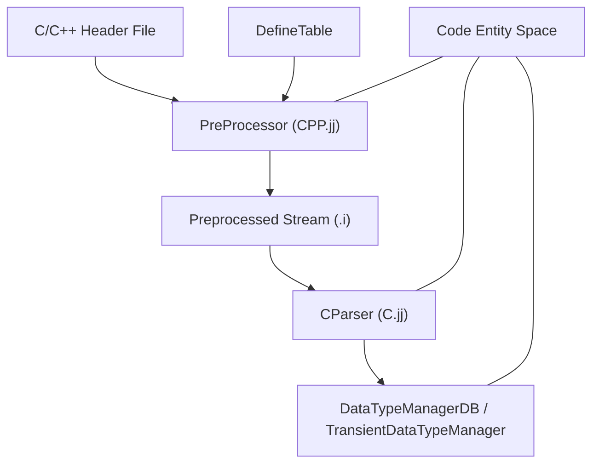
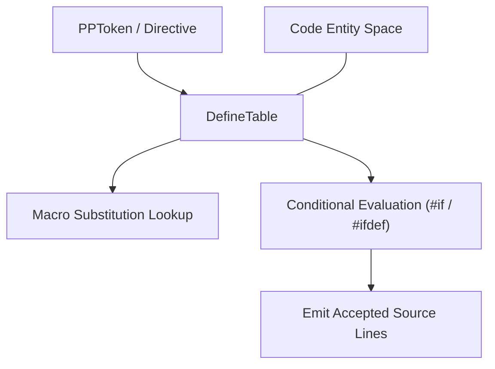
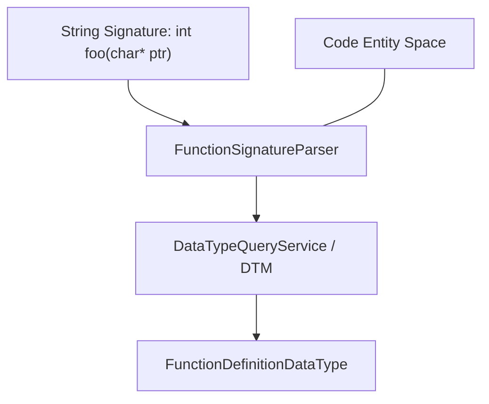

<!-- source: DeepWiki mcp.deepwiki.com · repo NationalSecurityAgency/ghidra · extra page C Header Parsing and Data Type Import · fetched 2026-11-09 -->

# C Header Parsing and Data Type Import

Relevant source files

The following files were used as context for generating this wiki page:

- [Ghidra/Features/Base/data/parserprofiles/VisualStudio12_32.prf](Ghidra/Features/Base/data/parserprofiles/VisualStudio12_32.prf)
- [Ghidra/Features/Base/data/parserprofiles/VisualStudio12_64.prf](Ghidra/Features/Base/data/parserprofiles/VisualStudio12_64.prf)
- [Ghidra/Features/Base/data/parserprofiles/VisualStudio22_64.prf](Ghidra/Features/Base/data/parserprofiles/VisualStudio22_64.prf)
- [Ghidra/Features/Base/data/parserprofiles/generic_clib_32.prf](Ghidra/Features/Base/data/parserprofiles/generic_clib_32.prf)
- [Ghidra/Features/Base/data/parserprofiles/generic_clib_64.prf](Ghidra/Features/Base/data/parserprofiles/generic_clib_64.prf)
- [Ghidra/Features/Base/data/parserprofiles/vs12Local.prf](Ghidra/Features/Base/data/parserprofiles/vs12Local.prf)
- [Ghidra/Features/Base/data/typeinfo/generic/generic_clib.gdt](Ghidra/Features/Base/data/typeinfo/generic/generic_clib.gdt)
- [Ghidra/Features/Base/data/typeinfo/generic/generic_clib_64.gdt](Ghidra/Features/Base/data/typeinfo/generic/generic_clib_64.gdt)
- [Ghidra/Features/Base/data/typeinfo/mac_10.9/mac_osx.gdt](Ghidra/Features/Base/data/typeinfo/mac_10.9/mac_osx.gdt)
- [Ghidra/Features/Base/data/typeinfo/win32/windows_vs12_32.gdt](Ghidra/Features/Base/data/typeinfo/win32/windows_vs12_32.gdt)
- [Ghidra/Features/Base/data/typeinfo/win32/windows_vs12_64.gdt](Ghidra/Features/Base/data/typeinfo/win32/windows_vs12_64.gdt)
- [Ghidra/Features/Base/ghidra_scripts/CreateDefaultGDTArchivesScript.java](Ghidra/Features/Base/ghidra_scripts/CreateDefaultGDTArchivesScript.java)
- [Ghidra/Features/Base/ghidra_scripts/CreateExampleGDTArchiveScript.java](Ghidra/Features/Base/ghidra_scripts/CreateExampleGDTArchiveScript.java)
- [Ghidra/Features/Base/ghidra_scripts/CreateUEFIGDTArchivesScript.java](Ghidra/Features/Base/ghidra_scripts/CreateUEFIGDTArchivesScript.java)
- [Ghidra/Features/Base/ghidra_scripts/SynchronizeGDTCategoryPaths.java](Ghidra/Features/Base/ghidra_scripts/SynchronizeGDTCategoryPaths.java)
- [Ghidra/Features/Base/src/main/help/help/topics/DataTypeManagerPlugin/data_type_manager_description.htm](Ghidra/Features/Base/src/main/help/help/topics/DataTypeManagerPlugin/data_type_manager_description.htm)
- [Ghidra/Features/Base/src/main/help/help/topics/DataTypeManagerPlugin/data_type_manager_window.html](Ghidra/Features/Base/src/main/help/help/topics/DataTypeManagerPlugin/data_type_manager_window.html)
- [Ghidra/Features/Base/src/main/help/help/topics/DataTypeManagerPlugin/data_types_table.html](Ghidra/Features/Base/src/main/help/help/topics/DataTypeManagerPlugin/data_types_table.html)
- [Ghidra/Features/Base/src/main/java/ghidra/app/plugin/core/analysis/DefaultDataTypeManagerService.java](Ghidra/Features/Base/src/main/java/ghidra/app/plugin/core/analysis/DefaultDataTypeManagerService.java)
- [Ghidra/Features/Base/src/main/java/ghidra/app/plugin/core/cparser/CParserPlugin.java](Ghidra/Features/Base/src/main/java/ghidra/app/plugin/core/cparser/CParserPlugin.java)
- [Ghidra/Features/Base/src/main/java/ghidra/app/plugin/core/cparser/CParserTask.java](Ghidra/Features/Base/src/main/java/ghidra/app/plugin/core/cparser/CParserTask.java)
- [Ghidra/Features/Base/src/main/java/ghidra/app/plugin/core/datamgr/DataTypeComparePanel.java](Ghidra/Features/Base/src/main/java/ghidra/app/plugin/core/datamgr/DataTypeComparePanel.java)
- [Ghidra/Features/Base/src/main/java/ghidra/app/plugin/core/datamgr/DataTypeCompareProvider.java](Ghidra/Features/Base/src/main/java/ghidra/app/plugin/core/datamgr/DataTypeCompareProvider.java)
- [Ghidra/Features/Base/src/main/java/ghidra/app/plugin/core/datamgr/DataTypeContext.java](Ghidra/Features/Base/src/main/java/ghidra/app/plugin/core/datamgr/DataTypeContext.java)
- [Ghidra/Features/Base/src/main/java/ghidra/app/plugin/core/datamgr/DataTypeManagerPlugin.java](Ghidra/Features/Base/src/main/java/ghidra/app/plugin/core/datamgr/DataTypeManagerPlugin.java)
- [Ghidra/Features/Base/src/main/java/ghidra/app/plugin/core/datamgr/DataTypeSyncDialog.java](Ghidra/Features/Base/src/main/java/ghidra/app/plugin/core/datamgr/DataTypeSyncDialog.java)
- [Ghidra/Features/Base/src/main/java/ghidra/app/plugin/core/datamgr/DataTypeSynchronizer.java](Ghidra/Features/Base/src/main/java/ghidra/app/plugin/core/datamgr/DataTypeSynchronizer.java)
- [Ghidra/Features/Base/src/main/java/ghidra/app/plugin/core/datamgr/DataTypesActionContext.java](Ghidra/Features/Base/src/main/java/ghidra/app/plugin/core/datamgr/DataTypesActionContext.java)
- [Ghidra/Features/Base/src/main/java/ghidra/app/plugin/core/datamgr/DataTypesProvider.java](Ghidra/Features/Base/src/main/java/ghidra/app/plugin/core/datamgr/DataTypesProvider.java)
- [Ghidra/Features/Base/src/main/java/ghidra/app/plugin/core/datamgr/FilterOnNameOnlyAction.java](Ghidra/Features/Base/src/main/java/ghidra/app/plugin/core/datamgr/FilterOnNameOnlyAction.java)
- [Ghidra/Features/Base/src/main/java/ghidra/app/plugin/core/datamgr/ShowDataTypesTableAction.java](Ghidra/Features/Base/src/main/java/ghidra/app/plugin/core/datamgr/ShowDataTypesTableAction.java)
- [Ghidra/Features/Base/src/main/java/ghidra/app/plugin/core/datamgr/actions/CompareDataTypesAction.java](Ghidra/Features/Base/src/main/java/ghidra/app/plugin/core/datamgr/actions/CompareDataTypesAction.java)
- [Ghidra/Features/Base/src/main/java/ghidra/app/plugin/core/datamgr/actions/DtFilterAction.java](Ghidra/Features/Base/src/main/java/ghidra/app/plugin/core/datamgr/actions/DtFilterAction.java)
- [Ghidra/Features/Base/src/main/java/ghidra/app/plugin/core/datamgr/actions/FindDataTypesByNameAction.java](Ghidra/Features/Base/src/main/java/ghidra/app/plugin/core/datamgr/actions/FindDataTypesByNameAction.java)
- [Ghidra/Features/Base/src/main/java/ghidra/app/plugin/core/datamgr/actions/FindDataTypesBySizeAction.java](Ghidra/Features/Base/src/main/java/ghidra/app/plugin/core/datamgr/actions/FindDataTypesBySizeAction.java)
- [Ghidra/Features/Base/src/main/java/ghidra/app/plugin/core/datamgr/actions/FindEnumsByValueAction.java](Ghidra/Features/Base/src/main/java/ghidra/app/plugin/core/datamgr/actions/FindEnumsByValueAction.java)
- [Ghidra/Features/Base/src/main/java/ghidra/app/plugin/core/datamgr/actions/FindStructuresByOffsetAction.java](Ghidra/Features/Base/src/main/java/ghidra/app/plugin/core/datamgr/actions/FindStructuresByOffsetAction.java)
- [Ghidra/Features/Base/src/main/java/ghidra/app/plugin/core/datamgr/actions/FindStructuresBySizeAction.java](Ghidra/Features/Base/src/main/java/ghidra/app/plugin/core/datamgr/actions/FindStructuresBySizeAction.java)
- [Ghidra/Features/Base/src/main/java/ghidra/app/plugin/core/datamgr/actions/IncludeDataTypesInFilterAction.java](Ghidra/Features/Base/src/main/java/ghidra/app/plugin/core/datamgr/actions/IncludeDataTypesInFilterAction.java)
- [Ghidra/Features/Base/src/main/java/ghidra/app/plugin/core/datamgr/actions/associate/AssociateDataTypeAction.java](Ghidra/Features/Base/src/main/java/ghidra/app/plugin/core/datamgr/actions/associate/AssociateDataTypeAction.java)
- [Ghidra/Features/Base/src/main/java/ghidra/app/plugin/core/datamgr/actions/associate/CommitSingleDataTypeAction.java](Ghidra/Features/Base/src/main/java/ghidra/app/plugin/core/datamgr/actions/associate/CommitSingleDataTypeAction.java)
- [Ghidra/Features/Base/src/main/java/ghidra/app/plugin/core/datamgr/actions/associate/DisassociateDataTypeAction.java](Ghidra/Features/Base/src/main/java/ghidra/app/plugin/core/datamgr/actions/associate/DisassociateDataTypeAction.java)
- [Ghidra/Features/Base/src/main/java/ghidra/app/plugin/core/datamgr/actions/associate/RevertDataTypeAction.java](Ghidra/Features/Base/src/main/java/ghidra/app/plugin/core/datamgr/actions/associate/RevertDataTypeAction.java)
- [Ghidra/Features/Base/src/main/java/ghidra/app/plugin/core/datamgr/actions/associate/UpdateSingleDataTypeAction.java](Ghidra/Features/Base/src/main/java/ghidra/app/plugin/core/datamgr/actions/associate/UpdateSingleDataTypeAction.java)
- [Ghidra/Features/Base/src/main/java/ghidra/app/plugin/core/datamgr/tree/DataTypeArchiveGTree.java](Ghidra/Features/Base/src/main/java/ghidra/app/plugin/core/datamgr/tree/DataTypeArchiveGTree.java)
- [Ghidra/Features/Base/src/main/java/ghidra/app/plugin/core/datamgr/tree/DtFilterDialog.java](Ghidra/Features/Base/src/main/java/ghidra/app/plugin/core/datamgr/tree/DtFilterDialog.java)
- [Ghidra/Features/Base/src/main/java/ghidra/app/plugin/core/datamgr/tree/DtFilterState.java](Ghidra/Features/Base/src/main/java/ghidra/app/plugin/core/datamgr/tree/DtFilterState.java)
- [Ghidra/Features/Base/src/main/java/ghidra/app/plugin/core/datamgr/tree/DtTypeFilter.java](Ghidra/Features/Base/src/main/java/ghidra/app/plugin/core/datamgr/tree/DtTypeFilter.java)
- [Ghidra/Features/Base/src/main/java/ghidra/app/plugin/core/datamgr/util/DataTypeUtils.java](Ghidra/Features/Base/src/main/java/ghidra/app/plugin/core/datamgr/util/DataTypeUtils.java)
- [Ghidra/Features/Base/src/main/java/ghidra/app/plugin/core/disassembler/EntryPointAnalyzer.java](Ghidra/Features/Base/src/main/java/ghidra/app/plugin/core/disassembler/EntryPointAnalyzer.java)
- [Ghidra/Features/Base/src/main/java/ghidra/app/services/DataTypeArchiveService.java](Ghidra/Features/Base/src/main/java/ghidra/app/services/DataTypeArchiveService.java)
- [Ghidra/Features/Base/src/main/java/ghidra/app/services/DataTypeManagerService.java](Ghidra/Features/Base/src/main/java/ghidra/app/services/DataTypeManagerService.java)
- [Ghidra/Features/Base/src/main/java/ghidra/app/services/DataTypeQueryService.java](Ghidra/Features/Base/src/main/java/ghidra/app/services/DataTypeQueryService.java)
- [Ghidra/Features/Base/src/main/java/ghidra/app/util/RefRepeatComment.java](Ghidra/Features/Base/src/main/java/ghidra/app/util/RefRepeatComment.java)
- [Ghidra/Features/Base/src/main/java/ghidra/app/util/bin/format/dwarf/attribs/DWARFAttributeDef.java](Ghidra/Features/Base/src/main/java/ghidra/app/util/bin/format/dwarf/attribs/DWARFAttributeDef.java)
- [Ghidra/Features/Base/src/main/java/ghidra/app/util/cparser/C/CParserUtils.java](Ghidra/Features/Base/src/main/java/ghidra/app/util/cparser/C/CParserUtils.java)
- [Ghidra/Features/Base/src/main/java/ghidra/app/util/cparser/CPP/DefineTable.java](Ghidra/Features/Base/src/main/java/ghidra/app/util/cparser/CPP/DefineTable.java)
- [Ghidra/Features/Base/src/main/java/ghidra/app/util/parser/FunctionSignatureParser.java](Ghidra/Features/Base/src/main/java/ghidra/app/util/parser/FunctionSignatureParser.java)
- [Ghidra/Features/Base/src/main/java/ghidra/util/data/DataTypeParser.java](Ghidra/Features/Base/src/main/java/ghidra/util/data/DataTypeParser.java)
- [Ghidra/Features/Base/src/main/javacc/ghidra/app/util/cparser/C/C.jj](Ghidra/Features/Base/src/main/javacc/ghidra/app/util/cparser/C/C.jj)
- [Ghidra/Features/Base/src/main/javacc/ghidra/app/util/cparser/CPP/CPP.jj](Ghidra/Features/Base/src/main/javacc/ghidra/app/util/cparser/CPP/CPP.jj)
- [Ghidra/Features/Base/src/test.slow/java/ghidra/app/plugin/core/datamgr/DataTypeManagerPluginTest.java](Ghidra/Features/Base/src/test.slow/java/ghidra/app/plugin/core/datamgr/DataTypeManagerPluginTest.java)
- [Ghidra/Features/Base/src/test.slow/java/ghidra/app/util/parser/FunctionSignatureParserTest.java](Ghidra/Features/Base/src/test.slow/java/ghidra/app/util/parser/FunctionSignatureParserTest.java)
- [Ghidra/Features/Base/src/test.slow/java/ghidra/util/data/DataTypeParserTest.java](Ghidra/Features/Base/src/test.slow/java/ghidra/util/data/DataTypeParserTest.java)
- [Ghidra/Features/Base/src/test/java/ghidra/app/services/TestDoubleDataTypeManagerService.java](Ghidra/Features/Base/src/test/java/ghidra/app/services/TestDoubleDataTypeManagerService.java)
- [Ghidra/Features/Base/src/test/java/ghidra/app/util/cparser/CParserTest.java](Ghidra/Features/Base/src/test/java/ghidra/app/util/cparser/CParserTest.java)
- [Ghidra/Features/Base/src/test/java/ghidra/app/util/cparser/PreProcessorTest.java](Ghidra/Features/Base/src/test/java/ghidra/app/util/cparser/PreProcessorTest.java)
- [Ghidra/Features/Base/src/test/resources/ghidra/app/util/cparser/CParserTest.h](Ghidra/Features/Base/src/test/resources/ghidra/app/util/cparser/CParserTest.h)
- [Ghidra/Features/Base/src/test/resources/ghidra/app/util/cparser/PreProcessorTest.h](Ghidra/Features/Base/src/test/resources/ghidra/app/util/cparser/PreProcessorTest.h)
- [Ghidra/Features/Base/src/test/resources/ghidra/app/util/cparser/defined.h](Ghidra/Features/Base/src/test/resources/ghidra/app/util/cparser/defined.h)
- [Ghidra/Features/Base/src/test/resources/ghidra/app/util/cparser/multinclude.h](Ghidra/Features/Base/src/test/resources/ghidra/app/util/cparser/multinclude.h)
- [Ghidra/Framework/Docking/src/main/java/docking/DropCode.java](Ghidra/Framework/Docking/src/main/java/docking/DropCode.java)
- [Ghidra/Framework/Docking/src/main/java/docking/HeaderCursor.java](Ghidra/Framework/Docking/src/main/java/docking/HeaderCursor.java)
- [Ghidra/Framework/Docking/src/main/java/docking/ShowAllComponentsAction.java](Ghidra/Framework/Docking/src/main/java/docking/ShowAllComponentsAction.java)
- [Ghidra/Framework/Docking/src/main/java/docking/ShowComponentAction.java](Ghidra/Framework/Docking/src/main/java/docking/ShowComponentAction.java)
- [Ghidra/Framework/Docking/src/main/java/docking/widgets/textpane/GHtmlTextPane.java](Ghidra/Framework/Docking/src/main/java/docking/widgets/textpane/GHtmlTextPane.java)
- [Ghidra/Framework/Docking/src/main/java/docking/widgets/tree/support/GTreeRenderer.java](Ghidra/Framework/Docking/src/main/java/docking/widgets/tree/support/GTreeRenderer.java)
- [Ghidra/Framework/Generic/src/main/java/ghidra/util/datastruct/SortedRangeList.java](Ghidra/Framework/Generic/src/main/java/ghidra/util/datastruct/SortedRangeList.java)
- [Ghidra/Framework/Help/src/main/java/help/CustomTOCView.java](Ghidra/Framework/Help/src/main/java/help/CustomTOCView.java)
- [Ghidra/Framework/Help/src/main/java/help/GHelpSet.java](Ghidra/Framework/Help/src/main/java/help/GHelpSet.java)
- [Ghidra/Framework/SoftwareModeling/src/main/java/ghidra/pcodeCPort/utils/WeakHashMap2.java](Ghidra/Framework/SoftwareModeling/src/main/java/ghidra/pcodeCPort/utils/WeakHashMap2.java)
- [Ghidra/Framework/SoftwareModeling/src/test/java/ghidra/program/database/data/TypedefDBTest.java](Ghidra/Framework/SoftwareModeling/src/test/java/ghidra/program/database/data/TypedefDBTest.java)
- [Ghidra/Processors/Atmel/ghidra_scripts/CreateAVR8GDTArchiveScript.java](Ghidra/Processors/Atmel/ghidra_scripts/CreateAVR8GDTArchiveScript.java)
- [Ghidra/Processors/JVM/ghidra_scripts/CreateJNIGDTArchivesScript.java](Ghidra/Processors/JVM/ghidra_scripts/CreateJNIGDTArchivesScript.java)

## Purpose and Scope
Ghidra provides robust capabilities for importing C and C++ header files to populate data type managers (`DataTypeManager`), construct complex composite structures, define enums, and recover function signatures. This subsystem relies on JavaCC-based grammars for parsing preprocessed C and C++ source code, a custom preprocessor implementation for handling macros and conditional compilation directives, utility classes like `CParserUtils` and `FunctionSignatureParser`, an interactive parse dialog workflow, and a collection of prebuilt type information (`.gdt`) archives.

---

## 1. JavaCC-based C/C++ Parsers (`C.jj`, `CPP.jj`)
The core parsing engine is generated using JavaCC from grammar specifications located in the `ghidra.app.util.cparser` package. 

* **`C.jj`**: Defines the `CParser` class [Ghidra/Features/Base/src/main/javacc/ghidra/app/util/cparser/C/C.jj:80-101] which processes preprocessed C source files. It handles translation units, external declarations, function definitions, variable declarations, type specifiers (`struct`, `union`, `enum`), and `typedef` constructs, mapping them directly into Ghidra `DataType` objects (such as `StructureDataType`, `UnionDataType`, `Enum`, and `TypeDef`).
* **`CPP.jj`**: Defines the `PreProcessor` class [Ghidra/Features/Base/src/main/javacc/ghidra/app/util/cparser/CPP/CPP.jj:108-122] which scans and processes C/C++ preprocessor directives (`#define`, `#if`, `#ifdef`, `#ifndef`, `#else`, `#elif`, `#endif`, `#include`, `#pragma`, and `#line`). 

*Sources: [Ghidra/Features/Base/src/main/javacc/ghidra/app/util/cparser/C/C.jj:80-101](), [Ghidra/Features/Base/src/main/javacc/ghidra/app/util/cparser/CPP/CPP.jj:108-122]()*

---

## 2. C Preprocessor and `DefineTable`
Before source code reaches `CParser`, the preprocessor evaluates conditional compilation blocks and expands macros. 

* **`DefineTable`**: Manages the macro definition table and tracks defined symbols, macro replacement lists, and function-like macro arguments during parsing [ghidra/app/util/cparser/CPP/DefineTable.java](). It supports integer expression evaluation for `#if` and `#elif` conditional checks, handling standard integer suffixes (`L`, `UL`, `LL`, etc.) and bitwise/arithmetic operator evaluation.

*Sources: [Ghidra/Features/Base/src/main/java/ghidra/app/util/cparser/CPP/DefineTable.java]()*

---

## 3. Utility Wrappers: `CParserUtils` and `FunctionSignatureParser`
High-level integration with Ghidra tools and analyzers is provided by utility classes that simplify parsing strings or files into program databases.

* **`CParserUtils`**: Provides helper methods to configure a `CParser` instance with appropriate compiler specifications (`CompilerSpec`), data organization rules, and predefined macros before executing parses on header files or snippet strings [Ghidra/Features/Base/src/main/java/ghidra/app/util/cparser/C/CParserUtils.java]().
* **`FunctionSignatureParser`**: Parses string representations of function signatures (e.g., `int __cdecl foo(char *bar, int len)`) directly into `FunctionDefinition` data types without requiring a full translation unit [Ghidra/Features/Base/src/main/java/ghidra/app/util/parser/FunctionSignatureParser.java]().

*Sources: [Ghidra/Features/Base/src/main/java/ghidra/app/util/cparser/C/CParserUtils.java](), [Ghidra/Features/Base/src/main/java/ghidra/app/util/parser/FunctionSignatureParser.java]()*

---

## 4. Parse Dialog Workflow and `.gdt` Archive Generation
The user interface integration is coordinated via `CParserPlugin` and related dialog components, allowing users to parse C headers interactively and build persistent data type archives (`.gdt`).

* **Profile Selection**: Profiles (stored under `Ghidra/Features/Base/data/parserprofiles/`, such as `VisualStudio22_64.prf`) define default include paths, predefined compiler macros (e.g., `_MSC_VER`, `__GNUC__`), and architecture-specific type mappings.
* **Archive Export**: Parsed data types can be saved directly into the current program's data type manager or exported into a standalone persistent archive (`PersistentDataTypeArchive`) [Ghidra/Features/Base/src/main/java/ghidra/app/plugin/core/datamgr/DataTypeManagerPlugin.java]().

| Workflow Step | Key Class / Component | Description |
| :--- | :--- | :--- |
| **1. Configuration** | `CParserPlugin` / Parser Dialog | User selects header files, compiler profile (`.prf`), and target `DataTypeManager`. |
| **2. Preprocessing** | `PreProcessor` (`CPP.jj`) | Evaluates macros, includes, and conditional blocks based on profile settings. |
| **3. Parsing** | `CParser` (`C.jj`) | Translates parsed AST nodes into Ghidra data types. |
| **4. Persistence** | `PersistentDataTypeArchive` | Stores resulting types in a `.gdt` container file or program database. |

*Sources: [Ghidra/Features/Base/src/main/java/ghidra/app/plugin/core/datamgr/DataTypeManagerPlugin.java](), [Ghidra/Features/Base/src/main/java/ghidra/app/plugin/core/cparser/CParserPlugin.java]()*

---

## 5. Prebuilt Type Information Archives
Ghidra ships with precompiled `.gdt` type information archives located in the installation tree under `Ghidra/Features/Base/data/typeinfo/`. These archives provide immediate access to standard library definitions across different operating systems and compiler toolchains without requiring live header parsing.

* **Generic C Libraries**: `generic/generic_clib.gdt`, `generic/generic_clib_64.gdt` [Ghidra/Features/Base/data/typeinfo/generic/generic_clib_64.gdt]()
* **Windows / Visual Studio**: `win32/windows_vs12_32.gdt`, `win32/windows_vs12_64.gdt` [Ghidra/Features/Base/data/typeinfo/win32/windows_vs12_64.gdt]()

These archives are automatically made available or queried by Ghidra's data type manager service (`DataTypeManagerService`) to resolve standard types during disassembly and auto-analysis.

*Sources: [Ghidra/Features/Base/data/typeinfo/win32/windows_vs12_64.gdt](), [Ghidra/Features/Base/data/typeinfo/generic/generic_clib_64.gdt]()*

---

