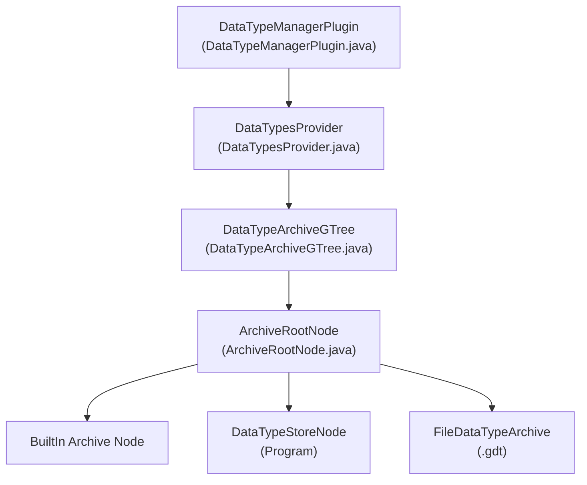
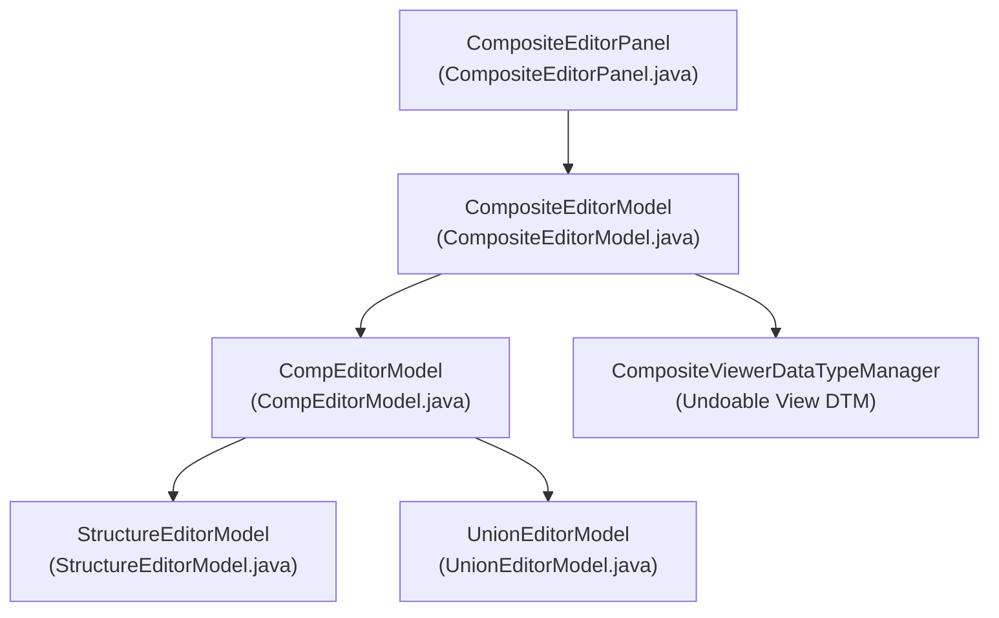

<!-- source: DeepWiki mcp.deepwiki.com · repo NationalSecurityAgency/ghidra · extra page Data Type Manager UI and Composite Editors · fetched 2026-11-09 -->

# Data Type Manager UI and Composite Editors

Relevant source files

The following files were used as context for generating this wiki page:

- [Ghidra/Features/Base/src/main/help/help/topics/DataTypeEditors/StructureEditor.htm](Ghidra/Features/Base/src/main/help/help/topics/DataTypeEditors/StructureEditor.htm)
- [Ghidra/Features/Base/src/main/help/help/topics/DataTypeEditors/images/NumElementsPrompt.png](Ghidra/Features/Base/src/main/help/help/topics/DataTypeEditors/images/NumElementsPrompt.png)
- [Ghidra/Features/Base/src/main/help/help/topics/DataTypeEditors/images/StructureEditBitfield.png](Ghidra/Features/Base/src/main/help/help/topics/DataTypeEditors/images/StructureEditBitfield.png)
- [Ghidra/Features/Base/src/main/help/help/topics/DataTypeEditors/images/StructureEditor.png](Ghidra/Features/Base/src/main/help/help/topics/DataTypeEditors/images/StructureEditor.png)
- [Ghidra/Features/Base/src/main/help/help/topics/DataTypeEditors/images/StructureEditorWithFlexArray.png](Ghidra/Features/Base/src/main/help/help/topics/DataTypeEditors/images/StructureEditorWithFlexArray.png)
- [Ghidra/Features/Base/src/main/help/help/topics/DataTypeEditors/images/UnionEditor.png](Ghidra/Features/Base/src/main/help/help/topics/DataTypeEditors/images/UnionEditor.png)
- [Ghidra/Features/Base/src/main/help/help/topics/DataTypeManagerPlugin/data_type_manager_description.htm](Ghidra/Features/Base/src/main/help/help/topics/DataTypeManagerPlugin/data_type_manager_description.htm)
- [Ghidra/Features/Base/src/main/help/help/topics/DataTypeManagerPlugin/data_type_manager_window.html](Ghidra/Features/Base/src/main/help/help/topics/DataTypeManagerPlugin/data_type_manager_window.html)
- [Ghidra/Features/Base/src/main/help/help/topics/DataTypeManagerPlugin/data_types_table.html](Ghidra/Features/Base/src/main/help/help/topics/DataTypeManagerPlugin/data_types_table.html)
- [Ghidra/Features/Base/src/main/java/ghidra/app/cmd/function/FunctionStackAnalysisCmd.java](Ghidra/Features/Base/src/main/java/ghidra/app/cmd/function/FunctionStackAnalysisCmd.java)
- [Ghidra/Features/Base/src/main/java/ghidra/app/plugin/core/analysis/DefaultDataTypeManagerService.java](Ghidra/Features/Base/src/main/java/ghidra/app/plugin/core/analysis/DefaultDataTypeManagerService.java)
- [Ghidra/Features/Base/src/main/java/ghidra/app/plugin/core/compositeeditor/AddBitFieldAction.java](Ghidra/Features/Base/src/main/java/ghidra/app/plugin/core/compositeeditor/AddBitFieldAction.java)
- [Ghidra/Features/Base/src/main/java/ghidra/app/plugin/core/compositeeditor/ApplyAction.java](Ghidra/Features/Base/src/main/java/ghidra/app/plugin/core/compositeeditor/ApplyAction.java)
- [Ghidra/Features/Base/src/main/java/ghidra/app/plugin/core/compositeeditor/ArrayAction.java](Ghidra/Features/Base/src/main/java/ghidra/app/plugin/core/compositeeditor/ArrayAction.java)
- [Ghidra/Features/Base/src/main/java/ghidra/app/plugin/core/compositeeditor/BitFieldEditorDialog.java](Ghidra/Features/Base/src/main/java/ghidra/app/plugin/core/compositeeditor/BitFieldEditorDialog.java)
- [Ghidra/Features/Base/src/main/java/ghidra/app/plugin/core/compositeeditor/BitFieldEditorPanel.java](Ghidra/Features/Base/src/main/java/ghidra/app/plugin/core/compositeeditor/BitFieldEditorPanel.java)
- [Ghidra/Features/Base/src/main/java/ghidra/app/plugin/core/compositeeditor/BitFieldPlacementComponent.java](Ghidra/Features/Base/src/main/java/ghidra/app/plugin/core/compositeeditor/BitFieldPlacementComponent.java)
- [Ghidra/Features/Base/src/main/java/ghidra/app/plugin/core/compositeeditor/ClearAction.java](Ghidra/Features/Base/src/main/java/ghidra/app/plugin/core/compositeeditor/ClearAction.java)
- [Ghidra/Features/Base/src/main/java/ghidra/app/plugin/core/compositeeditor/CompEditorModel.java](Ghidra/Features/Base/src/main/java/ghidra/app/plugin/core/compositeeditor/CompEditorModel.java)
- [Ghidra/Features/Base/src/main/java/ghidra/app/plugin/core/compositeeditor/CompEditorPanel.java](Ghidra/Features/Base/src/main/java/ghidra/app/plugin/core/compositeeditor/CompEditorPanel.java)
- [Ghidra/Features/Base/src/main/java/ghidra/app/plugin/core/compositeeditor/CompositeEditorModel.java](Ghidra/Features/Base/src/main/java/ghidra/app/plugin/core/compositeeditor/CompositeEditorModel.java)
- [Ghidra/Features/Base/src/main/java/ghidra/app/plugin/core/compositeeditor/CompositeEditorPanel.java](Ghidra/Features/Base/src/main/java/ghidra/app/plugin/core/compositeeditor/CompositeEditorPanel.java)
- [Ghidra/Features/Base/src/main/java/ghidra/app/plugin/core/compositeeditor/CompositeEditorProvider.java](Ghidra/Features/Base/src/main/java/ghidra/app/plugin/core/compositeeditor/CompositeEditorProvider.java)
- [Ghidra/Features/Base/src/main/java/ghidra/app/plugin/core/compositeeditor/CompositeEditorTableAction.java](Ghidra/Features/Base/src/main/java/ghidra/app/plugin/core/compositeeditor/CompositeEditorTableAction.java)
- [Ghidra/Features/Base/src/main/java/ghidra/app/plugin/core/compositeeditor/CompositeViewerDataTypeManager.java](Ghidra/Features/Base/src/main/java/ghidra/app/plugin/core/compositeeditor/CompositeViewerDataTypeManager.java)
- [Ghidra/Features/Base/src/main/java/ghidra/app/plugin/core/compositeeditor/CompositeViewerModel.java](Ghidra/Features/Base/src/main/java/ghidra/app/plugin/core/compositeeditor/CompositeViewerModel.java)
- [Ghidra/Features/Base/src/main/java/ghidra/app/plugin/core/compositeeditor/DuplicateAction.java](Ghidra/Features/Base/src/main/java/ghidra/app/plugin/core/compositeeditor/DuplicateAction.java)
- [Ghidra/Features/Base/src/main/java/ghidra/app/plugin/core/compositeeditor/DuplicateMultipleAction.java](Ghidra/Features/Base/src/main/java/ghidra/app/plugin/core/compositeeditor/DuplicateMultipleAction.java)
- [Ghidra/Features/Base/src/main/java/ghidra/app/plugin/core/compositeeditor/EditBitFieldAction.java](Ghidra/Features/Base/src/main/java/ghidra/app/plugin/core/compositeeditor/EditBitFieldAction.java)
- [Ghidra/Features/Base/src/main/java/ghidra/app/plugin/core/compositeeditor/EditFieldAction.java](Ghidra/Features/Base/src/main/java/ghidra/app/plugin/core/compositeeditor/EditFieldAction.java)
- [Ghidra/Features/Base/src/main/java/ghidra/app/plugin/core/compositeeditor/FavoritesAction.java](Ghidra/Features/Base/src/main/java/ghidra/app/plugin/core/compositeeditor/FavoritesAction.java)
- [Ghidra/Features/Base/src/main/java/ghidra/app/plugin/core/compositeeditor/JumpToOffsetAction.java](Ghidra/Features/Base/src/main/java/ghidra/app/plugin/core/compositeeditor/JumpToOffsetAction.java)
- [Ghidra/Features/Base/src/main/java/ghidra/app/plugin/core/compositeeditor/NextPrevDefinedComponentAction.java](Ghidra/Features/Base/src/main/java/ghidra/app/plugin/core/compositeeditor/NextPrevDefinedComponentAction.java)
- [Ghidra/Features/Base/src/main/java/ghidra/app/plugin/core/compositeeditor/SearchControlPanel.java](Ghidra/Features/Base/src/main/java/ghidra/app/plugin/core/compositeeditor/SearchControlPanel.java)
- [Ghidra/Features/Base/src/main/java/ghidra/app/plugin/core/compositeeditor/ShowDataTypeInTreeAction.java](Ghidra/Features/Base/src/main/java/ghidra/app/plugin/core/compositeeditor/ShowDataTypeInTreeAction.java)
- [Ghidra/Features/Base/src/main/java/ghidra/app/plugin/core/compositeeditor/StructureEditorModel.java](Ghidra/Features/Base/src/main/java/ghidra/app/plugin/core/compositeeditor/StructureEditorModel.java)
- [Ghidra/Features/Base/src/main/java/ghidra/app/plugin/core/compositeeditor/StructureEditorPanel.java](Ghidra/Features/Base/src/main/java/ghidra/app/plugin/core/compositeeditor/StructureEditorPanel.java)
- [Ghidra/Features/Base/src/main/java/ghidra/app/plugin/core/compositeeditor/StructureEditorProvider.java](Ghidra/Features/Base/src/main/java/ghidra/app/plugin/core/compositeeditor/StructureEditorProvider.java)
- [Ghidra/Features/Base/src/main/java/ghidra/app/plugin/core/compositeeditor/UnionEditorModel.java](Ghidra/Features/Base/src/main/java/ghidra/app/plugin/core/compositeeditor/UnionEditorModel.java)
- [Ghidra/Features/Base/src/main/java/ghidra/app/plugin/core/compositeeditor/UnionEditorPanel.java](Ghidra/Features/Base/src/main/java/ghidra/app/plugin/core/compositeeditor/UnionEditorPanel.java)
- [Ghidra/Features/Base/src/main/java/ghidra/app/plugin/core/compositeeditor/UnionEditorProvider.java](Ghidra/Features/Base/src/main/java/ghidra/app/plugin/core/compositeeditor/UnionEditorProvider.java)
- [Ghidra/Features/Base/src/main/java/ghidra/app/plugin/core/compositeeditor/UnpackageAction.java](Ghidra/Features/Base/src/main/java/ghidra/app/plugin/core/compositeeditor/UnpackageAction.java)
- [Ghidra/Features/Base/src/main/java/ghidra/app/plugin/core/datamgr/DataTypeComparePanel.java](Ghidra/Features/Base/src/main/java/ghidra/app/plugin/core/datamgr/DataTypeComparePanel.java)
- [Ghidra/Features/Base/src/main/java/ghidra/app/plugin/core/datamgr/DataTypeCompareProvider.java](Ghidra/Features/Base/src/main/java/ghidra/app/plugin/core/datamgr/DataTypeCompareProvider.java)
- [Ghidra/Features/Base/src/main/java/ghidra/app/plugin/core/datamgr/DataTypeContext.java](Ghidra/Features/Base/src/main/java/ghidra/app/plugin/core/datamgr/DataTypeContext.java)
- [Ghidra/Features/Base/src/main/java/ghidra/app/plugin/core/datamgr/DataTypeManagerPlugin.java](Ghidra/Features/Base/src/main/java/ghidra/app/plugin/core/datamgr/DataTypeManagerPlugin.java)
- [Ghidra/Features/Base/src/main/java/ghidra/app/plugin/core/datamgr/DataTypeSyncDialog.java](Ghidra/Features/Base/src/main/java/ghidra/app/plugin/core/datamgr/DataTypeSyncDialog.java)
- [Ghidra/Features/Base/src/main/java/ghidra/app/plugin/core/datamgr/DataTypeSynchronizer.java](Ghidra/Features/Base/src/main/java/ghidra/app/plugin/core/datamgr/DataTypeSynchronizer.java)
- [Ghidra/Features/Base/src/main/java/ghidra/app/plugin/core/datamgr/DataTypesActionContext.java](Ghidra/Features/Base/src/main/java/ghidra/app/plugin/core/datamgr/DataTypesActionContext.java)
- [Ghidra/Features/Base/src/main/java/ghidra/app/plugin/core/datamgr/DataTypesProvider.java](Ghidra/Features/Base/src/main/java/ghidra/app/plugin/core/datamgr/DataTypesProvider.java)
- [Ghidra/Features/Base/src/main/java/ghidra/app/plugin/core/datamgr/FilterOnNameOnlyAction.java](Ghidra/Features/Base/src/main/java/ghidra/app/plugin/core/datamgr/FilterOnNameOnlyAction.java)
- [Ghidra/Features/Base/src/main/java/ghidra/app/plugin/core/datamgr/ShowDataTypesTableAction.java](Ghidra/Features/Base/src/main/java/ghidra/app/plugin/core/datamgr/ShowDataTypesTableAction.java)
- [Ghidra/Features/Base/src/main/java/ghidra/app/plugin/core/datamgr/actions/CompareDataTypesAction.java](Ghidra/Features/Base/src/main/java/ghidra/app/plugin/core/datamgr/actions/CompareDataTypesAction.java)
- [Ghidra/Features/Base/src/main/java/ghidra/app/plugin/core/datamgr/actions/DtFilterAction.java](Ghidra/Features/Base/src/main/java/ghidra/app/plugin/core/datamgr/actions/DtFilterAction.java)
- [Ghidra/Features/Base/src/main/java/ghidra/app/plugin/core/datamgr/actions/FindDataTypesByNameAction.java](Ghidra/Features/Base/src/main/java/ghidra/app/plugin/core/datamgr/actions/FindDataTypesByNameAction.java)
- [Ghidra/Features/Base/src/main/java/ghidra/app/plugin/core/datamgr/actions/FindDataTypesBySizeAction.java](Ghidra/Features/Base/src/main/java/ghidra/app/plugin/core/datamgr/actions/FindDataTypesBySizeAction.java)
- [Ghidra/Features/Base/src/main/java/ghidra/app/plugin/core/datamgr/actions/FindEnumsByValueAction.java](Ghidra/Features/Base/src/main/java/ghidra/app/plugin/core/datamgr/actions/FindEnumsByValueAction.java)
- [Ghidra/Features/Base/src/main/java/ghidra/app/plugin/core/datamgr/actions/FindStructuresByOffsetAction.java](Ghidra/Features/Base/src/main/java/ghidra/app/plugin/core/datamgr/actions/FindStructuresByOffsetAction.java)
- [Ghidra/Features/Base/src/main/java/ghidra/app/plugin/core/datamgr/actions/FindStructuresBySizeAction.java](Ghidra/Features/Base/src/main/java/ghidra/app/plugin/core/datamgr/actions/FindStructuresBySizeAction.java)
- [Ghidra/Features/Base/src/main/java/ghidra/app/plugin/core/datamgr/actions/IncludeDataTypesInFilterAction.java](Ghidra/Features/Base/src/main/java/ghidra/app/plugin/core/datamgr/actions/IncludeDataTypesInFilterAction.java)
- [Ghidra/Features/Base/src/main/java/ghidra/app/plugin/core/datamgr/actions/associate/AssociateDataTypeAction.java](Ghidra/Features/Base/src/main/java/ghidra/app/plugin/core/datamgr/actions/associate/AssociateDataTypeAction.java)
- [Ghidra/Features/Base/src/main/java/ghidra/app/plugin/core/datamgr/actions/associate/CommitSingleDataTypeAction.java](Ghidra/Features/Base/src/main/java/ghidra/app/plugin/core/datamgr/actions/associate/CommitSingleDataTypeAction.java)
- [Ghidra/Features/Base/src/main/java/ghidra/app/plugin/core/datamgr/actions/associate/DisassociateDataTypeAction.java](Ghidra/Features/Base/src/main/java/ghidra/app/plugin/core/datamgr/actions/associate/DisassociateDataTypeAction.java)
- [Ghidra/Features/Base/src/main/java/ghidra/app/plugin/core/datamgr/actions/associate/RevertDataTypeAction.java](Ghidra/Features/Base/src/main/java/ghidra/app/plugin/core/datamgr/actions/associate/RevertDataTypeAction.java)
- [Ghidra/Features/Base/src/main/java/ghidra/app/plugin/core/datamgr/actions/associate/UpdateSingleDataTypeAction.java](Ghidra/Features/Base/src/main/java/ghidra/app/plugin/core/datamgr/actions/associate/UpdateSingleDataTypeAction.java)
- [Ghidra/Features/Base/src/main/java/ghidra/app/plugin/core/datamgr/tree/DataTypeArchiveGTree.java](Ghidra/Features/Base/src/main/java/ghidra/app/plugin/core/datamgr/tree/DataTypeArchiveGTree.java)
- [Ghidra/Features/Base/src/main/java/ghidra/app/plugin/core/datamgr/tree/DtFilterDialog.java](Ghidra/Features/Base/src/main/java/ghidra/app/plugin/core/datamgr/tree/DtFilterDialog.java)
- [Ghidra/Features/Base/src/main/java/ghidra/app/plugin/core/datamgr/tree/DtFilterState.java](Ghidra/Features/Base/src/main/java/ghidra/app/plugin/core/datamgr/tree/DtFilterState.java)
- [Ghidra/Features/Base/src/main/java/ghidra/app/plugin/core/datamgr/tree/DtTypeFilter.java](Ghidra/Features/Base/src/main/java/ghidra/app/plugin/core/datamgr/tree/DtTypeFilter.java)
- [Ghidra/Features/Base/src/main/java/ghidra/app/plugin/core/datamgr/util/DataTypeUtils.java](Ghidra/Features/Base/src/main/java/ghidra/app/plugin/core/datamgr/util/DataTypeUtils.java)
- [Ghidra/Features/Base/src/main/java/ghidra/app/plugin/core/stackeditor/StackEditorModel.java](Ghidra/Features/Base/src/main/java/ghidra/app/plugin/core/stackeditor/StackEditorModel.java)
- [Ghidra/Features/Base/src/main/java/ghidra/app/plugin/core/stackeditor/StackEditorPanel.java](Ghidra/Features/Base/src/main/java/ghidra/app/plugin/core/stackeditor/StackEditorPanel.java)
- [Ghidra/Features/Base/src/main/java/ghidra/app/plugin/core/stackeditor/StackEditorProvider.java](Ghidra/Features/Base/src/main/java/ghidra/app/plugin/core/stackeditor/StackEditorProvider.java)
- [Ghidra/Features/Base/src/main/java/ghidra/app/services/DataTypeArchiveService.java](Ghidra/Features/Base/src/main/java/ghidra/app/services/DataTypeArchiveService.java)
- [Ghidra/Features/Base/src/main/java/ghidra/app/services/DataTypeManagerService.java](Ghidra/Features/Base/src/main/java/ghidra/app/services/DataTypeManagerService.java)
- [Ghidra/Features/Base/src/main/java/ghidra/app/services/DataTypeQueryService.java](Ghidra/Features/Base/src/main/java/ghidra/app/services/DataTypeQueryService.java)
- [Ghidra/Features/Base/src/main/java/ghidra/app/util/RefRepeatComment.java](Ghidra/Features/Base/src/main/java/ghidra/app/util/RefRepeatComment.java)
- [Ghidra/Features/Base/src/main/java/ghidra/app/util/cparser/C/Declaration.java](Ghidra/Features/Base/src/main/java/ghidra/app/util/cparser/C/Declaration.java)
- [Ghidra/Features/Base/src/main/java/ghidra/app/util/parser/FunctionSignatureParser.java](Ghidra/Features/Base/src/main/java/ghidra/app/util/parser/FunctionSignatureParser.java)
- [Ghidra/Features/Base/src/main/java/ghidra/test/ClassicSampleX86ProgramBuilder.java](Ghidra/Features/Base/src/main/java/ghidra/test/ClassicSampleX86ProgramBuilder.java)
- [Ghidra/Features/Base/src/main/java/ghidra/util/data/DataTypeParser.java](Ghidra/Features/Base/src/main/java/ghidra/util/data/DataTypeParser.java)
- [Ghidra/Features/Base/src/test.slow/java/ghidra/app/plugin/core/clipboard/CopyPasteFunctionInfoTest.java](Ghidra/Features/Base/src/test.slow/java/ghidra/app/plugin/core/clipboard/CopyPasteFunctionInfoTest.java)
- [Ghidra/Features/Base/src/test.slow/java/ghidra/app/plugin/core/compositeeditor/AbstractEditorTest.java](Ghidra/Features/Base/src/test.slow/java/ghidra/app/plugin/core/compositeeditor/AbstractEditorTest.java)
- [Ghidra/Features/Base/src/test.slow/java/ghidra/app/plugin/core/compositeeditor/AbstractStructureEditorTest.java](Ghidra/Features/Base/src/test.slow/java/ghidra/app/plugin/core/compositeeditor/AbstractStructureEditorTest.java)
- [Ghidra/Features/Base/src/test.slow/java/ghidra/app/plugin/core/compositeeditor/CommonTestData.java](Ghidra/Features/Base/src/test.slow/java/ghidra/app/plugin/core/compositeeditor/CommonTestData.java)
- [Ghidra/Features/Base/src/test.slow/java/ghidra/app/plugin/core/compositeeditor/StructureEditorAlignmentTest.java](Ghidra/Features/Base/src/test.slow/java/ghidra/app/plugin/core/compositeeditor/StructureEditorAlignmentTest.java)
- [Ghidra/Features/Base/src/test.slow/java/ghidra/app/plugin/core/compositeeditor/StructureEditorFlexAlignmentTest.java](Ghidra/Features/Base/src/test.slow/java/ghidra/app/plugin/core/compositeeditor/StructureEditorFlexAlignmentTest.java)
- [Ghidra/Features/Base/src/test.slow/java/ghidra/app/plugin/core/compositeeditor/StructureEditorLockedActions1Test.java](Ghidra/Features/Base/src/test.slow/java/ghidra/app/plugin/core/compositeeditor/StructureEditorLockedActions1Test.java)
- [Ghidra/Features/Base/src/test.slow/java/ghidra/app/plugin/core/compositeeditor/StructureEditorLockedActions2Test.java](Ghidra/Features/Base/src/test.slow/java/ghidra/app/plugin/core/compositeeditor/StructureEditorLockedActions2Test.java)
- [Ghidra/Features/Base/src/test.slow/java/ghidra/app/plugin/core/compositeeditor/StructureEditorLockedActions3Test.java](Ghidra/Features/Base/src/test.slow/java/ghidra/app/plugin/core/compositeeditor/StructureEditorLockedActions3Test.java)
- [Ghidra/Features/Base/src/test.slow/java/ghidra/app/plugin/core/compositeeditor/StructureEditorLockedActions4Test.java](Ghidra/Features/Base/src/test.slow/java/ghidra/app/plugin/core/compositeeditor/StructureEditorLockedActions4Test.java)
- [Ghidra/Features/Base/src/test.slow/java/ghidra/app/plugin/core/compositeeditor/StructureEditorLockedActions5Test.java](Ghidra/Features/Base/src/test.slow/java/ghidra/app/plugin/core/compositeeditor/StructureEditorLockedActions5Test.java)
- [Ghidra/Features/Base/src/test.slow/java/ghidra/app/plugin/core/compositeeditor/StructureEditorLockedDnDTest.java](Ghidra/Features/Base/src/test.slow/java/ghidra/app/plugin/core/compositeeditor/StructureEditorLockedDnDTest.java)
- [Ghidra/Features/Base/src/test.slow/java/ghidra/app/plugin/core/compositeeditor/StructureEditorLockedEnablementTest.java](Ghidra/Features/Base/src/test.slow/java/ghidra/app/plugin/core/compositeeditor/StructureEditorLockedEnablementTest.java)
- [Ghidra/Features/Base/src/test.slow/java/ghidra/app/plugin/core/compositeeditor/StructureEditorProviderTest.java](Ghidra/Features/Base/src/test.slow/java/ghidra/app/plugin/core/compositeeditor/StructureEditorProviderTest.java)
- [Ghidra/Features/Base/src/test.slow/java/ghidra/app/plugin/core/compositeeditor/StructureEditorUnlockedActions2Test.java](Ghidra/Features/Base/src/test.slow/java/ghidra/app/plugin/core/compositeeditor/StructureEditorUnlockedActions2Test.java)
- [Ghidra/Features/Base/src/test.slow/java/ghidra/app/plugin/core/compositeeditor/StructureEditorUnlockedActions3Test.java](Ghidra/Features/Base/src/test.slow/java/ghidra/app/plugin/core/compositeeditor/StructureEditorUnlockedActions3Test.java)
- [Ghidra/Features/Base/src/test.slow/java/ghidra/app/plugin/core/compositeeditor/StructureEditorUnlockedActions4Test.java](Ghidra/Features/Base/src/test.slow/java/ghidra/app/plugin/core/compositeeditor/StructureEditorUnlockedActions4Test.java)
- [Ghidra/Features/Base/src/test.slow/java/ghidra/app/plugin/core/compositeeditor/StructureEditorUnlockedActions5Test.java](Ghidra/Features/Base/src/test.slow/java/ghidra/app/plugin/core/compositeeditor/StructureEditorUnlockedActions5Test.java)
- [Ghidra/Features/Base/src/test.slow/java/ghidra/app/plugin/core/compositeeditor/StructureEditorUnlockedActions6Test.java](Ghidra/Features/Base/src/test.slow/java/ghidra/app/plugin/core/compositeeditor/StructureEditorUnlockedActions6Test.java)
- [Ghidra/Features/Base/src/test.slow/java/ghidra/app/plugin/core/compositeeditor/StructureEditorUnlockedCellEdit2Test.java](Ghidra/Features/Base/src/test.slow/java/ghidra/app/plugin/core/compositeeditor/StructureEditorUnlockedCellEdit2Test.java)
- [Ghidra/Features/Base/src/test.slow/java/ghidra/app/plugin/core/compositeeditor/StructureEditorUnlockedDnD4Test.java](Ghidra/Features/Base/src/test.slow/java/ghidra/app/plugin/core/compositeeditor/StructureEditorUnlockedDnD4Test.java)
- [Ghidra/Features/Base/src/test.slow/java/ghidra/app/plugin/core/compositeeditor/StructureEditorUnlockedEnablementTest.java](Ghidra/Features/Base/src/test.slow/java/ghidra/app/plugin/core/compositeeditor/StructureEditorUnlockedEnablementTest.java)
- [Ghidra/Features/Base/src/test.slow/java/ghidra/app/plugin/core/compositeeditor/UnionEditorActions1Test.java](Ghidra/Features/Base/src/test.slow/java/ghidra/app/plugin/core/compositeeditor/UnionEditorActions1Test.java)
- [Ghidra/Features/Base/src/test.slow/java/ghidra/app/plugin/core/compositeeditor/UnionEditorCellEditTest.java](Ghidra/Features/Base/src/test.slow/java/ghidra/app/plugin/core/compositeeditor/UnionEditorCellEditTest.java)
- [Ghidra/Features/Base/src/test.slow/java/ghidra/app/plugin/core/compositeeditor/UnionEditorProviderTest.java](Ghidra/Features/Base/src/test.slow/java/ghidra/app/plugin/core/compositeeditor/UnionEditorProviderTest.java)
- [Ghidra/Features/Base/src/test.slow/java/ghidra/app/plugin/core/datamgr/DataTypeManagerPluginTest.java](Ghidra/Features/Base/src/test.slow/java/ghidra/app/plugin/core/datamgr/DataTypeManagerPluginTest.java)
- [Ghidra/Features/Base/src/test.slow/java/ghidra/app/plugin/core/function/Function1Test.java](Ghidra/Features/Base/src/test.slow/java/ghidra/app/plugin/core/function/Function1Test.java)
- [Ghidra/Features/Base/src/test.slow/java/ghidra/app/plugin/core/searchtext/ListingDisplaySearcherTest.java](Ghidra/Features/Base/src/test.slow/java/ghidra/app/plugin/core/searchtext/ListingDisplaySearcherTest.java)
- [Ghidra/Features/Base/src/test.slow/java/ghidra/app/plugin/core/stackeditor/AbstractStackEditorTest.java](Ghidra/Features/Base/src/test.slow/java/ghidra/app/plugin/core/stackeditor/AbstractStackEditorTest.java)
- [Ghidra/Features/Base/src/test.slow/java/ghidra/app/plugin/core/stackeditor/StackEditorActions4Test.java](Ghidra/Features/Base/src/test.slow/java/ghidra/app/plugin/core/stackeditor/StackEditorActions4Test.java)
- [Ghidra/Features/Base/src/test.slow/java/ghidra/app/plugin/core/stackeditor/StackEditorEnablementTest.java](Ghidra/Features/Base/src/test.slow/java/ghidra/app/plugin/core/stackeditor/StackEditorEnablementTest.java)
- [Ghidra/Features/Base/src/test.slow/java/ghidra/app/plugin/core/stackeditor/StackEditorProvider1Test.java](Ghidra/Features/Base/src/test.slow/java/ghidra/app/plugin/core/stackeditor/StackEditorProvider1Test.java)
- [Ghidra/Features/Base/src/test.slow/java/ghidra/app/util/parser/FunctionSignatureParserTest.java](Ghidra/Features/Base/src/test.slow/java/ghidra/app/util/parser/FunctionSignatureParserTest.java)
- [Ghidra/Features/Base/src/test.slow/java/ghidra/util/data/DataTypeParserTest.java](Ghidra/Features/Base/src/test.slow/java/ghidra/util/data/DataTypeParserTest.java)
- [Ghidra/Features/Base/src/test/java/ghidra/app/services/TestDoubleDataTypeManagerService.java](Ghidra/Features/Base/src/test/java/ghidra/app/services/TestDoubleDataTypeManagerService.java)
- [Ghidra/Features/Base/src/test/java/ghidra/program/model/data/MSVCStructureImplBitFieldTest.java](Ghidra/Features/Base/src/test/java/ghidra/program/model/data/MSVCStructureImplBitFieldTest.java)
- [Ghidra/Features/Base/src/test/java/ghidra/program/model/data/StructureImplBigEndianBitFieldTest.java](Ghidra/Features/Base/src/test/java/ghidra/program/model/data/StructureImplBigEndianBitFieldTest.java)
- [Ghidra/Features/Base/src/test/java/ghidra/program/model/data/StructureImplLittleEndianBitFieldTest.java](Ghidra/Features/Base/src/test/java/ghidra/program/model/data/StructureImplLittleEndianBitFieldTest.java)
- [Ghidra/Features/Base/src/test/resources/ghidra/app/util/cparser/bitfields.h](Ghidra/Features/Base/src/test/resources/ghidra/app/util/cparser/bitfields.h)
- [Ghidra/Features/Decompiler/src/main/java/ghidra/app/plugin/core/decompile/actions/EditDataTypeAction.java](Ghidra/Features/Decompiler/src/main/java/ghidra/app/plugin/core/decompile/actions/EditDataTypeAction.java)
- [Ghidra/Framework/Docking/src/main/java/docking/DropCode.java](Ghidra/Framework/Docking/src/main/java/docking/DropCode.java)
- [Ghidra/Framework/Docking/src/main/java/docking/HeaderCursor.java](Ghidra/Framework/Docking/src/main/java/docking/HeaderCursor.java)
- [Ghidra/Framework/Docking/src/main/java/docking/ShowAllComponentsAction.java](Ghidra/Framework/Docking/src/main/java/docking/ShowAllComponentsAction.java)
- [Ghidra/Framework/Docking/src/main/java/docking/ShowComponentAction.java](Ghidra/Framework/Docking/src/main/java/docking/ShowComponentAction.java)
- [Ghidra/Framework/Docking/src/main/java/docking/util/image/Callout.java](Ghidra/Framework/Docking/src/main/java/docking/util/image/Callout.java)
- [Ghidra/Framework/Docking/src/main/java/docking/util/image/DropShadow.java](Ghidra/Framework/Docking/src/main/java/docking/util/image/DropShadow.java)
- [Ghidra/Framework/Docking/src/main/java/docking/widgets/textpane/GHtmlTextPane.java](Ghidra/Framework/Docking/src/main/java/docking/widgets/textpane/GHtmlTextPane.java)
- [Ghidra/Framework/Docking/src/main/java/docking/widgets/tree/support/GTreeRenderer.java](Ghidra/Framework/Docking/src/main/java/docking/widgets/tree/support/GTreeRenderer.java)
- [Ghidra/Framework/Generic/src/main/java/ghidra/util/datastruct/SortedRangeList.java](Ghidra/Framework/Generic/src/main/java/ghidra/util/datastruct/SortedRangeList.java)
- [Ghidra/Framework/Gui/src/main/java/generic/test/AbstractGuiTest.java](Ghidra/Framework/Gui/src/main/java/generic/test/AbstractGuiTest.java)
- [Ghidra/Framework/Help/src/main/java/help/CustomTOCView.java](Ghidra/Framework/Help/src/main/java/help/CustomTOCView.java)
- [Ghidra/Framework/Help/src/main/java/help/GHelpSet.java](Ghidra/Framework/Help/src/main/java/help/GHelpSet.java)
- [Ghidra/Framework/Help/src/main/java/help/Help.java](Ghidra/Framework/Help/src/main/java/help/Help.java)
- [Ghidra/Test/IntegrationTest/src/screen/java/help/screenshot/RepositoryScreenShots.java](Ghidra/Test/IntegrationTest/src/screen/java/help/screenshot/RepositoryScreenShots.java)
- [Ghidra/Test/IntegrationTest/src/test.slow/java/ghidra/test/FrontEndTestEnv.java](Ghidra/Test/IntegrationTest/src/test.slow/java/ghidra/test/FrontEndTestEnv.java)

### Purpose and Scope
This section details Ghidra's user interface subsystems for data type organization, inspection, and modification. It covers the Data Type Manager window architecture (`DataTypeManagerPlugin`, `DataTypesProvider`, and the `DataTypeArchiveGTree`), composite data type editors (`StructureEditorModel`, `UnionEditorModel`), bit-field allocation visualization (`BitFieldPlacementComponent`), stack frame editors, and data type conflict resolution mechanisms.

---

## 1. Data Type Manager Window & Plugin Architecture

The Data Type Manager subsystem is anchored by `DataTypeManagerPlugin`, which provides services for querying, browsing, and organizing data types across built-in types, open program types, project archives, and file-backed archives (`PersistentDataTypeArchive`) [Ghidra/Features/Base/src/main/java/ghidra/app/plugin/core/datamgr/DataTypeManagerPlugin.java:77-87]().

*Figure 1: Data Type Manager Component Hierarchy and Code Entities.*

### Key Classes:
* **`DataTypeManagerPlugin`**: Manages window providers, archive listeners, clipboard operations (`DataTypeManagerPlugin.java` [Ghidra/Features/Base/src/main/java/ghidra/app/plugin/core/datamgr/DataTypeManagerPlugin.java:88-116]()).
* **`DataTypesProvider`**: Implements the tool component provider, hosts local actions (creating categories, structures, unions, enums, typedefs), and coordinates tree filtering and preview panes (`DataTypesProvider.java` [Ghidra/Features/Base/src/main/java/ghidra/app/plugin/core/datamgr/DataTypesProvider.java:55-123]()).
* **`DataTypeArchiveGTree`**: A specialized `GTree` implementation that displays archive bookshelves, categories, and leaf data types with custom rendering, drag-and-drop (`DataTypeDragNDropHandler`), and search data transformation (`DataTypeArchiveGTree.java` [Ghidra/Features/Base/src/main/java/ghidra/app/plugin/core/datamgr/tree/DataTypeArchiveGTree.java:48-84]()).

Sources: 
- `Ghidra/Features/Base/src/main/java/ghidra/app/plugin/core/datamgr/DataTypeManagerPlugin.java` [77-116]()
- `Ghidra/Features/Base/src/main/java/ghidra/app/plugin/core/datamgr/DataTypesProvider.java` [55-123]()
- `Ghidra/Features/Base/src/main/java/ghidra/app/plugin/core/datamgr/tree/DataTypeArchiveGTree.java` [48-84]()

---

## 2. Composite Editors (`Structure` and `Union`)

Composite data types are edited through dedicated model-view components. `CompositeEditorPanel` serves as the abstract base UI container, binding a table of components to an underlying `CompositeEditorModel` [Ghidra/Features/Base/src/main/java/ghidra/app/plugin/core/compositeeditor/CompositeEditorPanel.java:70-72]().

*Figure 2: Composite Editor Model-View Architecture.*

### Editor Architecture & Workflow:
1. **`CompositeEditorModel`**: Extends `CompositeViewerModel` to track uncommitted edits, row selections, undo/redo states, and synchronization back to the source `DataTypeManager` [Ghidra/Features/Base/src/main/java/ghidra/app/plugin/core/compositeeditor/CompositeEditorModel.java:49-81]().
2. **`StructureEditorModel`**: Implements structure-specific layout logic, column definitions (`Offset`, `Length`, `Mnemonic`, `DataType`, `Name`, `Comment`, `Ordinal`), and size/alignment constraints [Ghidra/Features/Base/src/main/java/ghidra/app/plugin/core/compositeeditor/StructureEditorModel.java:39-66]().
3. **`CompositeViewerDataTypeManager`**: A temporary, undoable transaction-backed `DataTypeManager` wrapper that isolates user edits in the editor until an explicit **Apply** action (`ApplyAction`) commits changes to the primary program or archive database [Ghidra/Features/Base/src/main/java/ghidra/app/plugin/core/compositeeditor/CompositeEditorModel.java:86-146]().

Sources:
- `Ghidra/Features/Base/src/main/java/ghidra/app/plugin/core/compositeeditor/CompositeEditorPanel.java` [70-124]()
- `Ghidra/Features/Base/src/main/java/ghidra/app/plugin/core/compositeeditor/CompositeEditorModel.java` [49-81]()
- `Ghidra/Features/Base/src/main/java/ghidra/app/plugin/core/compositeeditor/StructureEditorModel.java` [39-66]()

---

## 3. Bit-Field Placement and Visualization

Structures containing bit-fields utilize `BitFieldPlacementComponent` and `BitFieldEditorPanel` to render and interact with bit-level allocations [Ghidra/Features/Base/src/main/java/ghidra/app/plugin/core/compositeeditor/BitFieldPlacementComponent.java:34-149](), [Ghidra/Features/Base/src/main/java/ghidra/app/plugin/core/compositeeditor/BitFieldEditorPanel.java:50-110]().

* **Little-Endian Reversal**: Byte ordering is adjusted visually for little-endian data organizations to ensure bit-fields are displayed as contiguous horizontal bit ranges from most-significant to least-significant bits.
* **Allocation Units**: Tracks allocation byte offsets (`allocationByteOffset`) and unit sizes to validate bit-field packing, detecting bit conflicts and undefined padding bits.
* **Interactive Editing**: Allows users to specify base data types, bit offsets, and bit sizes with real-time feedback on alignment and boundary restrictions.

Sources:
- `Ghidra/Features/Base/src/main/java/ghidra/app/plugin/core/compositeeditor/BitFieldPlacementComponent.java` [34-149]()
- `Ghidra/Features/Base/src/main/java/ghidra/app/plugin/core/compositeeditor/BitFieldEditorPanel.java` [50-110]()

---

## 4. Stack Frame Editor

The stack frame editor uses `StackEditorModel` (extending composite/viewer patterns) to present a function's local variables, parameters, and return address as a pseudo-structure offset table relative to the stack pointer. Edits automatically propagate adjustments to stack offsets in variable storage locations (`VariableStorage`).

Sources:
- `Ghidra/Features/Base/src/main/java/ghidra/app/plugin/core/stackeditor/StackEditorModel.java` [1-50]() (implied by module structure)

---

## 5. Data Type Merge and Conflict Resolution

When data types are imported from archives or synchronized between programs and libraries, name collisions and structural discrepancies trigger conflict resolution [Ghidra/Features/Base/src/main/java/ghidra/app/plugin/core/datamgr/DataTypeSynchronizer.java:1-50]() (implied):
* **`DataTypeConflictHandler`**: Governs policies (`ConflictResolutionPolicy`) such as renaming conflicting types (e.g., appending numeric suffixes), replacing existing definitions, or keeping existing types.
* **`MergeDataTypeAction` & `ReplaceDataTypeAction`**: Provide interactive dialogs allowing users to inspect differences (`DataTypeComparePanel`) and select specific merge or replacement strategies across archive boundaries [Ghidra/Features/Base/src/main/java/ghidra/app/plugin/core/datamgr/DataTypesProvider.java:160-163]().

Sources:
- `Ghidra/Features/Base/src/main/java/ghidra/app/plugin/core/datamgr/DataTypesProvider.java` [160-163]()

---

