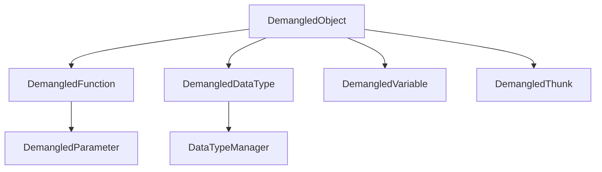
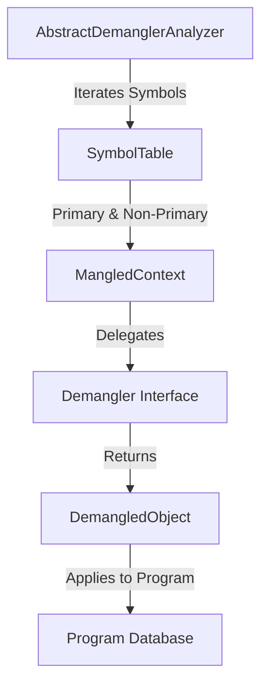

<!-- source: DeepWiki mcp.deepwiki.com · repo NationalSecurityAgency/ghidra · extra page Demanglers · fetched 2026-11-09 -->

# Demanglers

Relevant source files

The following files were used as context for generating this wiki page:

- [Ghidra/Features/Base/src/main/help/help/topics/AutoAnalysisPlugin/AutoAnalysis.htm](Ghidra/Features/Base/src/main/help/help/topics/AutoAnalysisPlugin/AutoAnalysis.htm)
- [Ghidra/Features/Base/src/main/help/help/topics/DataTypeManagerPlugin/images/MergeConfirmationDialog.png](Ghidra/Features/Base/src/main/help/help/topics/DataTypeManagerPlugin/images/MergeConfirmationDialog.png)
- [Ghidra/Features/Base/src/main/java/ghidra/app/cmd/disassemble/DisassembleCommand.java](Ghidra/Features/Base/src/main/java/ghidra/app/cmd/disassemble/DisassembleCommand.java)
- [Ghidra/Features/Base/src/main/java/ghidra/app/plugin/core/analysis/AbstractDemanglerAnalyzer.java](Ghidra/Features/Base/src/main/java/ghidra/app/plugin/core/analysis/AbstractDemanglerAnalyzer.java)
- [Ghidra/Features/Base/src/main/java/ghidra/app/plugin/core/datamgr/actions/MergeDataTypeAction.java](Ghidra/Features/Base/src/main/java/ghidra/app/plugin/core/datamgr/actions/MergeDataTypeAction.java)
- [Ghidra/Features/Base/src/main/java/ghidra/app/util/demangler/AbstractDemangledFunctionDefinitionDataType.java](Ghidra/Features/Base/src/main/java/ghidra/app/util/demangler/AbstractDemangledFunctionDefinitionDataType.java)
- [Ghidra/Features/Base/src/main/java/ghidra/app/util/demangler/DemangledAddressTable.java](Ghidra/Features/Base/src/main/java/ghidra/app/util/demangler/DemangledAddressTable.java)
- [Ghidra/Features/Base/src/main/java/ghidra/app/util/demangler/DemangledDataType.java](Ghidra/Features/Base/src/main/java/ghidra/app/util/demangler/DemangledDataType.java)
- [Ghidra/Features/Base/src/main/java/ghidra/app/util/demangler/DemangledFunction.java](Ghidra/Features/Base/src/main/java/ghidra/app/util/demangler/DemangledFunction.java)
- [Ghidra/Features/Base/src/main/java/ghidra/app/util/demangler/DemangledFunctionIndirect.java](Ghidra/Features/Base/src/main/java/ghidra/app/util/demangler/DemangledFunctionIndirect.java)
- [Ghidra/Features/Base/src/main/java/ghidra/app/util/demangler/DemangledFunctionPointer.java](Ghidra/Features/Base/src/main/java/ghidra/app/util/demangler/DemangledFunctionPointer.java)
- [Ghidra/Features/Base/src/main/java/ghidra/app/util/demangler/DemangledLabel.java](Ghidra/Features/Base/src/main/java/ghidra/app/util/demangler/DemangledLabel.java)
- [Ghidra/Features/Base/src/main/java/ghidra/app/util/demangler/DemangledLambda.java](Ghidra/Features/Base/src/main/java/ghidra/app/util/demangler/DemangledLambda.java)
- [Ghidra/Features/Base/src/main/java/ghidra/app/util/demangler/DemangledNamespaceNode.java](Ghidra/Features/Base/src/main/java/ghidra/app/util/demangler/DemangledNamespaceNode.java)
- [Ghidra/Features/Base/src/main/java/ghidra/app/util/demangler/DemangledObject.java](Ghidra/Features/Base/src/main/java/ghidra/app/util/demangler/DemangledObject.java)
- [Ghidra/Features/Base/src/main/java/ghidra/app/util/demangler/DemangledString.java](Ghidra/Features/Base/src/main/java/ghidra/app/util/demangler/DemangledString.java)
- [Ghidra/Features/Base/src/main/java/ghidra/app/util/demangler/DemangledThunk.java](Ghidra/Features/Base/src/main/java/ghidra/app/util/demangler/DemangledThunk.java)
- [Ghidra/Features/Base/src/main/java/ghidra/app/util/demangler/DemangledType.java](Ghidra/Features/Base/src/main/java/ghidra/app/util/demangler/DemangledType.java)
- [Ghidra/Features/Base/src/main/java/ghidra/app/util/demangler/DemangledVariable.java](Ghidra/Features/Base/src/main/java/ghidra/app/util/demangler/DemangledVariable.java)
- [Ghidra/Features/Base/src/main/java/ghidra/app/util/demangler/Demangler.java](Ghidra/Features/Base/src/main/java/ghidra/app/util/demangler/Demangler.java)
- [Ghidra/Features/Base/src/main/java/ghidra/app/util/demangler/DemanglerOptions.java](Ghidra/Features/Base/src/main/java/ghidra/app/util/demangler/DemanglerOptions.java)
- [Ghidra/Features/Base/src/main/java/ghidra/app/util/demangler/MangledContext.java](Ghidra/Features/Base/src/main/java/ghidra/app/util/demangler/MangledContext.java)
- [Ghidra/Features/GnuDemangler/certification.manifest](Ghidra/Features/GnuDemangler/certification.manifest)
- [Ghidra/Features/GnuDemangler/data/default.gnu.demangler.replacements.txt](Ghidra/Features/GnuDemangler/data/default.gnu.demangler.replacements.txt)
- [Ghidra/Features/GnuDemangler/ghidra_scripts/DemangleElfWithOptionScript.java](Ghidra/Features/GnuDemangler/ghidra_scripts/DemangleElfWithOptionScript.java)
- [Ghidra/Features/GnuDemangler/src/main/java/ghidra/app/plugin/core/analysis/GnuDemanglerAnalyzer.java](Ghidra/Features/GnuDemangler/src/main/java/ghidra/app/plugin/core/analysis/GnuDemanglerAnalyzer.java)
- [Ghidra/Features/GnuDemangler/src/main/java/ghidra/app/util/demangler/gnu/GnuDemangler.java](Ghidra/Features/GnuDemangler/src/main/java/ghidra/app/util/demangler/gnu/GnuDemangler.java)
- [Ghidra/Features/GnuDemangler/src/main/java/ghidra/app/util/demangler/gnu/GnuDemanglerFormat.java](Ghidra/Features/GnuDemangler/src/main/java/ghidra/app/util/demangler/gnu/GnuDemanglerFormat.java)
- [Ghidra/Features/GnuDemangler/src/main/java/ghidra/app/util/demangler/gnu/GnuDemanglerOptions.java](Ghidra/Features/GnuDemangler/src/main/java/ghidra/app/util/demangler/gnu/GnuDemanglerOptions.java)
- [Ghidra/Features/GnuDemangler/src/main/java/ghidra/app/util/demangler/gnu/GnuDemanglerParser.java](Ghidra/Features/GnuDemangler/src/main/java/ghidra/app/util/demangler/gnu/GnuDemanglerParser.java)
- [Ghidra/Features/GnuDemangler/src/main/java/ghidra/app/util/demangler/gnu/GnuDemanglerReplacement.java](Ghidra/Features/GnuDemangler/src/main/java/ghidra/app/util/demangler/gnu/GnuDemanglerReplacement.java)
- [Ghidra/Features/GnuDemangler/src/test/java/ghidra/app/plugin/core/analysis/GnuDemanglerAnalyzerTest.java](Ghidra/Features/GnuDemangler/src/test/java/ghidra/app/plugin/core/analysis/GnuDemanglerAnalyzerTest.java)
- [Ghidra/Features/GnuDemangler/src/test/java/ghidra/app/util/demangler/GnuDemanglerParserTest.java](Ghidra/Features/GnuDemangler/src/test/java/ghidra/app/util/demangler/GnuDemanglerParserTest.java)
- [Ghidra/Features/GnuDemangler/src/test/java/ghidra/app/util/demangler/gnu/GnuDemanglerTest.java](Ghidra/Features/GnuDemangler/src/test/java/ghidra/app/util/demangler/gnu/GnuDemanglerTest.java)
- [Ghidra/Features/MicrosoftDemangler/src/main/java/ghidra/app/util/demangler/microsoft/MicrosoftDemangler.java](Ghidra/Features/MicrosoftDemangler/src/main/java/ghidra/app/util/demangler/microsoft/MicrosoftDemangler.java)
- [Ghidra/Features/MicrosoftDemangler/src/main/java/ghidra/app/util/demangler/microsoft/MicrosoftDemanglerUtil.java](Ghidra/Features/MicrosoftDemangler/src/main/java/ghidra/app/util/demangler/microsoft/MicrosoftDemanglerUtil.java)
- [Ghidra/Features/MicrosoftDemangler/src/test/java/ghidra/app/util/demangler/microsoft/MicrosoftDemanglerExtraTest.java](Ghidra/Features/MicrosoftDemangler/src/test/java/ghidra/app/util/demangler/microsoft/MicrosoftDemanglerExtraTest.java)
- [Ghidra/Features/MicrosoftDemangler/src/test/java/ghidra/app/util/demangler/microsoft/MicrosoftDemanglerTest.java](Ghidra/Features/MicrosoftDemangler/src/test/java/ghidra/app/util/demangler/microsoft/MicrosoftDemanglerTest.java)
- [Ghidra/Features/MicrosoftDmang/developer_scripts/MDMangDeveloperGenericizeMangledNamesScript.java](Ghidra/Features/MicrosoftDmang/developer_scripts/MDMangDeveloperGenericizeMangledNamesScript.java)
- [Ghidra/Features/MicrosoftDmang/src/main/java/mdemangler/MDCharacterIterator.java](Ghidra/Features/MicrosoftDmang/src/main/java/mdemangler/MDCharacterIterator.java)
- [Ghidra/Features/MicrosoftDmang/src/main/java/mdemangler/MDDotSeparatedItem.java](Ghidra/Features/MicrosoftDmang/src/main/java/mdemangler/MDDotSeparatedItem.java)
- [Ghidra/Features/MicrosoftDmang/src/main/java/mdemangler/MDEncodedNumber.java](Ghidra/Features/MicrosoftDmang/src/main/java/mdemangler/MDEncodedNumber.java)
- [Ghidra/Features/MicrosoftDmang/src/main/java/mdemangler/MDMang.java](Ghidra/Features/MicrosoftDmang/src/main/java/mdemangler/MDMang.java)
- [Ghidra/Features/MicrosoftDmang/src/main/java/mdemangler/MDMangGenericize.java](Ghidra/Features/MicrosoftDmang/src/main/java/mdemangler/MDMangGenericize.java)
- [Ghidra/Features/MicrosoftDmang/src/main/java/mdemangler/MDMangGhidra.java](Ghidra/Features/MicrosoftDmang/src/main/java/mdemangler/MDMangGhidra.java)
- [Ghidra/Features/MicrosoftDmang/src/main/java/mdemangler/MDMangUtils.java](Ghidra/Features/MicrosoftDmang/src/main/java/mdemangler/MDMangUtils.java)
- [Ghidra/Features/MicrosoftDmang/src/main/java/mdemangler/MDMangVS2015.java](Ghidra/Features/MicrosoftDmang/src/main/java/mdemangler/MDMangVS2015.java)
- [Ghidra/Features/MicrosoftDmang/src/main/java/mdemangler/datatype/MDDataTypeParser.java](Ghidra/Features/MicrosoftDmang/src/main/java/mdemangler/datatype/MDDataTypeParser.java)
- [Ghidra/Features/MicrosoftDmang/src/main/java/mdemangler/datatype/extended/MDArrayReferencedType.java](Ghidra/Features/MicrosoftDmang/src/main/java/mdemangler/datatype/extended/MDArrayReferencedType.java)
- [Ghidra/Features/MicrosoftDmang/src/main/java/mdemangler/datatype/modifier/MDBasedAttribute.java](Ghidra/Features/MicrosoftDmang/src/main/java/mdemangler/datatype/modifier/MDBasedAttribute.java)
- [Ghidra/Features/MicrosoftDmang/src/main/java/mdemangler/datatype/modifier/MDCVMod.java](Ghidra/Features/MicrosoftDmang/src/main/java/mdemangler/datatype/modifier/MDCVMod.java)
- [Ghidra/Features/MicrosoftDmang/src/main/java/mdemangler/datatype/modifier/MDDataReferenceType.java](Ghidra/Features/MicrosoftDmang/src/main/java/mdemangler/datatype/modifier/MDDataReferenceType.java)
- [Ghidra/Features/MicrosoftDmang/src/main/java/mdemangler/datatype/modifier/MDDataRightReferenceType.java](Ghidra/Features/MicrosoftDmang/src/main/java/mdemangler/datatype/modifier/MDDataRightReferenceType.java)
- [Ghidra/Features/MicrosoftDmang/src/main/java/mdemangler/datatype/modifier/MDModifiedTypeParser.java](Ghidra/Features/MicrosoftDmang/src/main/java/mdemangler/datatype/modifier/MDModifiedTypeParser.java)
- [Ghidra/Features/MicrosoftDmang/src/main/java/mdemangler/datatype/modifier/MDQuestionModifierType.java](Ghidra/Features/MicrosoftDmang/src/main/java/mdemangler/datatype/modifier/MDQuestionModifierType.java)
- [Ghidra/Features/MicrosoftDmang/src/main/java/mdemangler/functiontype/MDFunctionType.java](Ghidra/Features/MicrosoftDmang/src/main/java/mdemangler/functiontype/MDFunctionType.java)
- [Ghidra/Features/MicrosoftDmang/src/main/java/mdemangler/functiontype/MDThrowAttribute.java](Ghidra/Features/MicrosoftDmang/src/main/java/mdemangler/functiontype/MDThrowAttribute.java)
- [Ghidra/Features/MicrosoftDmang/src/main/java/mdemangler/naming/MDBasicName.java](Ghidra/Features/MicrosoftDmang/src/main/java/mdemangler/naming/MDBasicName.java)
- [Ghidra/Features/MicrosoftDmang/src/main/java/mdemangler/naming/MDFragmentName.java](Ghidra/Features/MicrosoftDmang/src/main/java/mdemangler/naming/MDFragmentName.java)
- [Ghidra/Features/MicrosoftDmang/src/main/java/mdemangler/naming/MDNameModifier.java](Ghidra/Features/MicrosoftDmang/src/main/java/mdemangler/naming/MDNameModifier.java)
- [Ghidra/Features/MicrosoftDmang/src/main/java/mdemangler/naming/MDNestedName.java](Ghidra/Features/MicrosoftDmang/src/main/java/mdemangler/naming/MDNestedName.java)
- [Ghidra/Features/MicrosoftDmang/src/main/java/mdemangler/naming/MDNumberedNamespace.java](Ghidra/Features/MicrosoftDmang/src/main/java/mdemangler/naming/MDNumberedNamespace.java)
- [Ghidra/Features/MicrosoftDmang/src/main/java/mdemangler/naming/MDQualification.java](Ghidra/Features/MicrosoftDmang/src/main/java/mdemangler/naming/MDQualification.java)
- [Ghidra/Features/MicrosoftDmang/src/main/java/mdemangler/naming/MDQualifiedBasicName.java](Ghidra/Features/MicrosoftDmang/src/main/java/mdemangler/naming/MDQualifiedBasicName.java)
- [Ghidra/Features/MicrosoftDmang/src/main/java/mdemangler/naming/MDQualifier.java](Ghidra/Features/MicrosoftDmang/src/main/java/mdemangler/naming/MDQualifier.java)
- [Ghidra/Features/MicrosoftDmang/src/main/java/mdemangler/naming/MDReusableName.java](Ghidra/Features/MicrosoftDmang/src/main/java/mdemangler/naming/MDReusableName.java)
- [Ghidra/Features/MicrosoftDmang/src/main/java/mdemangler/naming/MDSpecialName.java](Ghidra/Features/MicrosoftDmang/src/main/java/mdemangler/naming/MDSpecialName.java)
- [Ghidra/Features/MicrosoftDmang/src/main/java/mdemangler/object/MDMangObjectParser.java](Ghidra/Features/MicrosoftDmang/src/main/java/mdemangler/object/MDMangObjectParser.java)
- [Ghidra/Features/MicrosoftDmang/src/main/java/mdemangler/object/MDObjectCPP.java](Ghidra/Features/MicrosoftDmang/src/main/java/mdemangler/object/MDObjectCPP.java)
- [Ghidra/Features/MicrosoftDmang/src/main/java/mdemangler/object/MDObjectCatch.java](Ghidra/Features/MicrosoftDmang/src/main/java/mdemangler/object/MDObjectCatch.java)
- [Ghidra/Features/MicrosoftDmang/src/main/java/mdemangler/object/MDObjectReserved.java](Ghidra/Features/MicrosoftDmang/src/main/java/mdemangler/object/MDObjectReserved.java)
- [Ghidra/Features/MicrosoftDmang/src/main/java/mdemangler/object/MDObjectUnknownReserved.java](Ghidra/Features/MicrosoftDmang/src/main/java/mdemangler/object/MDObjectUnknownReserved.java)
- [Ghidra/Features/MicrosoftDmang/src/main/java/mdemangler/object/MDObjectUnwindFunclet.java](Ghidra/Features/MicrosoftDmang/src/main/java/mdemangler/object/MDObjectUnwindFunclet.java)
- [Ghidra/Features/MicrosoftDmang/src/main/java/mdemangler/template/MDTemplateConstant.java](Ghidra/Features/MicrosoftDmang/src/main/java/mdemangler/template/MDTemplateConstant.java)
- [Ghidra/Features/MicrosoftDmang/src/main/java/mdemangler/template/MDTemplateNameAndArguments.java](Ghidra/Features/MicrosoftDmang/src/main/java/mdemangler/template/MDTemplateNameAndArguments.java)
- [Ghidra/Features/MicrosoftDmang/src/main/java/mdemangler/typeinfo/MDTypeInfo.java](Ghidra/Features/MicrosoftDmang/src/main/java/mdemangler/typeinfo/MDTypeInfo.java)
- [Ghidra/Features/MicrosoftDmang/src/main/java/mdemangler/typeinfo/MDTypeInfoParser.java](Ghidra/Features/MicrosoftDmang/src/main/java/mdemangler/typeinfo/MDTypeInfoParser.java)
- [Ghidra/Features/MicrosoftDmang/src/main/java/mdemangler/typeinfo/MDVCall.java](Ghidra/Features/MicrosoftDmang/src/main/java/mdemangler/typeinfo/MDVCall.java)
- [Ghidra/Features/MicrosoftDmang/src/main/java/mdemangler/typeinfo/MDVtordisp.java](Ghidra/Features/MicrosoftDmang/src/main/java/mdemangler/typeinfo/MDVtordisp.java)
- [Ghidra/Features/MicrosoftDmang/src/main/java/mdemangler/typeinfo/MDVtordispex.java](Ghidra/Features/MicrosoftDmang/src/main/java/mdemangler/typeinfo/MDVtordispex.java)
- [Ghidra/Features/MicrosoftDmang/src/main/java/mdemangler/typeinfo/MDVxTable.java](Ghidra/Features/MicrosoftDmang/src/main/java/mdemangler/typeinfo/MDVxTable.java)
- [Ghidra/Features/MicrosoftDmang/src/test/java/mdemangler/MDBaseTestConfiguration.java](Ghidra/Features/MicrosoftDmang/src/test/java/mdemangler/MDBaseTestConfiguration.java)
- [Ghidra/Features/MicrosoftDmang/src/test/java/mdemangler/MDGhidraTestConfiguration.java](Ghidra/Features/MicrosoftDmang/src/test/java/mdemangler/MDGhidraTestConfiguration.java)
- [Ghidra/Features/MicrosoftDmang/src/test/java/mdemangler/MDMangBaseTest.java](Ghidra/Features/MicrosoftDmang/src/test/java/mdemangler/MDMangBaseTest.java)
- [Ghidra/Features/MicrosoftDmang/src/test/java/mdemangler/MDMangExtraTest.java](Ghidra/Features/MicrosoftDmang/src/test/java/mdemangler/MDMangExtraTest.java)
- [Ghidra/Features/MicrosoftDmang/src/test/java/mdemangler/MDMangUtilsTest.java](Ghidra/Features/MicrosoftDmang/src/test/java/mdemangler/MDMangUtilsTest.java)
- [Ghidra/Features/Rust/src/main/java/ghidra/app/plugin/core/analysis/rust/RustDemanglerAnalyzer.java](Ghidra/Features/Rust/src/main/java/ghidra/app/plugin/core/analysis/rust/RustDemanglerAnalyzer.java)
- [Ghidra/Framework/Generic/src/main/java/ghidra/app/util/importer/MessageLog.java](Ghidra/Framework/Generic/src/main/java/ghidra/app/util/importer/MessageLog.java)
- [Ghidra/Framework/Project/src/main/java/ghidra/framework/cmd/BackgroundCommand.java](Ghidra/Framework/Project/src/main/java/ghidra/framework/cmd/BackgroundCommand.java)
- [Ghidra/Framework/SoftwareModeling/src/main/java/ghidra/program/database/data/DataTypeUtilities.java](Ghidra/Framework/SoftwareModeling/src/main/java/ghidra/program/database/data/DataTypeUtilities.java)
- [Ghidra/Framework/SoftwareModeling/src/main/java/ghidra/program/database/data/merge/DataTypeMerger.java](Ghidra/Framework/SoftwareModeling/src/main/java/ghidra/program/database/data/merge/DataTypeMerger.java)
- [Ghidra/Framework/SoftwareModeling/src/main/java/ghidra/program/database/data/merge/StructureMerger.java](Ghidra/Framework/SoftwareModeling/src/main/java/ghidra/program/database/data/merge/StructureMerger.java)
- [Ghidra/Framework/SoftwareModeling/src/main/java/ghidra/program/database/data/merge/UnionMerger.java](Ghidra/Framework/SoftwareModeling/src/main/java/ghidra/program/database/data/merge/UnionMerger.java)
- [Ghidra/Framework/SoftwareModeling/src/test/java/ghidra/program/database/data/merge/StructureMergerTest.java](Ghidra/Framework/SoftwareModeling/src/test/java/ghidra/program/database/data/merge/StructureMergerTest.java)
- [Ghidra/Test/IntegrationTest/src/test.slow/java/ghidra/app/util/demangler/gnu/GnuDemanglerIntegrationTest.java](Ghidra/Test/IntegrationTest/src/test.slow/java/ghidra/app/util/demangler/gnu/GnuDemanglerIntegrationTest.java)

## Purpose and Scope
The Demangler subsystem in Ghidra parses compiler-mangled C++ and symbol-encoded strings (such as those generated by GCC/GNU `c++filt` or MSVC) into structured program representations. This framework reconstructs namespaces, class hierarchies, function signatures, data types, and variable information, applying them directly to the `Program` database during auto-analysis or on-demand execution.

Sources: 
- `Ghidra/Features/Base/src/main/java/ghidra/app/util/demangler/DemangledObject.java` [Ghidra/Features/Base/src/main/java/ghidra/app/util/demangler/DemangledObject.java:33-144]()
- `Ghidra/Features/Base/src/main/java/ghidra/app/plugin/core/analysis/AbstractDemanglerAnalyzer.java` [Ghidra/Features/Base/src/main/java/ghidra/app/plugin/core/analysis/AbstractDemanglerAnalyzer.java:31-43]()

---

## 1. DemangledObject and DemangledFunction Model
The core model for representing demangled symbols revolves around the abstract base class `DemangledObject` [Ghidra/Features/Base/src/main/java/ghidra/app/util/demangler/DemangledObject.java:33-35]() and specialized subclasses like `DemangledFunction` [Ghidra/Features/Base/src/main/java/ghidra/app/util/demangler/DemangledFunction.java:42-44](), `DemangledDataType` [Ghidra/Features/Base/src/main/java/ghidra/app/util/demangler/DemangledDataType.java:30-33](), `DemangledVariable`, and `DemangledThunk`.

- **`DemangledObject`**: Tracks the original mangled string (`mangled`), raw demangled output (`rawDemangled`), namespace hierarchy (`namespace`), accessibility, and storage classes (`isStatic`, `isVirtual`, `isConst`) [Ghidra/Features/Base/src/main/java/ghidra/app/util/demangler/DemangledObject.java:83-113]().
- **`DemangledFunction`**: Extends `DemangledObject` to capture function-specific attributes including `returnType`, `callingConvention` (e.g., `__cdecl`, `__thiscall`), a list of `DemangledParameter` objects, `template` parameters, and trailing qualifiers (`isTrailingConst`, `isTrailingVolatile`) [Ghidra/Features/Base/src/main/java/ghidra/app/util/demangler/DemangledFunction.java:44-72]().

When results are finalized, the framework applies them to the database by creating or updating namespaces, setting primary labels, and applying function signatures or data types via `applyTo()` mechanisms.

*Figure 1: Demangled Object Hierarchy mapping natural entity concepts to code classes.*

Sources:
- `Ghidra/Features/Base/src/main/java/ghidra/app/util/demangler/DemangledObject.java` [Ghidra/Features/Base/src/main/java/ghidra/app/util/demangler/DemangledObject.java:33-144]()
- `Ghidra/Features/Base/src/main/java/ghidra/app/util/demangler/DemangledFunction.java` [Ghidra/Features/Base/src/main/java/ghidra/app/util/demangler/DemangledFunction.java:42-88]()

---

## 2. AbstractDemanglerAnalyzer
`AbstractDemanglerAnalyzer` provides the foundational analysis plugin architecture [Ghidra/Features/Base/src/main/java/ghidra/app/plugin/core/analysis/AbstractDemanglerAnalyzer.java:30-44]() that coordinates symbol demangling across a program. 

- **Priority**: Configured to run with high priority (`AnalysisPriority.DATA_TYPE_PROPOGATION`) before general data type propagation tasks [Ghidra/Features/Base/src/main/java/ghidra/app/plugin/core/analysis/AbstractDemanglerAnalyzer.java:51-55]().
- **Symbol Iteration**: Iterates through primary and non-primary symbols in memory address sets, as well as external symbols [Ghidra/Features/Base/src/main/java/ghidra/app/plugin/core/analysis/AbstractDemanglerAnalyzer.java:124-177]().
- **Delegation**: Delegates the actual symbol string extraction and parsing to concrete implementation classes (`GnuDemangler` or `MicrosoftDemangler`) via `doDemangle()` [Ghidra/Features/Base/src/main/java/ghidra/app/plugin/core/analysis/AbstractDemanglerAnalyzer.java:179-188]().

*Figure 2: Auto-analysis workflow driving symbol demangling through AbstractDemanglerAnalyzer.*

Sources:
- `Ghidra/Features/Base/src/main/java/ghidra/app/plugin/core/analysis/AbstractDemanglerAnalyzer.java` [Ghidra/Features/Base/src/main/java/ghidra/app/plugin/core/analysis/AbstractDemanglerAnalyzer.java:30-188]()

---

## 3. GNU Demangler Subsystem
The GNU demangler subsystem handles ELF, Mach-O, and GCC-compiled binaries using a combination of native process execution, custom parsers, and string replacement configurations.

### Components and Flow
- **`GnuDemangler`**: Implements the `Demangler` interface, checking program formats (`ElfLoader`, `MachoLoader`, or GCC-matching compiler specs) and managing options [Ghidra/Features/GnuDemangler/src/main/java/ghidra/app/util/demangler/gnu/GnuDemangler.java:32-66]().
- **`GnuDemanglerParser`**: Parses raw demangled text output into structured `DemangledObject` graphs [Ghidra/Features/GnuDemangler/src/main/java/ghidra/app/util/demangler/gnu/GnuDemanglerParser.java:42-53](). It handles complex constructs like array pointer references (`ARRAY_POINTER_REFERENCE_PATTERN`) and template casts [Ghidra/Features/GnuDemangler/src/main/java/ghidra/app/util/demangler/gnu/GnuDemanglerParser.java:141-144]().
- **Replacement Tables**: Simplifies verbose demangled names using predefined text patterns loaded from module data files ending with `.gnu.demangler.replacements.txt` (e.g., mapping `std::__cxx11::basic_string<...>` to `std::string`) [Ghidra/Features/GnuDemangler/src/main/java/ghidra/app/util/demangler/gnu/GnuDemanglerParser.java:48-53]().

Sources:
- `Ghidra/Features/GnuDemangler/src/main/java/ghidra/app/util/demangler/gnu/GnuDemangler.java` [Ghidra/Features/GnuDemangler/src/main/java/ghidra/app/util/demangler/gnu/GnuDemangler.java:32-154]()
- `Ghidra/Features/GnuDemangler/src/main/java/ghidra/app/util/demangler/gnu/GnuDemanglerParser.java` [Ghidra/Features/GnuDemangler/src/main/java/ghidra/app/util/demangler/gnu/GnuDemanglerParser.java:42-97]()

---

## 4. Microsoft Demangler Subsystem
Microsoft-mangled symbols (common in PE/COFF binaries compiled with MSVC) are parsed using a dedicated Java-native demangling engine.

### Components and Flow
- **`MDMang`**: The core parsing engine that implements Microsoft's decoration and mangling specifications from scratch [Ghidra/Features/MicrosoftDmang/src/main/java/mdemangler/MDMang.java:1-30]().
- **`MDMangGhidra`**: An extension layer providing integration options such as `setDemangleOnlyKnownPatterns()` to filter out non-standard symbols [Ghidra/Features/MicrosoftDmang/src/main/java/mdemangler/MDMangGhidra.java:21-65]().
- **`MicrosoftDemangler`**: Adapts `MDMang` into Ghidra's standard `Demangler` interface, converting parsed `MDParsableItem` trees into Ghidra's `DemangledObject` hierarchy for database application [Ghidra/Features/MicrosoftDemangler/src/main/java/ghidra/app/util/demangler/microsoft/MicrosoftDemangler.java:1-50]().

Sources:
- `Ghidra/Features/MicrosoftDmang/src/main/java/mdemangler/MDMangGhidra.java` [Ghidra/Features/MicrosoftDmang/src/main/java/mdemangler/MDMangGhidra.java:21-70]()
- `Ghidra/Features/MicrosoftDemangler/src/main/java/ghidra/app/util/demangler/microsoft/MicrosoftDemangler.java` [Ghidra/Features/MicrosoftDemangler/src/main/java/ghidra/app/util/demangler/microsoft/MicrosoftDemangler.java:1-60]()

---

