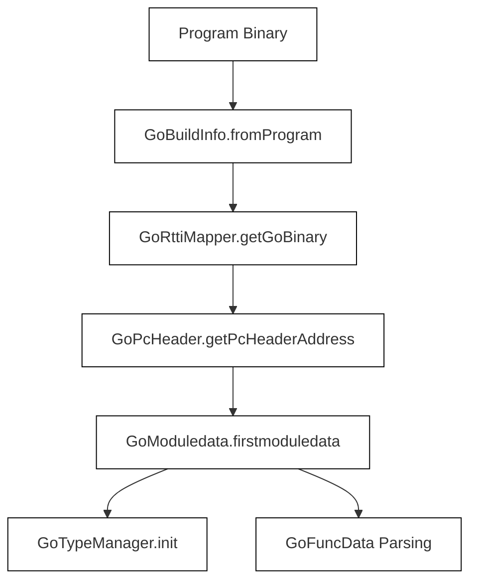
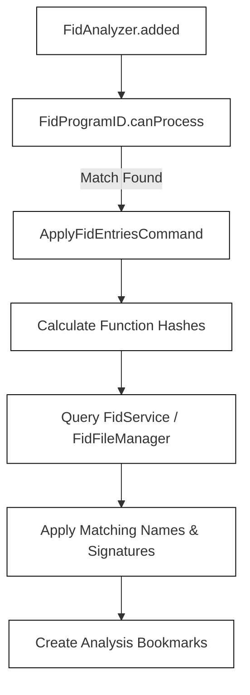

<!-- source: DeepWiki mcp.deepwiki.com · repo NationalSecurityAgency/ghidra · extra page Language-Specific Metadata Analyzers · fetched 2026-11-09 -->

# Language-Specific Metadata Analyzers

Relevant source files

The following files were used as context for generating this wiki page:

- [Ghidra/Features/Base/data/typeinfo/golang/golang_1.19_anybit_any.gdt](Ghidra/Features/Base/data/typeinfo/golang/golang_1.19_anybit_any.gdt)
- [Ghidra/Features/Base/data/typeinfo/golang/golang_1.20_anybit_any.gdt](Ghidra/Features/Base/data/typeinfo/golang/golang_1.20_anybit_any.gdt)
- [Ghidra/Features/Base/data/typeinfo/golang/golang_1.21_anybit_any.gdt](Ghidra/Features/Base/data/typeinfo/golang/golang_1.21_anybit_any.gdt)
- [Ghidra/Features/Base/data/typeinfo/golang/golang_1.22_anybit_any.gdt](Ghidra/Features/Base/data/typeinfo/golang/golang_1.22_anybit_any.gdt)
- [Ghidra/Features/Base/src/main/java/ghidra/app/plugin/core/analysis/AnalysisOptionsDialog.java](Ghidra/Features/Base/src/main/java/ghidra/app/plugin/core/analysis/AnalysisOptionsDialog.java)
- [Ghidra/Features/Base/src/main/java/ghidra/app/plugin/core/analysis/AnalysisOptionsUpdater.java](Ghidra/Features/Base/src/main/java/ghidra/app/plugin/core/analysis/AnalysisOptionsUpdater.java)
- [Ghidra/Features/Base/src/main/java/ghidra/app/plugin/core/analysis/AnalysisPanel.java](Ghidra/Features/Base/src/main/java/ghidra/app/plugin/core/analysis/AnalysisPanel.java)
- [Ghidra/Features/Base/src/main/java/ghidra/app/plugin/core/analysis/DWARFAnalyzer.java](Ghidra/Features/Base/src/main/java/ghidra/app/plugin/core/analysis/DWARFAnalyzer.java)
- [Ghidra/Features/Base/src/main/java/ghidra/app/plugin/core/analysis/GolangSymbolAnalyzer.java](Ghidra/Features/Base/src/main/java/ghidra/app/plugin/core/analysis/GolangSymbolAnalyzer.java)
- [Ghidra/Features/Base/src/main/java/ghidra/app/plugin/core/printing/PrintingPlugin.java](Ghidra/Features/Base/src/main/java/ghidra/app/plugin/core/printing/PrintingPlugin.java)
- [Ghidra/Features/Base/src/main/java/ghidra/app/util/bin/format/dwarf/attribs/DWARFAttribute.java](Ghidra/Features/Base/src/main/java/ghidra/app/util/bin/format/dwarf/attribs/DWARFAttribute.java)
- [Ghidra/Features/Base/src/main/java/ghidra/app/util/bin/format/golang/BootstrapInfoException.java](Ghidra/Features/Base/src/main/java/ghidra/app/util/bin/format/golang/BootstrapInfoException.java)
- [Ghidra/Features/Base/src/main/java/ghidra/app/util/bin/format/golang/GoBuildInfo.java](Ghidra/Features/Base/src/main/java/ghidra/app/util/bin/format/golang/GoBuildInfo.java)
- [Ghidra/Features/Base/src/main/java/ghidra/app/util/bin/format/golang/GoConstants.java](Ghidra/Features/Base/src/main/java/ghidra/app/util/bin/format/golang/GoConstants.java)
- [Ghidra/Features/Base/src/main/java/ghidra/app/util/bin/format/golang/GoFunctionFixup.java](Ghidra/Features/Base/src/main/java/ghidra/app/util/bin/format/golang/GoFunctionFixup.java)
- [Ghidra/Features/Base/src/main/java/ghidra/app/util/bin/format/golang/GoRegisterInfo.java](Ghidra/Features/Base/src/main/java/ghidra/app/util/bin/format/golang/GoRegisterInfo.java)
- [Ghidra/Features/Base/src/main/java/ghidra/app/util/bin/format/golang/GoRegisterInfoManager.java](Ghidra/Features/Base/src/main/java/ghidra/app/util/bin/format/golang/GoRegisterInfoManager.java)
- [Ghidra/Features/Base/src/main/java/ghidra/app/util/bin/format/golang/GoVer.java](Ghidra/Features/Base/src/main/java/ghidra/app/util/bin/format/golang/GoVer.java)
- [Ghidra/Features/Base/src/main/java/ghidra/app/util/bin/format/golang/rtti/GoFuncData.java](Ghidra/Features/Base/src/main/java/ghidra/app/util/bin/format/golang/rtti/GoFuncData.java)
- [Ghidra/Features/Base/src/main/java/ghidra/app/util/bin/format/golang/rtti/GoFunctabEntry.java](Ghidra/Features/Base/src/main/java/ghidra/app/util/bin/format/golang/rtti/GoFunctabEntry.java)
- [Ghidra/Features/Base/src/main/java/ghidra/app/util/bin/format/golang/rtti/GoModuledata.java](Ghidra/Features/Base/src/main/java/ghidra/app/util/bin/format/golang/rtti/GoModuledata.java)
- [Ghidra/Features/Base/src/main/java/ghidra/app/util/bin/format/golang/rtti/GoPcHeader.java](Ghidra/Features/Base/src/main/java/ghidra/app/util/bin/format/golang/rtti/GoPcHeader.java)
- [Ghidra/Features/Base/src/main/java/ghidra/app/util/bin/format/golang/rtti/GoPcValueEvaluator.java](Ghidra/Features/Base/src/main/java/ghidra/app/util/bin/format/golang/rtti/GoPcValueEvaluator.java)
- [Ghidra/Features/Base/src/main/java/ghidra/app/util/bin/format/golang/rtti/GoRttiMapper.java](Ghidra/Features/Base/src/main/java/ghidra/app/util/bin/format/golang/rtti/GoRttiMapper.java)
- [Ghidra/Features/Base/src/main/java/ghidra/app/util/bin/format/golang/rtti/GoSlice.java](Ghidra/Features/Base/src/main/java/ghidra/app/util/bin/format/golang/rtti/GoSlice.java)
- [Ghidra/Features/Base/src/main/java/ghidra/app/util/bin/format/golang/rtti/GoTypeManager.java](Ghidra/Features/Base/src/main/java/ghidra/app/util/bin/format/golang/rtti/GoTypeManager.java)
- [Ghidra/Features/Base/src/main/java/ghidra/app/util/bin/format/golang/rtti/types/GoArrayType.java](Ghidra/Features/Base/src/main/java/ghidra/app/util/bin/format/golang/rtti/types/GoArrayType.java)
- [Ghidra/Features/Base/src/main/java/ghidra/app/util/bin/format/golang/rtti/types/GoBaseType.java](Ghidra/Features/Base/src/main/java/ghidra/app/util/bin/format/golang/rtti/types/GoBaseType.java)
- [Ghidra/Features/Base/src/main/java/ghidra/app/util/bin/format/golang/rtti/types/GoChanType.java](Ghidra/Features/Base/src/main/java/ghidra/app/util/bin/format/golang/rtti/types/GoChanType.java)
- [Ghidra/Features/Base/src/main/java/ghidra/app/util/bin/format/golang/rtti/types/GoFuncType.java](Ghidra/Features/Base/src/main/java/ghidra/app/util/bin/format/golang/rtti/types/GoFuncType.java)
- [Ghidra/Features/Base/src/main/java/ghidra/app/util/bin/format/golang/rtti/types/GoInterfaceType.java](Ghidra/Features/Base/src/main/java/ghidra/app/util/bin/format/golang/rtti/types/GoInterfaceType.java)
- [Ghidra/Features/Base/src/main/java/ghidra/app/util/bin/format/golang/rtti/types/GoMapType.java](Ghidra/Features/Base/src/main/java/ghidra/app/util/bin/format/golang/rtti/types/GoMapType.java)
- [Ghidra/Features/Base/src/main/java/ghidra/app/util/bin/format/golang/rtti/types/GoPlainType.java](Ghidra/Features/Base/src/main/java/ghidra/app/util/bin/format/golang/rtti/types/GoPlainType.java)
- [Ghidra/Features/Base/src/main/java/ghidra/app/util/bin/format/golang/rtti/types/GoPointerType.java](Ghidra/Features/Base/src/main/java/ghidra/app/util/bin/format/golang/rtti/types/GoPointerType.java)
- [Ghidra/Features/Base/src/main/java/ghidra/app/util/bin/format/golang/rtti/types/GoSliceType.java](Ghidra/Features/Base/src/main/java/ghidra/app/util/bin/format/golang/rtti/types/GoSliceType.java)
- [Ghidra/Features/Base/src/main/java/ghidra/app/util/bin/format/golang/rtti/types/GoStructField.java](Ghidra/Features/Base/src/main/java/ghidra/app/util/bin/format/golang/rtti/types/GoStructField.java)
- [Ghidra/Features/Base/src/main/java/ghidra/app/util/bin/format/golang/rtti/types/GoStructType.java](Ghidra/Features/Base/src/main/java/ghidra/app/util/bin/format/golang/rtti/types/GoStructType.java)
- [Ghidra/Features/Base/src/main/java/ghidra/app/util/bin/format/golang/rtti/types/GoType.java](Ghidra/Features/Base/src/main/java/ghidra/app/util/bin/format/golang/rtti/types/GoType.java)
- [Ghidra/Features/Base/src/main/java/ghidra/app/util/bin/format/golang/rtti/types/GoTypeBridge.java](Ghidra/Features/Base/src/main/java/ghidra/app/util/bin/format/golang/rtti/types/GoTypeBridge.java)
- [Ghidra/Features/Base/src/main/java/ghidra/app/util/bin/format/golang/rtti/types/GoUncommonType.java](Ghidra/Features/Base/src/main/java/ghidra/app/util/bin/format/golang/rtti/types/GoUncommonType.java)
- [Ghidra/Features/Base/src/main/java/ghidra/app/util/bin/format/golang/structmapping/DataTypeMapper.java](Ghidra/Features/Base/src/main/java/ghidra/app/util/bin/format/golang/structmapping/DataTypeMapper.java)
- [Ghidra/Features/Base/src/main/java/ghidra/app/util/bin/format/golang/structmapping/FieldMapping.java](Ghidra/Features/Base/src/main/java/ghidra/app/util/bin/format/golang/structmapping/FieldMapping.java)
- [Ghidra/Features/Base/src/main/java/ghidra/app/util/bin/format/golang/structmapping/FieldMappingInfo.java](Ghidra/Features/Base/src/main/java/ghidra/app/util/bin/format/golang/structmapping/FieldMappingInfo.java)
- [Ghidra/Features/Base/src/main/java/ghidra/app/util/bin/format/golang/structmapping/MarkupSession.java](Ghidra/Features/Base/src/main/java/ghidra/app/util/bin/format/golang/structmapping/MarkupSession.java)
- [Ghidra/Features/Base/src/main/java/ghidra/app/util/bin/format/golang/structmapping/ReflectionHelper.java](Ghidra/Features/Base/src/main/java/ghidra/app/util/bin/format/golang/structmapping/ReflectionHelper.java)
- [Ghidra/Features/Base/src/main/java/ghidra/app/util/bin/format/golang/structmapping/StructureMapping.java](Ghidra/Features/Base/src/main/java/ghidra/app/util/bin/format/golang/structmapping/StructureMapping.java)
- [Ghidra/Features/Base/src/main/java/ghidra/app/util/bin/format/golang/structmapping/StructureMappingInfo.java](Ghidra/Features/Base/src/main/java/ghidra/app/util/bin/format/golang/structmapping/StructureMappingInfo.java)
- [Ghidra/Features/Base/src/test.slow/java/ghidra/app/plugin/core/analysis/AnalysisOptionsTest.java](Ghidra/Features/Base/src/test.slow/java/ghidra/app/plugin/core/analysis/AnalysisOptionsTest.java)
- [Ghidra/Features/FunctionID/src/main/java/ghidra/feature/fid/analyzer/FidAnalyzer.java](Ghidra/Features/FunctionID/src/main/java/ghidra/feature/fid/analyzer/FidAnalyzer.java)
- [Ghidra/Features/FunctionID/src/main/java/ghidra/feature/fid/db/FidFileManager.java](Ghidra/Features/FunctionID/src/main/java/ghidra/feature/fid/db/FidFileManager.java)
- [Ghidra/Features/FunctionID/src/main/java/ghidra/feature/fid/plugin/FidPlugin.java](Ghidra/Features/FunctionID/src/main/java/ghidra/feature/fid/plugin/FidPlugin.java)
- [Ghidra/Features/VersionTracking/src/main/java/ghidra/feature/vt/gui/actions/RemoveMatchAction.java](Ghidra/Features/VersionTracking/src/main/java/ghidra/feature/vt/gui/actions/RemoveMatchAction.java)
- [Ghidra/Features/VersionTracking/src/main/java/ghidra/feature/vt/gui/filters/AbstractAddressRangeFilter.java](Ghidra/Features/VersionTracking/src/main/java/ghidra/feature/vt/gui/filters/AbstractAddressRangeFilter.java)
- [Ghidra/Features/VersionTracking/src/main/java/ghidra/feature/vt/gui/filters/Filter.java](Ghidra/Features/VersionTracking/src/main/java/ghidra/feature/vt/gui/filters/Filter.java)
- [Ghidra/Features/VersionTracking/src/main/java/ghidra/feature/vt/gui/provider/matchtable/AbstractDoubleRangeFilter.java](Ghidra/Features/VersionTracking/src/main/java/ghidra/feature/vt/gui/provider/matchtable/AbstractDoubleRangeFilter.java)
- [Ghidra/Features/VersionTracking/src/main/java/ghidra/feature/vt/gui/provider/matchtable/LengthFilter.java](Ghidra/Features/VersionTracking/src/main/java/ghidra/feature/vt/gui/provider/matchtable/LengthFilter.java)
- [Ghidra/Features/VersionTracking/src/main/java/ghidra/feature/vt/gui/util/AbstractTextFilter.java](Ghidra/Features/VersionTracking/src/main/java/ghidra/feature/vt/gui/util/AbstractTextFilter.java)
- [Ghidra/Framework/Docking/src/main/java/docking/options/editor/ColorEditor.java](Ghidra/Framework/Docking/src/main/java/docking/options/editor/ColorEditor.java)
- [Ghidra/Framework/Docking/src/main/java/docking/options/editor/OptionsDialog.java](Ghidra/Framework/Docking/src/main/java/docking/options/editor/OptionsDialog.java)
- [Ghidra/Framework/Docking/src/main/java/docking/options/editor/OptionsPanel.java](Ghidra/Framework/Docking/src/main/java/docking/options/editor/OptionsPanel.java)
- [Ghidra/Framework/Gui/src/main/java/ghidra/framework/options/OptionsEditor.java](Ghidra/Framework/Gui/src/main/java/ghidra/framework/options/OptionsEditor.java)
- [Ghidra/Framework/Gui/src/main/java/ghidra/util/WebColors.java](Ghidra/Framework/Gui/src/main/java/ghidra/util/WebColors.java)

## Purpose and Scope
This page details Ghidra's specialized auto-analysis components designed to recover high-level semantic metadata from language runtimes and compiled binaries. Standard disassembly often leaves runtime constructs (such as reflection tables, closures, type descriptors, and library stubs) opaque or unformatted. Language-specific metadata analyzers leverage runtime-specific binary layouts, type descriptors, and signature databases to automatically reconstruct class hierarchies, function signatures, data types, and library identities. 

Primary subsystems covered include the Go runtime RTTI subsystem (`GoRttiMapper`, `GoModuledata`, `GoFuncData`), the declarative structmapping framework, the Function ID (FID) matching engine (`FidAnalyzer`), and runtime metadata extractors for Rust, Swift, and Objective-C.

---

## 1. Golang RTTI Subsystem Architecture

Go binaries retain extensive Run-Time Type Information (RTTI) and line-number/function tables (`pclntab`) even when stripped of standard symbol tables. Ghidra analyzes Go binaries through `GolangSymbolAnalyzer` [Ghidra/Features/Base/src/main/java/ghidra/app/plugin/core/analysis/GolangSymbolAnalyzer.java:68-102] acting in coordination with `GoRttiMapper` [Ghidra/Features/Base/src/main/java/ghidra/app/util/bin/format/golang/rtti/GoRttiMapper.java:48-78].

### Bootstrapping and Module Location
The initialization pipeline starts by locating Go build characteristics and runtime headers:
1. **`GoBuildInfo`**: Scans for the Go build version string and pointer sizing, functioning independently of structure mapping [Ghidra/Features/Base/src/main/java/ghidra/app/util/bin/format/golang/rtti/GoRttiMapper.java:151-163].
2. **`GoPcHeader`**: In Go 1.16+, locates the pclntab header via the `gopclntab` section or `runtime.pclntab` symbol, validating magic numbers (`GO_1_16_MAGIC`, `GO_1_18_MAGIC`, etc.) [Ghidra/Features/Base/src/main/java/ghidra/app/util/bin/format/golang/rtti/GoPcHeader.java:40-64]. For stripped PE binaries, it scans memory ranges using `findPcHeaderAddress()` [Ghidra/Features/Base/src/main/java/ghidra/app/util/bin/format/golang/rtti/GoPcHeader.java:95-126].
3. **`GoModuledata`**: Represents the `runtime.moduledata` structure (root moduledata often labeled `firstmoduledata`) [Ghidra/Features/Base/src/main/java/ghidra/app/util/bin/format/golang/rtti/GoModuledata.java:33-50]. It references text segment boundaries, file/line tables (`pctab`, `filetab`), type offset boundaries (`types`, `etypes`), and interface tables (`itablinks`) [Ghidra/Features/Base/src/main/java/ghidra/app/util/bin/format/golang/rtti/GoModuledata.java:51-120].

*Sources: [Ghidra/Features/Base/src/main/java/ghidra/app/plugin/core/analysis/GolangSymbolAnalyzer.java:110-143](), [Ghidra/Features/Base/src/main/java/ghidra/app/util/bin/format/golang/rtti/GoRttiMapper.java:151-163](), [Ghidra/Features/Base/src/main/java/ghidra/app/util/bin/format/golang/rtti/GoPcHeader.java:56-64](), [Ghidra/Features/Base/src/main/java/ghidra/app/util/bin/format/golang/rtti/GoModuledata.java:33-50](), [Ghidra/Features/Base/src/main/java/ghidra/app/util/bin/format/golang/rtti/GoTypeManager.java:104-160]() *

### Function and Type Recovery
- **`GoFuncData` (`runtime._func`)**: Manages function metadata entries stored within the pclntab structure. It decodes relative entry offsets (`entryoff`), name offsets (`nameoff`), stack pointer tracking offsets (`pcsp`), and variable-length argument maps (`npcdata`, `nfuncdata`) [Ghidra/Features/Base/src/main/java/ghidra/app/util/bin/format/golang/rtti/GoFuncData.java:39-96]. Function bodies are evaluated via `GoPcValueEvaluator` to compute precise address ranges [Ghidra/Features/Base/src/main/java/ghidra/app/util/bin/format/golang/rtti/GoFuncData.java:147-160].
- **`GoTypeManager`**: Iterates over all runtime types referenced in `moduledata` and interface tables (`GoItab`), reconstructing equivalent Ghidra data types [Ghidra/Features/Base/src/main/java/ghidra/app/util/bin/format/golang/rtti/GoTypeManager.java:104-160]. It identifies unindexed closure context structures by analyzing gaps between type metadata structures [Ghidra/Features/Base/src/main/java/ghidRai/app/util/bin/format/golang/rtti/GoTypeManager.java:184-196].

---

## 2. Structmapping Framework for Runtime Metadata

To simplify parsing complex binary runtime structures (such as Go RTTI structs), Ghidra implements an annotation-driven serialization and markup framework located in `ghidra.app.util.bin.format.golang.structmapping`.

### Key Annotations and Classes
- **`@StructureMapping`**: Class-level annotation linking a Java data object to a runtime structure name (e.g., `@StructureMapping(structureName = "runtime.moduledata")`) [Ghidra/Features/Base/src/main/java/ghidra/app/util/bin/format/golang/rtti/GoModuledata.java:37-38].
- **`@FieldMapping`**: Field-level annotation mapping binary layout fields, supporting conditional inclusion (`presentWhen = "1.16+"`) and fallback field names [Ghidra/Features/Base/src/main/java/ghidra/app/util/bin/format/golang/rtti/GoFuncData.java:48-61].
- **`@ContextField`**: Injects context providers like `GoRttiMapper` or `StructureContext` into parsed entity instances [Ghidra/Features/Base/src/main/java/ghidra/app/util/bin/format/golang/rtti/GoModuledata.java:40-44].
- **`MarkupSession`**: Coordinates the application of recovered data types and labels back into the Ghidra `Program` database [Ghidra/Features/Base/src/main/java/ghidra/app/util/bin/format/golang/rtti/GoTypeManager.java:163-170].

---

## 3. Function Identification (FID) Subsystem

The Function ID subsystem identifies known library functions within stripped binaries by generating structural hashes and matching them against precompiled database archives (`.fidb`).

### `FidAnalyzer` Execution Flow
`FidAnalyzer` operates as a high-priority `BYTE_ANALYZER` scheduled after core function body recovery [Ghidra/Features/FunctionID/src/main/java/ghidra/feature/fid/analyzer/FidAnalyzer.java:36-111].

*Sources: [Ghidra/Features/FunctionID/src/main/java/ghidra/feature/fid/analyzer/FidAnalyzer.java:138-151](), [Ghidra/Features/FunctionID/src/main/java/ghidra/feature/fid/plugin/FidPlugin.java:77-83]() *

### Analyzer Options and Thresholds
- **Instruction Count Threshold**: Sets the minimum score (approximating instruction count) required for a function to be labeled, avoiding false positives on trivial stubs [Ghidra/Features/FunctionID/src/main/java/ghidra/feature/fid/analyzer/FidAnalyzer.java:70-75].
- **Multiple Match Threshold**: Requires a higher confidence score when conflicting database signatures match the same function block [Ghidra/Features/FunctionID/src/main/java/ghidra/feature/fid/analyzer/FidAnalyzer.java:77-81].
- **Always Apply FID Labels**: Controls whether to overwrite existing imported or user-defined labels [Ghidra/Features/FunctionID/src/main/java/ghidra/feature/fid/analyzer/FidAnalyzer.java:53-58].

---

## 4. Rust, Swift, and Objective-C Metadata Analysis

In addition to Go and standard DWARF/PDB formats, Ghidra includes analyzers targeting other modern language runtimes:

- **Rust Demangling and Type Archives**: Implements specialized name mangling parsers (`DemangledObject`, `DemangledFunction`) to recover generic parameters, trait implementations, and path hierarchies from Rust symbol strings.
- **Objective-C Metadata**: Scans sections such as `__objc_methlist`, `__objc_const`, and `__objc_selrefs` to reconstruct class definitions, method lists, selector references, and inheritance trees.
- **Swift Metadata**: Parses Swift type descriptors, protocol conformance tables (`protocol_conformance_t`), and reflection metadata fields to recover high-level type information and closure names.

---
*Sources: [Ghidra/Features/Base/src/main/java/ghidra/app/plugin/core/analysis/GolangSymbolAnalyzer.java:34-178](), [Ghidra/Features/Base/src/main/java/ghidra/app/util/bin/format/golang/rtti/GoRttiMapper.java:48-129](), [Ghidra/Features/Base/src/main/java/ghidra/app/util/bin/format/golang/rtti/GoModuledata.java:33-120](), [Ghidra/Features/Base/src/main/java/ghidra/app/util/bin/format/golang/rtti/GoFuncData.java:36-114](), [Ghidra/Features/Base/src/main/java/ghidra/app/util/bin/format/golang/rtti/GoTypeManager.java:38-110](), [Ghidra/Features/FunctionID/src/main/java/ghidra/feature/fid/analyzer/FidAnalyzer.java:36-115]() *

---

