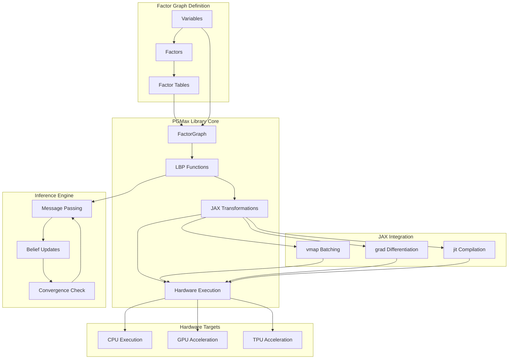
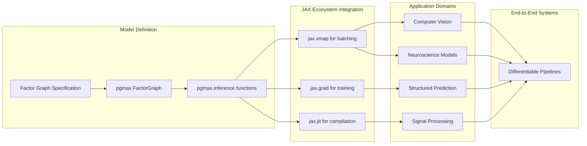

<!-- source: DeepWiki mcp.deepwiki.com · repo google-deepmind/PGMax · page 1 Overview · fetched 2026-10-26 -->

# Overview

Relevant source files

The following files were used as context for generating this wiki page:

- [README.md](README.md)

## Purpose and Scope

This document provides a high-level introduction to PGMax, explaining what it is, its core capabilities for factor graphs and loopy belief propagation in JAX, and how its components work together. For detailed installation instructions and basic usage patterns, see [Getting Started](#2). For hands-on examples and applications, see [Examples and Applications](#3). For performance comparisons with other libraries, see [Benchmarking System](#4).

## What is PGMax

PGMax is a JAX-based library that implements general factor graphs for discrete probabilistic graphical models (PGMs) and provides hardware-accelerated differentiable loopy belief propagation (LBP). It bridges the gap between theoretical probabilistic modeling and practical high-performance computation by generating pure JAX functions that can run on modern accelerators and integrate seamlessly with JAX's transformation system.

The library enables researchers and practitioners to:
- Define complex factor graphs with arbitrary topology and factor definitions
- Execute LBP inference on GPU/TPU hardware  
- Differentiate through the LBP iterative process for end-to-end training
- Process batches of models using `vmap` transformations
- Integrate PGM inference into larger differentiable systems

Sources: [README.md:7-21]()

## Key Features and Capabilities

### General Factor Graph Support

PGMax supports specification of general factor graphs with:
- Potentially complicated topology and connectivity patterns
- Custom factor definitions with arbitrary complexity  
- Discrete variables with varying numbers of states
- Flexible model architectures beyond standard PGM templates

### JAX-Native Implementation  

The library generates pure JAX functions for LBP that:
- Run on modern accelerators (GPU/TPU) for high performance
- Work seamlessly with JAX transformations (`vmap`, `grad`, `jit`)  
- Enable end-to-end differentiable probabilistic inference
- Integrate easily into larger JAX-based machine learning pipelines

### Hardware Acceleration

PGMax leverages JAX's compilation and acceleration capabilities to provide:
- GPU/TPU acceleration for inference computations
- Efficient batched processing of multiple models or samples
- Just-in-time compilation for optimized runtime performance
- Gradient computation through the iterative LBP process

Sources: [README.md:12-21]()

## System Architecture

### Core PGMax Components

This diagram shows how PGMax transforms factor graph definitions into hardware-accelerated JAX functions through its core inference engine and JAX integration layer.

Sources: [README.md:7-21]()

### Application Integration Patterns

This diagram illustrates how PGMax integrates with the broader JAX ecosystem and supports various application domains through its differentiable inference capabilities.

Sources: [README.md:15-21]()

## Core Use Cases

PGMax supports several categories of applications:

| Use Case | Description | Example Applications |
|----------|-------------|---------------------|
| **Basic Inference** | Standard LBP on predefined factor graphs | Ising models, grid MRFs |
| **Advanced Inference** | Custom factor definitions and topologies | Restricted Boltzmann Machines |
| **Max-Product LBP** | MAP inference instead of marginal inference | Recursive Cortical Networks |
| **End-to-End Learning** | Gradient-based training through LBP | Differentiable PGM parameter learning |
| **Signal Processing** | Structured inference for signal reconstruction | Binary deconvolution problems |
| **Alternative Solvers** | Non-LBP inference methods | Smooth Dual LP-MAP solving |

Sources: [README.md:66-72]()

## Integration with JAX Ecosystem

PGMax is designed as part of the broader DeepMind JAX ecosystem, providing:

- **Functional Programming**: Pure functions without side effects that compose cleanly
- **Transformation Support**: First-class support for `vmap`, `grad`, `jit`, and other JAX transformations  
- **Hardware Abstraction**: Unified interface across CPU, GPU, and TPU backends
- **Ecosystem Compatibility**: Integration with other JAX-based libraries and workflows

The library generates JAX functions that can be seamlessly incorporated into larger differentiable systems, enabling probabilistic inference as a differentiable component in end-to-end machine learning pipelines.

Sources: [README.md:15-21](), [README.md:76-92]()

---

