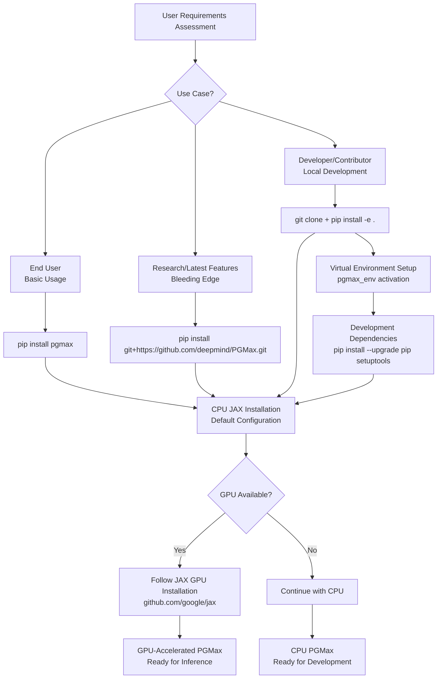
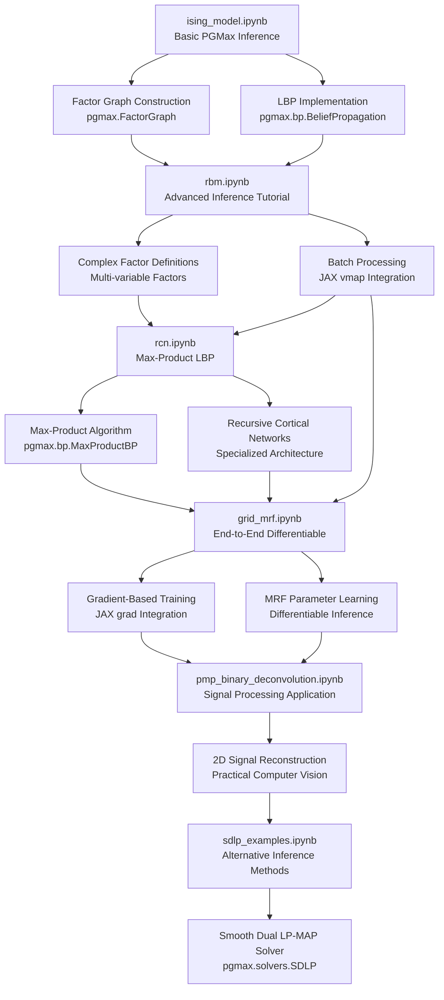

<!-- source: DeepWiki mcp.deepwiki.com · repo google-deepmind/PGMax · page 2 Getting Started · fetched 2026-10-26 -->

# Getting Started

<details>
<summary>Relevant source files</summary>

The following files were used as context for generating this wiki page:

- [README.md](README.md)

</details>


This document covers the installation process, system requirements, and initial setup procedures for PGMax. It provides step-by-step instructions for installing PGMax through multiple methods and guides users through their first examples using the provided Colab notebooks.

For comprehensive examples and applications beyond basic setup, see [Examples and Applications](#3). For development-specific setup including contributing and CI/CD processes, see [Development and Contributing](#5).

## System Requirements

PGMax is built on JAX and requires Python 3.7 or higher. The library is designed to work on both CPU and GPU/TPU hardware, with GPU acceleration providing significant performance benefits for factor graph inference tasks.

**Core Dependencies:**
- Python 3.7+
- JAX (CPU version installed by default)
- NumPy
- SciPy

**Optional GPU Dependencies:**
- CUDA-compatible GPU
- JAX GPU installation (requires separate setup)

Sources: [README.md:1-99]()

## Installation Methods

PGMax supports three primary installation approaches, each suited to different use cases and user requirements.

### Installation Workflow



Sources: [README.md:27-60]()

### PyPI Installation

The simplest installation method for end users who want stable releases:

```bash
pip install pgmax
```

This installs the latest stable version from PyPI with CPU-only JAX by default.

Sources: [README.md:29-32]()

### GitHub Latest Version

For users who need the most recent features or bug fixes:

```bash
pip install git+https://github.com/deepmind/PGMax.git
```

This method installs directly from the main branch and may include unreleased features.

Sources: [README.md:34-37]()

### Developer Installation

For contributors or users who need to modify PGMax source code, a local editable installation is recommended:

```bash
git clone https://github.com/deepmind/PGMax.git
cd PGMax
python3 -m venv pgmax_env
source pgmax_env/bin/activate
pip install --upgrade pip setuptools
pip install -e .
```

The virtual environment setup (`pgmax_env`) isolates dependencies and prevents conflicts with other Python packages.

Sources: [README.md:39-53]()

## GPU Configuration

By default, all installation methods configure JAX for CPU execution. GPU acceleration requires additional setup following JAX's official GPU installation procedures.

**GPU Installation Process:**
1. Complete base PGMax installation using any method above
2. Follow JAX GPU installation instructions at `github.com/google/jax#pip-installation-gpu-cuda`
3. Verify GPU detection through JAX device enumeration

GPU acceleration provides significant performance improvements for factor graph inference, particularly for models with large numbers of variables or complex factor structures.

Sources: [README.md:55-59]()

## Getting Started Examples

PGMax includes a comprehensive set of Colab notebooks that demonstrate core functionality and advanced applications. These examples are designed to run on GPU instances for optimal performance.

### Example Progression and Core Components



Sources: [README.md:64-72]()

### Core Example Categories

| Example Notebook | Primary Concepts | PGMax Components |
|------------------|------------------|------------------|
| `ising_model.ipynb` | Basic factor graph construction, LBP inference | `pgmax.FactorGraph`, `pgmax.bp.BeliefPropagation` |
| `rbm.ipynb` | Advanced factor definitions, batch processing | Multi-variable factors, JAX `vmap` integration |
| `rcn.ipynb` | Max-product inference, specialized architectures | `pgmax.bp.MaxProductBP`, custom factor graphs |
| `grid_mrf.ipynb` | End-to-end differentiability, parameter learning | JAX `grad` integration, differentiable inference |
| `pmp_binary_deconvolution.ipynb` | Signal processing applications | 2D factor graphs, computer vision tasks |
| `sdlp_examples.ipynb` | Alternative inference methods | `pgmax.solvers.SDLP`, LP-MAP solving |

Sources: [README.md:66-72]()

### Running Examples

All examples are provided as Colab notebooks with direct GitHub integration:

1. Click the Colab links in the main README or access them at `github.com/deepmind/PGMax/tree/master/examples/`
2. Select "Runtime > Change runtime type" and choose GPU for optimal performance
3. Execute cells sequentially to follow the tutorial progression

Each notebook is self-contained and includes detailed explanations of PGMax concepts and implementation patterns.

Sources: [README.md:64-65]()

## Post-Installation Verification

After installation, verify PGMax functionality by importing core modules:

```python
import pgmax
import jax
import jax.numpy as jnp

# Verify JAX device configuration
print("JAX devices:", jax.devices())

# Test basic PGMax imports
from pgmax import FactorGraph, factor
from pgmax.bp import BeliefPropagation
```

For GPU installations, ensure JAX detects GPU devices in the device list output.

## Next Steps

After completing installation and running initial examples:

1. **Basic Usage**: Start with the Ising model example (`ising_model.ipynb`) to understand factor graph construction and LBP inference
2. **Advanced Features**: Progress through the RBM tutorial for complex factor definitions and batch processing
3. **Specialized Applications**: Explore domain-specific examples like RCNs or binary deconvolution based on your use case
4. **Development**: For contributing or advanced customization, see [Development and Contributing](#5)
5. **Performance Evaluation**: To understand PGMax performance characteristics, see [Benchmarking System](#4)

Sources: [README.md:64-73]()

---

