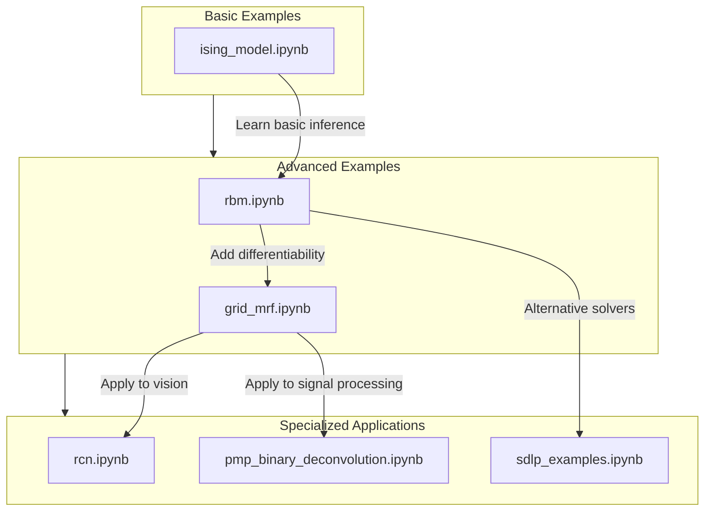
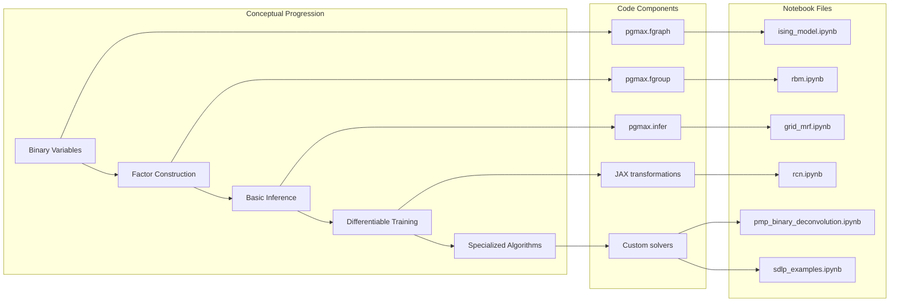

<!-- source: DeepWiki mcp.deepwiki.com · repo google-deepmind/PGMax · page 3 Examples and Applications · fetched 2026-10-26 -->

# Examples and Applications

Relevant source files

The following files were used as context for generating this wiki page:

- [README.md](README.md)

This page covers the various Colab notebook examples and practical applications that demonstrate PGMax capabilities. These examples range from basic factor graph inference on simple models to advanced applications in computer vision, signal processing, and alternative inference methods.

For information about installation and basic setup, see [Getting Started](#2). For performance comparisons with other libraries, see [Benchmarking System](#4).

## Overview of Example Categories

The PGMax examples are organized into three main categories based on complexity and application domain:

**Sources:** [README.md:64-72]()

## Basic Examples

### Ising Model Tutorial

The **ising_model.ipynb** notebook provides the foundational introduction to PGMax. This tutorial demonstrates:

- Basic factor graph construction for discrete probabilistic graphical models
- Standard loopy belief propagation inference
- Working with binary variables and pairwise factors
- Understanding PGMax's JAX-based computation model

The Ising model serves as an ideal starting point because it uses simple binary variables with pairwise interactions, making the factor graph structure easy to understand while demonstrating core PGMax functionality.

**Sources:** [README.md:66]()

## Advanced Examples

### Restricted Boltzmann Machine (RBM)

The **rbm.ipynb** notebook demonstrates more sophisticated factor graph modeling with:

- Complex factor definitions beyond simple pairwise interactions
- Handling larger numbers of variables and factors
- Advanced inference techniques on structured models
- Performance considerations for larger factor graphs

RBMs represent a significant step up in complexity, involving bipartite factor graphs with hidden and visible units connected through learned parameters.

**Sources:** [README.md:67]()

### End-to-End Differentiable Training

The **grid_mrf.ipynb** notebook showcases PGMax's key differentiability features:

- Gradient-based training of probabilistic graphical model parameters
- Integration with JAX transformation system (`grad`, `vmap`)
- End-to-end learning workflows combining inference and parameter optimization
- Grid-structured Markov Random Fields for spatial modeling

This example demonstrates how PGMax enables modern machine learning approaches to PGM training, where model parameters can be learned through gradient descent on downstream objectives.

**Sources:** [README.md:70]()

## Specialized Applications

### Computer Vision: Recursive Cortical Networks

The **rcn.ipynb** notebook implements max-product LBP for Recursive Cortical Networks, demonstrating:

- Max-product belief propagation instead of standard sum-product
- Application to hierarchical computer vision models
- Integration with neuroscience-inspired architectures
- Complex factor graph topologies for vision tasks

This example bridges PGMax with cutting-edge computer vision research, particularly in models that combine probabilistic inference with hierarchical feature learning.

**Sources:** [README.md:68-69]()

### Signal Processing: Binary Deconvolution

The **pmp_binary_deconvolution.ipynb** notebook applies PGMax to signal processing:

- 2D signal reconstruction problems
- Binary constraint handling in factor graphs
- Application of probabilistic inference to inverse problems
- Signal processing workflows using factor graph modeling

This demonstrates PGMax's versatility beyond traditional machine learning applications into classical signal processing domains.

**Sources:** [README.md:71]()

### Alternative Inference Methods

The **sdlp_examples.ipynb** notebook explores alternative solving approaches:

- Smooth Dual LP-MAP solver implementation
- Comparison with traditional belief propagation
- Alternative optimization approaches for factor graph inference
- Performance trade-offs between different solver methods

This example shows how PGMax supports multiple inference algorithms beyond LBP, providing flexibility for different problem requirements.

**Sources:** [README.md:72]()

## Learning Progression and Code Integration

The examples follow a structured learning progression that maps to PGMax's core components:

## Example Access and Execution

All examples are provided as interactive Colab notebooks with direct links for immediate execution:

| Example Type | Notebook | Primary Focus | Recommended Instance |
|--------------|----------|---------------|---------------------|
| Basic | `ising_model.ipynb` | Factor graph fundamentals | CPU/GPU |
| Advanced | `rbm.ipynb` | Complex model inference | GPU |
| Advanced | `grid_mrf.ipynb` | Differentiable training | GPU |
| Specialized | `rcn.ipynb` | Max-product algorithms | GPU |
| Specialized | `pmp_binary_deconvolution.ipynb` | Signal processing | GPU |
| Specialized | `sdlp_examples.ipynb` | Alternative solvers | GPU |

The notebooks are designed to be self-contained and executable directly in Google Colab, with GPU instances recommended for optimal performance due to PGMax's JAX-based hardware acceleration.

**Sources:** [README.md:64-72]()

---

