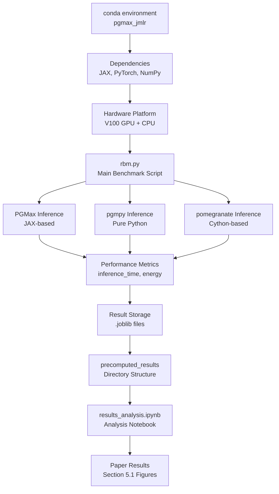
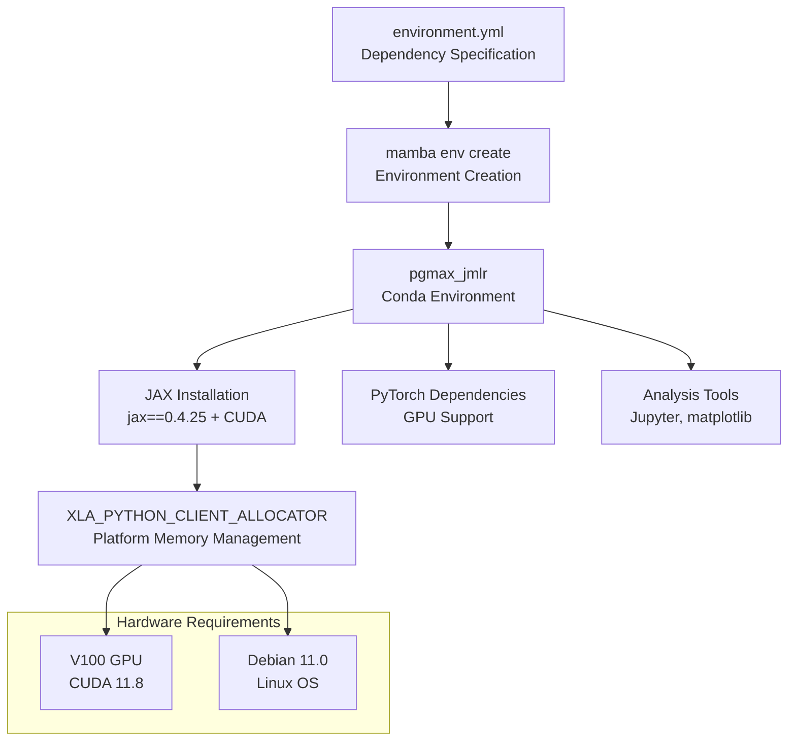
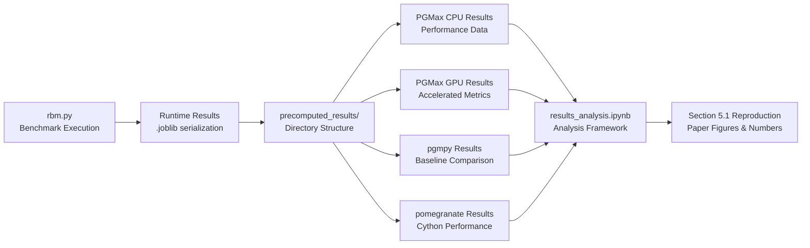

<!-- source: DeepWiki mcp.deepwiki.com · repo google-deepmind/PGMax · page 4 Benchmarking System · fetched 2026-10-26 -->

# Benchmarking System

<details>
<summary>Relevant source files</summary>

The following files were used as context for generating this wiki page:

- [benchmark/README.md](benchmark/README.md)

</details>


## Purpose and Scope

The PGMax benchmarking system provides a comprehensive framework for evaluating PGMax performance against established probabilistic graphical model libraries, specifically `pgmpy` and `pomegranate`. This system reproduces the experimental results presented in Section 5.1 of the PGMax companion paper, demonstrating computational advantages of JAX-based inference on both CPU and GPU hardware.

For detailed setup instructions and execution procedures, see [Benchmark Setup and Execution](#4.1). For analysis of performance results and metrics, see [Benchmark Results and Analysis](#4.2).

## System Architecture

The benchmarking system operates as an integrated pipeline that compares inference performance across three distinct probabilistic modeling libraries using Restricted Boltzmann Machine (RBM) configurations.

### Benchmark Execution Pipeline



Sources: [benchmark/README.md:1-40]()

### Library Comparison Framework

The system evaluates three probabilistic modeling implementations with distinct computational approaches:

| Library | Implementation | Backend | Target Hardware |
|---------|---------------|---------|-----------------|
| **PGMax** | JAX-based factor graphs | JAX/XLA | CPU + GPU |
| **pgmpy** | Pure Python implementation | NumPy/SciPy | CPU only |
| **pomegranate** | Cython-optimized | C extensions | CPU only |

The benchmark focuses on loopy belief propagation inference performance across different RBM configurations, measuring both execution time and computational efficiency.

Sources: [benchmark/README.md:3-4]()

## Execution Environment

### Conda Environment Setup



Sources: [benchmark/README.md:7-15](), [benchmark/README.md:35-36]()

### Benchmark Execution Modes

The system supports dual execution modes for comprehensive performance evaluation:

**CPU-only Benchmarking:**
```bash
XLA_PYTHON_CLIENT_ALLOCATOR=platform python rbm.py
```

**GPU-accelerated Benchmarking:**
- Modify `jax_platform_name = 'cpu'` to `jax_platform_name = 'gpu'` in `rbm.py`
- Re-execute with platform memory allocation

Sources: [benchmark/README.md:19-31]()

## Results Management System

### Data Storage Architecture



Sources: [benchmark/README.md:33](), [benchmark/README.md:37-39]()

### Analysis Workflow

The benchmarking system provides both real-time execution and precomputed result analysis capabilities:

1. **Live Benchmarking**: Execute `rbm.py` to generate fresh performance measurements
2. **Precomputed Analysis**: Use existing results from `precomputed_results` directory 
3. **Result Processing**: Process data through `results_analysis.ipynb` for statistical analysis
4. **Paper Reproduction**: Generate figures and numerical results matching the companion paper

The `results_analysis.ipynb` notebook serves as the primary interface for result interpretation, providing statistical analysis and visualization of performance comparisons across all three libraries.

Sources: [benchmark/README.md:33](), [benchmark/README.md:37-39]()

---

