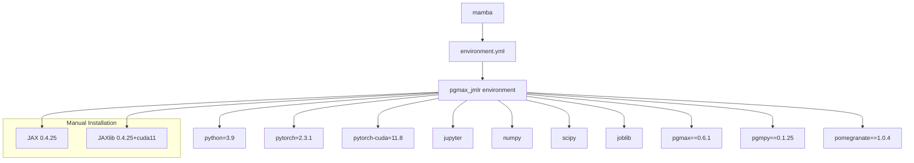
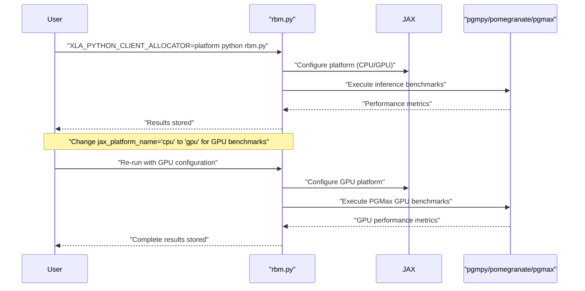
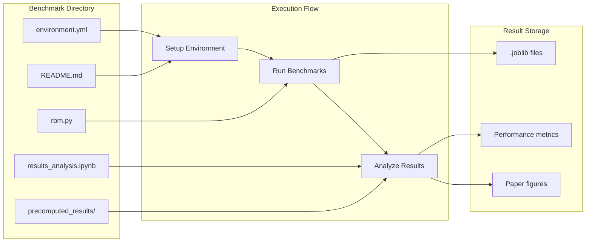

<!-- source: DeepWiki mcp.deepwiki.com · repo google-deepmind/PGMax · page 4.1 Benchmark Setup and Execution · fetched 2026-10-26 -->

# Benchmark Setup and Execution

<details>
<summary>Relevant source files</summary>

The following files were used as context for generating this wiki page:

- [benchmark/README.md](benchmark/README.md)
- [benchmark/environment.yml](benchmark/environment.yml)

</details>


## Purpose and Scope

This document covers the setup and execution of the PGMax benchmark suite that compares performance against the `pgmpy` and `pomegranate` libraries. The benchmarking system reproduces the experimental results from Section 5.1 of the PGMax companion paper, focusing on inference performance across different hardware configurations.

For analysis of benchmark results and performance metrics, see [Benchmark Results and Analysis](#4.2).

## Environment Setup

### Conda Environment Configuration

The benchmark system uses a dedicated conda environment named `pgmax_jmlr` that ensures consistent dependencies across different execution environments. The environment configuration includes specific versions of PyTorch, CUDA support, and Python 3.9.



**Benchmark Environment Setup Flow**

Sources: [benchmark/environment.yml:1-22](), [benchmark/README.md:7-16]()

### Installation Process

The setup process follows a specific sequence to ensure GPU acceleration support:

1. **Base Environment Creation**: Use `mamba env create -f environment.yml` to create the `pgmax_jmlr` environment
2. **Environment Activation**: Activate with `mamba activate pgmax_jmlr`
3. **JAX Installation**: Install specific JAX versions with CUDA support using pip

The JAX installation uses a specific command targeting CUDA 11.8 compatibility:
```bash
pip install jax==0.4.25 jaxlib==0.4.25+cuda11.cudnn86 -f https://storage.googleapis.com/jax-releases/jax_cuda_releases.html
```

Sources: [benchmark/README.md:7-16]()

## Benchmark Execution Process

### CPU Benchmarking

The primary benchmark script is `rbm.py`, which generates inference results for all libraries except PGMax GPU results in the initial run. The execution requires setting the `XLA_PYTHON_CLIENT_ALLOCATOR` environment variable:

```bash
XLA_PYTHON_CLIENT_ALLOCATOR=platform python rbm.py
```

### GPU Benchmarking

GPU benchmarking requires a manual configuration change in the `rbm.py` script. The `jax_platform_name` variable must be updated from `'cpu'` to `'gpu'` before running the same command to generate PGMax GPU inference results.



**Benchmark Execution Sequence**

Sources: [benchmark/README.md:17-32]()

## Platform and Hardware Requirements

### System Specifications

The benchmark system has been tested and validated on specific hardware and software configurations:

| Component | Specification |
|-----------|--------------|
| Operating System | Debian 11.0 |
| CUDA Version | 11.8 |
| GPU Hardware | Single V100 |
| Python Version | 3.9 |
| JAX Version | 0.4.25 |
| PyTorch Version | 2.3.1 |

### CUDA Compatibility

The system requires CUDA 11.8 for the tested configuration. For different CUDA versions, the JAX and PyTorch dependencies must be updated accordingly in the environment configuration.

Sources: [benchmark/README.md:35-36](), [benchmark/environment.yml:12]()

## File Organization and Results

### Benchmark File Structure

The benchmark system organizes files into specific roles:



**Benchmark File Organization and Workflow**

### Precomputed Results

The `precomputed_results` directory contains inference results used to generate the numbers and figures in the companion paper. This allows for result reproduction without requiring the full benchmark execution, which is particularly useful for users without GPU access or specific hardware configurations.

The `results_analysis.ipynb` notebook can analyze both newly generated results and the precomputed results to reproduce the paper's Section 5.1 analysis.

Sources: [benchmark/README.md:37-40](), [benchmark/README.md:33]()

---

