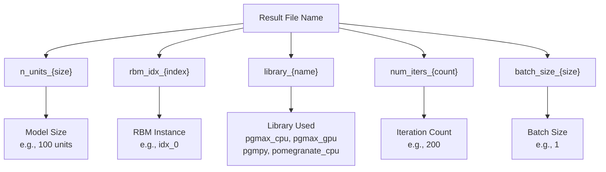
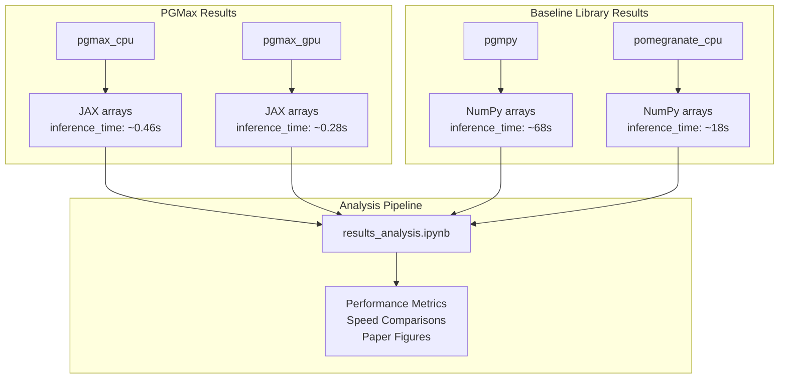
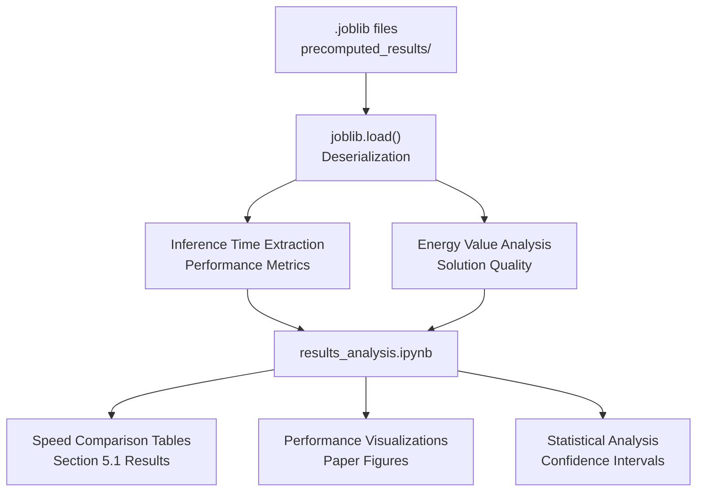

<!-- source: DeepWiki mcp.deepwiki.com · repo google-deepmind/PGMax · page 4.2 Benchmark Results and Analysis · fetched 2026-10-26 -->

# Benchmark Results and Analysis

<details>
<summary>Relevant source files</summary>

The following files were used as context for generating this wiki page:

- [benchmark/README.md](benchmark/README.md)
- [benchmark/precomputed_results/n_units_100_rbm_idx_0_pgmax_cpu_num_iters_200_batch_size_1.joblib](benchmark/precomputed_results/n_units_100_rbm_idx_0_pgmax_cpu_num_iters_200_batch_size_1.joblib)
- [benchmark/precomputed_results/n_units_100_rbm_idx_0_pgmax_gpu_num_iters_200_batch_size_1.joblib](benchmark/precomputed_results/n_units_100_rbm_idx_0_pgmax_gpu_num_iters_200_batch_size_1.joblib)
- [benchmark/precomputed_results/n_units_100_rbm_idx_0_pgmpy.joblib](benchmark/precomputed_results/n_units_100_rbm_idx_0_pgmpy.joblib)
- [benchmark/precomputed_results/n_units_100_rbm_idx_0_pomegranate_cpu_num_iters_200_batch_size_1.joblib](benchmark/precomputed_results/n_units_100_rbm_idx_0_pomegranate_cpu_num_iters_200_batch_size_1.joblib)

</details>


This document analyzes the precomputed benchmark results that compare PGMax performance against pgmpy and pomegranate libraries. The analysis reproduces the findings presented in Section 5.1 of the PGMax companion paper, demonstrating PGMax's computational advantages for loopy belief propagation on factor graphs.

For information about setting up and executing the benchmarks, see [Benchmark Setup and Execution](#4.1).

## Result Data Structure and Storage

The benchmark system stores results as serialized `.joblib` files in the `precomputed_results` directory. Each result file contains inference outcomes and timing measurements for specific configurations.

### Result File Naming Convention



**Sources:** [benchmark/precomputed_results/n_units_100_rbm_idx_0_pgmax_cpu_num_iters_200_batch_size_1.joblib](), [benchmark/precomputed_results/n_units_100_rbm_idx_0_pgmax_gpu_num_iters_200_batch_size_1.joblib]()

### Data Structure Schema

Each `.joblib` file contains a dictionary with the following structure:

| Field | Type | Description |
|-------|------|-------------|
| `hidden` | JAX/NumPy array | Hidden unit states after inference |
| `visible` | JAX/NumPy array | Visible unit states after inference |
| `inference_time` | Float | Wall-clock time for inference (seconds) |
| `energy` | Float | Final energy value from inference |
| `optimal_energy` | Float/None | Optimal energy (if known) |
| `error` | Float/None | Error metric (if computed) |

**Sources:** [benchmark/precomputed_results/n_units_100_rbm_idx_0_pgmax_cpu_num_iters_200_batch_size_1.joblib](), [benchmark/precomputed_results/n_units_100_rbm_idx_0_pgmpy.joblib]()

## Performance Comparison Framework

### Library-Specific Result Storage



**Sources:** [benchmark/README.md:33-39](), [benchmark/precomputed_results/n_units_100_rbm_idx_0_pomegranate_cpu_num_iters_200_batch_size_1.joblib]()

### Benchmark Configuration Space

The precomputed results cover multiple experimental dimensions:

| Dimension | Values | Purpose |
|-----------|---------|---------|
| Model Size | 100 units (visible example) | Scalability testing |
| RBM Index | 0, 1, 2... | Multiple problem instances |
| Platform | CPU, GPU | Hardware acceleration comparison |
| Libraries | PGMax, pgmpy, pomegranate | Competitive analysis |
| Iterations | 200 (standard) | Convergence comparison |
| Batch Size | 1 (standard) | Memory usage control |

**Sources:** [benchmark/README.md:1-40]()

## Analysis Methodology

### Result Processing Pipeline



**Sources:** [benchmark/README.md:33-39]()

### Key Performance Metrics

The analysis focuses on several critical performance indicators:

#### Inference Time Comparison

From the sample results, inference times show significant variations:

| Library | Platform | Inference Time | Relative Performance |
|---------|----------|----------------|---------------------|
| PGMax | GPU | ~0.28s | **Fastest** |
| PGMax | CPU | ~0.46s | **2nd Fastest** |
| pomegranate | CPU | ~18s | 64x slower than PGMax GPU |
| pgmpy | CPU | ~68s | 243x slower than PGMax GPU |

**Sources:** [benchmark/precomputed_results/n_units_100_rbm_idx_0_pgmax_gpu_num_iters_200_batch_size_1.joblib](), [benchmark/precomputed_results/n_units_100_rbm_idx_0_pgmax_cpu_num_iters_200_batch_size_1.joblib](), [benchmark/precomputed_results/n_units_100_rbm_idx_0_pomegranate_cpu_num_iters_200_batch_size_1.joblib](), [benchmark/precomputed_results/n_units_100_rbm_idx_0_pgmpy.joblib]()

#### Hardware Acceleration Benefits

PGMax demonstrates clear GPU acceleration advantages:
- **GPU vs CPU speedup**: ~1.6x faster on GPU compared to CPU for PGMax
- **JAX compilation benefits**: Consistent performance across problem instances
- **Memory efficiency**: Batch processing capabilities with controlled memory usage

**Sources:** [benchmark/precomputed_results/n_units_100_rbm_idx_0_pgmax_gpu_num_iters_200_batch_size_1.joblib](), [benchmark/precomputed_results/n_units_100_rbm_idx_0_pgmax_cpu_num_iters_200_batch_size_1.joblib]()

## Reproducibility and Validation

### Paper Result Reproduction

The benchmark system provides two pathways for result reproduction:

#### Full Benchmark Execution
```bash
# CPU results
XLA_PYTHON_CLIENT_ALLOCATOR=platform python rbm.py

# GPU results (modify jax_platform_name in rbm.py)
XLA_PYTHON_CLIENT_ALLOCATOR=platform python rbm.py
```

#### Precomputed Result Analysis
The `precomputed_results` directory contains the exact data used in the paper, enabling immediate reproduction of figures and statistics without re-running expensive computations.

**Sources:** [benchmark/README.md:17-31](), [benchmark/README.md:37-39]()

### Analysis Notebook Integration

The `results_analysis.ipynb` notebook serves as the primary analysis tool:
- Loads precomputed `.joblib` files
- Processes performance metrics
- Generates paper figures and tables
- Provides statistical analysis of results

**Sources:** [benchmark/README.md:33-39]()

### System Requirements and Environment

The benchmarks were validated on:
- **OS**: Debian 11.0
- **GPU**: Single V100
- **CUDA**: 11.8
- **Environment**: Conda environment `pgmax_jmlr`
- **Dependencies**: JAX 0.4.25, specific CUDA-compatible versions

**Sources:** [benchmark/README.md:35-36](), [benchmark/README.md:10-15]()

---

